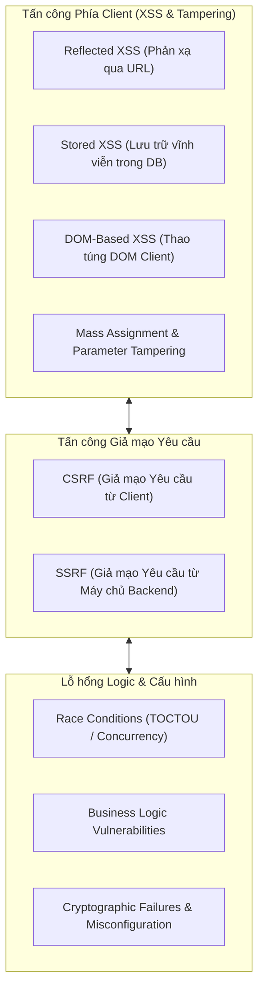
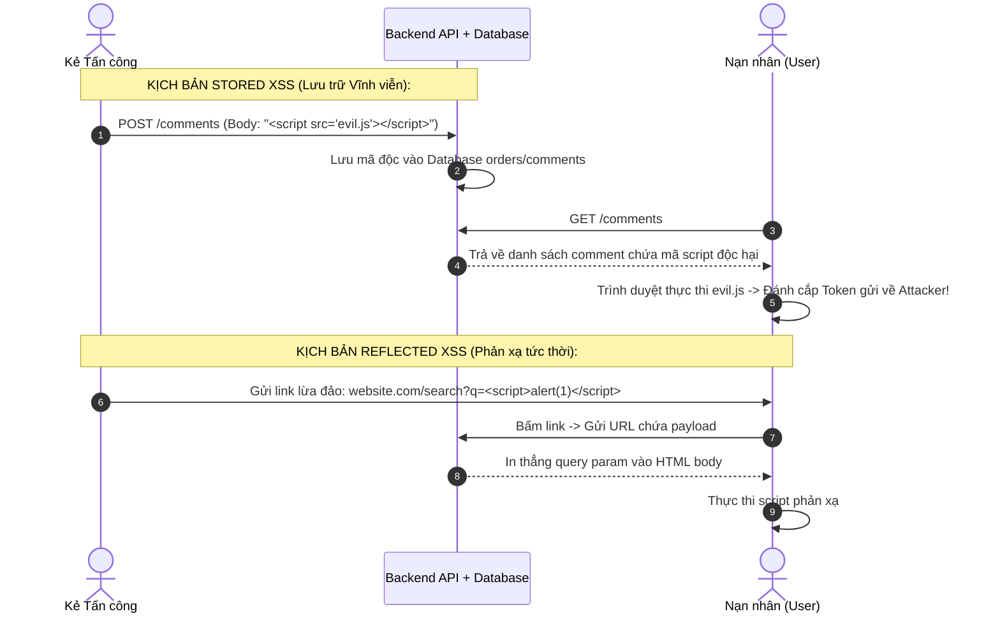
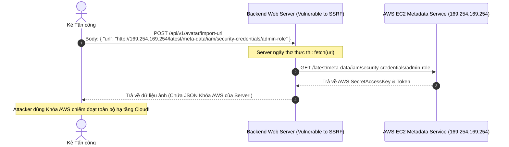
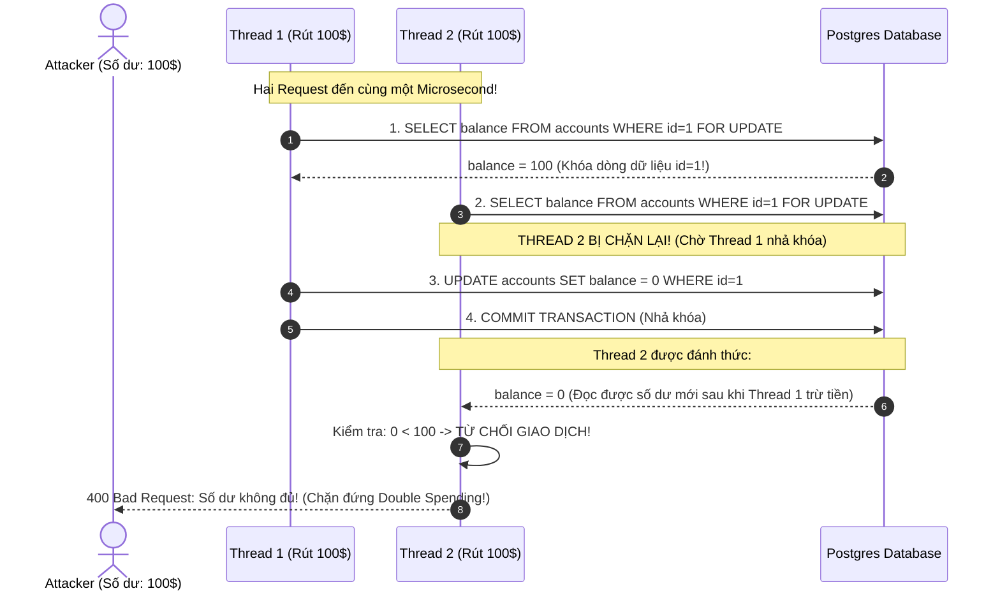

# 7.3. Client-Side and Request Forgery Attacks (Tấn công Phía Máy khách & Giả mạo Yêu cầu)

## Tổng quan về Web Forgery & Client-Side Exploitation
Mặc dù các kỹ sư Backend chủ yếu tập trung vào mã nguồn máy chủ, nhưng **Bảo mật phía Máy khách (Client-Side Security)** và các lỗ hổng **Giả mạo Yêu cầu (Request Forgery)** lại có mối liên hệ mật thiết và ảnh hưởng sống còn tới toàn bộ hạ tầng Backend. Một lỗi hiển thị dữ liệu thô (XSS) trên trình duyệt có thể dẫn tới việc Session Token bị đánh cắp; một API chấp nhận đối tượng JSON tùy ý có thể mở toang lỗ hổng **Mass Assignment**; và đặc biệt, một lỗ hổng **SSRF (Server-Side Request Forgery)** có thể biến chính máy chủ Backend của bạn thành một bàn đạp để hacker xuyên thủng toàn bộ mạng nội bộ và Cloud Infrastructure.



---

## 2. Chi tiết từng Keyword (Under-the-Hood Deep Dive)

### 1. Cross-Site Scripting (XSS): Reflected, Stored & DOM-Based

#### 1. Khái niệm bản chất (What & Why)
- **Cross-Site Scripting (XSS - Chèn mã Đa trang)**: Lỗ hổng cho phép kẻ tấn công inject các đoạn mã JavaScript độc hại vào trang web mà những người dùng khác đang truy cập. Trình duyệt của nạn nhân tin tưởng rằng đoạn mã đó đến từ nguồn hợp pháp (Do tính chất của Same-Origin Policy) và thực thi nó với toàn bộ quyền hạn của người dùng (đọc DOM, đánh cắp Session Cookie không có HttpOnly, gửi request mạo danh, theo dõi phím gõ Keylogger).
- **Ba Dạng XSS Cốt lõi**:
  1. **Reflected XSS (XSS Phản xạ / Non-Persistent)**: Đoạn mã script độc hại nằm trong tham số URL request (ví dụ: `?search=<script>...`). Server nhận request và in thẳng giá trị này vào mã HTML phản hồi. Mã độc được phản xạ tức thời về trình duyệt của người click vào link.
  2. **Stored XSS (XSS Lưu trữ / Persistent)**: Dạng nguy hiểm nhất. Đoạn script độc hại được lưu vĩnh viễn vào cơ sở dữ liệu của server (ví dụ: bình luận bài viết, tên hồ sơ, bio). Mỗi khi bất kỳ người dùng nào mở trang web đó lên, mã độc tự động tải từ database về và thực thi trên máy của họ!
  3. **DOM-Based XSS (XSS Dựa trên Cây DOM)**: Xảy ra hoàn toàn ở phía Client mà không cần sự tham gia của Server. Mã JavaScript của trang web đọc dữ liệu từ một "Nguồn không tin cậy" (**Source** như `location.search`, `location.hash`) và ghi trực tiếp vào một "Điểm thực thi nguy hiểm" (**Sink** như `innerHTML`, `document.write`, `eval()`).

#### 2. Cơ chế hoạt động sâu (Under the hood / Hardcore Internals)
- **Context-Aware Output Encoding (Mã hóa Đầu ra theo Ngữ cảnh)**:
  Lý do chính khiến XSS tồn tại là trình duyệt có nhiều chế độ phân tích cú pháp (Parsers) khác nhau: HTML Parser, JavaScript Parser, CSS Parser, URL Parser.
  - Một ký tự an toàn trong ngữ cảnh này có thể là mã độc trong ngữ cảnh khác!
  - *Ngữ cảnh HTML Body*: Cần mã hóa 5 ký tự đặc biệt: `&` $\to$ `&amp;`, `<` $\to$ `&lt;`, `>` $\to$ `&gt;`, `"` $\to$ `&quot;`, `'` $\to$ `&#x27;`.
  - *Ngữ cảnh Thuộc tính thẻ (Attribute Context)*: `<input value="USER_DATA">`: Nếu không mã hóa dấu ngoặc kép, kẻ tấn công đóng thuộc tính: `" onfocus="alert(1)`.
  - *Ngữ cảnh JavaScript Script Tag*: `<script>let name = 'USER_DATA';</script>`: Nếu dữ liệu chứa `'; alert(1); //`, câu lệnh JS bị ngắt và thực thi mã độc.
- **Content Security Policy (CSP - Tấm khiên Phòng vệ Chiều sâu)**:
  Header HTTP `Content-Security-Policy` do Backend gửi về chỉ thị cho trình duyệt:
  `default-src 'self'; script-src 'self' 'nonce-rAnd0m123'; object-src 'none';`
  Khi CSP được kích hoạt, trình duyệt sẽ **từ chối thực thi mọi thẻ `<script>` nội tuyến không có chứa thuộc tính nonce hợp lệ**, vô hiệu hóa 99% các cuộc tấn công XSS ngay cả khi website dính lỗi nhúng chuỗi!

#### 3. Sơ đồ minh họa (Luồng Tấn công Stored XSS vs Reflected XSS)


#### 4. Code ví dụ thực chiến (TypeScript Context-Aware HTML Sanitizer & CSP Configurator)
```typescript
import { Response } from 'express';

export class XSSDefenseEngine {
    /**
     * Mã hóa ký tự theo chuẩn HTML Entity Encoding (ASVS V5)
     */
    public static encodeForHTML(input: string): string {
        return input.replace(/[&<>"'/]/g, (char) => {
            switch (char) {
                case '&': return '&amp;';
                case '<': return '&lt;';
                case '>': return '&gt;';
                case '"': return '&quot;';
                case "'": return '&#x27;';
                case '/': return '&#x2F;';
                default: return char;
            }
        });
    }

    /**
     * Thiết lập Header Content Security Policy (CSP) nghiêm ngặt
     */
    public static setStrictCSPHeaders(res: Response, scriptNonce: string): void {
        const cspDirectives = [
            "default-src 'self'",
            `script-src 'self' 'nonce-${scriptNonce}'`, // Chỉ cho phép script có nonce trùng khớp
            "object-src 'none'",                       // Chặn hoàn toàn Flash, Java Applet
            "base-uri 'self'",                          // Chặn thao túng thẻ <base>
            "frame-ancestors 'none'",                   // Chống Clickjacking
            "require-trusted-types-for 'script'"        // Cưỡng chế Trusted Types cho DOM XSS
        ].join('; ');

        res.setHeader('Content-Security-Policy', cspDirectives);
    }
}
```

#### 5. Ưu / Nhược điểm, Pitfalls & Anti-patterns
- **Pitfall**: Tự viết các biểu thức chính quy (Regex) để loại bỏ thẻ `<script>` (ví dụ: `input.replace(/<script>/gi, '')`). Kẻ tấn công có thể dễ dàng bypass bằng hàng trăm vector khác: ``, `<svg onload=alert(1)>`, `<iframe src="javascript:alert(1)">`.
- **Anti-pattern**: Trong React/Vue: Sử dụng thuộc tính `dangerouslySetInnerHTML` hoặc `v-html` với dữ liệu lấy từ người dùng mà không qua thư viện làm sạch chuyên dụng (như DOMPurify).

#### 6. Ứng dụng thực tế trong Backend / Systems
Mọi ứng dụng web hiện đại (Google, GitHub) đều triển khai **CSP với Nonce** và sử dụng các thư viện template tự động mã hóa ký tự (Auto-escaping Template Engines) mặc định.

---

### 2. Server-Side Request Forgery (SSRF)

#### 1. Khái niệm bản chất (What & Why)
- **SSRF (Server-Side Request Forgery - Giả mạo Yêu cầu Phía Máy chủ)**: Lỗ hổng bảo mật nghiêm trọng (chiếm vị trí **A10:2021** trong OWASP Top 10) xảy ra khi một ứng dụng backend nhận một URL từ phía người dùng (ví dụ: Tính năng "Tải ảnh đại diện từ link URL", "Xem trước liên kết Webhook", "Chuyển đổi URL sang PDF") và **thực hiện lệnh gọi mạng (HTTP Fetch/cURL) tới URL đó mà không kiểm soát phạm vi đích đến**.
- **Hậu quả tàn khốc**:
  Máy chủ backend thường nằm trong mạng nội bộ (Internal VPC/Private Subnet) và có đặc quyền truy cập vào các tài nguyên bí mật. Kẻ tấn công lợi dụng chính máy chủ backend làm "con rối" (Proxy) để:
  1. Đọc **Cloud Metadata Service** (Địa chỉ ma thuật `http://169.254.169.254/` trên AWS/GCP) để đánh cắp IAM Access Keys / Service Account Credentials của máy chủ!
  2. Quét mạng nội bộ và truy cập vào các cơ sở dữ liệu nội bộ không có mật khẩu (như Redis 6379, Elasticsearch 9200, Kubernetes Kubelet 10250).

#### 2. Cơ chế hoạt động sâu (Under the hood / Hardcore Internals)
- **Kỹ thuật Tinh vi: DNS Rebinding Attack trong SSRF**:
  Làm thế nào hacker vượt qua được bộ lọc IP của backend?
  Giả sử backend có code kiểm tra:
  `if (ip === '127.0.0.1' || ip === '169.254.169.254') block();`
  Kẻ tấn công dựng một DNS Server riêng (`attacker-dns.com`):
  1. Lần DNS Resolve thứ nhất (Khi Backend gọi hàm validate URL): DNS Server trả về IP công khai `1.2.3.4` (Hợp lệ, vượt qua bộ lọc!).
  2. Lần DNS Resolve thứ hai (Khi Backend thực sự gọi hàm `http.get()` ngay sau đó vài mili-giây): DNS Server trả về IP nội bộ `169.254.169.254` với TTL = 0 giây!
  - **Hệ quả**: Backend gửi yêu cầu trực tiếp vào Cloud Metadata Service và trả toàn bộ Khóa bảo mật AWS về cho hacker!

#### 3. Sơ đồ minh họa (Mô hình Tấn công SSRF Chiếm đoạt Cloud Metadata)


#### 4. Code ví dụ thực chiến (TypeScript Anti-SSRF Defense with Custom DNS Resolver)
```typescript
import * as dns from 'dns/promises';
import * as net from 'net';

export class AntiSsrfValidator {
    // Danh sách các dải IP nội bộ nguy hiểm cần chặn tuyệt đối (RFC 1918 & Cloud Metadata)
    private static isPrivateIp(ip: string): boolean {
        if (!net.isIP(ip)) return true;

        // IPv4 Checks
        if (net.isIPv4(ip)) {
            const parts = ip.split('.').map(Number);
            // 127.0.0.0/8 (Loopback)
            if (parts[0] === 127) return true;
            // 10.0.0.0/8 (Private Network)
            if (parts[0] === 10) return true;
            // 172.16.0.0/12 (Private Network)
            if (parts[0] === 172 && (parts[1] >= 16 && parts[1] <= 31)) return true;
            // 192.168.0.0/16 (Private Network)
            if (parts[0] === 192 && parts[1] === 168) return true;
            // 169.254.0.0/16 (Link-Local / AWS EC2 Metadata Service)
            if (parts[0] === 169 && parts[1] === 254) return true;
            // 0.0.0.0/8
            if (parts[0] === 0) return true;
        }
        return false;
    }

    /**
     * Thẩm định URL an toàn chống SSRF và DNS Rebinding
     */
    public static async validateUrlStrict(rawUrl: string): Promise<string> {
        const parsed = new URL(rawUrl);

        // 1. Chỉ cho phép giao thức HTTP/HTTPS (Chặn file:///, gopher://, dict://)
        if (parsed.protocol !== 'http:' && parsed.protocol !== 'https:') {
            throw new Error(`Protocol ${parsed.protocol} is strictly forbidden.`);
        }

        // 2. Phân giải DNS thủ công (Chống DNS Rebinding)
        const addresses = await dns.resolve4(parsed.hostname);
        if (!addresses || addresses.length === 0) {
            throw new Error("Could not resolve host.");
        }

        // 3. Kiểm tra toàn bộ các địa chỉ IP được trả về
        for (const ip of addresses) {
            if (this.isPrivateIp(ip)) {
                console.error(`[SSRF ALERT] Blocked access to private network IP: ${ip} for host ${parsed.hostname}`);
                throw new Error("Security Alert: Access to internal network addresses is forbidden.");
            }
        }

        return parsed.toString();
    }
}
```

#### 5. Ưu / Nhược điểm, Pitfalls & Anti-patterns
- **Pitfall**: Chỉ chặn chuỗi `169.254.169.254` dưới dạng văn bản thô. Kẻ tấn công có thể biểu diễn địa chỉ này dưới dạng số nguyên (Dword format: `http://2852039166/`), dạng số thập lục phân (`http://0xa9fea9fe/`), hoặc dùng dịch vụ chuyển hướng (Open Redirect).
- **Anti-pattern**: Cho phép backend chạy các giao thức lạ như `gopher://` trong cURL. Giao thức Gopher cho phép hacker gửi dữ liệu nhị phân tùy ý vào cổng Redis 6379 để ghi đè SSH keys trên server.

#### 6. Ứng dụng thực tế trong Backend / Systems
Bắt buộc cấu hình **IMDSv2 (Instance Metadata Service Version 2)** trên AWS EC2 (yêu cầu session token `X-aws-ec2-metadata-token` qua PUT request trước khi đọc metadata, triệt tiêu hoàn toàn khả năng khai thác của SSRF).

---

### 3. Mass Assignment, Parameter Tampering & Race Conditions

#### 1. Khái niệm bản chất (What & Why)
- **Mass Assignment (Gán Thuộc tính Hàng loạt)**: Lỗ hổng xuất hiện khi framework backend (Ruby on Rails, Spring, Express, Laravel) tự động nạp toàn bộ các thuộc tính từ request JSON của client vào thẳng model của cơ sở dữ liệu mà không có cơ chế lọc trường (Whitelisting).
  - *Ví dụ*: Người dùng đăng ký tài khoản gửi JSON:
    `{ "username": "alice", "password": "123", "role": "ADMIN", "isVerified": true }`.
    Nếu backend viết `User.create(req.body)`, trường `role: "ADMIN"` được ghi thẳng vào database, giúp Alice lập tức biến thành Quản trị viên!
- **Parameter Tampering (Thao túng Tham số)**: Kẻ tấn công can thiệp vào các tham số giá cả, số lượng, hoặc trạng thái trên form/API:
  - *Ví dụ*: Thay đổi giá sản phẩm từ `price=500` thành `price=0.01` hoặc `amount=-50` (âm tiền) khi gửi lên cổng thanh toán.
- **Race Conditions (Điều kiện Tranh chấp / TOCTOU - Time of Check to Time of Use)**: Lỗ hổng xảy ra khi tính toàn vẹn của một giao dịch phụ thuộc vào thứ tự thực thi của các luồng (Threads/Processes) đồng thời.
  - *Ví dụ kinh điển (Tấn công Rút tiền Kép - Double Spending)*: Nạn nhân có số dư $100. Kẻ tấn công gửi 2 request rút $100 cùng một thời điểm cách nhau vài microsecond. Nếu server kiểm tra số dư ở cả 2 luồng trước khi thực hiện trừ tiền, cả 2 lệnh rút tiền đều thành công, tài khoản rút được $200!

#### 2. Cơ chế hoạt động sâu (Under the hood / Hardcore Internals)
- **Cơ chế Khóa Cơ sở Dữ liệu để Chống Race Condition**:
  Để triệt tiêu lỗ hổng TOCTOU trong các giao dịch tài chính:
  1. **Pessimistic Locking (Khóa Bi quan - `SELECT ... FOR UPDATE`)**:
     Khi Luồng 1 đọc dòng dữ liệu số dư tài khoản:
     `SELECT balance FROM accounts WHERE user_id = 1 FOR UPDATE;`
     Nhân cơ sở dữ liệu (PostgreSQL/MySQL) lập tức gán một khóa độc quyền (Exclusive Row Lock) trên dòng dữ liệu đó. Luồng 2 cố gắng đọc dòng này sẽ bị đưa vào hàng đợi chờ (Wait queue) ở tầng Kernel cho đến khi Luồng 1 hoàn tất commit transaction!
  2. **Optimistic Locking (Khóa Lạc quan với Version Column)**:
     Sử dụng một cột số nguyên `version`:
     `UPDATE accounts SET balance = balance - 100, version = version + 1 WHERE user_id = 1 AND version = :read_version;`
     Nếu Luồng 2 đến sau, giá trị `version` trong DB đã bị tăng lên, câu lệnh UPDATE của Luồng 2 sẽ cập nhật 0 dòng và transaction tự động rollback an toàn.

#### 3. Sơ đồ minh họa (Lỗ hổng Race Condition và Giải pháp Khóa Hàng Bi quan)


#### 4. Code ví dụ thực chiến (TypeScript Pessimistic Locking with Prisma/SQL)
```typescript
interface DatabaseTransactionClient {
    query(sql: string, params: any[]): Promise<any>;
}

export class FinancialAccountService {
    /**
     * Thực thi trừ tiền an toàn tuyệt đối chống Race Condition bằng Pessimistic Lock
     */
    public static async withdrawFundsSecure(
        db: DatabaseTransactionClient,
        accountId: string,
        amountToWithdraw: number
    ): Promise<void> {
        // 1. Kiểm tra tham số Parameter Tampering (Không cho phép số âm hoặc 0)
        if (amountToWithdraw <= 0 || !Number.isInteger(amountToWithdraw)) {
            throw new Error("Parameter Tampering Detected: Invalid withdrawal amount.");
        }

        // 2. Khóa dòng dữ liệu độc quyền bằng FOR UPDATE (Bắt buộc trong Transaction)
        const accountRows = await db.query(
            'SELECT id, balance_cents FROM bank_accounts WHERE id = $1 FOR UPDATE;',
            [accountId]
        );

        if (accountRows.length === 0) {
            throw new Error("Account not found.");
        }

        const currentBalance = accountRows[0].balance_cents;

        // 3. Kiểm tra điều kiện logic an toàn sau khi đã giữ khóa
        if (currentBalance < amountToWithdraw) {
            throw new Error("Insufficient funds.");
        }

        // 4. Trừ tiền và Commit
        await db.query(
            'UPDATE bank_accounts SET balance_cents = balance_cents - $1 WHERE id = $2;',
            [amountToWithdraw, accountId]
        );

        console.log(`[Transaction Success] Deducted ${amountToWithdraw} cents from account ${accountId}.`);
    }
}
```

#### 5. Ưu / Nhược điểm, Pitfalls & Anti-patterns
- **Pitfall**: Dùng Mass Assignment với các ORM hiện đại bằng cách truyền thẳng `req.body` vào `Model.update()`. Luôn luôn sử dụng DTO Validation (Data Transfer Object) với danh sách thuộc tính được phép rõ ràng (Allowlist).
- **Anti-pattern**: Kiểm tra số lượng hàng tồn kho (Inventory Check) ở tầng ứng dụng bằng code JavaScript mà không sử dụng Database Transaction hoặc Redis Distributed Lock (`Redlock`).

#### 6. Ứng dụng thực tế trong Backend / Systems
Tiêu chuẩn bắt buộc trong các sàn giao dịch tiền điện tử (Crypto Exchanges), hệ thống đặt vé máy bay/ghế rạp chiếu phim (Booking Systems) và ví điện tử để loại bỏ hoàn toàn các lỗi gian lận số dư.
