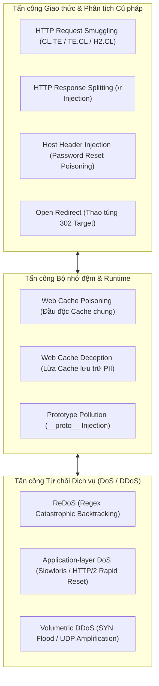
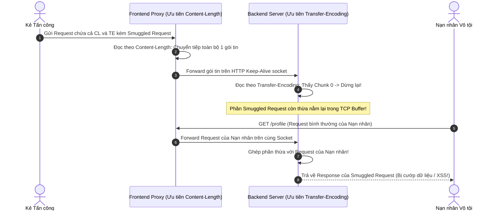
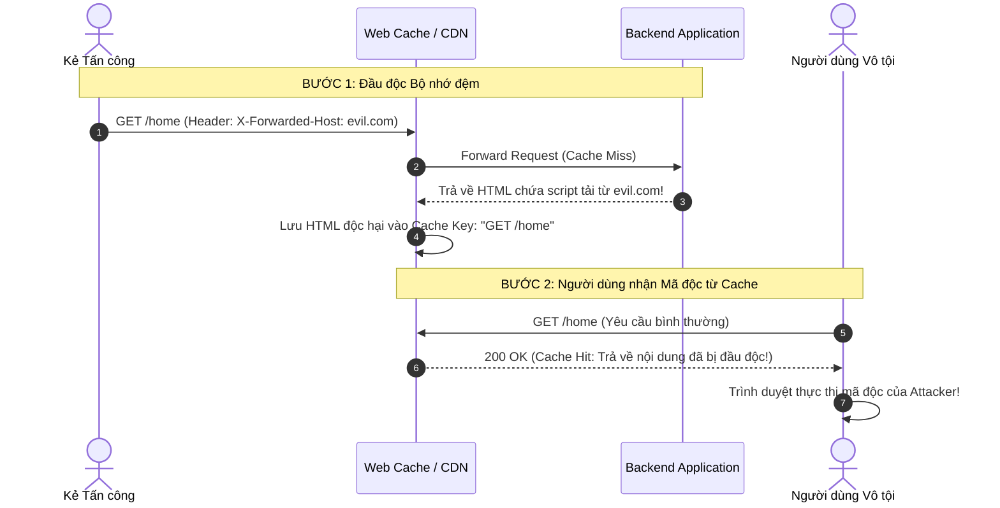
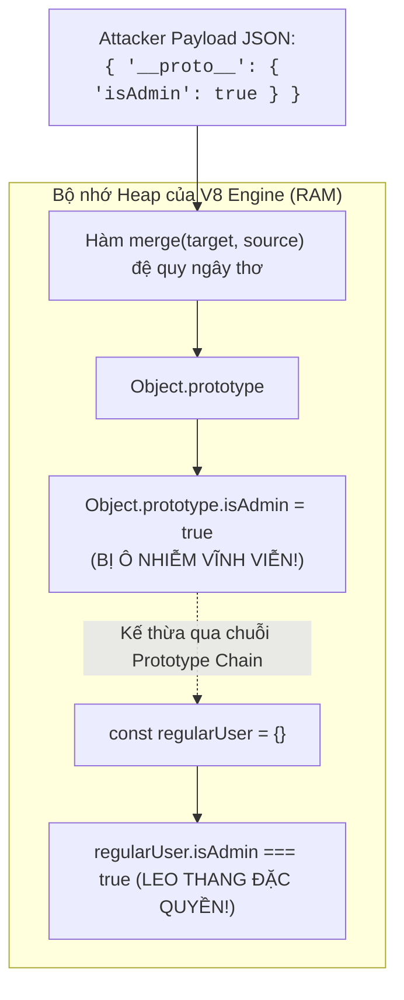

# 7.4. HTTP Protocol and Advanced Web Attacks (Các Cuộc tấn công Giao thức HTTP & Web Nâng cao)

## Tổng quan về Advanced Web Exploitation
Khi các biện pháp bảo vệ ứng dụng cơ bản đã được thiết lập, kẻ tấn công chuyển hướng sang khai thác các **Sự sai lệch trong quá trình phân tích cú pháp giao thức (Protocol Parsing Desynchronization)** giữa các mắt xích trong chuỗi truyền tải: Giữa Frontend Reverse Proxy (Cloudflare, Nginx, HAProxy, AWS ALB) và Backend Application Server (Node.js, Gunicorn, Tomcat, Go).

Các cuộc tấn công ở tầng này bao gồm: **HTTP Request Smuggling** (kỹ thuật thâm nhập tinh vi làm mất đồng bộ ranh giới yêu cầu mạng), **Cache Poisoning** (đầu độc bộ nhớ đệm biên), **Prototype Pollution** (thao túng chuỗi nguyên mẫu trong runtime JavaScript), và các cuộc tấn công kiệt quệ tài nguyên như **ReDoS (Regular Expression Denial of Service)** và **DDoS**.



---

## 2. Chi tiết từng Keyword (Under-the-Hood Deep Dive)

### 1. HTTP Request Smuggling, Response Splitting & Host Header Injection

#### 1. Khái niệm bản chất (What & Why)
- **HTTP Request Smuggling (Buôn lậu Yêu cầu HTTP)**: Lỗ hổng kỹ thuật cực kỳ nguy hiểm xuất hiện trong các kiến trúc gồm chuỗi máy chủ nối tiếp (Reverse Proxy $\to$ Backend Server). Xảy ra khi Proxy và Backend **bất đồng quan điểm về cách xác định ranh giới (độ dài) của một yêu cầu HTTP**:
  - Một bên sử dụng header `Content-Length` (CL).
  - Bên kia sử dụng header `Transfer-Encoding: chunked` (TE).
  - *Hậu quả*: Kẻ tấn công có thể "nhét lậu" (Smuggle) một request thứ hai ẩn bên trong thân của request thứ nhất. Khi request lậu này đến Backend, nó sẽ bị ghép nối vào đầu request của một người dùng vô tội tiếp theo, cho phép cướp phiên, bypass WAF hoặc sửa đổi response của nạn nhân!
- **HTTP Response Splitting**: Xảy ra khi dữ liệu người dùng chứa các ký tự điều khiển ngắt dòng `CRLF` (`\r\n` - `%0d%0a`) được đưa vào header của response. Kẻ tấn công tách một response HTTP thành hai response riêng biệt, cho phép inject mã độc XSS hoặc đầu độc cache proxy.
- **Host Header Injection**: Lỗ hổng xảy ra khi ứng dụng backend tin tưởng mù quáng vào giá trị của header `Host:` trong request để xây dựng các đường dẫn URL tuyệt đối (ví dụ: tạo link reset mật khẩu: `https://` + `req.headers.host` + `/reset?token=xyz`).
  - Kẻ tấn công gửi request với header: `Host: attacker-server.com`.
  - Backend gửi email reset mật khẩu cho nạn nhân chứa đường link trỏ thẳng về server của hacker!

#### 2. Cơ chế hoạt động sâu (Under the hood / Hardcore Internals)
- **Hai Biến thể Kinh điển của Request Smuggling**:
  1. **CL.TE (Frontend dùng Content-Length, Backend dùng Transfer-Encoding)**:
     - Kẻ tấn công gửi:
       ```http
       POST / HTTP/1.1
       Host: example.com
       Content-Length: 13
       Transfer-Encoding: chunked

       0

       SMUGGLED_PREFIX
       ```
     - *Frontend (CL)*: Đọc đúng 13 byte (đến hết dòng `0\r\n\r\n`), chuyển tiếp toàn bộ sang Backend.
     - *Backend (TE)*: Đọc khối chunk đầu tiên có độ dài `0` byte $\implies$ Backend hiểu rằng request đã kết thúc!
     - Chuỗi còn lại `SMUGGLED_PREFIX` bị bỏ lại trong bộ đệm TCP socket của Backend. Khi request tiếp theo của Alice gửi tới trên cùng kết nối HTTP Keep-Alive, chuỗi `SMUGGLED_PREFIX` sẽ được nối vào đầu request của Alice!
  2. **TE.CL (Frontend dùng Transfer-Encoding, Backend dùng Content-Length)**:
     Kịch bản đảo ngược, khai thác sự bất đồng tương tự.
  - **Phòng vệ Tối thượng**: Nâng cấp toàn bộ hạ tầng từ HTTP/1.1 lên **HTTP/2 hoặc HTTP/3 từ biên tới tận Backend**. Giao thức HTTP/2 phân tách các khung dữ liệu (Frames) bằng độ dài nhị phân rõ ràng, triệt tiêu hoàn toàn sự mập mờ giữa CL và TE.

#### 3. Sơ đồ minh họa (Cơ chế Mất đồng bộ Ranh giới Gói tin trong HTTP Request Smuggling)


#### 4. Code ví dụ thực chiến (TypeScript Host Header Validation Middleware)
```typescript
import { Request, Response, NextFunction } from 'express';

export class HostHeaderSecurityGuard {
    private static readonly ALLOWED_HOSTS = new Set([
        'api.company.com',
        'auth.company.com',
        'localhost:3000'
    ]);

    /**
     * Chặn đứng Host Header Injection & Password Reset Poisoning
     */
    public static validateHostHeader(req: Request, res: Response, next: NextFunction): void {
        const rawHost = req.headers['host'];

        if (!rawHost) {
            res.status(400).json({ error: "Missing Host Header." });
            return;
        }

        // Loại bỏ cổng nếu có để kiểm tra hostname (hoặc kiểm tra cả port)
        const hostNameOnly = rawHost.toLowerCase();

        // PHÒNG VỆ: So khớp với Danh sách Trắng cố định (Strict Allowlist)
        if (!this.ALLOWED_HOSTS.has(hostNameOnly)) {
            console.error(`[Host Header Attack Blocked] Untrusted host detected: ${rawHost}`);
            res.status(400).json({ error: "Invalid Host Header: Untrusted domain." });
            return;
        }

        next();
    }
}
```

#### 5. Ưu / Nhược điểm, Pitfalls & Anti-patterns
- **Pitfall**: Dùng `req.headers['x-forwarded-host']` trực tiếp để tạo URL chuyển hướng mà không kiểm tra IP của Proxy gửi đến. Bất kỳ ai cũng có thể giả mạo header `X-Forwarded-Host`.
- **Anti-pattern**: Cho phép Reverse Proxy tự động chuẩn hóa và giải nén URL không đồng nhất với máy chủ phía sau.

#### 6. Ứng dụng thực tế trong Backend / Systems
Các bộ cân bằng tải hiện đại (AWS ALB, Cloudflare, Envoy Proxy) hiện đã tích hợp chế độ kiểm tra nghiêm ngặt `HTTP Desync Mitigation Mode` để tự động ngắt kết nối khi phát hiện request chứa cả hai header `Content-Length` và `Transfer-Encoding`.

---

### 2. Cache Poisoning & Cache Deception

#### 1. Khái niệm bản chất (What & Why)
- **Web Cache Poisoning (Đầu độc Bộ nhớ đệm)**: Cuộc tấn công nhắm vào máy chủ Cache trung gian (CDN như Cloudflare, Akamai, hoặc Varnish Cache). Kẻ tấn công gửi một request chứa dữ liệu độc hại trong các trường **Unkeyed Inputs** (những tham số hoặc headers mà Cache bỏ qua không tính vào Cache Key, ví dụ: `X-Forwarded-Host`, `X-Original-URL`). Server sinh ra response độc hại (chứa XSS); CDN ngây thơ lưu response độc hại này vào Cache và phân phát cho hàng triệu người dùng khác truy cập sau đó.
- **Web Cache Deception (Đánh lừa Bộ nhớ đệm)**: Kẻ tấn công lừa CDN lưu trữ các trang web chứa **Dữ liệu Cá nhân Nhạy cảm (PII)** của nạn nhân vào bộ nhớ đệm công khai.
  - *Cách thức*: Kẻ tấn công lừa nạn nhân bấm vào link: `https://bank.com/my-account/profile.css`.
  - Server Backend (được cấu hình lỏng lẻo) bỏ qua phần mở rộng `.css` và trả về trang profile JSON của nạn nhân.
  - Nhưng CDN thấy đuôi file là `.css` (định dạng tĩnh) nên tự động lưu response này vào Cache công khai!
  - Kẻ tấn công chỉ cần truy cập lại `https://bank.com/my-account/profile.css` là có thể đọc toàn bộ số dư và thông tin của nạn nhân!

#### 2. Cơ chế hoạt động sâu (Under the hood / Hardcore Internals)
- **Bản chất của Cache Key**:
  Bộ nhớ đệm xác định một trang web có thể tái sử dụng hay không dựa trên một khóa băm duy nhất gọi là **Cache Key**:
  $$\text{Cache Key} = \text{Hash}\Big(\text{HTTP Method} \ || \ \text{Host} \ || \ \text{Path} \ || \ \text{Query String}\Big)$$
  Bất kỳ thành phần nào của request **không nằm trong Cache Key** nhưng lại làm thay đổi nội dung của Response ở tầng Backend đều tạo ra một lỗ hổng **Cache Poisoning** tiềm năng!

#### 3. Sơ đồ minh họa (Mô hình Tấn công Web Cache Poisoning)


#### 4. Code ví dụ thực chiến (TypeScript Cache-Control Header Hardening)
```typescript
import { Response } from 'express';

export class CacheSecurityPolicy {
    /**
     * Cấu hình Cache-Control tuyệt đối an toàn cho các endpoints chứa dữ liệu nhạy cảm
     */
    public static setStrictNoCache(res: Response): void {
        res.setHeader(
            'Cache-Control',
            'no-store, no-cache, must-revalidate, proxy-revalidate, max-age=0'
        );
        res.setHeader('Pragma', 'no-cache');
        res.setHeader('Expires', '0');
        // Chỉ thị cho CDN không bao giờ lưu trữ response này
        res.setHeader('Surrogate-Control', 'no-store');
    }
}
```

#### 5. Ưu / Nhược điểm, Pitfalls & Anti-patterns
- **Pitfall**: Cấu hình CDN cache toàn bộ website theo đường dẫn URL mà không loại trừ các API authenticated.
- **Anti-pattern**: Cho phép backend đọc các header không chuẩn hóa (như `X-Rewrite-URL`, `X-Original-URL`) để thay đổi nội dung trang web mà không đưa các header này vào Cache Key.

#### 6. Ứng dụng thực tế trong Backend / Systems
Cấu hình **Vary Header (`Vary: Accept-Encoding, Cookie, Authorization`)** trên Nginx và Fastly/Cloudflare để bộ nhớ đệm tự động phân tách cache riêng biệt cho từng người dùng đã xác thực.

---

### 3. Prototype Pollution, ReDoS & Denial of Service (DoS/DDoS)

#### 1. Khái niệm bản chất (What & Why)
- **Prototype Pollution (Ô nhiễm Nguyên mẫu)**: Lỗ hổng bảo mật đặc thù của ngôn ngữ JavaScript/Node.js. Kẻ tấn công chèn các thuộc tính đặc biệt như `__proto__`, `constructor`, hoặc `prototype` vào các hàm gộp đối tượng đệ quy (Recursive Object Merge / Clone / Extend như các phiên bản cũ của thư viện `lodash`).
  - *Hậu quả*: Thuộc tính độc hại bị tiêm thẳng vào **`Object.prototype`** – đối tượng gốc của toàn bộ không gian bộ nhớ tiến trình Node.js! Mọi object mới được tạo ra sau đó đều tự động thừa kế thuộc tính này, dẫn đến bypass phân quyền (ví dụ: gán `isAdmin: true` cho mọi object) hoặc gây crash tiến trình (DoS), thậm chí đạt được RCE.
- **ReDoS (Regular Expression Denial of Service)**: Tấn công Từ chối Dịch vụ bằng Biểu thức Chính quy. Xảy ra khi backend sử dụng một Regex có cấu trúc lồng nhau kém tối ưu (Evil Regex). Khi kẻ tấn công gửi vào một chuỗi khớp một phần nhưng sai ở ký tự cuối cùng, cỗ máy phân tích Regex của CPU (Nondeterministic Finite Automaton - NFA) sẽ rơi vào trạng thái **Quay lui Cực hạn (Catastrophic Backtracking)** với độ phức tạp thời gian tăng theo cấp số nhân $O(2^n)$. Một chuỗi chỉ dài 30 ký tự có thể khiến một nhân CPU chạy 100% trong hàng giờ đồng hồ!
- **DoS & DDoS (Denial of Service / Distributed Denial of Service)**: Hành vi làm cạn kiệt tài nguyên của hệ thống (Băng thông mạng, Bộ nhớ RAM, Kết nối Socket, CPU) khiến người dùng hợp pháp không thể truy cập dịch vụ.
  - Phân loại: **Tầng 4 (Network/Transport)**: SYN Flood, UDP Reflection. **Tầng 7 (Application)**: HTTP Flood, Slowloris, HTTP/2 Rapid Reset (CVE-2023-44487).

#### 2. Cơ chế hoạt động sâu (Under the hood / Hardcore Internals)
- **Giải phẫu Catastrophic Backtracking trong ReDoS**:
  Xét một biểu thức chính quy ngây thơ kiểm tra định danh: `^(a+)+$`
  - Nếu input là `aaaaX`:
    Cỗ máy NFA sẽ thử nghiệm mọi cách phân chia các chữ `a` vào các nhóm lồng nhau:
    `(a)(a)(a)(a)`, `(aa)(a)(a)`, `(a)(aa)(a)`, `(aaa)(a)`...
    Với độ dài chuỗi $N$, số lượng phép thử quay lui là $2^N$.
    Khi $N = 30$, số bước tính toán là $2^{30} \approx 1,073,741,824$ bước! Trong môi trường Single-Thread Event Loop của Node.js, luồng xử lý bị đóng băng hoàn toàn, toàn bộ các request của tất cả người dùng khác đều bị chặn đứng!

#### 3. Sơ đồ minh họa (Mô hình Prototype Pollution làm Ô nhiễm Bộ nhớ Runtime JS)


#### 4. Code ví dụ thực chiến (C++ Non-Backtracking Linear Time Regex Engine via RE2)
```cpp
#include <iostream>
#include <string>
#include <chrono>

// Minh họa nguyên lý cấm Evil Regex: Kiểm tra giới hạn độ sâu đệ quy
class SafeRegexMatcher {
public:
    // Thuật toán kiểm tra chuỗi có độ dài an toàn và không dùng các mẫu Regex nguy hiểm
    static bool validatePatternSafe(const std::string& input) {
        // Giới hạn độ dài đầu vào để chặn đứng ReDoS trước khi phân tích
        if (input.length() > 64) {
            std::cerr << "[ReDoS Guard] Input exceeds safe length threshold (64 chars).\n";
            return false;
        }

        // Trong production, luôn luôn sử dụng thư viện Google RE2 thay vì std::regex!
        // RE2 dựa trên thuật toán DFA (Deterministic Finite Automaton) đảm bảo thời gian chạy tuyến tính O(N).
        for (char c : input) {
            if (c != 'a' && c != 'b') {
                return false;
            }
        }
        return true;
    }
};

int main() {
    std::string safeInput = "aaaaaaaaaaaaaaaabbbb";
    std::string maliciousReDoSInput(200, 'a'); // Kẻ tấn công gửi chuỗi dài kích hoạt backtracking

    std::cout << "Safe Match: " << (SafeRegexMatcher::validatePatternSafe(safeInput) ? "PASS" : "FAIL") << "\n";
    std::cout << "Malicious Match: " << (SafeRegexMatcher::validatePatternSafe(maliciousReDoSInput) ? "PASS" : "FAIL") << "\n";
    return 0;
}
```

#### 5. Code ví dụ thực chiến (TypeScript Prototype Pollution Defense)
```typescript
export class SafeObjectOperations {
    /**
     * Phòng vệ Prototype Pollution: Chặn đứng các thuộc tính nhạy cảm
     */
    public static safeDeepMerge(target: any, source: any): any {
        for (const key of Object.keys(source)) {
            // PHÒNG VỆ CỐT LÕI: Chặn tuyệt đối __proto__, constructor, prototype
            if (key === '__proto__' || key === 'constructor' || key === 'prototype') {
                console.warn(`[Security Alert] Prototype Pollution attempt blocked on key: ${key}`);
                continue;
            }

            if (source[key] instanceof Object && key in target) {
                this.safeDeepMerge(target[key], source[key]);
            } else {
                target[key] = source[key];
            }
        }
        return target;
    }

    /**
     * Tạo Object không có Prototype (hoàn toàn miễn nhiễm Prototype Pollution)
     */
    public static createCleanDictionary(): Record<string, any> {
        return Object.create(null); // Không có __proto__
    }
}
```

#### 6. Ưu / Nhược điểm, Pitfalls & Anti-patterns
- **Pitfall**: Sử dụng thư viện `std::regex` trong C++ hoặc Regex tích hợp sẵn trong Node.js/Python với các chuỗi đầu vào tùy ý của người dùng mà không có Timeout. Bắt buộc phải bọc Regex trong Timeout Worker hoặc chuyển sang dùng **Google RE2 library** (thuật toán DFA chạy tuyến tính $O(N)$ thời gian, hoàn toàn không có quay lui).
- **Anti-pattern**: Parse JSON từ người dùng bằng các hàm `eval()` hoặc gộp đối tượng bằng `Object.assign()` mà không kiểm tra thuộc tính nguyên mẫu.

#### 7. Ứng dụng thực tế trong Backend / Systems
Bảo vệ chống DDoS tầng 7 bằng **Cloudflare Magic Transit**, AWS Shield, và thiết lập cấu hình giới hạn kết nối đồng thời `keepalive_requests` và `client_body_timeout` trong Nginx.
