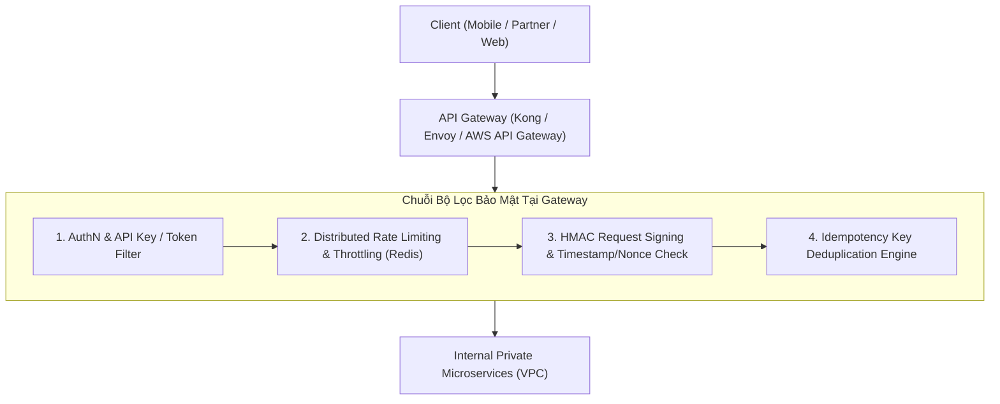
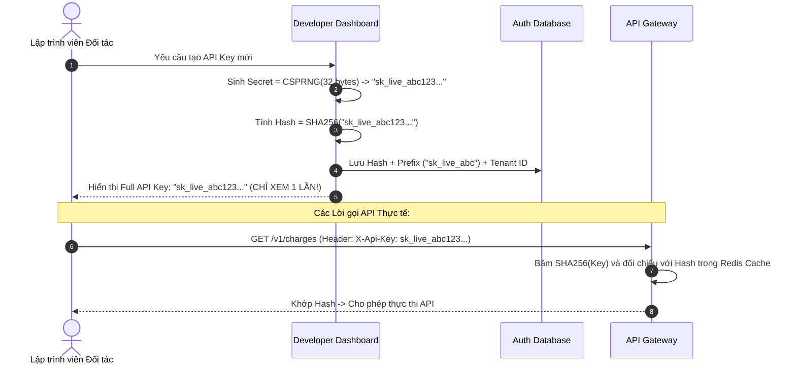
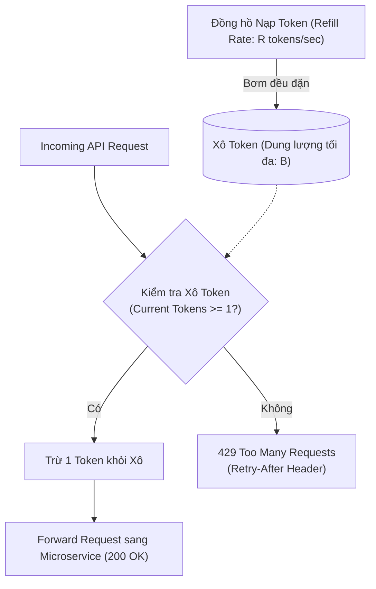
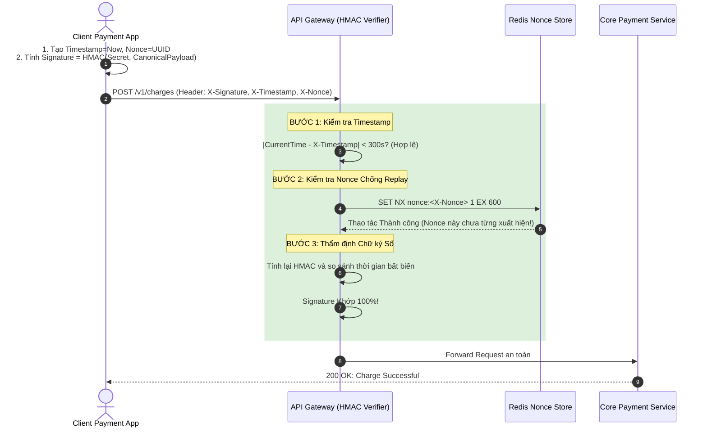

# 8.1. API Authentication, Rate Limiting and Gateways (Bảo mật Cổng API, Xác thực & Ký số Yêu cầu)

## Tổng quan về API Gateway & Perimeter Security
Trong kiến trúc phần mềm phân tán hiện đại (Microservices / Serverless), **API Gateway** đóng vai trò là "người gác cổng tối thượng" (Single Entry Point / Reverse Proxy). Toàn bộ lưu lượng từ bên ngoài Internet trước khi được phép tiếp cận các dịch vụ nghiệp vụ nội bộ đều bắt buộc phải đi qua API Gateway để thực hiện: Xác thực định danh (AuthN), Phân quyền phạm vi (AuthZ), Kiểm soát lưu lượng chống nghẽn (**Rate Limiting & Throttling**), và Thẩm định chữ ký số yêu cầu (**HMAC Request Signing**).

Bảo mật API đòi hỏi sự kết hợp chặt chẽ giữa việc quản trị khóa an toàn (API Key Management), ngăn chặn tấn công phát lại bằng **Timestamp & Nonce**, cùng cơ chế xử lý trùng lặp an toàn bằng **Khóa Bất biến (Idempotency Key Security)**.



---

## 2. Chi tiết từng Keyword (Under-the-Hood Deep Dive)

### 1. API Authentication, Key Management & Token Security

#### 1. Khái niệm bản chất (What & Why)
- **API Security Fundamentals**: Bảo vệ giao diện lập trình ứng dụng (REST, GraphQL, gRPC) trước các hành vi truy cập trái phép, lạm dụng dữ liệu và tấn công từ chối dịch vụ. Khác với ứng dụng web truyền thống (phục vụ con người qua giao diện HTML), API phục vụ tương tác Máy-đến-Máy (Machine-to-Machine) với khối lượng dữ liệu JSON/Protobuf lớn và tần suất cao.
- **API Key Management (Quản trị Khóa API)**:
  - API Key là định danh tĩnh dùng để nhận diện ứng dụng gọi API (Project/Tenant level) và áp dụng hạn ngạch tiêu thụ (Quota/Billing).
  - *Nguyên tắc Vàng*: API Key **chỉ dùng để Định danh (Identification), KHÔNG NÊN dùng làm cơ chế Xác thực bảo mật duy nhất cho người dùng (Not for User Authentication)**. Khi cần ủy quyền hành vi của người dùng, phải dùng Token (OAuth 2.0 / JWT).
  - Khóa API bí mật bắt buộc phải được băm một chiều (Hashed via SHA-256) trước khi lưu vào Database, hỗ trợ cơ chế tạo nhiều khóa đồng thời để phục vụ việc luân chuyển khóa (Key Rotation) mà không gây downtime.

#### 2. Cơ chế hoạt động sâu (Under the hood / Hardcore Internals)
- **Phân tách Khóa Công khai và Khóa Bí mật trong API (Stripe Pattern)**:
  Các hệ thống API chuẩn công nghiệp luôn cung cấp cặp khóa:
  1. `Publishable Key` (ví dụ: `pk_live_...`): Dùng trên giao diện Frontend Client (React/iOS) để token hóa thẻ tín dụng trực tiếp, không có quyền đọc dữ liệu nhạy cảm hay thực hiện giao dịch hoàn tiền.
  2. `Secret Key` (ví dụ: `sk_live_...`): **Chỉ lưu trên Backend Server của đối tác**, có toàn quyền thực thi giao dịch tài chính.
- **Tại sao Token lại vượt trội hơn API Key?**:
  - API Key là tĩnh và tồn tại vĩnh viễn cho đến khi bị xóa thủ công $\implies$ Nguy cơ rò rỉ cực cao (bị commit nhầm lên GitHub).
  - API Token (OAuth 2.0 Access Token) có **thời hạn sống ngắn (Short-lived TTL)**, bị ràng buộc phạm vi quyền hạn hẹp (**Granular Scopes**) và được ký số toán học, giúp giảm thiểu tối đa cửa sổ rủi ro nếu token bị lộ.

#### 3. Sơ đồ minh họa (Mô hình Quản trị và Xác thực API Key Hai Chiều)


#### 4. Code ví dụ thực chiến (TypeScript Secure API Key Provisioning & Constant-Time Validation)
```typescript
import * as crypto from 'crypto';

interface StoredApiKeyRecord {
    keyHashHex: string;
    tenantId: string;
    rateLimitTier: 'FREE' | 'ENTERPRISE';
    isActive: boolean;
}

export class ApiKeySecurityService {
    private static readonly KEY_PREFIX = "sk_prod_";

    /**
     * Sinh API Key chuẩn và lưu Hash vào Database
     */
    public static issueApiKey(tenantId: string, tier: 'FREE' | 'ENTERPRISE'): { plainKey: string; record: StoredApiKeyRecord } {
        // Sinh 32 bytes ngẫu nhiên chuẩn CSPRNG
        const rawEntropy = crypto.randomBytes(32).toString('base64url');
        const plainKey = `${this.KEY_PREFIX}${rawEntropy}`;

        // Băm SHA-256 để lưu trữ (Không bao giờ lưu plainKey!)
        const keyHashHex = crypto.createHash('sha256').update(plainKey).digest('hex');

        const record: StoredApiKeyRecord = {
            keyHashHex,
            tenantId,
            rateLimitTier: tier,
            isActive: true
        };

        return { plainKey, record };
    }

    /**
     * Xác thực API Key từ Client gửi lên bằng so sánh thời gian bất biến
     */
    public static authenticate(plainKeyFromHeader: string, storedRecord: StoredApiKeyRecord): boolean {
        if (!storedRecord.isActive) return false;

        const computedHashHex = crypto.createHash('sha256').update(plainKeyFromHeader).digest('hex');

        const computedBuf = Buffer.from(computedHashHex, 'hex');
        const storedBuf = Buffer.from(storedRecord.keyHashHex, 'hex');

        if (computedBuf.length !== storedBuf.length) return false;

        // Constant-time comparison chống Timing Attack
        return crypto.timingSafeEqual(computedBuf, storedBuf);
    }
}
```

#### 5. Ưu / Nhược điểm, Pitfalls & Anti-patterns
- **Pitfall**: Truyền API Key qua URL Query Parameter (ví dụ: `https://api.com/v1/data?api_key=secret123`). URL query parameter sẽ bị ghi lại trong nhật ký máy chủ (Server Access Logs), lịch sử trình duyệt, và bị rò rỉ qua Referer Header khi chuyển hướng sang bên thứ ba. Bắt buộc phải truyền qua Header: `X-API-Key: ...` hoặc `Authorization: Bearer ...`.
- **Anti-pattern**: Lưu trữ API Key dạng plaintext trong Database để "tiện tra cứu cho khách hàng".

#### 6. Ứng dụng thực tế trong Backend / Systems
Tiêu chuẩn quản trị khóa của **Stripe, SendGrid, Twilio, OpenAI API**, và Amazon API Gateway Usage Plans.

---

### 2. API Rate Limiting & Throttling

#### 1. Khái niệm bản chất (What & Why)
- **API Rate Limiting (Giới hạn Tần suất)**: Chính sách kiểm soát số lượng yêu cầu tối đa mà một Client (định danh theo IP, User ID, hoặc API Key) được phép gửi tới API trong một khung thời gian cố định (ví dụ: 100 requests / phút). Khi vượt quá ngưỡng, server trả về mã lỗi HTTP **`429 Too Many Requests`**.
- **API Throttling (Điều tiết Lưu lượng)**: Cơ chế làm chậm tốc độ xử lý hoặc đưa các yêu cầu vượt ngưỡng vào hàng đợi (Queue) thay vì từ chối thẳng thừng, giúp bảo vệ các dịch vụ backend phía sau không bị quá tải khi lưu lượng tăng đột biến (Spike).
- **Các Thuật toán Kinh điển**:
  1. **Token Bucket**: Một xô chứa token với dung lượng tối đa $B$. Cứ mỗi đơn vị thời gian, hệ thống tự động bơm thêm $R$ tokens vào xô. Mỗi request đến sẽ tiêu thụ 1 token. Cho phép lưu lượng tăng đột biến trong thời gian ngắn (Bursting) miễn là trong xô còn token.
  2. **Leaky Bucket**: Các yêu cầu đi vào xô và được xả ra xử lý với một tốc độ cố định đều đặn (như giọt nước rò rỉ từ đáy thùng). Triệt tiêu hoàn toàn tính đột biến, làm phẳng lưu lượng mạng.
  3. **Sliding Window Counter**: Thuật toán chia nhỏ thời gian để tính toán lưu lượng trượt chính xác, loại bỏ nhược điểm "tăng gấp đôi lưu lượng ở biên ranh giới" của thuật toán Fixed Window.

#### 2. Cơ chế hoạt động sâu (Under the hood / Hardcore Internals)
- **Triển khai Token Bucket Phân tán bằng Redis Lua Script**:
  Nếu hệ thống chạy trên nhiều máy chủ, việc kiểm tra và trừ token không thể thực hiện ngoài mã nguồn ứng dụng vì sẽ dính Race Condition.
  - Toàn bộ thuật toán Token Bucket được viết thành một đoạn mã **Lua Script** thực thi nguyên tử (Atomic) trực tiếp bên trong tiến trình đơn luồng của Redis Server:
    1. Đọc số lượng token hiện tại và mốc thời gian lần cuối nạp token (`last_refreshed`).
    2. Tính toán số token mới cần bù vào: $\Delta \text{Tokens} = (\text{CurrentTime} - \text{last\_refreshed}) \times \text{RefillRate}$.
    3. Cập nhật `current_tokens = min(Capacity, current_tokens + delta)`.
    4. Nếu `current_tokens >= 1` $\implies$ Trừ 1 token, lưu lại thời gian và trả về `1` (Cho phép).
    5. Ngược lại $\implies$ Trả về `0` (Từ chối 429) kèm số mili-giây cần chờ để có token mới!

#### 3. Sơ đồ minh họa (Mô hình Thuật toán Token Bucket tại API Gateway)


#### 4. Code ví dụ thực chiến (C++ Token Bucket Rate Limiter with Burst Handling)
```cpp
#include <iostream>
#include <chrono>
#include <algorithm>

class ProductionRateLimiter {
private:
    const double maxCapacity;        // Sức chứa tối đa của xô (Burst Limit)
    const double refillRatePerMsec;  // Tốc độ bơm token mỗi mili-giây
    double availableTokens;
    std::chrono::steady_clock::time_point lastRefillTimestamp;

    void updateTokens() {
        auto now = std::chrono::steady_clock::now();
        auto elapsedMs = std::chrono::duration_cast<std::chrono::milliseconds>(now - lastRefillTimestamp).count();

        if (elapsedMs > 0) {
            double tokensToAdd = elapsedMs * refillRatePerMsec;
            availableTokens = std::min(maxCapacity, availableTokens + tokensToAdd);
            lastRefillTimestamp = now;
        }
    }

public:
    ProductionRateLimiter(double capacity, double refillPerSecond)
        : maxCapacity(capacity),
          refillRatePerMsec(refillPerSecond / 1000.0),
          availableTokens(capacity),
          lastRefillTimestamp(std::chrono::steady_clock::now()) {}

    bool allowRequest(double cost = 1.0) {
        updateTokens();
        if (availableTokens >= cost) {
            availableTokens -= cost;
            return true; // Cho phép
        }
        return false; // Bị Rate Limit (HTTP 429)
    }

    double getRemainingTokens() {
        updateTokens();
        return availableTokens;
    }
};

int main() {
    // Cấu hình: Dung lượng xô 5 tokens, nạp 2 tokens mỗi giây
    ProductionRateLimiter limiter(5.0, 2.0);

    std::cout << "Simulating 7 rapid requests:\n";
    for (int i = 1; i <= 7; ++i) {
        bool allowed = limiter.allowRequest();
        std::cout << "Request " << i << ": " << (allowed ? "ALLOWED" : "REJECTED (429)") 
                  << " | Remaining: " << limiter.getRemainingTokens() << "\n";
    }
    return 0;
}
```

#### 5. Ưu / Nhược điểm, Pitfalls & Anti-patterns
- **Pitfall**: Không trả về các Header tiêu chuẩn RFC 6585 khi từ chối request: `RateLimit-Limit`, `RateLimit-Remaining`, `RateLimit-Reset` và `Retry-After`. Việc thiếu các header này khiến các client SDK của đối tác không biết khi nào được phép gửi lại, dẫn đến việc họ liên tục bắn request thử lại (Retry Storm) làm sập hệ thống nặng hơn.
- **Anti-pattern**: Đặt chung một Rate Limit cho tất cả các endpoint. Các thao tác nặng (như Export Báo cáo PDF, Quét AI) phải có giới hạn tần suất khắt khe hơn nhiều (ví dụ: 2 req/phút) so với các API nhẹ (như Lấy thông tin cá nhân: 100 req/phút).

#### 6. Ứng dụng thực tế trong Backend / Systems
Mọi API Gateway chuẩn công nghiệp (Envoy Ratelimit Service, Cloudflare Rate Limiting Rules, AWS WAF Rate-based Rules) đều dựa trên kiến trúc Token Bucket phân tán.

---

### 3. Request Signing: HMAC, Replay Prevention (Timestamp & Nonce) & Idempotency Key Security

#### 1. Khái niệm bản chất (What & Why)
- **Request Signing (Ký số Yêu cầu)**: Cơ chế bảo mật cấp cao bắt buộc máy khách phải tạo một chữ ký số toán học (thường dùng HMAC-SHA256) trên toàn bộ nội dung của gói tin HTTP (Method, URL, Headers, Timestamp, Nonce, Request Body) bằng một khóa bí mật chia sẻ (Secret Key) trước khi gửi đi.
  - *Lợi ích*: Ngay cả khi kết nối TLS bị giải mã ở một Proxy trung gian, kẻ tấn công cũng **không thể sửa đổi dù chỉ 1 ký tự trong JSON body hoặc URL query param** (Toàn vẹn tuyệt đối).
- **Replay Attack Prevention (Phòng chống Tấn công Phát lại)**:
  - **Timestamp Validation**: Request bắt buộc phải đính kèm Header thời gian (ví dụ: `X-Timestamp: 1773070000`). Server kiểm tra: Nếu thời gian gửi của request lệch quá $\pm 5$ phút so với đồng hồ của server $\implies$ Từ chối ngay lập tức!
  - **Nonce Validation**: Đính kèm một chuỗi ngẫu nhiên duy nhất dùng 1 lần (ví dụ: `X-Nonce: 9b1deb4d...`). Server lưu Nonce này vào Redis với TTL 10 phút. Nếu một request thứ hai xuất hiện với cùng một Nonce $\implies$ **Phát hiện tấn công phát lại! Từ chối ngay!**
- **Idempotency Key Security (Bảo mật Khóa Bất biến)**: Cơ chế đảm bảo một hành động thay đổi dữ liệu nguy hiểm (như Trừ tiền thẻ tín dụng) **chỉ được thực thi chính xác 1 lần duy nhất**, ngay cả khi mạng bị chập chờn và Client tự động thử lại request nhiều lần.

#### 2. Cơ chế hoạt động sâu (Under the hood / Hardcore Internals)
- **Chuẩn hóa Gói tin để Ký số (Canonical Request Creation - Chuẩn AWS Signature V4)**:
  Để tính toán chữ ký HMAC chính xác giữa Client và Server, hai bên bắt buộc phải chuyển đổi request về một định dạng chuỗi chuẩn tắc (**Canonical String**):
  $$\text{CanonicalRequest} = \text{HTTPMethod} \ || \ \text{"\n"} \ || \ \text{CanonicalURI} \ || \ \text{"\n"} \ || \ \text{CanonicalQueryString} \ || \ \text{"\n"} \ || \ \text{CanonicalHeaders} \ || \ \text{"\n"} \ || \ \text{SHA256}(Body)$$
  $$\text{Signature} = \text{HMAC-SHA256}(\text{SecretKey}, \text{CanonicalRequest})$$
  Bất kỳ sự thay đổi thứ tự query param (`?b=2&a=1` vs `?a=1&b=2`) hoặc khoảng trắng thừa trong Header đều sẽ làm sai lệch chữ ký HMAC!

#### 3. Sơ đồ minh họa (Mô hình Xác thực HMAC Kèm Timestamp & Nonce)


#### 4. Code ví dụ thực chiến (TypeScript Complete HMAC Request Signing & Idempotency Engine)
```typescript
import * as crypto from 'crypto';

interface SignedRequestHeaders {
    'x-signature': string;
    'x-timestamp': string;
    'x-nonce': string;
    'x-idempotency-key': string;
}

export class HmacRequestSignerEngine {
    private static readonly TOLERANCE_SECONDS = 300; // 5 Phút

    /**
     * Tạo Canonical String và tính chữ ký HMAC-SHA256
     */
    public static computeSignature(
        method: string,
        path: string,
        timestamp: string,
        nonce: string,
        idempotencyKey: string,
        bodyPayload: string,
        secretKey: string
    ): string {
        const bodyHash = crypto.createHash('sha256').update(bodyPayload, 'utf8').digest('hex');
        const canonicalString = [
            method.toUpperCase(),
            path,
            timestamp,
            nonce,
            idempotencyKey,
            bodyHash
        ].join('\n');

        return crypto.createHmac('sha256', secretKey).update(canonicalString, 'utf8').digest('hex');
    }

    /**
     * Thẩm định Chữ ký số, Timestamp, Nonce và Idempotency tại API Gateway
     */
    public static verifyRequest(
        method: string,
        path: string,
        bodyPayload: string,
        headers: SignedRequestHeaders,
        secretKey: string,
        isNonceSeen: (nonce: string) => Promise<boolean>
    ): Promise<boolean> {
        return new Promise(async (resolve, reject) => {
            const timestampNum = parseInt(headers['x-timestamp'], 10);
            const nowSeconds = Math.floor(Date.now() / 1000);

            // 1. Kiểm tra Timestamp (Chống trễ gói tin)
            if (isNaN(timestampNum) || Math.abs(nowSeconds - timestampNum) > this.TOLERANCE_SECONDS) {
                return reject(new Error("Timestamp out of acceptable window (+-5m)."));
            }

            // 2. Kiểm tra Nonce (Chống Replay Attack)
            const seen = await isNonceSeen(headers['x-nonce']);
            if (seen) {
                return reject(new Error("Replay Attack Detected: Nonce already processed."));
            }

            // 3. Tính toán lại Chữ ký và So sánh Constant-Time
            const expectedSignature = this.computeSignature(
                method, path, headers['x-timestamp'], headers['x-nonce'],
                headers['x-idempotency-key'], bodyPayload, secretKey
            );

            const expectedBuf = Buffer.from(expectedSignature, 'hex');
            const receivedBuf = Buffer.from(headers['x-signature'], 'hex');

            if (expectedBuf.length !== receivedBuf.length || !crypto.timingSafeEqual(expectedBuf, receivedBuf)) {
                return reject(new Error("HMAC Signature Mismatch! Request corrupted or tampered with."));
            }

            resolve(true);
        });
    }
}
```

#### 5. Ưu / Nhược điểm, Pitfalls & Anti-patterns
- **Pitfall**: Quên đưa Header `Idempotency-Key` hoặc Request Body vào chuỗi Canonical String trước khi băm chữ ký HMAC. Khi đó kẻ tấn công có thể tráo đổi body thanh toán mà chữ ký vẫn hợp lệ.
- **Anti-pattern**: Lưu trữ Idempotency Record không có trạng thái xử lý (ví dụ: chỉ lưu kết quả thành công mà không lưu trạng thái `PROCESSING`). Khi 2 request gửi tới cùng một thời điểm, cả 2 đều thấy chưa có kết quả và đều tiến hành trừ tiền hai lần. Bắt buộc phải sử dụng Khóa phân tán (Atomic Lock).

#### 6. Ứng dụng thực tế trong Backend / Systems
Tiêu chuẩn bắt buộc của các API tài chính toàn cầu: **AWS Signature Version 4 (SigV4)**, Stripe Webhook Signatures, và Cổng thanh toán quốc tế PayPal / Visa Direct.
