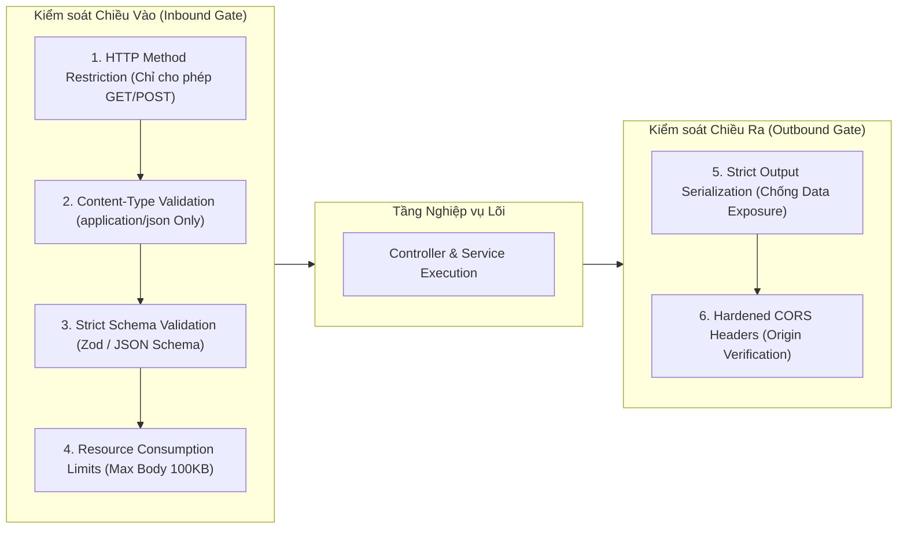
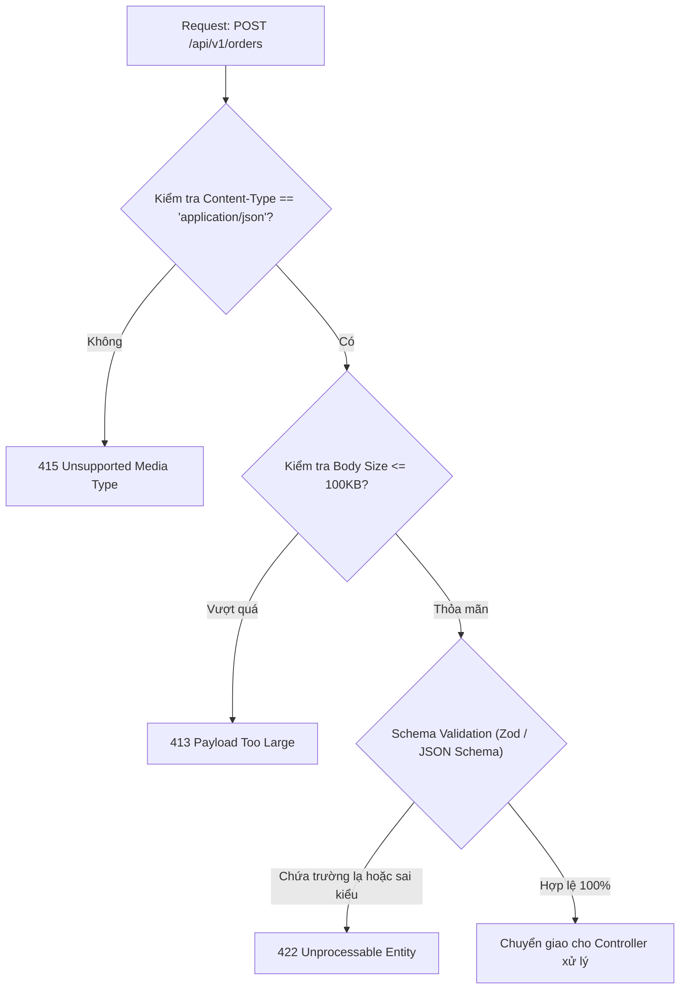
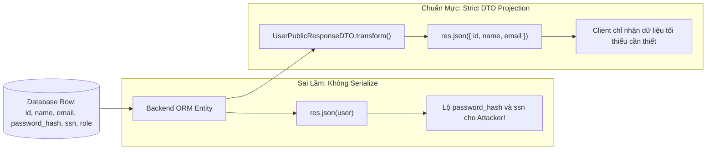
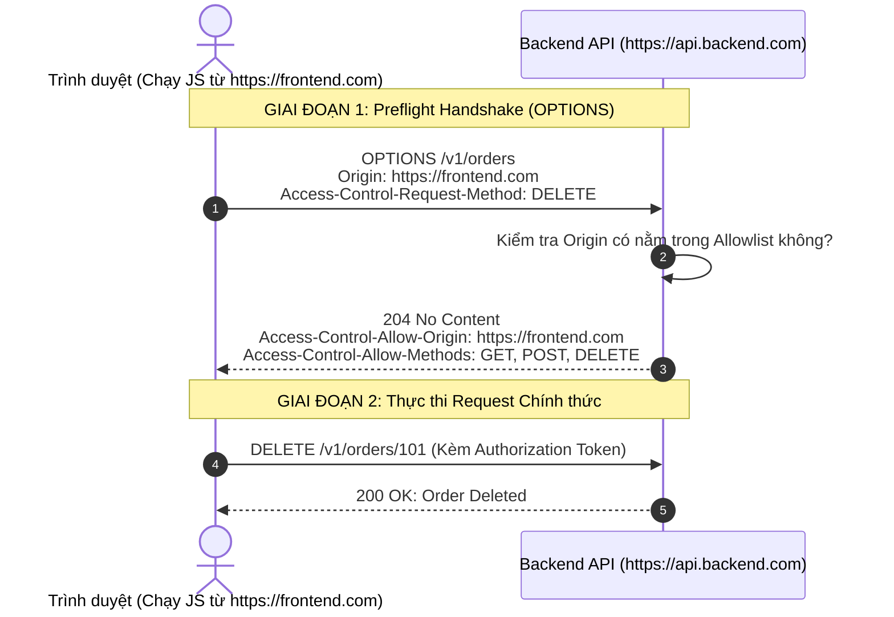

# 8.2. Validation and API Vulnerabilities (Thẩm định Dữ liệu & Phòng ngừa Lỗ hổng API)

## Tổng quan về Data Contracts & Defensive Validation
Một hệ thống API phân tán an toàn phải hoạt động theo nguyên tắc: **Mọi dữ liệu đi qua ranh giới mạng (Over-the-wire Network Boundary) đều là dữ liệu thù địch cho đến khi được chứng minh ngược lại**. 

Bảo vệ API đòi hỏi sự kiểm soát nghiêm ngặt ở cả hai chiều: Chiều đi vào (**Inbound Request Validation, Schema Validation, Content-Type & Method Enforcement**) và chiều đi ra (**Outbound Response Serialization, Data Masking, Chống Excessive Data Exposure**), kết hợp với các cơ chế kiểm soát chia sẻ tài nguyên an toàn (**CORS**) và ngăn chặn lạm dụng tài nguyên (**Resource Consumption Limits**).



---

## 2. Chi tiết từng Keyword (Under-the-Hood Deep Dive)

### 1. Inbound Validation: Request, Input, Schema, Content-Type & Method Restrictions

#### 1. Khái niệm bản chất (What & Why)
- **Input Validation (Thẩm định Đầu vào)**: Quy trình kiểm tra tính hợp lệ của mọi trường dữ liệu nhận được từ Client (Query parameters, Path variables, Headers, Body) theo định dạng, độ dài, kiểu dữ liệu và phạm vi cho phép trước khi xử lý.
- **Schema Validation (Thẩm định Lược đồ)**: Sử dụng các lược đồ định nghĩa hình thức (JSON Schema, Zod, OpenAPI Specification) để kiểm tra toàn bộ cấu trúc phân cấp của payload JSON chỉ trong một bước duy nhất.
- **Content-Type Validation**: Kiểm tra bắt buộc header `Content-Type: application/json`. Nếu client gửi một định dạng lạ (như `application/x-www-form-urlencoded` hoặc `multipart/form-data`) trong khi API chỉ hỗ trợ JSON, server **bắt buộc phải từ chối ngay với mã lỗi HTTP `415 Unsupported Media Type`**.
- **HTTP Method Restrictions**: Ràng buộc nghiêm ngặt chỉ chấp nhận các phương thức HTTP đã được định nghĩa rõ ràng cho từng endpoint. Nếu một route chỉ hỗ trợ `POST`, mọi yêu cầu `GET`, `PUT`, `DELETE`, `HEAD` phải bị từ chối với mã lỗi HTTP **`405 Method Not Allowed`** kèm header `Allow: POST`.

#### 2. Cơ chế hoạt động sâu (Under the hood / Hardcore Internals)
- **Mô hình Thẩm định Danh sách Trắng (Whitelist / Positive Validation)**:
  - *Phương pháp Sai lầm (Blacklist)*: Cố gắng tìm và chặn các ký tự độc hại (như `'`, `<`, `>`). Kẻ tấn công luôn tìm ra các biến thể encoding mới để vượt qua.
  - *Phương pháp Chuẩn mực (Whitelist)*: Chỉ định nghĩa chính xác những gì **ĐƯỢC PHÉP**: Kiểu dữ liệu (`String`), Chiều dài (`2 <= length <= 50`), Tập ký tự hợp lệ (`/^[a-zA-Z0-9_-]+$/`), và các giá trị Enum được công nhận. Mọi thứ nằm ngoài định nghĩa này đều bị loại bỏ ngay lập tức!
- **Strict Schema Parsing (Chống Mass Assignment)**:
  Sử dụng chế độ `.strict()` trong các schema validator. Nếu client cố tình gửi thêm một trường không nằm trong định nghĩa (ví dụ: `role: "admin"` hoặc `balance: 99999`), thư viện validator sẽ ném ngoại lệ và dừng request ngay tại cổng vào của controller.

#### 3. Sơ đồ minh họa (Quy trình Thẩm định Đầu vào Đa Tầng tại API Gateway)


#### 4. Code ví dụ thực chiến (TypeScript Strict Schema Enforcement with Zod)
```typescript
import { Request, Response, NextFunction } from 'express';
import { z, ZodError } from 'zod';

// Định nghĩa Lược đồ Hợp đồng Dữ liệu nghiêm ngặt
export const CreateOrderRequestSchema = z.object({
    productId: z.string().uuid({ message: "Invalid Product UUID" }),
    quantity: z.number().int().min(1).max(50, { message: "Quantity must be between 1 and 50" }),
    deliveryAddress: z.object({
        street: z.string().min(5).max(100),
        city: z.string().min(2).max(50),
        postalCode: z.string().regex(/^\d{5}(-\d{4})?$/, { message: "Invalid Postal Code format" })
    }),
    paymentMethod: z.enum(['CREDIT_CARD', 'BANK_TRANSFER', 'PAYPAL'])
}).strict(); // CHỐNG MASS ASSIGNMENT: Ném lỗi nếu có bất kỳ thuộc tính lạ nào!

export type CreateOrderDTO = z.infer<typeof CreateOrderRequestSchema>;

/**
 * Middleware thẩm định Content-Type và Schema tự động
 */
export function validateInboundOrderRequest(req: Request, res: Response, next: NextFunction): void {
    // 1. Kiểm tra Content-Type
    if (req.method === 'POST' || req.method === 'PUT') {
        const contentType = req.headers['content-type'];
        if (!contentType || !contentType.includes('application/json')) {
            res.status(415).json({ error: "Unsupported Media Type: Must be application/json." });
            return;
        }
    }

    // 2. Thẩm định Schema
    try {
        req.body = CreateOrderRequestSchema.parse(req.body);
        next();
    } catch (error) {
        if (error instanceof ZodError) {
            res.status(422).json({
                error: "Validation Failure",
                details: error.issues.map(i => ({ path: i.path.join('.'), message: i.message }))
            });
            return;
        }
        res.status(400).json({ error: "Malformed JSON Request Body." });
    }
}
```

#### 5. Ưu / Nhược điểm, Pitfalls & Anti-patterns
- **Pitfall**: Chỉ validate dữ liệu ở Controller mà không giới hạn kích thước payload ở tầng Web Server (Body Parser). Kẻ tấn công có thể gửi một file JSON rác dung lượng 500MB để làm cạn kiệt RAM và crash Node.js Event Loop (Dẫn tới DoS).
- **Anti-pattern**: Viết các thông báo lỗi validation quá chi tiết làm rò rỉ cấu trúc cơ sở dữ liệu nội bộ (ví dụ: `Database column user_invoices_fk constraint violated`).

#### 6. Ứng dụng thực tế trong Backend / Systems
Tiêu chuẩn thiết kế bắt buộc của mọi framework hiện đại (FastAPI Pydantic trong Python, NestJS Class-Validator trong TypeScript, Spring Boot Hibernate Validator trong Java).

---

### 2. Outbound Security: Excessive Data Exposure & Strict Output Serialization

#### 1. Khái niệm bản chất (What & Why)
- **Excessive Data Exposure (Lộ Dữ liệu Quá mức - OWASP API3)**: Lỗ hổng xảy ra khi API backend truy vấn toàn bộ đối tượng từ cơ sở dữ liệu (ví dụ: `SELECT * FROM users`) và **trả về nguyên vẹn toàn bộ đối tượng JSON đó cho Client**, dựa dẫm vào việc "Frontend UI sẽ tự chọn lọc những trường cần hiển thị để vẽ lên màn hình".
  - Kẻ tấn công không dùng trình duyệt; họ mở Tab Network hoặc dùng Postman để xem thẳng JSON thô và thu thập toàn bộ: `password_hash`, `mfa_secret`, `is_admin`, `internal_risk_score`, `ssn`!
- **Strict Output Serialization (Tuần tự hóa Đầu ra Nghiêm ngặt)**: Kỹ thuật sử dụng các lớp Data Transfer Object (DTO) hoặc Serializers để lọc sạch dữ liệu ở chiều phản hồi, đảm bảo **CHỈ DUY NHẤT các trường được cho phép một cách tường minh mới được xuất hiện trong JSON trả về**.

#### 2. Cơ chế hoạt động sâu (Under the hood / Hardcore Internals)
- **Cơ chế Lọc Đối tượng Theo Vai trò (Role-Based Field Projection)**:
  Ở tầng Response Interceptor:
  Một đối tượng dữ liệu trong bộ nhớ có thể có 20 trường. Bộ serializer phân giải theo ngữ cảnh:
  - Nếu `caller.role === 'ADMIN'`: Giữ lại 20 trường.
  - Nếu `caller.role === 'PUBLIC'`: Áp dụng phép chiếu (Projection) chỉ chọn 3 trường (`id`, `username`, `avatar_url`).
  - Mọi trường nhạy cảm như `hashedPassword`, `resetToken`, `salt` đều được đánh dấu cờ bảo vệ (ví dụ: `@Exclude()` trong TypeScript hoặc `@JsonIgnore` trong Java Jackson) để không bao giờ bị chuyển đổi thành chuỗi JSON trong mọi tình huống.

#### 3. Sơ đồ minh họa (Mô hình Ngăn chặn Lỗ hổng Excessive Data Exposure)


#### 4. Code ví dụ thực chiến (TypeScript Safe Response Serialization DTO Pattern)
```typescript
interface RawUserDatabaseRecord {
    id: string;
    username: string;
    email: string;
    passwordHash: string;      // TỐI MẬT!
    totpSecret: string;        // TỐI MẬT!
    creditCardLast4: string;
    internalAdminNotes: string;
}

export class UserResponseSerializer {
    /**
     * PHƯƠNG THỨC AN TOÀN: Chống tuyệt đối Excessive Data Exposure (API3)
     */
    public static toPublicProfileJson(record: RawUserDatabaseRecord) {
        // Chỉ trích xuất các trường công khai, cô lập hoàn toàn các bí mật
        return {
            id: record.id,
            username: record.username,
            email: record.email,
            maskedCard: `****-****-****-${record.creditCardLast4}`
        };
    }
}
```

#### 5. Ưu / Nhược điểm, Pitfalls & Anti-patterns
- **Pitfall**: Nghĩ rằng các trường bị ẩn bằng CSS trên giao diện web (`display: none`) là an toàn. Mọi dữ liệu đã nằm trong response HTTP đều có thể được xem bởi bất kỳ ai có kiến thức cơ bản về F12 DevTools.
- **Anti-pattern**: Trả về toàn bộ Stack Trace hoặc câu truy vấn SQL lỗi trong response `500 Internal Server Error` khi môi trường là Production (Information Disclosure).

#### 6. Ứng dụng thực tế trong Backend / Systems
Tiêu chuẩn bảo mật dữ liệu cá nhân theo đạo luật **GDPR (Châu Âu)** và **HIPAA (Y tế Hoa Kỳ)** bắt buộc áp dụng nguyên tắc tối thiểu hóa dữ liệu (Data Minimization) trên mọi API endpoints.

---

### 3. Cross-Origin Resource Sharing (CORS) Security & API Abuse Prevention

#### 1. Khái niệm bản chất (What & Why)
- **Same-Origin Policy (SOP - Chính sách Cùng Nguồn)**: Cơ chế bảo mật nền tảng của trình duyệt web: Ngăn chặn mã JavaScript từ nguồn này (Origin A: `https://evil.com`) đọc dữ liệu hoặc gửi request trái phép sang nguồn khác (Origin B: `https://my-bank.com`).
  - Định nghĩa Nguồn (Origin) = **`Protocol` + `Host` + `Port`**.
- **CORS (Cross-Origin Resource Sharing - Chia sẻ Tài nguyên Đa Nguồn)**: Cơ chế cho phép máy chủ Backend nới lỏng chính sách SOP một cách có kiểm soát thông qua các HTTP Headers đặc thù, cho phép các ứng dụng Frontend nằm trên domain khác (ví dụ: SPA chạy tại `https://my-app.com`) có thể gọi vào API tại `https://api.my-app.com`.
- **CORS Misconfiguration (Cấu hình Sai CORS)**: Một trong những lỗi bảo mật phổ biến nhất:
  - Cấu hình: `Access-Control-Allow-Origin: *` kết hợp với `Access-Control-Allow-Credentials: true` (hoặc phản xạ lại bất kỳ Origin nào mà client gửi lên). Lỗi này cho phép website độc hại của hacker có thể âm thầm gửi request đọc trộm toàn bộ dữ liệu người dùng từ API của bạn!

#### 2. Cơ chế hoạt động sâu (Under the hood / Hardcore Internals)
- **Cơ chế Phân loại Request trong CORS**:
  1. **Simple Requests (Yêu cầu Đơn giản)**: Sử dụng phương thức `GET`, `POST`, `HEAD` và chỉ chứa các header an toàn (`Accept`, `Content-Type: text/plain` hoặc `application/x-www-form-urlencoded`). Trình duyệt gửi request đi ngay lập tức và chỉ kiểm tra header `Access-Control-Allow-Origin` trong response trả về để quyết định có cho phép JavaScript đọc dữ liệu hay không.
  2. **Preflight Requests (Yêu cầu Thăm dò - `OPTIONS`)**:
     Nếu request chứa phương thức phức tạp (`PUT`, `DELETE`, `PATCH`) hoặc Header tùy biến (`Authorization: Bearer`, `Content-Type: application/json`):
     - Trình duyệt **tự động gửi một request `OPTIONS` đi trước** để hỏi Server: "Bạn có cho phép domain của tôi gửi lệnh PUT kèm Authorization Header hay không?".
     - Server phải trả về các header cho phép:
       `Access-Control-Allow-Origin: https://my-app.com`
       `Access-Control-Allow-Methods: GET, POST, PUT, DELETE`
       `Access-Control-Allow-Headers: Authorization, Content-Type`
       `Access-Control-Max-Age: 86400` (Cache kết quả preflight trong 24 giờ).
     - Chỉ khi bước Preflight thành công, trình duyệt mới gửi request thực tế đi!

#### 3. Sơ đồ minh họa (Luồng Kiểm tra CORS Preflight OPTIONS Request)


#### 4. Code ví dụ thực chiến (TypeScript Hardened CORS Policy Middleware)
```typescript
import { Request, Response, NextFunction } from 'express';

export class HardenedCorsMiddleware {
    // Danh sách các Nguồn tin cậy tuyệt đối (Strict Origin Allowlist)
    private static readonly TRUSTED_ORIGINS = new Set([
        'https://app.company.com',
        'https://admin.company.com'
    ]);

    public static handleCors(req: Request, res: Response, next: NextFunction): void {
        const clientOrigin = req.headers['origin'];

        if (clientOrigin) {
            // 1. Kiểm tra Origin với Allowlist (Không bao giờ phản xạ mù quáng!)
            if (this.TRUSTED_ORIGINS.has(clientOrigin)) {
                res.setHeader('Access-Control-Allow-Origin', clientOrigin);
                res.setHeader('Access-Control-Allow-Credentials', 'true');
                res.setHeader('Access-Control-Allow-Methods', 'GET, POST, PUT, DELETE, OPTIONS');
                res.setHeader('Access-Control-Allow-Headers', 'Authorization, Content-Type, X-Requested-With');
                res.setHeader('Access-Control-Max-Age', '86400'); // Cache 24h
                res.setHeader('Vary', 'Origin'); // Chỉ thị cho Cache CDN phân tách theo Origin
            } else {
                console.warn(`[CORS Blocked] Untrusted Cross-Origin access attempt from: ${clientOrigin}`);
                // Không set header CORS -> Trình duyệt sẽ tự chặn việc đọc dữ liệu
            }
        }

        // 2. Xử lý tức thì Preflight Request (OPTIONS)
        if (req.method === 'OPTIONS') {
            if (clientOrigin && this.TRUSTED_ORIGINS.has(clientOrigin)) {
                res.status(204).end();
            } else {
                res.status(403).json({ error: "CORS Preflight Rejected: Origin not allowed." });
            }
            return;
        }

        next();
    }
}
```

#### 5. Ưu / Nhược điểm, Pitfalls & Anti-patterns
- **Pitfall**: Dùng Regex kiểm tra Origin lỏng lẻo như `/company\.com/`. Kẻ tấn công có thể đăng ký tên miền `company.com.attacker.com` hoặc `evil-company.com` để vượt qua bộ lọc Regex!
- **Anti-pattern**: Nghĩ rằng CORS là một giải pháp bảo mật phía Server (Server-side Firewall). CORS là **chính sách bảo vệ Trình duyệt Client**. Kẻ tấn công dùng `curl`, Python hoặc Mobile App không bị ràng buộc bởi CORS và có thể gọi API bình thường; do đó, mọi API vẫn bắt buộc phải có xác thực Token/Session đầy đủ.

#### 6. Ứng dụng thực tế trong Backend / Systems
Tiêu chuẩn cấu hình hạ tầng của **AWS CloudFront, Cloudflare, Kubernetes Nginx Ingress** và các dịch vụ cổng thanh toán liên ngân hàng.
