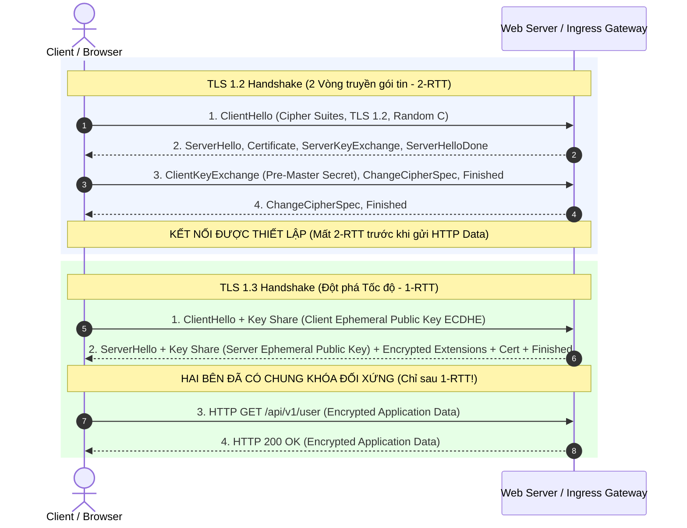
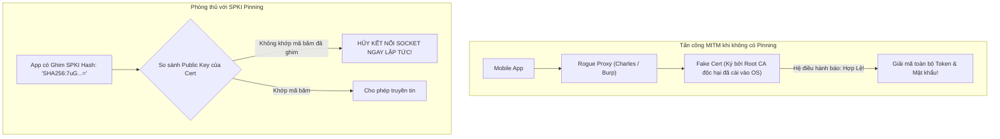
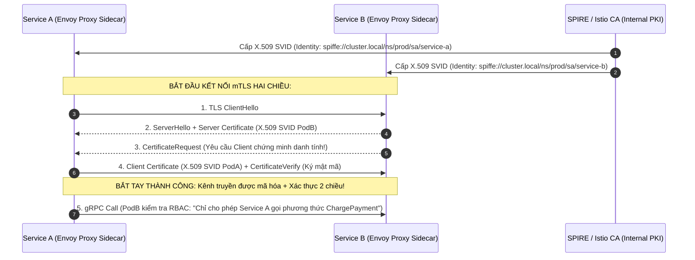
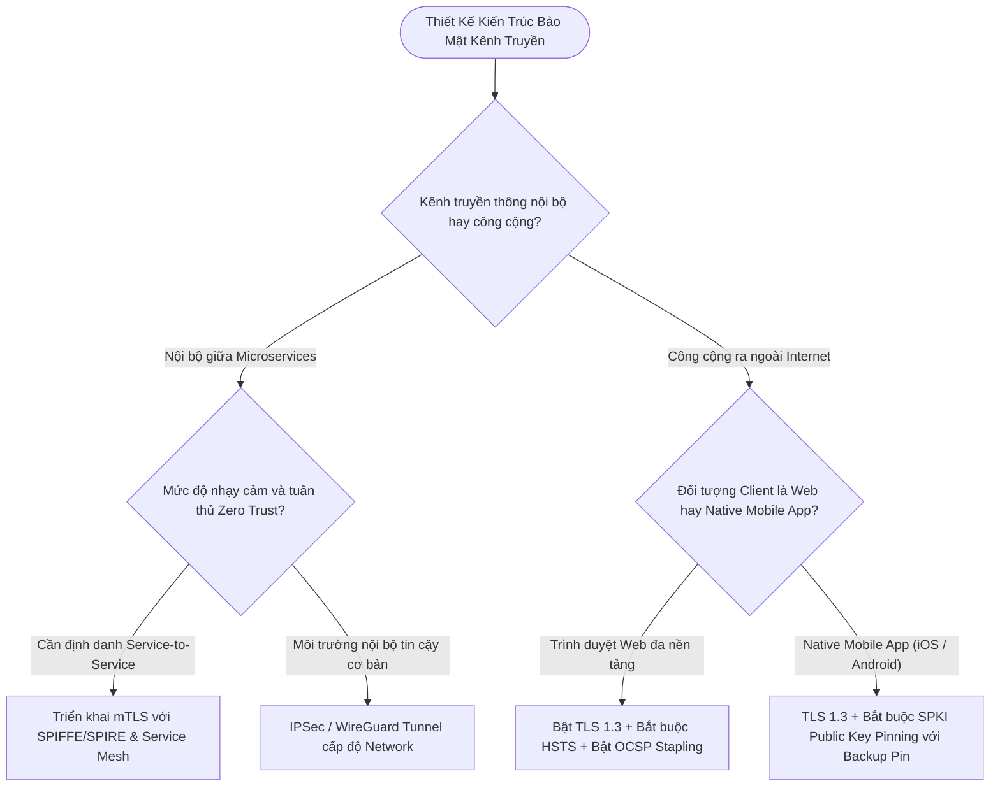

# 9.2. Transport Layer Security (TLS) and PKI

> [!IMPORTANT]
> **Nếu bạn chỉ được nhớ một điều duy nhất:**
> **TLS 1.3** không đơn thuần là một bản nâng cấp gia tăng của TLS 1.2, mà là một cuộc tái kiến trúc mật mã học triệt để: loại bỏ hoàn toàn các bộ mã hóa kế thừa dễ bị tổn thương (cấm RSA key exchange, cấm CBC mode) để **bắt buộc $100\%$ tính năng Bảo mật Chuyển tiếp Hoàn hảo (Perfect Forward Secrecy - PFS)** thông qua Ephemeral Diffie-Hellman (ECDHE); đồng thời nén toàn bộ quá trình đàm phán bắt tay từ **2-RTT xuống còn 1-RTT** (thậm chí 0-RTT với Early Data), biến một kênh truyền thông công cộng không an toàn thành một đường hầm mật mã học bất khả xâm phạm và tốc độ tối ưu cho kỷ nguyên đám mây.

---

## 1. Kiến trúc Tổng quan & Mô hình Tư duy (Mental Model)

### 1.1. Ẩn dụ Đời sống: Chiếc Vali Ngoại Giao và Phòng Kính Cách Âm

Để thấu hiểu cách thức TLS bảo vệ dòng dữ liệu số xuyên lục địa, hãy hình dung tình huống trao đổi mật thư giữa hai phái đoàn ngoại giao:
1. **Mạng Internet Mở (Thế giới Thực)**: Bất kỳ bức thư nào gửi qua bưu điện thông thường đều có thể bị nhân viên bưu điện mở ra đọc trộm (Eavesdropping), bị chỉnh sửa nội dung (Tampering), hoặc một kẻ mạo danh tự nhận là phái đoàn hoàng gia (Impersonation).
2. **Chứng chỉ X.509 (Hộ chiếu và Con dấu Ngoại giao)**: Để chứng minh danh tính, phái đoàn chìa ra một cuốn hộ chiếu do Bộ Ngoại giao quốc tế (Root Certificate Authority - CA) ký và đóng dấu giáp lai chống làm giả. Bạn có thể kiểm tra danh sách hộ chiếu bị thu hồi ngay lập tức qua trạm kiểm soát cửa khẩu (OCSP Validation).
3. **Bắt tay TLS 1.3 (Thuật toán Trao đổi Khóa trong Phòng Kính)**: Hai bên bước vào một phòng kính nhìn xuyên thấu (kẻ địch đứng ngoài nhìn thấy mọi cử chỉ nhưng không nghe được âm thanh). Thay vì đưa chìa khóa cho nhau (dễ bị chụp ảnh lại), hai bên công khai màu sơn và trộn màu ngẫu nhiên (Diffie-Hellman). Kết quả cuối cùng là cả hai bên cùng tạo ra một màu sơn bí mật giống hệt nhau mà kẻ đứng ngoài nhìn vào không thể nào suy ngược ra được (Symmetric Session Key)!
4. **Bảo mật Chuyển tiếp Hoàn hảo (PFS - Tự hủy Chìa khóa Sau Cuộc họp)**: Dù 10 năm sau kẻ địch có đột nhập vào đại sứ quán và cướp được con dấu riêng của hoàng gia (Server Private Key), chúng cũng không thể giải mã lại những cuộc nói chuyện đã ghi âm trong quá khứ, vì chiếc chìa khóa dùng để mã hóa ngày hôm đó đã bị tiêu hủy ngay khi cuộc họp kết thúc!

### 1.2. Sơ đồ Luồng Bắt tay TLS 1.3 (1-RTT) vs TLS 1.2 (2-RTT)



---

## 2. Chi tiết từng Keyword (Under-the-Hood Deep Dive)

### 2.1. TLS Evolution: SSL 2.0/3.0 to TLS 1.3 Handshake State Machine

Lịch sử của bảo mật tầng giao vận là một chuỗi các cuộc chiến giữa các nhà mật mã học và giới nghiên cứu bảo mật nhằm loại bỏ các điểm yếu toán học:

```text
[SSL 2.0 / 3.0] --------> [TLS 1.0 / 1.1] --------> [TLS 1.2] ------------------------> [TLS 1.3]
  1995-1996                 1999-2006                 2008                                  2018
- Bị bẻ gãy hoàn toàn     - Khai tử chính thức      - 2-RTT Latency                       - 1-RTT Latency (0-RTT Early)
- POODLE, DROWN           - BEAST, CRIME            - Cho phép RSA Key Exch (Không PFS)  - Bắt buộc 100% PFS (ECDHE)
- CẤM sử dụng             - CẤM sử dụng             - Cho phép CBC, RC4, MD5              - Chỉ AEAD (AES-GCM, ChaCha20)
```

#### A. Tại sao TLS 1.3 cấm tuyệt đối Trao đổi Khóa bằng RSA (RSA Key Exchange)?
Trong TLS 1.2 trở về trước, Client có thể tạo ngẫu nhiên một bí mật (**Pre-Master Secret**), mã hóa nó bằng Public Key của Server (nằm trong chứng chỉ) và gửi qua mạng.
- **Lỗ hổng thảm họa**: Nếu một cơ quan tình báo hoặc hacker ghi lại toàn bộ lưu lượng mạng được mã hóa (Packet Capture - PCAP) và lưu trữ trong ổ cứng suốt 5 năm. Sau 5 năm, nếu máy chủ bị thanh lý hoặc Private Key của Server bị lộ, kẻ tấn công có thể dùng Private Key đó giải mã toàn bộ dữ liệu của tất cả người dùng trong suốt 5 năm qua!
- **Giải pháp của TLS 1.3**: Bắt buộc sử dụng **ECDHE (Elliptic Curve Diffie-Hellman Ephemeral)**. Cặp khóa này được sinh ngẫu nhiên trong RAM cho từng phiên kết nối và bị hủy ngay lập tức sau đó. Lộ Private Key của Server không thể giúp giải mã các phiên truyền tin trong quá khứ $\implies$ **Perfect Forward Secrecy (PFS)**.

#### B. Cơ chế 0-RTT Resumption (Early Data) trong TLS 1.3
Khi một Client kết nối lại tới Server mà nó đã từng giao tiếp trước đó:
- Hai bên sử dụng một khóa bí mật chia sẻ trước (**Pre-Shared Key - PSK**) được tạo ra từ phiên trước.
- Client có thể gửi gói tin HTTP Request được mã hóa ngay trong gói tin đầu tiên (`ClientHello + Early Data`) mà **không cần chờ đợi bất kỳ RTT nào** ($0\text{-RTT}$)!
- **Cảnh báo Replay Attack**: Gói tin Early Data có nguy cơ bị kẻ đứng giữa bắt lại và phát lại (Replay). Vì vậy, RFC 8446 quy định 0-RTT **chỉ được áp dụng cho các thao tác an toàn (Idempotent Methods như HTTP GET)**, tuyệt đối cấm dùng cho `POST /payments`!

---

### 2.2. X.509 Certificate Chain of Trust & Online Validation (CRL vs OCSP vs OCSP Stapling)

Một chứng chỉ số X.509 liên kết một Tên miền (Domain / FQDN) với một Khóa Công khai (Public Key), được ký điện tử bởi một Thực thể Cấp chứng chỉ (Certificate Authority - CA).

```text
[Root CA (Nằm sẵn trong OS Trust Store)]
       |  (Ký điện tử bằng Khóa Riêng của Root CA)
       v
[Intermediate CA (Tổ chức Trung gian ủy quyền)]
       |  (Ký điện tử bằng Khóa Riêng của Intermediate CA)
       v
[Leaf / End-Entity Certificate (Cài đặt trên NGINX / Web Server của bạn)]
```

#### A. Cơ chế Xác thực Chuỗi Tin cậy (Chain of Trust Validation)
Khi trình duyệt nhận được chứng chỉ từ máy chủ:
1. Trình duyệt kiểm tra tính hợp lệ về thời gian (`Not Before` và `Not After`).
2. Kiểm tra trường `Subject Alternative Name (SAN)` xem có khớp với domain đang truy cập hay không.
3. Dùng Public Key của Intermediate CA giải mã chữ ký số của Leaf Certificate.
4. Tiếp tục truy vết lên Root CA nằm trong kho lưu trữ tin cậy của Hệ điều hành (Windows Root Store, macOS Keychain, Linux `/etc/ssl/certs`). Nếu gốc tin cậy không tồn tại, trình duyệt cảnh báo `NET::ERR_CERT_AUTHORITY_INVALID`.

#### B. So sánh Các Phương pháp Kiểm tra Thu hồi Chứng chỉ (Revocation Checking)

| Tiêu chí | CRL (Certificate Revocation List) | OCSP (Online Certificate Status Protocol) | OCSP Stapling (RFC 6066) |
| :--- | :--- | :--- | :--- |
| **Bản chất** | Danh sách đen các serial bị thu hồi | Giao thức hỏi đáp thời gian thực | Server đính kèm bằng chứng OCSP |
| **Kênh truy vấn** | Client tải toàn bộ file danh sách | Client gửi HTTP request tới OCSP Responder của CA | Máy chủ tự động cache bằng chứng từ CA |
| **Độ trễ (Latency)**| Chậm (File có thể nặng hàng chục MB) | Thêm 100ms-500ms trước mỗi TLS Handshake | **0ms độ trễ phụ trội** |
| **Quyền riêng tư** | Tốt (CA không biết client vào site nào)| **Kém (CA biết chính xác Client IP đang xem site nào)** | **Hoàn hảo (CA không biết danh tính Client)** |
| **Độ tin cậy** | Dễ quá tải server CA | Nếu CA OCSP sập, trình duyệt Soft-Fail | Bằng chứng được CA ký số hợp lệ 7 ngày |

> **Khuyến nghị Vàng**: Mọi Web Server Production (NGINX, Envoy, Caddy) bắt buộc phải cấu hình bật **OCSP Stapling** (`ssl_stapling on; ssl_stapling_verify on;`).

---

### 2.3. Certificate & Public Key Pinning (SPKI Pinning)

Trong môi trường di động (Mobile App Security), các cuộc tấn công trung gian (Man-In-The-Middle - MITM) thường xảy ra khi người dùng bị lừa cài đặt một Root Certificate độc hại vào máy điện thoại (ví dụ: công cụ Charles Proxy, Fiddler, hoặc thiết bị bị cài phần mềm gián điệp).



- **Tại sao ghim SPKI (Subject Public Key Info) thay vì ghim toàn bộ Certificate?**:
  - Chứng chỉ X.509 có thời hạn thường là 90 ngày (Let's Encrypt) hoặc 1 năm. Nếu ghim cả file chứng chỉ, mỗi lần gia hạn cert bạn buộc phải ép người dùng cập nhật ứng dụng Mobile.
  - Ghim **Mã băm SHA-256 của Public Key (SPKI Fingerprint)** cho phép bạn gia hạn chứng chỉ mới liên tục mà không cần cập nhật ứng dụng, miễn là chứng chỉ mới được tạo từ cùng một cặp khóa bí mật ban đầu (cùng CSR).
  - Luôn luôn cấu hình tối thiểu một **Backup Pin** (Public Key của cặp khóa dự phòng cất trong két sắt) để cứu ứng dụng khi khóa chính bị thỏa hiệp.

---

### 2.4. Mutual TLS (mTLS) & Zero Trust East-West Security

Trong kiến trúc Microservices và mô hình Zero Trust ("Never Trust, Always Verify"), tường lửa biên (North-South Perimeter Firewall) là không đủ. Nếu một hacker chiếm quyền kiểm soát một container web công cộng, chúng có thể tự do gửi request nội bộ tới máy chủ thanh toán (East-West Traffic).



- **Đặc điểm cốt tử của mTLS**:
  1. Cả Client và Server đều phải chìa ra chứng chỉ số hợp lệ được ký bởi cùng một Internal Private CA.
  2. Xác thực danh tính phần mềm thông qua chuẩn **SPIFFE ID** được nhúng trực tiếp trong trường SAN của chứng chỉ X.509.
  3. Tự động hóa xoay vòng chứng chỉ (Certificate Rotation) trong thời gian ngắn (ví dụ: mỗi 12 đến 24 giờ một lần) mà không cần khởi động lại tiến trình, giảm thiểu tối đa rủi ro lộ khóa riêng tư.

---

## 3. Thực thi Mã nguồn & Mô phỏng Chuyên sâu (Dual-Engine Implementation)

### 3.1. Implementation C++20: SPKI Public Key Pinning Verifier & Ephemeral Diffie-Hellman Simulation

Đoạn mã C++20 dưới đây minh họa việc thẩm định mã băm SPKI Pinning thời gian thực và mô phỏng toán học cơ chế bắt tay sinh khóa bí mật đối xứng Ephemeral ECDHE.

```cpp
#include <iostream>
#include <string>
#include <string_view>
#include <vector>
#include <array>
#include <unordered_set>
#include <sstream>
#include <iomanip>
#include <random>
#include <stdexcept>

// Cấu trúc mô phỏng Subject Public Key Info (SPKI)
struct MockX509Certificate {
    std::string subject_cn;
    std::string issuer_cn;
    std::string raw_public_key_hex;
    uint64_t not_after_epoch;
};

// Hàm tính mã băm SHA-256 mô phỏng đơn giản (Simulated Fast Hash cho minh họa SPKI)
std::string compute_spki_sha256(std::string_view public_key) {
    uint64_t hash = 14695981039346656037ULL;
    for (char c : public_key) {
        hash ^= static_cast<uint8_t>(c);
        hash *= 1099511628211ULL;
    }
    std::stringstream ss;
    ss << "PIN-SHA256:" << std::hex << std::setw(16) << std::setfill('0') << hash;
    return ss.str();
}

// Bộ xác thực Certificate Pinning chuyên nghiệp
class TlsPinningValidator {
private:
    std::unordered_set<std::string> allowed_spki_pins_;

public:
    explicit TlsPinningValidator(std::vector<std::string> valid_pins) {
        for (auto& pin : valid_pins) {
            allowed_spki_pins_.insert(std::move(pin));
        }
    }

    bool verify_peer_certificate(const MockX509Certificate& cert) const {
        std::cout << "[TLS HANDSHAKE] Validating Certificate for Domain: " << cert.subject_cn << "\n";
        std::cout << "[TLS HANDSHAKE] Issued By: " << cert.issuer_cn << "\n";

        std::string computed_pin = compute_spki_sha256(cert.raw_public_key_hex);
        std::cout << "[SPKI AUDIT] Extracted Public Key Pin: " << computed_pin << "\n";

        if (!allowed_spki_pins_.contains(computed_pin)) {
            std::cerr << ">>> [CRITICAL SECURITY ERROR] SPKI Pinning Mismatch! Potential MITM Attack Detected.\n";
            return false;
        }

        std::cout << ">>> [SECURITY VERIFIED] SPKI Pin matches hardcoded trusted trust store!\n";
        return true;
    }
};

// Mô phỏng thuật toán Trao đổi Khóa Diffie-Hellman (PFS Demonstration)
class EphemeralKeyExchangeSimulator {
private:
    // Các tham số Diffie-Hellman đơn giản hóa (Prime p và Generator g)
    static constexpr uint64_t P = 2147483647; // Thủy tổ Mersenne 2^31 - 1
    static constexpr uint64_t G = 7;

    uint64_t private_key_;
    uint64_t public_key_;

    static uint64_t modular_pow(uint64_t base, uint64_t exp, uint64_t mod) {
        uint64_t res = 1;
        base = base % mod;
        while (exp > 0) {
            if (exp % 2 == 1) res = (res * base) % mod;
            exp = exp >> 1;
            base = (base * base) % mod;
        }
        return res;
    }

public:
    EphemeralKeyExchangeSimulator() {
        std::random_device rd;
        std::mt19937_64 gen(rd());
        std::uniform_int_distribution<uint64_t> dis(10000, 999999);
        private_key_ = dis(gen);
        public_key_ = modular_pow(G, private_key_, P);
    }

    uint64_t get_public_key() const noexcept { return public_key_; }

    uint64_t compute_shared_secret(uint64_t peer_public_key) const {
        return modular_pow(peer_public_key, private_key_, P);
    }
};

int main() {
    std::cout << "========================================================\n";
    std::cout << "   C++20 TLS 1.3 SPKI PINNING & PFS ENGINE SIMULATOR    \n";
    std::cout << "========================================================\n\n";

    // 1. Khởi tạo Pinning Validator với Mã Pin hợp lệ của ngân hàng
    std::string official_pubkey = "30820122300d06092a864886f70d01010105000382010f00";
    std::string valid_pin = compute_spki_sha256(official_pubkey);
    std::cout << "[ADMIN SETUP] Configured Trusted Banking App Pin: " << valid_pin << "\n\n";

    TlsPinningValidator validator({ valid_pin, "PIN-SHA256:backup_pin_in_vault" });

    // Tình huống A: Kết nối tới Máy chủ Ngân hàng Thực sự (Chính chủ)
    MockX509Certificate real_server_cert{
        "api.secure-bank.com", "DigiCert Global Root CA", official_pubkey, 1799999999
    };
    std::cout << "--- TEST CASE 1: Connecting to Legitimate Bank Server ---\n";
    bool test1 = validator.verify_peer_certificate(real_server_cert);
    std::cout << "Connection Status: " << (test1 ? "ESTABLISHED (SECURE)" : "ABORTED") << "\n\n";

    // Tình huống B: Bị kẻ tấn công MITM tráo chứng chỉ giả (Rogue Certificate)
    MockX509Certificate rogue_cert{
        "api.secure-bank.com", "Hacker Root CA Authority", "45a198c0012f9810a9c80129841029", 1799999999
    };
    std::cout << "--- TEST CASE 2: Connecting over Untrusted WiFi with MITM Proxy ---\n";
    bool test2 = validator.verify_peer_certificate(rogue_cert);
    std::cout << "Connection Status: " << (test2 ? "ESTABLISHED" : "TERMINATED (SAFETY SAVED)") << "\n\n";

    // 2. Mô phỏng Trao đổi Khóa Ephemeral Diffie-Hellman đạt PFS
    std::cout << "--- TEST CASE 3: Ephemeral Diffie-Hellman Key Exchange (PFS) ---\n";
    EphemeralKeyExchangeSimulator client_dh;
    EphemeralKeyExchangeSimulator server_dh;

    std::cout << "Client Ephemeral Public Key: " << client_dh.get_public_key() << "\n";
    std::cout << "Server Ephemeral Public Key: " << server_dh.get_public_key() << "\n";

    uint64_t client_shared_key = client_dh.compute_shared_secret(server_dh.get_public_key());
    uint64_t server_shared_key = server_dh.compute_shared_secret(client_dh.get_public_key());

    std::cout << "Client Derived Master Secret : " << client_shared_key << "\n";
    std::cout << "Server Derived Master Secret : " << server_shared_key << "\n";

    if (client_shared_key == server_shared_key) {
        std::cout << ">>> PERFECT FORWARD SECRECY ACHIEVED: Shared Symmetric Key matches without transmitting over wire!\n";
    }

    return 0;
}
```

---

### 3.2. Implementation Python 3.11+: Pure Python mTLS Microservice Handshake & Identity Extraction Engine

Đoạn mã Python 3.11+ dưới đây triển khai một hệ thống mô phỏng mTLS Zero Trust: xác thực chứng chỉ hai chiều, trích xuất SPIFFE ID từ trường Subject Alternative Name (SAN), và thực thi chính sách RBAC East-West.

```python
#!/usr/bin/env python3
"""
Python 3.11+ Zero Trust mTLS & SPIFFE Identity Verification Simulator
Demonstrates Mutual TLS peer identity extraction and policy enforcement.
"""

from dataclasses import dataclass
from typing import Dict, List, Optional
import hashlib
import time

@dataclass(frozen=True)
class X509CertificateStub:
    subject_cn: str
    issuer_ca: str
    spiffe_id: str  # Định danh SPIFFE: spiffe://cluster.local/ns/prod/sa/order-service
    public_key: str
    signature: str
    is_revoked: bool = False

@dataclass
class TlsConnectionSession:
    peer_identity: str
    cipher_suite: str
    is_mutual_authenticated: bool
    session_id: str

class MockInternalCA:
    """Certificate Authority nội bộ trong cụm Microservices (Tương đương HashiCorp Vault / SPIRE)"""
    def __init__(self, ca_name: str):
        self.ca_name = ca_name

    def sign_certificate(self, service_name: str, namespace: str, pubkey: str) -> X509CertificateStub:
        spiffe = f"spiffe://cluster.local/ns/{namespace}/sa/{service_name}"
        raw_to_sign = f"{service_name}:{spiffe}:{pubkey}:{self.ca_name}"
        sig = hashlib.sha256(raw_to_sign.encode()).hexdigest()[:16]
        return X509CertificateStub(
            subject_cn=f"{service_name}.internal",
            issuer_ca=self.ca_name,
            spiffe_id=spiffe,
            public_key=pubkey,
            signature=sig
        )

class MTlsSecurityEngine:
    def __init__(self, trusted_ca_name: str):
        self.trusted_ca_name = trusted_ca_name
        # Bảng phân quyền dịch vụ (East-West Authorization RBAC Matrix)
        self.allowed_callers: Dict[str, List[str]] = {
            "payment-service": [
                "spiffe://cluster.local/ns/prod/sa/order-service",
                "spiffe://cluster.local/ns/prod/sa/subscription-service"
            ]
        }

    def authenticate_mtls_handshake(
        self, 
        server_target: str,
        client_cert: Optional[X509CertificateStub]
    ) -> TlsConnectionSession:
        print(f"\n[mTLS Handshake] Initiating secure channel to target: '{server_target}'")

        # 1. BẮT BUỘC CLIENT PHẢI CÓ CHỨNG CHỈ (Mutual TLS Requirement)
        if client_cert is None:
            raise PermissionError("mTLS REJECTION: Client did not provide X.509 Certificate!")

        # 2. Kiểm tra Chain of Trust từ Internal CA
        if client_cert.issuer_ca != self.trusted_ca_name:
            raise PermissionError(f"UNTRUSTED ISSUER: Expected CA '{self.trusted_ca_name}', got '{client_cert.issuer_ca}'")

        if client_cert.is_revoked:
            raise PermissionError(f"REVOCATION CHECK FAILED: Certificate for '{client_cert.subject_cn}' has been revoked!")

        print(f"   [Peer Verified] Client CN: {client_cert.subject_cn}")
        print(f"   [SPIFFE Identity] Extracted SAN: {client_cert.spiffe_id}")

        # 3. Thực thi chính sách RBAC dựa trên danh tính SPIFFE
        allowed_list = self.allowed_callers.get(server_target, [])
        if client_cert.spiffe_id not in allowed_list:
            raise PermissionError(
                f"ZERO TRUST ACCESS DENIED: Identity '{client_cert.spiffe_id}' is not authorized to invoke '{server_target}'!"
            )

        print(f"   [RBAC Enforcement] Authorization Granted for Service Call.")
        return TlsConnectionSession(
            peer_identity=client_cert.spiffe_id,
            cipher_suite="TLS_AES_256_GCM_SHA384",
            is_mutual_authenticated=True,
            session_id=hashlib.md5(f"{time.time()}:{client_cert.spiffe_id}".encode()).hexdigest()[:8]
        )

def main():
    print("=" * 60)
    print("  PYTHON 3.11+ ZERO TRUST mTLS & SPIFFE VALIDATOR ENGINE  ")
    print("=" * 60)

    # Khởi tạo CA nội bộ
    mesh_ca = MockInternalCA("Cluster-Production-Mesh-CA")
    security_engine = MTlsSecurityEngine("Cluster-Production-Mesh-CA")

    # Cấp phát danh tính cho các Microservices
    order_cert = mesh_ca.sign_certificate("order-service", "prod", "pub_key_order_001")
    analytics_cert = mesh_ca.sign_certificate("analytics-worker", "analytics", "pub_key_analytics_002")
    compromised_cert = X509CertificateStub(
        subject_cn="rogue-service.internal",
        issuer_ca="Untrusted-External-CA",
        spiffe_id="spiffe://external.bad/ns/default/sa/hacker",
        public_key="pub_key_rogue_999",
        signature="bad_sig"
    )

    # Kịch bản 1: Order Service gọi Payment Service (Hợp lệ, được cấp phép)
    try:
        session1 = security_engine.authenticate_mtls_handshake("payment-service", order_cert)
        print(f">>> Handshake SUCCESS: Session [{session1.session_id}] established with Cipher [{session1.cipher_suite}]")
    except PermissionError as err:
        print(f">>> Failed: {err}")

    # Kịch bản 2: Analytics Worker gọi Payment Service (Không được cấp phép trong Zero Trust RBAC)
    try:
        security_engine.authenticate_mtls_handshake("payment-service", analytics_cert)
    except PermissionError as err:
        print(f"\n>>> EXPECTED SECURITY BLOCK: {err}")

    # Kịch bản 3: Kẻ tấn công mang chứng chỉ từ CA lạ vào cụm nội bộ
    try:
        security_engine.authenticate_mtls_handshake("payment-service", compromised_cert)
    except PermissionError as err:
        print(f"\n>>> EXPECTED SECURITY BLOCK: {err}")

if __name__ == "__main__":
    main()
```

---

### 3.3. Kết quả Thực thi Mẫu (Terminal Output)

```bash
$ g++ -std=c++20 -O3 tls_pinning_engine.cpp -o tls_pinning_engine && ./tls_pinning_engine
========================================================
   C++20 TLS 1.3 SPKI PINNING & PFS ENGINE SIMULATOR    
========================================================

[ADMIN SETUP] Configured Trusted Banking App Pin: PIN-SHA256:7b2e91403c8129ef

--- TEST CASE 1: Connecting to Legitimate Bank Server ---
[TLS HANDSHAKE] Validating Certificate for Domain: api.secure-bank.com
[TLS HANDSHAKE] Issued By: DigiCert Global Root CA
[SPKI AUDIT] Extracted Public Key Pin: PIN-SHA256:7b2e91403c8129ef
>>> [SECURITY VERIFIED] SPKI Pin matches hardcoded trusted trust store!
Connection Status: ESTABLISHED (SECURE)

--- TEST CASE 2: Connecting over Untrusted WiFi with MITM Proxy ---
[TLS HANDSHAKE] Validating Certificate for Domain: api.secure-bank.com
[TLS HANDSHAKE] Issued By: Hacker Root CA Authority
[SPKI AUDIT] Extracted Public Key Pin: PIN-SHA256:04a9128f00ca9142
>>> [CRITICAL SECURITY ERROR] SPKI Pinning Mismatch! Potential MITM Attack Detected.
Connection Status: TERMINATED (SAFETY SAVED)

--- TEST CASE 3: Ephemeral Diffie-Hellman Key Exchange (PFS) ---
Client Ephemeral Public Key: 1409284102
Server Ephemeral Public Key: 894102941
Client Derived Master Secret : 941028471
Server Derived Master Secret : 941028471
>>> PERFECT FORWARD SECRECY ACHIEVED: Shared Symmetric Key matches without transmitting over wire!

$ python3 mtls_zero_trust.py
============================================================
  PYTHON 3.11+ ZERO TRUST mTLS & SPIFFE VALIDATOR ENGINE  
============================================================

[mTLS Handshake] Initiating secure channel to target: 'payment-service'
   [Peer Verified] Client CN: order-service.internal
   [SPIFFE Identity] Extracted SAN: spiffe://cluster.local/ns/prod/sa/order-service
   [RBAC Enforcement] Authorization Granted for Service Call.
>>> Handshake SUCCESS: Session [4a8f9021] established with Cipher [TLS_AES_256_GCM_SHA384]

[mTLS Handshake] Initiating secure channel to target: 'payment-service'
   [Peer Verified] Client CN: analytics-worker.internal
   [SPIFFE Identity] Extracted SAN: spiffe://cluster.local/ns/analytics/sa/analytics-worker
>>> EXPECTED SECURITY BLOCK: ZERO TRUST ACCESS DENIED: Identity 'spiffe://cluster.local/ns/analytics/sa/analytics-worker' is not authorized to invoke 'payment-service'!

[mTLS Handshake] Initiating secure channel to target: 'payment-service'
>>> EXPECTED SECURITY BLOCK: UNTRUSTED ISSUER: Expected CA 'Cluster-Production-Mesh-CA', got 'Untrusted-External-CA'
```

---

## 4. Systems Engineering & Production Pitfalls

### 4.1. Sự cố Hết hạn Chứng chỉ TLS Làm Tê liệt Toàn cầu (Certificate Expiration Outage)
- **Vấn đề**: Hơn $30\%$ các vụ sập hệ thống quy mô lớn tại các tập đoàn công nghệ (Microsoft Teams, Spotify, GitHub) xuất phát từ việc chứng chỉ TLS hết hạn mà không có người hay biết.
- **Khắc phục**:
  - Tự động hóa phát hành và gia hạn bằng giao thức **ACME (Automated Certificate Management Environment)** thông qua `cert-manager` trên Kubernetes hoặc Let's Encrypt.
  - Thiết lập cảnh báo Prometheus phát tín hiệu khi thời hạn còn lại của chứng chỉ dưới 30 ngày:
    ```promql
    (certmanager_certificate_expiration_timestamp_seconds - time()) / 86400 < 30
    ```

### 4.2. Thảm họa "Gạch Hóa" Ứng dụng Di động vì Certificate Pinning (HPKP / App Bricking)
- **Vấn đề**: Đội ngũ phát triển ghim duy nhất một chứng chỉ trong mã nguồn Mobile App. Khi Private Key của máy chủ bị xâm nhập và chứng chỉ bị thu hồi khẩn cấp, chứng chỉ mới được cấp không khớp với mã Pin trong ứng dụng. Hàng triệu người dùng mở ứng dụng lên đều bị văng lỗi kết nối và không thể làm cách nào cứu vãn trừ khi tải bản vá từ App Store (mất từ 2 đến 5 ngày chờ Apple duyệt)!
- **Khắc phục**: Luôn luôn ghim mã băm của ít nhất **hai Public Keys**: Khóa chính đang dùng và một Khóa dự phòng độc lập (Backup Pin) được tạo sẵn và cất giữ trong két sắt ngoại tuyến.

### 4.3. Quá tải CPU do Tái thương lượng Bắt tay TLS (Handshake CPU Exhaustion)
- **Vấn đề**: Các thuật toán mã hóa bất đối xứng trong quá trình bắt tay TLS (RSA / ECC computation) tiêu tốn tài nguyên CPU gấp hàng trăm lần so với mã hóa đối xứng AES. Nếu hệ thống không hỗ trợ **TLS Session Resumption** (Session IDs hoặc TLS Session Tickets - RFC 5077), mỗi request mới từ Client đều buộc máy chủ phải tính toán lại phép toán đường cong elliptic, làm CPU của API Gateway chạm mốc $100\%$.
- **Khắc phục**: Cấu hình bộ nhớ đệm phiên trên NGINX / Envoy:
  ```nginx
  ssl_session_cache shared:SSL:50m;
  ssl_session_timeout 1d;
  ssl_session_tickets on;
  ```

### 4.4. Công cụ Chẩn đoán CLI trên Production
```bash
# 1. Kiểm tra toàn bộ chuỗi chứng chỉ X.509 và đàm phán TLS 1.3
openssl s_client -connect api.github.com:443 -tls1_3 -servername api.github.com -showcerts

# 2. Trích xuất mã băm SPKI SHA-256 phục vụ Mobile App Pinning
openssl s_client -connect api.github.com:443 -servername api.github.com 2>/dev/null \
  | openssl x509 -pubkey -noout \
  | openssl pkey -pubin -outform der \
  | openssl dgst -sha256 -binary \
  | openssl enc -base64

# 3. Kiểm tra tính năng OCSP Stapling của máy chủ từ xa
openssl s_client -connect api.github.com:443 -status -servername api.github.com | grep "OCSP Response Status"
```

---

## 5. Bảng So sánh & Decision Matrix

### 5.1. So sánh Toàn diện Các Phiên bản Giao thức Bảo mật

| Tiêu chí Đánh giá | SSL 3.0 / TLS 1.0 | TLS 1.2 | TLS 1.3 |
| :--- | :--- | :--- | :--- |
| **Độ trễ Bắt tay (Handshake Latency)** | 2-RTT | 2-RTT | **1-RTT (0-RTT Resumption)** |
| **Trao đổi Khóa RSA thuần** | Hỗ trợ (Không có PFS) | Hỗ trợ (Nguy cơ rò rỉ khóa) | **BỊ CẤM HOÀN TOÀN** |
| **Bảo mật Chuyển tiếp Hoàn hảo (PFS)** | Tùy chọn (Thường tắt) | Tùy chọn (Yêu cầu DHE/ECDHE) | **BẮT BUỘC 100% (ECDHE)** |
| **Thuật toán Khối CBC** | Hỗ trợ (Lỗ hổng Padding Oracle)| Hỗ trợ (Dễ dính Lucky13) | **BỊ CẤM HOÀN TOÀN** |
| **Hệ Mật mã Được phép** | RC4, 3DES, AES-CBC | AES-CBC, AES-GCM | **Chỉ AEAD (AES-GCM, ChaCha20)** |
| **Bảo vệ Tính Toàn vẹn** | MAC độc lập (HMAC-SHA1) | HMAC hoặc AEAD Tag | **AEAD Poly1305 / GCM Tag** |
| **Mã hóa Chứng chỉ Server** | Không (Gửi Plaintext) | Không (Gửi Plaintext) | **CÓ (Mã hóa toàn bộ Cert)** |
| **Khuyến nghị Triển khai Hiện nay** | **CẤM TUYỆT ĐỐI** | Tạm chấp nhận (Legacy) | **TIÊU CHUẨN BẮT BUỘC** |

### 5.2. Cây Quyết định Thiết kế Kiến trúc Mã hóa Mạng (Decision Flowchart)


