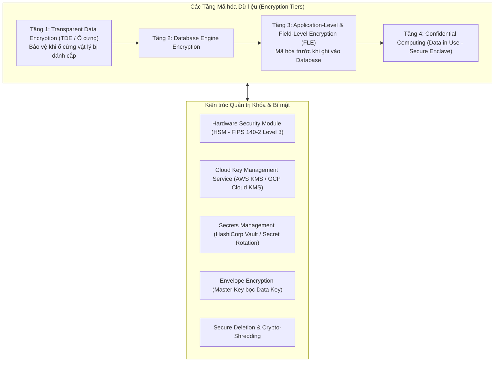
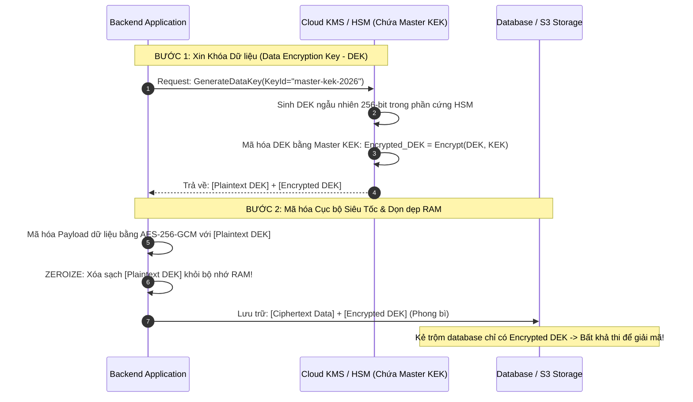
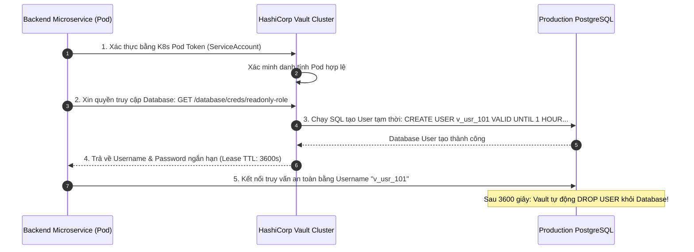
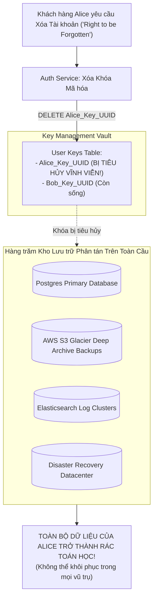

# 10.2. Data Encryption, Key Management and Secrets (Mã hóa Dữ liệu, Quản trị Khóa & Bí mật Hệ thống)

## Tổng quan về Data Encryption & Key Management
Trong vòng đời của dữ liệu số, dữ liệu luôn tồn tại ở một trong ba trạng thái:
1. **Dữ liệu Đang truyền (Data in Transit)**: Di chuyển qua cáp mạng, Internet (được bảo vệ bởi TLS 1.3 / mTLS / IPsec).
2. **Dữ liệu Đang lưu trữ (Data at Rest)**: Nằm trên ổ cứng SSD/HDD, Database blocks, Object Storage, Backups (được bảo vệ bởi TDE, Field-Level Encryption, Envelope Encryption).
3. **Dữ liệu Đang xử lý (Data in Use)**: Nằm trong bộ nhớ RAM và thanh ghi CPU (được bảo vệ bởi Confidential Computing / AMD SEV / Intel SGX).

Tuy nhiên, định lý tối thượng của mật mã học là: **Một hệ thống mã hóa chỉ an toàn bằng chính cách mà Khóa Bí Mật (Cryptographic Keys) của nó được bảo vệ**. Nếu khóa mã hóa được lưu ngay bên cạnh dữ liệu hoặc hardcode trong file mã nguồn, toàn bộ hệ thống mã hóa trở nên vô nghĩa. Do đó, việc xây dựng kiến trúc **Envelope Encryption (Mã hóa Phong bì)**, kết hợp thiết bị phần cứng chuyên dụng (**HSM - Hardware Security Module**), hệ thống quản trị bí mật (**HashiCorp Vault / Cloud Secrets Manager**) và quy trình tiêu hủy dữ liệu số an toàn (**Crypto-shredding**) là nền tảng sống còn của kỹ thuật an ninh dữ liệu.



---

## 2. Chi tiết từng Keyword (Under-the-Hood Deep Dive)

### 1. Encryption Tiers: At Rest, In Transit, Field-Level, Application-Level & TDE

#### 1. Khái niệm bản chất (What & Why)
- **Data Encryption at Rest (Mã hóa Dữ liệu Lưu trữ)**: Cơ chế mã hóa dữ liệu khi nó được ghi xuống các thiết bị lưu trữ cố định (Ổ cứng SSD, SAN, S3 Buckets, Database tablespaces). Nếu kẻ gian đột nhập vào Datacenter tháo trộm ổ cứng mang về nhà cắm vào máy khác, chúng chỉ đọc được các byte ngẫu nhiên vô nghĩa.
- **Transparent Data Encryption (TDE - Mã hóa Dữ liệu Minh bạch)**: Tính năng mã hóa ở tầng nhân của Database Engine (Oracle, Microsoft SQL Server, MySQL Enterprise, PostgreSQL via pgcrypto):
  - *Minh bạch*: Toàn bộ quá trình mã hóa (khi ghi ra đĩa) và giải mã (khi đọc vào buffer pool) diễn ra tự động bên dưới nhân database mà **không đòi hỏi lập trình viên phải thay đổi một dòng code SQL nào**.
  - *Nhược điểm chí tử của TDE*: TDE chỉ bảo vệ khi ổ đĩa bị tháo trộm. Nếu kẻ tấn công khai thác thành công lỗi SQL Injection hoặc chiếm được tài khoản Database User, **toàn bộ dữ liệu truy vấn lên vẫn là Plaintext**!
- **Application-Level & Field-Level Encryption (Mã hóa Tầng Ứng dụng & Cấp độ Trường)**:
  - Dữ liệu nhạy cảm (Số thẻ tín dụng, Số CMND) được **mã hóa trực tiếp bằng code của Backend Server TRƯỚC KHI gửi câu lệnh INSERT sang Database**.
  - Trong Database, các trường này chỉ là các chuỗi Base64 bản mã vô nghĩa.
  - *Ưu điểm tối thượng*: Ngay cả khi Database Administrator (DBA) có toàn quyền `superuser` hoặc Database bị hacker dump toàn bộ dữ liệu ra ngoài, kẻ tấn công **vẫn hoàn toàn bất lực vì Khóa Giải mã nằm trong RAM của Backend Server, không nằm trong Database**!

#### 2. Cơ chế hoạt động sâu (Under the hood / Hardcore Internals)
- **Mô hình Mã hóa Phong bì (Envelope Encryption Architecture)**:
  Làm thế nào để mã hóa hàng Terabytes dữ liệu mà không làm nghẽn máy chủ quản lý khóa (KMS/HSM)?
  Thay vì gửi toàn bộ 1TB dữ liệu sang KMS để mã hóa:
  1. Backend gọi KMS yêu cầu sinh một cặp khóa:
     $$\text{KMS sinh:} \quad \textbf{DEK (Data Encryption Key - Plaintext)} \quad \text{và} \quad \textbf{Encrypted DEK}$$
     (Trong đó `Encrypted DEK` đã được mã hóa bằng **Master Key (KEK - Key Encryption Key)** nằm bất biến an toàn bên trong phần cứng HSM).
  2. Backend nhận được `DEK` trong RAM, dùng thuật toán đối xứng siêu tốc độ **AES-256-GCM** mã hóa cục bộ toàn bộ file dữ liệu 1TB.
  3. Sau khi mã hóa xong, Backend **LẬP TỨC XÓA BỎ (Zeroize) bản rõ `DEK` khỏi RAM**.
  4. Backend lưu trữ file bản mã kèm theo chuỗi `Encrypted DEK` ngay bên cạnh file (đóng gói như một chiếc phong bì).
  5. Khi cần giải mã: Backend gửi `Encrypted DEK` lên KMS để xin lại `DEK` trong tích tắc, giải mã file xong lại xóa ngay `DEK` khỏi bộ nhớ.

#### 3. Sơ đồ minh họa (Quy trình Mã hóa Phong bì - Envelope Encryption với KMS/HSM)


#### 4. Code ví dụ thực chiến (TypeScript Envelope Encryption with AES-256-GCM & Memory Zeroing)
```typescript
import * as crypto from 'crypto';

interface EncryptedEnvelope {
    encryptedDataHex: string;
    encryptedDekHex: string; // Trong thực tế được mã hóa bởi AWS KMS KEK
    ivHex: string;
    authTagHex: string;
}

export class EnvelopeEncryptionEngine {
    // Giả lập Master Key KEK (Trong thực tế KEK nằm trong HSM không bao giờ rời khỏi phần cứng)
    private static readonly MASTER_KEK = crypto.randomBytes(32);

    /**
     * Mã hóa dữ liệu theo mô hình Envelope Encryption
     */
    public static encryptEnvelope(plaintextPayload: string): EncryptedEnvelope {
        // 1. Sinh Data Encryption Key (DEK) 256-bit ngẫu nhiên
        const plainDek = crypto.randomBytes(32);
        const iv = crypto.randomBytes(12); // GCM Standard IV

        // 2. Mã hóa dữ liệu người dùng bằng DEK
        const cipher = crypto.createCipheriv('aes-256-gcm', plainDek, iv);
        let encryptedData = cipher.update(plaintextPayload, 'utf8', 'hex');
        encryptedData += cipher.final('hex');
        const authTag = cipher.getAuthTag();

        // 3. Mã hóa DEK bằng Master Key KEK
        const kekIv = crypto.randomBytes(12);
        const kekCipher = crypto.createCipheriv('aes-256-gcm', this.MASTER_KEK, kekIv);
        let encryptedDek = kekCipher.update(plainDek.toString('hex'), 'utf8', 'hex');
        encryptedDek += kekCipher.final('hex');

        // 4. BẢO MẬT TỐI THƯỢNG: Zeroize bộ nhớ RAM của Plaintext DEK
        plainDek.fill(0);
        console.log("[Envelope Security] Plaintext DEK safely wiped from memory.");

        return {
            encryptedDataHex: encryptedData,
            encryptedDekHex: `${kekIv.toString('hex')}:${kekCipher.getAuthTag().toString('hex')}:${encryptedDek}`,
            ivHex: iv.toString('hex'),
            authTagHex: authTag.toString('hex')
        };
    }
}
```

#### 5. Ưu / Nhược điểm, Pitfalls & Anti-patterns
- **Pitfall**: Dùng duy nhất một khóa tĩnh (Hardcoded Key) trong file cấu hình để mã hóa cho tất cả các bảng database. Nếu khóa này bị lộ, toàn bộ dữ liệu lịch sử trong 10 năm qua của công ty đều bị giải mã đồng loạt.
- **Anti-pattern**: Lưu trữ khóa mã hóa trong cùng một Database hoặc cùng một Server với dữ liệu bản mã (Vi phạm nguyên tắc phân tách trách nhiệm Segregation of Duties).

#### 6. Ứng dụng thực tế trong Backend / Systems
Kiến trúc mã hóa mặc định của **AWS S3 Server-Side Encryption (SSE-KMS)**, Google Cloud Storage Customer-Managed Encryption Keys (CMEK), và cơ chế Field-Level Encryption trong MongoDB Client-Side Field Level Encryption (CSFLE).

---

### 2. Key Management Services, HSM & Secrets Management

#### 1. Khái niệm bản chất (What & Why)
- **Key Management (Quản trị Khóa Mật mã)**: Hệ thống quy trình và công nghệ quản lý toàn diện vòng đời của các khóa mật mã: Sinh khóa (Generation), Phân phối (Distribution), Sử dụng (Usage), Luân chuyển (Rotation), Lưu trữ an toàn (Storage), Thu hồi (Revocation) và Tiêu hủy (Destruction) theo chuẩn NIST SP 800-57.
- **Hardware Security Module (HSM - Thiết bị Phần cứng Bảo mật Chuyên dụng)**: Thiết bị vật lý được gia cố chống can thiệp vật lý (Tamper-resistant silicon hardware), đạt chứng nhận bảo mật quân sự **FIPS 140-2 Level 3 hoặc Level 4**:
  - Khóa mật mã được sinh ra và cất giữ bên trong chip silicon của HSM. **KHÔNG BAO GIỜ có bất kỳ API nào có thể xuất (Export) Private Key ra khỏi HSM**!
  - Mọi thao tác ký số hoặc giải mã đều diễn ra trực tiếp bên trong bo mạch của HSM.
  - Nếu kẻ tấn công cố tình mở vỏ bọc vật lý, khoan vi mạch hoặc đo điện áp, cảm biến phần cứng của HSM sẽ tự động kích hoạt cơ chế xóa trắng toàn bộ khóa mật mã trong microsecond (Zeroization / Self-Destruct)!
- **Secrets Management (Quản lý Bí mật Hệ thống)**: Công cụ phần mềm chuyên dụng (như **HashiCorp Vault, AWS Secrets Manager, CyberArk**) được thiết kế để giải quyết vấn đề rò rỉ bí mật lập trình (Secrets Sprawl: Database passwords, API tokens, Private keys bị commit nhầm lên Git repository hoặc nằm trong file config tĩnh).

#### 2. Cơ chế hoạt động sâu (Under the hood / Hardcore Internals)
- **Tính năng Dynamic Ephemeral Credentials trong HashiCorp Vault**:
  Thay vì lưu trữ một mật khẩu Database vĩnh viễn trong file `.env`:
  1. Khi một Microservice backend khởi động, nó xác thực định danh với Vault qua Kubernetes Service Account Token.
  2. Microservice gọi API của Vault: "Hãy cấp cho tôi quyền truy cập PostgreSQL!".
  3. Vault tự động kết nối vào Database bằng quyền quản trị, chạy lệnh SQL sinh một User tạm thời duy nhất:
     `CREATE USER "v_app_99" WITH PASSWORD "random_secret_xyz" VALID UNTIL '2026-11-09 23:00:00';`
     `GRANT SELECT, INSERT ON orders TO "v_app_99";`
  4. Vault trao tài khoản này cho Microservice với thời hạn sống ngắn (TTL: 1 giờ).
  5. Khi hết 1 giờ, nếu Microservice không gia hạn (Lease Renewal), Vault sẽ **tự động gọi lệnh `DROP USER "v_app_99"` trên Database**!
  - *Lợi ích*: Hoàn toàn không có bất kỳ mật khẩu tĩnh nào tồn tại trên đĩa cứng; nếu hacker trộm được mật khẩu này, nó cũng tự động biến mất sau 1 tiếng.

#### 3. Sơ đồ minh họa (Kiến trúc Cấp phát Bí mật Động của HashiCorp Vault)


#### 4. Code ví dụ thực chiến (C++ Secure Memory Zeroing & Allocation)
```cpp
#include <iostream>
#include <vector>
#include <cstring>
#include <openssl/crypto.h>

class SensitiveKeyBuffer {
private:
    std::vector<uint8_t> keyData;

public:
    SensitiveKeyBuffer(size_t size) : keyData(size, 0) {}

    ~SensitiveKeyBuffer() {
        // PHÒNG VỆ CHỐNG COMPILER OPTIMIZATION KHI XÓA BỘ NHỚ:
        // Nếu dùng hàm memset thông thường, Compiler C++ có thể tự ý tối ưu hóa
        // và bỏ qua lệnh memset vì biến sắp bị giải phóng (Dead Store Elimination)!
        // Bắt buộc phải sử dụng OPENSSL_cleanse hoặc memset_s để ép buộc ghi đè 0 vào RAM.
        if (!keyData.empty()) {
            OPENSSL_cleanse(keyData.data(), keyData.size());
            std::cout << "[Secure Destruction] Sensitive key memory safely cleansed via OPENSSL_cleanse.\n";
        }
    }

    uint8_t* data() { return keyData.data(); }
    size_t size() const { return keyData.size(); }
};

int main() {
    {
        SensitiveKeyBuffer masterKey(32);
        // Nạp khóa bí mật vào buffer
        std::memcpy(masterKey.data(), "SUPER_SECRET_PAYMENT_KEY_256_BIT", 32);
        std::cout << "Key loaded in secure RAM block.\n";
    } // Ra khỏi scope: Destructor tự động dọn sạch ô nhớ RAM ngay lập tức!

    return 0;
}
```

#### 5. Ưu / Nhược điểm, Pitfalls & Anti-patterns
- **Pitfall**: Commit file `.env` hoặc file cấu hình chứa private key vào Git repository (kể cả Git private nội bộ). Kẻ tấn công chỉ cần dùng công cụ quét lịch sử Git (TruffleHog, Gitleaks) là trích xuất được toàn bộ lịch sử mật khẩu từ ngày đầu dự án.
- **Anti-pattern**: Thực hiện luân chuyển bí mật (Secret Rotation) nhưng không hỗ trợ giai đoạn chuyển tiếp (Dual-secret support), khiến ứng dụng bị crash khi kết nối database với mật khẩu mới trong khi connection pool cũ chưa kịp nạp lại.

#### 6. Ứng dụng thực tế trong Backend / Systems
Tiêu chuẩn quản trị bí mật bắt buộc của **HashiCorp Vault, AWS Secrets Manager, Google Cloud Secret Manager**, và hệ thống quản lý khóa HSM đạt chuẩn FIPS 140-2 Level 3 (CloudHSM).

---

### 3. Data Retention, Secure Deletion (Crypto-shredding) & Backup Encryption

#### 1. Khái niệm bản chất (What & Why)
- **Data Retention Policy (Chính sách Lưu trữ Dữ liệu)**: Quy định chính thức về khoảng thời gian tối đa mà một bản ghi dữ liệu được phép tồn tại trong hệ thống trước khi phải bị tiêu hủy vĩnh viễn (ví dụ: Log truy cập lưu 90 ngày; Hóa đơn tài chính lưu 5 năm theo luật kế toán; Dữ liệu người dùng yêu cầu xóa tài khoản phải bị tiêu hủy trong vòng 30 ngày theo GDPR "Right to be Forgotten").
- **Secure Data Deletion (Tiêu hủy Dữ liệu An toàn)**: Khi thực hiện lệnh `DELETE` trong SQL hoặc `rm file` trong Linux, hệ điều hành chỉ đơn thuần đánh dấu khối dữ liệu đó là "trống" (Unallocated) trên bảng Inode; **các bit dữ liệu vật lý 0 và 1 vẫn nằm nguyên vẹn trên bề mặt đĩa từ hoặc chip flash SSD** và có thể dễ dàng khôi phục lại bằng các phần mềm phục hồi dữ liệu chuyên dụng!
- **Crypto-shredding (Tiêu hủy Mật mã học)**: Giải pháp kỹ thuật đỉnh cao để tiêu hủy dữ liệu phân tán:
  Thay vì phải tìm và ghi đè vật lý hàng ngàn bản backup phân tán trên khắp thế giới: **Dữ liệu của mỗi người dùng được mã hóa bằng một Khóa Riêng Biệt (Per-User Encryption Key)**. Khi người dùng yêu cầu xóa tài khoản, hệ thống **CHỈ CẦN TIÊU HỦY DUY NHẤT KHÓA MÃ HÓA CỦA NGƯỜI ĐÓ**. Không còn khóa, toàn bộ dữ liệu lưu trữ, bản sao lưu và bản nhân bản trên toàn cầu lập tức trở thành các bit rác ngẫu nhiên không thể giải mã trong hàng triệu năm, hoàn thành việc tiêu hủy dữ liệu chỉ trong 1 mili-giây!
- **Backup Encryption (Mã hóa Bản sao lưu)**: Bắt buộc mã hóa toàn bộ các file backup cơ sở dữ liệu (`mysqldump`, `pg_dump`, EBS snapshots) độc lập với mã hóa của database chính.

#### 2. Cơ chế hoạt động sâu (Under the hood / Hardcore Internals)
- **Tại sao Lệnh Ghi đè Vật lý (Overwrite) Thất bại trên Ổ cứng Thể rắn SSD?**:
  Trên ổ SSD hiện đại, bộ điều khiển (SSD Controller) sử dụng thuật toán **Wear Leveling** để phân bổ đều số lần ghi lên các chip nhớ Flash NAND nhằm kéo dài tuổi thọ ổ cứng.
  - Khi bạn chạy lệnh ghi đè số `0` lên khối địa chỉ logic cũ (LBA): Bộ điều khiển SSD sẽ **ghi số 0 vào một khối vật lý hoàn toàn mới** và đánh dấu khối vật lý cũ vào danh sách chờ dọn rác (Garbage Collection / TRIM). Dữ liệu nhạy cảm cũ vẫn nằm nguyên vẹn trên chip Flash!
  - Do đó, đối với hạ tầng Cloud và ổ cứng SSD, **Crypto-shredding là phương pháp duy nhất được chứng nhận toán học để đảm bảo dữ liệu không thể phục hồi**.

#### 3. Sơ đồ minh họa (Cơ chế Tiêu hủy Dữ liệu Siêu Tốc Bằng Crypto-Shredding)


#### 4. Code ví dụ thực chiến (TypeScript Per-Tenant Crypto-Shredding Service)
```typescript
import * as crypto from 'crypto';

export class CryptoShreddingManager {
    // Lưu trữ bảng khóa độc lập cho từng Tenant/User
    private static userEncryptionKeys = new Map<string, Buffer>();

    public static registerUserKey(userId: string): void {
        const key = crypto.randomBytes(32); // AES-256 Key
        this.userEncryptionKeys.set(userId, key);
    }

    public static encryptUserData(userId: string, plaintext: string): { ciphertextHex: string; ivHex: string } {
        const key = this.userEncryptionKeys.get(userId);
        if (!key) throw new Error("Encryption Key not found. User may have been shredded!");

        const iv = crypto.randomBytes(12);
        const cipher = crypto.createCipheriv('aes-256-gcm', key, iv);
        let encrypted = cipher.update(plaintext, 'utf8', 'hex');
        encrypted += cipher.final('hex');

        return { ciphertextHex: encrypted, ivHex: iv.toString('hex') };
    }

    /**
     * THAO TÁC TIÊU HỦY DỮ LIỆU AN TOÀN (CRYPTO-SHREDDING):
     * Xóa sạch khóa mã hóa khỏi RAM và Database -> Tiêu hủy toàn bộ dữ liệu trên toàn cầu!
     */
    public static cryptoShredUser(userId: string): void {
        const key = this.userEncryptionKeys.get(userId);
        if (key) {
            // 1. Ghi đè 0 vào vùng nhớ RAM trước khi giải phóng
            key.fill(0);
            // 2. Xóa khỏi Key Vault vĩnh viễn
            this.userEncryptionKeys.delete(userId);
            console.log(`[Crypto-Shredding Completed] User ${userId} key destroyed. All associated data is permanently unrecoverable.`);
        }
    }
}
```

#### 5. Ưu / Nhược điểm, Pitfalls & Anti-patterns
- **Pitfall**: Lưu file backup không mã hóa trên các Cloud Storage Buckets công khai (như cấu hình S3 Bucket public). Hàng ngàn vụ rò rỉ dữ liệu lớn trên thế giới xảy ra do hacker quét các bucket backup bị mở quyền truy cập `AllUsers`.
- **Anti-pattern**: Thực hiện xóa tài khoản người dùng trong Database nhưng lưu giữ các file log và backup chứa PII dạng plaintext trong nhiều năm mà không có cơ chế dọn dẹp theo vòng đời (Lifecycle Rules).

#### 6. Ứng dụng thực tế trong Backend / Systems
Mô hình tiêu hủy dữ liệu chuẩn mực để tuân thủ quyền được quên (**GDPR Article 17 - Right to Erasure**) của các tập đoàn công nghệ lớn (Apple, Google, Stripe).
