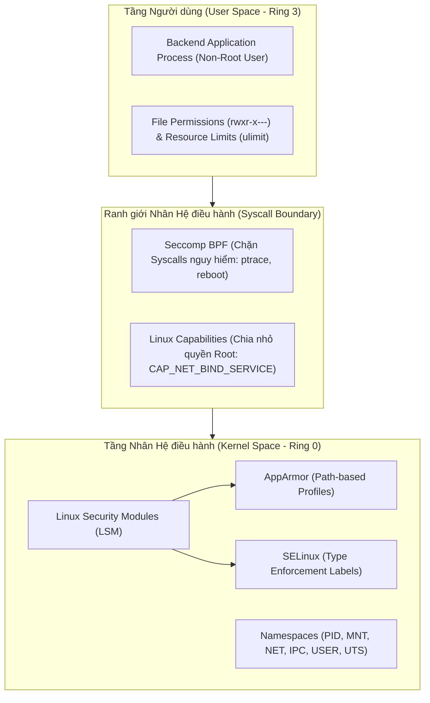
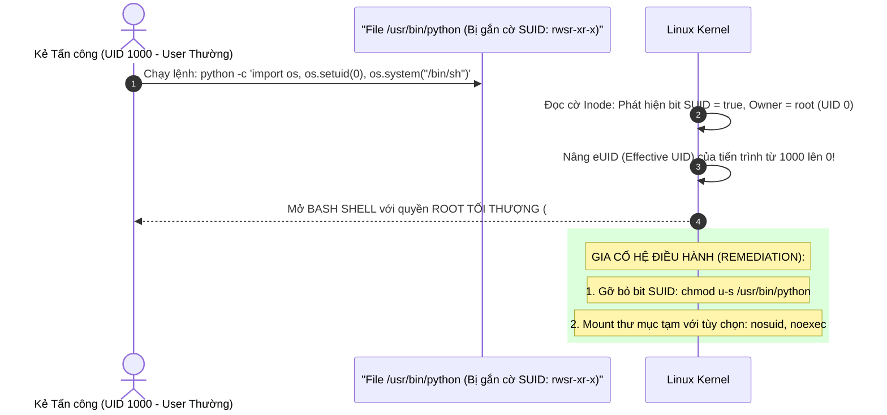
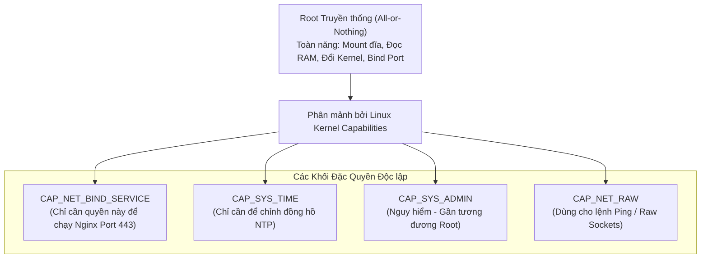
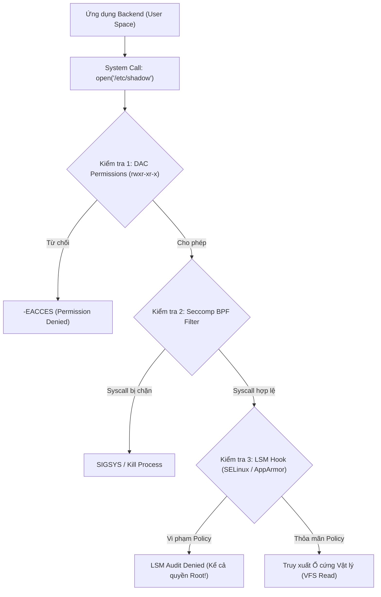

# 11.1. OS Hardening and Linux Kernel Security (Gia cố Hệ điều hành & Bảo mật Nhân Linux)

## Tổng quan về Linux Systems Hardening
Hơn 90% các máy chủ Backend, Cloud Datacenters và Container Pods trên thế giới chạy trên nền tảng **Hệ điều hành Linux**. Mặc dù Linux được thiết kế với kiến trúc phân quyền đa người dùng vững chắc, một bản phân phối Linux mặc định (như Ubuntu hoặc Debian nguyên bản) chứa hàng trăm tiện ích, dịch vụ chạy ngầm và cấu hình lỏng lẻo không phù hợp cho môi trường sản xuất có tính đối kháng cao.

Gia cố Hệ điều hành (**Operating System Hardening**) là quá trình có phương pháp nhằm giảm thiểu tối đa bề mặt tấn công của hệ thống: Tước bỏ đặc quyền siêu người dùng qua **Linux Capabilities**, cô lập tài nguyên qua **Namespaces & Cgroups**, lọc các lời gọi hệ thống qua **Seccomp BPF**, và kích hoạt các module kiểm soát truy cập bắt buộc cấp nhân (**LSM - Linux Security Modules: AppArmor & SELinux**).



---

## 2. Chi tiết từng Keyword (Under-the-Hood Deep Dive)

### 1. OS Hardening, File System & User/Group Permissions

#### 1. Khái niệm bản chất (What & Why)
- **Operating System Hardening (Gia cố Hệ điều hành)**: Quy trình loại bỏ tất cả các dịch vụ không cần thiết (Tắt Telnet, FTP, rsh), cấu hình tối ưu các tham số nhân qua `/etc/sysctl.conf`, gỡ cài đặt các trình biên dịch trên production (gcc, make), đóng tất cả các cổng mạng dư thừa và áp dụng nguyên tắc **Least Privilege** cho hệ thống tập tin.
- **User and Group Permissions**: Phân tách tài khoản người dùng:
  - Tuyệt đối **CẤM chạy ứng dụng Backend dưới quyền tài khoản `root` (UID 0)**.
  - Mỗi dịch vụ (Nginx, PostgreSQL, Node.js app) phải sở hữu một tài khoản dịch vụ riêng biệt (Dedicated System User) không có shell đăng nhập (`/usr/sbin/nologin` hoặc `/bin/false`).
- **File System Permissions (Quyền trên Hệ thống Tập tin)**:
  - Cấu hình phân quyền nghiêm ngặt theo chuẩn DAC: Các file cấu hình bí mật chỉ cho phép quyền `600` (`rw-------`) hoặc `640` (`rw-r-----`).
  - Gắn cờ **Immutable Flag (`chattr +i file`)** cho các file nhị phân và file log trọng yếu để ngăn chặn ngay cả người dùng root cũng không thể sửa đổi hoặc xóa nếu chưa mở khóa cờ.
  - Phân vùng ổ đĩa riêng biệt với các tùy chọn mount an toàn trong `/etc/fstab`:
    - `noexec`: Cấm thực thi file nhị phân trên các thư mục tạm (`/tmp`, `/var/tmp`).
    - `nosuid`: Vô hiệu hóa bit SUID (chống leo thang đặc quyền).
    - `nodev`: Cấm tạo các file thiết bị phần cứng.

#### 2. Cơ chế hoạt động sâu (Under the hood / Hardcore Internals)
- **Hiểm họa của Bit SUID (Set User ID) và SGID**:
  Trong Linux, bit SUID (được biểu diễn bằng số `4` trong bát phân: ví dụ `chmod 4755 binary` hoặc ký tự `s` trong `rwsr-xr-x`):
  Khi một người dùng thông thường thực thi file này, tiến trình con sẽ **tự động chạy với đặc quyền của Chủ sở hữu file (Owner UID - thường là root)** thay vì UID của người gọi!
  - *Ví dụ hợp lệ*: Lệnh `/usr/bin/passwd` cần bit SUID để user thường có thể ghi mật khẩu mới vào file `/etc/shadow`.
  - *Hiểm họa Leo thang Đặc quyền (Privilege Escalation via SUID Binaries)*: Nếu các lệnh như `find`, `vim`, `bash`, hoặc `python` bị ai đó vô tình gắn bit SUID, kẻ tấn công chỉ cần chạy `find . -exec /bin/sh \; -quit` là lập tức có được **Root Shell**!
  - *Gia cố*: Quét và tước bỏ toàn bộ bit SUID không cần thiết trên hệ thống:
    `find / -perm -4000 -type f -exec ls -la {} \;`

#### 3. Sơ đồ minh họa (Mô hình Leo thang Đặc quyền qua Bit SUID và Cách Khắc phục)


#### 4. Code ví dụ thực chiến (C++ Drop Privileges to Dedicated Non-Root User via setuid)
```cpp
#include <iostream>
#include <unistd.h>
#include <sys/types.h>
#include <pwd.h>
#include <cerrno>
#include <cstring>

// Minh họa việc tự động tước bỏ quyền root ngay sau khi khởi tạo socket cổng thấp
class PrivilegeDropper {
public:
    static bool dropRootToUser(const std::string& targetUsername) {
        if (getuid() != 0) {
            std::cout << "[Privilege Guard] Process is already running as non-root (UID: " << getuid() << ").\n";
            return true;
        }

        // 1. Tìm thông tin người dùng trong /etc/passwd
        struct passwd* pw = getpwnam(targetUsername.c_str());
        if (!pw) {
            std::cerr << "Target user not found: " << targetUsername << "\n";
            return false;
        }

        // 2. Tước bỏ quyền nhóm trước (Group Privileges)
        if (setgid(pw->pw_gid) != 0) {
            std::cerr << "Failed to drop GID: " << strerror(errno) << "\n";
            return false;
        }

        // 3. Tước bỏ quyền người dùng (User Privileges: eUID & rUID)
        if (setuid(pw->pw_uid) != 0) {
            std::cerr << "Failed to drop UID: " << strerror(errno) << "\n";
            return false;
        }

        // 4. KIỂM TRA PHÒNG VỆ: Xác minh chắc chắn không thể nâng lại quyền root
        if (setuid(0) != -1) {
            std::cerr << "CRITICAL SECURITY FAULT: Regained root privileges unexpectedly!\n";
            exit(1);
        }

        std::cout << "[Privilege Dropped] Process permanently switched to UID: " 
                  << getuid() << " (" << targetUsername << ").\n";
        return true;
    }
};

int main() {
    std::cout << "Starting backend server initial setup...\n";
    // Giả sử server vừa bind cổng 443 với quyền root, sau đó hạ quyền xuống user 'nobody'
    PrivilegeDropper::dropRootToUser("nobody");
    return 0;
}
```

#### 5. Ưu / Nhược điểm, Pitfalls & Anti-patterns
- **Pitfall**: Đăng nhập SSH trực tiếp bằng tài khoản `root` qua Internet công cộng bằng mật khẩu. Kẻ tấn công sẽ quét cổng 22 và dùng từ điển vét cạn mật khẩu root 24/7. (Bắt buộc cấu hình `/etc/ssh/sshd_config`: `PermitRootLogin no` và `PasswordAuthentication no`, chỉ dùng SSH Key).
- **Anti-pattern**: Lưu trữ các file nhạy cảm trong thư mục `/tmp` có quyền `777` cho phép bất kỳ tiến trình người dùng nào khác trên cùng máy chủ đọc trộm.

#### 6. Ứng dụng thực tế trong Backend / Systems
Tiêu chuẩn gia cố máy chủ chuẩn quốc tế của **Center for Internet Security (CIS Benchmarks for Linux)** và DISA STIGs được áp dụng trong mọi ngân hàng và hệ thống quốc phòng.

---

### 2. Linux Capabilities & Namespaces

#### 1. Khái niệm bản chất (What & Why)
- **Vấn đề của Mô hình Quyền Truyền thống**:
  Trong Unix cổ điển, quyền hạn là nhị phân tuyệt đối: Hoặc bạn là người dùng bình thường (bị giới hạn mọi thứ), hoặc bạn là **`root` (toàn quyền sinh sát - All-or-Nothing Privilege Model)**. Nếu một web server chỉ cần lắng nghe cổng 80 (cổng dưới 1024), nó buộc phải chạy dưới quyền `root`. Nếu server bị dính lỗi RCE, hacker sẽ chiếm trọn toàn bộ máy chủ!
- **Linux Capabilities (POSIX 1003.1e - Chia nhỏ Quyền Root)**:
  Giải pháp cách mạng của nhân Linux: Chia nhỏ quyền hạn toàn năng của `root` thành **khoảng 40 đặc quyền độc lập, riêng biệt (Capabilities)**:
  - `CAP_NET_BIND_SERVICE`: Cho phép bind vào các cổng mạng thấp ($< 1024$) mà không cần bất kỳ quyền root nào khác!
  - `CAP_SYS_ADMIN`: Quyền quản trị hệ thống nặng (Tương đương root - Cực kỳ nguy hiểm).
  - `CAP_SYS_PTRACE`: Quyền theo dõi và debug bộ nhớ của tiến trình khác (`ptrace`).
  - `CAP_CHOWN`: Cho phép thay đổi quyền sở hữu file.
  - `CAP_NET_ADMIN`: Cấu hình giao diện mạng, iptables.
- **Linux Namespaces (Không gian Tên Cô lập)**:
  Nền tảng công nghệ cốt lõi của **Containerization (Docker / Containerd)**. Namespaces bọc một tài nguyên hệ thống toàn cục vào một góc nhìn cô lập (Virtual View):
  1. `pid` (Process ID): Tiến trình bên trong namespace thấy mình là PID 1, hoàn toàn không thấy các tiến trình bên ngoài host.
  2. `net` (Network): Cung cấp card mạng, bảng định tuyến và cổng IP độc lập.
  3. `mnt` (Mount): Cung cấp hệ thống tập tin gốc riêng rẽ.
  4. `ipc` (Inter-Process Communication): Cách ly hàng đợi thông điệp và shared memory.
  5. `uts` (Hostname): Cung cấp tên máy chủ riêng.
  6. `user` (User IDs): Cho phép người dùng là root (UID 0) bên trong container nhưng chỉ là user thường (UID 100000) trên máy chủ vật lý bên ngoài!

#### 2. Cơ chế hoạt động sâu (Under the hood / Hardcore Internals)
- **Tập hợp Quyền Capabilities (The 5 Capability Sets)**:
  Mỗi tiến trình trong Linux duy trì 5 trường bitmask 64-bit trong cấu trúc `cred` của Task Struct:
  1. **Effective (`pE`)**: Các quyền hạn mà tiến trình thực sự đang dùng để kiểm tra bảo mật ngay tại thời điểm hiện tại.
  2. **Permitted (`pP`)**: Tập cha tối đa các quyền mà tiến trình được phép kích hoạt vào Effective set.
  3. **Inheritable (`pI`)**: Các quyền được kế thừa xuyên qua lệnh gọi hàm `execve`.
  4. **Bounding (`pB`)**: Giới hạn trần tối thượng: Tiến trình và con cháu không bao giờ có thể thu thập thêm quyền ngoài tập này.
  5. **Ambient (`pA`)**: Cho phép kế thừa quyền dễ dàng cho các tiến trình con không có SUID.

#### 3. Sơ đồ minh họa (Mô hình Chia nhỏ Quyền Root bằng Linux Capabilities)


#### 4. Code ví dụ thực chiến (C++ Linux Capabilities Inspection via libcap)
```cpp
#include <iostream>
#include <sys/capability.h>
#include <unistd.h>

class LinuxCapabilityInspector {
public:
    static void printProcessCapabilities() {
        // Lấy cấu trúc Capability hiện tại của tiến trình qua Syscall capget
        cap_t caps = cap_get_proc();
        if (!caps) {
            perror("cap_get_proc failed");
            return;
        }

        char* capText = cap_to_text(caps, nullptr);
        std::cout << "[Capabilities State] Current process capability sets:\n"
                  << (capText ? capText : "None (Fully Unprivileged)") << "\n";

        // Kiểm tra xem tiến trình có sở hữu quyền nguy hiểm CAP_SYS_ADMIN hay không
        cap_flag_value_t flagVal;
        cap_get_flag(caps, CAP_SYS_ADMIN, CAP_EFFECTIVE, &flagVal);
        std::cout << "Has CAP_SYS_ADMIN: " << (flagVal == CAP_SET ? "YES (HIGH RISK!)" : "NO (SECURE)") << "\n";

        cap_free(capText);
        cap_free(caps);
    }
};

int main() {
    std::cout << "Inspecting Linux Capabilities...\n";
    LinuxCapabilityInspector::printProcessCapabilities();
    return 0;
}
```

#### 5. Ưu / Nhược điểm, Pitfalls & Anti-patterns
- **Pitfall**: Chạy Docker Container với cờ `--privileged`. Cờ này trao cho container **toàn bộ 40 capabilities** và mở toang mọi ranh giới cách ly của kernel, cho phép kẻ tấn công dễ dàng thực hiện Container Escape để chiếm quyền máy chủ host!
- **Anti-pattern**: Gán trực tiếp file capabilities (`setcap cap_sys_admin+ep /path/to/binary`) mà không kiểm tra độ tin cậy của mã nguồn.

#### 6. Ứng dụng thực tế trong Backend / Systems
Mọi Container Runtime chuẩn OCI (Docker, Containerd, CRI-O) đều mặc định **Drop toàn bộ các capabilities nguy hiểm** và chỉ giữ lại một tập tối thiểu (như `CAP_CHOWN`, `CAP_FOWNER`, `CAP_SETUID`).

---

### 3. Seccomp, AppArmor & SELinux

#### 1. Khái niệm bản chất (What & Why)
- **Seccomp (Secure Computing Mode - BPF System Call Filtering)**:
  Cơ chế bảo vệ tầng nhân cho phép tiến trình tự giới hạn các **System Calls** mà nó được phép gọi:
  - Một máy chủ web thông thường chỉ cần khoảng 40 syscalls (như `read`, `write`, `epoll_wait`, `close`).
  - Nhân Linux có tới hơn **450 system calls** khác nhau (bao gồm các syscall cực kỳ nguy hiểm và dễ dính lỗi kernel zero-day như `ptrace`, `bpf`, `reboot`, `kexec_load`).
  - Seccomp cho phép cài đặt một bộ lọc BPF (Berkeley Packet Filter): Nếu tiến trình gọi một syscall nằm ngoài danh sách cho phép, Kernel lập tức gửi tín hiệu `SIGSYS` hoặc tiêu diệt tiến trình ngay lập tức!
- **LSM (Linux Security Modules) - Kiểm soát Truy cập Bắt buộc (MAC)**:
  - **AppArmor**: Hệ thống bảo mật MAC dựa trên **Đường dẫn Tập tin (Path-based Access Control)**. Cấu hình dễ đọc, trực quan (ví dụ: Quy định ứng dụng Nginx chỉ được phép đọc thư mục `/var/www/` và ghi vào `/var/log/nginx/`, mọi hành vi đọc `/etc/shadow` đều bị chặn đứng).
  - **SELinux (Security-Enhanced Linux)**: Được phát triển bởi Cơ quan An ninh Quốc gia Hoa Kỳ (NSA). Hoạt động dựa trên **Nhãn Bảo mật (Type Enforcement & Security Labels)** gắn chặt vào Inode của file và tiến trình, độc lập hoàn toàn với đường dẫn file. Cực kỳ mạnh mẽ và chặt chẽ, là tiêu chuẩn mặc định trên RedHat Enterprise Linux, CentOS và Android.

#### 2. Cơ chế hoạt động sâu (Under the hood / Hardcore Internals)
- **Cơ chế Hooking của Linux Security Module (LSM)**:
  Trong nhân Linux:
  Mỗi khi một tiến trình User-space gọi một system call (ví dụ: `open()`):
  1. Kernel kiểm tra quyền DAC truyền thống (Unix rwxr-xr-x) trước.
  2. Nếu DAC cho phép, trước khi thực sự truy cập vào tài nguyên phần cứng, Kernel sẽ gọi một **LSM Hook Function** (ví dụ: `security_file_open()`).
  3. Module bảo mật (SELinux / AppArmor) được nạp trong nhân sẽ đối chiếu nhãn Context của tiến trình (`scontext`) và nhãn Context của file mục tiêu (`tcontext`) với Ma trận Chính sách Bảo mật (Security Policy Rules) trong RAM:
     - Nếu chính sách không cho phép $\implies$ Trả về lỗi `-EACCES` ngay lập tức, ngay cả khi tiến trình đang chạy dưới quyền `root`!

#### 3. Sơ đồ minh họa (Kiến trúc Hooking Bảo vệ Đa Tầng của Linux Kernel)


#### 4. Code ví dụ thực chiến (C++ Strict Seccomp Syscall Whitelisting)
```cpp
#include <iostream>
#include <unistd.h>
#include <sys/prctl.h>
#include <linux/seccomp.h>
#include <linux/filter.h>
#include <linux/audit.h>
#include <sys/syscall.h>

void enforceStrictSeccomp() {
    // Ngăn chặn tiến trình con tự ý nâng quyền
    prctl(PR_SET_NO_NEW_PRIVS, 1, 0, 0, 0);

    // Kích hoạt chế độ SECCOMP_MODE_STRICT:
    // CHỈ CHO PHÉP DUY NHẤT 4 SYSCALLS TRÊN TOÀN BỘ NHÂN LINUX:
    // read(), write(), _exit(), sigreturn()! Mọi syscall khác đều bị KILL!
    if (prctl(PR_SET_SECCOMP, SECCOMP_MODE_STRICT) != 0) {
        perror("Failed to enable strict seccomp");
        exit(1);
    }
    std::cout << "[Seccomp Sandbox Active] Only read, write, exit syscalls are permitted.\n";
}

int main() {
    enforceStrictSeccomp();

    // 1. Syscall write hợp lệ -> Tiếp tục chạy bình thường
    const char* msg = "Executing secure sandboxed computational logic...\n";
    write(STDOUT_FILENO, msg, strlen(msg));

    // 2. Kẻ tấn công hoặc mã độc cố tình gọi syscall cấm (ví dụ: getpid hoặc socket)
    std::cout << "Attempting unauthorized syscall getpid()...\n";
    pid_t pid = syscall(SYS_getpid); // Nhân Linux sẽ gửi SIGKILL tiêu diệt tiến trình ngay tại đây!

    std::cout << "This line will NEVER execute! PID: " << pid << "\n";
    return 0;
}
```

#### 5. Ưu / Nhược điểm, Pitfalls & Anti-patterns
- **Pitfall**: Tắt vĩnh viễn SELinux (`SELINUX=disabled` trong `/etc/selinux/config`) mỗi khi gặp lỗi phân quyền service thay vì học cách gán đúng nhãn Context (`chcon -t httpd_sys_content_t`). Thao tác này biến toàn bộ máy chủ thành miếng mồi ngon cho hacker.
- **Anti-pattern**: Chạy Docker containers với Seccomp profile bị vô hiệu hóa (`--security-opt seccomp=unconfined`).

#### 6. Ứng dụng thực tế trong Backend / Systems
Cấu hình mặc định trong **Docker Container Security Profiles**, Red Hat OpenShift Enterprise Kubernetes, và kiến trúc hộp cát bảo mật của trình duyệt Google Chrome Sandbox.
