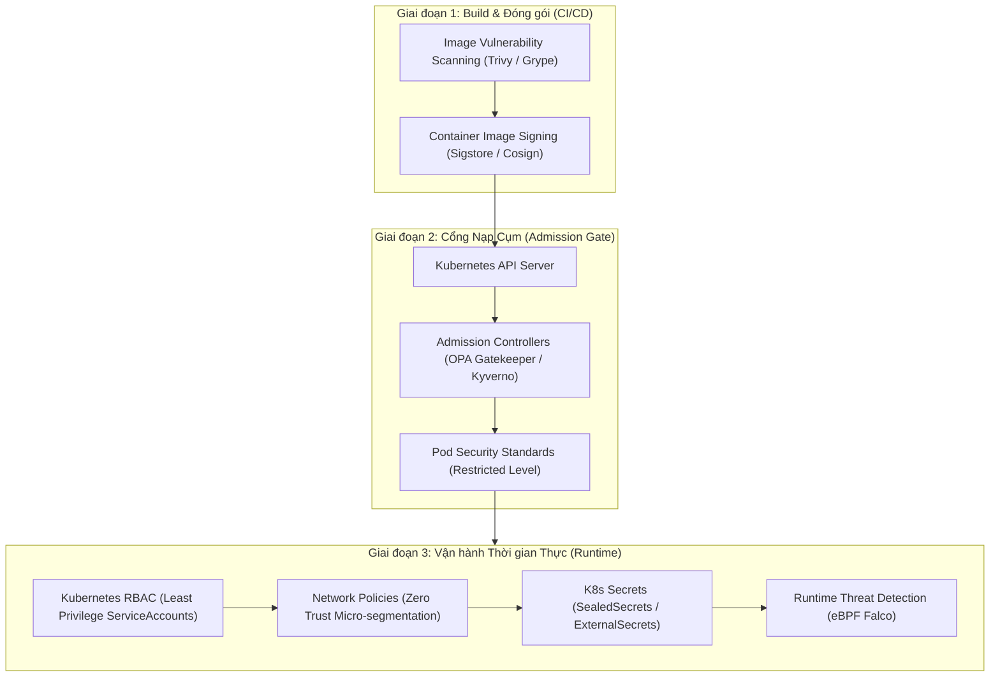
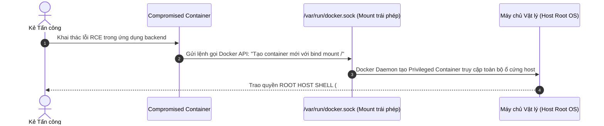
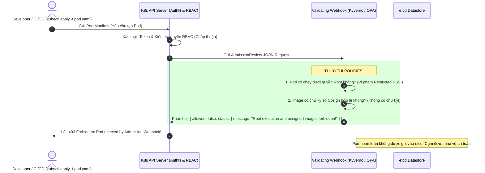
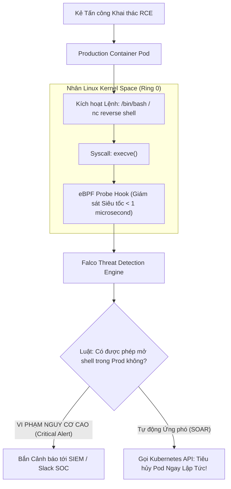

# 11.2. Container and Kubernetes Security (Bảo mật Container & Cụm Điều phối Kubernetes)

## Tổng quan về Cloud-Native Container Security
Sự trỗi dậy của công nghệ Container hóa (Docker, OCI Runtime) và hệ thống điều phối cụm (**Kubernetes - K8s**) đã thay đổi hoàn toàn cách thức phần mềm backend được đóng gói, phân phối và vận hành. Tuy nhiên, một quan niệm sai lầm phổ biến là: "Container giống như một Máy ảo (Virtual Machine)".

Thực chất, **Container không phải là Máy ảo** – tất cả các container trên cùng một nốt máy chủ đều **CHIA SẺ CHUNG MỘT NHÂN LINUX KERNEL DUY NHẤT**. Do đó, nếu một container bị xâm nhập và có thể thực hiện hành vi vượt rào (**Container Escape**), kẻ tấn công sẽ chiếm quyền kiểm soát toàn bộ máy chủ vật lý và toàn bộ các container láng giềng.

Bảo mật Container và Kubernetes đòi hỏi một chiến lược phòng thủ 4 giai đoạn khép kín: Từ giai đoạn build hình ảnh (**Image Scanning & Image Signing**), kiểm soát nạp vào cụm (**Admission Controllers & Pod Security Standards**), phân quyền nội bộ cụm (**Kubernetes RBAC**), cho đến giám sát hành vi bất thường thời gian thực (**Runtime Security**).



---

## 2. Chi tiết từng Keyword (Under-the-Hood Deep Dive)

### 1. Docker & Container Isolation Mechanics

#### 1. Khái niệm bản chất (What & Why)
- **Container Isolation (Cơ chế Cách ly Container)**: Container không có nhân riêng (No Hypervisor overhead). Sự cách ly của container được tạo nên từ 3 tính năng cốt lõi của Linux Kernel:
  1. **Namespaces**: Cách ly góc nhìn về tài nguyên (PID, Network, Mount, IPC, User).
  2. **Cgroups (Control Groups)**: Giới hạn lượng tài nguyên phần cứng tối đa mà container được phép tiêu thụ (CPU limits, Memory limits, I/O bandwidth).
  3. **LSM & Seccomp**: Giới hạn quyền hạn và system calls.
- **Docker Security Best Practices**:
  - **Non-Root Containers**: Luôn luôn khai báo chỉ thị `USER <non-root-uid>` trong Dockerfile (ví dụ: `USER 10001`). Mặc định nếu không khai báo, Docker sẽ chạy tiến trình bên trong container dưới quyền `root` (UID 0)!
  - **Read-Only Root Filesystem**: Khởi chạy container với cờ `--read-only`. Ngăn chặn kẻ tấn công tải và ghi mã độc hoặc webshell vào container.
  - **Distroless & Minimal Base Images**: Sử dụng các base image siêu nhỏ gọn (như `gcr.io/distroless/static` hoặc `alpine`) không chứa bash, curl, package manager, giảm thiểu tối đa bề mặt tấn công và số lượng CVEs thư viện.

#### 2. Cơ chế hoạt động sâu (Under the hood / Hardcore Internals)
- **Giải phẫu Cuộc tấn công Vượt rào Container (Container Escape via Docker Socket)**:
  Một lỗi cấu hình chết người phổ biến là mount trực tiếp socket của Docker host vào bên trong container:
  `docker run -v /var/run/docker.sock:/var/run/docker.sock vulnerable_app`
  - *Tại sao đây là thảm họa?*: Socket `/var/run/docker.sock` là giao diện Unix Domain Socket điều khiển Docker Daemon của máy chủ host (chạy dưới quyền root).
  - Kẻ tấn công bên trong container chỉ cần tải công cụ `docker` CLI hoặc gửi một HTTP POST request qua socket:
    ```bash
    # Khởi tạo một container mới mount toàn bộ ổ cứng gốc / của máy chủ host!
    curl -XPOST --unix-socket /var/run/docker.sock http://localhost/containers/create \
         -d '{"Image":"alpine","Cmd":["chroot","/host","bash"],"HostConfig":{"Binds":["/:/host"]}}'
    ```
    Hacker lập tức thoát ra khỏi container và có được Root Shell trên máy chủ vật lý bên ngoài!

#### 3. Sơ đồ minh họa (Mô hình Leo thang Container Escape qua Docker Socket)


#### 4. Code ví dụ thực chiến (Dockerfile Hardened Production Configuration)
```dockerfile
# GIAI ĐOẠN 1: Build nhị phân (Multi-stage build)
FROM golang:1.22-alpine AS builder
WORKDIR /app
COPY go.mod go.sum ./
RUN go mod download
COPY . .
# Biên dịch binary tĩnh (Statically linked) không phụ thuộc C library
RUN CGO_ENABLED=0 GOOS=linux go build -ldflags="-w -s" -o backend-api .

# GIAI ĐOẠN 2: Image sản xuất siêu bảo mật (Distroless)
# Distroless hoàn toàn KHÔNG có shell (/bin/sh), không có package manager, không có curl!
FROM gcr.io/distroless/static-debian12:nonroot

WORKDIR /app
# Sao chép binary từ builder stage
COPY --from=builder /app/backend-api /app/backend-api

# BẮT BUỘC: Chạy dưới quyền Non-root user (nonroot:nonroot có UID:GID 65532:65532)
USER nonroot:nonroot

# Lắng nghe cổng không đặc quyền (> 1024)
EXPOSE 8080

# Chạy ứng dụng trực tiếp mà không qua Shell wrapper
ENTRYPOINT ["/app/backend-api"]
```

#### 5. Ưu / Nhược điểm, Pitfalls & Anti-patterns
- **Pitfall**: Chạy container với tùy chọn `--pid=host` hoặc `--net=host`. Tùy chọn này xóa bỏ hoàn toàn rào cản cách ly Namespace của mạng và tiến trình, cho phép container nhìn thấy và can thiệp vào các tiến trình của máy chủ host.
- **Anti-pattern**: Lưu trữ API Keys, mật khẩu Database trực tiếp trong các lệnh `ENV` của Dockerfile. Bất kỳ ai có quyền pull image (`docker pull`) đều có thể chạy lệnh `docker history` hoặc `docker inspect` để đọc các mật khẩu này.

#### 6. Ứng dụng thực tế trong Backend / Systems
Mọi pipeline đóng gói container của Google, Netflix và các tiêu chuẩn bảo mật container **CIS Docker Benchmark**.

---

### 2. Kubernetes RBAC, Pod Security Standards & Admission Controllers

#### 1. Khái niệm bản chất (What & Why)
- **Kubernetes RBAC (Role-Based Access Control)**: Khung phân quyền kiểm soát toàn bộ các yêu cầu gửi tới Kubernetes API Server. Định nghĩa ai (Subjects: Users, Groups, ServiceAccounts) được phép thực thi hành động nào (`get`, `list`, `create`, `delete`) trên tài nguyên nào (`pods`, `services`, `secrets`, `namespaces`):
  - **Role & RoleBinding**: Phân quyền trong phạm vi một Namespace cụ thể.
  - **ClusterRole & ClusterRoleBinding**: Phân quyền trên phạm vi toàn cụm (Cluster-wide).
- **Pod Security Standards (PSS - Chuẩn Bảo mật Pod)**: Khung chuẩn hóa tích hợp sẵn trong Kubernetes thay thế cho PodSecurityPolicy cũ, chia làm 3 mức độ bảo vệ:
  1. **Privileged**: Không hạn chế (Dành cho System components, CNI plugins).
  2. **Baseline**: Mức tối thiểu (Chặn các quyền nguy hiểm nhất).
  3. **Restricted (Khuyến nghị cho Production)**: Cấm tuyệt đối chạy root (`runAsNonRoot: true`), cấm mount `hostPath`, bắt buộc drop capabilities `ALL` và chỉ cho phép `NET_BIND_SERVICE`, cấm nâng quyền (`allowPrivilegeEscalation: false`).
- **Admission Controllers**: Các cổng kiểm duyệt chặn giữa quá trình Kubernetes API Server nhận request và trước khi ghi đối tượng vào cơ sở dữ liệu `etcd`:
  - **Validating Admission Controller**: Kiểm tra tính hợp lệ của manifest (ví dụ: Chặn các pod không có nhãn quy chuẩn hoặc dùng image tag `:latest`).
  - **Mutating Admission Controller**: Tự động sửa đổi manifest trước khi nạp (ví dụ: Tự động tiêm Istio Sidecar Proxy vào Pod).
  - *Công cụ Công nghiệp*: **OPA Gatekeeper** và **Kyverno**.

#### 2. Cơ chế hoạt động sâu (Under the hood / Hardcore Internals)
- **Tấn công ServiceAccount Token Exfiltration trong Kubernetes**:
  Theo mặc định trong các cụm K8s cũ, mỗi khi một Pod được sinh ra, K8s tự động mount một JWT token vào thư mục:
  `/var/run/secrets/kubernetes.io/serviceaccount/token`.
  - Nếu lập trình viên vô tình gán quyền quá mức cho ServiceAccount của Pod đó (ví dụ: gán ClusterRole `admin` hoặc quyền `secrets: get`), kẻ tấn công sau khi khai thác được lỗi RCE trong container chỉ cần đọc file token này:
    `TOKEN=$(cat /var/run/secrets/kubernetes.io/serviceaccount/token)`
    `curl -k -H "Authorization: Bearer $TOKEN" https://kubernetes.default.svc/api/v1/secrets`
    Hacker có thể tải sạch toàn bộ Secrets của tất cả các dịch vụ khác trong toàn cụm Kubernetes!
  - **Phòng vệ**: Cấu hình `automountServiceAccountToken: false` cho tất cả các Pod không có nhu cầu giao tiếp với K8s API.

#### 3. Sơ đồ minh họa (Chu trình Kiểm duyệt của Kubernetes Admission Controllers)


#### 4. Code ví dụ thực chiến (YAML Kubernetes Least-Privilege RBAC & Restricted Pod Spec)
```yaml
# 1. ServiceAccount tối thiểu không tự mount token
apiVersion: v1
kind: ServiceAccount
metadata:
  name: order-service-sa
  namespace: production
automountServiceAccountToken: false # CHỐNG TRỘM TOKEN: Cấm tự động mount token K8s API

---
# 2. Pod Specification tuân thủ nghiêm ngặt Pod Security Standards 'Restricted'
apiVersion: v1
kind: Pod
metadata:
  name: hardened-order-api
  namespace: production
spec:
  serviceAccountName: order-service-sa
  securityContext: # Pod-level Security Context
    runAsNonRoot: true
    runAsUser: 10001
    runAsGroup: 10001
    fsGroup: 10001
    seccompProfile:
      type: RuntimeDefault # Bắt buộc kích hoạt Seccomp Profile mặc định của K8s
  containers:
  - name: api
    image: company-registry.internal/order-api:v1.2.0
    securityContext: # Container-level Security Context
      allowPrivilegeEscalation: false # Chặn tuyệt đối nâng đặc quyền SUID
      readOnlyRootFilesystem: true     # Khóa cứng hệ thống tập tin chỉ đọc
      capabilities:
        drop:
        - ALL # Tước bỏ TOÀN BỘ 40 capabilities của Linux!
    resources:
      limits:
        cpu: "1"
        memory: "512Mi"
      requests:
        cpu: "100m"
        memory: "128Mi"
```

#### 5. Ưu / Nhược điểm, Pitfalls & Anti-patterns
- **Pitfall**: Sử dụng vai trò `cluster-admin` cho các công cụ tự động hóa CI/CD mà không giới hạn quyền trong namespace cụ thể.
- **Anti-pattern**: Lưu trữ Kubernetes Secrets dưới dạng mặc định mà không bật mã hóa tại đĩa trong etcd (**EncryptionConfiguration**). Mặc định trong Kubernetes, Secrets chỉ được mã hóa Base64 đơn thuần và lưu dưới dạng bản rõ trong cơ sở dữ liệu `etcd`.

#### 6. Ứng dụng thực tế trong Backend / Systems
Tiêu chuẩn quản trị cụm bắt buộc của các dịch vụ Managed Kubernetes trên Cloud: **Amazon EKS, Google Cloud GKE, Azure AKS**, và chuẩn kiểm thử tự động **kube-bench**.

---

### 3. Container Image Scanning, Signing & Runtime Security (eBPF Falco)

#### 1. Khái niệm bản chất (What & Why)
- **Container Image Scanning (Quét Lỗ hổng Hình ảnh)**: Quy trình tự động phân tích các layer của Docker image trong CI/CD pipeline bằng các công cụ quét chuyên dụng (**Trivy, Grype, Clair, Snyk**) nhằm phát hiện:
  - Các gói phần mềm hệ điều hành (apt/apk) có chứa lỗ hổng bảo mật đã biết (**CVEs**).
  - Các thư viện phụ thuộc (npm, pip, maven) bị lỗi thời.
  - Các khóa bí mật, API keys vô tình bị nướng cứng (Baked-in secrets) vào image layer.
- **Container Image Signing (Ký số Hình ảnh Container - Sigstore Cosign)**: Cơ chế sử dụng chữ ký số mật mã học để chứng minh rằng: Image này thực sự được sinh ra từ chính pipeline CI/CD chính thức của công ty và **chưa từng bị thay đổi, chèn ép mã độc trong Container Registry**.
- **Runtime Security (Bảo vệ Thời gian Thực bằng eBPF)**: Công nghệ giám sát hành vi của container ngay khi nó đang chạy trên máy chủ:
  - Máy quét image chỉ bảo vệ lúc deploy; nếu một lỗi Zero-day mới xuất hiện khi pod đang chạy, chỉ có **Runtime Security** mới có thể phát hiện!
  - Sử dụng công nghệ **eBPF** (như công cụ **Falco** của CNCF) để hook trực tiếp vào Linux Kernel, giám sát mọi hành vi mở shell bất thường, sửa đổi file nhị phân trong container hoặc kết nối tới địa chỉ IP độc hại ngoài Internet.

#### 2. Cơ chế hoạt động sâu (Under the hood / Hardcore Internals)
- **Cơ chế Giám sát Siêu Tốc của eBPF Falco ở Tầng Kernel**:
  Khác với các phần mềm diệt virus truyền thống chạy ở User-space làm chậm hệ thống:
  - Falco nạp các chương trình eBPF bytecode nhỏ trực tiếp vào không gian Kernel.
  - Khi một hacker khai thác thành công lỗi RCE bên trong Pod và chạy lệnh `bash`:
    Syscall `sys_enter_execve` được kích hoạt trong Kernel.
    Chương trình eBPF bắt giữ sự kiện ngay tại microsecond đó, trích xuất: `ProcessName: "/bin/bash"`, `ContainerID: "abc123"`, `Namespace: "production"`.
    Falco đối chiếu với tập luật (Rule: *A shell was spawned in a production container!*), lập tức phát cảnh báo về SIEM và kích hoạt Webhook tiêu diệt Pod bị nhiễm ngay lập tức!

#### 3. Sơ đồ minh họa (Mô hình Giám sát Hành vi Bất thường Bằng eBPF Falco)


#### 4. Code ví dụ thực chiến (YAML Falco Threat Detection Rule for Container Shell Spawn)
```yaml
# Định nghĩa luật phát hiện mở Shell bất thường trong Container bằng Falco
- rule: Terminal Shell Spawned in Production Container
  desc: Detects an attempt to spawn an interactive shell inside a running production container
  condition: >
    spawned_process and 
    container and 
    container.image.repository not in (trusted_debug_images) and 
    proc.name in (bash, sh, zsh, ksh, csh) and 
    k8s.ns.name = "production"
  output: >
    CRITICAL SECURITY ALERT: Shell spawned inside container 
    (user=%user.name user_loginuid=%user.loginuid command=%proc.cmdline 
     container_id=%container.id container_name=%container.name 
     image=%container.image.repository namespace=%k8s.ns.name)
  priority: CRITICAL
  tags: [container, shell, mitre_execution, pci_dss]
```

#### 5. Ưu / Nhược điểm, Pitfalls & Anti-patterns
- **Pitfall**: Quét image một lần duy nhất lúc build rồi không bao giờ quét lại. Một image sạch ngày hôm nay có thể dính CVE Critical vào tuần sau khi lỗ hổng mới được công bố. (Bắt buộc phải **quét liên tục các image đang chạy trong Registry**).
- **Anti-pattern**: Sử dụng hình ảnh container với tag `:latest` (ví dụ: `image: node:latest`). Tag này có tính chất trôi nổi (Mutable); kẻ tấn công có thể ghi đè image tag này trên registry bằng mã độc và cụm K8s của bạn sẽ tự động kéo mã độc về chạy! Luôn luôn ghim image theo **SHA256 Immutable Digest** (`node@sha256:abc123...`).

#### 6. Ứng dụng thực tế trong Backend / Systems
Tiêu chuẩn chuỗi cung ứng container của Google Cloud Artifact Registry (Binary Authorization), AWS ECR Image Scanning, và tiêu chuẩn giám sát Runtime Security của CNCF.
