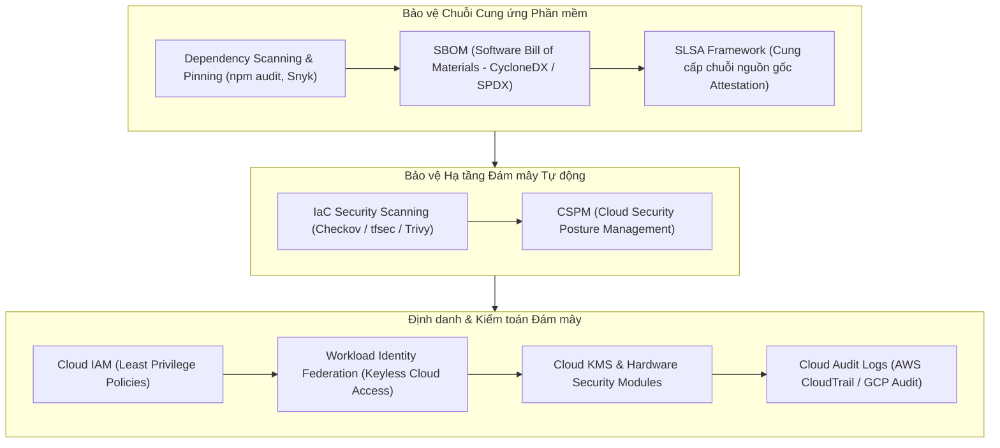
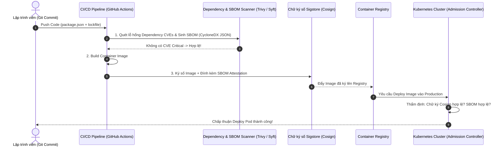
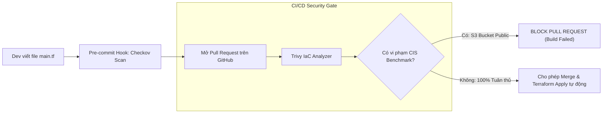
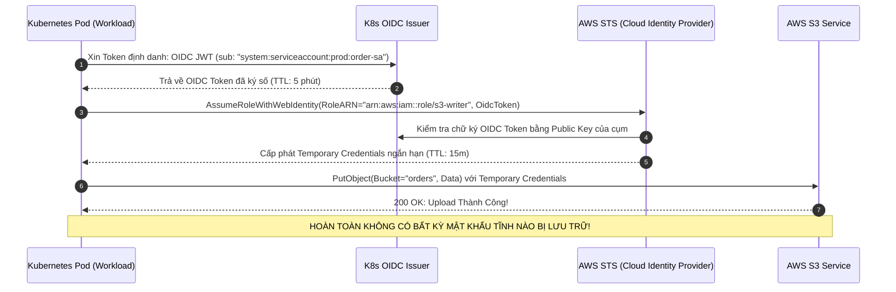

# 11.3. Supply Chain and Cloud Security (Bảo mật Chuỗi Cung ứng & An ninh Điện toán Đám mây)

## Tổng quan về Software Supply Chain & Cloud Security
Trong kỹ thuật phần mềm hiện đại, hơn 80% mã nguồn trong một ứng dụng backend không phải do các kỹ sư của công ty tự viết, mà được kéo về từ hàng ngàn thư viện nguồn mở của bên thứ ba (**Third-party Open-Source Dependencies** như npm, PyPI, Maven, Crates.io). Kẻ tấn công không còn tấn công trực diện vào tường lửa của công ty mà chuyển sang tấn công vào các mắt xích yếu hơn: Nhà phát triển thư viện, trình quản lý gói, và các script build CI/CD (**Tấn công Chuỗi cung ứng Phần mềm - Software Supply Chain Attacks** như SolarWinds, EventStream, XZ Utils backdoor).

Song song đó, trên môi trường đám mây (**Cloud Computing: AWS, GCP, Azure**), quyền kiểm soát truy cập (**IAM**), danh tính máy móc (**Workload Identity**), hạ tầng dạng mã (**Infrastructure as Code - IaC Security**) và kiểm toán an ninh đám mây (**Cloud Audit Logs, CSPM**) là các trụ cột định hình sự an toàn của toàn bộ tổ chức.



---

## 2. Chi tiết từng Keyword (Under-the-Hood Deep Dive)

### 1. Software Supply Chain Security, SBOM & Dependency Scanning

#### 1. Khái niệm bản chất (What & Why)
- **Software Supply Chain Security (Bảo mật Chuỗi Cung ứng Phần mềm)**: Toàn bộ quy trình bảo vệ mọi thành phần, công cụ và quy trình đi vào việc xây dựng phần mềm: Từ mã nguồn của lập trình viên, các kho lưu trữ bên thứ ba (Dependencies), hệ thống build máy chủ (CI/CD pipelines), trình biên dịch, cho đến container base images.
  - *Các Hình thức Tấn công Kinh điển*:
    - **Typosquatting**: Đăng ký các gói thư viện có tên gần giống với gói nổi tiếng (ví dụ: `cross-env` bị nhầm thành `crossenv` chứa mã độc đánh cắp biến môi trường).
    - **Dependency Confusion**: Tải các gói mã độc lên kho công khai (npm công cộng) trùng tên với các gói nội bộ riêng tư của công ty.
    - **Compromised Maintainer Account**: Hacker chiếm tài khoản của tác giả thư viện mã nguồn mở uy tín và phát hành phiên bản mới chứa backdoor (như vụ việc `ua-parser-js` hoặc backdoor nhị phân trong `xz-utils` CVE-2024-3094).
- **SBOM (Software Bill of Materials - Danh mục Thành phần Phần mềm)**: Danh sách kiểm kê toàn diện và có cấu trúc máy đọc được (chuẩn **CycloneDX** hoặc **SPDX**) ghi nhận mọi thư viện, phiên bản, giấy phép bản quyền và mã hash của tất cả các thành phần cấu thành nên phần mềm. Được ví như "Bảng thành phần dinh dưỡng" trên bao bì thực phẩm.
- **Dependency Scanning (Quét Thư viện Phụ thuộc)**: Công cụ tự động đối chiếu danh sách các package trong `package-lock.json`, `requirements.txt`, hoặc `go.sum` với cơ sở dữ liệu lỗ hổng toàn cầu (**NVD / GitHub Security Advisory Database**) để phát hiện các thư viện dính CVE đã biết.

#### 2. Cơ chế hoạt động sâu (Under the hood / Hardcore Internals)
- **Khung Tiêu chuẩn SLSA (Supply-chain Levels for Software Artifacts)**:
  Được Google và OpenSSF phát triển để ngăn chặn việc sửa đổi mã nhị phân trong CI/CD:
  - Cung cấp **Chứng thực Xuất xứ (Build Provenance / Attestations)** có chữ ký số:
    Một container image hay file nhị phân chỉ được coi là an toàn nếu nó kèm theo một chứng nhận mật mã học chứng minh được rằng:
    1. Mã nguồn được build từ chính xác Git commit nào.
    2. Được build trên môi trường CI/CD bất khả biến nào (GitHub Actions, Google Cloud Build).
    3. Không có sự can thiệp thủ công của bất kỳ con người nào vào quá trình biên dịch!

#### 3. Sơ đồ minh họa (Mô hình Tạo và Thẩm định SBOM trong CI/CD Pipeline)


#### 4. Code ví dụ thực chiến (JSON Snippet of CycloneDX Standard Software Bill of Materials - SBOM)
```json
{
  "bomFormat": "CycloneDX",
  "specVersion": "1.5",
  "serialNumber": "urn:uuid:3e671687-395b-41f5-a30f-a58921a69b79",
  "version": 1,
  "metadata": {
    "timestamp": "2026-11-09T10:00:00Z",
    "tools": [
      { "vendor": "Anchore", "name": "syft", "version": "1.0.0" }
    ],
    "component": {
      "type": "application",
      "name": "payment-microservice",
      "version": "2.4.0"
    }
  },
  "components": [
    {
      "type": "library",
      "name": "jsonwebtoken",
      "version": "9.0.2",
      "scope": "required",
      "hashes": [
        { "alg": "SHA-256", "content": "e3b0c44298fc1c149afbf4c8996fb92427ae41e4649b934ca495991b7852b855" }
      ],
      "licenses": [{ "license": { "id": "MIT" } }],
      "purl": "pkg:npm/jsonwebtoken@9.0.2"
    }
  ]
}
```

#### 5. Ưu / Nhược điểm, Pitfalls & Anti-patterns
- **Pitfall**: Không sử dụng file khóa phụ thuộc (**Lockfiles: `package-lock.json`, `yarn.lock`, `Poetry.lock`**). Khi chạy lệnh `npm install` trên CI/CD, hệ thống sẽ tự động kéo các phiên bản phụ thuộc con mới nhất (Minor/Patch updates), tạo cơ hội cho mã độc chuỗi cung ứng thâm nhập vào sản phẩm. (Luôn luôn dùng `npm ci` thay vì `npm install`).
- **Anti-pattern**: Bỏ qua các cảnh báo bảo mật của Dependabot hoặc Snyk trong nhiều tháng mà không có quy trình cập nhật bản vá.

#### 6. Ứng dụng thực tế trong Backend / Systems
Sắc lệnh hành pháp về An ninh Mạng Hoa Kỳ (US Executive Order 14028) hiện đã bắt buộc tất cả các nhà cung cấp phần mềm cho chính phủ liên bang phải cung cấp **SBOM (Software Bill of Materials)** hợp lệ cho mỗi bản phát hành.

---

### 2. Infrastructure as Code (IaC) Security & Cloud Security Posture Management (CSPM)

#### 1. Khái niệm bản chất (What & Why)
- **Infrastructure as Code (IaC - Hạ tầng Dạng Mã)**: Thực hành quản lý và cấp phát hạ tầng đám mây (Máy chủ, Tường lửa, Database, VPC, Load Balancers) thông qua các tệp mã nguồn khai báo (Declarative configuration files như **Terraform, AWS CloudFormation, Pulumi, Kubernetes Manifests**).
- **IaC Security Scanning (Quét Bảo mật Hạ tầng Dạng Mã)**: Quy trình phân tích tĩnh (Static Analysis) các tệp mã nguồn IaC trong Git repository trước khi chạy lệnh `terraform apply` nhằm phát hiện các cấu hình sai lầm nguy hiểm:
  - Một S3 bucket vô tình bị đặt cờ `acl = "public-read"`.
  - Một Security Group mở toàn bộ dải cổng ra Internet (`cidr_blocks = ["0.0.0.0/0"]`).
  - Một cụm Database PostgreSQL không kích hoạt mã hóa tại đĩa (`storage_encrypted = false`).
  - *Công cụ Tiêu chuẩn*: **Checkov, tfsec, KICS, Trivy**.
- **CSPM (Cloud Security Posture Management - Quản trị Tư thế An ninh Đám mây)**: Các nền tảng giám sát liên tục (như **Wiz, Prisma Cloud, AWS Security Hub**) quét toàn bộ tài nguyên thực tế đang chạy trên Cloud để phát hiện các sai lệch cấu hình (Configuration Drift), vi phạm quy chuẩn tuân thủ (CIS Benchmarks, PCI-DSS) và các rủi ro bảo mật phát sinh trong thời gian thực.

#### 2. Cơ chế hoạt động sâu (Under the hood / Hardcore Internals)
- **Shift-Left Security trong Hạ tầng Đám mây**:
  - *Chi phí sửa lỗi trên Production*: Một lỗi mở cổng Database ra Internet khi đã deploy lên AWS có thể dẫn đến việc rò rỉ toàn bộ cơ sở dữ liệu và tốn hàng triệu USD khắc phục sự cố.
  - *Shift-Left*: Bằng cách tích hợp công cụ quét Checkov vào **Pre-commit Hooks** và **Pull Request Check**: Lập trình viên viết sai code Terraform sẽ bị **chặn ngay tại lệnh `git push`** với hướng dẫn sửa lỗi tức thì. Chi phí phòng ngừa tiệm cận bằng 0!

#### 3. Sơ đồ minh họa (Quy trình Shift-Left IaC Security trong GitOps)


#### 4. Code ví dụ thực chiến (Terraform Secure AWS S3 Bucket Hardened Specification)
```hcl
# Định nghĩa S3 Bucket chuẩn an toàn cấp ngân hàng chống lại toàn bộ lỗi cấu hình IaC
resource "aws_s3_bucket" "secure_customer_data" {
  bucket        = "company-restricted-financial-records-2026"
  force_destroy = false

  tags = {
    Environment        = "production"
    DataClassification = "RESTRICTED_PII"
  }
}

# 1. Chặn hoàn toàn tất cả các quyền truy cập công khai (Block Public Access)
resource "aws_s3_bucket_public_access_block" "block_public" {
  bucket = aws_s3_bucket.secure_customer_data.id

  block_public_acls       = true
  block_public_policy     = true
  ignore_public_acls      = true
  restrict_public_buckets = true
}

# 2. Bắt buộc Mã hóa tại đĩa (Server-Side Encryption) bằng Customer-Managed KMS Key
resource "aws_s3_bucket_server_side_encryption_configuration" "kms_encryption" {
  bucket = aws_s3_bucket.secure_customer_data.id

  rule {
    apply_server_side_encryption_by_default {
      kms_master_key_id = "arn:aws:kms:us-east-1:123456789012:key/custom-kek-uuid"
      sse_algorithm     = "aws:kms"
    }
    bucket_key_enabled = true
  }
}

# 3. Kích hoạt tính năng Lưu trữ Phiên bản (Versioning) chống Ransomware ghi đè
resource "aws_s3_bucket_versioning" "versioning" {
  bucket = aws_s3_bucket.secure_customer_data.id
  versioning_configuration {
    status = "Enabled"
  }
}
```

#### 5. Ưu / Nhược điểm, Pitfalls & Anti-patterns
- **Pitfall**: Chỉ quét mã nguồn Terraform mà không bật CSPM trên Cloud. Quản trị viên có thể đăng nhập thẳng vào AWS Web Console và bấm chuột chỉnh sửa cấu hình thủ công (ClickOps), làm sai lệch trạng thái an toàn ban đầu (Configuration Drift).
- **Anti-pattern**: Sử dụng lệnh bỏ qua cảnh báo bảo mật (`#checkov:skip=CKV_AWS_20`) một cách vô tội vạ mà không có sự phê duyệt chính thức của Đội An ninh Thông tin (Security Lead).

#### 6. Ứng dụng thực tế trong Backend / Systems
Tiêu chuẩn tự động hóa hạ tầng đám mây của các tập đoàn tài chính (Capital One, JPMorgan Chase) tích hợp các công cụ **Checkov, OPA Conftest, và AWS Security Hub**.

---

### 3. Cloud IAM, Workload Identity & Cloud Audit Logs

#### 1. Khái niệm bản chất (What & Why)
- **Cloud IAM (Identity and Access Management)**: Hệ thống quản trị định danh và kiểm soát quyền truy cập trên các nền tảng đám mây (AWS, GCP, Azure). Cung cấp cơ chế phân quyền hạt nhân (**Least Privilege**) cho cả Người dùng (Users/Groups) và Máy móc (Roles/Service Accounts).
- **Workload Identity / Keyless Authentication (Xác thực Không Cần Khóa)**:
  - *Vấn đề Cũ*: Khi một ứng dụng chạy trên Kubernetes (hoặc GitHub Actions) cần kết nối vào AWS S3: Lập trình viên phải tạo một tài khoản IAM User, sinh cặp khóa tĩnh `AWS_ACCESS_KEY_ID` và `AWS_SECRET_ACCESS_KEY`, rồi lưu vào Kubernetes Secret hoặc GitHub Secrets. *Hậu quả*: Khóa tĩnh bị rò rỉ và tồn tại vĩnh viễn trên Internet.
  - *Cuộc Cách mạng Workload Identity*: **LOẠI BỎ HOÀN TOÀN KHÓA TĨNH (Zero Static Keys)**! Sử dụng cơ chế liên minh danh tính **OIDC Federation**: Cụm Kubernetes hoặc GitHub Actions tự phát hành một OIDC Token có ký số ngắn hạn (TTL: 5 phút). Cloud Provider (AWS STS / GCP IAM) xác thực chữ ký token này và tự động trao quyền cho tiến trình thực thi mà không cần bất kỳ mật khẩu nào!
- **Cloud Audit Logs (Nhật ký Kiểm toán Đám mây - AWS CloudTrail / GCP Cloud Audit Logs)**: Cơ chế bất biến ghi nhận mọi lời gọi API trên nền tảng đám mây: Bất kỳ ai thực hiện hành vi tạo máy ảo, xóa database, đổi quyền IAM đều bị ghi lại đầy đủ: `Timestamp`, `Actor`, `EventName`, `Source IP`, `Parameters`.

#### 2. Cơ chế hoạt động sâu (Under the hood / Hardcore Internals)
- **Quy trình Hoạt động của AWS IAM Roles for Service Accounts (IRSA)**:
  1. Pod trong Kubernetes khởi động, K8s nạp một OpenID Connect (OIDC) JWT Token vào Pod.
  2. AWS SDK bên trong Pod tự động đọc OIDC Token này và gọi hàm `sts:AssumeRoleWithWebIdentity` tới máy chủ AWS STS (Security Token Service).
  3. AWS STS đối chiếu OIDC Token với **OIDC Identity Provider** của cụm Kubernetes (đã đăng ký từ trước qua chứng chỉ công khai).
  4. Nếu chữ ký hợp lệ, AWS STS sinh ra một bộ thông tin xác thực tạm thời (**Temporary Security Credentials**: `AccessKeyId`, `SecretAccessKey`, `SessionToken`) với thời hạn sống chỉ **15 phút** và trả về cho Pod.
  5. Ứng dụng dùng thông tin ngắn hạn này để truy cập S3. Khi gần hết hạn, SDK tự động xoay vòng lấy thông tin mới mà lập trình viên không cần viết thêm dòng code nào!

#### 3. Sơ đồ minh họa (Mô hình Xác thực Không Cần Khóa - Workload Identity Federation)


#### 4. Code ví dụ thực chiến (JSON IAM Policy Following Strict Least Privilege Principles)
```json
{
  "Version": "2012-10-17",
  "Statement": [
    {
      "Sid": "AllowSpecificS3ObjectAccessOnly",
      "Effect": "Allow",
      "Action": [
        "s3:GetObject",
        "s3:PutObject"
      ],
      "Resource": "arn:aws:s3:::company-financial-reports-2026/invoices/*",
      "Condition": {
        "Bool": {
          "aws:SecureTransport": "true"
        },
        "StringEquals": {
          "s3:x-amz-server-side-encryption": "aws:kms"
        }
      }
    },
    {
      "Sid": "DenyUnencryptedCommunications",
      "Effect": "Deny",
      "Action": "s3:*",
      "Resource": "arn:aws:s3:::company-financial-reports-2026/*",
      "Condition": {
        "Bool": {
          "aws:SecureTransport": "false"
        }
      }
    }
  ]
}
```

#### 5. Ưu / Nhược điểm, Pitfalls & Anti-patterns
- **Pitfall**: Sử dụng chính sách quyền Admin rộng rãi (`Action: "*", Resource: "*"`) cho các ứng dụng backend để "tránh lỗi phân quyền". Khi pod bị RCE, hacker sẽ có toàn quyền xóa sạch toàn bộ tài nguyên trên Cloud account của công ty.
- **Anti-pattern**: Tắt tính năng ghi log CloudTrail / Cloud Audit Logs để "tiết kiệm chi phí lưu trữ". Khi xảy ra biến cố rò rỉ dữ liệu, bạn hoàn toàn mù tịt không thể điều tra pháp y (Forensics) xem hacker đã đột nhập qua con đường nào và đã đánh cắp những gì.

#### 6. Ứng dụng thực tế trong Backend / Systems
Tiêu chuẩn quản trị định danh hiện đại số một trên toàn cầu: **AWS IRSA (IAM Roles for Service Accounts)**, Google Cloud Workload Identity, và GitHub Actions OIDC Cloud Authentication.
