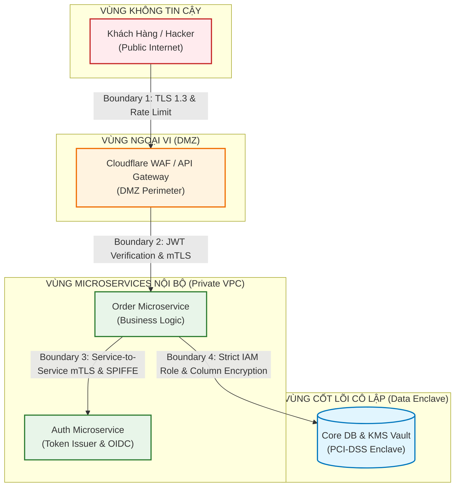
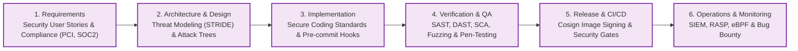
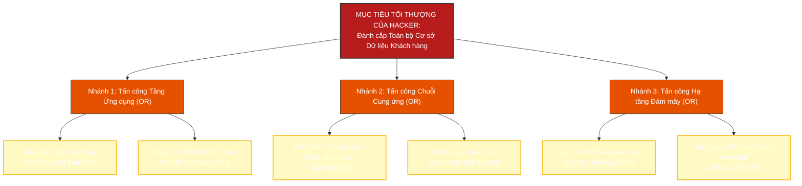

# 12.1. SSDLC, Threat Modeling and Secure Design: STRIDE, DREAD, Attack Trees & Defense-in-Depth

> [!IMPORTANT]
> **Nếu bạn chỉ được nhớ một điều duy nhất:** Bảo mật không phải là một tính năng (Feature) được đính kèm vào ngày cuối cùng trước khi bàn giao phần mềm, mà là thuộc tính kiến trúc nền tảng phải được thiết kế từ ngày đầu tiên. Theo **Quy tắc 1:10:100 (IBM Systems Sciences Institute)**: Một lỗi bảo mật kiến trúc nếu được phát hiện ở pha Thiết kế chỉ tốn **\$1** để sửa chữa trên bảng trắng; nếu lọt vào khâu Kiểm thử sẽ tốn **\$10**; nhưng một khi đã lọt ra môi trường **Production**, chi phí ứng cứu sự cố, đền bù khách hàng, phạt pháp lý (GDPR/PCI-DSS) và tổn hại uy tín thương hiệu sẽ vượt mức **\$100 - \$1000**! **Threat Modeling** chính là bài tập tư duy kỹ thuật bắt buộc: Chia cắt hệ thống qua các **Ranh giới Tin cậy (Trust Boundaries)**, thẩm vấn kiến trúc bằng 6 lăng kính **STRIDE**, lượng hóa rủi ro bằng ma trận **DREAD**, và thiết kế phòng ngự theo triết lý **Zero Trust: "Never Trust, Always Verify"**.

---

## 1. Kiến trúc Tổng quan & Mô hình Tư duy (Mental Model)

### 1.1. Ẩn dụ Đời sống: Lâu Đài Phòng Thủ Nhiều Lớp & Ngân Hàng Trung Ương

Hãy hình dung một pháo đài thời Trung Cổ hoặc một Ngân hàng Dự trữ Quốc gia:
- **Ngân hàng không bao giờ chỉ dựa vào một cánh cửa chính**: Cho dù cánh cửa thép bên ngoài có dày đến đâu, kẻ cướp vẫn có thể dùng thuốc nổ hoặc giả danh nhân viên bảo vệ để lọt qua.
- **Phòng ngự Chiều sâu (Defense-in-Depth)**:
  1. Bên ngoài là hàng rào camera và bảo vệ tuần tra (Perimeter Defense - WAF / DDoS Shield).
  2. Bước vào sảnh là cửa từ kiểm tra vũ khí và quầy tiếp tân yêu cầu thẻ căn cước (Authentication - IAM / OAuth2 / MFA).
  3. Lối vào kho tiền được bảo vệ bằng cửa thép hai lớp yêu cầu hai chìa khóa độc lập từ hai quản lý khác nhau (Authorization & Dual-Control - Multi-sig / RBAC).
  4. Bên trong hầm, các két sắt cá nhân tiếp tục được khóa riêng biệt (Data-at-Rest Encryption - AES-256 KMS).
  5. Mọi hành vi mở cửa đều kích hoạt chuông báo động ngầm và camera ghi hình không thể can thiệp (Immutable Audit Logging - WORM Storage).
- **Ranh giới Tin cậy (Trust Boundary)**: Vạch kẻ phân định giữa vỉa hè công cộng (Internet không tin cậy) và bên trong sảnh ngân hàng là một ranh giới tin cậy. Vạch kẻ giữa sảnh tiếp khách và kho tiền là một ranh giới tin cậy cấp độ cao hơn. Bất kỳ ai hay bất kỳ gói tin nào bước qua ranh giới này đều phải bị kiểm tra, soi chiếu và xác thực danh tính lại từ đầu.



---

## 2. Chi tiết từng Keyword (Under-the-Hood Deep Dive)

### 2.1. SSDLC Frameworks & Security Requirements (NIST SSDF, OWASP SAMM, Microsoft SDL)

#### 1. Bản chất Kỹ thuật & Thách thức Kiến trúc
Trong mô hình phát triển phần mềm truyền thống (Waterfall hoặc Agile ngây thơ), bảo mật thường bị coi là "vật cản" (Friction). Đội ngũ phát triển hoàn thiện toàn bộ mã nguồn rồi mới chuyển giao cho đội ngũ Pentest (Penetration Testing) rà soát trong 1 tuần trước ngày Go-Live. Khi phát hiện ra các lỗ hổng kiến trúc nghiêm trọng (như thiếu phân quyền đa người thuê - Multi-tenant BOLA, hoặc thiết kế database lưu plaintext mật khẩu), ban quản trị dự án buộc phải lựa chọn giữa hai thảm họa:
1. Trì hoãn ngày ra mắt nhiều tháng để đập đi xây lại toàn bộ kiến trúc; hoặc
2. Chấp nhận phát hành sản phẩm mang rủi ro bị khai thác và bị xử phạt hàng triệu USD.

**SSDLC (Secure Software Development Lifecycle)** giải quyết triệt để vấn đề này bằng triết lý **Shift-Left Security**: Đưa các hoạt động bảo vệ an ninh sang tận cùng bên trái của dòng thời gian phát triển (ngay từ khâu lấy yêu cầu và thiết kế kiến trúc).



#### 2. Cơ chế Hoạt động Sâu (Under-the-Hood)
- **NIST SSDF (SP 800-218 - Secure Software Development Framework)**:
  Bộ tiêu chuẩn bắt buộc của chính phủ Hoa Kỳ dành cho các nhà thầu phần mềm, phân bổ thành 4 nhóm thực hành:
  - *PO (Prepare the Organization)*: Đào tạo nhân sự, định nghĩa tiêu chuẩn mã nguồn an toàn.
  - *PS (Protect the Software)*: Bảo vệ tính toàn vẹn của mã nguồn (chống tấn công chuỗi cung ứng - Supply Chain Attacks, ký số commit git).
  - *PW (Produce Well-Secured Software)*: Thiết kế kiến trúc an toàn, mô hình hóa mối đe dọa, kiểm tra mã nguồn tự động.
  - *RV (Respond to Vulnerabilities)*: Quản lý chương trình tiết lộ lỗ hổng (Vulnerability Disclosure) và quy trình vá lỗi khẩn cấp (Hotfix).
- **Microsoft SDL (Security Development Lifecycle)**:
  Quy chuẩn định hình nền tảng an ninh của Microsoft Windows và Azure:
  - *Thiết lập Bug Bars / Quality Gates*: Quy định rõ ràng ngưỡng chấp nhận lỗi. Ví dụ: Bất kỳ lỗ hổng nào đạt điểm CVSS $\ge 7.0$ hoặc DREAD $\ge 7.5$ đều kích hoạt cơ chế **Chặn Đứng Phát Hành (Release Blocker)**.
  - *Security User Stories & Acceptance Criteria*: Bảo mật được định nghĩa tường minh trong Product Backlog:
    ```markdown
    User Story: Nạp tiền ví điện tử
    - Given: Người dùng đã đăng nhập với JWT hợp lệ.
    - Security Acceptance Criteria:
      1. [AuthZ]: Endpoint kiểm tra ID người nạp trùng với Sub claim trong JWT (Chống BOLA).
      2. [Anti-Replay]: Yêu cầu Header `X-Idempotency-Key` dạng UUIDv4, lưu cache Redis TTL 24h.
      3. [Race Condition]: Cập nhật số dư dùng lệnh `SELECT ... FOR UPDATE` trong DB transaction.
      4. [Rate Limit]: Giới hạn tối đa 5 requests/phút/IP.
    ```
- **OWASP SAMM (Software Assurance Maturity Model)**:
  Khung đánh giá mức độ trưởng thành an ninh thông tin của doanh nghiệp theo thang điểm từ Cấp độ 1 (Tự phát) đến Cấp độ 3 (Tối ưu hóa và tự động hóa toàn diện).

---

### 2.2. Threat Modeling Frameworks: STRIDE, DREAD, PASTA & Shostack's 4 Questions

#### 1. Bản chất Kỹ thuật & Thách thức Kiến trúc
Làm thế nào một đội ngũ kỹ sư có thể dự đoán trước được các chiêu thức tinh vi của kẻ tấn công trước khi viết một dòng code nào? Adam Shostack (tác giả cuốn sách kinh điển *"Threat Modeling: Designing for Security"*) đã quy chuẩn hóa toàn bộ quy trình này thành **4 Câu Hỏi Vàng**:
1. **Chúng ta đang xây dựng cái gì? (What are we building?)** $\implies$ Vẽ Data Flow Diagram (DFD) chi tiết.
2. **Điều gì có thể xảy ra sai sót? (What can go wrong?)** $\implies$ Áp dụng bảng phân loại mối đe dọa **STRIDE**.
3. **Chúng ta sẽ làm gì để khắc phục nó? (What are we going to do about it?)** $\implies$ Thiết kế các biện pháp giảm thiểu kỹ thuật (Mitigations).
4. **Chúng ta đã làm tốt công việc đó chưa? (Did we do a good job?)** $\implies$ Rà soát lại rủi ro tồn đọng (Residual Risk Review).

#### 2. Cơ chế Hoạt động Sâu (Under-the-Hood)
- **Bảng Phân Loại Mối Đe Dọa STRIDE (Microsoft 1999)**:
  Phân tích rủi ro an ninh theo 6 trục tấn công cốt lõi tương ứng với 6 mục tiêu bảo vệ trong mật mã học:

| Ký Tự | Mối Đe Dọa STRIDE | Vi Phạm Mục Tiêu An Ninh | Kịch Bản Khai Thác Thực Tế | Biện Pháp Khắc Phục Kỹ Thuật (Mitigations) |
| :---: | :--- | :--- | :--- | :--- |
| **S** | **Spoofing**<br/>(Giả mạo danh tính) | **Authentication**<br/>(Tính xác thực) | Hacker giả mạo Header `X-Forwarded-For` hoặc token của microservice khác để gọi API nội bộ. | Xác thực mạnh: Multi-Factor Authentication (MFA), FIDO2/WebAuthn, mTLS với chứng chỉ x509 ngắn hạn, JWT ký bằng RSA-256/Ed25519. |
| **T** | **Tampering**<br/>(Sửa đổi dữ liệu) | **Integrity**<br/>(Tính toàn vẹn) | Sửa đổi giá tiền gói hàng trên đường truyền HTTP hoặc can thiệp trực tiếp vào database cache. | Bắt buộc TLS 1.3 trên mọi kết nối, chữ ký số HMAC-SHA256 trên webhook payload, checksums và immutable logs. |
| **R** | **Repudiation**<br/>(Chối bỏ trách nhiệm) | **Non-repudiation**<br/>(Không thể chối cãi) | Khách hàng thực hiện lệnh chuyển \$10,000 rồi kiện ngân hàng nói rằng mình không hề bấm nút. | Ghi nhật ký kiểm toán (Audit Logs) bất biến đẩy trực tiếp lên WORM storage (Write Once Read Many), ký số transaction bằng khóa riêng phần cứng (Hardware Token). |
| **I** | **Information Disclosure**<br/>(Lộ lọt thông tin) | **Confidentiality**<br/>(Tính bí mật) | Trả về stack trace chứa thông tin đăng nhập database trong response HTTP 500; lộ số thẻ tín dụng trong file log. | Mã hóa dữ liệu lưu trữ (AES-GCM-256), bọc bảo vệ bằng HashiCorp Vault/KMS, Data Masking / Tokenization trước khi ghi log. |
| **D** | **Denial of Service**<br/>(Từ chối dịch vụ) | **Availability**<br/>(Tính khả dụng) | Tấn công gửi Regex phức tạp (ReDoS) làm treo CPU Event Loop 100%; làm cạn kiệt Connection Pool. | Áp dụng Rate Limiting (Token Bucket / Leaky Bucket), thư viện Regex tuyến tính (Google RE2), Circuit Breakers và Timeout nghiêm ngặt. |
| **E** | **Elevation of Privilege**<br/>(Leo thang đặc quyền) | **Authorization**<br/>(Tính phân quyền) | Người dùng đổi `role=user` thành `role=admin` trong JSON request hoặc khai thác IDOR/BOLA để thao tác tài nguyên người khác. | Phân quyền chặt chẽ theo vai trò và thuộc tính (RBAC / ABAC), kiểm tra quyền sở hữu đối tượng ở tầng service, Policy-as-Code (Open Policy Agent - OPA). |

- **Mô Hình Lượng Hóa Rủi Ro DREAD**:
  Để quyết định bug nào cần sửa trước, ma trận DREAD cho điểm từ 1 (thấp nhất) đến 10 (nghiêm trọng nhất) cho 5 tiêu chí:
  $$\text{DREAD Score} = \frac{D + R + E + A + D}{5} = \frac{\text{Damage} + \text{Reproducibility} + \text{Exploitability} + \text{Affected Users} + \text{Discoverability}}{5}$$
  - **$\ge 7.5$**: **CRITICAL (P0)** $\implies$ Dừng Sprint, phát hành Emergency Hotfix ngay lập tức!
  - **$5.5 - 7.4$**: **HIGH (P1)** $\implies$ Bắt buộc phải giải quyết dứt điểm trong Sprint hiện tại.
  - **$3.5 - 5.4$**: **MEDIUM (P2)** $\implies$ Đưa vào Product Backlog xử lý theo lộ trình.
  - **$< 3.5$**: **LOW (P3)** $\implies$ Chấp nhận rủi ro tồn đọng (Accept Risk).
- **PASTA (Process for Attack Simulation and Threat Analysis)**:
  Quy trình mô hình hóa mối đe dọa 7 bước lấy mục tiêu kinh doanh và góc nhìn của kẻ tấn công làm trung tâm: Từ định nghĩa mục tiêu tài chính, phân tích kiến trúc, giả lập tấn công (Attack Simulation), đến định lượng rủi ro kinh tế.

---

### 2.3. Attack Trees & Abuse Cases Modeling

#### 1. Bản chất Kỹ thuật & Thách thức Kiến trúc
Các kỹ sư phần mềm thường được đào tạo để xây dựng **Use Cases** (Các kịch bản sử dụng thông thường: "Làm sao để người dùng thanh toán thuận tiện nhất với 1 cú click?"). Tuy nhiên, hacker không bao giờ hành động như người dùng bình thường. Chúng tìm kiếm các kẽ hở biên, trạng thái bất thường và các hành vi bất hợp pháp. Do đó, kỹ sư bảo mật bắt buộc phải xây dựng **Abuse Cases** (Ca lạm dụng) và mô hình hóa thành **Cây Tấn Công (Attack Trees)**.

#### 2. Cơ chế Hoạt động Sâu (Under-the-Hood)
- **Cấu Trúc Cây Tấn Công (Attack Tree Graph)**:
  Phát minh bởi Bruce Schneier, Attack Tree là đồ thị cây có hướng:
  - **Nút gốc (Root Node)**: Mục tiêu tối thượng của kẻ tấn công (ví dụ: *"Đánh cắp toàn bộ Cơ sở Dữ liệu Khách hàng"*).
  - **Các nút con (Child Nodes)**: Các con đường hoặc kỹ thuật để đạt được mục tiêu đó, kết hợp qua các cổng logic **OR** (chỉ cần một nhánh thành công) hoặc **AND** (bắt buộc tất cả các bước phải đồng thời thành công).



Mỗi lá của cây tấn công được gán trọng số: Chi phí của hacker (Cost), Kỹ năng đòi hỏi (Skill Level) và Khả năng phát hiện (Detection Rate). Bằng cách duyệt cây, kỹ sư kiến trúc sẽ xác định được **Đường tấn công có chi phí thấp nhất nhưng gây thiệt hại lớn nhất** để dồn nguồn lực phòng thủ vào đó.

---

### 2.4. Secure Architecture Principles & Trust Boundaries (Saltzer & Schroeder, DFDs, Zero Trust)

#### 1. Bốn Nguyên Tắc Vàng Thiết Kế Bảo Mật (Saltzer & Schroeder 1975)
Dù đã ra đời nửa thế kỷ, 8 nguyên lý của Jerome Saltzer và Michael Schroeder vẫn là kim chỉ nam bất biến của mọi hệ điều hành và hệ thống phân tán:
1. **Principle of Least Privilege (Đặc quyền Tối thiểu)**:
   Mọi thực thể (User, Background Process, Microservice, Database Connection) chỉ được trao đúng quyền hạn tối thiểu cần thiết để hoàn thành nhiệm vụ, và quyền hạn đó phải bị thu hồi ngay khi hoàn tất. Không bao giờ chạy container bằng tài khoản `root`.
2. **Fail-Safe Defaults (Mặc định An toàn khi Lỗi)**:
   Khi một điều kiện kiểm tra phân quyền bị lỗi kết nối, xảy ra timeout hoặc ném ra exception không mong muốn, quyết định mặc định bắt buộc phải là **TỪ CHỐI (Deny by Default)**, tuyệt đối không bao giờ được phép "cho qua" vì tiện lợi.
3. **Defense-in-Depth (Phòng ngự Chiều sâu)**:
   Không bao giờ đặt niềm tin vào một lớp lá chắn duy nhất. Nếu tường lửa mạng bị xuyên thủng, lớp xác thực mTLS nội bộ phải chặn đứng kẻ thù; nếu mTLS bị vượt qua, lớp mã hóa dữ liệu tại tầng ứng dụng (Application-level Encryption) phải bảo vệ nội dung nhạy cảm.
4. **Economy of Mechanism (Đơn giản hóa Cơ chế)**:
   Cơ chế bảo mật càng phức tạp, rối rắm thì càng tiềm ẩn nhiều kẽ hở logic mà kỹ sư không lường trước được. Các cơ chế xác thực và cấp quyền phải được giữ đơn giản, tập trung và dễ dàng kiểm toán (Auditability).

#### 2. Nhận Diện Ranh Giới Tin Cậy Trên Sơ Đồ Luồng Dữ Liệu (Trust Boundaries on DFDs)
Một **Ranh giới Tin cậy (Trust Boundary)** là đường biên phân tách giữa hai vùng có mức độ tin cậy hoặc quyền hạn khác nhau:
- **DFD Cấp độ 0 & 1**: Vẽ toàn bộ các tiến trình xử lý (Processes), kho lưu trữ dữ liệu (Data Stores), thực thể bên ngoài (External Entities) và các luồng dữ liệu (Data Flows).
- **Quy tắc Vàng của Kiến trúc An ninh**: **Bất kỳ luồng dữ liệu nào cắt ngang qua một Trust Boundary đều là một điểm xung yếu tiềm tàng (Attack Surface)**. Tại điểm giao cắt đó, hệ thống bắt buộc phải triển khai:
  1. Mã hóa kênh truyền (mTLS / TLS 1.3).
  2. Xác thực danh tính người gửi (Authentication).
  3. Kiểm tra tính toàn vẹn dữ liệu (Integrity Check / Schema Validation).
  4. Lọc dữ liệu đầu vào chống injection (Input Sanitization).

---

## 3. Thực thi Mã nguồn & Mô phỏng Chuyên sâu (Dual-Engine Implementation)

### 3.1. C++20 Automated STRIDE / DREAD Threat Register & Severity Evaluator

Chương trình minh chứng cách lượng hóa rủi ro an ninh theo tiêu chuẩn công nghiệp: Khai báo sổ đăng ký mối đe dọa (Threat Register), tính toán điểm DREAD, phân loại mức độ nghiêm trọng P0/P1/P2/P3, và tự động sắp xếp ưu tiên xử lý:

```cpp
// dread_evaluator.cpp
// Biên dịch: g++ -std=c++20 -O3 dread_evaluator.cpp -o dread_evaluator
#include <iostream>
#include <vector>
#include <string>
#include <iomanip>
#include <algorithm>

struct DreadMetrics {
    int damage;            // 1 - 10: Mức độ thiệt hại tài sản & uy tín thương hiệu
    int reproducibility;   // 1 - 10: Tỷ lệ thành công khi tái hiện lại cuộc tấn công
    int exploitability;    // 1 - 10: Độ dễ dàng kỹ thuật để khai thác (10: Dễ nhất)
    int affected_users;    // 1 - 10: Tỷ lệ phần trăm người dùng bị tác động
    int discoverability;   // 1 - 10: Mức độ dễ dàng phát hiện lỗ hổng qua scan/recon

    double calculate_score() const {
        return (damage + reproducibility + exploitability + affected_users + discoverability) / 5.0;
    }

    std::string get_severity_band() const {
        double s = calculate_score();
        if (s >= 7.5) return "CRITICAL (P0: Chặn Release, Phát Hành Emergency Hotfix)";
        if (s >= 5.5) return "HIGH     (P1: Bắt Buộc Vá Xong Trong Sprint Hiện Tại)";
        if (s >= 3.5) return "MEDIUM   (P2: Đưa Vào Backlog Kế Tiếp)";
        return "LOW      (P3: Chấp Nhận Rủi Ro Tồn Đọng)";
    }
};

struct ThreatItem {
    std::string stride_category;
    std::string target_endpoint;
    std::string vulnerability_desc;
    std::string technical_mitigation;
    DreadMetrics dread;
};

int main() {
    std::vector<ThreatItem> threat_register = {
        {
            "Elevation of Privilege",
            "/api/v1/admin/users/{id}",
            "Broken Function Level Authorization (BFLA): User thường xóa được tài khoản admin",
            "Enforce RBAC/ABAC tại API Gateway + Áp dụng OPA Policy-as-Code",
            {10, 10, 9, 8, 9} // DREAD cực cao
        },
        {
            "Information Disclosure",
            "Payment Microservice Logs",
            "Số thẻ tín dụng và mã CVV bị ghi thô vào Elasticsearch Cluster",
            "Áp dụng Regex Log Masking Filter + Chỉ lưu Tokenized Reference",
            {8, 9, 7, 6, 8}
        },
        {
            "Denial of Service",
            "/api/v1/auth/register (Regex)",
            "Regular Expression Denial of Service (ReDoS) làm treo CPU Event Loop",
            "Thay thế Regex bằng Google RE2 (Linear Time Guarantee) + Giới hạn length",
            {6, 8, 8, 5, 6}
        },
        {
            "Tampering",
            "/api/v1/webhook/stripe",
            "Webhook Payload không kiểm tra chữ ký HMAC bí mật",
            "Kiểm tra Stripe-Signature Header bằng khóa bí mật HMAC-SHA256",
            {9, 8, 6, 7, 7}
        },
        {
            "Spoofing",
            "Internal Microservice gRPC",
            "Giao tiếp giữa Order và Payment Service không có xác thực mTLS nội bộ",
            "Triển khai mTLS hai chiều qua Istio Service Mesh với chứng chỉ SPIFFE/SPIRE",
            {7, 7, 6, 5, 5}
        }
    };

    // Sắp xếp các mối đe dọa theo điểm DREAD giảm dần (Ưu tiên P0 lên đầu)
    std::sort(threat_register.begin(), threat_register.end(), 
              [](const ThreatItem& a, const ThreatItem& b) {
                  return a.dread.calculate_score() > b.dread.calculate_score();
              });

    std::cout << "========================================================================================\n";
    std::cout << "             BÁO CÁO ĐÁNH GIÁ MÔ HÌNH HÓA MỐI ĐE DỌA (STRIDE / DREAD REGISTER)          \n";
    std::cout << "========================================================================================\n\n";

    for (size_t i = 0; i < threat_register.size(); ++i) {
        const auto& item = threat_register[i];
        std::cout << "[" << (i + 1) << "] MỤC TIÊU: " << item.target_endpoint << "\n";
        std::cout << "    - Phân Loại STRIDE : " << item.stride_category << "\n";
        std::cout << "    - Mô Tả Lỗ Hổng   : " << item.vulnerability_desc << "\n";
        std::cout << "    - Giải Pháp Vá     : " << item.technical_mitigation << "\n";
        std::cout << "    - Điểm DREAD       : " << std::fixed << std::setprecision(1) 
                  << item.dread.calculate_score() << " / 10.0 --> " 
                  << item.dread.get_severity_band() << "\n";
        std::cout << "----------------------------------------------------------------------------------------\n";
    }

    return 0;
}
```

#### Terminal Output Mẫu:
```text
========================================================================================
             BÁO CÁO ĐÁNH GIÁ MÔ HÌNH HÓA MỐI ĐE DỌA (STRIDE / DREAD REGISTER)          
========================================================================================

[1] MỤC TIÊU: /api/v1/admin/users/{id}
    - Phân Loại STRIDE : Elevation of Privilege
    - Mô Tả Lỗ Hổng   : Broken Function Level Authorization (BFLA): User thường xóa được tài khoản admin
    - Giải Pháp Vá     : Enforce RBAC/ABAC tại API Gateway + Áp dụng OPA Policy-as-Code
    - Điểm DREAD       : 9.0 / 10.0 --> CRITICAL (P0: Chặn Release, Phát Hành Emergency Hotfix)
----------------------------------------------------------------------------------------
[2] MỤC TIÊU: Payment Microservice Logs
    - Phân Loại STRIDE : Information Disclosure
    - Mô Tả Lỗ Hổng   : Số thẻ tín dụng và mã CVV bị ghi thô vào Elasticsearch Cluster
    - Giải Pháp Vá     : Áp dụng Regex Log Masking Filter + Chỉ lưu Tokenized Reference
    - Điểm DREAD       : 7.6 / 10.0 --> CRITICAL (P0: Chặn Release, Phát Hành Emergency Hotfix)
----------------------------------------------------------------------------------------
[3] MỤC TIÊU: /api/v1/webhook/stripe
    - Phân Loại STRIDE : Tampering
    - Mô Tả Lỗ Hổng   : Webhook Payload không kiểm tra chữ ký HMAC bí mật
    - Giải Pháp Vá     : Kiểm tra Stripe-Signature Header bằng khóa bí mật HMAC-SHA256
    - Điểm DREAD       : 7.4 / 10.0 --> HIGH     (P1: Bắt Buộc Vá Xong Trong Sprint Hiện Tại)
----------------------------------------------------------------------------------------
[4] MỤC TIÊU: /api/v1/auth/register (Regex)
    - Phân Loại STRIDE : Denial of Service
    - Mô Tả Lỗ Hổng   : Regular Expression Denial of Service (ReDoS) làm treo CPU Event Loop
    - Giải Pháp Vá     : Thay thế Regex bằng Google RE2 (Linear Time Guarantee) + Giới hạn length
    - Điểm DREAD       : 6.2 / 10.0 --> HIGH     (P1: Bắt Buộc Vá Xong Trong Sprint Hiện Tại)
----------------------------------------------------------------------------------------
[5] MỤC TIÊU: Internal Microservice gRPC
    - Phân Loại STRIDE : Spoofing
    - Mô Tả Lỗ Hổng   : Giao tiếp giữa Order và Payment Service không có xác thực mTLS nội bộ
    - Giải Pháp Vá     : Triển khai mTLS hai chiều qua Istio Service Mesh với chứng chỉ SPIFFE/SPIRE
    - Điểm DREAD       : 6.2 / 10.0 --> HIGH     (P1: Bắt Buộc Vá Xong Trong Sprint Hiện Tại)
----------------------------------------------------------------------------------------
```

---

### 3.2. Python 3.11+ Automated Architecture DFD & Trust Boundary Security Auditor

Script tự động hóa việc phân tích sơ đồ luồng dữ liệu (Data Flow Diagram - DFD) và các ranh giới tin cậy: Phát hiện các vi phạm quy chuẩn an toàn (như truyền plaintext qua trust boundary, gửi token vào log, hoặc thiếu xác thực liên dịch vụ):

```python
#!/usr/bin/env python3
"""
dfd_trust_boundary_auditor.py
Công cụ tự động kiểm toán vi phạm bảo mật trên Sơ đồ Luồng Dữ liệu (DFD)
"""
from dataclasses import dataclass
from typing import List, Dict

@dataclass
class ServiceNode:
    name: str
    trust_zone: str # e.g., "Public Internet", "DMZ", "Internal VPC", "Core Data Enclave"
    is_hardened: bool

@dataclass
class DataFlow:
    flow_id: str
    source: ServiceNode
    destination: ServiceNode
    data_classification: str # "PUBLIC", "INTERNAL", "CONFIDENTIAL", "RESTRICTED_PII"
    is_encrypted: bool       # TLS / mTLS
    has_authentication: bool

class DFDArchitectureAuditor:
    def __init__(self):
        self.flows: List[DataFlow] = []

    def register_flow(self, flow: DataFlow):
        self.flows.append(flow)

    def audit_system(self):
        print("=" * 80)
        print("          KIỂM TOÁN TỰ ĐỘNG BẢO MẬT KIẾN TRÚC & RANH GIỚI TIN CẬY (DFD)        ")
        print("=" * 80)

        violations_count = 0

        for f in self.flows:
            crosses_boundary = (f.source.trust_zone != f.destination.trust_zone)

            # Quy tắc 1: Cắt ngang Trust Boundary bắt buộc phải mã hóa đường truyền (Chống Tampering / Info Disclosure)
            if crosses_boundary and not f.is_encrypted:
                violations_count += 1
                print(f"[VI PHẠM CRITICAL - STRIDE T/I] Luồng '{f.flow_id}':")
                print(f"  -> Dữ liệu: {f.data_classification} truyền từ '{f.source.name}' ({f.source.trust_zone})")
                print(f"     sang '{f.destination.name}' ({f.destination.trust_zone}) mà KHÔNG ĐƯỢC MÃ HÓA!")
                print(f"  -> Khắc phục: Bắt buộc cấu hình TLS 1.3 hoặc mTLS qua Service Mesh.\n")

            # Quy tắc 2: Dữ liệu nhạy cảm (PII / Credentials) không bao giờ được gửi tới thành phần Logging / Monitoring
            if f.data_classification in ["CONFIDENTIAL", "RESTRICTED_PII"]:
                if "Log" in f.destination.name or "Analytics" in f.destination.name:
                    violations_count += 1
                    print(f"[VI PHẠM CRITICAL - STRIDE I] Luồng '{f.flow_id}':")
                    print(f"  -> Dữ liệu nhạy cảm cao '{f.data_classification}' bị rò rỉ tới sink '{f.destination.name}'!")
                    print(f"  -> Khắc phục: Áp dụng Client-side Tokenization / Data Masking Filter trước khi gửi.\n")

            # Quy tắc 3: Luồng đi vào Vùng Cốt Lõi (Core Enclave) bắt buộc phải xác thực danh tính
            if f.destination.trust_zone == "Core Data Enclave" and not f.has_authentication:
                violations_count += 1
                print(f"[VI PHẠM HIGH - STRIDE S/E] Luồng '{f.flow_id}':")
                print(f"  -> Truy cập vào '{f.destination.name}' trong vùng Core Enclave mà thiếu xác thực danh tính!")
                print(f"  -> Khắc phục: Enforce SPIFFE ID và IAM Role với Principle of Least Privilege.\n")

        print("=" * 80)
        if violations_count == 0:
            print("[KẾT QUẢ KIỂM TOÁN] Kiến trúc hoàn toàn tuân thủ Zero Trust & Trust Boundary! (0 Vi phạm)")
        else:
            print(f"[KẾT QUẢ KIỂM TOÁN] CẢNH BÁO: Phát hiện {violations_count} lỗi kiến trúc nghiêm trọng!")
            print("                     Cần chỉnh sửa thiết kế trước khi bắt đầu Sprint triển khai mã nguồn.")
        print("=" * 80)

if __name__ == "__main__":
    auditor = DFDArchitectureAuditor()

    # Định nghĩa các vùng tin cậy
    client = ServiceNode("User Browser", "Public Internet", is_hardened=False)
    api_gw = ServiceNode("Kong API Gateway", "DMZ", is_hardened=True)
    order_svc = ServiceNode("Order Service", "Internal VPC", is_hardened=True)
    payment_svc = ServiceNode("Payment Service", "Internal VPC", is_hardened=True)
    elk_log = ServiceNode("Elasticsearch Logger", "Internal VPC", is_hardened=False)
    db_core = ServiceNode("PostgreSQL PCI Database", "Core Data Enclave", is_hardened=True)

    # Đăng ký các luồng dữ liệu kiến trúc
    # Luồng 1: Hợp lệ (HTTPS từ Client vào Gateway)
    auditor.register_flow(DataFlow("FLOW_01", client, api_gw, "CONFIDENTIAL", is_encrypted=True, has_authentication=True))
    
    # Luồng 2: Lỗi kiến trúc - Gửi Plaintext HTTP giữa DMZ và Internal VPC
    auditor.register_flow(DataFlow("FLOW_02", api_gw, order_svc, "RESTRICTED_PII", is_encrypted=False, has_authentication=True))
    
    # Luồng 3: Lỗi kiến trúc - Gửi thông tin thẻ tín dụng nhạy cảm vào Elasticsearch Log
    auditor.register_flow(DataFlow("FLOW_03", payment_svc, elk_log, "RESTRICTED_PII", is_encrypted=True, has_authentication=False))
    
    # Luồng 4: Lỗi kiến trúc - Truy cập DB Core Enclave mà không kiểm tra xác thực quyền service
    auditor.register_flow(DataFlow("FLOW_04", order_svc, db_core, "CONFIDENTIAL", is_encrypted=True, has_authentication=False))

    auditor.audit_system()
```

#### Terminal Output Mẫu:
```text
================================================================================
          KIỂM TOÁN TỰ ĐỘNG BẢO MẬT KIẾN TRÚC & RANH GIỚI TIN CẬY (DFD)        
================================================================================
[VI PHẠM CRITICAL - STRIDE T/I] Luồng 'FLOW_02':
  -> Dữ liệu: RESTRICTED_PII truyền từ 'Kong API Gateway' (DMZ)
     sang 'Order Service' (Internal VPC) mà KHÔNG ĐƯỢC MÃ HÓA!
  -> Khắc phục: Bắt buộc cấu hình TLS 1.3 hoặc mTLS qua Service Mesh.

[VI PHẠM CRITICAL - STRIDE I] Luồng 'FLOW_03':
  -> Dữ liệu nhạy cảm cao 'RESTRICTED_PII' bị rò rỉ tới sink 'Elasticsearch Logger'!
  -> Khắc phục: Áp dụng Client-side Tokenization / Data Masking Filter trước khi gửi.

[VI PHẠM HIGH - STRIDE S/E] Luồng 'FLOW_04':
  -> Truy cập vào 'PostgreSQL PCI Database' trong vùng Core Enclave mà thiếu xác thực danh tính!
  -> Khắc phục: Enforce SPIFFE ID và IAM Role với Principle of Least Privilege.

================================================================================
[KẾT QUẢ KIỂM TOÁN] CẢNH BÁO: Phát hiện 3 lỗi kiến trúc nghiêm trọng!
                     Cần chỉnh sửa thiết kế trước khi bắt đầu Sprint triển khai mã nguồn.
================================================================================
```

---

## 4. Systems Engineering & Production Pitfalls

### 4.1. Cạm Bẫy Thực Chiến Thường Gặp (Production Pitfalls)

#### 1. Ảo Tưởng "Security by Obscurity" & Định Luật Shannon
- **Cạm bẫy**: *"Tôi giấu cổng API nội bộ trên cổng lạ 8443 và không tài liệu hóa nó trong Swagger, hacker không thể biết được để tấn công"*.
- **Thực tế**: **Nguyên Lý Kerckhoffs & Định Luật Shannon** đã khẳng định: *"Kẻ thù biết rõ toàn bộ kiến trúc và hệ thống của bạn"* (*The enemy knows the system*). Kẻ tấn công chỉ cần quét cổng bằng `nmap`, bắt gói tin bằng Wireshark hoặc dịch ngược (Reverse-engineer) mã nguồn JavaScript/Wasm trên trình duyệt là toàn bộ các URL bí mật đều bị phơi bày trong vài giây!
- **Giải pháp**: Luôn thiết kế hệ thống bảo mật dựa trên **Toán học và Mật mã học** (khóa mã hóa mạnh, chữ ký số, JWT), ngay cả khi toàn bộ sơ đồ kiến trúc và mã nguồn bị công khai $100\%$.

#### 2. Threat Modeling Biến Thành "Tài Liệu Chết" (Shelf-ware)
- **Cạm bẫy**: Đội ngũ bảo mật tổ chức một buổi Threat Modeling hoành tráng, xuất ra một file PDF 50 trang rồi cất vào Google Drive mà không bao giờ mở lại.
- **Thực tế**: Trong khi đó, các kỹ sư backend vẫn tiếp tục push code theo tiến độ mà không hề hay biết các biện pháp phòng ngừa (Mitigations) cần phải viết. Kết quả là mọi lỗi kiến trúc vẫn lọt thẳng ra môi trường Production.
- **Giải pháp**: Mọi mối đe dọa từ Threat Modeling bắt buộc phải được chuyển thể thành các **Jira Tasks / Security User Stories** có gắn cờ blocker trong Sprint hiện tại.

#### 3. Bẫy ReDoS (Regular Expression Denial of Service)
- **Cạm bẫy**: Sử dụng các biểu thức Regex có cấu trúc lồng nhau (Nested Quantifiers như `^(a+)+$`) để xác thực email hoặc số điện thoại.
- **Thực tế**: Khi kẻ tấn công gửi một chuỗi đầu vào độc hại không khớp ở ký tự cuối cùng (ví dụ: `aaaaaaaaaaaaaaaaaaaaaaaaaaaa!`), các engine Regex sử dụng thuật toán quay lui (Backtracking NFA) như trong Node.js, Python, Java sẽ rơi vào độ phức tạp thời gian cấp số nhân $O(2^n)$. CPU máy chủ sẽ bị treo cứng ở mức $100\%$, làm sập toàn bộ Event Loop!
- **Giải pháp**: Sử dụng engine Regex thời gian tuyến tính có bảo đảm như **Google RE2** hoặc **Rust regex crate** (sử dụng thuật toán DFA với độ phức tạp bảo đảm $O(n)$ theo độ dài chuỗi).

---

### 4.2. CI/CD Security Gates & Công Cụ Kiểm Soát Tự Động

```bash
# 1. Quét tìm API Keys, AWS Credentials, Private Keys rò rỉ trước khi commit
gitleaks detect --source . --verbose --redact

# 2. Phân tích mã nguồn tĩnh (SAST) phát hiện SQLi, XSS, Hardcoded Secrets
semgrep --config=auto --error

# 3. Quét kiểm tra lỗ hổng chuỗi cung ứng (SCA) trong thư viện phụ thuộc và container image
trivy fs --scanners vuln,secret,config --severity HIGH,CRITICAL .
trivy image --severity HIGH,CRITICAL my-company/backend-api:v2.1.0

# 4. Xác minh chữ ký số container image trước khi deploy lên cụm Kubernetes
cosign verify --key cosign.pub my-company/backend-api:v2.1.0

# 5. Phân tích ranh giới mạng và phát hiện cổng mở bất thường
nmap -sV -sC -p- 192.168.1.100
```

---

## 5. Bảng So sánh & Decision Matrix

| Chiều Không Gian So Sánh | STRIDE Threat Modeling | DREAD Risk Scoring | SAST (Static Analysis) | DAST (Dynamic Analysis) | Zero Trust & mTLS |
| :--- | :--- | :--- | :--- | :--- | :--- |
| **Giai Đoạn SSDLC** | Khởi tạo & Thiết kế (Design) | Thiết kế & Lập kế hoạch Sprint | Lập trình & Biên dịch (Build) | Kiểm thử & Staging (Test) | Vận hành & Runtime (Ops) |
| **Bản Chất Hoạt Động** | Tư duy kỹ thuật, phân tích DFD | Ma trận công thức toán học | Quét AST / Cây cú pháp mã nguồn | Fuzzing & Bắn payload runtime | Xác thực danh tính mã hóa 2 chiều |
| **Đối Tượng Phân Tích** | Sơ đồ kiến trúc & luồng dữ liệu | Các kịch bản tấn công tiềm tàng | File mã nguồn thô (.cpp, .py, .go)| Endpoint HTTP/gRPC đang chạy | Mọi kết nối mạng liên dịch vụ |
| **Công Cụ Tiêu Biểu** | OWASP Threat Dragon, MS Threat Tool | JIRA Security Matrix, Excel | Semgrep, SonarQube, Snyk Code | OWASP ZAP, Burp Suite, Nuclei | Istio, Envoy, SPIFFE/SPIRE, Linkerd|
| **Ưu Điểm Lớn Nhất** | Triệt tiêu lỗi kiến trúc với giá \$1 | Lượng hóa rõ ràng mức ưu tiên P0/P1| Tự động hóa 100% trong Git CI/CD | Phát hiện lỗi cấu hình môi trường thật| Loại bỏ hoàn toàn nguy cơ giả mạo mạng |
| **Hạn Chế / Điểm Cần Chú Ý**| Đòi hỏi kinh nghiệm bảo mật cao | Có thể mang tính chủ quan cảm tính | Tỷ lệ cảnh báo giả (False Positive) cao| Không quét được toàn bộ góc khuất code| Tăng nhẹ chi phí CPU cho TLS handshake |
