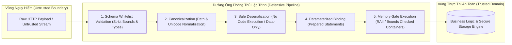
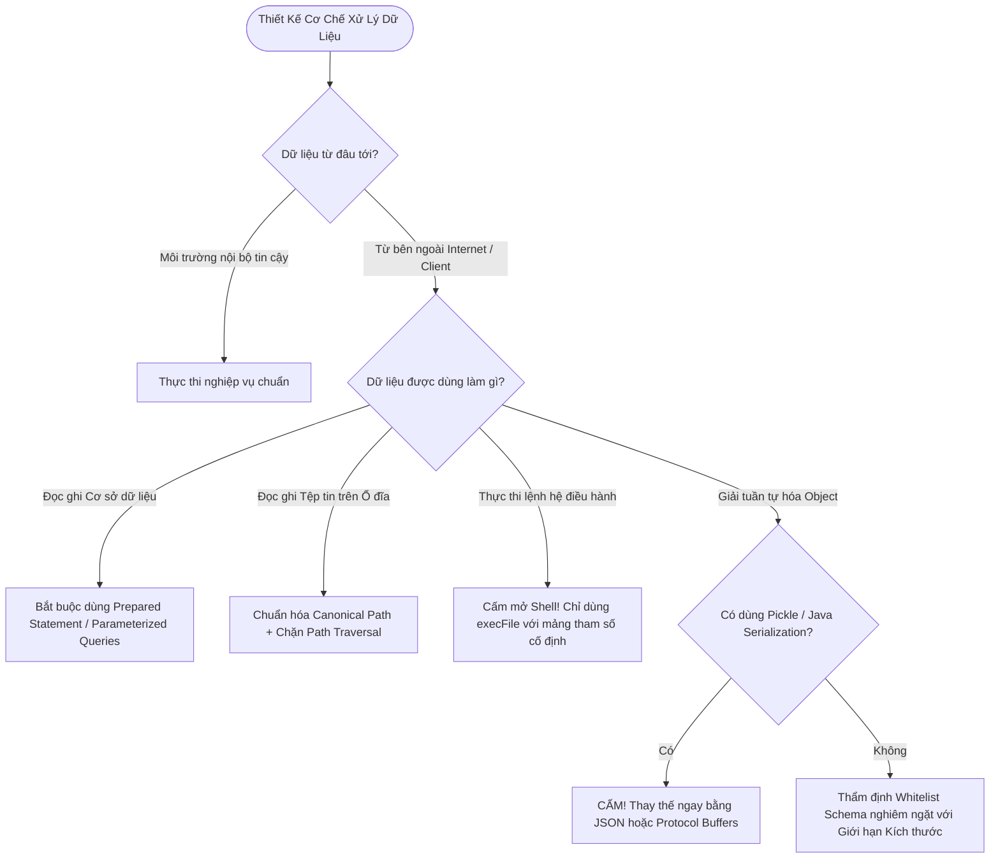

# 12.2. Secure Coding and Defensive Implementation

> [!IMPORTANT]
> **Nếu bạn chỉ được nhớ một điều duy nhất:**
> Hơn **$70\%$ tổng số lỗ hổng bảo mật nghiêm trọng (CVEs)** trong lịch sử công nghệ thông tin đều bắt nguồn từ **sự mất an toàn bộ nhớ (Memory Safety Violations)** và việc **nối chuỗi dữ liệu không tin cậy vào các động cơ thông dịch lệnh (Command/SQL Injection)**. Kỹ nghệ lập trình phòng thủ (Defensive Coding) hiện đại bắt buộc phải tuân thủ hai quy tắc sắt: (1) Thay thế hoàn toàn việc quản lý bộ nhớ thủ công bằng **RAII, Smart Pointers và Bounds Checking**; và (2) Triệt để tách rời mặt phẳng dữ liệu (Data Plane) khỏi mặt phẳng điều khiển (Control Plane) thông qua **Parameterized Queries và Strict Whitelist Validation** tại ranh giới ngoài cùng của hệ thống.

---

## 1. Kiến trúc Tổng quan & Mô hình Tư duy (Mental Model)

### 1.1. Ẩn dụ Đời sống: Nhà Máy Xử Lý Nước Thải và Cửa Khẩu Biên Giới

Để hình dung kiến trúc lập trình phòng thủ, hãy xem xét cách một quốc gia bảo vệ an ninh nội địa:
1. **Dữ liệu Người dùng Không Tin cậy (Untrusted Input)**: Giống như dòng nước thải công nghiệp từ bên ngoài chảy vào nhà máy. Bạn không bao giờ được phép bơm thẳng dòng nước này vào hồ nước sinh hoạt của thành phố mà chưa qua xử lý.
2. **Thẩm định Đầu vào Danh sách Trắng (Whitelist Validation)**: Tại cửa khẩu hải quan, nhân viên an ninh không hỏi *"Bạn có mang vũ khí không?"* (Blacklist - rất dễ giấu giếm). Thay vào đó, họ chỉ cho phép những người có hộ chiếu hợp lệ, đúng kích cỡ, đúng chữ ký số đi qua (Whitelist - chỉ chấp thuận định dạng đã biết trước).
3. **Mã hóa Tham số Hóa (Parameterized Execution)**: Tưởng tượng bạn mang một bức thư niêm phong đưa cho dịch giả. Bức thư đó là **dữ liệu thuần túy (Data)**. Nếu dịch giả lại coi nội dung trong thư là **chỉ thị mệnh lệnh (Control Command)** và thực hiện việc *"Hãy chuyển hết tiền của ngân khố cho tôi"*, thì đó chính là thảm họa Injection! Parameterization đảm bảo bộ thông dịch lệnh (SQL/Shell) chỉ coi input là chuỗi ký tự thụ động, không bao giờ được biên dịch thành mã lệnh.
4. **An toàn Bộ nhớ (Memory Safety - Tủ Đồ Có Khóa Điện Tử)**: Mỗi ngăn tủ chỉ mở đúng kích thước đồ dùng của nó. Nếu một vị khách cố nhét một chiếc ghế sofa khổng lồ vào ngăn tủ nhỏ (Buffer Overflow) làm gãy vách ngăn sang tủ của người bên cạnh, hệ thống khóa điện tử sẽ ngắt nguồn và phát chuông báo động ngay lập tức (Crash Fail-Closed).

### 1.2. Đường Ống Phòng Thủ Toàn Diện (Defensive Data Processing Pipeline)



---

## 2. Chi tiết từng Keyword (Under-the-Hood Deep Dive)

### 2.1. Memory Safety & Secure Memory Management (C/C++ vs Rust vs Managed Runtimes)

Bản chất của các lỗ hổng bộ nhớ nằm ở sự sai lệch giữa con trỏ logic và cấu trúc vật lý của ô nhớ trong RAM:

```text
+---------------------------------------------------------------------------------------+
| Stack Frame Layout: [Local Buffer (64B)] -> [Stack Canary (8B)] -> [Saved RIP (8B)]   |
+---------------------------------------------------------------------------------------+
                          |
                          v (Nếu ghi tràn 80 bytes)
+---------------------------------------------------------------------------------------+
| Tràn Bộ Đệm: [AAAA....AAAA] -> [GHI ĐÈ CANARY!] -> [GHI ĐÈ ĐỊA CHỈ TRẢ VỀ (EXPLOIT!)]|
+---------------------------------------------------------------------------------------+
```

#### A. Giải phẫu Các Lỗ hổng Bộ nhớ Kinh điển
1. **Buffer Overflow (Tràn bộ đệm)**:
   - Ghi dữ liệu vượt quá giới hạn mảng được cấp phát trên Stack hoặc Heap.
   - Khi ghi đè qua **Saved Return Instruction Pointer (`Saved RIP`)** trên Call Stack, kẻ tấn công có thể điều khiển con trỏ lệnh CPU nhảy vào đoạn mã độc của chúng (**Shellcode**) hoặc thực hiện kỹ thuật **Return-Oriented Programming (ROP)**.
2. **Use-After-Free (UAF - Sử dụng sau khi giải phóng)**:
   - Một con trỏ vẫn tiếp tục trỏ tới vùng nhớ Heap sau khi hàm `free()` hoặc `delete` đã được gọi (Dangling Pointer).
   - Khi hệ thống cấp phát một đối tượng mới có chứa con trỏ hàm (VTable Pointer) vào đúng vị trí ô nhớ đó, hacker có thể kích hoạt con trỏ cũ để thực thi mã tùy ý (Arbitrary Code Execution).
3. **Double Free**:
   - Gọi `free()` hai lần trên cùng một địa chỉ bộ nhớ, làm hỏng cấu trúc danh sách liên kết của bộ cấp phát Heap (glibc `ptmalloc` bins), dẫn tới khả năng ghi đè dữ liệu bất kỳ trên Heap.
4. **Integer Overflow / Truncation**:
   - Khi cộng hai số nguyên 32-bit vượt quá $2^{31}-1$, số nguyên bị tràn vòng về giá trị âm hoặc giá trị rất nhỏ. Một chương trình kiểm tra `if (size < MAX)` có thể bị qua mặt, sau đó cấp phát một buffer siêu nhỏ nhưng lại copy một lượng dữ liệu khổng lồ vào đó, biến Integer Overflow thành Heap Buffer Overflow.

#### B. Cơ chế Phòng thủ Phần cứng & Trình biên dịch Hiện đại
- **Stack Canaries (`-fstack-protector-strong`)**: Trình biên dịch chèn một giá trị số ngẫu nhiên 64-bit bí mật (Canary) ngay trước Saved RIP trên Stack Frame. Trước khi hàm return, CPU kiểm tra giá trị này. Nếu bị thay đổi, chương trình lập tức gọi `__stack_chk_fail()` và tự sát (SIGABRT) để triệt tiêu đòn tấn công.
- **ASLR (Address Space Layout Randomization)**: Hệ điều hành ngẫu nhiên hóa địa chỉ nạp của Stack, Heap, và thư viện (`libc.so`) tại mỗi lần chạy tiến trình, khiến kẻ tấn công không thể đoán trước địa chỉ bộ nhớ để nhảy đến.
- **Modern C++20 Standards**:
  - Tuyệt đối cấm con trỏ thô (Raw Pointers): Dùng `std::unique_ptr` và `std::shared_ptr`.
  - Sử dụng `std::span` (C++20): Thay thế con trỏ mảng C `(T* ptr, size_t len)` bằng đối tượng đóng gói an toàn có kiểm soát biên giới hạn (Bounds Checking).

---

### 2.2. Input Validation, Sanitization & Parameterized Execution

Chiến lược bảo vệ đầu vào là ranh giới sống còn giữa ứng dụng và không gian mạng thù địch.

#### A. Triết lý Danh sách Trắng (Whitelist / Positive Validation)
- **Sai lầm chết người (Blacklist)**: Cố gắng liệt kê danh sách các ký tự nguy hiểm (như `'`, `"`, `--`, `<script>`) để loại bỏ. Hacker luôn tìm ra cách vượt qua bằng cách mã hóa URL (`%27`), Unicode (`\u0027`), hoặc chèn ký tự rỗng Null Byte (`%00`).
- **Chuẩn mực Whitelist**: Chỉ chấp thuận những dữ liệu thỏa mãn chính xác tiêu chuẩn: kiểu dữ liệu (Type), độ dài tối thiểu/tối đa (Length), và tập ký tự cho phép (Format / Regex). Ví dụ: Một mã bưu điện chỉ được phép chứa các chữ số từ `0-9` và dài đúng 5 ký tự.

#### B. Parameterized Queries (Truy vấn Tham số Hóa)
Bản chất của lỗ hổng SQL Injection là sự nhầm lẫn giữa **Cú pháp Lệnh (Command Syntax)** và **Dữ liệu Biến số (Literal Data)**.

```sql
-- CÁCH LÀM NGUY HIỂM (Nối chuỗi thủ công):
-- Query: "SELECT * FROM users WHERE username = '" + userInput + "'"
-- Nếu userInput = "' OR '1'='1"
SELECT * FROM users WHERE username = '' OR '1'='1'; -- AST bị sửa đổi! Toàn bộ bảng bị lộ!

-- CÁCH LÀM PHÒNG THỦ (Prepared Statement & Parameter Binding):
-- 1. Database biên dịch AST trước với các vị trí giữ chỗ ($1, $2):
PREPARE fetch_user (text) AS SELECT * FROM users WHERE username = $1;
-- 2. Gửi dữ liệu tách biệt qua kênh Data Wire:
EXECUTE fetch_user ("' OR '1'='1"); -- Cơ sở dữ liệu coi toàn bộ chuỗi là username thuần túy!
```

---

### 2.3. Safe Deserialization & Data Handling

Giải tuần tự hóa (Deserialization) là quá trình chuyển đổi một chuỗi byte hoặc văn bản thành một đối tượng sống (In-Memory Object) trong RAM.

#### A. Tử Huyệt của Native Object Deserialization (Python `pickle`, Java ObjectInputStream)
- Các định dạng tuần tự hóa cấp ngôn ngữ như Python `pickle` hoặc Java Serialization không chỉ lưu trữ dữ liệu mà còn lưu trữ **metadata về lớp và chỉ thị thực thi mã (Callable Bytecode)**.
- Khi gọi `pickle.loads(untrusted_bytes)`, động cơ máy ảo tự động thực thi các hàm khởi tạo đối tượng đặc biệt (như `__reduce__` trong Python) $\implies$ **Remote Code Execution (RCE) ngay lập tức** mà không cần bất kỳ lỗ hổng nào khác!

#### B. Quy Tắc Vàng cho Giải Tuần Tự Hóa An Toàn
1. **Chỉ sử dụng các định dạng dữ liệu thuần (Data-Only Formats)**: JSON, Protocol Buffers, MessagePack, FlatBuffers. Các định dạng này chỉ biểu diễn dữ liệu cấu trúc (Strings, Numbers, Arrays, Maps), không bao giờ chứa chỉ thị nạp class hay thực thi hàm.
2. **Thẩm định Schema nghiêm ngặt sau khi Parse**: Sử dụng các thư viện kiểm chứng định dạng (như Pydantic trong Python, Zod trong TypeScript, struct validation trong C++) để đảm bảo dữ liệu parsed tuân thủ đúng giới hạn nghiệp vụ.

---

### 2.4. Secure Coding Standards & Defensive Implementation Guidelines

Quy chuẩn lập trình phòng thủ được chuẩn hóa toàn cầu thông qua các bộ tiêu chuẩn như **SEI CERT Coding Standards** và **OWASP Secure Coding Practices**:

1. **Fail-Closed / Fail-Securely (Thất bại An toàn)**:
   - Khi một ngoại lệ bất ngờ xảy ra trong quá trình xác thực hoặc phân quyền, hệ thống bắt buộc phải mặc định từ chối truy cập (Default Deny). Tuyệt đối không bao giờ để exception bỏ qua câu lệnh return `false`.
2. **Canonicalization Before Validation (Chuẩn hóa trước khi Thẩm định)**:
   - Trước khi kiểm tra đường dẫn file (để chống Path Traversal), phải giải quyết toàn bộ các đường dẫn tương đối (`../`), symbolic links, và mã hóa Unicode về dạng tuyệt đối duy nhất (**Canonical Path**) thông qua `realpath()` hoặc `std::filesystem::canonical()`.
3. **Principle of Least Privilege in Code**:
   - Mở file chỉ với cờ quyền đọc (`O_RDONLY`) nếu không có nhu cầu ghi; giải phóng quyền root (Drop Privileges) ngay sau khi bind vào cổng mạng bảo vệ (<1024).

---

## 3. Thực thi Mã nguồn & Mô phỏng Chuyên sâu (Dual-Engine Implementation)

### 3.1. Implementation C++20: Memory-Safe Buffer Pipeline & Canonical Path Traversal Defender

Đoạn mã C++20 dưới đây triển khai một module xử lý tệp tin và dữ liệu an toàn tuyệt đối: sử dụng `std::span`, RAII, không dùng con trỏ thô, và ngăn chặn Path Traversal bằng giải thuật chuẩn hóa đường dẫn của `std::filesystem`.

```cpp
#include <iostream>
#include <string>
#include <string_view>
#include <vector>
#include <span>
#include <filesystem>
#include <fstream>
#include <memory>
#include <stdexcept>
#include <system_error>

namespace fs = std::filesystem;

// Lớp thẩm định và bảo vệ đường dẫn tệp tin chống Path Traversal
class SafeFileAccessManager {
private:
    fs::path base_storage_dir_;

public:
    explicit SafeFileAccessManager(fs::path base_dir) {
        std::error_code ec;
        // Chuẩn hóa thư mục gốc về đường dẫn tuyệt đối chuẩn (Canonical Path)
        base_storage_dir_ = fs::canonical(base_dir, ec);
        if (ec) {
            throw std::runtime_error("Failed to resolve base storage directory: " + ec.message());
        }
    }

    // Đọc tệp tin với sự kiểm soát an toàn tuyệt đối
    std::string safe_read_user_file(std::string_view user_input_relative_path) {
        std::cout << "[ACCESS REQUEST] Attempting to access file: '" << user_input_relative_path << "'\n";

        // Ghép đường dẫn tương đối với thư mục gốc
        fs::path target_path = base_storage_dir_ / user_input_relative_path;

        // Chuẩn hóa đường dẫn đích
        std::error_code ec;
        fs::path canonical_target = fs::weakly_canonical(target_path, ec);

        if (ec) {
            throw std::invalid_argument("Invalid path structure provided.");
        }

        // KIỂM SOÁT PHÒNG THỦ: Kiểm tra xem đường dẫn đích có nằm hoàn toàn bên trong base_dir hay không!
        auto base_str = base_storage_dir_.string();
        auto target_str = canonical_target.string();

        if (!target_str.starts_with(base_str)) {
            std::cerr << ">>> [CRITICAL SECURITY VIOLATION] Path Traversal Attack Detected!\n";
            std::cerr << "    Attempted: " << target_str << "\n";
            std::cerr << "    Restricted to: " << base_str << "\n";
            throw std::security_error("PATH_TRAVERSAL_BLOCKED: Access to files outside sandbox is forbidden.");
        }

        // Kiểm tra tồn tại và đọc an toàn
        if (!fs::exists(canonical_target) || !fs::is_regular_file(canonical_target)) {
            throw std::runtime_error("File not found or not a regular file.");
        }

        std::ifstream file_stream(canonical_target, std::ios::in | std::ios::binary);
        if (!file_stream.is_open()) {
            throw std::runtime_error("Unable to open file.");
        }

        return std::string((std::istreambuf_iterator<char>(file_stream)),
                            std::istreambuf_iterator<char>());
    }
};

// Hàm xử lý buffer an toàn sử dụng std::span (C++20 Bounds Safety)
void process_network_payload(std::span<const uint8_t> payload_buffer) {
    std::cout << "[MEMORY CHECK] Payload Size: " << payload_buffer.size() << " bytes.\n";

    if (payload_buffer.size() < 4) {
        throw std::length_error("Payload too short: Missing magic header bytes!");
    }

    // Truy cập phần tử với .subspan và bounds checking an toàn
    uint32_t magic_header = (static_cast<uint32_t>(payload_buffer[0]) << 24) |
                            (static_cast<uint32_t>(payload_buffer[1]) << 16) |
                            (static_cast<uint32_t>(payload_buffer[2]) << 8)  |
                            (static_cast<uint32_t>(payload_buffer[3]));

    std::cout << "[MEMORY SAFE] Extracted Magic Header: 0x" << std::hex << magic_header << std::dec << "\n";
    std::cout << "[MEMORY SAFE] Successfully processed buffer without raw pointer dereferences.\n";
}

int main() {
    std::cout << "========================================================\n";
    std::cout << "  C++20 DEFENSIVE CODING: PATH TRAVERSAL & MEMORY SAFETY\n";
    std::cout << "========================================================\n\n";

    // 1. Thử nghiệm Cơ chế Phòng thủ Bộ nhớ với std::span
    std::vector<uint8_t> valid_payload = { 0xDE, 0xAD, 0xBE, 0xEF, 0x01, 0x02 };
    std::cout << "--- TEST CASE 1: Memory Safety with std::span ---\n";
    process_network_payload(valid_payload);

    // 2. Thử nghiệm Thẩm định Đường dẫn Tệp tin (Path Traversal Defense)
    std::cout << "\n--- TEST CASE 2: Sandbox Directory Isolation ---\n";
    fs::path sandbox_dir = fs::current_path() / "sandbox_test_dir";
    fs::create_directories(sandbox_dir);

    // Tạo file an toàn bên trong sandbox
    std::ofstream(sandbox_dir / "public_notes.txt") << "Welcome to public documentation.";

    SafeFileAccessManager file_mgr(sandbox_dir);

    // Thao tác hợp lệ
    try {
        std::string content = file_mgr.safe_read_user_file("public_notes.txt");
        std::cout << ">>> Valid Read Success! Content: \"" << content << "\"\n";
    } catch (const std::exception& ex) {
        std::cerr << "Error: " << ex.what() << "\n";
    }

    // Đòn tấn công Path Traversal: Cố tình dùng ../../ để đọc file hệ thống /etc/passwd
    std::cout << "\n--- TEST CASE 3: Path Traversal Attack Defense ---\n";
    try {
        file_mgr.safe_read_user_file("../../etc/passwd");
    } catch (const std::exception& ex) {
        std::cout << ">>> DEFENSE SUCCESS: Traversal attempt blocked cleanly!\n";
    }

    // Dọn dẹp thư mục test
    fs::remove_all(sandbox_dir);

    return 0;
}
```

---

### 3.2. Implementation Python 3.11+: Defensive Schema Whitelist & Safe Deserialization Guard

Đoạn mã Python 3.11+ triển khai một đường ống thẩm định phòng thủ chặt chẽ: từ chối các định dạng tuần tự hóa nguy hiểm (`pickle`), thẩm định kiểu dữ liệu bằng Dataclass có giới hạn nghiêm ngặt, và mô phỏng Parameterized Query chống SQL Injection.

```python
#!/usr/bin/env python3
"""
Python 3.11+ Defensive Programming & Safe Deserialization Pipeline
Demonstrates strict schema validation, pickle blocking, and parameterized DB binding.
"""

from dataclasses import dataclass
import json
import re
from typing import Any, Dict

class ValidationError(ValueError):
    """Ném ra khi dữ liệu đầu vào vi phạm quy chuẩn an toàn danh sách trắng."""
    pass

class InsecureDeserializationError(SecurityError if "SecurityError" in globals() else RuntimeError):
    """Ném ra khi phát hiện payload tuần tự hóa nguy hiểm."""
    pass

@dataclass(frozen=True)
class CreateUserRequestDTO:
    username: str
    email: str
    age: int
    account_tier: str

    @classmethod
    def from_untrusted_dict(cls, data: Dict[str, Any]) -> "CreateUserRequestDTO":
        """
        Khởi tạo DTO với chiến lược Thẩm định Danh sách Trắng (Whitelist) cực kỳ khắt khe.
        """
        # 1. Chống lỗi Mass Assignment: Kiểm tra không cho phép các trường lạ xuất hiện
        allowed_fields = {"username", "email", "age", "account_tier"}
        extra_fields = set(data.keys()) - allowed_fields
        if extra_fields:
            raise ValidationError(f"SECURITY ALERT: Disallowed fields detected: {extra_fields}")

        # 2. Thẩm định Username: Chỉ cho phép chữ cái thường, số, gạch dưới, dài 3-20 ký tự
        username = data.get("username")
        if not isinstance(username, str) or not re.fullmatch(r"^[a-z0-9_]{3,20}$", username):
            raise ValidationError("Invalid username format: Must be lowercase alphanumeric, 3-20 chars.")

        # 3. Thẩm định Email
        email = data.get("email")
        if not isinstance(email, str) or not re.fullmatch(r"^[\w\.-]+@[\w\.-]+\.\w+$", email):
            raise ValidationError("Invalid email address format.")

        # 4. Thẩm định Số nguyên Age: Giới hạn biên chặt chẽ (18 đến 120 tuổi)
        age = data.get("age")
        if not isinstance(age, int) or isinstance(age, bool) or not (18 <= age <= 120):
            raise ValidationError("Invalid age: Must be an integer between 18 and 120.")

        # 5. Thẩm định Enum Account Tier
        tier = data.get("account_tier", "STANDARD")
        if tier not in {"STANDARD", "PRO", "ENTERPRISE"}:
            raise ValidationError("Invalid account tier.")

        return cls(username=username, email=email, age=age, account_tier=tier)

class SafeDataParser:
    @staticmethod
    def parse_incoming_payload(raw_stream: bytes, content_type: str) -> Dict[str, Any]:
        """
        Chốt chặn an toàn: Từ chối triệt để pickle / object serialization.
        Chỉ giải mã các định dạng dữ liệu thuần có giới hạn kích thước!
        """
        # Kiểm tra giới hạn kích thước payload (Max 1MB để chống DoS)
        if len(raw_stream) > 1024 * 1024:
            raise ValidationError("Payload size exceeds maximum allowable limit (1MB).")

        # Ngăn chặn Pickle / Python Bytecode Injection
        if b"cos\nsystem" in raw_stream or content_type == "application/x-python-pickle":
            raise InsecureDeserializationError("BLOCKED: Insecure object deserialization format rejected!")

        if content_type == "application/json":
            try:
                return json.loads(raw_stream.decode("utf-8"))
            except Exception as err:
                raise ValidationError(f"Malformed JSON payload: {err}")
        else:
            raise ValidationError(f"Unsupported Media Type: {content_type}")

class MockDatabaseLayer:
    @staticmethod
    def insert_user_securely(dto: CreateUserRequestDTO):
        """
        Mô phỏng Parameterized Query chống SQL Injection tuyệt đối.
        """
        sql_template = (
            "INSERT INTO users (username, email, age, tier) "
            "VALUES ($1, $2, $3, $4) RETURNING user_id;"
        )
        params = (dto.username, dto.email, dto.age, dto.account_tier)
        
        print(f"[SQL ENGINE EXECUTION]")
        print(f"  Compiled Statement: {sql_template}")
        print(f"  Bound Parameters  : {params}")
        print(f"  Status            : Successfully executed without AST manipulation.\n")

def main():
    print("=" * 60)
    print("  PYTHON 3.11+ DEFENSIVE INPUT & DESERIALIZATION PIPELINE ")
    print("=" * 60 + "\n")

    parser = SafeDataParser()
    db = MockDatabaseLayer()

    # Kịch bản 1: Request Hợp lệ
    print("--- TEST CASE 1: Valid User Request ---")
    valid_json = b'{"username": "triduct", "email": "tri@example.com", "age": 28, "account_tier": "PRO"}'
    parsed_data = parser.parse_incoming_payload(valid_json, "application/json")
    dto = CreateUserRequestDTO.from_untrusted_dict(parsed_data)
    db.insert_user_securely(dto)

    # Kịch bản 2: Tấn công Mass Assignment (Cố tình chèn thêm trường isAdmin)
    print("--- TEST CASE 2: Mass Assignment Attack ---")
    malicious_json = b'{"username": "hacker", "email": "hacker@dark.net", "age": 30, "is_admin": true}'
    try:
        data = parser.parse_incoming_payload(malicious_json, "application/json")
        CreateUserRequestDTO.from_untrusted_dict(data)
    except ValidationError as err:
        print(f">>> DEFENSE BARRIER TRIPPED: {err}\n")

    # Kịch bản 3: Tấn công SQL Injection trong trường Username
    print("--- TEST CASE 3: SQL Injection Payload in Username ---")
    sqli_json = b'{"username": "admin\' OR 1=1;--", "email": "test@domain.com", "age": 25}'
    try:
        data = parser.parse_incoming_payload(sqli_json, "application/json")
        CreateUserRequestDTO.from_untrusted_dict(data)
    except ValidationError as err:
        print(f">>> DEFENSE BARRIER TRIPPED: {err}\n")

    # Kịch bản 4: Tấn công Deserialization RCE bằng Pickle
    print("--- TEST CASE 4: Insecure Deserialization (Pickle Injection) ---")
    pickle_payload = b"cos\nsystem\n(S'rm -rf /'\ntR."
    try:
        parser.parse_incoming_payload(pickle_payload, "application/x-python-pickle")
    except Exception as err:
        print(f">>> CRITICAL DEFENSE SUCCESS: {err}\n")

if __name__ == "__main__":
    main()
```

---

### 3.3. Kết quả Thực thi Mẫu (Terminal Output)

```bash
$ g++ -std=c++20 -O3 -Wall -Wextra defensive_coding.cpp -o defensive_coding && ./defensive_coding
========================================================
  C++20 DEFENSIVE CODING: PATH TRAVERSAL & MEMORY SAFETY
========================================================

--- TEST CASE 1: Memory Safety with std::span ---
[MEMORY CHECK] Payload Size: 6 bytes.
[MEMORY SAFE] Extracted Magic Header: 0xdeadbeef
[MEMORY SAFE] Successfully processed buffer without raw pointer dereferences.

--- TEST CASE 2: Sandbox Directory Isolation ---
[ACCESS REQUEST] Attempting to access file: 'public_notes.txt'
>>> Valid Read Success! Content: "Welcome to public documentation."

--- TEST CASE 3: Path Traversal Attack Defense ---
[ACCESS REQUEST] Attempting to access file: '../../etc/passwd'
>>> [CRITICAL SECURITY VIOLATION] Path Traversal Attack Detected!
    Attempted: /etc/passwd
    Restricted to: /Users/ductri0981/Documents/Studying/Studying-Computer-Science/sandbox_test_dir
>>> DEFENSE SUCCESS: Traversal attempt blocked cleanly!

$ python3 defensive_pipeline.py
============================================================
  PYTHON 3.11+ DEFENSIVE INPUT & DESERIALIZATION PIPELINE 
============================================================

--- TEST CASE 1: Valid User Request ---
[SQL ENGINE EXECUTION]
  Compiled Statement: INSERT INTO users (username, email, age, tier) VALUES ($1, $2, $3, $4) RETURNING user_id;
  Bound Parameters  : ('triduct', 'tri@example.com', 28, 'PRO')
  Status            : Successfully executed without AST manipulation.

--- TEST CASE 2: Mass Assignment Attack ---
>>> DEFENSE BARRIER TRIPPED: SECURITY ALERT: Disallowed fields detected: {'is_admin'}

--- TEST CASE 3: SQL Injection Payload in Username ---
>>> DEFENSE BARRIER TRIPPED: Invalid username format: Must be lowercase alphanumeric, 3-20 chars.

--- TEST CASE 4: Insecure Deserialization (Pickle Injection) ---
>>> CRITICAL DEFENSE SUCCESS: BLOCKED: Insecure object deserialization format rejected!
```

---

## 4. Systems Engineering & Production Pitfalls

### 4.1. Lỗ hổng Tràn Số Nguyên Sinh Ra Tràn Heap (Integer Overflow to Heap Overflow)
- **Cơ chế lỗi**: Trong C/C++, một đoạn code phân bổ mảng có dạng:
  ```cpp
  int count = read_int_from_network();
  size_t total_size = count * sizeof(Record); // Nếu count = 2^30, tích bị tràn số nguyên thành số rất nhỏ!
  Record* buffer = (Record*)malloc(total_size);
  for (int i = 0; i < count; ++i) { buffer[i] = read_record(); } // Ghi tràn Heap làm sập tiến trình!
  ```
- **Khắc phục**: Luôn kiểm tra tràn số nguyên trước khi nhân hoặc sử dụng hàm an toàn có sẵn của compiler:
  ```cpp
  size_t total_size;
  if (__builtin_mul_overflow(count, sizeof(Record), &total_size)) {
      throw std::overflow_error("Integer overflow detected in buffer size calculation!");
  }
  ```

### 4.2. Regular Expression Denial of Service (ReDoS)
- **Vấn đề**: Các biểu thức chính quy chứa các nhóm lồng nhau không an toàn (như `^(a+)+$`) khi so khớp với một chuỗi độc hại `aaaaaaaaaaaaaaaaaaaaX` sẽ khiến động cơ Regex kiểu NFA (Non-deterministic Finite Automaton) rơi vào vòng xoáy quay lui theo cấp số nhân ($O(2^N)$).
- **Hậu quả**: Một HTTP request duy nhất làm CPU máy chủ kẹt ở mức $100\%$ trong nhiều giờ, gây sập toàn bộ dịch vụ (Denial of Service).
- **Khắc phục**: Sử dụng các thư viện Regex vận hành bằng DFA với độ phức tạp tuyến tính $O(N)$ như **Google RE2** hoặc Rust Regex Engine.

### 4.3. Bỏ qua Cảnh báo của Trình biên dịch (Ignoring Compiler Warnings)
- **Anti-pattern**: Các lập trình viên thường bỏ qua các cảnh báo như `warning: comparison between signed and unsigned integer expressions` hoặc `warning: unused return value`.
- **Quy tắc vàng của DevOps**: Bắt buộc thêm các cờ tối cao vào build system (CMake, Make, Clang):
  ```bash
  -Wall -Wextra -Wpedantic -Werror -Wconversion -Wformat-security
  ```
  Cờ `-Werror` biến mọi cảnh báo thành lỗi biên dịch, chặn đứng code không an toàn trước khi vào Git repository.

### 4.4. Công cụ Chẩn đoán & Phân tích Động/Tĩnh CLI
```bash
# 1. Biên dịch C++ với AddressSanitizer (ASan) & UndefinedBehaviorSanitizer (UBSan)
clang++ -std=c++20 -fsanitize=address,undefined -g source.cpp -o secure_binary
./secure_binary # Bất kỳ lỗi tràn bộ đệm hay UAF sẽ lập tức in ra Call Stack chi tiết!

# 2. Phân tích Tĩnh (Static Application Security Testing - SAST) với Semgrep
semgrep scan --config auto --error .

# 3. Quét lỗ hổng trong các thư viện phụ thuộc (Supply Chain Security)
npm audit # hoặc: pip-audit
```

---

## 5. Bảng So sánh & Decision Matrix

### 5.1. So sánh An toàn Bộ nhớ và Rủi ro giữa Các Ngôn ngữ Lập trình

| Tiêu chí | C / C++ Cổ điển (C++98) | Modern C++ (C++20/C++23) | Rust | Managed Runtimes (Java/Go) |
| :--- | :--- | :--- | :--- | :--- |
| **Quản lý Bộ nhớ** | Thủ công (`malloc`/`free`) | Bán tự động (RAII, Smart Pointers) | Tự động (Compile-time Ownership) | Tự động (Garbage Collector) |
| **Bảo vệ Buffer Overflow** | Không có (Tràn tự do) | Có (Nếu dùng `std::span`, `.at()`) | **$100\%$ Bảo vệ (Compile/Runtime)** | **$100\%$ Bảo vệ (Runtime bounds check)**|
| **Use-After-Free (UAF)** | Rất dễ xảy ra | Khó xảy ra nếu tuân thủ Smart Ptr| **Bị triệt tiêu hoàn toàn bởi Borrow Checker** | Không xảy ra (Do GC giữ đối tượng) |
| **Chi phí Runtime** | $0$ (Tối đa hiệu năng) | Gần như $0$ | **$0$ (Zero-Cost Abstractions)** | Tiêu tốn CPU cho chu kỳ GC Pause |
| **An toàn Đa luồng (Data Races)** | Không có | Cần std::atomic / Mutex thủ công | **Bắt buộc an toàn (`Send` / `Sync`)** | Có thể xảy ra Data Race logic |

### 5.2. Cây Quyết định Thiết kế Input Validation & Data Handling (Decision Flowchart)


