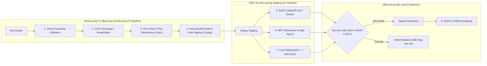
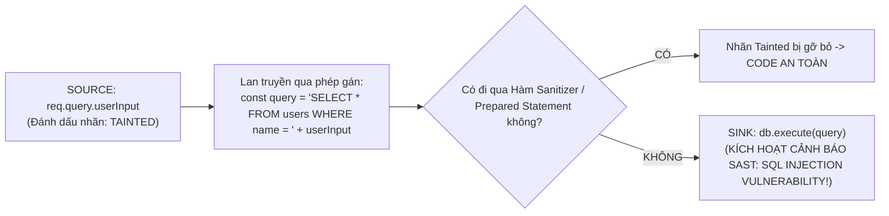
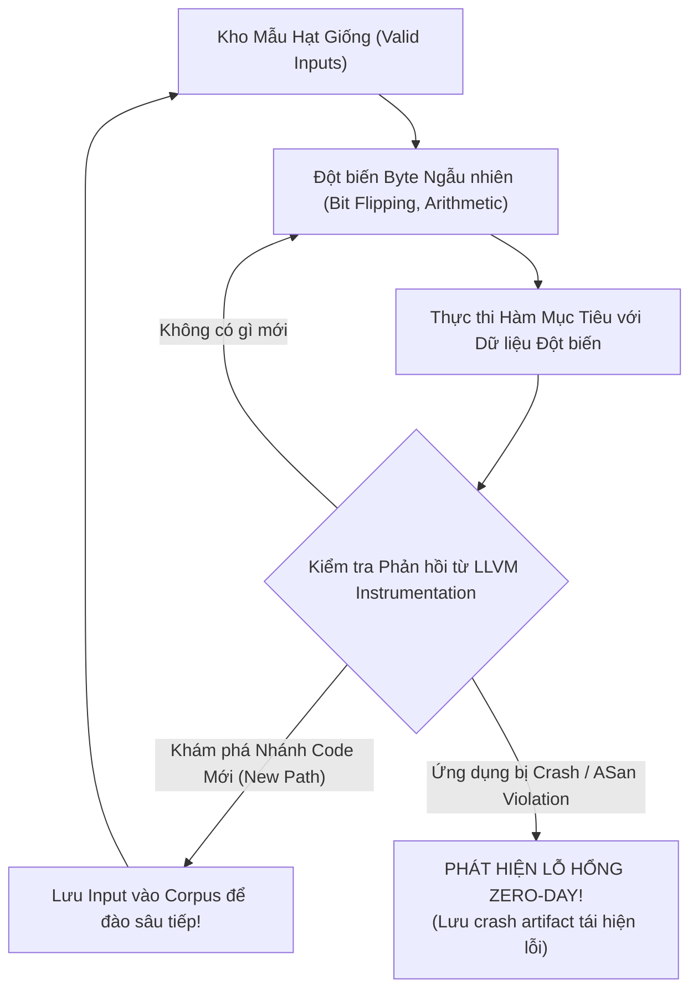
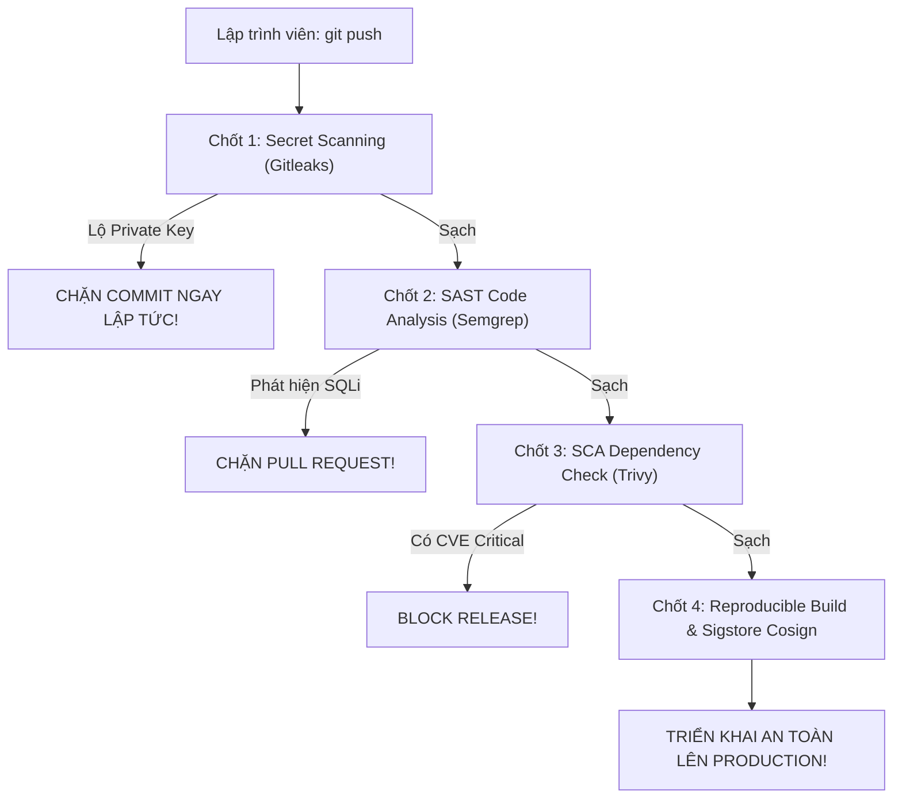

# 12.3. Security Testing and DevSecOps Pipeline (Kiểm thử Bảo mật & Đường ống DevSecOps)

## Tổng quan về DevSecOps & Automated Security Testing
Trước đây trong mô hình phát triển phần mềm truyền thống, kiểm thử bảo mật (Penetration Testing) thường được thực hiện thủ công bởi một đội ngũ chuyên gia độc lập ngay trước ngày sản phẩm golive. Mô hình "chốt chặn cuối cùng" (Gatekeeper) này tạo ra xung đột nghiêm trọng với các quy trình phát triển hiện đại (Agile / CI/CD) – nơi mà mã nguồn được triển khai lên production hàng chục lần mỗi ngày.

**DevSecOps** là triết lý văn hóa và kỹ thuật tích hợp tự động hóa các công cụ kiểm thử an ninh vào sâu bên trong đường ống CI/CD (**Automated Security Testing**). Phần mềm được kiểm tra đa chiều: Phân tích mã nguồn tĩnh (**SAST**), phân tích ứng dụng động lúc đang chạy (**DAST**), kết hợp tương tác (**IAST**), tự bảo vệ thời gian thực (**RASP**), kiểm tra ngẫu nhiên tham số dị thường (**Fuzz Testing**), quét bí mật (**Secret Scanning**), quét phụ thuộc (**SCA**), ghim phụ thuộc (**Dependency Pinning**), đảm bảo khả năng tái tạo bản build (**Reproducible Builds**) và áp dụng các chốt chặn tự động (**Security Gates**).



---

## 2. Chi tiết từng Keyword (Under-the-Hood Deep Dive)

### 1. Application Security Testing: SAST, DAST, IAST & RASP

#### 1. Khái niệm bản chất (What & Why)
- **SAST (Static Application Security Testing - Kiểm thử Tĩnh / Hộp trắng)**:
  Phân tích trực tiếp mã nguồn (Source Code), bytecode hoặc file nhị phân mà **không cần thực thi chương trình**. Quét tìm các mẫu câu lệnh nguy hiểm (Pattern matching) và phân tích dòng chảy dữ liệu (Data-flow / Taint Analysis).
  - *Ưu điểm*: Phát hiện lỗi sớm ngay khi dev vừa code xong (Shift-Left), chỉ rõ chính xác số dòng code bị lỗi.
  - *Nhược điểm*: Tỷ lệ báo động giả (False Positives) cao; không hiểu được cấu hình hạ tầng mạng thực tế.
  - *Công cụ*: **Semgrep, SonarQube, Checkmarx, CodeQL**.
- **DAST (Dynamic Application Security Testing - Kiểm thử Động / Hộp đen)**:
  Kiểm thử ứng dụng từ bên ngoài khi **ứng dụng đang thực sự chạy trên môi trường Staging/Test**. Đóng vai trò như một hacker thực thụ, gửi hàng ngàn request HTTP chứa các payload tấn công (SQLi, XSS, Path Traversal) vào các API endpoints và phân tích response trả về.
  - *Ưu điểm*: Tỷ lệ báo động giả rất thấp; kiểm tra được toàn bộ cấu hình máy chủ, chứng chỉ TLS và WAF thực tế.
  - *Nhược điểm*: Không chỉ ra được chính xác dòng code nào bị lỗi; phát hiện lỗi muộn hơn SAST.
  - *Công cụ*: **OWASP ZAP, Burp Suite Enterprise, Nuclei**.
- **IAST (Interactive Application Security Testing - Kiểm thử Tương tác)**:
  Sự kết hợp hoàn hảo giữa SAST và DAST. Sử dụng một **Agent phần mềm cài trực tiếp bên trong tiến trình ứng dụng (như Java Virtual Machine Agent, Node.js runtime hook)**:
  - Khi các bài test tự động (Integration Tests / E2E Tests / DAST) bắn request vào ứng dụng, Agent bên trong sẽ giám sát dòng dữ liệu đi qua bộ nhớ RAM, các lệnh gọi hàm, các câu truy vấn SQL gửi sang database.
  - Phát hiện chính xác lỗ hổng đang xảy ra ở dòng code nào với độ tin cậy tiệm cận $100\%$!
- **RASP (Runtime Application Self-Protection - Tự bảo vệ Thời gian Thực)**:
  Công nghệ bảo mật cài đặt trực tiếp bên trong ứng dụng trên môi trường **Production**. Khác với WAF (chỉ đứng bên ngoài và nhìn HTTP text), RASP hiểu được ngữ cảnh bên trong của ứng dụng:
  - Nếu kẻ tấn công gửi một payload SQL Injection qua WAF, nhưng RASP thấy câu lệnh đó được Database Driver chuẩn bị qua Parameterized Query an toàn $\implies$ RASP cho qua.
  - Nhưng nếu RASP thấy ứng dụng sắp gọi hàm `Runtime.getRuntime().exec()` để mở shell lạ $\implies$ RASP lập tức chặn đứng lệnh gọi hàm đó ngay tại tầng nhân JVM và gửi cảnh báo về SOC!

#### 2. Cơ chế hoạt động sâu (Under the hood / Hardcore Internals)
- **Bản chất của Taint Analysis trong SAST Engine**:
  Làm thế nào một công cụ SAST như Semgrep hay CodeQL biết được một dòng code có lỗ hổng?
  1. **Source (Nguồn không tin cậy)**: Điểm dữ liệu đi vào ứng dụng (ví dụ: `req.body.name`, `req.query.search`). Biến này được đánh dấu nhãn "Bị nhiễm bẩn" (**Tainted**).
  2. **Propagation (Lan truyền)**: Bộ phân tích theo dõi dòng chảy của biến qua các phép gán, truyền tham số hàm, nối chuỗi. Mọi biến mới nhận giá trị từ biến bị nhiễm bẩn đều bị lây nhiễm bẩn theo.
  3. **Sanitizer (Bộ làm sạch)**: Nếu dữ liệu đi qua một hàm validate (ví dụ: `parseInt()` hoặc `zod.parse()`), nhãn nhiễm bẩn được gỡ bỏ.
  4. **Sink (Điểm thực thi nguy hiểm)**: Nếu một biến vẫn còn mang nhãn "Tainted" mà chạm tới một hàm nguy hiểm (như `db.rawQuery()` hoặc `eval()`) $\implies$ SAST Engine ném cảnh báo phát hiện lỗ hổng bảo mật nghiêm trọng!

#### 3. Sơ đồ minh họa (Mô hình Taint Analysis trong Phân tích Mã nguồn Tĩnh SAST)


#### 4. Code ví dụ thực chiến (YAML Semgrep Custom SAST Rule for Hardcoded Secrets Detection)
```yaml
# Định nghĩa luật quét mã nguồn tĩnh tùy biến bằng Semgrep
rules:
  - id: detect-insecure-jwt-signing-secret
    languages: [typescript, javascript]
    message: "Security Alert: Hardcoded secret detected in JWT signing! Secrets must be retrieved from Environment Variables."
    severity: ERROR
    metadata:
      cwe: "CWE-798: Use of Hard-coded Credentials"
      owasp: "A02:2021 - Cryptographic Failures"
    pattern: |
      jwt.sign($PAYLOAD, "...", ...) # Bắt tất cả các hàm ký JWT có truyền chuỗi ký tự cứng!
```

#### 5. Ưu / Nhược điểm, Pitfalls & Anti-patterns
- **Pitfall**: Đưa công cụ SAST vào CI/CD pipeline với cấu hình nhạy cảm tối đa ngay trong ngày đầu tiên. Pipeline sẽ phát hiện ra hàng ngàn cảnh báo lỗi giả (False Positives), làm chặn đứng việc deploy và gây ức chế cực độ cho toàn bộ đội ngũ lập trình viên. (Bắt buộc phải **tinh chỉnh ruleset, lọc bỏ false positives và chỉ chặn các lỗi Critical/High**).
- **Anti-pattern**: Chỉ dùng DAST mà bỏ qua SAST. DAST chỉ quét được những API endpoints mà nó có thể tìm thấy; các logic nghiệp vụ ẩn sâu bên trong mã nguồn sẽ bị bỏ sót hoàn toàn.

#### 6. Ứng dụng thực tế trong Backend / Systems
Tiêu chuẩn CI/CD bắt buộc của mọi tập đoàn công nghệ lớn: Tích hợp **Semgrep / GitHub CodeQL (SAST)**, **Snyk (SCA)**, và **OWASP ZAP (DAST)** vào GitHub Actions hoặc GitLab CI.

---

### 2. Fuzz Testing & Penetration Testing

#### 1. Khái niệm bản chất (What & Why)
- **Fuzz Testing (Fuzzing - Kiểm thử Dị thường Mù/Thông minh)**: Kỹ thuật kiểm thử phần mềm tự động bằng cách bơm hàng triệu dữ liệu đầu vào ngẫu nhiên, dị thường, dị dạng hoặc biên cực hạn (Malformed / Semi-valid inputs) vào ứng dụng để tìm kiếm các trạng thái crash, rò rỉ bộ nhớ (Memory leaks), hoặc vi phạm assert logic.
  - *Phân loại*:
    - **Mutation-based Fuzzing**: Lấy một gói tin hợp lệ làm mẫu và đột biến ngẫu nhiên một vài bit/byte.
    - **Coverage-guided Fuzzing**: Sử dụng phản hồi độ bao phủ mã nguồn (Code Coverage instrumentation qua LLVM) để hướng dẫn thuật toán sinh các ca thử nghiệm đi sâu vào các nhánh code chưa từng được khám phá.
    - *Công cụ Hàng đầu*: **AFL++ (American Fuzzy Lop), Google LibFuzzer, Honggfuzz**.
- **Penetration Testing (Kiểm thử Thâm nhập / Pentest)**: Hoạt động đánh giá bảo mật chuyên sâu do con người (Các Ethical Hackers / Chuyên gia An ninh mạng) thực hiện có ủy quyền. Pentester kết hợp các công cụ tự động với tư duy sáng tạo của con người để chuỗi các lỗ hổng nhỏ thành một đòn tấn công tổng lực nhằm thâm nhập sâu vào hệ thống.

#### 2. Cơ chế hoạt động sâu (Under the hood / Hardcore Internals)
- **Cơ chế Hoạt động của LLVM LibFuzzer với AddressSanitizer**:
  Trong C/C++:
  Trình biên dịch Clang nạp các cờ `-fsanitize=fuzzer,address`:
  - Mỗi hàm, mỗi lệnh rẽ nhánh `if/else` trong code đều được chèn các bộ đếm đo độ bao phủ (Edge Coverage counters).
  - Cỗ máy Fuzzing liên tục đột biến dữ liệu đầu vào:
    Nếu một input mới làm cho chương trình đi vào một nhánh lệnh chưa từng chạm tới trước đó $\implies$ Input đó được lưu vào kho hạt giống (**Corpus**) để tiếp tục đột biến sâu hơn.
  - Khi xảy ra lỗi Buffer Overflow hoặc Out-of-bounds Read dù chỉ 1 byte, AddressSanitizer lập tức bắt giữ ngắt CPU, in ra Stack Trace chi tiết và lưu lại chính xác chuỗi byte gây crash (Crash Reproducer Input).

#### 3. Sơ đồ minh họa (Vòng lặp Phản hồi của Coverage-Guided Fuzz Testing)


#### 4. Code ví dụ thực chiến (C++ LLVM LibFuzzer Target Function for API Parser)
```cpp
#include <iostream>
#include <cstdint>
#include <cstddef>
#include <string>

// Giả sử đây là hàm phân tích cú pháp chuỗi JSON hoặc giao thức nhị phân của Backend
bool parseCustomNetworkProtocol(const uint8_t* data, size_t size) {
    if (size < 4) return false;

    // Giả lập một lỗi tiềm ẩn: Nếu 4 byte đầu là "CRSH" và byte thứ 5 là 0xFF -> Lỗi tràn mảng!
    if (data[0] == 'C' && data[1] == 'R' && data[2] == 'S' && data[3] == 'H') {
        if (size > 4 && data[4] == 0xFF) {
            // LỖI BỘ NHỚ CỐ Ý ĐỂ FUZZER TÌM RA:
            volatile int* invalidPtr = nullptr;
            *invalidPtr = 42; // Gây ra SIGSEGV (Crash!)
        }
    }
    return true;
}

// ĐIỂM VÀO TIÊU CHUẨN CỦA LLVM LIBFUZZER (Hàm bắt buộc)
// Fuzzer engine sẽ liên tục gọi hàm này hàng triệu lần mỗi giây với các mảng byte ngẫu nhiên
extern "C" int LLVMFuzzerTestOneInput(const uint8_t *data, size_t size) {
    parseCustomNetworkProtocol(data, size);
    return 0; // Luôn trả về 0 nếu không crash
}
```

#### 5. Ưu / Nhược điểm, Pitfalls & Anti-patterns
- **Pitfall**: Viết hàm Fuzzer Target có tương tác với I/O mạng hoặc ổ cứng đĩa. Việc đọc/ghi đĩa làm tốc độ Fuzzing giảm từ 50,000 lần/giây xuống còn 10 lần/giây, triệt tiêu hoàn toàn hiệu quả của Fuzz testing. (Fuzzer Target **bắt buộc phải là In-Memory Function thuần túy**).
- **Anti-pattern**: Coi việc vượt qua bài kiểm thử tự động là đã đủ an toàn và không bao giờ thuê chuyên gia thực hiện Penetration Testing độc lập từ bên ngoài.

#### 6. Ứng dụng thực tế trong Backend / Systems
Dự án **Google OSS-Fuzz** (liên tục fuzzing hàng ngàn dự án nguồn mở trọng yếu như OpenSSL, Linux Kernel, Chromium, phát hiện hơn 40,000 lỗi bộ nhớ và lỗ hổng bảo mật nghiêm trọng).

---

### 3. DevSecOps Pipeline: Secret Scanning, Dependency Pinning, Reproducible Builds & Security Gates

#### 1. Khái niệm bản chất (What & Why)
- **Secret Scanning (Quét Bí mật Rò rỉ)**: Công cụ tự động quét mã nguồn và lịch sử Git (sử dụng biểu thức chính quy và thuật toán đo độ hỗn loạn Shannon Entropy) để phát hiện và ngăn chặn các khóa bí mật (AWS Keys, Private Keys, Database Passwords) bị commit nhầm:
  - *Pre-commit Hook*: Chặn ngay trên máy của lập trình viên trước khi commit (`gitleaks protect`).
  - *Push Protection*: Chặn ở cổng nhận commit của Git Server (GitHub Secret Scanning).
- **Dependency Pinning (Ghim Chặt Phiên bản Phụ thuộc)**: Thực hành khóa cứng phiên bản chính xác tuyệt đối (Exact SemVer) của mọi thư viện phụ thuộc và phụ thuộc con (Transitive Dependencies) kèm theo mã băm toàn vẹn (Integrity Hash) trong Lockfile.
- **Reproducible Builds (Bản dựng Có thể Tái tạo)**: Quy trình kỹ thuật đảm bảo rằng: Với cùng một mã nguồn và cùng một môi trường biên dịch, bất kỳ ai, tại bất kỳ thời điểm nào trên thế giới cũng **biên dịch ra một file nhị phân có mã băm SHA-256 trùng khớp 100% từng bit** (loại bỏ biến thiên timestamp, đường dẫn file tuyệt đối). Giúp chứng minh rằng file nhị phân không bị chèn backdoor bởi máy chủ build bị hack!
- **Security Gates (Chốt chặn Bảo mật CI/CD)**: Các điều kiện logic tự động trong pipeline CI/CD quyết định việc bản build có được phép chuyển sang môi trường tiếp theo hay không:
  - *Ví dụ Chốt chặn*: Bẻ gãy quá trình build (Pipeline FAILED) nếu phát hiện bất kỳ CVE mức độ Critical/High nào chưa được vá, hoặc nếu điểm kiểm thử SAST thấp hơn 85%.

#### 2. Cơ chế hoạt động sâu (Under the hood / Hardcore Internals)
- **Tự động hóa Đóng và Mở Security Gate trong GitHub Actions**:
  Khi một Pull Request được mở:
  1. Job 1: Chạy Gitleaks. Nếu phát hiện chuỗi có entropy cao khớp mẫu AWS Key $\implies$ `exit 1` (Block PR).
  2. Job 2: Chạy Trivy quét container. Xuất báo cáo định dạng chuẩn **SARIF (Static Analysis Results Interchange Format)**.
  3. Job 3: Security Gate Evaluator đọc SARIF file:
     `jq '.runs[].results[] | select(.level=="error")'`
     Nếu số lượng lỗi Critical $> 0$ $\implies$ Đánh dấu cờ đỏ trên GitHub PR và khóa nút "Merge"!

#### 3. Sơ đồ minh họa (Mô hình Đường ống CI/CD Tích hợp Đầy đủ Security Gates)


#### 4. Code ví dụ thực chiến (GitHub Actions Workflow with Hardened Security Gates)
```yaml
name: DevSecOps Production Security Pipeline

on:
  push:
    branches: [ main ]
  pull_request:
    branches: [ main ]

jobs:
  security-audit:
    name: Automated Security Gates
    runs-on: ubuntu-latest
    steps:
      - name: Checkout Code
        uses: actions/checkout@v4
        with:
          fetch-depth: 0 # Quét toàn bộ lịch sử Git

      # BƯỚC 1: Quét lộ lọt Secret bằng Gitleaks
      - name: Run Secret Scanning
        uses: gitleaks/gitleaks-action@v2
        env:
          GITHUB_TOKEN: ${{ secrets.GITHUB_TOKEN }}

      # BƯỚC 2: Quét phụ thuộc npm bằng Trivy
      - name: Run Software Composition Analysis (SCA)
        uses: aquasecurity/trivy-action@master
        with:
          scan-type: 'fs'
          scan-ref: '.'
          severity: 'CRITICAL,HIGH'
          exit-code: '1' # BẮT BUỘC: Bẻ gãy build nếu phát hiện CVE Critical!

      # BƯỚC 3: Quét mã nguồn tĩnh SAST bằng Semgrep
      - name: Run Static Code Analysis (SAST)
        run: |
          docker run --rm -v $(pwd):/src returntocorp/semgrep semgrep \
            --config=auto --error --strict /src

      # BƯỚC 4: Build và Ký số Artifact
      - name: Successful Security Gates
        run: echo "[SECURITY PASSED] All security quality gates satisfied. Authorized for staging deployment."
```

#### 5. Ưu / Nhược điểm, Pitfalls & Anti-patterns
- **Pitfall**: Đặt `exit-code: 0` (chỉ in cảnh báo mà không chặn build) cho các công cụ bảo mật trong CI/CD. Khi đó các kỹ sư sẽ bỏ qua toàn bộ cảnh báo và tiếp tục deploy mã độc lên production.
- **Anti-pattern**: Chạy quy trình build CI/CD trên các máy ảo tự host (Self-hosted Runners) không có cơ chế cách ly bộ nhớ, cho phép một Pull Request độc hại đọc trộm toàn bộ Secrets của công ty lưu trong RAM máy chủ runner.

#### 6. Ứng dụng thực tế trong Backend / Systems
Tiêu chuẩn tự động hóa bắt buộc trong toàn bộ các dự án mã nguồn mở của **Linux Foundation**, Google Open Source Security, và các tập đoàn công nghệ Fortune 500.
