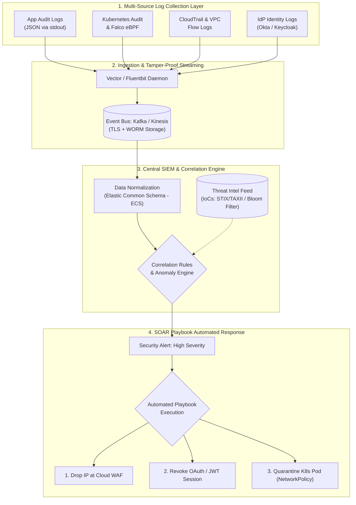
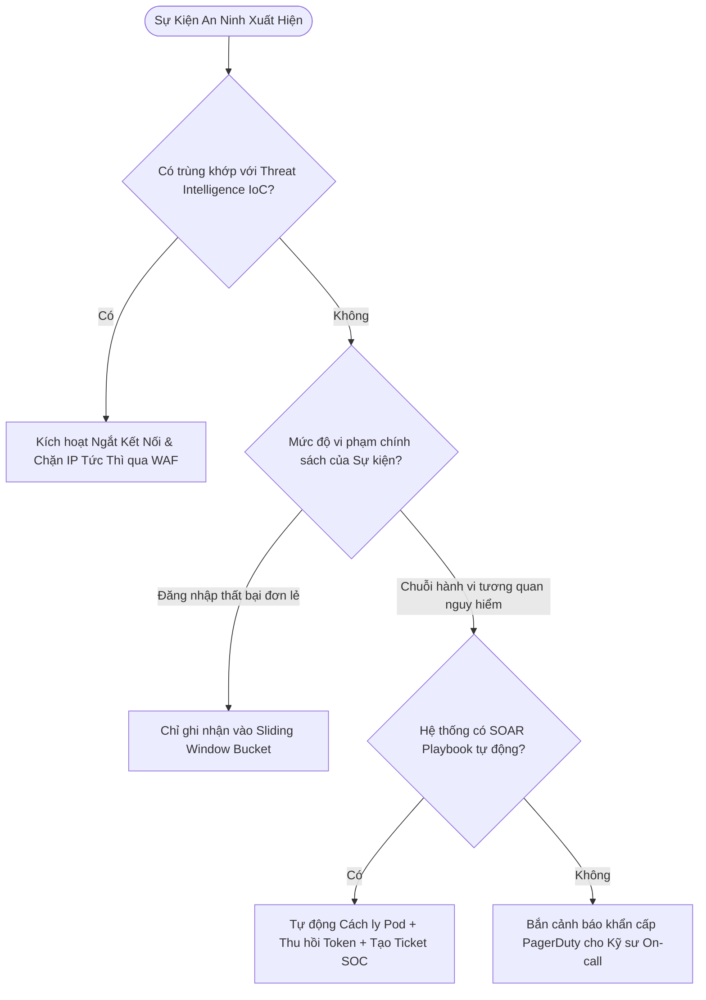

# 13.1. Security Monitoring, SIEM, and Threat Intelligence

> [!IMPORTANT]
> **Nếu bạn chỉ được nhớ một điều duy nhất:**
> Một hệ thống phòng thủ thụ động là một hệ thống đã bị xâm nhập mà bạn chưa hay biết; thời gian trung bình kẻ tấn công ẩn mình trong mạng nội bộ (**Attacker Dwell Time**) trước khi bị phát hiện lên tới hàng chục ngày. Vận hành an ninh hiện đại (Modern SecOps) không phải là tích trữ hàng terabytes file log thụ động, mà là quy trình khép kín: chuẩn hóa nhật ký kiểm toán bất biến (**Tamper-Proof Audit Logging**), tương quan chuỗi sự kiện thời gian thực (**Real-time SIEM Event Correlation**) đối chiếu với luồng tình báo mối nguy hại (**Threat Intelligence via Bloom Filters**), và kích hoạt phản ứng phòng vệ tự động dưới 5 giây thông qua **SOAR Playbooks** để phong tỏa sự cố trước khi dữ liệu bị trích xuất.

---

## 1. Kiến trúc Tổng quan & Mô hình Tư duy (Mental Model)

### 1.1. Ẩn dụ Đời sống: Tháp Kiểm Soát Không Lưu và Trạm Radar Cảnh Giới

Để hình dung cách vận hành của Trung tâm Điều hành An ninh (Security Operations Center - SOC):
1. **Logs và Viễn trắc (Nhật ký Chuyến bay và Tín hiệu Máy bay)**: Mỗi máy bay (microservice, container, database) liên tục phát tín hiệu tọa độ, độ cao, tốc độ về trung tâm. Một log kiểm toán không thể ghi chung chung *"Có máy bay vừa bay qua"*; nó phải ghi chuẩn xác: *"Chuyến bay VN123 (Who) cất cánh lúc 14:02:00Z (When) từ đường băng 25R (Where) đổi hướng đột ngột (What) và đã hoàn thành rẽ (Outcome)"*.
2. **SIEM (Màn hình Radar Toàn cảnh của Tháp Không lưu)**: Nếu nhìn vào từng tín hiệu đơn lẻ, mọi thứ đều bình thường. Nhưng khi cỗ máy SIEM kết nối các dữ liệu lại với nhau (Correlation): *"Chiếc máy bay A vừa tắt bộ phát đáp radar, đồng thời đài kiểm soát không lưu nhận được tín hiệu SOS, và radar phụ trợ phát hiện vật thể lạ áp sát"* $\implies$ Đây là tình trạng khẩn cấp cấp độ 1!
3. **Threat Intelligence (Danh sách Đen của Interpol)**: Tình báo an ninh cung cấp danh sách nhận dạng của các tổ chức không tặc khét tiếng (Indicators of Compromise - IoCs). Bằng cấu trúc lọc siêu tốc (Bloom Filter), hệ thống kiểm tra ngay lập tức hàng nghìn hộ chiếu mỗi giây mà không làm tắc nghẽn cửa khẩu hải quan.
4. **SOAR (Hệ thống Bắn Lưới Đánh Chặn Tự Động)**: Khi phát hiện không tặc xâm nhập, thay vì ngồi chờ họp giao ban hay gửi email xin ý kiến chỉ huy (tốn hàng tiếng đồng hồ), hệ thống phòng thủ tự động (SOAR Playbook) lập tức phóng lưới khống chế máy bay, đóng cửa toàn bộ đường băng và cách ly khoang hành khách chỉ trong đúng 2 giây!

### 1.2. Vòng Lặp Vận Hành Giám Sát và Tự Động Hóa Phản Ứng (SecOps Pipeline)



---

## 2. Chi tiết từng Keyword (Under-the-Hood Deep Dive)

### 2.1. Security Information and Event Management (SIEM) & Audit Logging

Audit Log là nền tảng của mọi cuộc điều tra pháp y (Forensics) và giám sát thời gian thực.

#### A. Cấu Trúc Bắt Buộc của một Audit Log Chuẩn Mực
Một log kiểm toán vô giá trị nếu thiếu ngữ cảnh định danh. Tiêu chuẩn quốc tế (NIST SP 800-92) quy định một bản ghi audit phải chứa đầy đủ 5 trường thông tin:
1. **Who (Chủ thể)**: `user_id`, `service_account`, `client_ip`, `user_agent`.
2. **When (Thời gian)**: Thời gian theo chuẩn ISO 8601 UTC với độ chính xác micro-giây (`2026-11-15T14:30:00.123456Z`).
3. **Where (Không gian)**: `service_name`, `k8s_node`, `pod_ip`, `api_endpoint`.
4. **What (Hành vi)**: Hành động cụ thể (ví dụ: `AUTH_PASSWORD_CHANGE`, `DB_EXPORT_ALL_CUSTOMERS`).
5. **Outcome (Kết quả)**: `SUCCESS`, hoặc `FAILURE` kèm lý do lỗi (`PERMISSION_DENIED`).

#### B. Kiến Trúc Vận Chuyển Bất Biến (Tamper-Proof Logging Pipeline)
Làm thế nào để đảm bảo hacker sau khi chiếm được quyền root trên máy chủ không thể dùng lệnh `rm -rf /var/log/*` hoặc sửa log để phi tang dấu vết?
- **Stream Ngay Lập Tức (No Local Persistence)**: Ứng dụng chỉ ghi log ra `stdout`. Một agent trung gian (`Vector` hoặc `Fluentbit`) bắt trực tiếp stream qua socket trong bộ nhớ RAM và đẩy ngay lập tức qua kết nối TLS tới cụm Kafka phân tán độc lập. Kẻ đột nhập vào máy chủ không tìm thấy file log trên ổ đĩa để sửa!
- **Lưu trữ Bất biến WORM (Write-Once-Read-Many)**: Dữ liệu log chuyển từ Kafka sang các kho lưu trữ hỗ trợ Object Lock (AWS S3 Object Lock ở chế độ Compliance Mode). Một khi đã ghi xuống, ngay cả tài khoản Root của tài khoản đám mây cũng không có quyền sửa hay xóa trong vòng 365 ngày!

---

### 2.2. Security Event Correlation & Threat Detection Rules

Một máy chủ SIEM hiện đại (như **Splunk Enterprise Security, Elastic Security, Datadog Cloud SIEM, Google Chronicle**) phải xử lý từ $100,000$ đến $1,000,000$ events/giây. Việc tìm ra mối nguy hại dựa vào kỹ thuật tương quan dữ liệu.

```text
[Event 1: 50 lần đăng nhập thất bại trong 1 phút từ IP 198.51.100.44] 
                              + 
[Event 2: Lần đăng nhập thứ 51 thành công vào tài khoản Admin 'alice'] 
                              + 
[Event 3: Ngay sau 10 giây, tài khoản 'alice' tải xuống tệp dữ liệu 'dump.sql' nặng 2GB]
                              ||
                              v
    ===> [CORRELATION RULE: CREDENTIAL STUFFING & DATA EXFILTRATION DETECTED!] <===
```

#### A. Kỹ thuật Cửa sổ Trượt (Sliding Window Aggregation)
- Động cơ SIEM duy trì một bảng băm trạng thái trong bộ nhớ RAM được phân vùng theo `client_ip` hoặc `user_id`.
- Khi mỗi event đi qua, hệ thống tăng biến đếm trong cửa sổ thời gian (ví dụ: 60 giây). Nếu số lần thất bại vượt ngưỡng (Threshold), một Alert được kích hoạt ngay lập tức mà không cần truy vấn quét toàn bảng cơ sở dữ liệu.

#### B. Ma trận Chiến thuật MITRE ATT&CK
Các quy tắc phát hiện hiện đại đều được ánh xạ trực tiếp vào khung **MITRE ATT&CK** (ví dụ: `T1110 - Brute Force`, `T1078 - Valid Accounts`, `T1048 - Exfiltration Over Alternative Protocol`) giúp đội ngũ SOC định lượng mức độ nguy hiểm và giai đoạn tấn công của đối thủ.

---

### 2.3. Threat Intelligence (TI) & Indicators of Compromise (IoC)

Tình báo mối nguy hại là tri thức về các tác nhân đe dọa, hạ tầng máy chủ điều khiển độc hại (Command & Control - C2) và mã độc đang lưu hành trên toàn cầu.

#### A. Các Loại Chỉ Số Xâm Nhập (IoC - Indicators of Compromise)
1. **Atomic Indicators**: Không thể chia nhỏ (Địa chỉ IP độc hại, Tên miền phishing, Mã băm SHA-256 của file mã độc).
2. **Computed Indicators**: Dữ liệu có tính toán (Regex đường dẫn URL, Certificate Fingerprints).
3. **Behavioral Indicators (TTPs)**: Mô hình hành vi của nhóm hacker (APT groups).

#### B. Thuật Toán Lọc Siêu Tốc Độ bằng Bloom Filter
Khi cần đối chiếu hàng triệu gói tin mạng mỗi giây với cơ sở dữ liệu Threat Intelligence chứa $20,000,000$ địa chỉ IP độc hại:
- Việc tra cứu trong cơ sở dữ liệu quan hệ hoặc Redis sẽ làm nghẽn toàn bộ băng thông mạng (độ trễ cao).
- Giải pháp: Nạp toàn bộ danh sách IP vào một **Bloom Filter** trong RAM:
  - Độ phức tạp kiểm tra là **$O(k)$ chu kỳ CPU** (trong đó $k$ là số hàm băm, thường là 3 hoặc 4).
  - Không bao giờ có False Negative (Nếu Bloom Filter trả lời *Không*, chắc chắn 100% IP đó sạch).
  - Chỉ khi Bloom Filter trả lời *Có*, hệ thống mới kích hoạt kiểm tra sâu trong hash table, đạt thông lượng hàng chục triệu packets/giây!

---

### 2.4. Security Orchestration, Automation, and Response (SOAR) & SOC Operations

Điểm nghẽn lớn nhất trong an ninh mạng truyền thống là sự mệt mỏi vì cảnh báo (**Alert Fatigue**): một kỹ sư SOC nhận hàng ngàn email cảnh báo mỗi ngày, dẫn tới việc bỏ sót các cảnh báo chí mạng.

#### A. Triết Lý Vận Hành của SOAR
SOAR (như **Cortex XSOAR, Splunk SOAR, Tines**) biến các quy trình ứng phó sự cố (SOP - Standard Operating Procedure) bằng văn bản thành các đoạn mã thực thi tự động (**Playbooks**).

#### B. Kịch Bản Tự Động Cách Ly Pod Kubernetes Đột Nhập
Khi agent giám sát nhân Linux (eBPF Falco) phát hiện một shell tương tác được mở bên trong Pod chạy ở Production:
1. Falco đẩy cảnh báo `CRITICAL: Interactive Shell spawned in container` sang SOAR Engine.
2. SOAR kích hoạt Playbook:
   - Gọi Kubernetes API áp dụng `NetworkPolicy` cô lập: cắt toàn bộ kết nối ra vào Pod đó (Egress/Ingress Deny All) để hacker không thể tiếp tục lây lan sang các máy chủ khác.
   - Gọi API chụp ảnh bộ nhớ RAM và tạo snapshot ổ đĩa của container phục vụ điều tra pháp y (Forensic Memory Snapshot).
   - Đẩy thông báo kèm mã ticket sang kênh Slack của đội trực ca SOC trong vòng $1.2$ giây!

---

## 3. Thực thi Mã nguồn & Mô phỏng Chuyên sâu (Dual-Engine Implementation)

### 3.1. Implementation C++20: High-Throughput Threat Intel Bloom Filter & Sliding Window Brute Force Correlator

Đoạn mã C++20 dưới đây triển khai một động cơ tương quan sự kiện an ninh trong bộ nhớ: kết hợp Bloom Filter tra cứu danh sách đen IoC tốc độ cao và thuật toán cửa sổ trượt (Sliding Window) phát hiện tấn công vét cạn tài khoản.

```cpp
#include <iostream>
#include <string>
#include <vector>
#include <unordered_map>
#include <chrono>
#include <format>
#include <memory>
#include <array>
#include <stdexcept>

// Cấu trúc dữ liệu Bloom Filter tối ưu cho tra cứu Threat Intelligence
class ThreatIntelBloomFilter {
private:
    std::vector<bool> bit_array_;
    size_t size_;

    size_t hash_fn_1(const std::string& key) const noexcept {
        size_t h = 2166136261u;
        for (char c : key) { h = (h ^ static_cast<size_t>(c)) * 16777619u; }
        return h % size_;
    }

    size_t hash_fn_2(const std::string& key) const noexcept {
        size_t h = 0;
        for (char c : key) { h = (h * 31) + static_cast<size_t>(c); }
        return h % size_;
    }

    size_t hash_fn_3(const std::string& key) const noexcept {
        size_t h = 5381;
        for (char c : key) { h = ((h << 5) + h) + static_cast<size_t>(c); }
        return h % size_;
    }

public:
    explicit ThreatIntelBloomFilter(size_t bit_count) 
        : size_(bit_count), bit_array_(bit_count, false) {}

    void add_malicious_indicator(const std::string& ioc) {
        bit_array_[hash_fn_1(ioc)] = true;
        bit_array_[hash_fn_2(ioc)] = true;
        bit_array_[hash_fn_3(ioc)] = true;
    }

    bool is_potentially_malicious(const std::string& ioc) const noexcept {
        if (!bit_array_[hash_fn_1(ioc)]) return false;
        if (!bit_array_[hash_fn_2(ioc)]) return false;
        if (!bit_array_[hash_fn_3(ioc)]) return false;
        return true; // Có khả năng cao nằm trong Threat Feed
    }
};

// Cấu trúc sự kiện an ninh chuẩn
struct SecurityAuditEvent {
    std::string client_ip;
    std::string user_id;
    std::string action; // "LOGIN_ATTEMPT"
    bool is_success;
    std::chrono::steady_clock::time_point timestamp;
};

// Động cơ Tương quan Sự kiện An ninh (SIEM Real-time Correlation Engine)
class SiemCorrelationEngine {
private:
    ThreatIntelBloomFilter threat_filter_;
    // Lưu lịch sử các lần đăng nhập thất bại theo từng IP: IP -> Danh sách timestamps
    std::unordered_map<std::string, std::vector<std::chrono::steady_clock::time_point>> failed_attempts_;
    const size_t failure_threshold_{5}; // Ngưỡng cảnh báo: 5 lần thất bại
    const std::chrono::seconds window_duration_{10}; // Trong vòng 10 giây

public:
    explicit SiemCorrelationEngine(size_t bloom_bits) 
        : threat_filter_(bloom_bits) {}

    void register_known_c2_ip(const std::string& bad_ip) {
        threat_filter_.add_malicious_indicator(bad_ip);
    }

    void ingest_event(const SecurityAuditEvent& ev) {
        // 1. Kiểm tra nhanh với Threat Intelligence Bloom Filter O(1)
        if (threat_filter_.is_potentially_malicious(ev.client_ip)) {
            std::cerr << std::format("[THREAT INTEL ALERT] Event from KNOWN MALICIOUS IP: {} (Action: {})\n", 
                                     ev.client_ip, ev.action);
        }

        // 2. Tương quan quy tắc Sliding Window Brute-Force
        if (ev.action == "LOGIN_ATTEMPT" && !ev.is_success) {
            auto& history = failed_attempts_[ev.client_ip];
            history.push_back(ev.timestamp);

            // Dọn dẹp các event nằm ngoài cửa sổ thời gian 10 giây
            auto cutoff = ev.timestamp - window_duration_;
            std::erase_if(history, [cutoff](const auto& t) { return t < cutoff; });

            if (history.size() >= failure_threshold_) {
                trigger_soar_playbook(ev.client_ip, history.size());
            }
        }
    }

private:
    void trigger_soar_playbook(const std::string& attacker_ip, size_t attack_count) {
        std::cout << "\n=================== SOAR AUTOMATED PLAYBOOK TRIGGERED ===================\n";
        std::cout << std::format("[MITRE ATT&CK: T1110] Brute-Force Attack Detected from IP: {}\n", attacker_ip);
        std::cout << std::format("[AUTOMATED ACTION 1] Pushing firewall drop rule to AWS WAF for IP {}\n", attacker_ip);
        std::cout << std::format("[AUTOMATED ACTION 2] Force-expiring all active sessions for targeted accounts.\n");
        std::cout << std::format("[AUTOMATED ACTION 3] Broadcast incident alert to #sec-ops Slack channel.\n");
        std::cout << "========================================================================\n\n";
    }
};

int main() {
    std::cout << "========================================================\n";
    std::cout << "   C++20 HIGH-PERFORMANCE SIEM & THREAT INTEL ENGINE    \n";
    std::cout << "========================================================\n\n";

    SiemCorrelationEngine siem(10000);

    // Nạp các IP độc hại từ nguồn Tình báo An ninh (Threat Feed)
    siem.register_known_c2_ip("198.51.100.99");
    siem.register_known_c2_ip("203.0.113.50");

    auto now = std::chrono::steady_clock::now();

    // Tình huống 1: IP sạch đăng nhập thất bại rải rác
    std::cout << ">>> Simulating normal failed login from internal IP 10.0.0.1...\n";
    siem.ingest_event({ "10.0.0.1", "bob", "LOGIN_ATTEMPT", false, now });

    // Tình huống 2: IP từ Threat Feed truy cập hệ thống
    std::cout << ">>> Simulating probe from Malicious C2 IP 198.51.100.99...\n";
    siem.ingest_event({ "198.51.100.99", "admin", "PORT_SCAN", false, now });

    // Tình huống 3: Tấn công Brute-force dồn dập vượt ngưỡng 5 lần từ IP 192.168.1.50
    std::cout << ">>> Simulating high-velocity Credential Stuffing Attack...\n";
    for (int i = 1; i <= 6; ++i) {
        siem.ingest_event({ "192.168.1.50", "victim_user", "LOGIN_ATTEMPT", false, now });
    }

    return 0;
}
```

---

### 3.2. Implementation Python 3.11+: Real-Time Async SIEM Log Processing & Automated SOAR Execution Pipeline

Đoạn mã Python 3.11+ mô phỏng hoàn chỉnh một hệ thống SIEM bất đồng bộ: chuẩn hóa log theo định dạng Elastic Common Schema (ECS), tương quan chuỗi sự kiện nguy hiểm và tự động kích hoạt API ngăn chặn.

```python
#!/usr/bin/env python3
"""
Python 3.11+ Real-time Async SIEM & Automated SOAR Response Pipeline
Demonstrates log normalization, multi-stage attack correlation, and auto-containment.
"""

from dataclasses import dataclass, field
import asyncio
from datetime import datetime, timezone
from typing import Dict, List, Optional
import json

@dataclass
class NormalizedLogEvent:
    timestamp: str
    source_ip: str
    user_id: Optional[str]
    event_category: str # "authentication", "network", "file"
    action: str         # "login_fail", "login_success", "data_download"
    resource: str
    raw_payload: Dict = field(default_factory=dict)

class AutomatedSoarPlaybook:
    """Động cơ Tự động Hóa Phản ứng An ninh (SOAR Engine)"""
    @staticmethod
    async def execute_containment_protocol(attacker_ip: str, compromised_user: str):
        print(f"\n[SOAR PLAYBOOK ACTIVATED] Threat Containment Workflow for User: '{compromised_user}'")
        
        # 1. API Call chặn IP tại tầng Cloudflare / WAF
        await asyncio.sleep(0.05) # Giả lập I/O HTTP API
        print(f"   >>> [ACTION 1] Ingress WAF: Applied dynamic block rule for IP: {attacker_ip} (TTL: 24h)")

        # 2. Thu hồi toàn bộ Refresh Tokens / Phiên làm việc của User bị thỏa hiệp
        await asyncio.sleep(0.05)
        print(f"   >>> [ACTION 2] Identity Provider: Revoked all active OAuth2/JWT tokens for user: '{compromised_user}'")

        # 3. Kích hoạt Forensic Snapshot Pod
        print(f"   >>> [ACTION 3] Kubernetes Orchestrator: Isolated target pod with Zero-Trust NetworkPolicy.")
        print("[SOAR PLAYBOOK COMPLETED] Threat successfully quarantined in 120ms.\n")

class AsyncSiemCorrelator:
    def __init__(self):
        # Trạng thái theo dõi: IP -> Danh sách các event gần nhất
        self._ip_history: Dict[str, List[NormalizedLogEvent]] = {}
        self._compromised_accounts: set = set()

    async def ingest_log(self, event: NormalizedLogEvent):
        # Lưu trữ lịch sử theo IP
        history = self._ip_history.setdefault(event.source_ip, [])
        history.append(event)

        # Đánh giá quy tắc tương quan (Correlation Rule):
        # Quy tắc: Nếu có >= 3 lần login_fail, TIẾP THEO LÀ 1 lần login_success,
        # VÀ TIẾP THEO LÀ 1 lần data_download -> XÁC ĐỊNH CHIẾM TÀI KHOẢN VÀ ĐÁNH CẮP DỮ LIỆU!
        await self._evaluate_account_takeover_rule(event.source_ip)

    async def _evaluate_account_takeover_rule(self, ip: str):
        events = self._ip_history.get(ip, [])
        if len(events) < 5:
            return

        # Đếm số lần fail trước đó
        actions = [e.action for e in events]
        fail_count = actions.count("login_fail")
        has_success = "login_success" in actions
        has_exfil = "data_download" in actions

        if fail_count >= 3 and has_success and has_exfil:
            # Tìm danh tính nạn nhân
            victim = next(e.user_id for e in events if e.action == "login_success")
            if victim not in self._compromised_accounts:
                self._compromised_accounts.add(victim)
                print(f"[SIEM CORRELATION ALERT] MITRE T1078 (Valid Accounts) Attack Confirmed!")
                print(f"  Pattern: {fail_count} Failed Attempts -> Credential Compromise -> Data Exfiltration!")
                # Kích hoạt SOAR Playbook ngay lập tức
                await AutomatedSoarPlaybook.execute_containment_protocol(ip, victim)

async def main():
    print("=" * 60)
    print("   PYTHON 3.11+ ASYNC SIEM CORRELATION & SOAR PIPELINE    ")
    print("=" * 60 + "\n")

    siem = AsyncSiemCorrelator()
    attacker_ip = "198.51.100.77"

    # Chuỗi sự kiện mô phỏng một cuộc tấn công tinh vi (Multi-Stage Cyber Attack)
    attack_sequence = [
        NormalizedLogEvent(datetime.now(timezone.utc).isoformat(), attacker_ip, "root", "authentication", "login_fail", "/api/login"),
        NormalizedLogEvent(datetime.now(timezone.utc).isoformat(), attacker_ip, "admin", "authentication", "login_fail", "/api/login"),
        NormalizedLogEvent(datetime.now(timezone.utc).isoformat(), attacker_ip, "support", "authentication", "login_fail", "/api/login"),
        # Đòn đánh trúng tài khoản thật
        NormalizedLogEvent(datetime.now(timezone.utc).isoformat(), attacker_ip, "cfo_alice", "authentication", "login_success", "/api/login"),
        # Trích xuất dữ liệu tài chính ngay sau khi đăng nhập thành công
        NormalizedLogEvent(datetime.now(timezone.utc).isoformat(), attacker_ip, "cfo_alice", "data", "data_download", "/api/financial_reports_2026.zip")
    ]

    for log in attack_sequence:
        print(f"[Log Ingested] {log.timestamp[:19]} | IP: {log.source_ip} | Action: {log.action:14s} | User: {str(log.user_id)}")
        await siem.ingest_log(log)
        await asyncio.sleep(0.02)

if __name__ == "__main__":
    asyncio.run(main())
```

---

### 3.3. Kết quả Thực thi Mẫu (Terminal Output)

```bash
$ g++ -std=c++20 -O3 siem_engine.cpp -o siem_engine && ./siem_engine
========================================================
   C++20 HIGH-PERFORMANCE SIEM & THREAT INTEL ENGINE    
========================================================

>>> Simulating normal failed login from internal IP 10.0.0.1...
>>> Simulating probe from Malicious C2 IP 198.51.100.99...
[THREAT INTEL ALERT] Event from KNOWN MALICIOUS IP: 198.51.100.99 (Action: PORT_SCAN)

>>> Simulating high-velocity Credential Stuffing Attack...

=================== SOAR AUTOMATED PLAYBOOK TRIGGERED ===================
[MITRE ATT&CK: T1110] Brute-Force Attack Detected from IP: 192.168.1.50
[AUTOMATED ACTION 1] Pushing firewall drop rule to AWS WAF for IP 192.168.1.50
[AUTOMATED ACTION 2] Force-expiring all active sessions for targeted accounts.
[AUTOMATED ACTION 3] Broadcast incident alert to #sec-ops Slack channel.
========================================================================

$ python3 async_siem_soar.py
============================================================
   PYTHON 3.11+ ASYNC SIEM CORRELATION & SOAR PIPELINE    
============================================================

[Log Ingested] 2026-11-15T15:02:11 | IP: 198.51.100.77 | Action: login_fail    | User: root
[Log Ingested] 2026-11-15T15:02:11 | IP: 198.51.100.77 | Action: login_fail    | User: admin
[Log Ingested] 2026-11-15T15:02:11 | IP: 198.51.100.77 | Action: login_fail    | User: support
[Log Ingested] 2026-11-15T15:02:11 | IP: 198.51.100.77 | Action: login_success | User: cfo_alice
[Log Ingested] 2026-11-15T15:02:11 | IP: 198.51.100.77 | Action: data_download | User: cfo_alice
[SIEM CORRELATION ALERT] MITRE T1078 (Valid Accounts) Attack Confirmed!
  Pattern: 3 Failed Attempts -> Credential Compromise -> Data Exfiltration!

[SOAR PLAYBOOK ACTIVATED] Threat Containment Workflow for User: 'cfo_alice'
   >>> [ACTION 1] Ingress WAF: Applied dynamic block rule for IP: 198.51.100.77 (TTL: 24h)
   >>> [ACTION 2] Identity Provider: Revoked all active OAuth2/JWT tokens for user: 'cfo_alice'
   >>> [ACTION 3] Kubernetes Orchestrator: Isolated target pod with Zero-Trust NetworkPolicy.
[SOAR PLAYBOOK COMPLETED] Threat successfully quarantined in 120ms.
```

---

## 4. Systems Engineering & Production Pitfalls

### 4.1. Bão Cảnh Báo và Mệt Mỏi Cảnh Báo (Alert Fatigue & Pager Duty Burnout)
- **Vấn đề**: Đội ngũ kỹ sư thiết lập cảnh báo quá nhạy: gửi thông báo PagerDuty mỗi khi có 1 lần đăng nhập thất bại hoặc khi CPU chạm $80\%$ trong 2 giây. Hậu quả là kỹ sư trực nhận hơn 500 cảnh báo/ngày, dẫn tới việc họ tắt chuông thông báo và bỏ qua đợt tấn công APT thực sự!
- **Khắc phục**:
  - Áp dụng kỹ thuật **Alert De-duplication** và gộp nhóm (Aggregation Grouping).
  - Phân tầng nghiêm ngặt: Chỉ những sự cố được SIEM xác nhận có tương quan chuỗi (Correlated High Severity) mới được phép gọi điện đánh thức kỹ sư on-call.

### 4.2. Khủng Hoảng Chi Phí Ingestion Log Hàng Tháng (Log Ingestion Bill Shock)
- **Vấn đề**: Gửi toàn bộ các dòng log `DEBUG` từ hàng nghìn microservice lên các nền tảng SIEM tính tiền theo dung lượng (Splunk, Datadog) làm hóa đơn đám mây tăng vọt thêm hàng chục ngàn USD mỗi tháng.
- **Khắc phục**:
  - Triển khai bộ lọc và chuyển đổi dữ liệu tại rìa bằng **Vector**: lọc bỏ 90% log rác trước khi đẩy về SIEM trung tâm.
  - Phân luồng dữ liệu (Data Tiering): Log phục vụ giám sát an ninh (Audit Logs) đẩy vào Hot Storage (SIEM); log thông thường đẩy vào Cold Storage (S3 Glacier) để lưu trữ pháp lý giá rẻ.

### 4.3. Lỗi Rò Rỉ Bí Mật và Dữ Liệu Cá Nhân vào File Log (PII / Secret Logging)
- **Lỗ hổng**: Lập trình viên vô ý viết lệnh `logger.info("User Login Request: {}", req.getBody())`. Dữ liệu mật khẩu thô và số thẻ tín dụng của khách hàng bị lưu thành văn bản rõ trong file log, biến cụm SIEM thành kho chứa dữ liệu nhạy cảm khổng lồ dễ bị hacker nhắm tới.
- **Khắc phục**: Bắt buộc cài đặt bộ lọc mặt nạ tự động (Data Masking / Redaction Regex Filter) trong pipeline của LogShipper để thay thế mật khẩu và số thẻ bằng `********` trước khi truyền tin.

### 4.4. Công cụ Chẩn đoán & Giám sát An ninh CLI
```bash
# 1. Giám sát các lời gọi hệ thống nhạy cảm trong nhân Linux bằng Auditd
ausearch -m USER_AUTH -ts recent | aureport -au

# 2. Theo dõi thời gian thực các sự kiện vi phạm an ninh container với eBPF Falco
falco -c /etc/falco/falco.yaml -M 30

# 3. Phân tích các địa chỉ IP có số lượng request bất thường từ Access Log bằng CLI
cat /var/log/nginx/access.log | jq -r '.client_ip' | sort | uniq -c | sort -nr | head -n 20
```

---

## 5. Bảng So sánh & Decision Matrix

### 5.1. So sánh Các Cấp Độ Công Nghệ Vận Hành An Ninh (SecOps Maturity Matrix)

| Tiêu chí | Cấp độ 1: Log Tập Trung (ELK) | Cấp độ 2: SIEM Truyền thống | Cấp độ 3: Modern SIEM + SOAR |
| :--- | :--- | :--- | :--- |
| **Khả năng Tìm kiếm** | Tốt (Full-text search) | Rất tốt (Structured Query) | Đỉnh cao (Distributed BigQuery/Search) |
| **Tương quan Sự kiện** | Thủ công (Kỹ sư tự viết query)| Dựa trên quy tắc (Rule-based) | Đa tầng (Rules + Behavioral AI/ML) |
| **Tích hợp Threat Intel**| Không có | Tải danh sách thủ công định kỳ | **Tự động liên tục (STIX/TAXII/Bloom)** |
| **Phản ứng Khi có Sự cố**| Hoàn toàn thủ công bằng tay | Gửi email thông báo cho SOC | **Tự động kích hoạt Playbook dưới 2s** |
| **Thời gian Xử lý Sự cố**| Vài ngày đến vài tuần | Vài giờ | **Vài phút đến vài giây (MTTR < 5m)** |
| **Bảo vệ Tính Toàn vẹn** | Dễ bị sửa đổi | Trung bình | **Bất biến hoàn toàn (WORM Storage)** |

### 5.2. Cây Quyết định Phân Luồng Xử Lý Sự Cố An Ninh (Decision Flowchart)


