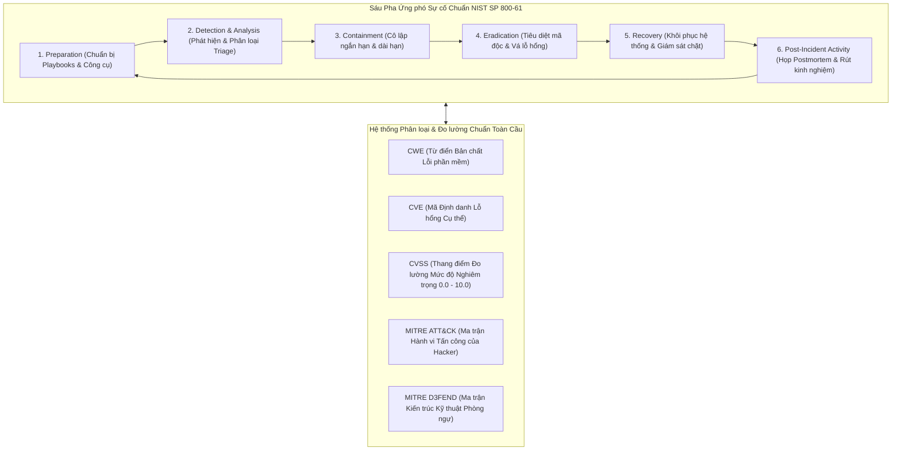
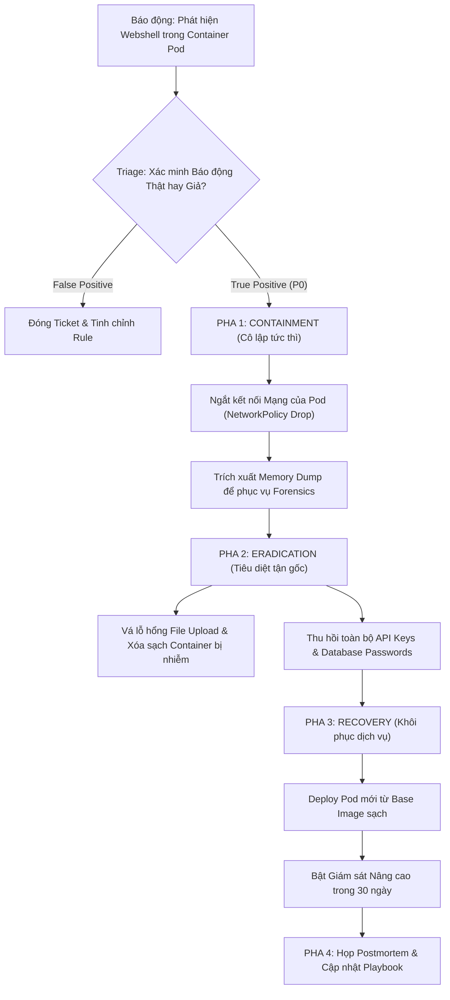
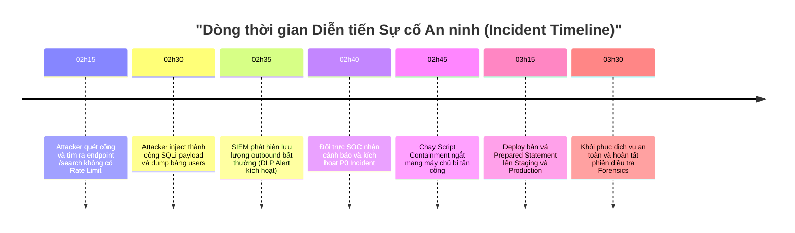
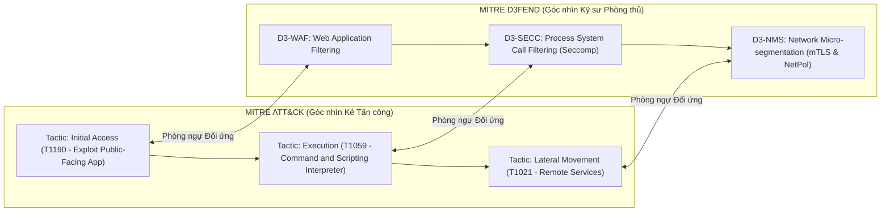

# 13.2. Incident Response, Forensics and Security Frameworks (Ứng phó Sự cố, Điều tra Pháp y & Các Khung Bảo mật Quốc tế)

## Tổng quan về Incident Response & Threat Frameworks
Trong thế giới kỹ thuật hệ thống hiện đại, châm ngôn sống còn là: **"Không phải là hệ thống của bạn có bị hack hay không, mà là khi nào bị hack và bạn phát hiện, xử lý nó nhanh đến mức nào"** (Assume Breach Mindset). Một sự cố an ninh thông tin (Security Incident) nếu được xử lý một cách hỗn loạn, thiếu bài bản sẽ biến một lỗ hổng nhỏ thành một thảm họa phá hủy toàn bộ dữ liệu và sụp đổ doanh nghiệp.

Quy trình Ứng phó Sự cố (**Incident Response Lifecycle**) theo chuẩn **NIST SP 800-61** và **SANS Institute** cung cấp một lộ trình quân sự khép kín: Từ phát hiện (**Detection & Triage**), cô lập ngăn chặn lây lan (**Containment**), tiêu diệt tận gốc (**Eradication**), khôi phục dịch vụ (**Recovery**), điều tra pháp y kỹ thuật số (**Digital Forensics**), cho đến phân tích nguyên nhân gốc rễ (**Root Cause Analysis & Postmortem**).

Đồng thời, toàn bộ kho tàng tri thức phòng thủ của nhân loại được chuẩn hóa qua các khung phân loại quốc tế: **CVE, CVSS, CWE**, ma trận kỹ thuật tấn công **MITRE ATT&CK** và ma trận phòng ngự **MITRE D3FEND**.



---

## 2. Chi tiết từng Keyword (Under-the-Hood Deep Dive)

### 1. The Incident Response Lifecycle: Triage, Containment, Eradication & Recovery

#### 1. Khái niệm bản chất (What & Why)
- **Incident Response (IR - Ứng phó Sự cố An ninh)**: Tập hợp các quy trình, kỹ thuật và hành động phối hợp nhằm phát hiện, hạn chế thiệt hại, tiêu diệt mối nguy và khôi phục hoạt động bình thường của hệ thống sau khi xảy ra một cuộc tấn công mạng.
- **Sáu Giai đoạn Vàng theo Chuẩn NIST SP 800-61**:
  1. **Preparation (Chuẩn bị)**: Thiết lập các kịch bản phản ứng (**Security Incident Playbooks**), diễn tập định kỳ (Tabletop Exercises), phân công trách nhiệm đội phản ứng khẩn cấp (CSIRT/CERT).
  2. **Detection & Triage (Phát hiện & Phân loại Mức độ)**: Nhận diện biến cố an ninh và phân loại mức độ khẩn cấp (P0 - Khẩn cấp / Toàn hệ thống vs P3 - Thấp) để huy động nguồn lực tương xứng.
  3. **Containment (Cô lập Phạm vi Thiệt hại)**:
     - *Short-term Containment*: Ngắt kết nối mạng của máy chủ bị nhiễm (Quarantine Pod / Isolate Host), đóng các cổng kết nối bị tấn công.
     - *Long-term Containment*: Cài đặt bản vá tạm thời, khóa tài khoản người dùng bị thỏa hiệp.
  4. **Eradication (Tiêu diệt Tận gốc)**: Tìm và xóa sạch mọi thành phần của mã độc (Malware, Webshells, Rootkits, Cron jobs độc hại), đóng các backdoor do hacker để lại và vá lỗ hổng gốc rễ.
  5. **Recovery (Khôi phục Hệ thống)**: Khôi phục dữ liệu từ các bản backup sạch đã được kiểm định, đưa hệ thống trở lại hoạt động và tăng cường giám sát cảnh báo cấp cao trong nhiều tuần sau đó.
  6. **Post-Incident Activity / Postmortem (Đánh giá Sau Sự cố)**: Họp rút kinh nghiệm, lập báo cáo phân tích nguyên nhân gốc rễ (**Root Cause Analysis**) và cải tiến hệ thống để sự cố không bao giờ lặp lại.

#### 2. Cơ chế hoạt động sâu (Under the hood / Hardcore Internals)
- **Quy tắc Bất di bất dịch khi Cô lập Máy chủ bị Nhiễm**:
  Khi phát hiện một máy chủ backend bị hacker xâm nhập:
  - **TUYỆT ĐỐI KHÔNG TẮT NGUỒN MÁY CHỦ (`power off`) HAY REBOOT!**
    Nếu bạn tắt nguồn máy tính, toàn bộ dữ liệu lưu trữ tạm thời trong bộ nhớ **RAM (Volatile Memory)** – bao gồm shellcode độc hại, các khóa mã hóa đối xứng, các kết nối mạng TCP socket đang mở và các tiến trình mã độc chạy ngầm – **sẽ bị biến mất vĩnh viễn**, phá hủy hoàn toàn bằng chứng phục vụ điều tra pháp y (Digital Forensics)!
  - *Hành động Chuẩn*: **Chỉ ngắt kết nối card mạng (Isolate Network Cable / Disable Virtual NIC / Iptables Drop All)**, giữ nguyên nguồn điện máy chủ và thực hiện ngay quy trình trích xuất bộ nhớ RAM (**Memory Dump via LiME / Volatility**).

#### 3. Sơ đồ minh họa (Mô hình Phân luồng Xử lý Sự cố theo Playbook)


#### 4. Code ví dụ thực chiến (Bash Automated Incident Containment Script for Linux Host)
```bash
#!/bin/bash
# Kịch bản Tự động Cô lập Khẩn cấp Máy chủ Linux khi Phát hiện Xâm nhập (Containment Playbook)

set -euo pipefail

echo "[INCIDENT CONTAINMENT] Emergency quarantine sequence initiated on host: $(hostname)"

# 1. BƯỚC 1: CÔ LẬP MẠNG LẬP TỨC (Chặn toàn bộ lưu lượng ra vào trừ cổng quản trị an toàn)
echo "[Step 1] Dropping all network traffic via iptables..."
iptables -P INPUT DROP
iptables -P FORWARD DROP
iptables -P OUTPUT DROP

# Chỉ duy nhất cho phép kết nối loopback nội bộ để các công cụ forensics chạy
iptables -A INPUT -i lo -j ACCEPT
iptables -A OUTPUT -o lo -j ACCEPT

# 2. BƯỚC 2: ĐÓNG BĂNG TIẾN TRÌNH KHẢ NGHI (SIGSTOP thay vì SIGKILL để giữ nguyên bộ nhớ RAM)
TARGET_PID=${1:-""}
if [ -n "$TARGET_PID" ]; then
    echo "[Step 2] Freezing suspicious process PID $TARGET_PID using SIGSTOP for memory preservation..."
    kill -STOP "$TARGET_PID" || true
fi

# 3. BƯỚC 3: DUMP THÔNG TIN MẠNG VÀ KẾT NỐI SOCKET VÀO FILE BẰNG CHỨNG
TIMESTAMP=$(date +%Y%m%d_%H%M%S)
EVIDENCE_DIR="/var/log/forensics_evidence_${TIMESTAMP}"
mkdir -p "$EVIDENCE_DIR"

echo "[Step 3] Collecting volatile network and process evidence..."
netstat -tupn > "${EVIDENCE_DIR}/active_connections.txt" 2>&1 || true
ss -tupn > "${EVIDENCE_DIR}/active_sockets.txt" 2>&1 || true
ps auxwf > "${EVIDENCE_DIR}/process_tree.txt" 2>&1 || true
lsof -n -P > "${EVIDENCE_DIR}/open_files.txt" 2>&1 || true

echo "[INCIDENT CONTAINMENT] Host successfully isolated. Evidence captured in: ${EVIDENCE_DIR}"
```

#### 5. Ưu / Nhược điểm, Pitfalls & Anti-patterns
- **Pitfall**: Thực hiện khôi phục hệ thống (Recovery) quá vội vàng trước khi xác định được nguyên nhân gốc rễ (Root Cause). Kẻ tấn công chỉ cần dùng lại chính lỗ hổng cũ hoặc backdoor bí mật chưa bị tiêu diệt để tái xâm nhập hệ thống ngay trong ngày hôm sau.
- **Anti-pattern**: "Văn hóa Đổ lỗi" (Blameless Postmortem Violation). Khi một sự cố xảy ra, nếu công ty chỉ tập trung tìm một cá nhân để khiển trách hoặc sa thải, các kỹ sư sẽ có xu hướng che giấu lỗi lầm, khiến hệ thống mãi mãi không được khắc phục triệt để.

#### 6. Ứng dụng thực tế trong Backend / Systems
Tiêu chuẩn vận hành của các đội ứng cứu khẩn cấp máy tính quốc gia (**VNCERT tại Việt Nam, US-CERT tại Hoa Kỳ**) và các đội ứng phó sự cố chuyên nghiệp của Mandiant, CrowdStrike.

---

### 2. Digital Forensics, Root Cause Analysis & Security Postmortem

#### 1. Khái niệm bản chất (What & Why)
- **Digital Forensics (Điều tra Pháp y Kỹ thuật số)**: Khoa học thu thập, bảo tồn, phân tích và trình bày các bằng chứng số từ hệ thống máy tính theo cách thức được pháp luật công nhận nhằm xác định chính xác danh tính kẻ tấn công, phương thức xâm nhập và phạm vi thiệt hại.
- **Thứ tự Biến thiên của Dữ liệu Bằng chứng (Order of Volatility - RFC 3227)**:
  Bằng chứng số phải được thu thập theo thứ tự từ thành phần dễ bay hơi nhất đến thành phần bền vững nhất:
  1. *Thanh ghi CPU, Bộ nhớ Cache CPU*.
  2. *Bộ nhớ RAM (Volatile Memory, Routing table, ARP cache, Kernel state)*.
  3. *Trạng thái mạng tạm thời (Temporary file systems, Sockets)*.
  4. *Ổ cứng lưu trữ vật lý (SSD/HDD, Disk images)*.
  5. *Log từ xa và Media lưu trữ quang/băng từ*.
- **Chuỗi Hành trình Bằng chứng (Chain of Custody)**: Quy trình tài liệu hóa chặt chẽ ai đã tiếp cận bằng chứng, vào thời gian nào, lưu trữ ở đâu và kèm theo mã băm mật mã học (SHA-256 Checksum) để chứng minh trước tòa án rằng bằng chứng số **không hề bị thay đổi hay thêm bớt trong suốt quá trình điều tra**.
- **Security Postmortem (Báo cáo Phân tích Sau Sự cố)**: Tài liệu kỹ thuật chuyên sâu được biên soạn sau khi sự cố kết thúc, phân tích rõ dòng thời gian (Timeline), nguyên nhân gốc rễ (**5 Whys Methodology**), bài học kinh nghiệm và các hành động phòng ngừa (Action Items) cụ thể.

#### 2. Cơ chế hoạt động sâu (Under the hood / Hardcore Internals)
- **Phương pháp 5 Whys trong Phân tích Nguyên nhân Gốc rễ (Root Cause Analysis)**:
  - *Sự cố*: Cơ sở dữ liệu khách hàng bị rò rỉ trên Dark Web.
  - *Tại sao 1*: Kẻ tấn công đọc được database qua lỗi SQL Injection trên API tìm kiếm.
  - *Tại sao 2*: Lập trình viên đã dùng phép nối chuỗi thô thay vì dùng Parameterized Query.
  - *Tại sao 3*: Lập trình viên mới vào công ty chưa được đào tạo về Secure Coding Standards.
  - *Tại sao 4*: Đường ống CI/CD không có công cụ SAST tự động chặn đứng lỗi SQLi khi mở Pull Request.
  - *Tại sao 5 (Root Cause)*: Công ty chưa triển khai quy trình SSDLC và thiếu chốt chặn tự động Security Gate trong quy trình phát triển!
  - $\implies$ *Giải pháp gốc rễ*: Cài đặt Semgrep SAST vào CI/CD để tự động chặn mọi code SQL nối chuỗi, và tổ chức đào tạo bảo mật định kỳ cho toàn bộ kỹ sư.

#### 3. Sơ đồ minh họa (Mẫu Báo cáo Sự cố An ninh Blameless Postmortem Timeline)


#### 4. Code ví dụ thực chiến (C++ Cryptographic Evidence Hash Verification Engine)
```cpp
#include <iostream>
#include <fstream>
#include <string>
#include <vector>
#include <openssl/sha.h>
#include <iomanip>

class ForensicEvidenceIntegrity {
public:
    // Tính toán mã băm SHA-256 của file bằng chứng pháp y để đảm bảo Chain of Custody
    static std::string computeEvidenceFileSha256(const std::string& filePath) {
        std::ifstream file(filePath, std::ios::binary);
        if (!file.is_open()) {
            throw std::runtime_error("Cannot open evidence file: " + filePath);
        }

        SHA256_CTX sha256;
        SHA256_Init(&sha256);

        char buffer[32768]; // Đọc từng khối 32KB
        while (file.read(buffer, sizeof(buffer))) {
            SHA256_Update(&sha256, buffer, file.gcount());
        }
        SHA256_Update(&sha256, buffer, file.gcount());

        unsigned char hash[SHA256_DIGEST_LENGTH];
        SHA256_Final(hash, &sha256);

        std::stringstream ss;
        for (int i = 0; i < SHA256_DIGEST_LENGTH; ++i) {
            ss << std::hex << std::setw(2) << std::setfill('0') << static_cast<int>(hash[i]);
        }
        return ss.str();
    }
};

int main() {
    std::cout << "Digital Forensics: Chain of Custody Evidence Verification Engine ready.\n";
    // Trong thực tế: File memory_dump.raw được băm ngay tại hiện trường và ghi nhận vào biên bản pháp lý
    return 0;
}
```

#### 5. Ưu / Nhược điểm, Pitfalls & Anti-patterns
- **Pitfall**: Chỉnh sửa trực tiếp file bằng chứng gốc trong quá trình điều tra. Nguyên tắc vàng của Digital Forensics là: **Luôn luôn tạo bản sao bit-by-bit (Forensic Bitstream Image bằng lệnh `dd`) và chỉ được phép điều tra trên bản sao, giữ nguyên bản gốc trong két sắt**!
- **Anti-pattern**: Đóng sự cố mà không lập Postmortem hoặc không theo dõi các hành động khắc phục (Action Items) trong Jira.

#### 6. Ứng dụng thực tế trong Backend / Systems
Mô hình báo cáo sự cố chuẩn mực của **Google Site Reliability Engineering (SRE Blameless Postmortem Framework)** và Netflix Chaos & Resilience Engineering.

---

### 3. Vulnerability Disclosure & Global Security Frameworks: CVE, CVSS, CWE, MITRE ATT&CK & D3FEND

#### 1. Khái niệm bản chất (What & Why)
- **Vulnerability Disclosure (Quy trình Công bố Lỗ hổng)**:
  - **Full Disclosure**: Công bố công khai toàn bộ chi tiết và mã khai thác của lỗ hổng lên Internet mà không báo trước cho nhà phát triển (Thường gây nguy hiểm cực lớn cho người dùng).
  - **Responsible Disclosure / Coordinated Vulnerability Disclosure (CVD - Chuẩn mực Văn minh)**: Nhà nghiên cứu bảo mật thông báo riêng tư cho công ty phát triển phần mềm, cho công ty một khoảng thời gian hợp lý (thường là **90 ngày theo chuẩn Google Project Zero**) để phát triển và phát hành bản vá. Sau khi bản vá đã được cập nhật rộng rãi cho người dùng, chi tiết lỗ hổng mới được công bố công khai.
- **Bộ Ba Định danh và Đánh giá Lỗ hổng Toàn cầu**:
  - **CWE (Common Weakness Enumeration)**: Từ điển phân loại **Bản chất của các loại lỗi phần mềm** (Ví dụ: `CWE-89`: SQL Injection; `CWE-79`: XSS; `CWE-787`: Out-of-bounds Write).
  - **CVE (Common Vulnerabilities and Exposures)**: Mã định danh duy nhất toàn cầu gán cho **một lỗ hổng bảo mật cụ thể trong một sản phẩm cụ thể** do tổ chức MITRE quản lý (Ví dụ: `CVE-2021-44228` - Lỗ hổng Log4Shell trong Apache Log4j).
  - **CVSS (Common Vulnerability Scoring System)**: Khung đo lường định lượng mức độ nghiêm trọng của lỗ hổng theo thang điểm từ **0.0 đến 10.0** (Phiên bản mới nhất là **CVSS v4.0**):
    - `0.0`: None
    - `0.1 - 3.9`: Low
    - `4.0 - 6.9`: Medium
    - `7.0 - 8.9`: High
    - `9.0 - 10.0`: **CRITICAL (Khẩn cấp - Cần vá trong 24 giờ!)**
- **MITRE ATT&CK (Adversarial Tactics, Techniques, and Common Knowledge)**: Ma trận tri thức toàn cầu mô hình hóa toàn bộ các **Chiến thuật (Tactics - Mục tiêu của hacker: Initial Access, Execution, Persistence, Privilege Escalation, Lateral Movement, Exfiltration)** và hàng trăm **Kỹ thuật cụ thể (Techniques)** mà các nhóm hacker thực tế (APT groups) sử dụng trong thực chiến.
- **MITRE D3FEND**: Ma trận kiến trúc kỹ thuật phòng thủ đối ứng trực tiếp với MITRE ATT&CK. Chỉ rõ chính xác các giải pháp kỹ thuật phòng ngự tương ứng (Model, Deceive, Isolate, Harden, Evict) cho từng kỹ thuật tấn công của hacker.

#### 2. Cơ chế hoạt động sâu (Under the hood / Hardcore Internals)
- **Công thức Tính điểm CVSS v3.1 Base Score**:
  Điểm số CVSS được tính toán tự động dựa trên hai nhóm chỉ số vector:
  1. **Exploitability Metrics (Độ dễ dàng khai thác)**:
     - `Attack Vector (AV)`: Network (Mạng - Điểm cao nhất), Adjacent, Local, Physical.
     - `Attack Complexity (AC)`: Low (Dễ khai thác) vs High.
     - `Privileges Required (PR)`: None (Không cần tài khoản) vs Low vs High.
     - `User Interaction (UI)`: None (Tự động khai thác) vs Required (Cần nạn nhân click chuột).
  2. **Impact Metrics (Mức độ thiệt hại tam giác CIA)**:
     - `Confidentiality Impact (C)`: None, Low, High.
     - `Integrity Impact (I)`: None, Low, High.
     - `Availability Impact (A)`: None, Low, High.
  - *Ví dụ Vector Chuẩn*: `CVSS:3.1/AV:N/AC:L/PR:N/UI:N/S:U/C:H/I:H/A:H` $\implies$ **Điểm số tối đa 9.8 CRITICAL!** (Khai thác qua mạng, độ phức tạp thấp, không cần tài khoản, không cần tương tác người dùng, phá hủy hoàn toàn cả 3 đỉnh C-I-A).

#### 3. Sơ đồ minh họa (Mối quan hệ Đối kháng giữa Ma trận MITRE ATT&CK vs MITRE D3FEND)


#### 4. Code ví dụ thực chiến (TypeScript CVSS v3.1 Severity Score Classifier)
```typescript
interface CvssVector {
    attackVector: 'NETWORK' | 'ADJACENT' | 'LOCAL' | 'PHYSICAL';
    attackComplexity: 'LOW' | 'HIGH';
    privilegesRequired: 'NONE' | 'LOW' | 'HIGH';
    userInteraction: 'NONE' | 'REQUIRED';
    scope: 'UNCHANGED' | 'CHANGED';
    confidentiality: 'NONE' | 'LOW' | 'HIGH';
    integrity: 'NONE' | 'LOW' | 'HIGH';
    availability: 'NONE' | 'LOW' | 'HIGH';
}

export class CvssEvaluator {
    /**
     * Phân loại mức độ nghiêm trọng và thiết lập SLA vá lỗi tự động theo thang điểm CVSS
     */
    public static classifySeverity(cvssScore: number): { severity: string; remediationSlaHours: number; action: string } {
        if (cvssScore >= 9.0) {
            return {
                severity: "CRITICAL",
                remediationSlaHours: 24, // Bắt buộc vá trong vòng 24 giờ!
                action: "P0 Emergency Hotfix: Mobilize Security War Room immediately."
            };
        } else if (cvssScore >= 7.0) {
            return {
                severity: "HIGH",
                remediationSlaHours: 72, // 3 Ngày
                action: "P1 Priority: Fix within current operational sprint."
            };
        } else if (cvssScore >= 4.0) {
            return {
                severity: "MEDIUM",
                remediationSlaHours: 14 * 24, // 14 Ngày
                action: "P2 Normal: Schedule for upcoming release cycle."
            };
        } else {
            return {
                severity: "LOW",
                remediationSlaHours: 30 * 24, // 30 Ngày
                action: "P3 Low Priority: Monitor and batch update."
            };
        }
    }
}

// Minh họa phân loại một lỗ hổng RCE nghiêm trọng
const vulnerabilityAssessment = CvssEvaluator.classifySeverity(9.8);
console.log(`Vulnerability Classification: ${vulnerabilityAssessment.severity}`);
console.log(`Remediation SLA: Within ${vulnerabilityAssessment.remediationSlaHours} hours`);
console.log(`Action Required: ${vulnerabilityAssessment.action}`);
```

#### 5. Ưu / Nhược điểm, Pitfalls & Anti-patterns
- **Pitfall**: Đe dọa pháp lý hoặc kiện tụng các nhà nghiên cứu bảo mật thiện chí (White-hat Hackers) khi họ báo cáo lỗ hổng qua email. Hành động này sẽ thúc đẩy hacker chuyển sang Full Disclosure hoặc bán lỗ hổng trên thị trường chợ đen. (Luôn luôn thiết lập trang **`security.txt`** và chương trình **Bug Bounty** công khai trên HackerOne/Bugcrowd).
- **Anti-pattern**: Chỉ chăm chăm nhìn vào điểm CVSS Base Score mà bỏ qua ngữ cảnh môi trường (Temporal / Environmental Metrics). Ví dụ: Một lỗi CVSS 9.8 nằm trong một dịch vụ thử nghiệm offline không có kết nối mạng sẽ có mức độ ưu tiên thực tế thấp hơn nhiều so với một lỗi CVSS 7.5 nằm trên cổng thanh toán chính của công ty.

#### 6. Ứng dụng thực tế trong Backend / Systems
Toàn bộ quy trình quản lý lỗ hổng (Vulnerability Management Program) của các tập đoàn công nghệ lớn đều liên kết chặt chẽ với cơ sở dữ liệu **NIST National Vulnerability Database (NVD)** và ma trận **MITRE ATT&CK** để xây dựng chiến lược phòng ngự chủ động.
