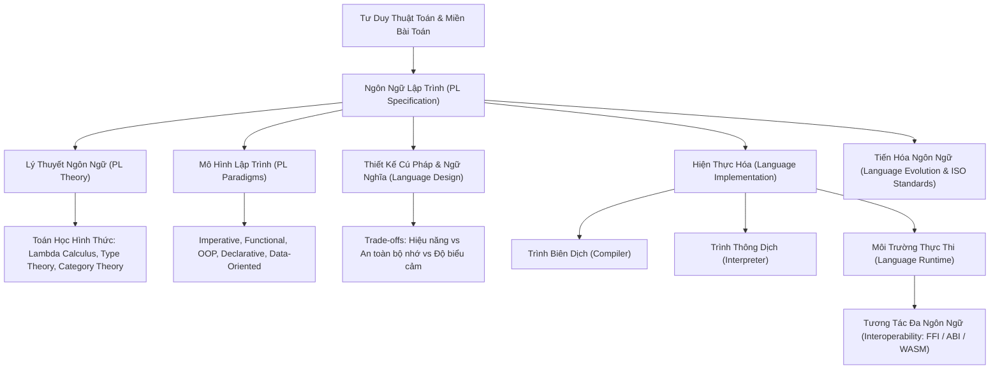
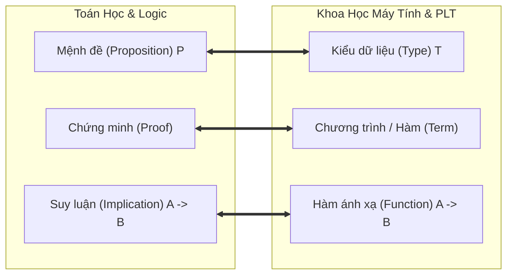
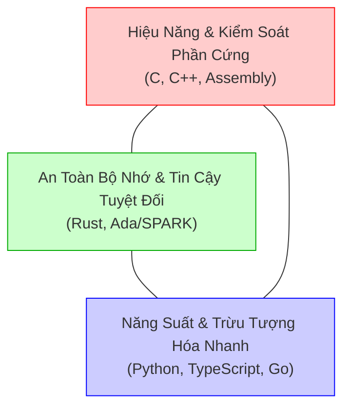
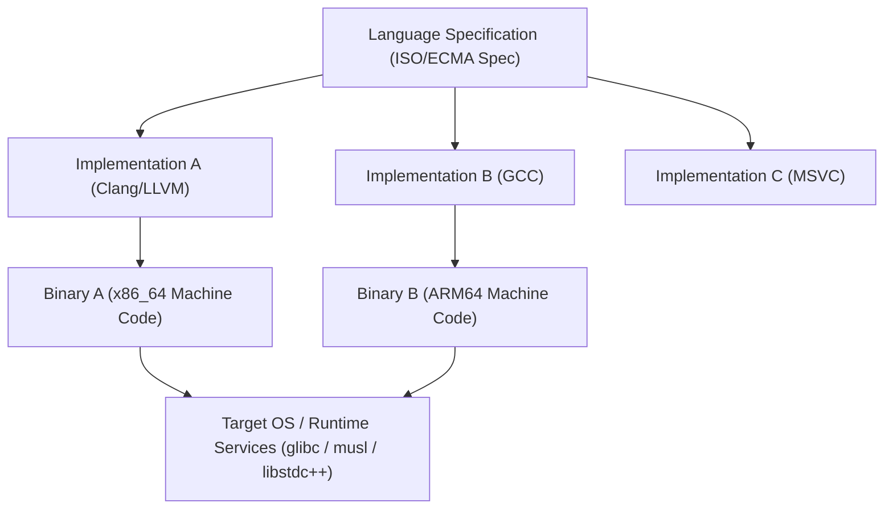
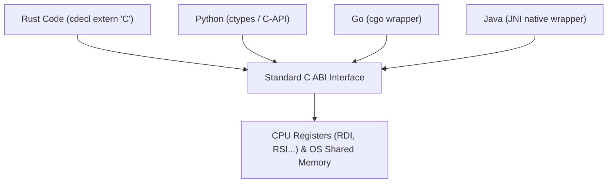

# 1.1. Lý Thuyết và Thiết Kế Ngôn Ngữ Lập Trình (Language Theory & Design)

## Tổng quan về Language Theory & Design
Lý thuyết và thiết kế ngôn ngữ lập trình là nhánh nền tảng của Khoa học máy tính nghiên cứu về định nghĩa toán học, cấu trúc hình thức, hệ thống thực thi và tiến hóa của các ký hiệu mà con người dùng để giao tiếp với phần cứng. Ngôn ngữ lập trình là một lớp trừu tượng (abstraction layer) chuyển đổi tư duy logic của con người thành chuỗi các chỉ thị máy (machine instructions) có thể thực thi trên kiến trúc von Neumann.



---

## 2. Chi tiết từng Keyword (Under-the-Hood Deep Dive)

---

### 1. Programming Language Theory (Lý Thuyết Ngôn Ngữ Lập Trình)

#### 1. Khái niệm bản chất (What & Why)
Programming Language Theory (PLT) là lĩnh vực toán học và khoa học máy tính chuyên nghiên cứu thiết kế, phân tích, đặc tả và phân loại các ngôn ngữ lập trình cùng các đặc tính hình thức của chúng. 
PLT dựa trên ba trụ cột chính:
1. **Mathematical Logic & Model Theory**: Logic mệnh đề, logic vị từ, lý thuyết chứng minh (Proof Theory).
2. **Lambda Calculus ($\lambda$-calculus)** (Alonzo Church): Nền tảng tính toán hình thức chứng minh tính Turing-complete thông qua quy tắc $\alpha$-conversion, $\beta$-reduction và $\eta$-conversion.
3. **Type Theory** (Per Martin-Löf, Jean-Yves Girard): Khung toán học thiết lập tính đúng đắn và an toàn thông qua tính đẳng cấu Curry-Howard (Chương trình $\equiv$ Chứng minh toán học, Kiểu dữ liệu $\equiv$ Định lý).

#### 2. Cơ chế hoạt động sâu (Under the hood / Hardcore Internals)
Dưới tầng sâu, PLT quyết định cách thức mà một trừu tượng toán học được hạ thấp (lowered) thành kiến trúc vật lý:
- **Khả năng quy đổi trạng thái (State Transition Semantics)**: Mọi biểu thức toán học trong $\lambda$-calculus không mang trạng thái mutable. Để ánh xạ vào CPU vật lý (vốn dựa trên thanh ghi và bộ nhớ có trạng thái), lý thuyết bổ sung *Monads* hoặc *Linear Types* để quản lý hiệu ứng phụ (side-effects) mà không làm mất đi tính minh bạch tham chiếu (referential transparency).
- **Hệ thống chứng minh hình thức (Formal Verification)**: Các ngôn ngữ như Coq, Agda, Lean chuyển đổi trực tiếp mã nguồn thành các chứng minh toán học. Trình biên dịch trở thành một Proof Checker; nếu mã vượt qua bước kiểm tra kiểu (type checking), chương trình được bảo đảm toán học không bao giờ gặp lỗi Runtime Undefined Behavior.

#### 3. Sơ đồ minh họa (Curry-Howard Isomorphism)


#### 4. Code ví dụ thực chiến (C++20: Khái niệm Chứng minh Kiểu ở Compile-Time thông qua Concepts)
```cpp
#include <iostream>
#include <concepts>
#include <type_traits>

// Mô hình hóa Curry-Howard đơn giản: Chứng minh ở thời điểm biên dịch
// Định lý: Chỉ chấp nhận kiểu dữ liệu có thể cộng dồn mà không bị tràn ngầm định
template <typename T>
concept AddableAndNumeric = std::is_arithmetic_v<T> && requires(T a, T b) {
    { a + b } -> std::same_as<T>;
};

// Hàm đóng vai trò như một "Chứng minh" (Proof Term) cho định lý
template <AddableAndNumeric T>
constexpr T safeAdd(T a, T b) noexcept {
    return a + b;
}

int main() {
    constexpr int val = safeAdd(10, 20); // Hợp lệ, kiểm chứng toán học tại compile-time
    std::cout << "Computed value: " << val << "\n";
    
    // safeAdd("Hello", "World"); // Compile Error: Vi phạm định lý AddableAndNumeric
    return 0;
}
```

#### 5. Cạm bẫy & Anti-patterns
- **Over-formalization**: Áp dụng hệ thống kiểu phụ thuộc (dependent types) quá phức tạp vào các ứng dụng nghiệp vụ CRUD cơ bản, khiến thời gian biên dịch (compile time) bùng nổ cấp số nhân và cản trở tốc độ delivery.

#### 6. Ứng dụng thực tế trong Backend / Systems
- Sử dụng công cụ TLA+ (Leslie Lamport) hoặc Coq/Isabelle để kiểm chứng hình thức cho các thuật toán đồng thuận phân tán phức tạp như Raft, Paxos hoặc mô hình phân phối bộ nhớ trong Linux Kernel.

---

### 2. Programming Language Paradigms & Language Design

#### 1. Khái niệm bản chất (What & Why)
- **Programming Language Paradigms (Mô hình lập trình)**: Lăng kính tư duy và phương pháp luận tổ chức mã nguồn, quản lý trạng thái và luồng thực thi (ví dụ: Imperative, Functional, Object-Oriented, Data-Oriented).
- **Language Design (Thiết kế ngôn ngữ)**: Quá trình đưa ra các quyết định đánh đổi kỹ thuật (Trade-offs) khắt khe giữa:
  1. *Hiệu năng thực thi (Execution Speed)* vs *Năng suất lập trình viên (Developer Velocity)*.
  2. *An toàn bộ nhớ (Memory Safety)* vs *Quyền kiểm soát phần cứng trực tiếp (Low-level Control)*.
  3. *Hệ thống kiểu tĩnh khắt khe (Static Expressiveness)* vs *Thời gian biên dịch (Compile-time Latency)*.

#### 2. Cơ chế hoạt động sâu (Under the hood / Hardcore Internals)
Khi thiết kế một ngôn ngữ, quyết định kiến trúc then chốt bao gồm:
- **Mô hình bộ nhớ (Memory Management Model)**:
  - *Manual Management* (C/C++): Tối đa hiệu năng CPU cache và throughput, nhưng rủi ro Use-After-Free và Memory Leak.
  - *Tracing GC* (Java, Go, Go-GMP): Đảm bảo an toàn bộ nhớ qua GC cycles, đánh đổi lại bằng Stop-The-World (STW) pauses và overhead bộ nhớ gấp 1.5x - 2x.
  - *Compile-Time Ownership* (Rust): Không tốn runtime GC, an toàn bộ nhớ 100% nhờ bộ kiểm tra mượn (Borrow Checker) tại compile-time, nhưng đẩy độ phức tạp nhận thức lên lập trình viên và kéo dài compile-time.
- **Biểu diễn dữ liệu bộ nhớ (Data Representation)**:
  - Boxing vs Unboxing: Java `Integer` (con trỏ 8 bytes + header đối tượng 16 bytes = 24 bytes trên Heap) so với C++ `int32_t` (chính xác 4 bytes nằm trực tiếp trên Stack/Cache line).

#### 3. Sơ đồ minh họa (Tam giác đánh đổi thiết kế ngôn ngữ)


#### 4. Code ví dụ thực chiến (C++20 vs TypeScript: So sánh tư duy thiết kế ngôn ngữ)
```cpp
// C++20: Zero-cost Abstraction, Bộ nhớ phẳng (Flat Memory Layout), Không overhead Heap
#include <iostream>
#include <array>
#include <numeric>

struct PacketHeader {
    uint16_t length;
    uint8_t flags;
    uint8_t protocol;
}; // Tổng kích thước đúng 4 bytes (với padding phù hợp), không con trỏ, không boxing

constexpr size_t calculatePayloadOffset() {
    return sizeof(PacketHeader);
}
```

```typescript
// TypeScript: Dynamic Runtime (V8 JS), Type Erasure hoàn toàn ở Runtime
interface PacketHeader {
    length: number;
    flags: number;
    protocol: number;
}
// Tại runtime: V8 tạo Shape/Hidden Class, các thuộc tính là số thực 64-bit IEEE 754 (Double)
// có thể bị boxed Heap nếu vượt ngưỡng Smi (Small Integer).
```

#### 5. Cạm bẫy & Anti-patterns
- **Turing Tarpit**: Ngôn ngữ cố gắng tối giản hóa tới mức cực đoan (như Brainfuck hay Pure LISP), khiến việc viết các tác vụ kỹ thuật thực tế (như mở Socket, quản lý Thread) trở nên cực kỳ gian nan.
- **Kitchen Sink Syndrome**: Nhồi nhét quá nhiều tính năng xung đột vào cùng một ngôn ngữ (vừa hỗ trợ OOP kế thừa đa tầng, vừa functional monad, vừa dynamic monkey patching) làm compiler phình to và ngôn ngữ mất đi bản sắc triết lý.

#### 6. Ứng dụng thực tế trong Backend / Systems
- Thiết kế các ngôn ngữ đặc thù chuyên biệt (DSL) cho cấu hình hạ tầng như HCL (HashiCorp Terraform) hay SQL cho Database Query Engines.

---

### 3. Programming Language Specification, Implementation & Runtime

#### 1. Khái niệm bản chất (What & Why)
- **Programming Language Specification (Đặc tả ngôn ngữ)**: Bản mô tả hình thức bằng văn bản xác định chính xác cú pháp hợp lệ và ngữ nghĩa hành vi của một ngôn ngữ (ví dụ: ISO/IEC 14882 cho C++, ECMAScript Specification cho JavaScript, The Java Language Specification - JLS).
- **Language Implementation (Hiện thực hóa ngôn ngữ)**: Phần mềm cụ thể hiện thực hóa bản đặc tả đó (ví dụ: GCC, Clang, MSVC là các implementation của C++; V8, JavaScriptCore, SpiderMonkey là implementation của ECMAScript).
- **Language Runtime (Môi trường thực thi)**: Tập hợp các thư viện hệ thống và thành phần nền tảng chạy song song với mã nguồn của ứng dụng để cung cấp các dịch vụ cơ sở: cấp phát bộ nhớ, thu gom rác, quản lý luồng, dispatch ảo, I/O multiplexing.

#### 2. Cơ chế hoạt động sâu (Under the hood / Hardcore Internals)
Sự tách bạch giữa Specification và Implementation:
- **Bản quyền và Chuẩn hóa**: Specification cho phép nhiều nhà cung cấp viết compiler/runtime độc lập nhưng vẫn đảm bảo chương trình chạy nhất quán (portable).
- **Undefined Behavior (UB) & Implementation-Defined Behavior**:
  - *Implementation-Defined*: Bản đặc tả cho phép compiler tự do quyết định nhưng bắt buộc phải tài liệu hóa (ví dụ: kích thước của `int` trong C++ là 16, 32 hay 64 bit).
  - *Undefined Behavior*: Bản đặc tả không đưa ra bất kỳ bảo đảm nào; compiler có thể sinh ra mã máy bất kỳ (thậm chí xóa trắng đoạn code hoặc giả định điều kiện không bao giờ xảy ra để tối ưu instruction pipelining).

#### 3. Sơ đồ minh họa (Mối quan hệ Spec - Implementation - Runtime)


#### 4. Code ví dụ thực chiến (C++20: Khai thác Implementation-Defined vs Compiler Attributes)
```cpp
#include <iostream>
#include <limits>

int main() {
    // 1. Implementation-defined behavior
    std::cout << "Kích thước pointer trên nền tảng hiện tại: " << sizeof(void*) * 8 << " bits\n";
    std::cout << "Kiểu char có dấu (signed) hay không: " << std::is_signed_v<char> << "\n";

    // 2. Tận dụng Compiler Intrinsics được cung cấp bởi implementation cụ thể (GCC/Clang)
#if defined(__GNUC__) || defined(__clang__)
    unsigned int val = 0b00010000;
    int leading_zeros = __builtin_clz(val);
    std::cout << "Số bit 0 đứng đầu (Hardware instruction BSR/LZCNT): " << leading_zeros << "\n";
#endif
    return 0;
}
```

#### 5. Cạm bẫy & Anti-patterns
- Nhầm lẫn giữa đặc tả ngôn ngữ và một implementation cụ thể (ví dụ: cho rằng "Python là ngôn ngữ thông dịch", trong khi thực tế Python là bản đặc tả, CPython là trình thông dịch bytecode, còn PyPy là JIT compiler).

#### 6. Ứng dụng thực tế trong Backend / Systems
- Thiết kế hệ thống Backend đa nền tảng (Cross-platform microservices): Biết rõ runtime implementation (ví dụ: dùng glibc vs musl libc trong Alpine Linux) giúp tránh các lỗi memory fragmentation và thread stack overflow kinh điển trong container.

---

### 4. Language Interoperability & Language Evolution

#### 1. Khái niệm bản chất (What & Why)
- **Language Interoperability (Khả năng tương tác đa ngôn ngữ)**: Năng lực cho phép mã nguồn viết bằng hai hoặc nhiều ngôn ngữ khác nhau có thể trực tiếp gọi hàm, truyền đối số và chia sẻ cấu trúc dữ liệu trong cùng một không gian địa chỉ bộ nhớ (shared address space).
- **Language Evolution (Tiến hóa ngôn ngữ)**: Quy trình cập nhật, hoàn thiện và bổ sung tính năng mới cho ngôn ngữ qua thời gian (ví dụ: chu kỳ 3 năm của C++: C++11, 14, 17, 20, 23; các giai đoạn đề xuất TC39 của ECMAScript).

#### 2. Cơ chế hoạt động sâu (Under the hood / Hardcore Internals)
- **Tương tác qua C ABI (The Universal Interop Lingua Franca)**:
  - Hầu hết các ngôn ngữ (Go, Rust, Python, Java thông qua JNI) đều không thể nói chuyện trực tiếp với nhau vì khác biệt về cấu trúc Runtime, Garbage Collector và Name Mangling.
  - C ABI (Application Binary Interface) đóng vai trò làm cầu nối chuẩn: layout bộ nhớ thẳng (flat layout), quy tắc gọi hàm cố định (cdecl, System V AMD64 ABI: truyền đối số qua thanh ghi `RDI`, `RSI`, `RDX`, `RCX`, `R8`, `R9`).
- **Chi phí của Interop**:
  - Khi Python gọi C extension hoặc Java gọi C qua JNI, luồng thực thi phải vượt qua ranh giới runtime (Crossing Runtime Boundary).
  - Phải ghim bộ nhớ (Pinning Memory) để GC không dịch chuyển địa chỉ con trỏ trong lúc mã ngoài C đang truy cập.

#### 3. Sơ đồ minh họa (C ABI làm cầu nối Interop)


#### 4. Code ví dụ thực chiến (C++20: Xuất hàm tương thích C ABI cho các ngôn ngữ khác gọi)
```cpp
// math_core.cpp: Biên dịch thành Shared Library (.so / .dylib / .dll)
#include <cstdint>

// Tắt C++ Name Mangling, áp đặt quy chuẩn C ABI
extern "C" {
    // Đảm bảo struct có memory alignment chuẩn C, không padding thừa
    struct Vector3D {
        float x, y, z;
    };

    // Hàm có thể được gọi trực tiếp từ Python (ctypes), Node.js (node-addon-api), hoặc Rust
    int32_t calculateDotProduct(const Vector3D* a, const Vector3D* b, float* result) {
        if (!a || !b || !result) {
            return -1; // Mã lỗi chuẩn
        }
        *result = (a->x * b->x) + (a->y * b->y) + (a->z * b->z);
        return 0; // Thành công
    }
}
```

```python
# Gọi hàm C++ từ Python mà không cần compiler phức tạp
import ctypes

class Vector3D(ctypes.Structure):
    _fields_ = [("x", ctypes.c_float), ("y", ctypes.c_float), ("z", ctypes.c_float)]

# lib = ctypes.CDLL("./libmath_core.so")
# res = ctypes.c_float()
# lib.calculateDotProduct(ctypes.byref(v1), ctypes.byref(v2), ctypes.byref(res))
```

#### 5. Cạm bẫy & Anti-patterns
- **Memory Management Across Boundaries**: Cấp phát bộ nhớ ở ngôn ngữ A (ví dụ: `malloc` trong C++) nhưng lại giải phóng ở ngôn ngữ B (ví dụ: để Python garbage collector thu hồi hoặc gọi `free` của một runtime khác). Điều này dẫn đến heap corruption và segmentation fault tức thì.

#### 6. Ứng dụng thực tế trong Backend / Systems
- Viết các extension tính toán ma trận hiệu năng cao (NumPy, PyTorch) bằng C++/CUDA nhưng expose API qua Python cho Data Scientists sử dụng.
- Tích hợp các module mật mã bảo mật viết bằng Rust vào trong các ứng dụng web Node.js hoặc Go backend.
