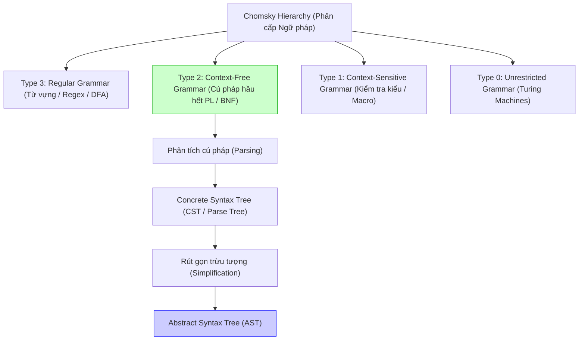
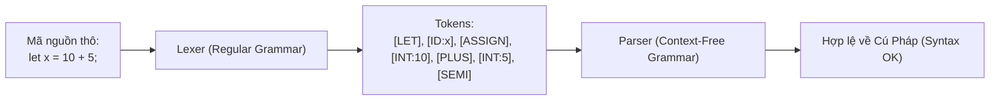
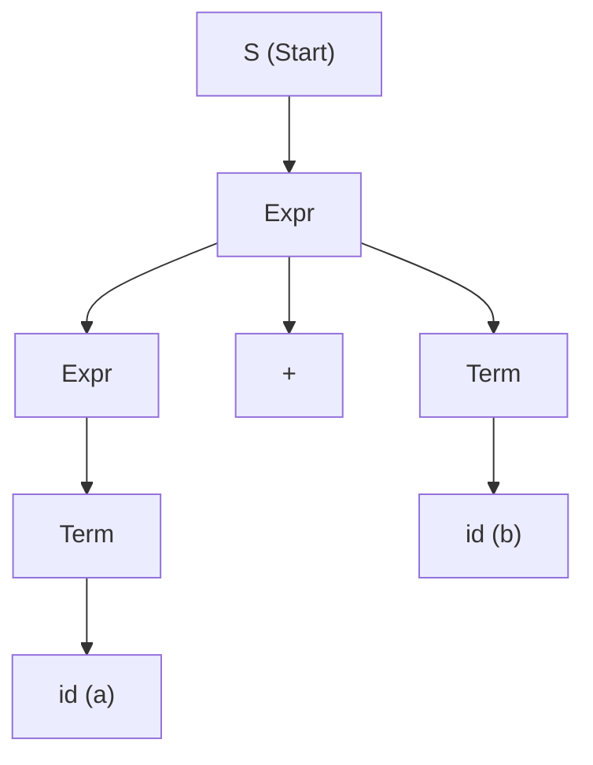
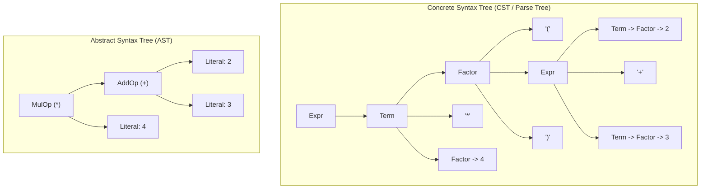

# 1.2. Cú Pháp và Ngữ Pháp Hình Thức (Syntax & Formal Grammar)

## Tổng quan về Syntax & Formal Grammar
Cú pháp (Syntax) và Ngữ pháp hình thức (Formal Grammar) là nền tảng toán học quy định cấu trúc bề mặt hợp lệ của một ngôn ngữ lập trình. Trong khi từ vựng xác định các từ hợp lệ, ngữ pháp hình thức xác định cách kết hợp các từ đó thành các phát biểu có cấu trúc logic mà trình biên dịch hoặc trình thông dịch có thể phân tích thành công.



---

## 2. Chi tiết từng Keyword (Under-the-Hood Deep Dive)

---

### 1. Language Syntax & Language Grammar

#### 1. Khái niệm bản chất (What & Why)
- **Language Syntax (Cú pháp ngôn ngữ)**: Tập hợp các quy tắc định hình cấu trúc bề mặt của mã nguồn, xác định thứ tự hợp lệ của các ký tự và từ khóa. Cú pháp chỉ quan tâm đến hình thức bên ngoài (form), không quan tâm đến ý nghĩa (meaning).
- **Language Grammar (Ngữ pháp ngôn ngữ)**: Hệ thống quy tắc sản xuất (production rules) mô tả cách thức sinh ra hoặc nhận diện tất cả các chuỗi hợp lệ thuộc về ngôn ngữ đó.

#### 2. Cơ chế hoạt động sâu (Under the hood / Hardcore Internals)
- Khi mã nguồn được nạp vào compiler, bộ phận đầu tiên là Lexer tách văn bản thô thành các Token (từ vựng).
- Ngữ pháp ngôn ngữ sẽ hướng dẫn Parser (Bộ phân tích cú pháp) duyệt qua luồng Token và dựng nên cây phân tích cú pháp.
- Một lỗi cú pháp (`SyntaxError`) xảy ra khi luồng token vi phạm quy tắc sản xuất ngữ pháp đã được xác định trước, dẫn đến việc Parser không thể thực hiện thao tác Shift hoặc Reduce (trong LR parsing) hoặc không tìm thấy nhánh suy dẫn phù hợp (trong LL parsing).

#### 3. Sơ đồ minh họa (Từ Text thô đến Token và Cú pháp)


#### 4. Code ví dụ thực chiến (C++20: Mô phỏng bộ nhận diện cú pháp đơn giản)
```cpp
#include <iostream>
#include <string_view>
#include <vector>
#include <stdexcept>

enum class TokenType { Number, Plus, Minus, EndOfFile };

struct Token {
    TokenType type;
    int value{0};
};

// Mô phỏng bộ phân tích cú pháp ngữ pháp: Expression -> Number ('+' Number)*
class SimpleSyntaxValidator {
    std::vector<Token> tokens_;
    size_t cursor_{0};

    Token current() const {
        if (cursor_ < tokens_.size()) return tokens_[cursor_];
        return {TokenType::EndOfFile, 0};
    }

    void consume(TokenType expected) {
        if (current().type == expected) {
            cursor_++;
        } else {
            throw std::runtime_error("SyntaxError: Token không khớp với quy tắc ngữ pháp!");
        }
    }

public:
    explicit SimpleSyntaxValidator(std::vector<Token> tokens) : tokens_(std::move(tokens)) {}

    void parseExpression() {
        consume(TokenType::Number);
        while (current().type == TokenType::Plus || current().type == TokenType::Minus) {
            cursor_++;
            consume(TokenType::Number);
        }
        consume(TokenType::EndOfFile);
    }
};

int main() {
    std::vector<Token> valid = { {TokenType::Number, 5}, {TokenType::Plus, 0}, {TokenType::Number, 10}, {TokenType::EndOfFile, 0} };
    SimpleSyntaxValidator parser(valid);
    try {
        parser.parseExpression();
        std::cout << "Cú pháp hợp lệ hoàn toàn!\n";
    } catch (const std::exception& e) {
        std::cerr << e.what() << "\n";
    }
    return 0;
}
```

#### 5. Cạm bẫy & Anti-patterns
- Nhầm lẫn giữa Syntax Error và Semantic Error: Cú pháp `int x = "abc";` trong C++ là hoàn toàn đúng về mặt ngữ pháp Context-Free (Cú pháp khai báo biến: `Type Identifier = Expression;`), nhưng sai về mặt ngữ nghĩa (Type mismatch).

#### 6. Ứng dụng thực tế trong Backend / Systems
- Viết parser cho các giao thức cấu hình hoặc truy vấn nội bộ (như SQL dialect riêng hoặc format RPC protobuf).

---

### 2. Formal Grammar, Context-Free Grammar (CFG) & Context-Sensitive Grammar (CSG)

#### 1. Khái niệm bản chất (What & Why)
- **Formal Grammar (Ngữ pháp hình thức)**: Bộ tứ hình thức $G = (V_N, V_T, P, S)$ gồm tập các ký hiệu chưa kết thúc (Non-terminals $V_N$), tập ký hiệu kết thúc (Terminals $V_T$), tập quy tắc sản xuất (Production Rules $P$) và ký hiệu bắt đầu ($S$).
- **Context-Free Grammar (CFG - Ngữ pháp phi ngữ cảnh)**: Các quy tắc sản xuất có dạng $A \to \alpha$, trong đó $A \in V_N$ và $\alpha \in (V_N \cup V_T)^*$. Nghĩa là việc thay thế $A$ bằng $\alpha$ hoàn toàn độc lập với ngữ cảnh xung quanh $A$. Đây là lớp ngữ pháp chuẩn để định nghĩa cú pháp hầu hết các ngôn ngữ lập trình hiện đại.
- **Context-Sensitive Grammar (CSG - Ngữ pháp phụ thuộc ngữ cảnh)**: Các quy tắc có dạng $\alpha A \beta \to \alpha \gamma \beta$. Việc thay thế $A$ chỉ được phép diễn ra khi có sự hiện diện của ngữ cảnh $\alpha$ và $\beta$.

#### 2. Cơ chế hoạt động sâu (Under the hood / Hardcore Internals)
- **Tại sao CFG được chọn làm nền tảng cho Compiler?**:
  - CFG có thể được nhận diện bởi máy tự động đẩy xuống (Pushdown Automaton - PDA) với độ phức tạp tính toán đa thức $O(n^3)$ (thuật toán CYK, Earley) hoặc tuyến tính $O(n)$ đối với các tập con xác định như LL(k) và LR(k).
  - Ngược lại, CSG đòi hỏi Linear Bounded Automaton và bài toán nhận diện là PSPACE-complete, không khả thi để biên dịch mã nguồn hàng triệu dòng trong thực tế.
- **Vấn đề ngữ cảnh trong ngôn ngữ lập trình (The C/C++ Typedef Problem)**:
  - Bản thân cú pháp C/C++ không hoàn toàn là Context-Free! Ví dụ biểu thức `(T) * x;`
    - Nếu `T` là kiểu dữ liệu: Đây là phép ép kiểu con trỏ (Cast dereference).
    - Nếu `T` là một biến: Đây là phép nhân giữa hai biến `(T)` và `*x` (hoặc nhân con trỏ).
  - Parser của C/C++ bắt buộc phải tương tác với Symbol Table trong lúc phân tích cú pháp (gọi là Lexer Hack) để biến đổi ngữ cảnh thành ngữ pháp phi ngữ cảnh.

#### 3. Sơ đồ minh họa (Suy dẫn CFG đơn giản)


#### 4. Code ví dụ thực chiến (Biểu diễn quy tắc ngữ pháp CFG qua EBNF và Code C++)
```text
/* Đặc tả BNF cho biểu thức số học */
Expr   ::= Term (( '+' | '-' ) Term)*
Term   ::= Factor (( '*' | '/' ) Factor)*
Factor ::= NUMBER | '(' Expr ')'
```

```cpp
// Hiện thực Recursive Descent Parser trực tiếp từ quy tắc CFG trên
#include <iostream>
#include <memory>

class ASTNode {
public:
    virtual ~ASTNode() = default;
};

class BinaryOpNode : public ASTNode {
public:
    char op;
    std::unique_ptr<ASTNode> left;
    std::unique_ptr<ASTNode> right;
    BinaryOpNode(char op, std::unique_ptr<ASTNode> l, std::unique_ptr<ASTNode> r)
        : op(op), left(std::move(l)), right(std::move(r)) {}
};

class NumberNode : public ASTNode {
public:
    int value;
    explicit NumberNode(int val) : value(val) {}
};
```

#### 5. Cạm bẫy & Anti-patterns
- Thiết kế ngữ pháp nhập nhằng (Ambiguous Grammar): Một chuỗi đầu vào có thể sinh ra 2 cây phân tích cú pháp khác nhau (ví dụ: vấn đề Dangling-Else trong câu lệnh `if (c1) if (c2) s1 else s2`), làm compiler không biết `else` thuộc về `if` nào nếu không có quy tắc ưu tiên rõ ràng.

#### 6. Ứng dụng thực tế trong Backend / Systems
- Sử dụng các bộ sinh Parser tự động dựa trên CFG như ANTLR, Bison, Yacc để tạo ra DSL parsing cho hệ thống định tuyến mạng (routing rules engine) hoặc bộ lọc log query tương tự Elasticsearch Query DSL.

---

### 3. Abstract Syntax vs Concrete Syntax (AST vs CST)

#### 1. Khái niệm bản chất (What & Why)
- **Concrete Syntax (Cú pháp cụ thể)**: Biểu diễn chính xác từng chi tiết ký tự xuất hiện trong mã nguồn, bao gồm dấu ngoặc đơn thừa, dấu chấm phẩy, khoảng trắng và chú thích. Cây biểu diễn trực tiếp Concrete Syntax được gọi là **Concrete Syntax Tree (CST)** hoặc **Parse Tree**.
- **Abstract Syntax (Cú pháp trừu tượng)**: Phiên bản tinh giản, loại bỏ toàn bộ các ký hiệu cú pháp râu ria (dấu ngoặc, dấu phẩy, phân tách khối) chỉ giữ lại cấu trúc phân cấp thuần túy của các phép toán logic và dữ liệu. Cây biểu diễn Abstract Syntax được gọi là **Abstract Syntax Tree (AST)**.

#### 2. Cơ chế hoạt động sâu (Under the hood / Hardcore Internals)
- **Quá trình chuyển đổi từ CST sang AST**:
  - CST chứa mọi nút trung gian phát sinh từ các bước suy dẫn ngữ pháp (ví dụ: nút `Term`, `Factor`). Điều này gây tốn bộ nhớ và làm chậm quá trình duyệt cây.
  - Bộ biên dịch chuyển đổi CST sang AST bằng cách làm phẳng (flatten) các nút thừa, chỉ giữ lại các phép toán thực sự (Operator) làm nút cha và các toán hạng (Operands) làm nút con.
- **Tối ưu hóa bộ nhớ cho AST**:
  - Trong các production compiler (như Clang hoặc Rust rustc), AST chứa hàng triệu nút cho các codebase lớn.
  - Để tránh phân mảnh bộ nhớ do cấp phát hàng triệu đối tượng nhỏ lẻ qua `malloc`/`new`, compiler sử dụng **Memory Arena** hoặc **Bump Allocator** (cấp phát theo block lớn liên tục) để chứa toàn bộ các node AST.

#### 3. Sơ đồ minh họa (So sánh CST vs AST cho biểu thức: `(2 + 3) * 4`)


#### 4. Code ví dụ thực chiến (TypeScript: Cấu trúc AST theo chuẩn ESTree)
```typescript
// Định nghĩa kiểu dữ liệu cho AST theo chuẩn ESTree (dùng trong Babel / ESLint / SWC)
type ASTNode = 
    | BinaryExpression 
    | NumericLiteral;

interface BinaryExpression {
    type: 'BinaryExpression';
    operator: '+' | '-' | '*' | '/';
    left: ASTNode;
    right: ASTNode;
}

interface NumericLiteral {
    type: 'NumericLiteral';
    value: number;
}

// Biểu diễn AST gọn gàng của (2 + 3) * 4
const ast: BinaryExpression = {
    type: 'BinaryExpression',
    operator: '*',
    left: {
        type: 'BinaryExpression',
        operator: '+',
        left: { type: 'NumericLiteral', value: 2 },
        right: { type: 'NumericLiteral', value: 3 }
    },
    right: { type: 'NumericLiteral', value: 4 }
};

// Hàm duyệt AST theo mẫu Visitor Pattern
function evaluateAST(node: ASTNode): number {
    switch (node.type) {
        case 'NumericLiteral':
            return node.value;
        case 'BinaryExpression': {
            const leftVal = evaluateAST(node.left);
            const rightVal = evaluateAST(node.right);
            if (node.operator === '+') return leftVal + rightVal;
            if (node.operator === '*') return leftVal * rightVal;
            throw new Error(`Toán tử không hỗ trợ: ${node.operator}`);
        }
    }
}

console.log("Kết quả tính toán AST:", evaluateAST(ast)); // 20
```

#### 5. Cạm bẫy & Anti-patterns
- Cố gắng thực hiện các phân tích ngữ nghĩa sâu (như Type Checking, Constant Folding) trực tiếp trên CST thay vì hạ xuống AST, gây lãng phí chu kỳ CPU và làm phức tạp hóa thuật toán duyệt cây.

#### 6. Ứng dụng thực tế trong Backend / Systems
- Các công cụ phân tích mã tĩnh (Static Analysis: SonarQube, ESLint), transpiler (Babel, SWC, esbuild) và công cụ định dạng code (Prettier, Clang-Format) đều hoạt động trực tiếp bằng cách phân tích và biến đổi cây AST.
