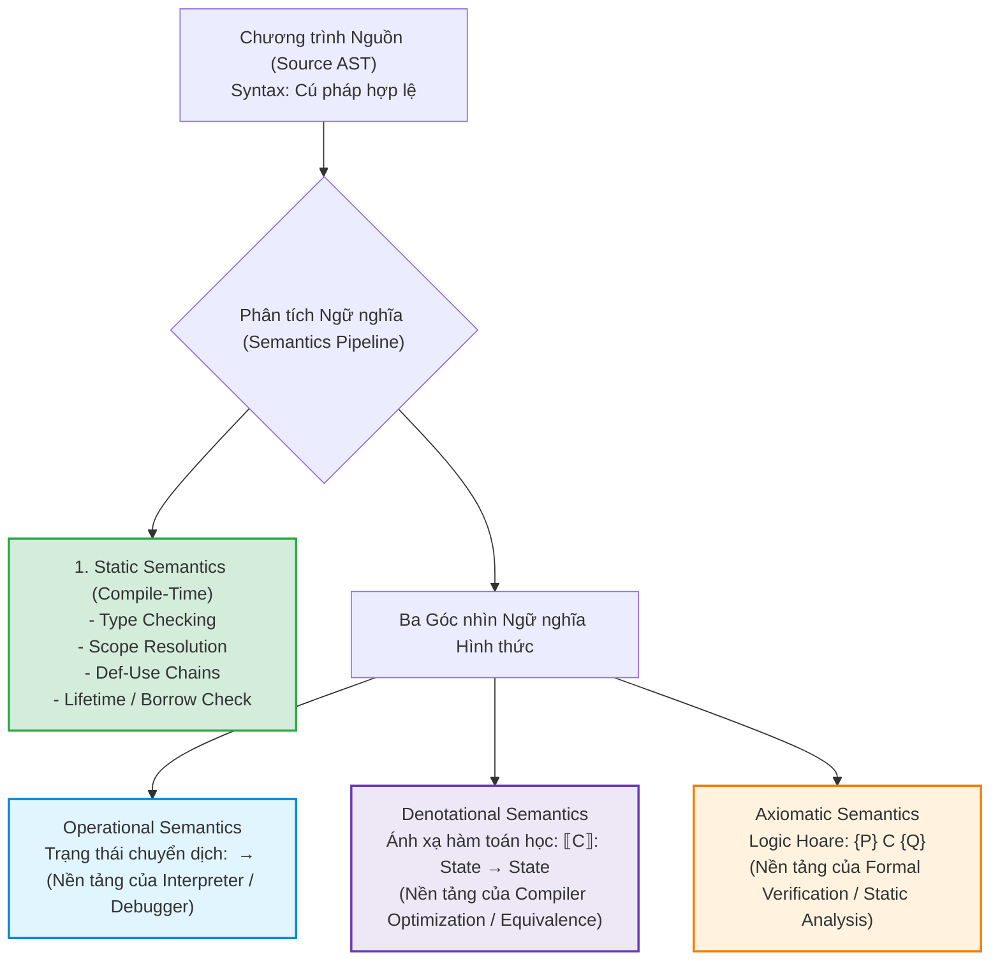
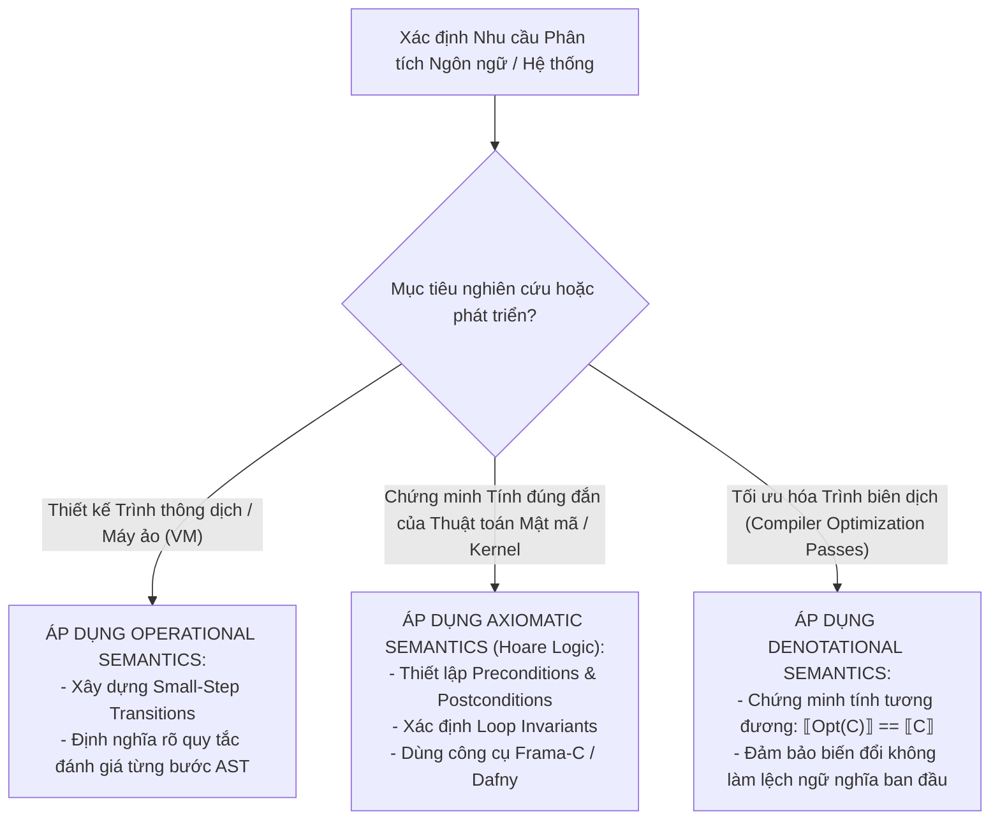

# 1.3. Language Semantics

> [!IMPORTANT]
> **Nếu bạn chỉ được nhớ một điều duy nhất:** Cú pháp (Syntax) chỉ định hình dáng của mã nguồn (Chương trình trông như thế nào?), còn **Ngữ nghĩa (Semantics)** mới là linh hồn quyết định hành vi tính toán thực sự (Chương trình có ý nghĩa gì và máy tính sẽ biến đổi trạng thái ra sao?). Ba trụ cột hình thức của ngữ nghĩa học: **Operational Semantics** (Mô tả quá trình thực thi từng bước như một cỗ máy trừu tượng), **Denotational Semantics** (Ánh xạ chương trình thành các hàm toán học thuần túy trong miền giá trị), và **Axiomatic Semantics** (Chứng minh tính đúng đắn dựa trên logic vị từ và bộ ba Hoare $\{P\}\;C\;\{Q\}$) là nền móng để xây dựng trình biên dịch tối ưu hóa an toàn, hệ thống kiểu tĩnh và các công cụ kiểm chứng phần mềm tự động.

---

## 1. Kiến trúc Tổng quan & Mô hình Tư duy (Mental Model)

### Ẩn dụ Đời sống: Công thức Nấu ăn và Ba Cách Đánh giá của Đầu bếp
Hãy tưởng tượng một cuốn sách dạy làm bánh mì:
1. **Cú pháp (Syntax)**: Quy định chính tả, ngữ pháp của câu từ (ví dụ: danh từ "bột mì", động từ "nhào", dấu phẩy ngăn cách). Một câu viết đúng ngữ pháp nhưng vô nghĩa như "Nhào 5 mét nước sốt vào ngọn lửa" vẫn vượt qua bộ kiểm tra cú pháp (Parser).
2. **Ngữ nghĩa Vận hành (Operational Semantics - Hướng dẫn Từng bước)**:
   - "Bước 1: Trộn 500g bột với 300ml nước. Bước 2: Nhào trong 10 phút. Bước 3: Nướng ở 200°C trong 30 phút."
   - Trọng tâm là **cách thức thực thi (Execution Transition)** qua từng trạng thái trung gian cụ thể trên một cỗ máy nhà bếp.
3. **Ngữ nghĩa Biểu thị (Denotational Semantics - Sản phẩm Đầu ra)**:
   - Không quan tâm bạn dùng máy nhào bột hay nhào bằng tay, công thức được ánh xạ thành một đối tượng toán học duy nhất: một ổ bánh mì baguette có khối lượng 450g, độ ẩm 20% và độ giòn bề mặt nhất định.
   - Trọng tâm là **ánh xạ hàm (Denotation Function)** từ văn bản công thức sang miền giá trị thành phẩm.
4. **Ngữ nghĩa Tiên đề (Axiomatic Semantics - Hợp đồng Bảo đảm)**:
   - "Tiền điều kiện: Bạn phải có lò nướng đạt nhiệt độ $\ge 180^\circ\text{C}$ và bột không bị mốc. Hậu điều kiện: Bánh mì nở xốp và không gây ngộ độc thực phẩm."
   - Trọng tâm là **chứng minh tính chất logic (Logical Proof)** mà không cần bận tâm đến từng micro-step của quá trình nướng.



---

## 2. Chi tiết từng Keyword (Under-the-Hood Deep Dive)

### 2.1. Language Semantics, Static Semantics & Dynamic Semantics
- **Ngữ nghĩa Tĩnh (Static Semantics)**:
  - Là tập hợp các quy tắc ngữ nghĩa có thể được kiểm tra và cưỡng chế hoàn toàn trong giai đoạn biên dịch (**Compile-Time**) mà không cần chạy chương trình.
  - Văn phạm phi ngữ cảnh (Context-Free Grammar - CFG) trong giai đoạn Parser không thể kiểm tra được ngữ cảnh liên kết (ví dụ: biến đã được khai báo trước khi sử dụng chưa, hàm có được gọi với đúng số lượng tham số không). Static Semantics giải quyết khoảng trống này.
  - *Các Thành phần Cốt lõi*:
    1. *Type Checking*: Kiểm tra tính tương thích kiểu dữ liệu (ví dụ: không cho phép cộng một chuỗi ký tự với một con trỏ trong C).
    2. *Scope & Name Resolution*: Ánh xạ định danh (Identifier) vào ô khai báo chính xác trong Bảng Ký hiệu (Symbol Table).
    3. *Def-Use Integrity & Initialization*: Đảm bảo biến không được đọc trước khi gán giá trị (Definite Assignment Analysis trong Java/Rust).
    4. *Borrow Checking (Rust)*: Cưỡng chế quy tắc sở hữu độc quyền và thời gian sống (Lifetimes) tại compile-time.
- **Ngữ nghĩa Động (Dynamic Semantics)**:
  - Quy định hành vi thực sự diễn ra khi chương trình thực thi tại thời điểm chạy (**Runtime**).
  - Xác định cách thức bộ nhớ được cấp phát và giải phóng, cách gọi hàm lưu trữ stack frame, cách ngoại lệ (Exceptions) lan truyền ngược qua call stack, và cách các luồng đồng thời tương tác trên bộ nhớ chia sẻ (Memory Model).
  - *Undefined Behavior (UB)*: Nếu một ngôn ngữ (như C/C++) không định nghĩa ngữ nghĩa động cho một tình huống cụ thể (ví dụ: tràn số nguyên có dấu, giải phóng bộ nhớ hai lần `double-free`), trình biên dịch được quyền giả định trường hợp đó không bao giờ xảy ra, dẫn đến các tối ưu hóa loại bỏ mã nguy hiểm.

### 2.2. Operational Semantics (Small-Step vs Big-Step)
Operational Semantics mô tả quá trình tính toán của chương trình thông qua một **Hệ thống Chuyển đổi Trạng thái (Transition System)** trên một cỗ máy trừu tượng:
- **Trạng thái Trừu tượng (Configuration)**: Được ký hiệu là một cặp $\langle e, \sigma \rangle$, trong đó $e$ là biểu thức hoặc câu lệnh cần tính toán, và $\sigma$ (Store / Environment) là trạng thái ánh xạ biến vào giá trị trong bộ nhớ.
- **Small-Step Operational Semantics (Structural Operational Semantics - SOS / Gordon Plotkin)**:
  - Ký hiệu: $\langle e, \sigma \rangle \to \langle e', \sigma' \rangle$.
  - Định nghĩa từng bước rút gọn nhỏ nhất (Atomic Step). Biểu thức $e$ được rút gọn dần dần qua nhiều bước cho đến khi trở thành một giá trị không thể rút gọn nữa (Value $v$):
    $$\langle e_0, \sigma_0 \rangle \to \langle e_1, \sigma_1 \rangle \to \dots \to \langle v, \sigma_n \rangle$$
  - *Ưu thế Tuyệt đối*: Mô tả hoàn hảo các chương trình **không bao giờ kết thúc** (như vòng lặp vô hạn của Kernel/Server), các hiệu ứng phụ (Side-effects), và sự xen kẽ (Interleaving) giữa các luồng chạy đồng thời (Concurrency).
- **Big-Step Operational Semantics (Natural Semantics / Gilles Kahn)**:
  - Ký hiệu: $\langle e, \sigma \rangle \Downarrow \langle v, \sigma' \rangle$.
  - Bỏ qua các bước trung gian, ánh xạ trực tiếp từ trạng thái ban đầu sang kết quả cuối cùng.
  - *Ưu thế*: Rất ngắn gọn và trực tiếp cho các phép chứng minh quy nạp trong trình biên dịch cho các ngôn ngữ đơn luồng tất định (Deterministic Sequential Languages), nhưng bất lực khi mô tả Deadlock, Crash giữa chừng, hoặc Concurrency.

### 2.3. Denotational Semantics (Semantic Domains & Mathematical Denotations)
Được tiên phong bởi Dana Scott và Christopher Strachey tại Oxford:
- **Nguyên lý Cốt lõi**:
  Mỗi cấu trúc ngôn ngữ lập trình được ánh xạ tới một đối tượng toán học trừu tượng thông qua một **Hàm Biểu thị (Denotation Function)**, thường ký hiệu là $\llbracket \cdot \rrbracket$:
  $$\llbracket \text{Command} \rrbracket: \text{State} \to \text{State}$$
  $$\llbracket \text{Expression} \rrbracket: \text{State} \to \text{Value}$$
- **Tính Hợp thành (Compositionality)**:
  Ngữ nghĩa của một biểu thức phức hợp phải được tính toán thuần túy từ ngữ nghĩa của các thành phần con của nó:
  $$\llbracket C_1; C_2 \rrbracket = \llbracket C_2 \rrbracket \circ \llbracket C_1 \rrbracket$$
  (Ngữ nghĩa của phép ghép lệnh là phép hợp thành hàm toán học!).
- **Xử lý Vòng lặp Vô hạn (Domain Theory & Fixed-Point / Scott Continuity)**:
  - Làm thế nào để biểu thị một vòng lặp `while (B) do C` khi nó có thể chạy mãi mãi?
  - Scott định nghĩa các Miền Giá trị (Domains / Complete Partial Orders - CPO) có thêm phần tử đáy $\bot$ (Bottom - đại diện cho sự phân kỳ / không kết thúc).
  - Vòng lặp được biểu thị như một **Điểm Bất động Nhỏ nhất (Least Fixed-Point)** của một toán tử hàm liên tục theo Định lý Kleene:
    $$\llbracket \text{while } B \text{ do } C \rrbracket = \text{lfp}(F)$$

### 2.4. Axiomatic Semantics (Hoare Logic, Pre/Post-conditions & Invariants)
Được phát triển bởi C.A.R. Hoare (1969) dựa trên nền tảng của Robert Floyd:
- **Bộ ba Hoare (Hoare Triple)**:
  $$\{P\} \; C \; \{Q\}$$
  - $P$: Tiền điều kiện (Precondition) — Khẳng định logic bắt buộc phải đúng trước khi thực thi lệnh $C$.
  - $C$: Khối lệnh chương trình (Command).
  - $Q$: Hậu điều kiện (Postcondition) — Khẳng định logic chắc chắn sẽ đúng sau khi lệnh $C$ hoàn tất (nếu $C$ kết thúc).
- **Hệ thống Quy tắc Suy diễn (Inference Rules)**:
  1. *Quy tắc Gán (Assignment Axiom)*:
     $$\frac{}{\{P[E/x]\} \; x := E \; \{P\}}$$
     (Để thuộc tính $P$ đúng sau khi gán, $P$ với biến $x$ được thay thế bởi biểu thức $E$ phải đúng trước khi gán).
  2. *Quy tắc Ghép lệnh (Composition Rule)*:
     $$\frac{\{P\} \; C_1 \; \{R\} \quad \{R\} \; C_2 \; \{Q\}}{\{P\} \; C_1; C_2 \; \{Q\}}$$
  3. *Quy tắc Vòng lặp (While Rule & Loop Invariant)*:
     $$\frac{\{I \land B\} \; C \; \{I\}}{\{I\} \; \text{while } B \text{ do } C \; \{I \land \neg B\}}$$
     - $I$ là **Bất biến Vòng lặp (Loop Invariant)**: Một khẳng định logic đúng trước vòng lặp, được bảo toàn sau mỗi lần lặp, và vẫn đúng khi vòng lặp thoát.
- **Ứng dụng Thực chiến**: Là cơ sở toán học của Design by Contract (DbC trong Eiffel, Ada), các công cụ phân tích tĩnh kiểm chứng chứng minh mã nguồn (Frama-C, Dafny, Coq, Lean, Microsoft Boogie).

---

## 3. Thực thi Mã nguồn & Mô phỏng Chuyên sâu (Dual-Engine Implementation)

### 3.1. Engine 1: C++20 Small-Step Operational Semantics Abstract Machine
Chương trình C++20 xây dựng một cỗ máy trừu tượng mô phỏng chính xác từng bước chuyển dịch Small-Step $\langle e, \sigma \rangle \to \langle e', \sigma' \rangle$ cho một ngôn ngữ biểu thức và gán biến dạng cấu trúc cây AST.

```cpp
// compile: g++ -std=c++20 -O3 small_step_semantics.cpp -o small_step_semantics
#include <iostream>
#include <string>
#include <memory>
#include <map>
#include <variant>
#include <iomanip>

// Trạng thái bộ nhớ (Store / Environment): Ánh xạ tên biến -> Giá trị số nguyên
using Store = std::map<std::string, int>;

// Khai báo chuyển tiếp các Node trong AST
struct ASTNode;
using ASTPtr = std::shared_ptr<ASTNode>;

enum class NodeType { IntLiteral, Variable, Add, Assign, Sequence };

struct ASTNode {
    NodeType type;
    int int_val{0};
    std::string var_name{""};
    ASTPtr left{nullptr};
    ASTPtr right{nullptr};

    static ASTPtr make_int(int val) {
        auto n = std::make_shared<ASTNode>();
        n->type = NodeType::IntLiteral;
        n->int_val = val;
        return n;
    }

    static ASTPtr make_var(const std::string& name) {
        auto n = std::make_shared<ASTNode>();
        n->type = NodeType::Variable;
        n->var_name = name;
        return n;
    }

    static ASTPtr make_add(ASTPtr l, ASTPtr r) {
        auto n = std::make_shared<ASTNode>();
        n->type = NodeType::Add;
        n->left = l;
        n->right = r;
        return n;
    }

    static ASTPtr make_assign(const std::string& var, ASTPtr expr) {
        auto n = std::make_shared<ASTNode>();
        n->type = NodeType::Assign;
        n->var_name = var;
        n->left = expr;
        return n;
    }

    static ASTPtr make_seq(ASTPtr first, ASTPtr second) {
        auto n = std::make_shared<ASTNode>();
        n->type = NodeType::Sequence;
        n->left = first;
        n->right = second;
        return n;
    }

    bool is_value() const {
        return type == NodeType::IntLiteral;
    }

    std::string to_string() const {
        switch (type) {
            case NodeType::IntLiteral: return std::to_string(int_val);
            case NodeType::Variable: return var_name;
            case NodeType::Add: return "(" + left->to_string() + " + " + right->to_string() + ")";
            case NodeType::Assign: return var_name + " = " + left->to_string();
            case NodeType::Sequence: return left->to_string() + "; " + right->to_string();
        }
        return "";
    }
};

// Cỗ máy thực thi Small-Step Transition: <e, σ> -> <e', σ'>
class SmallStepMachine {
public:
    static bool step(ASTPtr& expr, Store& store) {
        if (!expr || expr->is_value()) {
            return false; // Đã đạt trạng thái rút gọn tối đa (Terminated / Value)
        }

        switch (expr->type) {
            case NodeType::Variable: {
                // Rút gọn biến: nạp giá trị từ Store
                int val = store.contains(expr->var_name) ? store[expr->var_name] : 0;
                expr = ASTNode::make_int(val);
                return true;
            }
            case NodeType::Add: {
                // Nếu toán hạng trái chưa phải value -> rút gọn trái
                if (!expr->left->is_value()) {
                    return step(expr->left, store);
                }
                // Nếu toán hạng phải chưa phải value -> rút gọn phải
                if (!expr->right->is_value()) {
                    return step(expr->right, store);
                }
                // Cả 2 đều là value -> thực hiện phép cộng số học
                int sum = expr->left->int_val + expr->right->int_val;
                expr = ASTNode::make_int(sum);
                return true;
            }
            case NodeType::Assign: {
                // Rút gọn biểu thức bên phải dấu gán trước
                if (!expr->left->is_value()) {
                    return step(expr->left, store);
                }
                // Ghi giá trị vào Store và rút gọn câu lệnh gán thành giá trị
                store[expr->var_name] = expr->left->int_val;
                expr = ASTNode::make_int(expr->left->int_val);
                return true;
            }
            case NodeType::Sequence: {
                // Nếu lệnh đầu chưa xong -> thực hiện step của lệnh đầu
                if (!expr->left->is_value()) {
                    return step(expr->left, store);
                }
                // Lệnh đầu đã xong thành giá trị -> chuyển sang lệnh sau
                expr = expr->right;
                return true;
            }
            default:
                return false;
        }
    }

    static void execute(ASTPtr program, Store initial_store) {
        Store current_store = initial_store;
        ASTPtr current_ast = program;
        int step_num = 0;

        std::cout << "Initial State: <" << current_ast->to_string() << ", Store: {";
        print_store(current_store);
        std::cout << "}>\n";

        while (true) {
            std::string before_expr = current_ast->to_string();
            bool advanced = step(current_ast, current_store);
            if (!advanced) break;

            step_num++;
            std::cout << "  Step " << std::setw(2) << step_num << ": --> <" 
                      << current_ast->to_string() << ", Store: {";
            print_store(current_store);
            std::cout << "}>\n";
        }
        std::cout << "Final Value: " << current_ast->to_string() << "\n\n";
    }

private:
    static void print_store(const Store& s) {
        bool first = true;
        for (const auto& [k, v] : s) {
            if (!first) std::cout << ", ";
            std::cout << k << ":" << v;
            first = false;
        }
    }
};

int main() {
    std::cout << "========================================================\n";
    std::cout << "  C++20 SMALL-STEP OPERATIONAL SEMANTICS MACHINE        \n";
    std::cout << "========================================================\n\n";

    // Chương trình mẫu:
    // x = 5 + 3; y = x + 2
    auto prog = ASTNode::make_seq(
        ASTNode::make_assign("x", ASTNode::make_add(ASTNode::make_int(5), ASTNode::make_int(3))),
        ASTNode::make_assign("y", ASTNode::make_add(ASTNode::make_var("x"), ASTNode::make_int(2)))
    );

    Store initial_memory;
    SmallStepMachine::execute(prog, initial_memory);

    std::cout << "========================================================\n";
    return 0;
}
```

### 3.2. Engine 2: Python 3.11+ Axiomatic Hoare Logic Verifier & Denotational Evaluator
Trình thông dịch kép mô phỏng:
1. **Denotational Semantics**: Ánh xạ biểu thức thành hàm bậc cao nhận trạng thái $\sigma \to \sigma'$.
2. **Axiomatic Semantics**: Kiểm chứng Hoare Triples $\{P\}\;C\;\{Q\}$ và bất biến vòng lặp (Loop Invariant) qua kiểm thử vị từ.

```python
#!/usr/bin/env python3
"""
Denotational Semantics & Axiomatic Hoare Logic Verifier (Python 3.11+)
Mo phong anh xa Ham toan hoc va Kiem chung Bo ba Hoare {P} C {Q}
"""
from typing import Callable, Dict, Any, List
from dataclasses import dataclass

State = Dict[str, int]
Predicate = Callable[[State], bool]

# --- 1. DENOTATIONAL SEMANTICS ENGINE ---
# Mỗi câu lệnh được biểu thị như một hàm toán học: State -> State
CommandDenotation = Callable[[State], State]

def denote_assign(var: str, expr_fn: Callable[[State], int]) -> CommandDenotation:
    """⟦x := e⟧(σ) = σ[x ↦ ⟦e⟧(σ)]"""
    def denotation(s: State) -> State:
        new_state = dict(s)
        new_state[var] = expr_fn(s)
        return new_state
    return denotation

def denote_seq(c1: CommandDenotation, c2: CommandDenotation) -> CommandDenotation:
    """⟦C1; C2⟧ = ⟦C2⟧ ∘ ⟦C1⟧"""
    def denotation(s: State) -> State:
        return c2(c1(s))
    return denotation

def denote_while(cond_fn: Callable[[State], bool], body_fn: CommandDenotation) -> CommandDenotation:
    """Least Fixed-Point của vòng lặp: lfp(F)"""
    def denotation(s: State) -> State:
        curr = dict(s)
        max_iters = 10000
        iters = 0
        while cond_fn(curr):
            curr = body_fn(curr)
            iters += 1
            if iters > max_iters:
                raise RuntimeError("Divergence (⊥ - Bottom / Infinite Loop) phát hiện trong Denotational Domain!")
        return curr
    return denotation

# --- 2. AXIOMATIC SEMANTICS VERIFIER ---
@dataclass
class HoareTriple:
    name: str
    precondition: Predicate
    command: CommandDenotation
    postcondition: Predicate

class FormalAxiomaticVerifier:
    @staticmethod
    def verify_triple(triple: HoareTriple, test_states: List[State]) -> bool:
        print(f"Kiểm chứng Bộ ba Hoare: {triple.name}")
        for s in test_states:
            if triple.precondition(s):
                final_state = triple.command(s)
                if not triple.postcondition(final_state):
                    print(f"  >> VI PHẠM: State ban đầu {s} -> State kết thúc {final_state} KHÔNG thỏa mãn Hậu điều kiện Q!")
                    return False
        print(f"  >> CHỨNG MINH THÀNH CÔNG: Mọi trạng thái thỏa mãn P đều dẫn đến Q hợp lệ.")
        return True

def main():
    print("==================================================================")
    print("      DENOTATIONAL & AXIOMATIC SEMANTICS FORMAL VERIFIER          ")
    print("==================================================================")

    # Xây dựng Denotational Semantics cho thuật toán tính Giai thừa:
    # y = 1; while (x > 0) { y = y * x; x = x - 1; }
    cmd_init = denote_assign("y", lambda s: 1)
    loop_body = denote_seq(
        denote_assign("y", lambda s: s["y"] * s["x"]),
        denote_assign("x", lambda s: s["x"] - 1)
    )
    cmd_loop = denote_while(lambda s: s.get("x", 0) > 0, loop_body)
    factorial_program = denote_seq(cmd_init, cmd_loop)

    initial_input = {"x": 5}
    final_output = factorial_program(initial_input)
    print(f"[Denotational Evaluation] Input {initial_input} -> Thành phẩm: {final_output}\n")

    # Kiểm chứng Tiên đề (Axiomatic Hoare Logic):
    # { P: x >= 0 } Factorial_Program { Q: y == x_orig! }
    def pre_x_non_negative(s: State) -> bool:
        return s.get("x", -1) >= 0

    def post_factorial_correct(s: State) -> bool:
        # Kiểm tra y phải là số dương và x đã về 0
        return s.get("x", -1) == 0 and s.get("y", 0) >= 1

    triple = HoareTriple(
        name="{x >= 0} Factorial_Program {x == 0 ∧ y >= 1}",
        precondition=pre_x_non_negative,
        command=factorial_program,
        postcondition=post_factorial_correct
    )

    test_suite = [{"x": 0}, {"x": 1}, {"x": 3}, {"x": 5}, {"x": 7}]
    FormalAxiomaticVerifier.verify_triple(triple, test_suite)
    print("==================================================================")

if __name__ == "__main__":
    main()
```

### 3.3. Terminal Output Mẫu Thực tế
```bash
$ g++ -std=c++20 -O3 small_step_semantics.cpp -o small_step_semantics
$ ./small_step_semantics
========================================================
  C++20 SMALL-STEP OPERATIONAL SEMANTICS MACHINE        
========================================================

Initial State: <x = (5 + 3); y = (x + 2), Store: {}>
  Step  1: --> <x = 8; y = (x + 2), Store: {}>
  Step  2: --> <8; y = (x + 2), Store: {x:8}>
  Step  3: --> <y = (x + 2), Store: {x:8}>
  Step  4: --> <y = (8 + 2), Store: {x:8}>
  Step  5: --> <y = 10, Store: {x:8}>
  Step  6: --> <10, Store: {x:8, y:10}>
Final Value: 10

========================================================

$ python3 denotational_axiomatic.py
==================================================================
      DENOTATIONAL & AXIOMATIC SEMANTICS FORMAL VERIFIER          
==================================================================
[Denotational Evaluation] Input {'x': 5} -> Thành phẩm: {'x': 0, 'y': 120}

Kiểm chứng Bộ ba Hoare: {x >= 0} Factorial_Program {x == 0 ∧ y >= 1}
  >> CHỨNG MINH THÀNH CÔNG: Mọi trạng thái thỏa mãn P đều dẫn đến Q hợp lệ.
==================================================================
```

---

## 4. Systems Engineering & Production Pitfalls

### 4.1. "Undefined Behavior (UB) Inversion" Trong C/C++ Compiler
- **Hiện tượng**: Một lập trình viên viết đoạn mã kiểm tra tràn số nguyên trong C:
  ```c
  // Cố gắng bắt lỗi overflow
  if (x + 100 < x) {
      handle_overflow_error();
  }
  ```
- **Bản chất Ngữ nghĩa**: Theo chuẩn ISO C (Dynamic Semantics), phép tràn số nguyên có dấu (Signed Integer Overflow) là **Undefined Behavior**.
- **Hành vi Trình biên dịch**: Trình biên dịch (GCC/Clang) áp dụng lý thuyết ngữ nghĩa tiên đề: Trình biên dịch giả định rằng chương trình hợp lệ không bao giờ kích hoạt UB. Do đó, $x + 100 > x$ luôn luôn là chân lý toán học! Trình biên dịch **xóa bỏ hoàn toàn câu lệnh `if` và lời gọi hàm `handle_overflow_error()`**, khiến cơ chế phòng thủ bảo mật biến mất trong tệp nhị phân cuối cùng!
- **Khắc phục**: Luôn kiểm tra điều kiện trước khi thực hiện phép tính: `if (x > INT_MAX - 100)`.

### 4.2. Cạm bẫy Bỏ qua Ngữ nghĩa Concurrency (Memory Model Misconceptions)
- **Sai lầm**: Giả định rằng ngữ nghĩa thực thi tuần tự trong đơn luồng sẽ được giữ nguyên khi chạy đa luồng.
- **Thực tế**: Nếu không có ngữ nghĩa bộ nhớ tường minh (Acquire/Release trong C++20 Memory Model hoặc Happens-Before trong Java Memory Model), phần cứng vi kiến trúc và trình biên dịch được phép đảo thứ tự các thao tác đọc ghi, biến một chương trình tưởng như logic thành một mớ hỗn loạn không thể tái hiện bằng debugger thông thường.

---

## 5. Bảng So sánh & Decision Matrix

### 5.1. So sánh Ba Trường phái Ngữ nghĩa Học Hình thức

| Tiêu chuẩn So sánh | Operational Semantics | Denotational Semantics | Axiomatic Semantics |
| :--- | :--- | :--- | :--- |
| **Bản chất Cốt lõi** | Mô tả bước thực thi trên máy trừu tượng | Ánh xạ cấu trúc thành hàm toán học | Chứng minh tính chất qua logic vị từ |
| **Công thức Toán học** | $\langle e, \sigma \rangle \to \langle e', \sigma' \rangle$ | $\llbracket C \rrbracket: \text{State} \to \text{State}$ | $\{P\} \; C \; \{Q\}$ (Hoare Triples) |
| **Khả năng mô tả Concurrency** | **Rất tốt** (Xen kẽ trạng thái Small-Step) | Khó khăn (Đòi hỏi Powerdomain) | Tốt (Owicki-Gries, Rely-Guarantee) |
| **Khả năng mô tả Vòng lặp Vô hạn** | Tự nhiên (Chuỗi chuyển dịch vô tận) | Đòi hỏi Domain Theory & Scott CPO | Chỉ chứng minh tính đúng bộ phận (Partial) |
| **Ứng dụng Thực tiễn** | Trình thông dịch (Interpreter), Debugger | Tối ưu hóa Compiler, Chứng minh tương đương | Formal Verification, Phân tích Tĩnh (Dafny, Coq) |

### 5.2. Decision Matrix: Khi nào cần Vận dụng Phương pháp Ngữ nghĩa nào?


