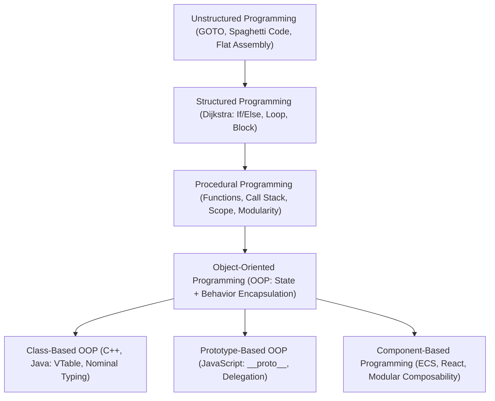
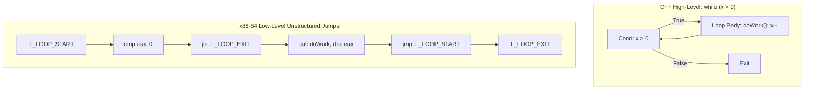
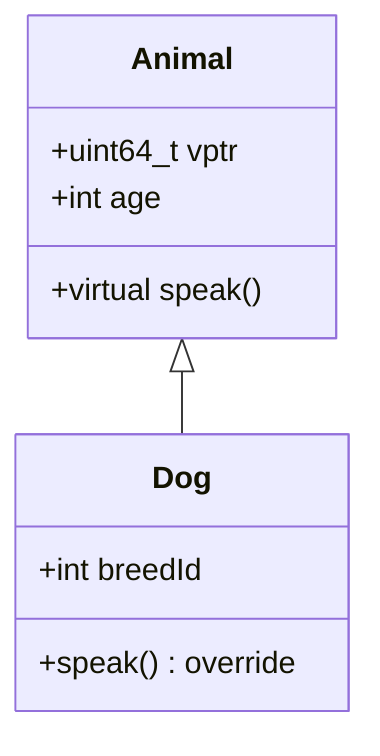
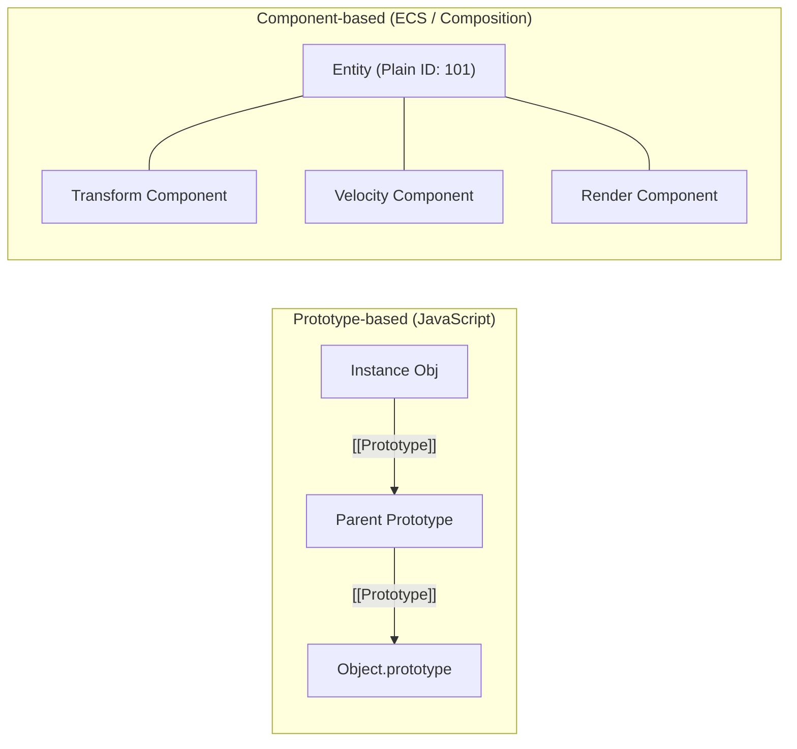

# 2.1. Các Mô Hình Lập Trình Mệnh Lệnh, Thủ Tục và Hướng Đối Tượng (Imperative, Procedural & OOP)

## Tổng quan về Imperative, Procedural & OOP
Nhóm mô hình lập trình mệnh lệnh (Imperative family) là họ các mô hình lập trình gần gũi nhất với kiến trúc phần cứng von Neumann. Chương trình được cấu trúc dưới dạng một chuỗi các chỉ thị làm thay đổi trạng thái toàn cục hoặc cục bộ của bộ nhớ máy tính thông qua phép gán và luồng điều khiển tuần tự.



---

## 2. Chi tiết từng Keyword (Under-the-Hood Deep Dive)

---

### 1. Imperative, Structured & Unstructured Programming

#### 1. Khái niệm bản chất (What & Why)
- **Imperative Programming (Lập trình mệnh lệnh)**: Mô hình lập trình tập trung vào việc mô tả *LÀM THẾ NÀO (HOW)* để hoàn thành một nhiệm vụ thông qua các câu lệnh thay đổi trạng thái (state mutation) và gán biến.
- **Unstructured Programming (Lập trình phi cấu trúc)**: Mã nguồn không phân nhóm thành các khối lệnh (blocks) hoặc hàm riêng biệt, mà dựa vào các lệnh nhảy vô điều kiện (`GOTO`, `JMP`) nhảy tự do qua các nhãn địa chỉ. Điều này dẫn đến hiện tượng mã rối ("Spaghetti code").
- **Structured Programming (Lập trình có cấu trúc)**: Khởi xướng bởi Edsger W. Dijkstra (bài báo kinh điển *"Go To Statement Considered Harmful"* năm 1968), yêu cầu kiểm soát luồng chỉ thông qua 3 cấu trúc cơ sở: Tuần tự (Sequence), Lựa chọn (Selection: `if/else`, `switch`), và Lặp (Iteration: `for`, `while`).

#### 2. Cơ chế hoạt động sâu (Under the hood / Hardcore Internals)
- **Tầng Assembly và CPU**:
  - Thực tế ở tầng vi xử lý, CPU chỉ hiểu duy nhất mô hình **Unstructured Programming**: mọi lệnh rẽ nhánh đều hạ xuống các chỉ thị `jmp`, `je`, `jne`, `jg`, `jle` dựa trên các cờ trong thanh ghi trạng thái (EFLAGS).
  - Trình biên dịch có nhiệm vụ chuyển đổi các khối Structured (`if`, `while`) thành các nhãn nhảy cục bộ (Local Labels) và sắp xếp luồng lệnh (Basic Blocks) sao cho tận dụng tối đa bộ dự đoán rẽ nhánh của CPU (**Branch Predictor**).

#### 3. Sơ đồ minh họa (Hạ cấp Structured Control Flow thành Assembly Jumps)


#### 4. Code ví dụ thực chiến (C++20: Structured Control Flow vs Inline Assembly Unstructured Jump)
```cpp
#include <iostream>

// 1. Structured Programming: Rõ ràng, dễ suy luận toán học
int structuredSum(int n) {
    int total = 0;
    for (int i = 1; i <= n; ++i) {
        total += i;
    }
    return total;
}

// 2. Unstructured Style mô phỏng Assembly Jump
int unstructuredSum(int n) {
    int total = 0;
    int i = 1;

loop_start:
    if (i > n) goto loop_exit;
    total += i;
    ++i;
    goto loop_start;

loop_exit:
    return total;
}

int main() {
    std::cout << "Structured: " << structuredSum(10) << "\n";
    std::cout << "Unstructured: " << unstructuredSum(10) << "\n";
    return 0;
}
```

#### 5. Cạm bẫy & Anti-patterns
- Sử dụng `goto` bừa bãi làm đứt gãy việc dọn dẹp biến cục bộ (Resource Destructors trong RAII) hoặc nhảy qua vị trí khởi tạo biến, gây Undefined Behavior.

#### 6. Ứng dụng thực tế trong Backend / Systems
- Trong Linux Kernel C code, lệnh `goto` có kỷ luật cao (Single Entry, Multi-exit cleanup pattern) vẫn được sử dụng phổ biến để xử lý giải phóng tài nguyên khi có lỗi phát sinh mà không gây lồng ghép `if` quá sâu.

---

### 2. Procedural Programming & Object-Oriented Programming (OOP)

#### 1. Khái niệm bản chất (What & Why)
- **Procedural Programming (Lập trình thủ tục)**: Mở rộng từ lập trình có cấu trúc, tổ chức chương trình thành các đơn vị có thể tái sử dụng gọi là Thủ tục (Procedures) hoặc Hàm (Functions). Dữ liệu và hành vi bị tách rời (Data structures tách biệt với Logic thao tác dữ liệu).
- **Object-Oriented Programming (OOP - Lập trình hướng đối tượng)**: Đóng gói trạng thái (State) và hành vi (Behavior) vào cùng một thực thể gọi là Đối tượng (Object). Dựa trên 4 nguyên lý trụ cột: Đóng gói (Encapsulation), Kế thừa (Inheritance), Đa hình (Polymorphism), và Trừu tượng (Abstraction).

#### 2. Cơ chế hoạt động sâu (Under the hood / Hardcore Internals)
- **VTable và Dynamic Dispatch trong OOP**:
  - Khi một lớp có phương thức ảo (`virtual`), compiler âm thầm chèn thêm một con trỏ bí mật vào đầu layout đối tượng: con trỏ bảng ảo (**VPTR** - Virtual Pointer, chiếm 8 bytes trên 64-bit).
  - VPTR trỏ đến **VTable** (Virtual Method Table), một mảng tĩnh chứa địa chỉ các con trỏ hàm.
  - Khi gọi hàm ảo `ptr->speak()`, CPU phải thực hiện 2 bước truy cập bộ nhớ gián tiếp (Dereference VPTR $\to$ Index vào VTable $\to$ Lấy con trỏ hàm $\to$ Gián tiếp gọi hàm `call *%rax`). Điều này làm mất cơ hội inlining của compiler và dễ gây trật bộ đệm lệnh (Instruction Cache miss).

#### 3. Sơ đồ minh họa (Memory Layout của Class có Virtual Method Table)

```text
Layout ô nhớ của đối tượng Dog trên Heap/Stack:
+-----------------------+ 0x00: vptr (8 bytes) ---> [ VTable for Dog ]
|  vptr (8 bytes)       |                           +----------------------+
+-----------------------+ 0x08                      | &Dog::speak()        |
|  age (4 bytes)        |                           +----------------------+
+-----------------------+ 0x0C
|  breedId (4 bytes)    |
+-----------------------+ 0x10 (Tổng: 16 bytes)
```

#### 4. Code ví dụ thực chiến (C++20: So sánh Procedural vs OOP Dynamic Dispatch)
```cpp
#include <iostream>
#include <memory>
#include <vector>

// 1. Phong cách Procedural: Dữ liệu tách rời hàm, dùng enum dispatch
namespace Procedural {
    enum class ShapeType { Circle, Rectangle };
    struct Shape {
        ShapeType type;
        double dim1, dim2;
    };
    double calculateArea(const Shape& s) {
        switch (s.type) {
            case ShapeType::Circle: return 3.14159 * s.dim1 * s.dim1;
            case ShapeType::Rectangle: return s.dim1 * s.dim2;
        }
        return 0.0;
    }
}

// 2. Phong cách OOP: Đóng gói và đa hình động
namespace OOP {
    class IShape {
    public:
        virtual ~IShape() = default;
        [[nodiscard]] virtual double area() const noexcept = 0; // Pure virtual
    };

    class Circle final : public IShape {
        double radius_;
    public:
        explicit Circle(double r) : radius_(r) {}
        double area() const noexcept override { return 3.14159 * radius_ * radius_; }
    };
}

int main() {
    OOP::Circle c(5.0);
    std::cout << "Circle Area (OOP): " << c.area() << "\n";
    return 0;
}
```

#### 5. Cạm bẫy & Anti-patterns
- **The Fragile Base Class Problem**: Kế thừa quá sâu (Deep inheritance hierarchies) khiến việc sửa đổi một phương thức ở lớp cha có thể vô tình làm hỏng toàn bộ logic của hàng chục lớp con kế thừa.
- **Object Slicing**: Gán một đối tượng dẫn xuất (Derived) vào một biến kiểu đối tượng cơ sở (Base by-value), làm cắt bỏ toàn bộ phần mở rộng và vptr của lớp con.

#### 6. Ứng dụng thực tế trong Backend / Systems
- Thiết kế hệ thống plugin hoặc middleware trong Backend frameworks (NestJS, Spring Boot, gRPC interceptors) tận dụng triệt để tính đa hình OOP.

---

### 3. Prototype-Based vs Component-Based Programming

#### 1. Khái niệm bản chất (What & Why)
- **Prototype-Based Programming (Lập trình hướng nguyên mẫu)**: Mô hình OOP không có khái niệm "Class" cố định. Các đối tượng được tạo ra bằng cách sao chép (clone) hoặc ủy quyền (delegate) trực tiếp từ một đối tượng hiện có gọi là Nguyên mẫu (Prototype). Tiêu biểu: JavaScript, Lua, Self.
- **Component-Based Programming (Lập trình hướng thành phần)**: Mô hình thiết kế dựa trên nguyên lý *"Composition over Inheritance"* (Ưu tiên kết hợp hơn kế thừa). Thay vì tạo cây kế thừa cứng nhắc, hệ thống cấu thành từ các khối độc lập (Components) có thể lắp ghép linh hoạt (ví dụ: Entity Component System - ECS trong game/physics engines hoặc React components).

#### 2. Cơ chế hoạt động sâu (Under the hood / Hardcore Internals)
- **Prototype Chain Lookup trong V8 Engine**:
  - Khi truy cập thuộc tính `obj.prop`, V8 trước hết tìm trong đối tượng hiện tại.
  - Nếu không thấy, engine sẽ dereference con trỏ `__proto__` trỏ lên đối tượng nguyên mẫu, lặp lại cho đến khi gặp `null`.
  - Để tối ưu tra cứu chuỗi nguyên mẫu, V8 sử dụng cơ chế **Hidden Classes (Shapes)** và **Inline Caches (IC)** để ghi nhớ vị trí offset của trường trong bộ nhớ, biến truy cập động thành truy cập offset trực tiếp.
- **Component-Based ECS Cache-Locality**:
  - Trong ECS, dữ liệu của các Component cùng loại được lưu liên tục trong một mảng phẳng (Contiguous Memory Arrays / Structure of Arrays - SoA).
  - CPU có thể nạp toàn bộ component vào L1/L2 Cache Lines (64 bytes/line) và xử lý hàng triệu thực thể mỗi giây bằng SIMD vectorization.

#### 3. Sơ đồ minh họa (Prototype Delegation vs Component Composition)


#### 4. Code ví dụ thực chiến (JavaScript vs TypeScript ECS Component)
```javascript
// 1. Prototype-Based Delegation thuần túy
const animalProto = {
    speak() { return `${this.name} makes a sound.`; }
};

const dog = Object.create(animalProto);
dog.name = "Rex";
console.log(dog.speak()); // Rex makes a sound (Ủy quyền qua chuỗi prototype)
```

```typescript
// 2. Component-Based Composition (Kiến trúc phẳng, không kế thừa sâu)
interface PositionComponent {
    x: number;
    y: number;
}

interface VelocityComponent {
    vx: number;
    vy: number;
}

// Entity chỉ đơn thuần là tập hợp các components
class GameWorld {
    private positions: Map<number, PositionComponent> = new Map();
    private velocities: Map<number, VelocityComponent> = new Map();

    public updatePhysics(entityId: number, dt: number) {
        const pos = this.positions.get(entityId);
        const vel = this.velocities.get(entityId);
        if (pos && vel) {
            pos.x += vel.vx * dt;
            pos.y += vel.vy * dt;
        }
    }
}
```

#### 5. Cạm bẫy & Anti-patterns
- **Monkey Patching** trong Prototype-based: Thay đổi trực tiếp `Array.prototype` hoặc `Object.prototype` tại runtime có thể làm sập hoặc tạo ra xung đột ẩn (prototype pollution vulnerability) cho toàn bộ ứng dụng.

#### 6. Ứng dụng thực tế trong Backend / Systems
- Kiến trúc Entity Component System (ECS) được áp dụng trong Unreal Engine, Unity DOTS, và các High-throughput MMORPG Game Servers để xử lý hàng vạn đối tượng đồng thời với độ trễ microsecond.
