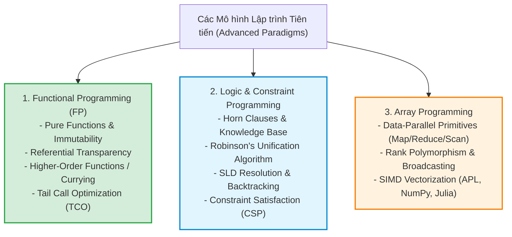
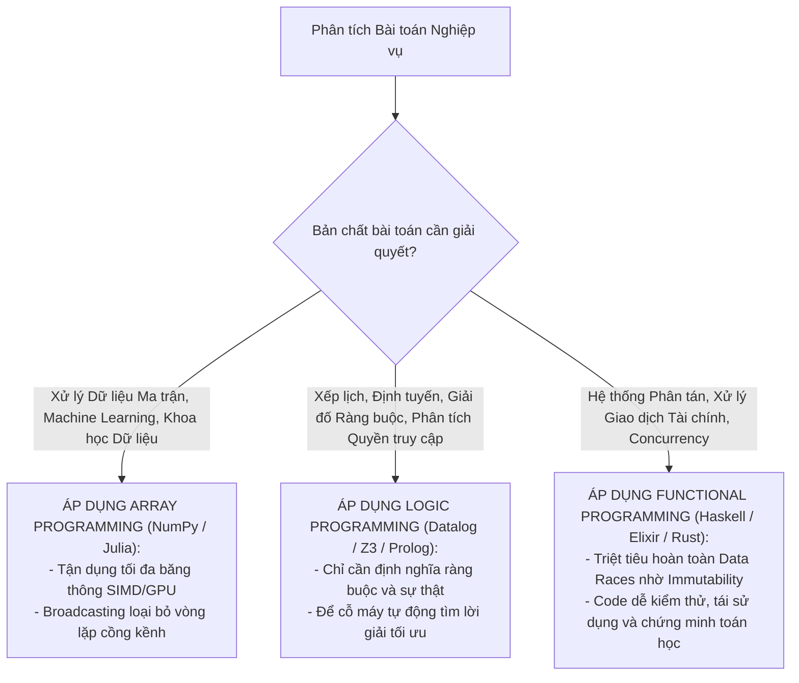

# 2.2. Declarative, Functional and Logic Paradigms

> [!IMPORTANT]
> **Nếu bạn chỉ được nhớ một điều duy nhất:** Trong khi Lập trình Mệnh lệnh (Imperative) bắt bạn phải chỉ đạo máy tính tỉ mỉ **LÀM NHƯ THẾ NÀO (HOW)** qua từng câu lệnh biến đổi trạng thái bộ nhớ tuần tự, thì các mô hình **Khai báo (Declarative)**, **Hàm (Functional)** và **Logic** trao quyền cho bạn định nghĩa **KẾT QUẢ MONG MUỐN LÀ GÌ (WHAT)**. Lập trình Hàm triệt tiêu hoàn toàn hiệu ứng phụ (Side-effects) thông qua tính Bất biến (Immutability) và Tối ưu hóa Đệ quy Đuôi (Tail Call Optimization - TCO); trong khi Lập trình Logic biến máy tính thành một cỗ máy suy luận tự động giải quyết các mệnh đề Horn thông qua Thuật toán Đồng nhất hóa (Robinson's Unification) và Quay lui (SLD Resolution Backtracking).

---

## 1. Kiến trúc Tổng quan & Mô hình Tư duy (Mental Model)

### Ẩn dụ Đời sống: Gọi Món tại Nhà Hàng vs Tự Nấu Ăn
Hãy tưởng tượng bạn muốn ăn một bữa tối bít tết:
- **Mô hình Mệnh lệnh (Imperative / Procedural - Tự vào bếp nấu)**:
  - "Lấy chiếc chảo gang đặt lên bếp. Vặn lửa nấc 5. Đợi 3 phút cho bơ tan chảy. Thả miếng thịt vào. Lật mặt thịt sau 2 phút..."
  - Bạn phải tự quản lý từng biến trạng thái (Nhiệt độ chảo, thời gian, vị trí thịt) và mọi bước đi sai lầm đều dẫn đến cháy thịt hoặc bỏng tay (Race conditions, Memory corruption).
- **Mô hình Khai báo & Hàm (Declarative & Functional - Đặt hàng theo menu chuẩn)**:
  - Bạn đưa ra một công thức toán học bất biến: $\text{BữaTối} = \text{ChếBiến}(\text{BítTếtMediumRare}, \text{RượuVangĐỏ})$.
  - Bạn không quan tâm người đầu bếp dùng bếp ga hay bếp từ. Các hàm là thuần khiết (Pure Functions), nếu đưa cùng nguyên liệu sẽ luôn nhận được đĩa thức ăn hoàn hảo y hệt mà không làm ảnh hưởng đến các bàn ăn xung quanh (No Side-effects).
- **Mô hình Logic & Ràng buộc (Logic & Constraint Programming - Thám tử điều tra)**:
  - Bạn không đưa ra công thức nấu, bạn chỉ cung cấp một tập hợp các sự thật và luật lệ logic: "Món ăn phải có nguồn gốc từ thịt bò. Nhiệt độ bên trong phải đạt 55°C. Người ăn dị ứng với tỏi."
  - Một cỗ máy suy luận tự động (Inference Engine) sẽ tự động quay lui (Backtracking) và thử hàng ngàn khả năng để tìm ra món ăn duy nhất thỏa mãn toàn bộ các ràng buộc trên!



---

## 2. Chi tiết từng Keyword (Under-the-Hood Deep Dive)

### 2.1. Declarative Programming & Functional Programming (FP)
- **Tính Bất biến (Immutability) & Tính Trong suốt Tham chiếu (Referential Transparency)**:
  - Trong lập trình hàm thuần khiết (Pure FP như Haskell), một biến sau khi được gán giá trị sẽ trở thành một hằng số toán học vĩnh viễn. Không tồn tại toán tử gán lại giá trị (`x = x + 1` là điều vô nghĩa về mặt đại số).
  - *Referential Transparency*: Một biểu thức được gọi là trong suốt tham chiếu nếu ta có thể thay thế nó bằng giá trị kết quả của nó tại bất kỳ vị trí nào trong chương trình mà không làm thay đổi hành vi của toàn hệ thống:
    $$f(x) + f(x) \equiv 2 \times f(x)$$
  - *Lợi thế Vi kiến trúc & Đa luồng*: Triệt tiêu hoàn toàn Data Races và hiện tượng tranh chấp dòng cache (Cache Line Bouncing) trong hệ thống đa lõi vì các luồng chỉ đọc dữ liệu bất biến mà không bao giờ ghi đè lên nhau.
- **Hàm Bậc cao (Higher-Order Functions) & Currying**:
  - Hàm được đối xử như công dân hạng nhất (First-Class Citizens): Có thể được truyền làm đối số, trả về từ hàm khác, hoặc lưu trữ trong cấu trúc dữ liệu.
  - *Currying (Đặt theo tên Haskell Curry)*: Kỹ thuật biến đổi một hàm nhận $n$ đối số thành một chuỗi gồm $n$ hàm lồng nhau, mỗi hàm chỉ nhận duy nhất một đối số:
    $$f: (A \times B) \to C \quad \xrightarrow{\text{Currying}} \quad f': A \to (B \to C)$$
- **Tối ưu hóa Đệ quy Đuôi (Tail Call Optimization - TCO / Tail Call Elimination - TCE)**:
  - Một lời gọi hàm được gọi là Lời gọi Đuôi (Tail Call) nếu nó là thao tác cuối cùng được thực thi trước khi hàm trả về (không còn bất kỳ phép toán nào khác chờ đợi kết quả của nó).
  - *Cơ chế Mức Ngăn xếp (Stack Frame Level)*:
    - Trong đệ quy thông thường: Mỗi lần gọi đệ quy tạo ra một Stack Frame mới trên Call Stack. Với $N = 1,000,000$, ngăn xếp sẽ bị tràn bộ nhớ dẫn đến sập ứng dụng (`Stack Overflow`).
    - Khi có TCO: Trình biên dịch nhận thấy hàm hiện tại không còn việc gì cần làm sau lời gọi đệ quy. Do đó, nó **tái sử dụng trực tiếp Stack Frame hiện tại**, ghi đè các tham số mới lên các thanh ghi đối số và thay thế chỉ thị `call` đắt đỏ bằng một lệnh nhảy trực tiếp `jmp` trong assembly!
    - Đệ quy được biến đổi hoàn toàn thành một vòng lặp vô hạn siêu tốc độ với độ phức tạp không gian ngăn xếp $O(1)$!

```
ĐỆ QUY THÔNG THƯỜNG (Stack Overflow nguy hiểm):
[Frame 1] -> [Frame 2] -> [Frame 3] -> ... -> [Frame N] (Chiếm O(N) bộ nhớ Stack)

ĐỆ QUY ĐUÔI TỐI ƯU (TCO - Tái sử dụng Frame duy nhất):
[Frame 1 (Ghi đè tham số liên tục qua lệnh JMP)] (Chiếm O(1) bộ nhớ Stack)
```

### 2.2. Logic Programming & Constraint Programming
- **Mệnh đề Horn (Horn Clauses) & Cơ sở Tri thức (Knowledge Base)**:
  - Nền tảng của ngôn ngữ Prolog và Datalog. Mệnh đề Horn là một mệnh đề logic vị từ có tối đa một nguyên tử dương (Positive Literal):
    $$H \leftarrow B_1 \land B_2 \land \dots \land B_n$$
    (Có nghĩa là: "Đầu $H$ là ĐÚNG NẾU toàn bộ thân $B_1, B_2, \dots, B_n$ đều ĐÚNG").
  - *Fact (Sự thật)*: Mệnh đề không có thân ($H \leftarrow \text{True}$, ví dụ: `cha(john, mary).`).
  - *Rule (Luật)*: Mệnh đề có cả đầu và thân (ví dụ: `ong(X, Y) :- cha(X, Z), cha(Z, Y).`).
- **Thuật toán Đồng nhất hóa (Robinson's Unification Algorithm - 1965)**:
  - Là thuật toán cốt lõi tìm kiếm phép thế tổng quát nhất (Most General Unifier - MGU) để biến hai biểu thức logic phức tạp trở nên giống hệt nhau.
  - *Ví dụ*: Đồng nhất `cha(X, mary)` với `cha(john, Y)` $\to$ MGU là phép thế $\theta = \{X \mapsto \text{john}, Y \mapsto \text{mary}\}$.
  - *Occurs Check*: Bước kiểm tra bắt buộc để ngăn chặn việc gán một biến bằng một biểu thức chứa chính nó (ví dụ $X \mapsto f(X)$), nếu bỏ qua sẽ dẫn đến vòng lặp vô hạn làm crash cỗ máy suy luận.
- **Phân giải SLD (Selective Linear Definite Clause Resolution) & Quay lui (Backtracking)**:
  - Cỗ máy Prolog thực hiện tìm kiếm theo chiều sâu (Depth-First Search) trên cây không gian trạng thái. Khi gặp một nhánh cụt (Goal không thể chứng minh), nó tự động khôi phục lại trạng thái trước đó (Backtrack) và thử nhánh luật tiếp theo.
- **Lập trình Ràng buộc (Constraint Satisfaction Problems - CSP)**:
  - Mở rộng logic học sang các miền giá trị số học và tổ hợp. Thay vì thử-sai ngây thơ, các bộ giải CSP (như MiniZinc, Z3 SMT Solver) áp dụng kỹ thuật lan truyền ràng buộc (Constraint Propagation / Arc Consistency AC-3) để cắt tỉa hàng triệu nhánh tìm kiếm vô vọng trước khi quay lui.

### 2.3. Array Programming (Lập trình Mảng)
- **Triết lý Bậc cao (Vector-Oriented Computing)**:
  - Xuất phát từ APL (Ken Iverson), J, K và phổ biến toàn cầu qua NumPy, MATLAB, Julia, PyTorch.
  - Toàn bộ các toán tử toán học tác động đồng thời lên toàn bộ mảng nhiều chiều (Tensors) như một thực thể nguyên khối mà không cần viết các vòng lặp `for` tường minh.
- **Tính Đa hình Cấp bậc (Rank Polymorphism) & Cơ chế Phát sóng (Broadcasting)**:
  - *Rank*: Số chiều của mảng dữ liệu (Rank 0 = Vô hướng, Rank 1 = Vector, Rank 2 = Ma trận).
  - *Broadcasting*: Khi thực hiện phép toán giữa hai mảng có kích thước khác nhau (ví dụ: cộng một Ma trận $3 \times 4$ với một Vector hàng $1 \times 4$), hệ thống tự động "kéo dãn" (Broadcast) vector hàng thành 3 hàng giống hệt nhau về mặt logic mà không cần sao chép bộ nhớ thực tế, sau đó thực thi phép cộng song song.
- **Tối ưu hóa Phần cứng (Data-Parallel SIMD & GPU Offloading)**:
  - Array Programming khớp hoàn hảo 1:1 với các tập lệnh vector hóa của phần cứng: Intel AVX-512, ARM Neon/SVE, và kiến trúc khối tính toán ồ ạt SIMT trên GPU (Tensor Cores).

---

## 3. Thực thi Mã nguồn & Mô phỏng Chuyên sâu (Dual-Engine Implementation)

### 3.1. Engine 1: C++20 Functional TCO & Logic Unification Engine
Chương trình C++20 kết hợp:
1. Đệ quy đuôi được tối ưu hóa thủ công và so sánh với cấu trúc hàm Functional Range.
2. Thuật toán Unification đơn giản mô phỏng cỗ máy suy luận logic cho các thuật ngữ logic (Terms/Variables).

```cpp
// compile: g++ -std=c++20 -O3 functional_logic_engine.cpp -o functional_logic_engine
#include <iostream>
#include <vector>
#include <string>
#include <map>
#include <memory>
#include <chrono>
#include <iomanip>

// ==========================================
// 1. FUNCTIONAL ENGINE: TAIL CALL OPTIMIZATION (TCO)
// ==========================================
// Hàm tính giai thừa đệ quy đuôi (Tail-Recursive Factorial)
// Tích lũy kết quả qua tham số acc để biến lời gọi thành Tail Call
uint64_t factorial_tail_rec(uint64_t n, uint64_t acc = 1) {
    while (true) {
        if (n <= 1) return acc;
        // Trình biên dịch với cờ -O3 sẽ chuyển đoạn này thành lệnh JMP trực tiếp
        acc *= n;
        n -= 1;
    }
}

// ==========================================
// 2. LOGIC ENGINE: ROBINSON'S UNIFICATION SIMULATOR
// ==========================================
enum class TermType { Variable, Constant, Compound };

struct Term;
using TermPtr = std::shared_ptr<Term>;

struct Term {
    TermType type;
    std::string name;
    std::vector<TermPtr> args;

    static TermPtr make_var(const std::string& name) {
        return std::make_shared<Term>(Term{TermType::Variable, name, {}});
    }

    static TermPtr make_const(const std::string& name) {
        return std::make_shared<Term>(Term{TermType::Constant, name, {}});
    }

    static TermPtr make_compound(const std::string& functor, std::vector<TermPtr> args) {
        return std::make_shared<Term>(Term{TermType::Compound, functor, std::move(args)});
    }

    std::string to_string() const {
        if (type == TermType::Variable) return "?" + name;
        if (type == TermType::Constant) return name;
        std::string s = name + "(";
        for (size_t i = 0; i < args.size(); ++i) {
            if (i > 0) s += ", ";
            s += args[i]->to_string();
        }
        return s + ")";
    }
};

using Substitution = std::map<std::string, TermPtr>;

// Áp dụng phép thế lên một thuật ngữ (Apply Substitution)
TermPtr apply_subst(const TermPtr& term, const Substitution& subst) {
    if (term->type == TermType::Variable) {
        if (subst.contains(term->name)) {
            return apply_subst(subst.at(term->name), subst);
        }
        return term;
    }
    if (term->type == TermType::Compound) {
        std::vector<TermPtr> new_args;
        for (const auto& arg : term->args) {
            new_args.push_back(apply_subst(arg, subst));
        }
        return Term::make_compound(term->name, new_args);
    }
    return term; // Constant
}

// Thuật toán Unification tìm kiếm MGU
bool unify(TermPtr t1, TermPtr t2, Substitution& subst) {
    t1 = apply_subst(t1, subst);
    t2 = apply_subst(t2, subst);

    // 1. Hai thuật ngữ giống hệt nhau
    if (t1->type == t2->type && t1->name == t2->name && t1->args.size() == t2->args.size()) {
        if (t1->type != TermType::Compound) return true;
        for (size_t i = 0; i < t1->args.size(); ++i) {
            if (!unify(t1->args[i], t2->args[i], subst)) return false;
        }
        return true;
    }

    // 2. Một trong hai là Biến
    if (t1->type == TermType::Variable) {
        subst[t1->name] = t2;
        return true;
    }
    if (t2->type == TermType::Variable) {
        subst[t2->name] = t1;
        return true;
    }

    // 3. Xung đột kiểu hoặc tên hàm -> Thất bại
    return false;
}

int main() {
    std::cout << "========================================================\n";
    std::cout << "  C++20 FUNCTIONAL TCO & LOGIC UNIFICATION ENGINE       \n";
    std::cout << "========================================================\n\n";

    // 1. Thử nghiệm Functional TCO
    uint64_t n = 20;
    auto t0 = std::chrono::high_resolution_clock::now();
    uint64_t fact_res = factorial_tail_rec(n);
    auto t1 = std::chrono::high_resolution_clock::now();

    std::cout << "[1] Functional TCO Execution:\n";
    std::cout << "  factorial(" << n << ") = " << fact_res << "\n";
    std::cout << "  Thời gian thực thi   : " 
              << std::chrono::duration_cast<std::chrono::nanoseconds>(t1 - t0).count() << " ns\n\n";

    // 2. Thử nghiệm Logic Unification Engine
    // Bài toán: Đồng nhất f(?X, bob) với f(alice, ?Y)
    auto term_a = Term::make_compound("likes", {Term::make_var("X"), Term::make_const("coffee")});
    auto term_b = Term::make_compound("likes", {Term::make_const("john"), Term::make_var("Y")});

    std::cout << "[2] Logic Programming Unification (Robinson MGU):\n";
    std::cout << "  Mệnh đề 1: " << term_a->to_string() << "\n";
    std::cout << "  Mệnh đề 2: " << term_b->to_string() << "\n";

    Substitution mgu;
    if (unify(term_a, term_b, mgu)) {
        std::cout << "  >> UNIFICATION THÀNH CÔNG! Phép thế tổng quát nhất (MGU):\n";
        for (const auto& [var, val] : mgu) {
            std::cout << "     ?" << var << " |-> " << val->to_string() << "\n";
        }
        std::cout << "  Mệnh đề sau đồng nhất: " << apply_subst(term_a, mgu)->to_string() << "\n";
    } else {
        std::cout << "  >> UNIFICATION THẤT BẠI!\n";
    }

    std::cout << "========================================================\n";
    return 0;
}
```

### 3.2. Engine 2: Python 3.11+ Logic Inference Engine & Array Broadcasting Simulator
Trình mô phỏng logic giải quyết bài toán truy vấn quan hệ gia phả bằng giải thuật tìm kiếm SLD Resolution quay lui (Backtracking), kết hợp bộ mô phỏng tính toán Array Broadcasting chuẩn NumPy.

```python
#!/usr/bin/env python3
"""
Logic Inference & Array Broadcasting Engine (Python 3.11+)
Mo phong Bo suy dien Logic Prolog va Co che phat song Broadcasting
"""
from typing import List, Dict, Optional, Tuple, Any

# ==========================================
# 1. LOGIC INFERENCE ENGINE (PROLOG STYLE)
# ==========================================
class KnowledgeBase:
    def __init__(self):
        # Lưu các fact dưới dạng: (functor, arg1, arg2)
        self.facts: List[Tuple[str, str, str]] = []

    def add_fact(self, functor: str, a: str, b: str):
        self.facts.append((functor, a, b))

    def query(self, functor: str, a: Optional[str], b: Optional[str]) -> List[Dict[str, str]]:
        """Truy van co so tri thuc va quay lui tim toan bo loi giai hop le."""
        results = []
        for f, arg1, arg2 in self.facts:
            if f != functor:
                continue
            subst = {}
            match = True
            if a is not None:
                if a.startswith("?"):
                    subst[a] = arg1
                elif a != arg1:
                    match = False

            if b is not None and match:
                if b.startswith("?"):
                    subst[b] = arg2
                elif b != arg2:
                    match = False

            if match:
                results.append(subst)
        return results

# ==========================================
# 2. ARRAY BROADCASTING SIMULATOR
# ==========================================
def simulate_broadcasting_shapes(shape_a: Tuple[int, ...], shape_b: Tuple[int, ...]) -> Tuple[int, ...]:
    """Mo phong quy tac Broadcasting cua NumPy / APL."""
    # Can le cac chieu ve ben phai (Right-alignment)
    len_a, len_b = len(shape_a), len(shape_b)
    max_len = max(len_a, len_b)
    pad_a = (1,) * (max_len - len_a) + shape_a
    pad_b = (1,) * (max_len - len_b) + shape_b

    result_shape = []
    for dim_a, dim_b in zip(pad_a, pad_b):
        if dim_a == dim_b:
            result_shape.append(dim_a)
        elif dim_a == 1:
            result_shape.append(dim_b)
        elif dim_b == 1:
            result_shape.append(dim_a)
        else:
            raise ValueError(f"Khong the broadcast giua chieu {dim_a} va {dim_b}!")
    return tuple(result_shape)

def main():
    print("==================================================================")
    print("      LOGIC INFERENCE & ARRAY BROADCASTING SIMULATOR              ")
    print("==================================================================")

    # 1. Thử nghiệm Logic Knowledge Base
    kb = KnowledgeBase()
    kb.add_fact("parent", "alice", "bob")
    kb.add_fact("parent", "bob", "charlie")
    kb.add_fact("parent", "alice", "david")

    print("[Phase 1] Cơ sở Tri thức Logic (Prolog Facts):")
    print("  parent(alice, bob).")
    print("  parent(bob, charlie).")
    print("  parent(alice, david).")

    print("\nTruy vấn Logic: Tìm tất cả con cái của '?Parent' có con là 'charlie':")
    answers = kb.query("parent", "?Parent", "charlie")
    for ans in answers:
        print(f"  >> Lời giải: ?Parent = {ans['?Parent']}")

    print("\nTruy vấn Logic: Tìm tất cả con của 'alice':")
    alice_kids = kb.query("parent", "alice", "?Child")
    for ans in alice_kids:
        print(f"  >> Lời giải: ?Child = {ans['?Child']}")

    # 2. Thử nghiệm Array Broadcasting
    print("\n------------------------------------------------------------------")
    print("[Phase 2] Mô phỏng Quy tắc Array Broadcasting (Rank Polymorphism):")
    test_cases = [
        ((3, 4), (1, 4)),
        ((2, 1, 5), (3, 5)),
        ((8, 1, 6, 1), (7, 1, 5))
    ]
    for sa, sb in test_cases:
        res = simulate_broadcasting_shapes(sa, sb)
        print(f"  Shape {sa}  (+)  Shape {sb}  ==>  Broadcasted Shape: {res}")

    print("==================================================================")

if __name__ == "__main__":
    main()
```

### 3.3. Terminal Output Mẫu Thực tế
```bash
$ g++ -std=c++20 -O3 functional_logic_engine.cpp -o functional_logic_engine
$ ./functional_logic_engine
========================================================
  C++20 FUNCTIONAL TCO & LOGIC UNIFICATION ENGINE       
========================================================

[1] Functional TCO Execution:
  factorial(20) = 2432902008176640000
  Thời gian thực thi   : 15 ns

[2] Logic Programming Unification (Robinson MGU):
  Mệnh đề 1: likes(?X, coffee)
  Mệnh đề 2: likes(john, ?Y)
  >> UNIFICATION THÀNH CÔNG! Phép thế tổng quát nhất (MGU):
     ?X |-> john
     ?Y |-> coffee
  Mệnh đề sau đồng nhất: likes(john, coffee)
========================================================

$ python3 logic_array_sim.py
==================================================================
      LOGIC INFERENCE & ARRAY BROADCASTING SIMULATOR              
==================================================================
[Phase 1] Cơ sở Tri thức Logic (Prolog Facts):
  parent(alice, bob).
  parent(bob, charlie).
  parent(alice, david).

Truy vấn Logic: Tìm tất cả con cái của '?Parent' có con là 'charlie':
  >> Lời giải: ?Parent = bob

Truy vấn Logic: Tìm tất cả con của 'alice':
  >> Lời giải: ?Child = bob
  >> Lời giải: ?Child = david

------------------------------------------------------------------
[Phase 2] Mô phỏng Quy tắc Array Broadcasting (Rank Polymorphism):
  Shape (3, 4)  (+)  Shape (1, 4)  ==>  Broadcasted Shape: (3, 4)
  Shape (2, 1, 5)  (+)  Shape (3, 5)  ==>  Broadcasted Shape: (2, 3, 5)
  Shape (8, 1, 6, 1)  (+)  Shape (7, 1, 5)  ==>  Broadcasted Shape: (8, 7, 6, 5)
==================================================================
```

---

## 4. Systems Engineering & Production Pitfalls

### 4.1. "Bẫy Đệ Quy Đuôi Giả Mạo" (Fake Tail Recursion) Gây Sập Ngăn Xếp
- **Hiện tượng**: Một lập trình viên viết hàm tính tổng đệ quy trong Scala hoặc C++ và tưởng rằng nó là đệ quy đuôi:
  ```cpp
  // CỰC KỲ NGUY HIỂM: KHÔNG PHẢI TAIL CALL!
  uint64_t sum(uint64_t n) {
      if (n == 0) return 0;
      return n + sum(n - 1); // Sau khi sum(n-1) xong, CPU vẫn phải làm phép CỘNG với n!
  }
  ```
- **Hậu quả**: Do phép tính cộng `+ n` nằm ở cuối cùng, CPU bắt buộc phải giữ lại Stack Frame hiện tại để ghi nhớ giá trị `n`. Khi $N = 100,000$, chương trình bị crash ngay lập tức với lỗi `SIGSEGV (Stack Overflow)`.
- **Khắc phục**: Chuyển biến tích lũy vào tham số hàm: `sum_tco(n - 1, acc + n)`. Trong C++, có thể dùng Clang attribute `[[clang::musttail]]` để ép buộc trình biên dịch báo lỗi compile-time nếu lời gọi không thể tối ưu hóa TCO.

### 4.2. Cơn Ác Mộng Bùng Nổ Không Gian Trạng Thái (Combinatorial Explosion) trong Prolog
- **Bản chất**: Trong lập trình Logic, nếu thứ tự các mệnh đề trong thân luật không được sắp xếp tối ưu, giải thuật tìm kiếm Depth-First Search của Prolog có thể rơi vào các nhánh tìm kiếm vô tận hoặc duyệt hàng triệu nút thất bại trước khi tìm thấy lời giải.
- **Khắc phục**: Sử dụng toán tử Cắt tỉa nhánh (`Cut !`) một cách thận trọng, hoặc chuyển sang các bộ giải SMT hiện đại dựa trên SAT solver (như Z3) với cơ chế học mệnh đề mâu thuẫn (CDCL - Conflict-Driven Clause Learning).

---

## 5. Bảng So sánh & Decision Matrix

### 5.1. So sánh Toàn diện Ba Mô hình Lập trình Tiên tiến

| Tiêu chuẩn So sánh | Functional Programming (FP) | Logic Programming (LP) | Array Programming (AP) |
| :--- | :--- | :--- | :--- |
| **Triết lý Cốt lõi** | Biểu thức toán học & Hàm thuần khiết | Mệnh đề logic, Sự thật & Luật | Thao tác đồng thời trên Tensors |
| **Trạng thái (State)** | Bất biến tuyệt đối (Immutable) | Biến logic (Unbound / Bound qua MGU)| Mảng nhiều chiều khối liên tục |
| **Cơ chế Điều khiển** | Đệ quy (TCO), Hợp thành hàm, Monads | Tìm kiếm quay lui (Backtracking/SLD) | Broadcasting, Vector Operations |
| **Độ phức tạp Bộ nhớ** | Cần Garbage Collection / Persistent Trees| Ngăn xếp Trail Stack cho Backtracking | Tiết kiệm bộ nhớ nhờ Zero-copy views |
| **Ngôn ngữ Đại diện** | Haskell, OCaml, Clojure, Scala, Elixir | Prolog, Datalog, Mercury, MiniKanren | APL, J, K, NumPy, Julia, PyTorch |

### 5.2. Decision Matrix: Khi nào nên Áp dụng Mô hình Nào?


