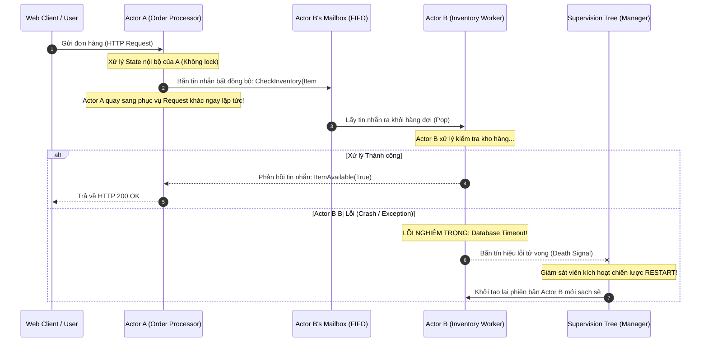
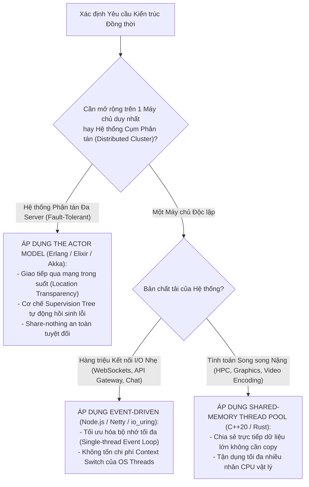

# 2.3. Concurrency, Reactive and Actor Models

> [!IMPORTANT]
> **Nếu bạn chỉ được nhớ một điều duy nhất:** Lập trình đồng thời dựa trên bộ nhớ chia sẻ truyền thống (Shared Memory Threads & Mutexes) là cội nguồn của mọi thảm họa deadlock, race conditions và suy giảm hiệu năng do tranh chấp cache line. Sự tiến hóa của các mô hình hiện đại hướng tới hai triết lý cách ly triệt để: **Mô hình Hướng sự kiện (Event-Driven / I/O Multiplexing)** dùng một luồng duy nhất kết hợp với `epoll`/`io_uring` để phục vụ hàng triệu kết nối đồng thời; và **Mô hình Actor (The Actor Model / Hewitt & Agha)** biến các thực thể tính toán thành những "pháo đài độc lập" không chia sẻ bất kỳ byte bộ nhớ nào (Share-Nothing), chỉ giao tiếp qua hàng đợi tin nhắn (Mailbox) và phục hồi lỗi thần tốc qua cây giám sát (Supervision Trees - "Let it crash").

---

## 1. Kiến trúc Tổng quan & Mô hình Tư duy (Mental Model)

### Ẩn dụ Đời sống: Người Trực Tổng đài và Các Văn phòng Đại sứ Ngoại giao
Hãy tưởng tượng sự khác biệt giữa hai mô hình tổ chức công việc:
1. **Event-Driven Architecture (Người Trực Tổng đài Siêu cấp)**:
   - Thay vì thuê 10,000 nhân viên ngồi trực 10,000 chiếc điện thoại bàn (Mô hình Thread-per-Connection tốn hàng chục GB RAM cho stack), công ty chỉ thuê **đúng một người trực tổng đài duy nhất** (Single-threaded Event Loop).
   - Người này ngồi trước một bảng điện tử hiện đại (`epoll` / `io_uring`). Bất cứ khi nào có chuông reo ở bất kỳ đường dây nào (I/O Event), một đèn led bật sáng. Người trực tổng đài nhấc máy xử lý một mẩu thông tin trong vài microsecond rồi chuyển ngay sang cuộc gọi tiếp theo. Không ai phải ngồi chờ vô ích, năng lượng tiêu thụ tối thiểu.
2. **The Actor Model (Hệ thống Đại sứ quán Ngoại giao Biệt lập)**:
   - Mỗi quốc gia là một **Actor** độc lập. Bên trong đại sứ quán, các nhân viên làm việc hoàn toàn tự do với kho dữ liệu mật riêng (Isolated Private State).
   - **Tuyệt đối không có chuyện** nhân viên Đại sứ quán A tự ý mở cửa bước vào phòng lưu trữ của Đại sứ quán B để đọc hay sửa tài liệu (Zero Shared Memory).
   - Mọi sự trao đổi thông tin bắt buộc phải viết thành thư mật, dán tem và thả vào Hòm Thư (Mailbox) đặt trước cổng. Mỗi đại sứ quán có một thư ký lấy từng lá thư ra đọc tuần tự (Sequential Message Processing).
   - Nếu một đại sứ quán bị sập do động đất (Exception / Crash), Đại sứ quán Trưởng (Supervisor) ngồi ở cấp cao hơn sẽ lập tức ra lệnh xây dựng lại một đại sứ quán mới toanh từ trạng thái sạch mà không làm gián đoạn toàn bộ mạng lưới ngoại giao ("Let it crash" philosophy).



---

## 2. Chi tiết từng Keyword (Under-the-Hood Deep Dive)

### 2.1. Concurrent Programming & Event-Driven Programming
- **Đồng thời (Concurrency) vs Song song (Parallelism)**:
  - *Concurrency (Cấu trúc bài toán)*: Khả năng xử lý nhiều công việc cùng một lúc bằng cách xen kẽ (Interleaving). Giống như một người vừa nấu cơm, vừa giặt đồ, vừa nghe điện thoại trên một lõi CPU đơn.
  - *Parallelism (Thực thi vật lý)*: Khả năng thực hiện nhiều phép tính tại cùng một thời điểm chính xác (Simultaneous Execution) trên nhiều lõi CPU vật lý độc lập.
- **Hạn chế Chết người của Mô hình Đa luồng Truyền thống (Thread-per-Core / Thread Pools)**:
  - Mỗi Thread trên Linux (pthread) tiêu tốn mặc định $2\text{ MB} - 8\text{ MB}$ bộ nhớ cho Virtual Stack. 100,000 luồng sẽ làm cạn kiệt bộ nhớ ảo và bảng trang MMU.
  - Chi phí Chuyển đổi Ngữ cảnh (Context Switch Overhead): Lưu và nạp lại thanh ghi, xả TLB, và làm nguội L1/L2 Cache khiến CPU mất hàng ngàn chu kỳ vô ích.
- **Vòng lặp Sự kiện (Event Loop) & I/O Multiplexing Tầng Nhân**:
  - *Cơ chế Hoạt động*: Thay vì để luồng bị block ở lệnh `read()`, tiến trình đăng ký hàng ngàn file descriptors (FDs) với hệ điều hành thông qua một System Call giám sát tập trung:
    - Linux: `epoll_create()`, `epoll_ctl()`, `epoll_wait()`.
    - BSD / macOS: `kqueue` / `kevent`.
    - Linux Hiện đại (Kernel 5.1+): `io_uring` (Cung cấp hai Ring Buffer không khóa chia sẻ giữa Kernel và User Space, cho phép thực hiện I/O bất đồng bộ thực sự mà không tốn chi phí syscall).
  - *Mô hình Reactor vs Proactor*:
    - **Reactor (Node.js, Netty, Nginx, Redis)**: Bộ điều phối đồng bộ phát hiện khi nào FD sẵn sàng đọc/ghi (`Readiness-based`), sau đó kích hoạt callback để ứng dụng tự đọc dữ liệu.
    - **Proactor (Windows IOCP, Linux io_uring)**: Hệ điều hành tự động đọc dữ liệu vào bộ đệm của ứng dụng trong nền (`Completion-based`), khi nạp xong hoàn toàn mới gửi thông báo hoàn tất cho ứng dụng.

### 2.2. Reactive Programming & The Actor Model
- **Lập trình Phản ứng (Reactive Programming) & Luồng Dữ liệu (Data Streams)**:
  - Mọi sự kiện (Click chuột, tin nhắn mạng, dữ liệu cảm biến, lỗi hệ thống) đều được trừu tượng hóa thành một **Luồng dữ liệu bất đồng bộ (Asynchronous Stream / Observable)**.
  - Tuân thủ công thức toán học hàm: Cho phép áp dụng các toán tử `map`, `filter`, `flatMap`, `debounce` trực tiếp trên dòng chảy thời gian.
- **Áp lực Ngược (Backpressure - Reactive Streams Specification)**:
  - *Vấn đề Cốt lõi*: Khi một Producer (nguồn phát dữ liệu, ví dụ Kafka Consumer) đẩy dữ liệu với tốc độ 100,000 events/giây, nhưng Consumer (bộ xử lý database) chỉ xử lý được 5,000 events/giây. Bộ đệm trung gian sẽ nhanh chóng phát nổ và gây sập ứng dụng vì lỗi `OutOfMemoryError`.
  - *Giải pháp Backpressure*: Chuyển đổi mô hình từ **Push-based** (Đẩy không kiểm soát) sang **Pull-based linh hoạt** (Tín hiệu phản hồi tín dụng: Consumer gửi tín hiệu `request(N)` yêu cầu đúng $N$ phần tử khi nó đã sẵn sàng tiếp nhận).
- **The Actor Model (Carl Hewitt, Gul Agha - 1973)**:
  - Đơn vị tính toán cơ bản duy nhất là **Actor**.
  - Mỗi Actor bao gồm 4 thành phần nội tại:
    1. **Private State**: Trạng thái biến nội bộ, hoàn toàn cô lập, không thể bị truy cập bởi bất kỳ Actor nào khác.
    2. **Mailbox**: Một hàng đợi FIFO chứa các tin nhắn gửi đến.
    3. **Behavior**: Logic xử lý tin nhắn hiện tại.
    4. **Children**: Tập hợp các Actor con do nó sinh ra và quản lý.
  - *Ba Hành động Nguyên thủy của Actor*: Khi nhận một tin nhắn, một Actor chỉ có thể thực hiện 3 thao tác:
    - Gửi một số lượng hữu hạn tin nhắn cho các Actor khác (Message Passing).
    - Tạo ra một số lượng hữu hạn các Actor con mới (Spawn Children).
    - Chỉ định hành vi mới cho tin nhắn tiếp theo (Become / Change Behavior).
- **Cây Giám sát (Supervision Trees) & Triết lý "Let It Crash" của Erlang OTP**:
  - Lập trình viên không viết hàng đống khối `try/catch` chắp vá để cố gắng cứu vãn các trạng thái bị hỏng hóc trong bộ nhớ.
  - Khi một Actor gặp lỗi không mong muốn, nó tự do sụp đổ ngay lập tức ("Let it crash").
  - Actor Cha (Supervisor) sẽ bắt được tín hiệu tử vong (`EXIT` signal) và thực thi một trong các chiến lược phục hồi chuẩn hóa:
    - `One-for-One`: Chỉ khởi động lại duy nhất Actor con bị lỗi.
    - `One-for-All`: Nếu một Actor con chết, giết toàn bộ các Actor anh em của nó và khởi động lại toàn bộ cụm.
    - `Rest-for-One`: Khởi động lại Actor bị lỗi và các Actor con được sinh ra sau nó.

---

## 3. Thực thi Mã nguồn & Mô phỏng Chuyên sâu (Dual-Engine Implementation)

### 3.1. Engine 1: C++20 Asynchronous Event Loop & Reactive Stream Pipeline
Chương trình C++20 xây dựng một Event Loop đơn luồng hoàn chỉnh kết hợp với một Reactive Pipeline hỗ trợ kiểm soát tín hiệu Backpressure cơ bản.

```cpp
// compile: g++ -std=c++20 -O3 event_loop_reactive.cpp -o event_loop_reactive
#include <iostream>
#include <functional>
#include <queue>
#include <vector>
#include <chrono>
#include <thread>
#include <memory>
#include <iomanip>

// ==========================================
// 1. ASYNCHRONOUS EVENT LOOP
// ==========================================
class SimpleEventLoop {
    using Task = std::function<void()>;
    std::queue<Task> task_queue_;
    bool running_{false};

public:
    void post(Task task) {
        task_queue_.push(std::move(task));
    }

    void run() {
        running_ = true;
        size_t processed = 0;
        while (running_ && !task_queue_.empty()) {
            Task task = std::move(task_queue_.front());
            task_queue_.pop();
            task();
            processed++;
        }
    }

    void stop() {
        running_ = false;
    }

    size_t pending_tasks() const {
        return task_queue_.size();
    }
};

// ==========================================
// 2. REACTIVE STREAM PIPELINE VỚI BACKPRESSURE
// ==========================================
template<typename T>
class ReactiveSubscriber {
public:
    virtual ~ReactiveSubscriber() = default;
    virtual void on_next(const T& item) = 0;
    virtual void on_complete() = 0;
};

template<typename T>
class ReactivePublisher {
    std::vector<T> buffer_;
    std::shared_ptr<ReactiveSubscriber<T>> subscriber_;
    size_t current_index_{0};
    size_t requested_credits_{0};

public:
    explicit ReactivePublisher(std::vector<T> data) : buffer_(std::move(data)) {}

    void subscribe(std::shared_ptr<ReactiveSubscriber<T>> sub) {
        subscriber_ = sub;
    }

    // Tín hiệu Backpressure Pull: Consumer yêu cầu cấp n phần tử
    void request(size_t n) {
        requested_credits_ += n;
        drain();
    }

private:
    void drain() {
        while (requested_credits_ > 0 && current_index_ < buffer_.size()) {
            requested_credits_--;
            subscriber_->on_next(buffer_[current_index_++]);
        }
        if (current_index_ >= buffer_.size() && subscriber_) {
            subscriber_->on_complete();
        }
    }
};

class PrintingConsumer : public ReactiveSubscriber<int>, public std::enable_shared_from_this<PrintingConsumer> {
    ReactivePublisher<int>* publisher_{nullptr};
    size_t batch_size_{2};
    size_t received_in_batch_{0};

public:
    void set_publisher(ReactivePublisher<int>* pub) {
        publisher_ = pub;
    }

    void start() {
        std::cout << "  [Consumer] Yêu cầu mẻ đầu tiên: " << batch_size_ << " items (Pull-Backpressure)\n";
        publisher_->request(batch_size_);
    }

    void on_next(const int& item) override {
        std::cout << "  [Consumer] Đã nhận và xử lý dữ liệu: " << item << "\n";
        received_in_batch_++;
        if (received_in_batch_ == batch_size_) {
            received_in_batch_ = 0;
            std::cout << "  [Consumer] Đã tiêu thụ hết hạn mức, yêu cầu tiếp " << batch_size_ << " items...\n";
            publisher_->request(batch_size_);
        }
    }

    void on_complete() override {
        std::cout << "  [Consumer] Hoàn tất toàn bộ luồng dữ liệu!\n";
    }
};

int main() {
    std::cout << "========================================================\n";
    std::cout << "  C++20 EVENT LOOP & REACTIVE BACKPRESSURE ENGINE       \n";
    std::cout << "========================================================\n\n";

    // 1. Thử nghiệm Event Loop
    SimpleEventLoop loop;
    std::cout << "[Step 1] Đăng ký các tác vụ bất đồng bộ vào Event Loop:\n";
    loop.post([]() { std::cout << "  [Task 1] Bắt đầu kết nối Database...\n"; });
    loop.post([]() { std::cout << "  [Task 2] Phân tích cú pháp HTTP Request Header...\n"; });
    loop.post([]() { std::cout << "  [Task 3] Ghi Log kiểm toán hoàn tất!\n"; });

    std::cout << "  Tổng số task trong hàng đợi: " << loop.pending_tasks() << "\n";
    std::cout << "  Chạy Event Loop:\n";
    loop.run();

    // 2. Thử nghiệm Reactive Backpressure
    std::cout << "\n--------------------------------------------------------\n";
    std::cout << "[Step 2] Thực thi Reactive Stream với Cơ chế Backpressure:\n";
    std::vector<int> data_source = {101, 102, 103, 104, 105};
    ReactivePublisher<int> publisher(data_source);
    auto consumer = std::make_shared<PrintingConsumer>();
    consumer->set_publisher(&publisher);
    publisher.subscribe(consumer);

    consumer->start();

    std::cout << "========================================================\n";
    return 0;
}
```

### 3.2. Engine 2: Python 3.11+ Actor Model Framework with Supervision Tree
Trình mô phỏng khung làm việc Actor Model hoàn chỉnh: Các Actor độc lập chạy với hàng đợi tin nhắn bất đồng bộ (`asyncio.Queue`), cách ly trạng thái tuyệt đối, và Cây Giám sát (Supervision Tree) tự động hồi sinh Actor khi gặp lỗi runtime.

```python
#!/usr/bin/env python3
"""
Actor Model & Supervision Tree Framework (Python 3.11+)
Mo phong kien truc Erlang/OTP: Actor Mailbox, Message Passing va Tu dong khoi dong lai
"""
import asyncio
from typing import Dict, Any, Optional

class ActorMessage:
    def __init__(self, msg_type: str, payload: Any, sender: Optional['BaseActor'] = None):
        self.msg_type = msg_type
        self.payload = payload
        self.sender = sender

class BaseActor:
    def __init__(self, name: str, supervisor: Optional['SupervisorActor'] = None):
        self.name = name
        self.supervisor = supervisor
        self.mailbox: asyncio.Queue[ActorMessage] = asyncio.Queue()
        self.is_alive = True
        self._task: Optional[asyncio.Task] = None

    def start(self):
        self._task = asyncio.create_task(self._run_loop())

    async def send(self, message: ActorMessage):
        if self.is_alive:
            await self.mailbox.put(message)

    async def _run_loop(self):
        while self.is_alive:
            try:
                msg = await self.mailbox.get()
                await self.receive(msg)
                self.mailbox.task_done()
            except Exception as e:
                print(f"  [CRASH] Actor '{self.name}' gap loi nghiem trong: {e}")
                self.is_alive = False
                if self.supervisor:
                    await self.supervisor.handle_crash(self)
                break

    async def receive(self, message: ActorMessage):
        raise NotImplementedError

# Actor Thực thi Nghiệp vụ: Xử lý Đơn hàng (Dễ bị crash nếu giá trị âm)
class OrderProcessorActor(BaseActor):
    def __init__(self, name: str, supervisor: Optional['SupervisorActor'] = None):
        super().__init__(name, supervisor)
        self.total_revenue = 0

    async def receive(self, message: ActorMessage):
        if message.msg_type == "PROCESS_ORDER":
            amount = message.payload
            if amount < 0:
                # Kich hoat Crash do du lieu bat thuong
                raise ValueError(f"So tien am bat hop le: {amount}!")
            self.total_revenue += amount
            print(f"  [{self.name}] Xu ly thanh cong don hang ${amount}. Tong doanh thu: ${self.total_revenue}")
        elif message.msg_type == "GET_STATUS":
            print(f"  [{self.name}] Bao cao Doanh thu hien tai: ${self.total_revenue}")

# Actor Giám sát (Supervisor): Áp dụng chiến lược One-for-One Restart
class SupervisorActor(BaseActor):
    def __init__(self, name: str):
        super().__init__(name)
        self.managed_actors: Dict[str, BaseActor] = {}

    def register_child(self, actor: BaseActor):
        self.managed_actors[actor.name] = actor
        actor.supervisor = self
        actor.start()

    async def handle_crash(self, crashed_actor: BaseActor):
        print(f"\n  [SUPERVISOR] Nhận được tín hiệu tử vong từ '{crashed_actor.name}'!")
        print(f"  [SUPERVISOR] Kích hoạt chính sách: One-For-One RESTART...")
        
        # Tạo mới một instance Actor sạch sẽ để thay thế
        new_actor = OrderProcessorActor(crashed_actor.name, self)
        self.managed_actors[crashed_actor.name] = new_actor
        new_actor.start()
        print(f"  [SUPERVISOR] Actor '{crashed_actor.name}' đã được hồi sinh thành công!\n")

async def main():
    print("==================================================================")
    print("      ACTOR MODEL & SUPERVISION TREE SIMULATOR (PYTHON 3.11+)     ")
    print("==================================================================")

    supervisor = SupervisorActor("MainSupervisor")
    order_worker = OrderProcessorActor("Worker-1")
    supervisor.register_child(order_worker)

    print("[Phase 1] Gửi các tin nhắn đơn hàng hợp lệ:")
    await supervisor.managed_actors["Worker-1"].send(ActorMessage("PROCESS_ORDER", 150))
    await supervisor.managed_actors["Worker-1"].send(ActorMessage("PROCESS_ORDER", 200))
    await asyncio.sleep(0.1)

    print("\n[Phase 2] Gửi đơn hàng lỗi cố ý gây Crash Actor ('Let it crash'):")
    await supervisor.managed_actors["Worker-1"].send(ActorMessage("PROCESS_ORDER", -50))
    await asyncio.sleep(0.1)

    print("[Phase 3] Gửi tiếp đơn hàng mới sau khi Actor đã được hồi sinh:")
    await supervisor.managed_actors["Worker-1"].send(ActorMessage("PROCESS_ORDER", 300))
    await supervisor.managed_actors["Worker-1"].send(ActorMessage("GET_STATUS", None))
    await asyncio.sleep(0.1)

    print("==================================================================")

if __name__ == "__main__":
    asyncio.run(main())
```

### 3.3. Terminal Output Mẫu Thực tế
```bash
$ g++ -std=c++20 -O3 event_loop_reactive.cpp -o event_loop_reactive
$ ./event_loop_reactive
========================================================
  C++20 EVENT LOOP & REACTIVE BACKPRESSURE ENGINE       
========================================================

[Step 1] Đăng ký các tác vụ bất đồng bộ vào Event Loop:
  Tổng số task trong hàng đợi: 3
  Chạy Event Loop:
  [Task 1] Bắt đầu kết nối Database...
  [Task 2] Phân tích cú pháp HTTP Request Header...
  [Task 3] Ghi Log kiểm toán hoàn tất!

--------------------------------------------------------
[Step 2] Thực thi Reactive Stream với Cơ chế Backpressure:
  [Consumer] Yêu cầu mẻ đầu tiên: 2 items (Pull-Backpressure)
  [Consumer] Đã nhận và xử lý dữ liệu: 101
  [Consumer] Đã nhận và xử lý dữ liệu: 102
  [Consumer] Đã tiêu thụ hết hạn mức, yêu cầu tiếp 2 items...
  [Consumer] Đã nhận và xử lý dữ liệu: 103
  [Consumer] Đã nhận và xử lý dữ liệu: 104
  [Consumer] Đã tiêu thụ hết hạn mức, yêu cầu tiếp 2 items...
  [Consumer] Đã nhận và xử lý dữ liệu: 105
  [Consumer] Hoàn tất toàn bộ luồng dữ liệu!
========================================================

$ python3 actor_supervision.py
==================================================================
      ACTOR MODEL & SUPERVISION TREE SIMULATOR (PYTHON 3.11+)     
==================================================================
[Phase 1] Gửi các tin nhắn đơn hàng hợp lệ:
  [Worker-1] Xu ly thanh cong don hang $150. Tong doanh thu: $150
  [Worker-1] Xu ly thanh cong don hang $200. Tong doanh thu: $350

[Phase 2] Gửi đơn hàng lỗi cố ý gây Crash Actor ('Let it crash'):
  [CRASH] Actor 'Worker-1' gap loi nghiem trong: So tien am bat hop le: -50!

  [SUPERVISOR] Nhận được tín hiệu tử vong từ 'Worker-1'!
  [SUPERVISOR] Kích hoạt chính sách: One-For-One RESTART...
  [SUPERVISOR] Actor 'Worker-1' đã được hồi sinh thành công!

[Phase 3] Gửi tiếp đơn hàng mới sau khi Actor đã được hồi sinh:
  [Worker-1] Xu ly thanh cong don hang $300. Tong doanh thu: $300
  [Worker-1] Bao cao Doanh thu hien tai: $300
==================================================================
```

---

## 4. Systems Engineering & Production Pitfalls

### 4.1. "Mailbox Overflow" và Thảm họa OOM trong Hệ thống Actor
- **Triệu chứng**: Trong các hệ thống chạy Akka (JVM) hoặc Elixir BEAM, một Actor quan trọng bỗng nhiên nhận hàng triệu tin nhắn mỗi phút nhưng tốc độ xử lý chỉ đạt vài ngàn tin nhắn. Hàng đợi Mailbox phình to không giới hạn (Unbounded Mailbox), dẫn đến sập toàn bộ nút cụm vì lỗi `OutOfMemoryError`.
- **Giải pháp**:
  - Luôn sử dụng **Bounded Mailbox** (giới hạn dung lượng hàng đợi, ví dụ tối đa 10,000 tin nhắn).
  - Khi hàng đợi đầy, áp dụng chính sách loại bỏ: Dead-Letter Queue (chuyển thư rác sang hàng đợi khác), Drop Oldest, hoặc kích hoạt cơ chế Backpressure từ chối nhận thêm tin nhắn mới từ phía gửi.

### 4.2. Cạm bẫy Chặn Luồng Sự kiện (Blocking the Event Loop)
- **Sai lầm Kinh điển trong Node.js / Python asyncio**: Một lập trình viên gọi một hàm tính toán mã hóa CPU-heavy nặng (như tính toán hash bcrypt đồng bộ) hoặc gọi hàm đọc file đồng bộ `fs.readFileSync()` ngay trong luồng chính của Event Loop.
- **Hậu quả**: Toàn bộ hàng ngàn kết nối người dùng khác đang chờ đợi trong hàng đợi đều bị đóng băng hoàn toàn. Tỷ lệ Timeout tăng vọt lên 100% dù CPU tổng thể chỉ mới sử dụng 1 lõi!
- **Khắc phục**: Luôn đẩy các tác vụ nặng về tính toán hoặc các I/O đồng bộ sang một **Worker Thread Pool** riêng biệt (như `libuv threadpool` hoặc `concurrent.futures`).

---

## 5. Bảng So sánh & Decision Matrix

### 5.1. So sánh Ba Mô hình Xử lý Đồng thời Hiện đại

| Tiêu chuẩn So sánh | Shared-Memory Multi-Threading | Event-Driven (Reactor/Proactor) | The Actor Model |
| :--- | :--- | :--- | :--- |
| **Chia sẻ Bộ nhớ** | Toàn bộ các luồng chia sẻ Heap chung | Một luồng duy nhất (Không chia sẻ) | **Share-Nothing tuyệt đối** |
| **Cơ chế Đồng bộ Hóa**| Khóa Mutex, Spinlock, Atomics | Đơn luồng tuần tự qua Event Loop | Hàng đợi tin nhắn bất đồng bộ (Mailbox) |
| **Điểm yếu Thường gặp** | Deadlock, Race Conditions, False Sharing| Dễ bị nghẽn nếu dính Blocking Code | Mailbox Overflow, Khó debug chuỗi tin |
| **Khả năng Phục hồi Lỗi**| Crash 1 luồng có thể sập cả Process | Khó cô lập lỗi ngoại lệ sâu | **Tự động hóa hoàn hảo qua Supervision** |
| **Công nghệ Đại diện** | C++ `std::thread`, Java Threads | Node.js, Nginx, Redis, Netty, Envoy | Erlang/OTP, Elixir, Akka, Ray |

### 5.2. Decision Matrix: Lựa chọn Mô hình Concurrency Phù hợp


