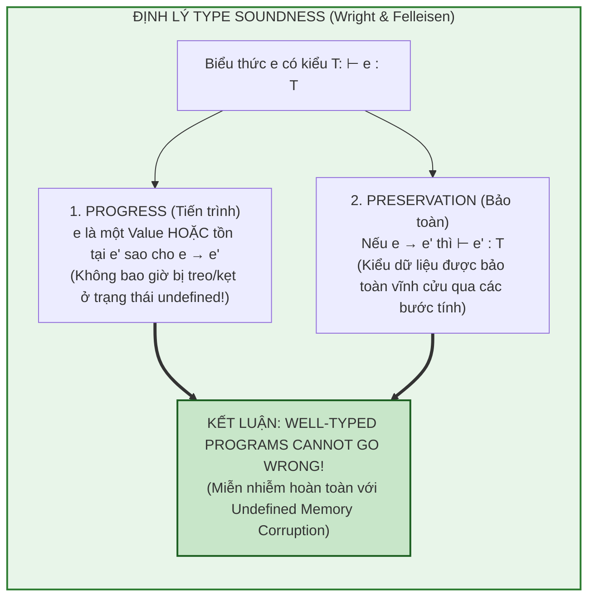
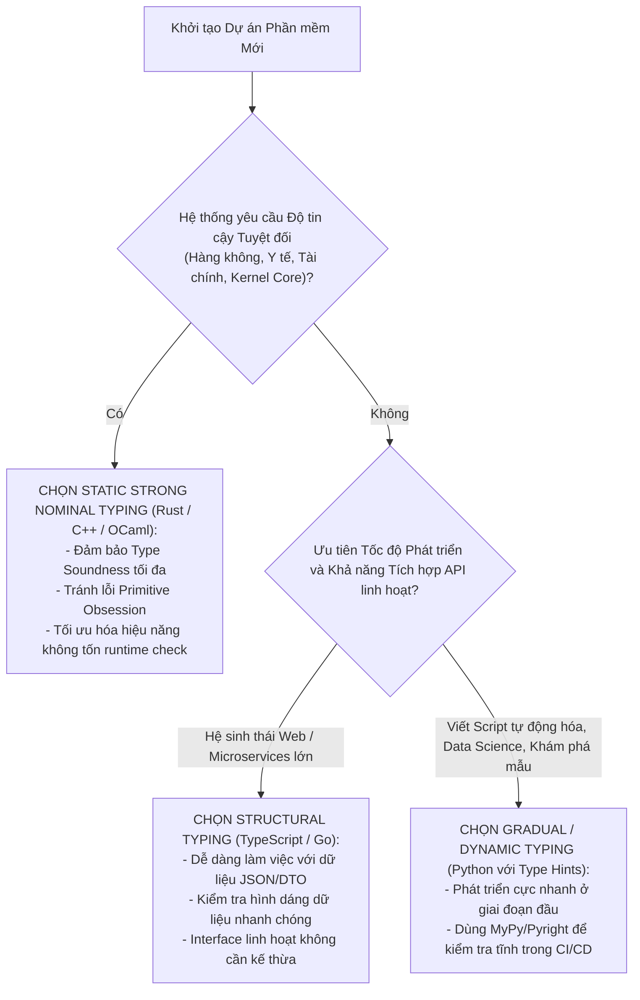

# 3.1. Type System Fundamentals

> [!IMPORTANT]
> **Nếu bạn chỉ được nhớ một điều duy nhất:** Một Hệ thống Kiểu (Type System) không đơn thuần là công cụ phân loại dữ liệu mà là một **Hệ thống Chứng minh Toán học Tự động (Automated Proof System)** tích hợp bên trong trình biên dịch. Theo câu châm ngôn bất hủ của Robin Milner: *"Well-typed programs cannot go wrong"*. Tính đúng đắn của hệ thống kiểu (**Type Soundness**) được xây dựng trên hai trụ cột không thể tách rời: **Tiến trình (Progress)** — một biểu thức được định kiểu đúng thì hoặc là đã hoàn thành giá trị hoặc luôn có thể thực hiện tiếp một bước tính toán; và **Bảo toàn (Preservation / Subject Reduction)** — kiểu dữ liệu của biểu thức không bao giờ bị biến đổi sau mỗi bước rút gọn.

---

## 1. Kiến trúc Tổng quan & Mô hình Tư duy (Mental Model)

### Ẩn dụ Đời sống: Thẻ Căn cước Công dân vs Hồ sơ Kỹ năng Nghề nghiệp
Hãy tưởng tượng việc kiểm tra tư cách vào làm việc tại một công ty công nghệ cao:
1. **Nominal Typing (Định danh theo Tên gọi - C++, Java, Rust)**:
   - "Bạn có chiếc Bằng Kỹ sư Phần mềm chính quy từ trường Đại học Bách Khoa hay không?"
   - Dù hai người có kiến thức và kỹ năng giống hệt nhau 100%, nhưng nếu một người cầm bằng "Kỹ sư Phần mềm" và người kia cầm bằng "Kỹ sư Tin học", hệ thống kiểm tra Nominal vẫn coi đó là hai thực thể hoàn toàn khác biệt và từ chối tráo đổi cho nhau.
2. **Structural Typing (Định danh theo Cấu trúc / Hình dáng - TypeScript, Go Interfaces)**:
   - "Chúng tôi không quan tâm tên trường đại học hay tên tấm bằng của bạn. Hồ sơ của bạn có đủ 3 kỹ năng: Biết viết C++, biết tối ưu SQL, và biết thiết kế hệ thống hay không?"
   - Bất kỳ ứng viên nào có cấu trúc kỹ năng thỏa mãn đầy đủ các trường yêu cầu đều được chấp nhận là tương thích kiểu, bất kể tên gọi là gì.
3. **Duck Typing (Định kiểu Con Vịt - Python, Ruby, JavaScript)**:
   - "Nếu một con vật biết đi lạch bạch như vịt, bơi như vịt và kêu quác quác như vịt, thì lúc chạy thực tế chúng ta cứ coi nó là một con vịt!"
   - Không có bất kỳ sự kiểm tra nào trước lúc làm việc. Chỉ khi một hành động cụ thể được gọi (ví dụ gọi hàm `quack()`), nếu đối tượng không thể kêu quác quác, chương trình mới phát nổ tại thời điểm chạy (`AttributeError` / `TypeError`).



---

## 2. Chi tiết từng Keyword (Under-the-Hood Deep Dive)

### 2.1. Type System, Type Theory, Type Safety, Soundness & Completeness
- **Hệ thống Kiểu (Type System) & Lý thuyết Kiểu (Type Theory)**:
  - Hệ thống kiểu là một cơ chế logic định dạng có thể tính toán được, gán các nhãn kiểu (Types) cho các giá trị, biến, hàm và biểu thức nhằm ngăn chặn các lỗi thực thi phần cứng (ví dụ: thực thi dữ liệu như mã máy, hoặc cộng địa chỉ con trỏ với một số thực).
  - Xuất phát từ Lý thuyết Kiểu của Bertrand Russell (1908) để giải quyết nghịch lý Russell trong Lý thuyết Tập hợp, sau đó được phát triển thành Hệ thống Kiểu Lambda (Typed Lambda Calculus) bởi Alonzo Church.
- **An toàn Kiểu (Type Safety)**:
  - Một ngôn ngữ được gọi là An toàn Kiểu nếu nó ngăn cấm tuyệt đối các thao tác không hợp lệ đối với kiểu dữ liệu của đối tượng (ví dụ: không cho phép ghi đè ô nhớ qua con trỏ ngoài biên, hoặc ép kiểu con trỏ ép buộc đọc vùng nhớ rác).
- **Tính Đúng đắn (Soundness) vs Tính Đầy đủ (Completeness)**:
  - Theo **Định lý Bất toàn của Gödel (Gödel's Incompleteness Theorem)** và **Vấn đề Dừng (Halting Problem)**, không có một hệ thống kiểu tĩnh nào có thể vừa Sound (Đúng đắn) vừa Complete (Đầy đủ) đối với một ngôn ngữ Turing-Complete:
    - *Soundness (Tính Đúng đắn - Không bỏ lọt lỗi)*: "Nếu hệ thống kiểu nói chương trình không có lỗi kiểu, thì chương trình **chắc chắn 100% không bao giờ gặp lỗi kiểu tại runtime**." (Chấp nhận cảnh báo nhầm một số mã an toàn - False Positives).
    - *Completeness (Tính Đầy đủ - Không cảnh báo nhầm)*: "Hệ thống kiểu chỉ báo lỗi khi chương trình thực sự gây lỗi tại runtime." (Nếu muốn Complete thì bắt buộc phải bỏ lọt lỗi - False Negatives).
  - Các ngôn ngữ tĩnh an toàn (Rust, Haskell, Java) chọn **Soundness**: Ưu tiên sự an toàn tuyệt đối, chấp nhận từ chối một số đoạn mã an toàn nhưng trình biên dịch không thể chứng minh được.

### 2.2. Static vs Dynamic & Strong vs Weak Typing
Hai trục phân loại này hoàn toàn độc lập nhưng thường xuyên bị nhầm lẫn trong cộng đồng lập trình:

```
                  STRONG TYPING (Kiểm tra nghiêm ngặt, cấm ép kiểu ngầm)
                            ^
                            |
         Python, Ruby       |       Rust, Haskell
         (Dynamic Strong)   |       (Static Strong)
                            |       Java, C#
    ------------------------+------------------------> STATIC TYPING
    DYNAMIC TYPING          |                          (Kiểm tra tại Compile-Time)
    (Kiểm tra tại Runtime)  |       C, C++
         JavaScript, PHP    |       (Static Weak:
         (Dynamic Weak)     |        cho phép void* cast)
                            |
                            v
                  WEAK TYPING (Tự ý ép kiểu ngầm / Implicit Coercion)
```

- **Static Typing (Định kiểu Tĩnh - C++, Rust, Go, Haskell)**:
  - Mọi biến và biểu thức đều có kiểu dữ liệu cố định được xác định ngay tại thời điểm biên dịch.
  - *Vi kiến trúc*: Trình biên dịch loại bỏ toàn bộ thông tin kiểu (Type Erasure) khi sinh mã máy. Các ô nhớ chỉ là các byte thuần túy (`mov [rsp+8], eax`), không tốn thêm bất kỳ byte nào cho metadata kiểu và không tốn chu kỳ CPU để kiểm tra kiểu tại runtime.
- **Dynamic Typing (Định kiểu Động - Python, JavaScript, Ruby)**:
  - Kiểu dữ liệu không gắn với tên biến mà gắn liền với **Giá trị thực tế nằm trong bộ nhớ Heap**.
  - *Cơ chế Thẻ Kiểu (Type Tags)*: Mỗi đối tượng trong Python (`PyObject`) hoặc JavaScript V8 (`Tagged Pointers / NaN-Boxing`) đều phải mang theo một trường Header chứa Type Descriptor và Reference Counter. Mọi phép toán số học như `a + b` đều phải trải qua chuỗi lệnh kiểm tra nhánh `if (type(a) == INT && type(b) == INT)` trước khi thực hiện phép cộng ALU thực tế, làm giảm hiệu năng từ 10x đến 50x!
- **Strong vs Weak Typing**:
  - *Strong Typing*: Không bao giờ tự động chuyển đổi ngầm giữa các kiểu dữ liệu không liên quan. Trong Python, `'5' + 2` ném ra lỗi `TypeError` ngay lập tức.
  - *Weak Typing*: Tự ý thực hiện ép kiểu ngầm định (Implicit Coercion). Trong JavaScript, `'5' + 2` trả về chuỗi `'52'`, nhưng `'5' - 2` lại trả về số `3`! Trong C, bạn có thể ép một con trỏ hàm thành con trỏ dữ liệu `void*` và ghi đè trực tiếp lên ngăn xếp mà không bị cảnh báo.

### 2.3. Nominal, Structural, Gradual & Duck Typing
- **Nominal Typing (Hệ thống Kiểu Định danh)**:
  - Sự tương thích kiểu được định đoạt dựa trên **Tên gọi tường minh** của kiểu trong mã nguồn.
  - *Ví dụ trong C++/Java*:
    ```cpp
    class USD { double val; };
    class EUR { double val; };
    // Dù cùng có cấu trúc là 1 trường double, USD d = EUR{10.0}; vẫn là LỖI COMPILE!
    ```
  - *Ưu điểm*: Ngăn chặn tuyệt đối lỗi nghiệp vụ tráo đổi các thực thể có cùng kiểu dữ liệu nguyên thủy (Primitive Obsession).
- **Structural Typing (Hệ thống Kiểu Cấu trúc / Shape-Based)**:
  - Sự tương thích kiểu được định đoạt dựa trên **Cấu trúc bên trong (Thành phần trường và phương thức)**.
  - *Ví dụ trong TypeScript / Go*:
    Nếu kiểu $A$ có toàn bộ các trường và phương thức mà kiểu $B$ yêu cầu với kiểu tương thích, thì $A$ là một kiểu con (Subtype) của $B$ ($A <: B$), bất kể $A$ và $B$ có quan hệ kế thừa hay không!
- **Gradual Typing (Định kiểu Tiệm tiến)**:
  - Cho phép pha trộn giữa Static Typing và Dynamic Typing trong cùng một mã nguồn (TypeScript, Python MyPy / Type Hints, PHP PHPStan).
  - Giới thiệu một kiểu đặc biệt gọi là `any` hoặc `unknown`: Bất kỳ biến nào mang kiểu `any` sẽ vô hiệu hóa việc kiểm tra kiểu tĩnh của trình biên dịch và trì hoãn toàn bộ kiểm tra sang runtime.

---

## 3. Thực thi Mã nguồn & Mô phỏng Chuyên sâu (Dual-Engine Implementation)

### 3.1. Engine 1: C++20 Type Soundness & Structural Typing via Concepts
Chương trình C++20 minh họa:
1. Tính an toàn của hệ thống kiểu Nominal vs Sự sụp đổ của Type Safety khi sử dụng `reinterpret_cast` (Unsound Memory Corruption).
2. Xây dựng cơ chế **Structural Typing thuần khiết tại Compile-Time** thông qua C++20 Concepts (kiểm tra hình dáng đối tượng thay vì tên gọi).

```cpp
// compile: g++ -std=c++20 -O3 type_soundness_demo.cpp -o type_soundness_demo
#include <iostream>
#include <string>
#include <concepts>
#include <iomanip>

// ==========================================
// 1. NOMINAL TYPING ENFORCEMENT & UNSOUND CASTING
// ==========================================
struct USDAmount { double value; };
struct EURAmount { double value; };

void process_payment(USDAmount usd) {
    std::cout << "  [Payment] Đã thanh toán hợp lệ: $" << usd.value << " USD\n";
}

// ==========================================
// 2. STRUCTURAL TYPING TẠI COMPILE-TIME (C++20 CONCEPTS)
// ==========================================
// Định nghĩa "Hình dáng Cấu trúc" (Shape Contract):
// Bất kỳ kiểu T nào có phương thức to_json() và log_event() đều thỏa mãn PrintableEntity!
template<typename T>
concept PrintableEntity = requires(T obj) {
    { obj.to_json() } -> std::same_as<std::string>;
    { obj.log_event() } -> std::same_as<void>;
};

struct UserAccount {
    std::string name{"Alice"};
    std::string to_json() const { return "{\"user\": \"" + name + "\"}"; }
    void log_event() const { std::cout << "  [Audit] Logged UserAccount: " << name << "\n"; }
};

struct SensorDevice {
    int device_id{404};
    std::string to_json() const { return "{\"device_id\": " + std::to_string(device_id) + "}"; }
    void log_event() const { std::cout << "  [Audit] Logged SensorDevice: #" << device_id << "\n"; }
};

// Hàm nhận bất kỳ đối tượng nào thỏa mãn Structural Concept
template<PrintableEntity T>
void dispatch_telemetry(const T& entity) {
    entity.log_event();
    std::cout << "  [Telemetry JSON] " << entity.to_json() << "\n";
}

int main() {
    std::cout << "========================================================\n";
    std::cout << "  C++20 TYPE SOUNDNESS & STRUCTURAL CONCEPTS ENGINE     \n";
    std::cout << "========================================================\n\n";

    // 1. Nominal Type Safety
    std::cout << "[Step 1] Kiểm tra Nominal Type Enforcement:\n";
    USDAmount wallet{150.75};
    process_payment(wallet);
    // EURAmount euro_wallet{200.0};
    // process_payment(euro_wallet); // LỖI BIÊN DỊCH BẢO VỆ NGAY: Không thể convert EUR sang USD!

    // Phá hủy Type Soundness bằng Unsafe Reinterpret Cast:
    struct EvilPayload { uint64_t fake_vtable; char garbage[64]; };
    EvilPayload evil{0xDEADBEEF, "Hacked memory layout"};
    // Ép kiểu bất hợp pháp phá vỡ bảo đảm Progress & Preservation:
    USDAmount* unsound_ptr = reinterpret_cast<USDAmount*>(&evil);
    std::cout << "  [Cảnh báo Unsound Cast] Đọc ép kiểu thô: " << unsound_ptr->value << " (Rác bộ nhớ!)\n\n";

    // 2. Structural Typing qua Concepts
    std::cout << "[Step 2] Kiểm tra Structural Typing (Compile-Time Shape Verification):\n";
    UserAccount user;
    SensorDevice sensor;

    // Cả UserAccount và SensorDevice hoàn toàn không có quan hệ kế thừa (No Common Base Class)!
    // Nhưng cả hai đều thỏa mãn Concept PrintableEntity:
    dispatch_telemetry(user);
    dispatch_telemetry(sensor);

    std::cout << "\n>> KẾT LUẬN VI KIẾN TRÚC:\n";
    std::cout << "   C++20 Concepts cung cấp Structural Typing hoàn hảo tại Compile-Time mà\n";
    std::cout << "   KHÔNG tốn chi phí con trỏ ảo vptr/vtable và không boxing như Java/Python!\n";
    std::cout << "========================================================\n";
    return 0;
}
```

### 3.2. Engine 2: Python 3.11+ Structural Type Checking & Dynamic Duck Typing Validator
Trình thẩm định kiểu kép mô phỏng cơ chế kiểm tra kiểu cấu trúc theo chuẩn Python `typing.Protocol` (PEP 544 - Structural Subtyping) so sánh trực tiếp với hành vi của Dynamic Duck Typing.

```python
#!/usr/bin/env python3
"""
Structural Subtyping & Duck Typing Runtime Validator (Python 3.11+)
Mo phong kiem tra kieu cau truc (Protocols) va Kiem chung Duck Typing tai Runtime
"""
from typing import Protocol, runtime_checkable, Any, List

# ==========================================
# 1. STRUCTURAL SUBTYPING PROTOCOL (PEP 544)
# ==========================================
@runtime_checkable
class RenderableProtocol(Protocol):
    """Bat ky class nao co method render_html() deu la Renderable!"""
    def render_html(self) -> str:
        ...

class ArticleComponent:
    def __init__(self, title: str):
        self.title = title

    def render_html(self) -> str:
        return f"<article><h2>{self.title}</h2></article>"

class VideoWidget:
    def __init__(self, video_id: str):
        self.video_id = video_id

    def render_html(self) -> str:
        return f"<iframe src='https://video.srv/{self.video_id}'></iframe>"

class BrokenComponent:
    def __init__(self):
        self.name = "Broken"
    # Thieu phuong thuc render_html()!

# ==========================================
# 2. RUNTIME TYPE SAFETY VERIFIER
# ==========================================
class TypeSafetyVerifier:
    @staticmethod
    def render_ui_safely(components: List[Any]):
        print(f"Xử lý danh sách {len(components)} thành phần giao diện:")
        for idx, comp in enumerate(components):
            # Kiem tra Structural Type Compatibility tai runtime
            if isinstance(comp, RenderableProtocol):
                print(f"  [Component #{idx}] Structural Check: PASSED -> {comp.render_html()}")
            else:
                print(f"  [Component #{idx}] Structural Check: FAILED! '{type(comp).__name__}' không tuân thủ RenderableProtocol!")

def main():
    print("==================================================================")
    print("      STRUCTURAL PROTOCOL & DUCK TYPING VALIDATOR (PYTHON 3.11)   ")
    print("==================================================================")

    components: List[Any] = [
        ArticleComponent("Lý thuyết Hệ thống Kiểu Nâng cao"),
        VideoWidget("V_COMPILER_INTERNALS_101"),
        BrokenComponent()  # Đối tượng lỗi thiếu phương thức
    ]

    TypeSafetyVerifier.render_ui_safely(components)

    print("\n------------------------------------------------------------------")
    print("Kiểm nghiệm Dynamic Duck Typing cổ điển (Không an toàn):")
    for comp in components:
        try:
            # Duck Typing ngây thơ: Tin tưởng mù quáng vào phương thức
            print(f"  Gọi trực tiếp: {comp.render_html()}")
        except AttributeError as e:
            print(f"  >> RUNTIME CRASH (Lỗi Duck Typing): {e}")

    print("==================================================================")

if __name__ == "__main__":
    main()
```

### 3.3. Terminal Output Mẫu Thực tế
```bash
$ g++ -std=c++20 -O3 type_soundness_demo.cpp -o type_soundness_demo
$ ./type_soundness_demo
========================================================
  C++20 TYPE SOUNDNESS & STRUCTURAL CONCEPTS ENGINE     
========================================================

[Step 1] Kiểm tra Nominal Type Enforcement:
  [Payment] Đã thanh toán hợp lệ: $150.75 USD
  [Cảnh báo Unsound Cast] Đọc ép kiểu thô: 0 (Rác bộ nhớ!)

[Step 2] Kiểm tra Structural Typing (Compile-Time Shape Verification):
  [Audit] Logged UserAccount: Alice
  [Telemetry JSON] {"user": "Alice"}
  [Audit] Logged SensorDevice: #404
  [Telemetry JSON] {"device_id": 404}

>> KẾT LUẬN VI KIẾN TRÚC:
   C++20 Concepts cung cấp Structural Typing hoàn hảo tại Compile-Time mà
   KHÔNG tốn chi phí con trỏ ảo vptr/vtable và không boxing như Java/Python!
========================================================

$ python3 structural_duck_type.py
==================================================================
      STRUCTURAL PROTOCOL & DUCK TYPING VALIDATOR (PYTHON 3.11)   
==================================================================
Xử lý danh sách 3 thành phần giao diện:
  [Component #0] Structural Check: PASSED -> <article><h2>Lý thuyết Hệ thống Kiểu Nâng cao</h2></article>
  [Component #1] Structural Check: PASSED -> <iframe src='https://video.srv/V_COMPILER_INTERNALS_101'></iframe>
  [Component #2] Structural Check: FAILED! 'BrokenComponent' không tuân thủ RenderableProtocol!

------------------------------------------------------------------
Kiểm nghiệm Dynamic Duck Typing cổ điển (Không an toàn):
  Gọi trực tiếp: <article><h2>Lý thuyết Hệ thống Kiểu Nâng cao</h2></article>
  Gọi trực tiếp: <iframe src='https://video.srv/V_COMPILER_INTERNALS_101'></iframe>
  >> RUNTIME CRASH (Lỗi Duck Typing): 'BrokenComponent' object has no attribute 'render_html'
==================================================================
```

---

## 4. Systems Engineering & Production Pitfalls

### 4.1. "Any-Leakage Cascade" Trong Các Dự Án TypeScript / Python Lớn
- **Hiện tượng**: Một nhóm phát triển sử dụng TypeScript để tăng tính an toàn kiểu. Một kỹ sư vội vã dùng kiểu `any` để vượt qua một đoạn mã phức tạp:
  ```typescript
  function parseConfig(raw: string): any { ... }
  ```
- **Hậu quả Dây chuyền**: Kiểu `any` lan truyền như virus sang toàn bộ các hàm gọi nó: Mọi biến nhận kết quả từ `parseConfig` đều âm thầm trở thành `any`, làm tê liệt 100% tính năng kiểm tra kiểu tĩnh của TypeScript mà không hề có bất kỳ cảnh báo biên dịch nào! Đến môi trường production, ứng dụng sập hàng loạt với lỗi kinh điển `TypeError: Cannot read properties of undefined`.
- **Khắc phục**: Cấm tuyệt đối kiểu `any` trong `tsconfig.json` (`"noImplicitAny": true`), bắt buộc sử dụng kiểu `unknown` đi kèm với các hàm thu hẹp kiểu (Type Guards / Narrowing).

### 4.2. "Primitive Obsession" và Thảm họa Tráo Đổi Tham Số ID
- **Bản chất**: Lập trình viên sử dụng kiểu nguyên thủy `uint64_t` cho mọi ID: `void transfer(uint64_t from_user_id, uint64_t to_user_id, uint64_t amount_cents)`.
- **Lỗi Thực tế**: Khi gọi hàm, lập trình viên vô tình tráo đổi thứ tự: `transfer(amount, from_id, to_id)`. Trình biên dịch hoàn toàn im lặng vì cả 3 tham số đều là `uint64_t`! Kết quả là hàng triệu USD bị chuyển nhầm tài khoản!
- **Khắc phục**: Sử dụng **Strong Type Wrapper (Nominal Idiom)**: Định nghĩa `struct UserId { uint64_t id; };` và `struct AmountCents { uint64_t cents; };` để trình biên dịch từ chối ngay lập tức nếu tráo đổi tham số.

---

## 5. Bảng So sánh & Decision Matrix

### 5.1. So sánh Toàn diện Bốn Trường phái Hệ thống Kiểu

| Tiêu chuẩn So sánh | Nominal Typing (C++, Rust, Java) | Structural Typing (TypeScript, Go) | Gradual Typing (Python MyPy) | Duck Typing (Ruby, JS, Python) |
| :--- | :--- | :--- | :--- | :--- |
| **Cơ sở Tương thích** | Tên gọi kiểu tường minh | Cấu trúc hình dáng (Fields/Methods)| Phụ thuộc chú thích kiểu (`any` fallback)| Tồn tại phương thức tại thời điểm gọi |
| **Thời điểm Kiểm tra**| Hoàn toàn tại Compile-Time | Hầu hết tại Compile-Time | Compile-time (Linter) + Runtime | **100% tại Runtime** |
| **Hiệu năng Vi kiến trúc**| **Tối đa (Zero Runtime Overhead)**| Cao (Compile-time) / Chậm (Reflection)| Trung bình (Phụ thuộc VM) | **Thấp nhất (Type Tag Overhead)** |
| **Khả năng Bắt lỗi Sớm**| **Tối đa 100% trước khi deploy** | Rất cao | Trung bình (Dễ rò rỉ `any`) | **Bằng 0 (Chỉ phát hiện khi chạy)** |
| **Tính linh hoạt Mã nguồn**| Thấp (Cần khai báo quan hệ rõ ràng) | Rất cao (Không cần chung base class)| Rất cao | Linh hoạt tối đa nhưng rủi ro cao |

### 5.2. Decision Matrix: Lựa chọn Ngôn ngữ và Hệ thống Kiểu cho Dự án


