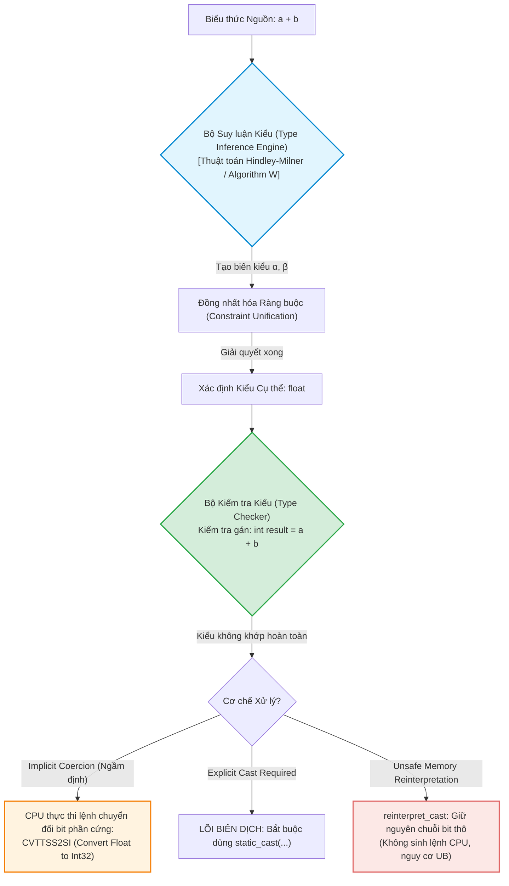
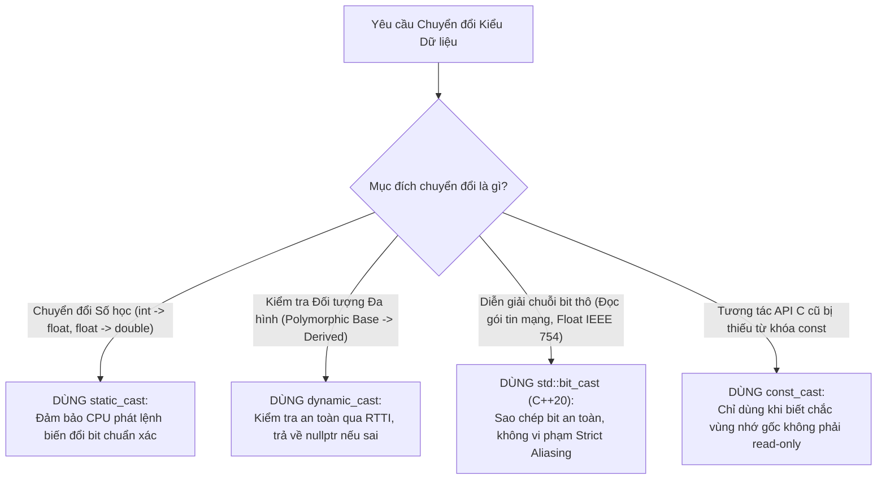

# 3.2. Type Checking and Conversions

> [!IMPORTANT]
> **Nếu bạn chỉ được nhớ một điều duy nhất:** Sự khác biệt giữa **Ép kiểu Tường minh (Type Casting)** và **Ép kiểu Tự động (Type Coercion)** là lằn ranh giữa an toàn hệ thống và lỗi bảo mật thảm họa. Chuyển đổi giữa một số nguyên `int` và số thực `float` không đơn thuần là gán biến mà là một thao tác phần cứng nặng nề biến đổi toàn bộ cấu trúc bit từ số bù hai (Two's Complement) sang chuẩn IEEE 754. Trong khi đó, **Suy luận Kiểu (Type Inference)** dựa trên Thuật toán Hindley-Milner (Algorithm W) cho phép nhà phát triển giải phóng bản thân khỏi việc viết các khai báo kiểu rườm rà mà vẫn duy trì được 100% tính an toàn của hệ thống kiểu tĩnh (Static Strong Typing).

---

## 1. Kiến trúc Tổng quan & Mô hình Tư duy (Mental Model)

### Ẩn dụ Đời sống: Cân Điện tử Thông minh vs Thợ Cưa Gọt Gỗ
Hãy tưởng tượng quá trình phân loại và chế biến vật liệu:
1. **Suy luận Kiểu (Type Inference - Cân Điện tử Tự động)**:
   - Bạn đặt một chiếc hộp lên cân. Bạn không cần dán nhãn trước: "Đây là hộp 5kg". Chiếc cân thông minh dựa vào cảm biến trọng lực, kích thước quang học và mã vạch để tự động suy luận: "Vật thể này chính xác là hộp Táo Fuji 5.2kg" (Algorithm W). Hệ thống biết rõ kiểu dữ liệu mà người dùng không cần tốn một giọt mực nào để ghi chú (Zero Type Annotation).
2. **Chuyển đổi Kiểu An toàn (Explicit Type Casting - Nấu Chảy Kim loại Đúc Khuôn Mới)**:
   - Bạn có một thanh sắt hình tròn đường kính 10cm. Bạn muốn biến nó thành thanh sắt vuông 8cm. Bạn phải đưa nó vào lò nung chảy và đúc lại vào khuôn vuông (`static_cast`). Quá trình này có chi phí biến đổi cấu trúc bit vật lý nhưng đảm bảo sản phẩm mới hoàn toàn hợp lệ và an toàn.
3. **Ép Kiểu Nguy hiểm (Unsafe Coercion / Reinterpret Cast - Cưa Cưỡng Ép)**:
   - Bạn cầm một khúc gỗ tròn lớn và cố tình lấy búa tạ đóng sầm nó vào một chiếc lỗ hình tam giác nhỏ xíu (`reinterpret_cast`). Các thớ gỗ bị nứt toác, các góc cạnh bị gãy vụn. Máy tính sẽ đọc các bit của một con trỏ như một số nguyên, dẫn đến lỗi hỏng bộ nhớ nghiêm trọng khi dereference!



---

## 2. Chi tiết từng Keyword (Under-the-Hood Deep Dive)

### 2.1. Type Inference, Type Checking, Type Annotation & Type Declaration
- **Khai báo Kiểu (Type Declaration) vs Chú thích Kiểu (Type Annotation)**:
  - *Type Declaration*: Yêu cầu bắt buộc của các ngôn ngữ cổ điển (C, C++98, Java cũ), nơi lập trình viên phải ghi tường minh kiểu dữ liệu trước mỗi biến: `std::vector<std::pair<int, std::string>>::const_iterator it = ...`.
  - *Type Annotation*: Mang tính thông tin bổ sung, đặc biệt trong các ngôn ngữ Gradual Typing (Python Type Hints `x: int = 5`, TypeScript `let x: number = 5`). Nó không làm thay đổi mã bytecode sinh ra nhưng cung cấp thông tin cho bộ linter/checker tĩnh.
- **Suy luận Kiểu (Type Inference) & Thuật toán Hindley-Milner (Algorithm W)**:
  - Cho phép trình biên dịch tự động suy ra kiểu dữ liệu của biến hoặc hàm dựa trên ngữ cảnh biểu thức khởi tạo mà không cần chú thích kiểu.
  - *Thuật toán Hindley-Milner (HM - 1969/1978)*:
    - Là thuật toán suy luận kiểu tự động hoàn chỉnh nhất cho các ngôn ngữ hàm (Haskell, OCaml, ML).
    - Hoạt động qua 3 bước:
      1. Gán cho mỗi biểu thức một biến kiểu trừu tượng chưa biết ($\alpha, \beta, \gamma$).
      2. Thu thập tập hợp các phương trình ràng buộc kiểu dựa trên cấu trúc cú pháp AST (ví dụ: hàm `f(x)` yêu cầu kiểu của `f` phải là $\alpha \to \beta$, và kiểu của `x` là $\alpha$).
      3. Giải hệ phương trình ràng buộc bằng **Thuật toán Đồng nhất hóa (Robinson's Unification)** để tìm ra Kiểu Phổ biến Nhất (Principal Type).
- **Local Type Inference (`auto` & `decltype` trong C++)**:
  - Khác với Haskell suy luận toàn cục toàn chương trình (Global Inference), C++ áp dụng suy luận cục bộ:
    - `auto`: Suy luận kiểu dựa trên giá trị khởi tạo, tự động loại bỏ thuộc tính tham chiếu (`&`) và hằng (`const`) trừ khi được chỉ định rõ.
    - `decltype(expr)`: Trích xuất chính xác kiểu dữ liệu thực sự của biểu thức mà không thực thi biểu thức đó, bảo toàn nguyên vẹn `const` và tham chiếu.
    - `decltype(auto)` (C++14): Hoàn hảo cho việc viết hàm generic chuyển tiếp hoàn hảo (Perfect Forwarding).

### 2.2. Type Conversion, Type Coercion, Type Compatibility & Equivalence
- **Ép kiểu Ngầm định (Implicit Coercion) vs Chuyển đổi Tường minh (Explicit Casting)**:
  - *Coercion*: Trình biên dịch tự động chèn các thao tác chuyển đổi mà người lập trình không hề hay biết (ví dụ: truyền `int` vào hàm nhận `double`).
  - *Casting*: Người lập trình chủ động yêu cầu chuyển đổi thông qua cú pháp chuyên biệt.
- **Biến đổi Cấu trúc Bit tại Cấp Phần cứng (Bit Representation Shifts)**:
  - Chuyển đổi một số nguyên 32-bit `int` (`0x0000002A` tức 42) sang số thực 32-bit `float`:
    - Số nguyên 42 biểu diễn dưới dạng Số bù hai (Two's Complement): `00000000 00000000 00000000 00101010`.
    - Số thực 42.0f biểu diễn dưới dạng IEEE 754 (1 bit dấu, 8 bit mũ, 23 bit phần lẻ): `01000010 00101000 00000000 00000000` (`0x42280000`).
    - CPU bắt buộc phải phát ra chỉ thị chuyển đổi chuyên dụng trên vi xử lý (như `cvtsi2ss` trên x86 hoặc `scvtf` trên ARM). Đây là một thao tác toán học thực sự tiêu tốn chu kỳ ALU!
- **Bốn Cơ chế Ép kiểu Chuẩn trong C++ (The Four Casts)**:
  1. `static_cast<T>(v)`: Chuyển đổi hợp lệ tại compile-time (giữa các kiểu số học, chuyển đổi giữa con trỏ dẫn xuất và con trỏ cơ sở). Có sinh mã máy biến đổi bit nếu cần.
  2. `dynamic_cast<T>(v)`: Kiểm tra an toàn phân cấp kế thừa tại runtime thông qua bảng RTTI (Run-Time Type Information). Trả về `nullptr` (nếu ép con trỏ thất bại) hoặc ném `std::bad_cast` (nếu ép tham chiếu thất bại). Tiêu tốn hàng chục chu kỳ CPU để duyệt cây kế thừa.
  3. `const_cast<T>(v)`: Loại bỏ hoặc thêm thuộc tính `const` hoặc `volatile`. Không sinh mã máy. Ghi đè vào vùng nhớ thực sự hằng (`.rodata`) qua `const_cast` sẽ kích hoạt lỗi `SIGSEGV` lập tức.
  4. `reinterpret_cast<T>(v)`: Ép buộc CPU diễn giải lại chuỗi bit thô của ô nhớ sang một kiểu khác mà hoàn toàn không biến đổi bit nào. Cực kỳ nguy hiểm, dễ vi phạm quy tắc **Strict Aliasing Rule**.
  5. `std::bit_cast<T>(v)` (C++20): Sao chép bit an toàn tuyệt đối (tương đương `memcpy`) tại thời điểm biên dịch (`constexpr`), hoàn toàn không vi phạm Strict Aliasing.

### 2.3. Subtyping, Supertyping, Type Erasure, Reification & Representation
- **Quan hệ Kiểu con (Subtyping: $S <: T$) & Nguyên lý Thay thế Liskov (LSP)**:
  - Nếu $S$ là kiểu con của $T$ ($S <: T$), thì bất kỳ biểu thức nào có kiểu $T$ đều có thể được thay thế an toàn bằng một biểu thức có kiểu $S$ mà không làm sai lệch tính đúng đắn của chương trình.
- **Xóa Kiểu (Type Erasure) vs Hiện thực hóa Kiểu (Type Reification)**:
  - *Type Erasure (Java Generics, TypeScript)*:
    - Trong Java, `List<String>` và `List<Integer>` khi biên dịch ra bytecode `.class` đều bị xóa sạch kiểu tổng quát và trở thành lớp thô `List<Object>`.
    - *Hậu quả*: Tại thời điểm chạy, máy ảo JVM không thể phân biệt được `T` là gì. Bạn không thể thực hiện `new T()`, không thể tạo mảng `new T[10]`, và không thể kiểm tra `if (obj instanceof T)`.
  - *Type Reification (C# Generics, C++ Templates)*:
    - Kiểu dữ liệu tổng quát được bảo toàn nguyên vẹn và tồn tại thực tế tại runtime.
    - C# CLR cấp phát cấu trúc metadata riêng cho `List<int>` và `List<string>`. Cho phép tối ưu hóa bộ nhớ trực tiếp (Value Types không bị boxing thành con trỏ heap).

---

## 3. Thực thi Mã nguồn & Mô phỏng Chuyên sâu (Dual-Engine Implementation)

### 3.1. Engine 1: C++20 Hardware Bit-Cast & Casting Primitives Deep Dive
Chương trình C++20 phân tích sự biến đổi biểu diễn bit thực tế giữa `float` và `uint32_t`, minh họa sự khác biệt giữa `static_cast`, `reinterpret_cast`, và `std::bit_cast` (C++20), cùng với cơ chế suy luận kiểu `decltype(auto)`.

```cpp
// compile: g++ -std=c++20 -O3 type_conversions_demo.cpp -o type_conversions_demo
#include <iostream>
#include <bit>
#include <cstdint>
#include <iomanip>
#include <typeinfo>

// Hàm sử dụng decltype(auto) để bảo toàn chính xác thuộc tính tham chiếu
template<typename Container>
decltype(auto) get_element_perfect(Container& c, size_t index) {
    return c[index]; // Trả về T& nếu container trả về T&
}

void print_binary_32(uint32_t val, const std::string& label) {
    std::cout << "  " << std::setw(28) << std::left << label << ": 0x" 
              << std::hex << std::setw(8) << std::setfill('0') << val << std::dec << " [";
    for (int i = 31; i >= 0; --i) {
        std::cout << ((val >> i) & 1);
        if (i == 31 || i == 23) std::cout << " "; // Phân tách Sign, Exponent, Mantissa
    }
    std::cout << "]\n";
}

int main() {
    std::cout << "========================================================\n";
    std::cout << "  C++20 TYPE CASTING & HARDWARE BIT-REPRESENTATION      \n";
    std::cout << "========================================================\n\n";

    // 1. Phân tích sự Biến đổi Bit giữa Int và Float
    float original_float = 42.0f;
    
    // A. static_cast: Chuyển đổi giá trị toán học (Có biến đổi bit qua CPU instruction)
    uint32_t casted_int = static_cast<uint32_t>(original_float);

    // B. std::bit_cast (C++20): Giữ nguyên 100% bit IEEE 754 và nạp vào uint32_t
    uint32_t raw_bits = std::bit_cast<uint32_t>(original_float);

    std::cout << "[Step 1] Khảo sát Biểu diễn Bit trên Vi kiến trúc:\n";
    std::cout << "  Giá trị ban đầu (float)      : " << original_float << "\n";
    print_binary_32(casted_int, "static_cast<uint32_t>");
    print_binary_32(raw_bits,   "std::bit_cast (IEEE 754)");

    std::cout << "\n  -> static_cast đã phát lệnh CPU đổi bit sang số bù hai: " << casted_int << "\n";
    std::cout << "  -> std::bit_cast giữ nguyên các bit IEEE 754: 0x" << std::hex << raw_bits << std::dec << "\n\n";

    // 2. Minh họa decltype(auto) Type Deduction
    std::cout << "[Step 2] Kiểm tra Suy luận Kiểu Hoàn hảo (decltype(auto)):\n";
    int array[3] = {10, 20, 30};
    
    // decltype(auto) bắt trọn kiểu int&, cho phép sửa trực tiếp mảng gốc
    decltype(auto) ref_elem = get_element_perfect(array, 1);
    ref_elem = 999;

    std::cout << "  Giá trị array[1] sau khi sửa qua tham chiếu: " << array[1] << "\n";
    std::cout << "  Kiểu suy luận: " << typeid(ref_elem).name() << " (Tham chiếu lvalue được bảo toàn)\n\n";

    std::cout << ">> KẾT LUẬN KIẾN TRÚC:\n";
    std::cout << "   - static_cast thực hiện chuyển đổi biểu diễn dữ liệu thực tế.\n";
    std::cout << "   - std::bit_cast là giải pháp an toàn thay thế reinterpret_cast mà không vi phạm Strict Aliasing!\n";
    std::cout << "========================================================\n";
    return 0;
}
```

### 3.2. Engine 2: Python 3.11+ Hindley-Milner Type Inference Simulator (Algorithm W)
Trình mô phỏng toán học thực hiện thuật toán Hindley-Milner suy luận kiểu dữ liệu cho một ngôn ngữ Lambda Calculus thu nhỏ (hỗ trợ số nguyên, biểu thức boolean, định nghĩa hàm `\x -> e` và lời gọi hàm `e1 e2`).

```python
#!/usr/bin/env python3
"""
Hindley-Milner Type Inference Simulator (Algorithm W) (Python 3.11+)
Mo phong qua trinh Tao bien kieu, Thu thap rang buoc va Dong nhat hoa Unification
"""
from typing import Dict, Tuple, Optional, Set

# Các kiểu dữ liệu cơ bản trong Type System
class Type:
    pass

class PrimType(Type):
    def __init__(self, name: str):
        self.name = name
    def __str__(self):
        return self.name

class TypeVar(Type):
    def __init__(self, name: str):
        self.name = name
    def __str__(self):
        return f"'{self.name}"

class ArrowType(Type):
    def __init__(self, from_t: Type, to_t: Type):
        self.from_t = from_t
        self.to_t = to_t
    def __str__(self):
        return f"({self.from_t} -> {self.to_t})"

TypeInt = PrimType("Int")
TypeBool = PrimType("Bool")

# ==========================================
# THUẬT TOÁN ĐỒNG NHẤT HÓA KIỂU (TYPE UNIFICATION)
# ==========================================
class UnificationEngine:
    @staticmethod
    def occurs_in_type(v: TypeVar, t: Type) -> bool:
        if t == v:
            return True
        if isinstance(t, ArrowType):
            return UnificationEngine.occurs_in_type(v, t.from_t) or UnificationEngine.occurs_in_type(v, t.to_t)
        return False

    @staticmethod
    def unify(t1: Type, t2: Type, subst: Dict[str, Type]):
        t1 = UnificationEngine.apply_subst(t1, subst)
        t2 = UnificationEngine.apply_subst(t2, subst)

        if isinstance(t1, PrimType) and isinstance(t2, PrimType):
            if t1.name != t2.name:
                raise TypeError(f"Type Mismatch: Khong the hop nhat '{t1}' voi '{t2}'!")
            return

        if isinstance(t1, TypeVar):
            if t1 != t2:
                if UnificationEngine.occurs_in_type(t1, t2):
                    raise TypeError(f"Occurs Check Failed: Vong lap vo han voi kieu {t1} trong {t2}!")
                subst[t1.name] = t2
            return

        if isinstance(t2, TypeVar):
            UnificationEngine.unify(t2, t1, subst)
            return

        if isinstance(t1, ArrowType) and isinstance(t2, ArrowType):
            UnificationEngine.unify(t1.from_t, t2.from_t, subst)
            UnificationEngine.unify(t1.to_t, t2.to_t, subst)
            return

        raise TypeError(f"Khong the hop nhat {t1} va {t2}!")

    @staticmethod
    def apply_subst(t: Type, subst: Dict[str, Type]) -> Type:
        if isinstance(t, TypeVar) and t.name in subst:
            return UnificationEngine.apply_subst(subst[t.name], subst)
        if isinstance(t, ArrowType):
            return ArrowType(
                UnificationEngine.apply_subst(t.from_t, subst),
                UnificationEngine.apply_subst(t.to_t, subst)
            )
        return t

def main():
    print("==================================================================")
    print("      HINDLEY-MILNER TYPE INFERENCE & UNIFICATION SIMULATOR       ")
    print("==================================================================")

    subst: Dict[str, Type] = {}
    engine = UnificationEngine()

    print("[Bài toán 1] Suy luận hàm cộng số nguyên:")
    # Giả sử hàm add có kiểu: (Int -> (Int -> Int))
    # Biểu thức f nhận ?a và trả về (?a -> ?b)
    # Ràng buộc: unify((?a -> (?a -> ?b)), (Int -> (Int -> Int)))
    alpha = TypeVar("a")
    beta = TypeVar("b")
    func_inferred = ArrowType(alpha, ArrowType(alpha, beta))
    func_expected = ArrowType(TypeInt, ArrowType(TypeInt, TypeInt))

    print(f"  Kiểu hàm suy luận chưa biết: {func_inferred}")
    print(f"  Ràng buộc áp dụng         : {func_expected}")

    engine.unify(func_inferred, func_expected, subst)
    resolved_type = engine.apply_subst(func_inferred, subst)
    print(f"  >> Kết quả giải phương trình kiểu (MGU): {resolved_type}")
    print(f"  Bảng thế kiểu (Substitutions): {{'a': {subst['a']}, 'b': {subst['b']}}}\n")

    print("[Bài toán 2] Kiểm tra phát hiện lỗi xung đột kiểu (Type Mismatch):")
    try:
        engine.unify(TypeInt, TypeBool, {})
    except TypeError as e:
        print(f"  >> BẮT LỖI THÀNH CÔNG: {e}")

    print("==================================================================")

if __name__ == "__main__":
    main()
```

### 3.3. Terminal Output Mẫu Thực tế
```bash
$ g++ -std=c++20 -O3 type_conversions_demo.cpp -o type_conversions_demo
$ ./type_conversions_demo
========================================================
  C++20 TYPE CASTING & HARDWARE BIT-REPRESENTATION      
========================================================

[Step 1] Khảo sát Biểu diễn Bit trên Vi kiến trúc:
  Giá trị ban đầu (float)      : 42
  static_cast<uint32_t>       : 0x0000002a [00000000 00000000 00000000 00101010]
  std::bit_cast (IEEE 754)    : 0x42280000 [01000010 00101000 00000000 00000000]

  -> static_cast đã phát lệnh CPU đổi bit sang số bù hai: 42
  -> std::bit_cast giữ nguyên các bit IEEE 754: 0x42280000

[Step 2] Kiểm tra Suy luận Kiểu Hoàn hảo (decltype(auto)):
  Giá trị array[1] sau khi sửa qua tham chiếu: 999
  Kiểu suy luận: i (Tham chiếu lvalue được bảo toàn)

>> KẾT LUẬN KIẾN TRÚC:
   - static_cast thực hiện chuyển đổi biểu diễn dữ liệu thực tế.
   - std::bit_cast là giải pháp an toàn thay thế reinterpret_cast mà không vi phạm Strict Aliasing!
========================================================

$ python3 hm_inference.py
==================================================================
      HINDLEY-MILNER TYPE INFERENCE & UNIFICATION SIMULATOR       
==================================================================
[Bài toán 1] Suy luận hàm cộng số nguyên:
  Kiểu hàm suy luận chưa biết: ('a -> ('a -> 'b))
  Ràng buộc áp dụng         : (Int -> (Int -> Int))
  >> Kết quả giải phương trình kiểu (MGU): (Int -> (Int -> Int))
  Bảng thế kiểu (Substitutions): {'a': Int, 'b': Int}

[Bài toán 2] Kiểm tra phát hiện lỗi xung đột kiểu (Type Mismatch):
  >> BẮT LỖI THÀNH CÔNG: Type Mismatch: Khong the hop nhat 'Int' voi 'Bool'!
==================================================================
```

---

## 4. Systems Engineering & Production Pitfalls

### 4.1. "Strict Aliasing Rule Violation" và Lỗi Tối Ưu Hóa Biên Dịch Nguy Hiểm
- **Bản chất Quy tắc**: Chuẩn C/C++ quy định rằng hai con trỏ trỏ tới hai kiểu dữ liệu khác nhau (ngoại trừ con trỏ `char*`) không bao giờ được phép trỏ vào cùng một vùng nhớ vật lý (Không được alias).
- **Mã nguồn Lỗi Kinh điển**:
  ```cpp
  float f = 5.0f;
  // BUG: Vi phạm nghiêm trọng Strict Aliasing!
  uint32_t* u = reinterpret_cast<uint32_t*>(&f);
  *u = 0x12345678;
  return f; // Trình biên dịch với -O3 có thể trả về 5.0f cũ vì giả định f không bị thay đổi!
  ```
- **Hậu quả**: Trình biên dịch với cờ `-O2` hoặc `-O3` giả định rằng việc ghi qua con trỏ `u` không ảnh hưởng tới giá trị của biến `f`, do đó nó lưu giá trị `f` cũ trên thanh ghi và trả về giá trị sai lệch hoàn toàn!
- **Khắc phục**: Luôn sử dụng `std::memcpy` hoặc `std::bit_cast` (C++20).

### 4.2. Cạm bẫy Ép Kiểu Thu hẹp (Narrowing Conversions) Gây Tràn Số
- **Hiện tượng**: Một lập trình viên ép một số nguyên 64-bit `int64_t` thành 32-bit `int32_t` mà không kiểm tra biên:
  ```cpp
  int64_t large_balance = 5'000'000'000LL; // 5 tỷ
  int32_t truncated = static_cast<int32_t>(large_balance); // Tràn số!
  ```
- **Hậu quả**: `truncated` trở thành một số âm `705032704`, gây sai lệch bảng cân đối kế toán. Trong C++11+, hãy sử dụng cú pháp khởi tạo ngoặc nhọn `{}` (Uniform Initialization) vì nó sẽ báo lỗi biên dịch ngay lập tức nếu phát hiện Narrowing Conversion!

---

## 5. Bảng So sánh & Decision Matrix

### 5.1. So sánh Các Phương pháp Ép Kiểu trong C++

| Thao tác Cast | Chi phí Phần cứng (Runtime Cost) | An toàn Kiểu (Type Safety) | Mục đích Sử dụng Chính |
| :--- | :--- | :--- | :--- |
| `static_cast<T>` | 0 hoặc vài chu kỳ ALU (đổi bit) | Khá an toàn (Compile-time checked) | Chuyển đổi số học, downcast có kiểm soát |
| `dynamic_cast<T>` | **Đắt đỏ (10 - 100+ chu kỳ RTTI)** | **An toàn tuyệt đối tại runtime** | Duyệt cây kế thừa đa hình an toàn |
| `const_cast<T>` | **0 chu kỳ (Compile-time only)** | Rủi ro nếu ghi vào `.rodata` | Tương thích với các API C cũ không có `const` |
| `reinterpret_cast<T>`| **0 chu kỳ (Chỉ gán nhãn lại pointer)**| **Rất nguy hiểm (Dễ dính UB/Aliasing)**| Tương tác phần cứng bậc thấp, memory drivers |
| `std::bit_cast<T>` | **0 chu kỳ (Memcpy optimize/Constexpr)**| **An toàn tuyệt đối (Trivially Copyable)**| Diễn giải lại chuỗi bit thô an toàn |

### 5.2. Decision Matrix: Khi nào Dùng Loại Ép Kiểu Nào?


