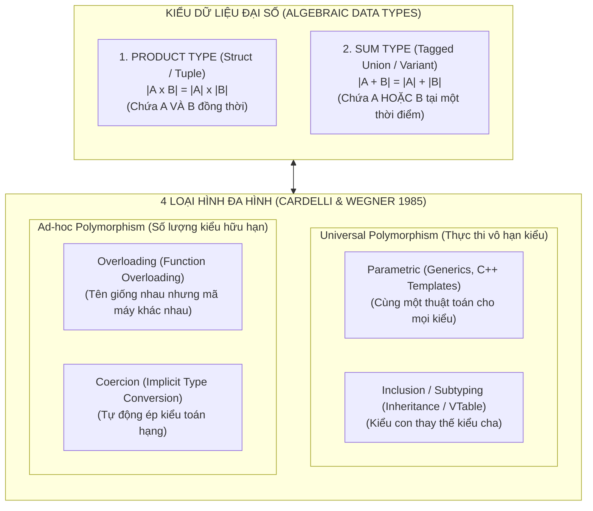
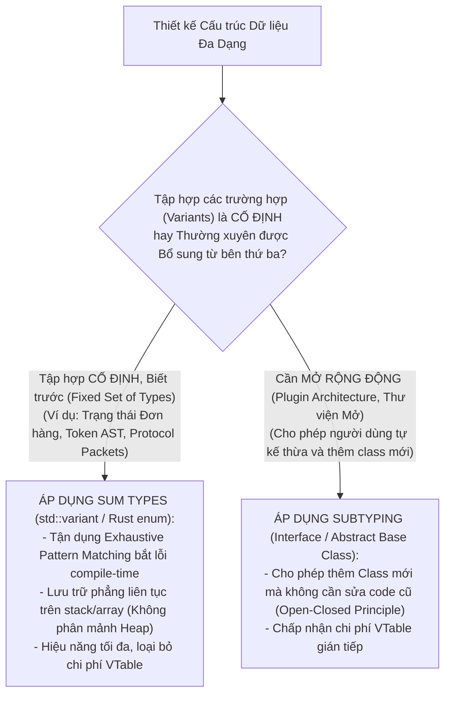

# 3.3. Algebraic Data Types and Polymorphism

> [!IMPORTANT]
> **Nếu bạn chỉ được nhớ một điều duy nhất:** Bản chất của **Kiểu Dữ liệu Đại số (Algebraic Data Types - ADTs)** là phép đếm số lượng trạng thái hợp lệ trong không gian toán học: **Product Types** (Structs, Tuples) nhân số lượng trạng thái ($|A \times B| = |A| \times |B|$), trong khi **Sum Types** (Tagged Unions, `std::variant`, Rust `enum`) cộng dồn số lượng trạng thái ($|A + B| = |A| + |B|$). Sum Types kết hợp với Khớp mẫu Toàn diện (Exhaustive Pattern Matching) giúp loại bỏ hoàn toàn thảm họa `null` pointer ("Tỷ Đô Sai Lầm" của Tony Hoare). Trong khi đó, **4 hình thái Đa hình của Cardelli & Wegner** phân định rõ ranh giới giữa Đa hình Phổ quát (Universal: Parametric vs Subtyping) và Đa hình Đặc thù (Ad-hoc: Overloading vs Coercion).

---

## 1. Kiến trúc Tổng quan & Mô hình Tư duy (Mental Model)

### Ẩn dụ Đời sống: Hộp Bento Đa Ngăn vs Chiếc Hộp Quà Bí Ẩn
Hãy tưởng tượng việc chuẩn bị một suất ăn trưa:
1. **Product Type (Kiểu Tích - Hộp Cơm Bento Đa Ngăn)**:
   - Một chiếc hộp gồm ngăn đựng cơm (Cơm trắng hoặc Cơm gạo lứt - 2 trạng thái) **VÀ** một ngăn đựng món mặn (Thịt bò, Cá hồi, Đậu phụ - 3 trạng thái).
   - Tổng số biến thể bữa ăn có thể tạo ra là phép nhân đại số: $2 \times 3 = 6$ biến thể hợp lệ. Bạn bắt buộc phải có cả hai món cùng lúc trong hộp cơm.
2. **Sum Type (Kiểu Tổng / Tagged Union - Chiếc Hộp Quà Bí Ẩn Có Nhãn Dán)**:
   - Một chiếc hộp chỉ chứa **HOẶC LÀ** một Chiếc Đồng hồ (Trạng thái A) **HOẶC LÀ** một Thẻ Quà tặng (Trạng thái B).
   - Chiếc hộp có dán một chiếc thẻ bài bên ngoài (**Discriminant Tag**). Người mở hộp chỉ cần nhìn vào thẻ bài để biết chính xác bên trong đang chứa món đồ gì. Tổng số khả năng là phép cộng đại số: $|A| + |B|$. Bạn không bao giờ rơi vào trạng thái kỳ dị vừa có đồng hồ vừa có thẻ quà tặng cùng lúc.
3. **Tính Đa Hình (Polymorphism - Bộ Đầu Chuyển Đổi Nguồn Điện Du Lịch)**:
   - Bạn mang theo một chiếc sấy tóc.
   - Thay vì chế tạo 5 chiếc máy sấy khác nhau cho từng ổ cắm ở Mỹ, Anh, Nhật, Châu Âu; bạn sử dụng một **Giao diện Chung (Parametric / Subtyping)** cho phép máy sấy thích ứng hoàn hảo với bất kỳ dòng điện nào mà không cần thay đổi động cơ cốt lõi bên trong.



---

## 2. Chi tiết từng Keyword (Under-the-Hood Deep Dive)

### 2.1. Algebraic Data Types: Product Types, Sum Types & Discriminated Unions
- **Lý thuyết Số học của Kiểu (The Algebra of Types)**:
  - Một kiểu dữ liệu $T$ có thể được coi như một tập hợp các giá trị có lực lượng (Cardinality) $|T|$.
  - *Kiểu Void / Never*: $|0| = 0$ (Không có giá trị nào, đại diện cho hàm không bao giờ kết thúc).
  - *Kiểu Unit (`void` trong C++, `()` trong Rust/Haskell)*: $|1| = 1$ (Chỉ có duy nhất một giá trị đại diện).
  - *Kiểu Boolean*: $|2| = 2$ (`{True, False}`).
  - *Product Type*: Thể hiện quan hệ $A \land B$. Trong bộ nhớ, kích thước của struct xấp xỉ bằng tổng kích thước của các trường cộng với padding căn lề:
    $$\text{sizeof}(A \times B) \approx \text{sizeof}(A) + \text{sizeof}(B) + \text{Padding}$$
  - *Sum Type (Discriminated Union / Tagged Union)*: Thể hiện quan hệ $A \lor B$. Cấu trúc bộ nhớ vật lý gồm hai phần:
    1. **Discriminant Tag**: Một số nguyên nhỏ (`uint8_t` hoặc `uint32_t`) ghi nhận kiểu dữ liệu nào hiện đang hoạt động.
    2. **Payload Storage**: Một vùng nhớ đệm có kích thước bằng giá trị cực đại của các thành phần con:
       $$\text{sizeof}(A + B) = \text{sizeof}(\text{Discriminant}) + \max(\text{sizeof}(A), \text{sizeof}(B)) + \text{Padding}$$
- **Khớp mẫu Toàn diện (Exhaustive Pattern Matching)**:
  - Trình biên dịch buộc người lập trình phải xử lý đầy đủ tất cả các trường hợp của Sum Type. Nếu một trường hợp mới được thêm vào Sum Type (ví dụ thêm `PaymentMethod::Crypto`), trình biên dịch sẽ từ chối build ở tất cả những nơi chưa xử lý trường hợp này, loại bỏ 100% các lỗi quên xử lý case tiềm ẩn!

### 2.2. Bốn Loại Hình Đa Hình (The 4 Flavors of Polymorphism)
Theo bài báo kinh điển năm 1985 của Luca Cardelli và Peter Wegner (*On Understanding Types, Data Abstraction, and Polymorphism*), đa hình được chia thành hai nhánh lớn:
- **1. Universal Polymorphism (Đa hình Phổ quát)**:
  Thực thi trên một số lượng không giới hạn các kiểu dữ liệu có cấu trúc chung:
  - **A. Parametric Polymorphism (Đa hình Tham số)**:
    - Cho phép viết một hàm hoặc cấu trúc dữ liệu tổng quát cho bất kỳ kiểu dữ liệu nào mà không cần quan tâm đến kiểu cụ thể (C++ Templates, Rust Generics, Java Generics, Haskell Polymorphism).
    - Cung cấp sự trừu tượng hóa tối đa mà không làm mất an toàn kiểu.
  - **B. Inclusion Polymorphism / Subtyping (Đa hình Bao hàm / Kiểu con)**:
    - Một định danh có thể trỏ tới các đối tượng thuộc các kiểu khác nhau miễn là chúng thuộc về cùng một cây kế thừa phân cấp ($S <: T$).
    - Thường được triển khai thông qua con trỏ bảng ảo (**VTable / VPTR**) tại runtime, tiêu tốn 1 lần truy cập gián tiếp con trỏ (Pointer Indirection) cho mỗi lời gọi phương thức.
- **2. Ad-hoc Polymorphism (Đa hình Đặc thù)**:
  Chỉ hoạt động trên một số lượng hữu hạn các kiểu được chỉ định rõ ràng:
  - **C. Overloading (Nạp chồng Hàm / Toán tử)**:
    - Cùng một tên hàm nhưng có nhiều hiện thực mã máy hoàn toàn khác biệt nhau tùy thuộc vào kiểu tham số truyền vào (ví dụ: `print(int)` và `print(string)`).
    - Quyết định gọi hàm nào được đưa ra hoàn toàn tại **Compile-time** thông qua kỹ thuật băm tên hàm (Name Mangling).
  - **D. Coercion (Đa hình Ép kiểu)**:
    - Một hàm chỉ có một hiện thực duy nhất nhưng có thể chấp nhận các kiểu khác nhờ trình biên dịch tự động chèn lệnh chuyển đổi kiểu (ví dụ: hàm `sqrt(double)` có thể nhận đối số `int` nhờ compiler tự động ép `int` sang `double`).
- **Bounded Polymorphism (Đa hình Có Ràng buộc)**:
  - Kết hợp sức mạnh của Parametric Polymorphism và Subtyping: Tham số kiểu $T$ không phải là bất kỳ kiểu nào mà bị giới hạn bởi một ràng buộc: $T <: \text{Comparable}$.
  - Trong C++20, kỹ thuật này được triển khai đỉnh cao qua **Concepts** (ví dụ `template<std::integral T> void fn(T val)`).

---

## 3. Thực thi Mã nguồn & Mô phỏng Chuyên sâu (Dual-Engine Implementation)

### 3.1. Engine 1: C++20 Hardware Tagged-Union vs Variant & Polymorphism Flavors
Chương trình C++20 khảo sát:
1. Cấu trúc bộ nhớ vật lý của một Tagged Union thủ công so sánh trực tiếp với `std::variant`.
2. Hiện thực 4 loại hình Polymorphism: Parametric (Concepts) vs Subtyping (VTable) vs Overloading vs Coercion.

```cpp
// compile: g++ -std=c++20 -O3 type_polymorphism_demo.cpp -o type_polymorphism_demo
#include <iostream>
#include <variant>
#include <string>
#include <concepts>
#include <iomanip>

// ==========================================
// 1. HARDWARE TAGGED-UNION MEMORY LAYOUT
// ==========================================
enum class DataTypeTag : uint8_t { Integer = 1, Floating = 2, Text = 3 };

struct ManualTaggedUnion {
    DataTypeTag tag; // 1 Byte
    // Padding 7 Bytes để căn lề 8-byte cho double/pointer
    union {
        int64_t int_val;
        double float_val;
        const char* text_val;
    } payload;       // 8 Bytes
};

// ==========================================
// 2. THE 4 FLAVORS OF POLYMORPHISM IN C++20
// ==========================================

// A. Parametric Polymorphism (Bounded qua C++20 Concepts)
template<typename T>
concept Summable = requires(T a, T b) { { a + b } -> std::same_as<T>; };

template<Summable T>
T generic_add(T a, T b) {
    return a + b; // Zero runtime overhead, inline trực tiếp
}

// B. Subtyping / Inclusion Polymorphism (Virtual VTable)
struct ShapeBase {
    virtual ~ShapeBase() = default;
    virtual double area() const = 0; // Dynamic Dispatch qua VPTR
};

struct Circle : public ShapeBase {
    double r;
    explicit Circle(double radius) : r(radius) {}
    double area() const override { return 3.1415926535 * r * r; }
};

// C. Overloading (Ad-hoc Polymorphism)
void log_value(int v) { std::cout << "  [Overload] Integer: " << v << "\n"; }
void log_value(const std::string& v) { std::cout << "  [Overload] String: " << v << "\n"; }

// D. Coercion (Ad-hoc Polymorphism)
void print_double(double d) { std::cout << "  [Coercion] Double received: " << d << "\n"; }

int main() {
    std::cout << "========================================================\n";
    std::cout << "  C++20 ALGEBRAIC DATA TYPES & POLYMORPHISM ENGINE      \n";
    std::cout << "========================================================\n\n";

    // 1. Phân tích Cấu trúc Bộ nhớ của Sum Types
    std::cout << "[Step 1] Phân tích Memory Layout của Tagged Union:\n";
    std::cout << "  sizeof(DataTypeTag)        : " << sizeof(DataTypeTag) << " Byte\n";
    std::cout << "  sizeof(ManualTaggedUnion)  : " << sizeof(ManualTaggedUnion) << " Bytes (1B tag + 7B pad + 8B payload)\n";
    
    using ModernVariant = std::variant<int64_t, double, std::string>;
    std::cout << "  sizeof(std::variant)       : " << sizeof(ModernVariant) << " Bytes\n\n";

    // Khớp mẫu với std::visit (Pattern Matching)
    ModernVariant payment = 1500.50; // Hiện đang chứa double
    std::cout << "[Step 2] Exhaustive Pattern Matching với std::visit:\n";
    std::visit([](auto&& arg) {
        using T = std::decay_t<decltype(arg)>;
        if constexpr (std::is_same_v<T, int64_t>) {
            std::cout << "  >> Pattern Matched: Integer Amount = " << arg << "\n";
        } else if constexpr (std::is_same_v<T, double>) {
            std::cout << "  >> Pattern Matched: High-Precision Currency = $" << arg << "\n";
        } else if constexpr (std::is_same_v<T, std::string>) {
            std::cout << "  >> Pattern Matched: Crypto Address = " << arg << "\n";
        }
    }, payment);

    // 2. Khảo sát 4 Loại hình Đa hình
    std::cout << "\n--------------------------------------------------------\n";
    std::cout << "[Step 3] Khảo sát 4 Trường phái Đa hình (Cardelli & Wegner):\n";
    
    // A. Parametric
    std::cout << "  A. Parametric (Concept)   : generic_add(10, 20) = " << generic_add(10, 20) << "\n";
    
    // B. Subtyping
    Circle c(5.0);
    ShapeBase* shape_ptr = &c;
    std::cout << "  B. Subtyping (VTable call): shape->area() = " << shape_ptr->area() << "\n";

    // C. Overloading
    log_value(42);
    log_value(std::string("Hello Type Systems"));

    // D. Coercion (int 100 tự động ép sang double 100.0)
    print_double(100);

    std::cout << "========================================================\n";
    return 0;
}
```

### 3.2. Engine 2: Python 3.11+ Algebraic Data Types & Exhaustive Pattern Matching Engine
Trình mô phỏng xây dựng Sum Types bằng `dataclass` và cơ chế khớp mẫu cấu trúc (`match-case`), chứng minh tính toàn diện loại trừ lỗi `null pointer`.

```python
#!/usr/bin/env python3
"""
Algebraic Data Types & Exhaustive Pattern Matching (Python 3.11+)
Mo phong Product Types, Sum Types va Bounded Parametric Polymorphism
"""
from dataclasses import dataclass
from typing import Union, Generic, TypeVar

# ==========================================
# 1. ALGEBRAIC DATA TYPES (SUM TYPE)
# ==========================================
@dataclass(frozen=True)
class CreditCard:
    card_number: str
    cvv: str

@dataclass(frozen=True)
class BankTransfer:
    iban: str
    swift_bic: str

@dataclass(frozen=True)
class CryptoWallet:
    wallet_address: str
    network: str

# Sum Type: PaymentMethod = CreditCard | BankTransfer | CryptoWallet
PaymentMethod = Union[CreditCard, BankTransfer, CryptoWallet]

class PaymentProcessor:
    @staticmethod
    def process_transaction(amount: float, method: PaymentMethod) -> str:
        # Exhaustive Structural Pattern Matching (Python 3.10+)
        match method:
            case CreditCard(card_num, _):
                masked = f"****-****-****-{card_num[-4:]}"
                return f"Thanh toán ${amount} qua Thẻ Tín dụng [{masked}] (Cổng Stripe)"
            
            case BankTransfer(iban, swift):
                return f"Thanh toán ${amount} qua Ủy nhiệm chi IBAN [{iban}] (Mạng SWIFT: {swift})"
            
            case CryptoWallet(addr, net):
                return f"Thanh toán ${amount} vào Ví [{addr[:6]}...{addr[-4:]}] (Mạng {net})"
            
            case _:
                raise ValueError("Lỗi Hệ thống Kiểu: Phương thức thanh toán không xác định!")

# ==========================================
# 2. BOUNDED PARAMETRIC POLYMORPHISM
# ==========================================
T = TypeVar("T", int, float)  # Bounded TypeVar (Chỉ chấp nhận số)

def compute_tax(amount: T, tax_rate: float) -> float:
    return float(amount) * tax_rate

def main():
    print("==================================================================")
    print("      ALGEBRAIC DATA TYPES & PATTERN MATCHING SIMULATOR           ")
    print("==================================================================")

    transactions = [
        (250.0, CreditCard("4111222233334444", "123")),
        (12000.0, BankTransfer("DE89370400440532013000", "DEUTDEDB")),
        (550.75, CryptoWallet("0x71C813237a71e7957718092", "Ethereum"))
    ]

    print("[Phase 1] Xử lý Danh sách Sum Types qua Pattern Matching:")
    for amt, method in transactions:
        result = PaymentProcessor.process_transaction(amt, method)
        print(f"  >> {result}")

    print("\n------------------------------------------------------------------")
    print("[Phase 2] Kiểm tra Bounded Parametric Polymorphism:")
    print(f"  compute_tax(100, 0.1)   = ${compute_tax(100, 0.1):.2f}")
    print(f"  compute_tax(99.5, 0.08) = ${compute_tax(99.5, 0.08):.2f}")

    print("==================================================================")

if __name__ == "__main__":
    main()
```

### 3.3. Terminal Output Mẫu Thực tế
```bash
$ g++ -std=c++20 -O3 type_polymorphism_demo.cpp -o type_polymorphism_demo
$ ./type_polymorphism_demo
========================================================
  C++20 ALGEBRAIC DATA TYPES & POLYMORPHISM ENGINE      
========================================================

[Step 1] Phân tích Memory Layout của Tagged Union:
  sizeof(DataTypeTag)        : 1 Byte
  sizeof(ManualTaggedUnion)  : 16 Bytes (1B tag + 7B pad + 8B payload)
  sizeof(std::variant)       : 40 Bytes

[Step 2] Exhaustive Pattern Matching với std::visit:
  >> Pattern Matched: High-Precision Currency = $1500.5

--------------------------------------------------------
[Step 3] Khảo sát 4 Trường phái Đa hình (Cardelli & Wegner):
  A. Parametric (Concept)   : generic_add(10, 20) = 30
  B. Subtyping (VTable call): shape->area() = 78.5398
  [Overload] Integer: 42
  [Overload] String: Hello Type Systems
  [Coercion] Double received: 100
========================================================

$ python3 adt_simulator.py
==================================================================
      ALGEBRAIC DATA TYPES & PATTERN MATCHING SIMULATOR           
==================================================================
[Phase 1] Xử lý Danh sách Sum Types qua Pattern Matching:
  >> Thanh toán $250.0 qua Thẻ Tín dụng [****-****-****-4444] (Cổng Stripe)
  >> Thanh toán $12000.0 qua Ủy nhiệm chi IBAN [DE89370400440532013000] (Mạng SWIFT: DEUTDEDB)
  >> Thanh toán $550.75 vào Ví [0x71C8...8092] (Mạng Ethereum)

------------------------------------------------------------------
[Phase 2] Kiểm tra Bounded Parametric Polymorphism:
  compute_tax(100, 0.1)   = $10.00
  compute_tax(99.5, 0.08) = $7.96
==================================================================
```

---

## 4. Systems Engineering & Production Pitfalls

### 4.1. "VTable Cache Miss Penalty" Trong Vòng Lặp Xử Lý Triệu Đối Tượng
- **Bản chất**: Trong lập trình OOP kinh điển sử dụng Subtyping Polymorphism (`virtual void update()`), mỗi đối tượng chứa một con trỏ `vptr` trỏ vào một bảng `vtable` độc lập.
- **Hậu quả Vi kiến trúc**: Khi duyệt một mảng gồm 1,000,000 đối tượng đa hình khác nhau:
  1. Con trỏ lệnh bị nhảy lung tung tới các địa chỉ code khác nhau trong bộ nhớ (Branch Target Misprediction).
  2. Mỗi lần gọi phương thức ảo là một lần giải con trỏ hai lớp (`Object -> vptr -> function_code`), gây ra hàng loạt **L1 Data Cache Miss và Instruction Cache Miss**!
- **Khắc phục**: Chuyển sang mô hình **Sum Type + `std::variant` / Rust `enum`**. Trình biên dịch sẽ biến lời gọi thành một lệnh `switch(tag)` trực tiếp, loại bỏ hoàn toàn con trỏ ảo và cho phép bộ dự đoán rẽ nhánh hoạt động hiệu quả gấp 5 lần!

### 4.2. Cạm bẫy Bỏ qua Exhaustiveness Check Khiến Hệ Thống "Nổ Chậm"
- **Hiện tượng**: Một lập trình viên thêm một trạng thái mới vào Enum (`OrderStatus::Refunded`), nhưng trong mã nguồn có 15 vị trí sử dụng lệnh `switch-case` mà không có nhánh xử lý cho `Refunded` (và có nhánh `default: break;` âm thầm bỏ qua lỗi).
- **Hậu quả**: Khi khách hàng yêu cầu hoàn tiền, hệ thống âm thầm bỏ qua giao dịch mà không báo lỗi, dẫn đến thất thoát tài chính lớn.
- **Khắc phục**: Không bao giờ viết nhánh `default` trong switch-case xử lý Sum Types! Để cờ biên dịch `-Werror=switch` (GCC/Clang) ép buộc trình biên dịch từ chối build nếu bỏ sót bất kỳ case nào.

---

## 5. Bảng So sánh & Decision Matrix

### 5.1. So sánh Bốn Loại Hình Đa Hình (Cardelli & Wegner)

| Loại hình Đa hình | Nhóm Đa hình | Thời điểm Ràng buộc (Binding Time) | Cơ chế Thực thi Vi kiến trúc | Chi phí Runtime |
| :--- | :--- | :--- | :--- | :--- |
| **Parametric** | Universal | **Compile-Time** | Monomorphization / Specialized code | **0 chu kỳ (Inlined)** |
| **Subtyping** | Universal | **Runtime** | Virtual Table (`vptr` indirection) | ~15 – 30 chu kỳ + Cache Miss |
| **Overloading** | Ad-hoc | **Compile-Time** | Name Mangling / Static dispatch | **0 chu kỳ** |
| **Coercion** | Ad-hoc | **Runtime / Compile-Time**| Lệnh biến đổi bit phần cứng (ALU) | ~1 – 5 chu kỳ CPU |

### 5.2. Decision Matrix: Khi nào Dùng Sum Types vs Kế thừa OOP?


