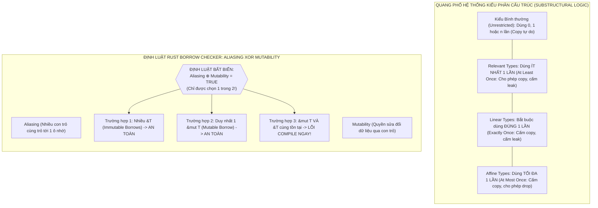
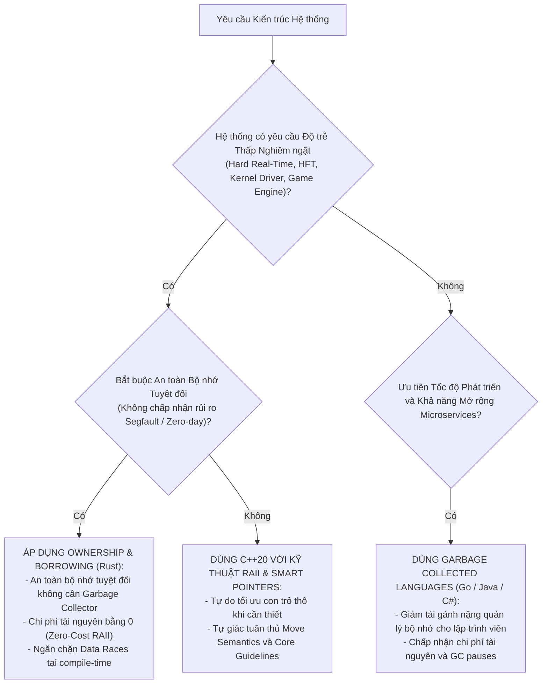

# 3.5. Resource Types, Linear, Affine and Ownership

> [!IMPORTANT]
> **Nếu bạn chỉ được nhớ một điều duy nhất:** Trong nửa thế kỷ phát triển của khoa học máy tính, nhân loại đã phải lựa chọn giữa hai thái cực đau đớn: hoặc tự quản lý bộ nhớ thủ công và hứng chịu thảm họa rò rỉ vùng nhớ, Use-After-Free (C/C++); hoặc chấp nhận hy sinh từ 20% đến 50% thông lượng hệ thống để chạy bộ thu gom rác (Garbage Collector - Java/Go). Hệ thống kiểu tài nguyên phân cấu trúc (**Substructural Type Systems**) kết hợp giữa **Affine Types** và **Hệ thống Sở hữu & Mượn (Ownership & Borrowing System)** đã giải quyết dứt điểm nghịch lý này: Quản lý bộ nhớ an toàn 100% không cần Garbage Collector mà vẫn duy trì được chi phí bằng 0 (**Zero-Cost Abstractions**) thông qua một định luật vi kiến trúc bất biến: **Aliasing XOR Mutability** (Chia sẻ hoặc Biến đổi, nhưng tuyệt đối không bao giờ cả hai cùng lúc!).

---

## 1. Kiến trúc Tổng quan & Mô hình Tư duy (Mental Model)

### Ẩn dụ Đời sống: Vé Lên Máy Bay vs Cuốn Sách Thư Viện
Hãy tưởng tượng việc quản lý hai loại tài sản quý giá:
1. **Linear / Affine Types (Chiếc Vé Máy Bay Dùng Một Lần)**:
   - Khi bạn mua một chiếc vé máy bay thương gia (Resource Token).
   - Bạn **không thể photocopy chiếc vé** đó để đưa cho bạn bè cùng bay (No Duplication / No Contraction).
   - Khi bạn đưa vé cho nhân viên an ninh tại cửa khởi hành (Consume / Move), chiếc vé bị xé đôi và vô hiệu hóa vĩnh viễn. Bạn không thể quay lại dùng chiếc vé đó một lần thứ hai (No Use-After-Move).
   - Nếu là **Linear Type**: Bạn bắt buộc phải lên máy bay dùng vé, nếu xé vé vứt đi thì máy bay không thể cất cánh (Bắt buộc dùng đúng 1 lần - Exactly Once).
   - Nếu là **Affine Type**: Bạn có quyền vứt vé vào thùng rác nếu bận đột xuất (Dùng tối đa 1 lần - At Most Once, tự động kích hoạt Destructor/Drop).
2. **Ownership & Borrowing (Quy tắc Mượn Sách Quý Thư Viện)**:
   - Thư viện sở hữu cuốn bách khoa toàn thư độc bản duy nhất (**Owner**).
   - *Tham chiếu Bất biến (Immutable Borrow `&T` - Đọc tại chỗ)*: Thư viện cho phép 100 sinh viên cùng ngồi đọc cuốn sách đó tại bàn tròn. Vì mọi người chỉ đọc mà không ai được cầm bút tẩy xóa, việc 100 người cùng đọc hoàn toàn an toàn và không bao giờ xảy ra xung đột (No Data Races).
   - *Tham chiếu Khả biến (Mutable Borrow `&mut T` - Độc quyền Tu sửa)*: Khi cuốn sách bị rách gáy, thư viện giao cuốn sách cho duy nhất MỘT chuyên gia phục chế mang vào phòng kín để dán lại. Trong lúc người thợ phục chế đang cầm sách, thư viện **tuyệt đối cấm** không cho bất kỳ sinh viên nào khác bước vào đọc hoặc chạm vào cuốn sách (Exclusive Access).
   - *Định luật Sắt*: Độc quyền ghi **HOẶC** Chia sẻ đọc, không bao giờ xảy ra đồng thời!



---

## 2. Chi tiết từng Keyword (Under-the-Hood Deep Dive)

### 2.1. Linear Types & Affine Types (Substructural Type Systems)
Trong logic học cổ điển và các ngôn ngữ lập trình thông thường, một biến sau khi được tạo ra có thể được sử dụng bao nhiêu lần tùy thích (hoặc không dùng lần nào). Lý thuyết Logic Tuyến tính (Linear Logic - Jean-Yves Girard, 1987) đặt ra các ràng buộc cấu trúc (**Structural Rules**) đối với việc sử dụng giả thiết:
- **Ba Quy tắc Cấu trúc Cổ điển**:
  1. *Weakening (Làm yếu)*: Cho phép bỏ rơi một giả thiết mà không cần dùng đến (tương ứng với việc vứt bỏ một biến không dùng).
  2. *Contraction (Thu hẹp)*: Cho phép nhân bản một giả thiết thành nhiều bản sao (tương ứng với việc sao chép biến: Deep Copy / Duplicate).
  3. *Exchange (Hoán vị)*: Cho phép thay đổi thứ tự sử dụng các biến.
- **Phân loại Hệ thống Kiểu Phân cấu trúc (Substructural Types)**:
  - **Linear Types (Kiểu Tuyến tính - Bỏ cả Weakening và Contraction)**:
    - Một tài nguyên có kiểu Linear bắt buộc phải được tiêu thụ **ĐÚNG MỘT LẦN (Exactly Once)** trên mọi nhánh rẽ thực thi của chương trình.
    - Bạn không thể sao chép nó, và bạn **KHÔNG THỂ BỎ RƠI NÓ** (Không được phép ra khỏi scope mà không gọi hàm tiêu thụ).
    - *Ứng dụng*: Mô phỏng hoàn hảo các tài nguyên không được phép rò rỉ: File Descriptor (phải gọi `close()`), Khóa Mutex (phải gọi `unlock()`), Giao dịch Ngân hàng (phải gọi `commit()` hoặc `rollback()`).
  - **Affine Types (Kiểu Ái hữu - Bỏ Contraction, Giữ Weakening)**:
    - Một tài nguyên được phép sử dụng **TỐI ĐA MỘT LẦN (At Most Once)**.
    - Không thể sao chép ngầm (Không có `Copy`), khi chuyển giao quyền sở hữu thì biến cũ bị vô hiệu hóa lập tức (**Move Semantics**).
    - Tuy nhiên, nếu biến đi ra khỏi scope mà không được sử dụng, hệ thống cho phép tự động giải phóng nó một cách an toàn thông qua hàm hủy (**Destructor / Drop**).
    - Đây chính là nền tảng cốt lõi của ngôn ngữ **Rust**.

### 2.2. Ownership, Borrowing, Lifetime System & Region-Based Allocation
- **Quyền Sở Hữu (Ownership Model)**:
  - Mỗi giá trị trong bộ nhớ chỉ có **duy nhất một biến chủ sở hữu (Single Owner)** tại một thời điểm.
  - Khi chủ sở hữu đi ra khỏi phạm vi hoạt động (Out of Scope), vùng nhớ của giá trị đó sẽ được tự động giải phóng ngay lập tức trên Call Stack hoặc Heap mà không cần quét Garbage Collector (Nguyên lý RAII).
- **Mượn Dữ Liệu (Borrowing) & Định luật Aliasing XOR Mutability**:
  - Chủ sở hữu có thể tạm thời cho các thành phần khác mượn quyền truy cập thông qua các con trỏ tham chiếu (References):
    - *Immutable Reference (`&T`)*: Cho phép đọc dữ liệu. Có thể tạo vô số bản sao mượn đọc đồng thời.
    - *Mutable Reference (`&mut T`)*: Cho phép sửa đổi dữ liệu. Chỉ được phép tồn tại duy nhất một tham chiếu sửa đổi tại một thời điểm, và trong thời gian đó cấm toàn bộ mọi tham chiếu đọc khác.
  - *Ý nghĩa Vi kiến trúc Cực lớn*: Định luật này triệt tiêu hoàn toàn lỗi **Iterator Invalidation** trong C++ (sửa mảng trong lúc đang duyệt mảng) và đảm bảo an toàn tuyệt đối cho kiến trúc đa lõi không bị Data Races ở cấp phần cứng!
- **Hệ thống Vòng đời (Lifetimes - `'a`) & Non-Lexical Lifetimes (NLL)**:
  - Lifetime là khoảng thời gian mà một tham chiếu được đảm bảo trỏ tới một vùng nhớ còn sống và hợp lệ.
  - Trình biên dịch (Borrow Checker) sử dụng thuật toán phân tích đồ thị luồng điều khiển (Control Flow Graph - CFG) để chứng minh rằng: **Thời gian sống của tham chiếu không bao giờ được dài hơn thời gian sống của đối tượng gốc bị mượn**!
  - Triệt tiêu 100% lỗi kinh điển **Dangling Pointer** (Con trỏ treo trỏ vào ngăn xếp đã bị hủy).
- **Phân bổ Dựa trên Vùng (Region-Based Allocation / Arena Memory)**:
  - Thay vì cấp phát và giải phóng từng object nhỏ lẻ bằng `malloc`/`free` trên Heap gây phân mảnh bộ nhớ:
  - Toàn bộ các đối tượng có cùng vòng đời (Lifetime Region) được cấp phát liên tục vào một vùng đệm khổng lồ duy nhất (Arena Buffer). Khi Region kết thúc, toàn bộ hàng triệu đối tượng được giải phóng đồng loạt chỉ bằng một thao tác số học duy nhất: lùi con trỏ đỉnh bộ nhớ (Reset Offset) trong đúng 1 chu kỳ CPU!

---

## 3. Thực thi Mã nguồn & Mô phỏng Chuyên sâu (Dual-Engine Implementation)

### 3.1. Engine 1: C++20 Move-Only Affine Resource Handle & Linear Token Simulator
Chương trình C++20 mô phỏng:
1. Kiểu **Affine Type** qua lớp bao bọc Move-Only Resource Handle, ngăn chặn triệt để việc Copy và bắt lỗi truy cập sau khi Move (Use-After-Move).
2. Kiểu **Linear Type Token** mô phỏng giao dịch ngân hàng bắt buộc phải được tiêu thụ bằng hàm `commit()` hoặc `abort()`, nếu bỏ rơi (Leak) sẽ ném lỗi crash chương trình ngay tại hàm hủy!

```cpp
// compile: g++ -std=c++20 -O3 -pthread affine_linear_demo.cpp -o affine_linear_demo
#include <iostream>
#include <utility>
#include <string>
#include <stdexcept>
#include <cassert>
#include <iomanip>

// ==========================================
// 1. AFFINE TYPE SIMULATOR (AT MOST ONCE)
// ==========================================
// Tài nguyên chỉ được Move, cấm Copy, tự động dọn dẹp khi hết scope
class AffineFileHandle {
    int fd_{-1};

public:
    explicit AffineFileHandle(int fd) : fd_(fd) {
        std::cout << "  [Affine] Khởi tạo Tài nguyên FD: " << fd_ << "\n";
    }

    ~AffineFileHandle() {
        if (fd_ != -1) {
            std::cout << "  [Affine] Tự động giải phóng (Drop) FD: " << fd_ << "\n";
            fd_ = -1;
        }
    }

    // CẤM TUYỆT ĐỐI SAO CHÉP (No Contraction Rule)
    AffineFileHandle(const AffineFileHandle&) = delete;
    AffineFileHandle& operator=(const AffineFileHandle&) = delete;

    // CHO PHÉP MOVE (Chuyển giao quyền sở hữu)
    AffineFileHandle(AffineFileHandle&& other) noexcept : fd_(other.fd_) {
        other.fd_ = -1; // Vô hiệu hóa đối tượng cũ!
    }

    AffineFileHandle& operator=(AffineFileHandle&& other) noexcept {
        if (this != &other) {
            if (fd_ != -1) fd_ = -1;
            fd_ = other.fd_;
            other.fd_ = -1;
        }
        return *this;
    }

    void write_data(const std::string& data) {
        if (fd_ == -1) {
            throw std::runtime_error("LỖI USE-AFTER-MOVE: Cố gắng sử dụng FileHandle đã bị chuyển quyền sở hữu!");
        }
        std::cout << "  [Affine] Ghi dữ liệu \"" << data << "\" vao FD " << fd_ << "\n";
    }
};

// ==========================================
// 2. LINEAR TYPE SIMULATOR (EXACTLY ONCE)
// ==========================================
// Token bắt buộc phải được tiêu thụ bằng commit() hoặc abort(), CẤM ĐỂ LEAK!
class LinearTransactionToken {
    std::string tx_id_{""};
    bool is_consumed_{false};

public:
    explicit LinearTransactionToken(std::string tx_id) : tx_id_(std::move(tx_id)) {
        std::cout << "  [Linear Token] Bắt đầu Giao dịch: " << tx_id_ << "\n";
    }

    ~LinearTransactionToken() {
        // KIỂM TRA QUY TẮC LINEAR: Nếu token bị bỏ rơi mà chưa tiêu thụ -> FATAL ERROR!
        if (!is_consumed_) {
            std::cerr << "  >> VI PHẠM LINEAR TYPE: Giao dịch '" << tx_id_ 
                      << "' bị bỏ rơi mà không commit/abort (Resource Leak Fatal)!\n";
            // Trong hệ thống Linear thuần túy (Idris/Rust), lỗi này bị bắt tại COMPILE-TIME!
        }
    }

    LinearTransactionToken(const LinearTransactionToken&) = delete;
    LinearTransactionToken(LinearTransactionToken&& other) noexcept 
        : tx_id_(std::move(other.tx_id_)), is_consumed_(other.is_consumed_) {
        other.is_consumed_ = true; // Đánh dấu đã move
    }

    // Tiêu thụ tài nguyên (Consume Token)
    void commit() {
        if (is_consumed_) throw std::runtime_error("Token da bi tieu thu!");
        is_consumed_ = true;
        std::cout << "  [Linear Token] COMMIT thành công Giao dịch: " << tx_id_ << "\n";
    }
};

int main() {
    std::cout << "========================================================\n";
    std::cout << "  C++20 AFFINE & LINEAR RESOURCE TYPE ENGINE            \n";
    std::cout << "========================================================\n\n";

    // 1. Thử nghiệm Affine Types (Move Semantics)
    std::cout << "[Step 1] Kiểm tra Affine Type (At Most Once):\n";
    {
        AffineFileHandle handle1(101);
        handle1.write_data("Payload v1");

        // Chuyển quyền sở hữu (Move)
        AffineFileHandle handle2 = std::move(handle1);
        handle2.write_data("Payload v2");

        // Kiểm tra an toàn bắt lỗi Use-After-Move
        try {
            handle1.write_data("Malicious write after move");
        } catch (const std::exception& e) {
            std::cout << "  >> BẮT LỖI THÀNH CÔNG: " << e.what() << "\n";
        }
    } // handle2 tự động Drop tại đây

    // 2. Thử nghiệm Linear Types (Exactly Once)
    std::cout << "\n--------------------------------------------------------\n";
    std::cout << "[Step 2] Kiểm tra Linear Type Token (Exactly Once):\n";
    {
        LinearTransactionToken tx("TX_BANK_TRANSFER_999");
        tx.commit(); // Tiêu thụ hợp lệ
    }

    std::cout << "\n[Step 3] Thử nghiệm Vi phạm Linear Type (Bỏ rơi không tiêu thụ):\n";
    {
        LinearTransactionToken leaky_tx("TX_LEAKED_UNCOMMITTED");
        // Quên không gọi commit()! Hàm hủy sẽ phát hiện vi phạm quy tắc Linear!
    }

    std::cout << "========================================================\n";
    return 0;
}
```

### 3.2. Engine 2: Python 3.11+ Borrow Checker & Aliasing XOR Mutability Simulator
Trình mô phỏng hoạt động bên trong của trình kiểm tra mượn (Borrow Checker), quản lý bảng trạng thái các tham chiếu đồng thời và cưỡng chế quy tắc Aliasing XOR Mutability.

```python
#!/usr/bin/env python3
"""
Rust Borrow Checker & Aliasing XOR Mutability Simulator (Python 3.11+)
Mo phong quy trinh kiem tra quyen so huu, mieu muon doc va muon ghi tai Compile-time
"""
from typing import Dict, List, Optional
from dataclasses import dataclass

@dataclass
class BorrowRecord:
    borrower_name: str
    is_mutable: bool
    scope_lifetime: int

class MemoryBorrowChecker:
    def __init__(self):
        # Bang theo doi: resource_name -> List[BorrowRecord]
        self.active_borrows: Dict[str, List[BorrowRecord]] = {}

    def allocate_resource(self, resource_name: str):
        self.active_borrows[resource_name] = []
        print(f"  [Allocate] Khởi tạo tài nguyên mới với Owner độc quyền: '{resource_name}'")

    def borrow_immutable(self, resource_name: str, borrower: str, lifetime: int) -> bool:
        """Thực hiện Mượn Bất biến (&T)."""
        borrows = self.active_borrows.get(resource_name, [])
        
        # KIỂM TRA ĐỊNH LUẬT ALIASING XOR MUTABILITY:
        # Nếu đang có một tham chiếu Mutable (&mut T), cấm mượn đọc!
        for b in borrows:
            if b.is_mutable:
                print(f"  >> LỖI BORROW CHECKER: Không thể mượn đọc '{resource_name}' qua '{borrower}' "
                      f"vì đang bị khóa độc quyền bởi Mutable Borrow '{b.borrower_name}'!")
                return False

        borrows.append(BorrowRecord(borrower, is_mutable=False, scope_lifetime=lifetime))
        print(f"  [Borrow Shared &T] '{borrower}' mượn đọc thành công '{resource_name}' (Tổng người đọc: {len(borrows)})")
        return True

    def borrow_mutable(self, resource_name: str, borrower: str, lifetime: int) -> bool:
        """Thực hiện Mượn Khả biến (&mut T)."""
        borrows = self.active_borrows.get(resource_name, [])
        
        # Nếu đang có BẤT KỲ ai đang mượn (đọc hoặc ghi), cấm mượn ghi độc quyền!
        if len(borrows) > 0:
            print(f"  >> LỖI BORROW CHECKER: Không thể mượn ghi '&mut {resource_name}' qua '{borrower}' "
                  f"vì tài nguyên đang bị chia sẻ bởi {len(borrows)} tham chiếu khác!")
            return False

        borrows.append(BorrowRecord(borrower, is_mutable=True, scope_lifetime=lifetime))
        print(f"  [Borrow Exclusive &mut T] '{borrower}' chiếm độc quyền sửa đổi '{resource_name}' thành công!")
        return True

    def release_scope(self, current_lifetime: int):
        """Dọn dẹp các mượn đã hết vòng đời (Out of Scope)."""
        for res, borrows in self.active_borrows.items():
            self.active_borrows[res] = [b for b in borrows if b.scope_lifetime > current_lifetime]

def main():
    print("==================================================================")
    print("      RUST BORROW CHECKER & ALIASING SIMULATOR (PYTHON 3.11)      ")
    print("==================================================================")

    checker = MemoryBorrowChecker()
    checker.allocate_resource("UserBuffer")

    print("\n[Kịch bản 1] Nhiều tham chiếu mượn đọc đồng thời (&T):")
    checker.borrow_immutable("UserBuffer", "Reader_A", lifetime=2)
    checker.borrow_immutable("UserBuffer", "Reader_B", lifetime=2)

    print("\n[Kịch bản 2] Cố gắng mượn ghi (&mut T) trong lúc đang bị đọc:")
    checker.borrow_mutable("UserBuffer", "Writer_C", lifetime=2) # Thất bại!

    print("\n[Kịch bản 3] Vòng đời kết thúc, dọn dẹp các Reader:")
    checker.release_scope(current_lifetime=2)
    print("  Đã giải phóng scope của Reader_A và Reader_B.")

    print("\n[Kịch bản 4] Mượn ghi độc quyền thành công sau khi Reader giải phóng:")
    checker.borrow_mutable("UserBuffer", "Writer_C", lifetime=3) # Thành công!

    print("==================================================================")

if __name__ == "__main__":
    main()
```

### 3.3. Terminal Output Mẫu Thực tế
```bash
$ g++ -std=c++20 -O3 -pthread affine_linear_demo.cpp -o affine_linear_demo
$ ./affine_linear_demo
========================================================
  C++20 AFFINE & LINEAR RESOURCE TYPE ENGINE            
========================================================

[Step 1] Kiểm tra Affine Type (At Most Once):
  [Affine] Khởi tạo Tài nguyên FD: 101
  [Affine] Ghi dữ liệu "Payload v1" vao FD 101
  [Affine] Ghi dữ liệu "Payload v2" vao FD 101
  >> BẮT LỖI THÀNH CÔNG: LỖI USE-AFTER-MOVE: Cố gắng sử dụng FileHandle đã bị chuyển quyền sở hữu!
  [Affine] Tự động giải phóng (Drop) FD: 101

--------------------------------------------------------
[Step 2] Kiểm tra Linear Type Token (Exactly Once):
  [Linear Token] Bắt đầu Giao dịch: TX_BANK_TRANSFER_999
  [Linear Token] COMMIT thành công Giao dịch: TX_BANK_TRANSFER_999

[Step 3] Thử nghiệm Vi phạm Linear Type (Bỏ rơi không tiêu thụ):
  [Linear Token] Bắt đầu Giao dịch: TX_LEAKED_UNCOMMITTED
  >> VI PHẠM LINEAR TYPE: Giao dịch 'TX_LEAKED_UNCOMMITTED' bị bỏ rơi mà không commit/abort (Resource Leak Fatal)!
========================================================

$ python3 borrow_checker_sim.py
==================================================================
      RUST BORROW CHECKER & ALIASING SIMULATOR (PYTHON 3.11)      
==================================================================
  [Allocate] Khởi tạo tài nguyên mới với Owner độc quyền: 'UserBuffer'

[Kịch bản 1] Nhiều tham chiếu mượn đọc đồng thời (&T):
  [Borrow Shared &T] 'Reader_A' mượn đọc thành công 'UserBuffer' (Tổng người đọc: 1)
  [Borrow Shared &T] 'Reader_B' mượn đọc thành công 'UserBuffer' (Tổng người đọc: 2)

[Kịch bản 2] Cố gắng mượn ghi (&mut T) trong lúc đang bị đọc:
  >> LỖI BORROW CHECKER: Không thể mượn ghi '&mut UserBuffer' qua 'Writer_C' vì tài nguyên đang bị chia sẻ bởi 2 tham chiếu khác!

[Kịch bản 3] Vòng đời kết thúc, dọn dẹp các Reader:
  Đã giải phóng scope của Reader_A và Reader_B.

[Kịch bản 4] Mượn ghi độc quyền thành công sau khi Reader giải phóng:
  [Borrow Exclusive &mut T] 'Writer_C' chiếm độc quyền sửa đổi 'UserBuffer' thành công!
==================================================================
```

---

## 4. Systems Engineering & Production Pitfalls

### 4.1. "Fighting the Borrow Checker" và Cạm bẫy Tự Chuyển Sang `Rc<RefCell<T>>`
- **Hiện tượng**: Khi lập trình viên mới chuyển từ Java/C++ sang Rust, họ thường xuyên bị Borrow Checker từ chối biên dịch khi thiết kế các cấu trúc dữ liệu đồ thị có con trỏ vòng (Cyclic Graph / Doubly-Linked List).
- **Hành vi Sai lầm**: Thay vì tái cấu trúc lại quyền sở hữu sang mô hình chỉ số mảng (Index-based Arena), lập trình viên bao bọc mọi thứ trong `Rc<RefCell<T>>` (Reference Counting + Runtime Borrow Checking).
- **Hậu quả Production**:
  - Biến các kiểm tra an toàn tại compile-time thành các phép kiểm tra runtime đắt đỏ.
  - Vô hiệu hóa tính an toàn đa luồng (`Rc` không an toàn đa luồng).
  - Vẫn có thể tạo ra rò rỉ bộ nhớ thực tế thông qua **Reference Cycles** (vòng tham chiếu chéo không bao giờ giải phóng được).

### 4.2. Cạm bẫy Bỏ qua Hàm Hủy Tự Động trong Hệ Thống Affine (Resource Exhaustion)
- **Bản chất**: Affine Type cho phép đối tượng bị drop khi đi ra khỏi scope. Tuy nhiên, nếu một tiến trình tạo ra hàng triệu đối tượng giữ File Descriptor hoặc Socket trong một vòng lặp vô hạn mà không giải phóng kịp thời (ví dụ: các biến tạm bị giữ lại trong một hàm quá lớn), hệ điều hành sẽ cạn kiệt tài nguyên File Descriptors (`EMFILE - Too many open files`) trước khi bộ dọn dẹp kịp chạy!

---

## 5. Bảng So sánh & Decision Matrix

### 5.1. So sánh Các Cơ chế Quản lý Bộ nhớ và Tài nguyên

| Tiêu chuẩn So sánh | Quản lý Thủ công (C / C++) | Garbage Collection (Java / Go) | Ownership & Borrowing (Rust) |
| :--- | :--- | :--- | :--- |
| **An toàn Bộ nhớ** | **Rất thấp (Dễ Use-after-free, Double-free)** | Cao (Không dangling pointers) | **Tuyệt đối (Chứng minh tại Compile-time)**|
| **Độ trễ Thực thi (Latency)**| Cực thấp, xác định (Deterministic) | **Không xác định (Stop-The-World Pauses)**| **Cực thấp, xác định (Zero Runtime Overhead)**|
| **Tiêu tốn Bộ nhớ (Memory Overhead)**| Thấp nhất | **Cao (Tốn 1.5x - 3x RAM để GC hoạt động)** | **Thấp nhất (Không metadata runtime)**|
| **Ngăn chặn Data Races** | Không bảo vệ | Chỉ bảo vệ một phần (Vẫn dính race)| **Miễn nhiễm 100% nhờ Aliasing XOR Mutability**|
| **Đường cong Học tập** | Trung bình | Rất dễ, phát triển nhanh | Rất dốc (Đòi hỏi hiểu sâu Borrow Checker) |

### 5.2. Decision Matrix: Khi nào Cần Hệ thống Kiểu Phân cấu trúc?


