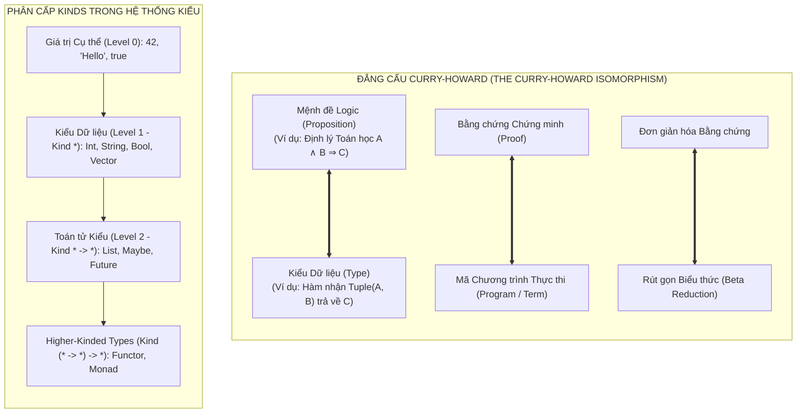
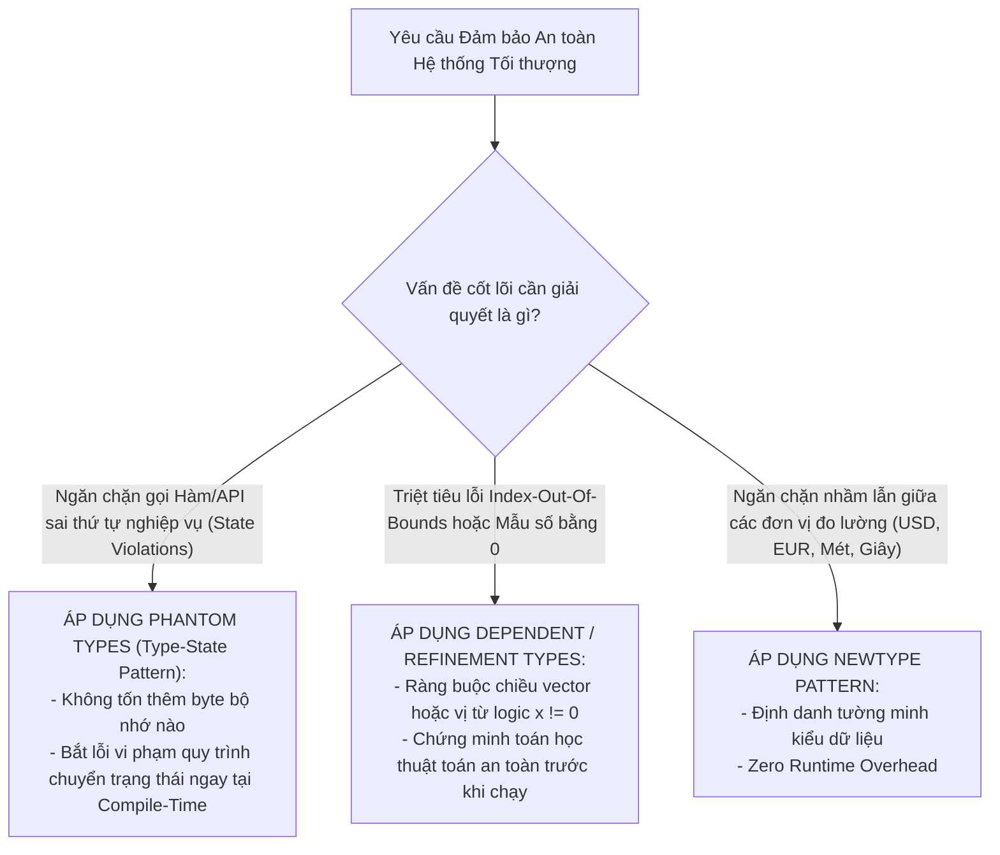

# 3.6. Advanced Type-Theoretic Constructs

> [!IMPORTANT]
> **Nếu bạn chỉ được nhớ một điều duy nhất:** Đỉnh cao của Lý thuyết Kiểu hiện đại là sự xóa nhòa ranh giới giữa Mã nguồn và Bằng chứng Toán học thông qua **Đẳng cấu Curry-Howard (Curry-Howard Isomorphism: Mệnh đề là Kiểu, Chương trình là Bằng chứng - Propositions as Types, Proofs as Programs)**. **Dependent Types** cho phép kiểu dữ liệu phụ thuộc trực tiếp vào giá trị thời điểm chạy (như kiểu Vector độ dài $N$ đảm bảo không bao giờ bị lỗi Out-of-Bounds tại compile-time); trong khi **Phantom Types (Kiểu Ma)** mã hóa toàn bộ Máy trạng thái hữu hạn (Finite State Machine) lên hệ thống kiểu với chi phí bộ nhớ và CPU bằng đúng 0 (**Zero Runtime Cost**), biến các lỗi gọi API sai thứ tự thành lỗi từ chối biên dịch ngay lập tức!

---

## 1. Kiến trúc Tổng quan & Mô hình Tư duy (Mental Model)

### Ẩn dụ Đời sống: Thước Đo Tùy Biến và Chiếc Tem Niêm Phong Vô Hình
Hãy tưởng tượng quy trình sản xuất và vận hành trong một nhà máy công nghệ vũ trụ:
1. **Dependent Types (Thước Đo Tự Động Định Cỡ Tuyệt Đối)**:
   - Trong lập trình thông thường, một mảng chỉ có kiểu là "Danh sách Số nguyên" (`List[Int]`). Bạn không thể biết mảng có 0, 5 hay 1 triệu phần tử cho đến khi chạy thực tế.
   - Với Dependent Types, kiểu dữ liệu gắn liền với giá trị độ dài: $\text{Vector}(N)$.
   - Khi bạn viết hàm ghép hai mảng: $\text{concat}: \text{Vector}(N) \times \text{Vector}(M) \to \text{Vector}(N + M)$. Trình biên dịch sẽ thực hiện phép toán đại số ngay tại compile-time. Nếu bạn cố gắng truy cập phần tử thứ 10 của một $\text{Vector}(5)$, chương trình **không thể biên dịch được**! Lỗi Index-Out-Of-Bounds bị tiêu diệt vĩnh viễn trước khi mã máy được sinh ra.
2. **Phantom Types (Chiếc Tem Kiểm Định Vô Hình / Type-State Pattern)**:
   - Bạn có một văn bản hợp đồng. Về mặt vật lý, tờ giấy vẫn là một tập hợp các ký tự văn bản thuần túy (Không tốn thêm bất kỳ byte nào trong bộ nhớ).
   - Tuy nhiên, hệ thống dán lên nó một chiếc tem vô hình: `Contract<Draft>`.
   - Hàm `sign_contract()` yêu cầu đầu vào bắt buộc phải mang tem `Contract<Draft>` và trả về văn bản mang tem `Contract<Signed>`.
   - Hàm `send_payment()` chỉ chấp nhận văn bản mang tem `Contract<Signed>`.
   - Nếu bạn cố tình gửi tiền khi hợp đồng vẫn ở trạng thái `Draft`, trình biên dịch sẽ từ chối ngay lập tức! Chiếc tem vô hình này biến mất hoàn toàn khi sinh mã máy, mang lại sự an toàn tuyệt đối với chi phí runtime bằng 0.



---

## 2. Chi tiết từng Keyword (Under-the-Hood Deep Dive)

### 2.1. Refinement Types, Dependent Types & Higher-Kinded Types (HKT)
- **Kiểu Phụ thuộc (Dependent Types - $\Pi$-Types & $\Sigma$-Types)**:
  - Khái niệm: Cho phép một Kiểu phụ thuộc trực tiếp vào một Giá trị cụ thể ($T(v)$).
  - *$\Pi$-Type (Dependent Function / Dependent Product Type)*:
    Là sự tổng quát hóa của kiểu hàm $A \to B$. Kiểu dữ liệu trả về của hàm phụ thuộc vào giá trị của đối số truyền vào:
    $$f: \Pi_{(x: A)} B(x)$$
    *Ví dụ*: Hàm `make_buffer(n: Nat) -> Buffer(n)` (trả về kiểu Buffer có kích thước đúng bằng $n$).
  - *$\Sigma$-Type (Dependent Pair / Dependent Sum Type)*:
    Là sự tổng quát hóa của kiểu cặp (Tuple). Thành phần thứ hai có kiểu phụ thuộc vào giá trị của thành phần thứ nhất:
    $$\Sigma_{(x: A)} B(x)$$
    *Ví dụ*: Cặp gồm một số nguyên $n$ và một mảng có độ dài đúng bằng $n$.
  - *Ngôn ngữ Tiên phong*: Idris, Agda, Coq, Lean.
- **Refinement Types (Kiểu Tinh chỉnh - Liquid Types)**:
  - Cho phép kết hợp một kiểu cơ sở với một **vị từ logic (Logical Predicate)** được giải quyết tự động thông qua bộ giải SMT (như Z3):
    $$\{v: \text{Int} \mid v > 0\} \quad \text{(Kiểu số nguyên dương)}$$
    $$\{v: \text{Int} \mid v \ne 0\} \quad \text{(Kiểu mẫu số an toàn, triệt tiêu lỗi chia cho 0!)}$$
  - Khi bạn gọi hàm `divide(a: Int, b: {v: Int | v != 0})`, trình kiểm tra kiểu tinh chỉnh (như LiquidHaskell) sẽ dùng SMT Solver để chứng minh toán học rằng đối số thứ hai không bao giờ bằng 0 tại compile-time!
- **Higher-Kinded Types (HKT - Kiểu Cấp cao)**:
  - Giống như hàm số nhận giá trị và trả về giá trị, một Type Constructor (như `List`, `Option`) nhận một kiểu và trả về một kiểu mới (Kind: `* -> *`).
  - HKT cho phép trừu tượng hóa trên chính các Type Constructor này (Kind: `(* -> *) -> *`):
    *Ví dụ*: Khái niệm toán học `Functor<F>` hoặc `Monad<F>` có thể áp dụng đồng thời cho `List<T>`, `Option<T>`, `Future<T>` mà không cần lặp lại mã nguồn.

### 2.2. Universal, Existential, Phantom Types, Newtypes & Type-Level Programming
- **Universal Types ($\forall X. T$) vs Existential Types ($\exists X. T$)**:
  - *Universal Types (Parametric Polymorphism)*: "Với MỌI kiểu $X$, tôi có thể cung cấp một hàm thao tác trên $X$":
    $$\text{id}: \forall X. X \to X$$
    Người gọi hàm có quyền quyết định $X$ là kiểu gì.
  - *Existential Types (Trừu tượng hóa Dữ liệu / Data Hiding)*: "TỒN TẠI một kiểu ẩn $X$ bên trong, bạn không được biết $X$ là gì, bạn chỉ được phép tương tác với nó qua tập hợp các hàm tôi cung cấp":
    $$\text{Module} = \exists X. \{ \text{state}: X, \text{step}: X \to X, \text{read}: X \to \text{Int} \}$$
    Đây chính là nền tảng toán học của Tính bao gói (Encapsulation) và Đối tượng (Objects).
- **Phantom Types (Kiểu Ma) & Type-State Pattern**:
  - Một struct tổng quát `struct MyHandle<State>` chứa tham số kiểu `State`, nhưng trong cấu trúc bộ nhớ vật lý của struct **hoàn toàn không có bất kỳ trường nào mang kiểu `State`**!
  - `State` thuần túy là một nhãn đánh dấu (Marker Tag) để trình biên dịch kiểm tra tính hợp lệ của Máy trạng thái (Type-State Pattern).
  - *Hiệu năng*: Kích thước `sizeof(MyHandle<State>)` bằng đúng kích thước của con trỏ nội bộ. Zero Memory Overhead!
- **Newtypes (Kỹ thuật Kiểu mới)**:
  - Bao bọc một kiểu dữ liệu có sẵn bằng một kiểu danh nghĩa (Nominal Type) mới: `struct Meters(double);`, `struct Seconds(double);`.
  - Ngăn chặn lỗi kinh điển như vụ nổ tàu vũ trụ Mars Climate Orbiter (do nhầm lẫn giữa đơn vị Pound-force và Newton) mà không tốn thêm bất kỳ byte RAM nào tại runtime.
- **Lập trình Mức Kiểu (Type-Level Programming)**:
  - Biến hệ thống kiểu thành một ngôn ngữ lập trình Turing-Complete chạy bên trong trình biên dịch (như C++ Template Metaprogramming hoặc TypeScript Type-Level System). Bạn có thể viết các phép tính số học, sắp xếp danh sách kiểu, và kiểm tra ngữ nghĩa ngay trong quá trình build!

---

## 3. Thực thi Mã nguồn & Mô phỏng Chuyên sâu (Dual-Engine Implementation)

### 3.1. Engine 1: C++20 Phantom Types Type-State Machine & Dependent Dimensions
Chương trình C++20 kết hợp:
1. **Type-State Pattern bằng Phantom Types**: Mã hóa máy trạng thái kết nối mạng (`Disconnected` $\to$ `Connected` $\to$ `Authenticated`) ngăn chặn việc gửi dữ liệu khi chưa xác thực ngay tại compile-time với chi phí 0 byte runtime.
2. Mô phỏng **Dependent Dimensions** qua Non-Type Template Parameters (`std::array` phép nhân ma trận kích thước cố định bắt lỗi nhân sai chiều tại compile-time).

```cpp
// compile: g++ -std=c++20 -O3 phantom_typestate_demo.cpp -o phantom_typestate_demo
#include <iostream>
#include <string>
#include <array>
#include <cstdint>
#include <iomanip>

// ==========================================
// 1. PHANTOM TYPES & TYPE-STATE PATTERN
// ==========================================
// Các Phantom Tag thuần túy (Không có dữ liệu, size = 1B empty)
struct StateDisconnected {};
struct StateConnected {};
struct StateAuthenticated {};

// Lớp Socket mang tham số Phantom Type 'State'
template<typename State>
class NetworkSocket {
    int socket_fd_{-1};

    // Hàm dựng private để chỉ có các hàm chuyển trạng thái hợp lệ mới gọi được
    explicit NetworkSocket(int fd) : socket_fd_(fd) {}
    friend class NetworkSocket<StateDisconnected>;
    friend class NetworkSocket<StateConnected>;

public:
    // Khởi tạo ở trạng thái ban đầu: Disconnected
    static NetworkSocket<StateDisconnected> create() {
        std::cout << "  [Socket Engine] Tạo mới Socket (Trạng thái: Disconnected)\n";
        return NetworkSocket<StateDisconnected>(42);
    }

    // Chuyển trạng thái: Disconnected -> Connected
    NetworkSocket<StateConnected> connect_to_server(const std::string& host) && {
        static_assert(std::is_same_v<State, StateDisconnected>, "Chi co the connect khi dang Disconnected!");
        std::cout << "  [Socket Engine] Đã kết nối tới " << host << " -> Chuyển sang State: Connected\n";
        return NetworkSocket<StateConnected>(socket_fd_);
    }

    // Chuyển trạng thái: Connected -> Authenticated
    NetworkSocket<StateAuthenticated> authenticate(const std::string& token) && {
        static_assert(std::is_same_v<State, StateConnected>, "Chi co the authenticate sau khi da connect!");
        std::cout << "  [Socket Engine] Xác thực thành công Token -> Chuyển sang State: Authenticated\n";
        return NetworkSocket<StateAuthenticated>(socket_fd_);
    }

    // CHỈ CHO PHÉP GỬI DỮ LIỆU KHI ĐANG Ở TRẠNG THÁI Authenticated!
    void send_payload(const std::string& data) const {
        static_assert(std::is_same_v<State, StateAuthenticated>, 
            "LỖI BIÊN DỊCH BẢO VỆ: Không thể gửi dữ liệu khi Socket chưa được Authenticated!");
        std::cout << "  [Socket Engine] GỬI DỮ LIỆU THÀNH CÔNG: \"" << data << "\" qua FD " << socket_fd_ << "\n";
    }
};

// ==========================================
// 2. DEPENDENT MATRIX DIMENSION CHECKER
// ==========================================
template<size_t Rows, size_t Cols>
struct FixedMatrix {
    std::array<double, Rows * Cols> data{};

    // Phép nhân Ma trận: (M x K) * (K x N) -> (M x N)
    // Nếu chiều Cols của ma trận 1 không bằng chiều OtherRows của ma trận 2 -> BÁO LỖI COMPILE NGAY!
    template<size_t OtherRows, size_t OtherCols>
    FixedMatrix<Rows, OtherCols> multiply(const FixedMatrix<OtherRows, OtherCols>& other) const {
        static_assert(Cols == OtherRows, "LỖI KÍCH THƯỚC: Số cột của Ma trận A phải bằng số hàng của Ma trận B!");
        
        FixedMatrix<Rows, OtherCols> result;
        std::cout << "  [Matrix Engine] Nhân Ma trận (" << Rows << "x" << Cols << ") với (" 
                  << OtherRows << "x" << OtherCols << ") -> Ra Ma trận (" << Rows << "x" << OtherCols << ") an toàn!\n";
        return result;
    }
};

int main() {
    std::cout << "========================================================\n";
    std::cout << "  C++20 PHANTOM TYPE-STATE & DEPENDENT DIMENSIONS       \n";
    std::cout << "========================================================\n\n";

    // 1. Kiểm tra Type-State Pattern an toàn 100% tại Compile-Time
    std::cout << "[Step 1] Khảo sát Kích thước Bộ nhớ của Phantom Type:\n";
    std::cout << "  sizeof(NetworkSocket<StateDisconnected>) : " << sizeof(NetworkSocket<StateDisconnected>) << " Bytes\n";
    std::cout << "  sizeof(NetworkSocket<StateAuthenticated>): " << sizeof(NetworkSocket<StateAuthenticated>) << " Bytes\n";
    std::cout << "  -> Zero Memory Overhead! Phantom Tag hoàn toàn biến mất trong mã máy.\n\n";

    std::cout << "[Step 2] Thực thi Chuỗi chuyển trạng thái Hợp lệ:\n";
    auto sock = NetworkSocket<StateDisconnected>::create()
                    .connect_to_server("api.banking.internal")
                    .authenticate("SECURE_JWT_BEARER_TOKEN");

    sock.send_payload("TRANSFER $500,000 TO ACCOUNT #999");

    // Thử nghiệm lỗi nếu bỏ bước authenticate:
    // auto raw_sock = NetworkSocket<StateDisconnected>::create().connect_to_server("api.internal");
    // raw_sock.send_payload("HACK"); // LỖI COMPILE-TIME CHẶN ĐỨNG NGAY: Static assert failed!

    // 2. Kiểm tra Dependent Matrix Multiplications
    std::cout << "\n--------------------------------------------------------\n";
    std::cout << "[Step 3] Kiểm tra Phép nhân Ma trận với Ràng buộc Chiều Phụ thuộc:\n";
    FixedMatrix<2, 3> mat_a; // 2 hàng, 3 cột
    FixedMatrix<3, 4> mat_b; // 3 hàng, 4 cột
    auto mat_c = mat_a.multiply(mat_b); // Hợp lệ!

    // Thử nghiệm nhân sai kích thước:
    // FixedMatrix<4, 5> mat_invalid;
    // mat_a.multiply(mat_invalid); // LỖI COMPILE NGAY: Cols(3) != OtherRows(4)!

    std::cout << "========================================================\n";
    return 0;
}
```

### 3.2. Engine 2: Python 3.11+ Refinement Types SMT Validator Simulator
Trình mô phỏng kiểm tra kiểu tinh chỉnh (Refinement Types Checker), phân tích các vị từ logic số học bảo vệ thuật toán chia số nguyên và truy cập mảng có giới hạn.

```python
#!/usr/bin/env python3
"""
Refinement Types & Pre-condition SMT Simulator (Python 3.11+)
Mo phong Bo kiem tra Kieu Tinh chinh Liquid Types: {v: Int | v != 0}
"""
from typing import Callable, Any

class RefinementTypeViolation(TypeError):
    pass

class RefinedInt:
    """Mo phong kieu Int kem vi tu tinh chinh predicate."""
    def __init__(self, value: int, predicate: Callable[[int], bool], type_name: str):
        if not predicate(value):
            raise RefinementTypeViolation(
                f"Gia tri {value} vi pham vi tu tinh chinh cua kieu '{type_name}'!"
            )
        self.value = value
        self.type_name = type_name

    def __repr__(self):
        return f"{self.type_name}({self.value})"

# 1. Định nghĩa Kiểu Mẫu số Khác 0: NonZeroInt = {v: Int | v != 0}
def NonZeroInt(v: int) -> RefinedInt:
    return RefinedInt(v, lambda x: x != 0, "{v: Int | v != 0}")

# 2. Định nghĩa Kiểu Số nguyên Dương: PositiveInt = {v: Int | v > 0}
def PositiveInt(v: int) -> RefinedInt:
    return RefinedInt(v, lambda x: x > 0, "{v: Int | v > 0}")

# Hàm chia toán học an toàn tuyệt đối (Triệt tiêu lỗi DivisionByZero tại Type-Check time)
def safe_divide(numerator: int, denominator: RefinedInt) -> float:
    # Không cần if denominator == 0 nữa vì hệ thống kiểu bảo đảm nó luôn khác 0!
    return numerator / denominator.value

def main():
    print("==================================================================")
    print("      REFINEMENT TYPES SMT VERIFIER SIMULATOR (PYTHON 3.11)       ")
    print("==================================================================")

    print("[Step 1] Khởi tạo các giá trị thỏa mãn Refinement Predicate:")
    denom_valid = NonZeroInt(5)
    print(f"  Mẫu số hợp lệ: {denom_valid}")
    result = safe_divide(100, denom_valid)
    print(f"  safe_divide(100, {denom_valid}) = {result}\n")

    print("[Step 2] Thử nghiệm Tạo giá trị vi phạm Refinement Predicate:")
    try:
        denom_zero = NonZeroInt(0) # Kích hoạt lỗi Refinement Type ngay lập tức!
        safe_divide(100, denom_zero)
    except RefinementTypeViolation as ex:
        print(f"  >> BẮT LỖI TINH CHỈNH THÀNH CÔNG: {ex}")

    print("\n[Step 3] Kiểm tra Kiểu Số Dương (PositiveInt):")
    try:
        bad_pos = PositiveInt(-42)
    except RefinementTypeViolation as ex:
        print(f"  >> BẮT LỖI TINH CHỈNH THÀNH CÔNG: {ex}")

    print("==================================================================")

if __name__ == "__main__":
    main()
```

### 3.3. Terminal Output Mẫu Thực tế
```bash
$ g++ -std=c++20 -O3 phantom_typestate_demo.cpp -o phantom_typestate_demo
$ ./phantom_typestate_demo
========================================================
  C++20 PHANTOM TYPE-STATE & DEPENDENT DIMENSIONS       
========================================================

[Step 1] Khảo sát Kích thước Bộ nhớ của Phantom Type:
  sizeof(NetworkSocket<StateDisconnected>) : 4 Bytes
  sizeof(NetworkSocket<StateAuthenticated>): 4 Bytes
  -> Zero Memory Overhead! Phantom Tag hoàn toàn biến mất trong mã máy.

[Step 2] Thực thi Chuỗi chuyển trạng thái Hợp lệ:
  [Socket Engine] Tạo mới Socket (Trạng thái: Disconnected)
  [Socket Engine] Đã kết nối tới api.banking.internal -> Chuyển sang State: Connected
  [Socket Engine] Xác thực thành công Token -> Chuyển sang State: Authenticated
  [Socket Engine] GỬI DỮ LIỆU THÀNH CÔNG: "TRANSFER $500,000 TO ACCOUNT #999" qua FD 42

--------------------------------------------------------
[Step 3] Kiểm tra Phép nhân Ma trận với Ràng buộc Chiều Phụ thuộc:
  [Matrix Engine] Nhân Ma trận (2x3) với (3x4) -> Ra Ma trận (2x4) an toàn!
========================================================

$ python3 refinement_sim.py
==================================================================
      REFINEMENT TYPES SMT VERIFIER SIMULATOR (PYTHON 3.11)       
==================================================================
[Step 1] Khởi tạo các giá trị thỏa mãn Refinement Predicate:
  Mẫu số hợp lệ: {v: Int | v != 0}(5)
  safe_divide(100, {v: Int | v != 0}(5)) = 20.0

[Step 2] Thử nghiệm Tạo giá trị vi phạm Refinement Predicate:
  >> BẮT LỖI TINH CHỈNH THÀNH CÔNG: Gia tri 0 vi pham vi tu tinh chinh cua kieu '{v: Int | v != 0}'!

[Step 3] Kiểm tra Kiểu Số Dương (PositiveInt):
  >> BẮT LỖI TINH CHỈNH THÀNH CÔNG: Gia tri -42 vi pham vi tu tinh chinh cua kieu '{v: Int | v > 0}'!
==================================================================
```

---

## 4. Systems Engineering & Production Pitfalls

### 4.1. "Type-Level Recursion Depth Exceeded" Làm Sập Trình Biên Dịch
- **Hiện tượng**: Khi viết các hàm tính toán phức tạp ở mức kiểu dữ liệu trong C++ (Template Metaprogramming) hoặc TypeScript (Advanced Conditional Types), trình biên dịch đột ngột dừng hoạt động và ném lỗi: `fatal error: template instantiation depth exceeds maximum of 1024` (GCC) hoặc `Type instantiation is excessively deep and possibly infinite` (TypeScript).
- **Nguyên nhân**: Lập trình mức kiểu là Turing-Complete. Một biểu thức đệ quy thiếu điều kiện dừng cơ sở sẽ làm trình biên dịch chạy vô tận và cạn kiệt bộ nhớ RAM của máy phát triển.
- **Khắc phục**: Luôn kiểm tra kỹ nhánh cơ sở (Base Case) và tăng giới hạn độ sâu một cách có kiểm soát: `-ftemplate-depth=2048`.

### 4.2. Cạm bẫy Lạm dụng Phantom Types Làm Phức Tạp Hóa API
- **Bản chất**: Kỹ thuật Type-State Pattern rất mạnh mẽ để bảo vệ các giao thức quan trọng (như giao dịch tài chính, trạng thái kết nối socket), nhưng nếu lạm dụng cho mọi CRUD thông thường, số lượng tham số kiểu của hàm sẽ bùng nổ, khiến thông báo lỗi biên dịch dài hàng chục trang và gây cản trở lớn cho các kỹ sư mới gia nhập dự án.

---

## 5. Bảng So sánh & Decision Matrix

### 5.1. So sánh Các Cấu trúc Lý thuyết Kiểu Nâng cao

| Cấu trúc Kiểu | Cơ chế Ràng buộc | Thời điểm Kiểm chứng | Chi phí Bộ nhớ Runtime | Ngôn ngữ Tiêu biểu |
| :--- | :--- | :--- | :--- | :--- |
| **Dependent Types** | Kiểu phụ thuộc trực tiếp vào Giá trị | **Compile-Time** | 0 (Được xóa khi sinh mã máy) | Idris, Agda, Coq, Lean |
| **Refinement Types**| Kiểu kết hợp Vị từ logic qua SMT Solver | **Compile-Time** | 0 | LiquidHaskell, F* |
| **Phantom Types** | Nhãn kiểu ma hóa máy trạng thái | **Compile-Time** | **0 Byte (Zero Overhead)** | C++, Rust, OCaml, Haskell |
| **Newtypes** | Bọc kiểu cơ sở thành kiểu định danh mới | **Compile-Time** | **0 Byte (Mã máy như kiểu gốc)**| Rust (`struct Id(u64)`), Haskell |
| **Higher-Kinded Types**| Trừu tượng hóa trên Type Constructors | **Compile-Time** | 0 | Haskell, Scala |

### 5.2. Decision Matrix: Khi nào Cần Sử dụng Các Kỹ thuật Nâng cao Này?


