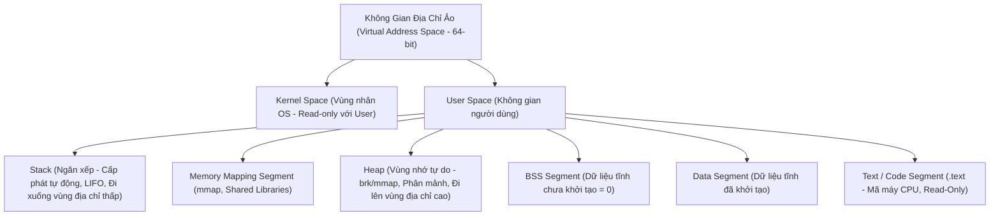
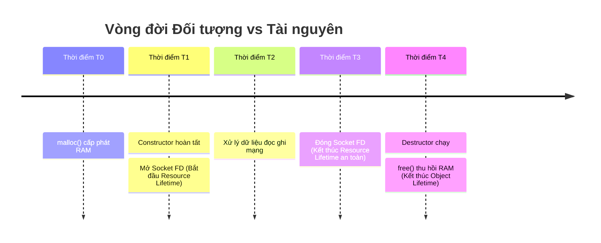

# 4.1. Phân Bổ Bộ Nhớ và Bố Cục Không Gian Địa Chỉ (Memory Allocation & Layouts)

## Tổng quan về Memory Allocation & Layouts
Bộ nhớ là tài nguyên vật lý hữu hạn và quan trọng nhất của hệ thống tính toán. Cách thức một ngôn ngữ lập trình tổ chức, cấp phát và thu hồi các vùng nhớ quyết định trực tiếp đến độ trễ truy xuất (Latency), thông lượng (Throughput) và tính ổn định của ứng dụng. Mọi chương trình thực thi đều vận hành trong một không gian địa chỉ ảo (Virtual Address Space) do Hệ điều hành và MMU quản lý.



---

## 2. Chi tiết từng Keyword (Under-the-Hood Deep Dive)

---

### 1. Stack Allocation, Heap Allocation & Static Allocation

#### 1. Khái niệm bản chất (What & Why)
Ba chiến lược cấp phát bộ nhớ nền tảng trong mọi ngôn ngữ:
- **Static Allocation (Cấp phát tĩnh)**: Bộ nhớ được cấp phát cố định một lần duy nhất tại thời điểm biên dịch hoặc nạp file nhị phân vào RAM (Data Segment / BSS Segment). Tồn tại trong suốt toàn bộ vòng đời của tiến trình.
- **Stack Allocation (Cấp phát trên ngăn xếp)**: Bộ nhớ dành cho biến cục bộ và khung hàm (Stack Frames). Vận hành theo nguyên tắc LIFO (Last-In First-Out). Tốc độ cấp phát siêu nhanh (chỉ bằng 1 lệnh dịch con trỏ CPU `RSP`). Tự động giải phóng khi hàm kết thúc.
- **Heap Allocation (Cấp phát trên đống)**: Vùng nhớ linh hoạt dành cho các đối tượng có kích thước động hoặc vòng đời độc lập với phạm vi hàm. Cấp phát thủ công (`malloc`, `new`) hoặc tự động qua Garbage Collector. Tốc độ chậm hơn, có nguy cơ phân mảnh bộ nhớ (Fragmentation).

#### 2. Cơ chế hoạt động sâu (Under the hood / Hardcore Internals)
- **Tầng Assembly của Stack Allocation**:
  - Khi gọi hàm (`call function`): CPU đẩy địa chỉ trả về (`RIP`) lên Stack.
  - Hàm thực thi **Function Prologue**: Lưu con trỏ khung cũ `push %rbp; mov %rsp, %rbp`.
  - Cấp phát toàn bộ biến cục bộ chỉ bằng một chỉ thị trừ số nguyên: `sub $64, %rsp` (Cấp phát 64 bytes trên Stack trong đúng **1 chu kỳ xung nhịp CPU**, ~0.3ns).
  - Kết thúc hàm (**Function Epilogue**): Phục hồi thanh ghi `mov %rbp, %rsp; pop %rbp; ret` giải phóng sạch sẽ toàn bộ biến cục bộ.
- **Tầng OS Kernel của Heap Allocation (`brk` vs `mmap`)**:
  - Vùng Heap không phải là bộ nhớ thần kỳ. Thư viện cấp phát (`glibc ptmalloc`, `jemalloc`, `tcmalloc`) tương tác với Linux Kernel qua 2 System Calls:
    1. `brk()` / `sbrk()`: Tăng giảm con trỏ ranh giới heap (Program Break) cho các khối cấp phát nhỏ (< 128 KB).
    2. `mmap()`: Tạo một vùng ánh xạ trang nhớ ảo ẩn danh (Anonymous Memory Mapping) trực tiếp từ Kernel cho các khối cấp phát lớn ($\ge$ 128 KB).
  - Kernel sử dụng cơ chế **Lazy Allocation / Demand Paging**: Khi gọi `malloc(1 GB)`, kernel chỉ cấp phát địa chỉ ảo (VMA), KHÔNG hề tốn 1 byte RAM vật lý nào. Chỉ khi CPU thực sự ghi dữ liệu vào trang đó, phần cứng MMU kích hoạt ngắt **Page Fault**, kernel mới map một Page Frame 4KB vật lý vào RAM.

#### 3. Sơ đồ minh họa (Kiến trúc Stack Frame Layout trên x86-64)
```text
Địa chỉ cao (High Memory)
+---------------------------------------+
|  Function Arguments (Arg 7, 8... nếu có)
+---------------------------------------+
|  Return Address (Địa chỉ lệnh kế tiếp) | <--- Được đẩy bởi chỉ thị CPU `call`
+---------------------------------------+
|  Saved Old RBP (Frame Pointer cũ)     | <--- Được lưu bởi `push %rbp`
+---------------------------------------+ <--- RBP mới trỏ tại đây
|  Local Variable 1 (int a)             | -4(%rbp)
+---------------------------------------+
|  Local Variable 2 (char buf[16])      | -20(%rbp)
+---------------------------------------+
|  Alignment Padding (Căn chỉnh 16 bytes)|
+---------------------------------------+ <--- RSP trỏ tại đỉnh ngăn xếp
Địa chỉ thấp (Low Memory - Ngăn xếp phát triển đi xuống)
```

#### 4. Code ví dụ thực chiến (C++20: So sánh Tốc độ và Vòng đời Stack vs Heap)
```cpp
#include <iostream>
#include <chrono>
#include <memory>

struct DataPacket {
    int id;
    double payload[64];
};

void benchmarkStack() {
    // Cấp phát Stack: Chỉ dịch chuyển thanh ghi RSP
    DataPacket packet;
    packet.id = 1;
    packet.payload[0] = 3.14;
} // Giải phóng tự động tức thì

void benchmarkHeap() {
    // Cấp phát Heap: Phải tìm block trống trong freelist, locks đa luồng
    auto packet = std::make_unique<DataPacket>();
    packet->id = 1;
    packet->payload[0] = 3.14;
} // Gọi free() / delete trả lại allocator

int main() {
    constexpr int ITERATIONS = 1'000'000;

    auto t1 = std::chrono::high_resolution_clock::now();
    for (int i = 0; i < ITERATIONS; ++i) benchmarkStack();
    auto t2 = std::chrono::high_resolution_clock::now();
    for (int i = 0; i < ITERATIONS; ++i) benchmarkHeap();
    auto t3 = std::chrono::high_resolution_clock::now();

    std::cout << "Stack time: " << std::chrono::duration_cast<std::chrono::milliseconds>(t2 - t1).count() << "ms\n";
    std::cout << "Heap time:  " << std::chrono::duration_cast<std::chrono::milliseconds>(t3 - t2).count() << "ms\n";
    return 0;
}
```

#### 5. Cạm bẫy & Anti-patterns
- **Stack Overflow**: Cấp phát mảng cục bộ quá lớn trên Stack (ví dụ: `int hugeArray[10'000'000];`) hoặc gọi đệ quy vô hạn làm con trỏ `RSP` vượt qua trang bảo vệ (**Guard Page**), khiến hệ điều hành gửi tín hiệu `SIGSEGV` kết liễu tiến trình.

#### 6. Ứng dụng thực tế trong Backend / Systems
- Viết các High-Frequency Trading (HFT) Engines: Nghiêm cấm hoàn toàn việc gọi `malloc`/`new` trên đường dẫn truyền lệnh (Critical Path); 100% dữ liệu phải được lưu trên Stack hoặc pre-allocated buffers.

---

### 2. Memory Pool, Memory Arena & Region-Based Allocation

#### 1. Khái niệm bản chất (What & Why)
Các bộ cấp phát tùy biến (Custom Memory Allocators) được thiết kế để vượt qua các hạn chế về hiệu năng và phân mảnh của bộ cấp phát hệ thống đa năng (`malloc`):
- **Memory Pool (Fixed-Size Block Allocator)**: Vùng nhớ lớn được chia sẵn thành các khối có kích thước bằng nhau (ví dụ: các ô 64 bytes). Tốc độ cấp phát và giải phóng là $O(1)$ tuyệt đối, không bao giờ bị phân mảnh ngoại vi.
- **Memory Arena (Bump Allocator / Linear Allocator)**: Cấp phát một khối bộ nhớ liên tục khổng lồ. Việc cấp phát chỉ đơn giản là tăng con trỏ offset (`current_ptr += size`). Không hỗ trợ giải phóng từng đối tượng đơn lẻ; toàn bộ Arena được giải phóng cùng lúc chỉ bằng một thao tác đặt lại con trỏ offset về 0 (`reset()`).
- **Region-Based Allocation (Cấp phát theo vùng)**: Gắn kết vùng Arena với phạm vi thời gian sống của một tác vụ (ví dụ: một HTTP Request hoặc một Frame game).

#### 2. Cơ chế hoạt động sâu (Under the hood / Hardcore Internals)
- **Triệt tiêu Phân Mảnh Bộ Nhớ (Memory Fragmentation)**:
  - Bộ cấp phát đa năng `malloc` sau hàng triệu lần cấp phát và giải phóng các kích thước ngẫu nhiên sẽ tạo ra các lỗ trống rải rác (**External Fragmentation**). Dù tổng RAM còn trống nhiều nhưng không có khoảng trống liên tục đủ lớn để cấp phát một khối mới.
  - Memory Arena loại bỏ hoàn toàn phân mảnh: dữ liệu nằm liên tiếp nhau, tối ưu hóa tuyệt đối L1/L2 Cache Lines.
- **Lock-Free Concurrency**:
  - `malloc` hệ thống thường phải dùng Mutex để bảo vệ freelist khi nhiều luồng cùng cấp phát.
  - Mỗi Thread trong hệ thống Backend có thể sở hữu một **Thread-Local Arena** riêng biệt, cấp phát bộ nhớ hoàn toàn không cần Lock (Zero-contention).

#### 3. Sơ đồ minh họa (Cơ chế Bump Allocator trong Memory Arena)
```text
Vùng nhớ Arena (Pre-allocated Buffer liên tục):
[ Object A (32B) ][ Object B (64B) ][ Object C (16B) ]                [ Trống... ]
^                                                     ^               ^
Arena Start                                       Current Pointer  Arena End
                                                  (Bump forward)
Khi hoàn thành Request: Reset Current Pointer về Arena Start -> Giải phóng 100% tốn 0ns!
```

#### 4. Code ví dụ thực chiến (C++20: Tự xây dựng Memory Arena Allocator siêu tốc)
```cpp
#include <iostream>
#include <cstdint>
#include <cstddef>
#include <new>

class MemoryArena {
    uint8_t* buffer_{nullptr};
    size_t capacity_{0};
    size_t offset_{0};

public:
    explicit MemoryArena(size_t capacity) : capacity_(capacity) {
        buffer_ = static_cast<uint8_t*>(std::malloc(capacity_));
    }

    ~MemoryArena() {
        std::free(buffer_);
    }

    // Bump Allocation với căn chỉnh địa chỉ (Memory Alignment)
    void* allocate(size_t bytes, size_t alignment = alignof(std::max_align_t)) {
        size_t currentAddress = reinterpret_cast<size_t>(buffer_ + offset_);
        size_t padding = (alignment - (currentAddress % alignment)) % alignment;

        if (offset_ + padding + bytes > capacity_) {
            throw std::bad_alloc(); // Tràn Arena
        }

        offset_ += padding;
        void* ptr = buffer_ + offset_;
        offset_ += bytes;
        return ptr;
    }

    // Giải phóng toàn bộ trong 1 chu kỳ CPU!
    void reset() noexcept {
        offset_ = 0;
    }
};

struct Order { int id; double price; };

int main() {
    MemoryArena requestArena(1024 * 1024); // Cấp phát trước 1MB cho HTTP Request

    // Cấp phát hàng vạn object không tốn chi phí syscall
    for (int i = 0; i < 3; ++i) {
        void* mem = requestArena.allocate(sizeof(Order), alignof(Order));
        Order* order = new (mem) Order{i, 99.5 * (i + 1)}; // Placement new
        std::cout << "Order ID: " << order->id << " tại địa chỉ: " << mem << "\n";
    }

    requestArena.reset(); // Dọn dẹp sạch sẽ toàn bộ Request
    return 0;
}
```

#### 5. Cạm bẫy & Anti-patterns
- Gọi `delete` hoặc cố gắng giải phóng từng con trỏ đơn lẻ trong Memory Arena: Arena không theo dõi danh sách từng đối tượng; việc giải phóng chỉ có thể diễn ra theo lô (Bulk Reset). Cần cẩn thận gọi Destructor nếu các đối tượng bên trong nắm giữ tài nguyên ngoài (như Socket, File Handle).

#### 6. Ứng dụng thực tế trong Backend / Systems
- Kiến trúc xử lý Request trong NGINX Web Server và Apache HTTP Server: Mỗi HTTP Request được gán một Memory Pool riêng; toàn bộ headers, query params và body buffers được cấp phát trong pool này và giải phóng một lượt khi gửi xong response, đảm bảo không bao giờ rò rỉ bộ nhớ.

---

### 3. Object Lifetime & Resource Lifetime

#### 1. Khái niệm bản chất (What & Why)
- **Object Lifetime (Vòng đời đối tượng)**: Khoảng thời gian từ khi đối tượng được cấp phát bộ nhớ và hoàn tất việc khởi tạo (Constructor) cho đến khi bắt đầu bị hủy bỏ (Destructor) và giải phóng vùng nhớ.
- **Resource Lifetime (Vòng đời tài nguyên)**: Khoảng thời gian mà một tài nguyên hệ thống (File descriptor, Socket kết nối mạng, Database connection, Mutex lock) được giữ lại bởi tiến trình trước khi được trả lại cho Hệ điều hành.

#### 2. Cơ chế hoạt động sâu (Under the hood / Hardcore Internals)
- **Sự bất đối xứng giữa Object và Resource**:
  - Một đối tượng chứa con trỏ có thể vẫn còn tồn tại trong bộ nhớ RAM, nhưng tài nguyên mạng mà nó trỏ tới đã bị đóng hoặc timeout.
  - Ngược lại, nếu một đối tượng bị Garbage Collector thu hồi nhưng không đóng tài nguyên bên dưới, hệ điều hành sẽ gặp hiện tượng **File Descriptor Exhaustion** (lỗi `Too many open files - EMFILE`), làm tê liệt toàn bộ server dù RAM vẫn còn trống rất nhiều.

#### 3. Sơ đồ minh họa (Mối quan hệ Vòng đời Đối tượng và Tài nguyên)


#### 4. Code ví dụ thực chiến (C++20: Đồng bộ hóa Vòng đời Đối tượng và Tài nguyên qua RAII)
```cpp
#include <iostream>
#include <fcntl.h>
#include <unistd.h>

class ScopedFile {
    int fd_{-1};

public:
    explicit ScopedFile(const char* path) {
        fd_ = ::open(path, O_RDONLY);
        if (fd_ < 0) perror("Lỗi mở file");
        else std::cout << "Mở file thành công: FD " << fd_ << "\n";
    }

    // Đảm bảo tuyệt đối: Resource Lifetime kết thúc CHÍNH XÁC cùng lúc với Object Lifetime
    ~ScopedFile() {
        if (fd_ >= 0) {
            ::close(fd_);
            std::cout << "Đóng file an toàn: FD " << fd_ << "\n";
        }
    }

    ScopedFile(const ScopedFile&) = delete;
    ScopedFile& operator=(const ScopedFile&) = delete;
};

void process() {
    ScopedFile file("/etc/hosts");
    // Thao tác với file...
} // file ra khỏi scope -> Destructor đóng FD ngay lập tức

int main() {
    process();
    return 0;
}
```

#### 5. Cạm bẫy & Anti-patterns
- Dựa vào Garbage Collector để giải phóng tài nguyên hệ thống (như trông chờ hàm `finalize()` của Java hoặc `__del__()` của Python để đóng file hoặc DB connection). GC chỉ kích hoạt khi thiếu RAM, không kích hoạt khi thiếu File Descriptors!

#### 6. Ứng dụng thực tế trong Backend / Systems
- Thiết kế Connection Pooling (HikariCP, pgx): Quản lý vòng đời chặt chẽ của hàng nghìn kết nối cơ sở dữ liệu, tự động tái chế kết nối nhàn rỗi (idle) để tránh làm nghẽn Database Server.
