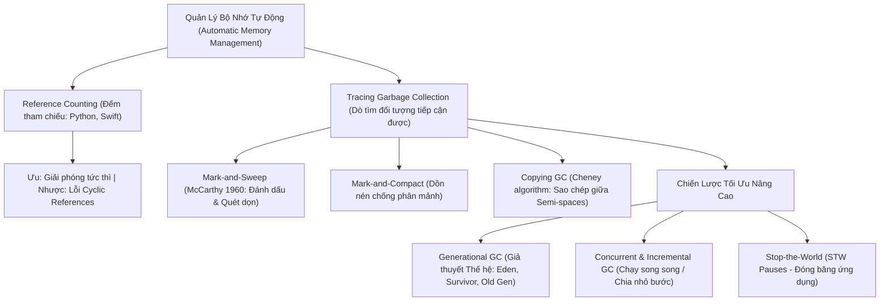
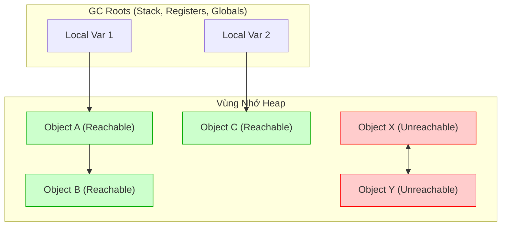
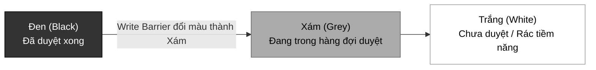

# 4.2. Cơ Chế Thu Gom Rác Tự Động (Garbage Collection Mechanisms)

## Tổng quan về Garbage Collection Mechanisms
Thu gom rác tự động (Garbage Collection - GC) là thành phần then chốt trong hệ thống runtime của các ngôn ngữ hiện đại (Java, Go, C#, JavaScript, Python). GC giải phóng lập trình viên khỏi gánh nặng quản lý bộ nhớ thủ công bằng cách tự động phát hiện và thu hồi các vùng nhớ Heap không còn được chương trình sử dụng (Unreachable Objects). Mục tiêu của các thuật toán GC hiện đại là tối ưu hóa thông lượng (Throughput), giảm thiểu độ trễ tạm dừng (Pause Time / Latency) và tiết kiệm footprint bộ nhớ.



---

## 2. Chi tiết từng Keyword (Under-the-Hood Deep Dive)

---

### 1. Reference Counting vs Tracing Garbage Collection

#### 1. Khái niệm bản chất (What & Why)
Hai trường phái căn bản của quản lý bộ nhớ tự động:
- **Reference Counting (Đếm tham chiếu)**: Mỗi đối tượng trên Heap chứa một trường đếm số nguyên (`ref_count`). Mỗi khi có một con trỏ trỏ đến đối tượng, `ref_count++`. Khi một con trỏ ra khỏi scope hoặc trỏ đi nơi khác, `ref_count--`. Khi `ref_count == 0`, đối tượng lập tức bị hủy và thu hồi bộ nhớ ngay trong chu kỳ đó.
- **Tracing Garbage Collection (Dò tìm theo đồ thị)**: Không theo dõi từng phép gán con trỏ. Định kỳ, GC tạm dừng hoặc chạy nền, bắt đầu từ tập hợp các con trỏ gốc (**GC Roots**: Stack variables, CPU Registers, Static/Global variables) và duyệt đồ thị các đối tượng có thể tiếp cận được (**Reachable Objects**). Bất kỳ đối tượng nào không thể tiếp cận được từ GC Roots đều là rác (**Garbage**) và sẽ bị thu hồi.

#### 2. Cơ chế hoạt động sâu (Under the hood / Hardcore Internals)
- **Điểm yếu chí mạng của Reference Counting (Cyclic References)**:
  - Nếu Đối tượng A trỏ tới Đối tượng B, và B trỏ ngược lại A: Cả hai đều có `ref_count = 1`.
  - Khi con trỏ từ bên ngoài bị hủy, cụm A-B bị cô lập hoàn toàn khỏi chương trình (Unreachable), nhưng `ref_count` không bao giờ về 0! Gây rò rỉ bộ nhớ vĩnh viễn (Memory Leak).
  - Để giải quyết, CPython phải xây dựng thêm một bộ Tracing GC phụ trợ (`gc` module) chỉ chuyên dò tìm các chu trình rác.
- **Chi phí CPU của Reference Counting**:
  - Mỗi phép gán con trỏ `p = q` đòi hỏi các chỉ thị khóa nguyên tử CPU (`lock xadd` / `atomic_fetch_add`) nếu chạy đa luồng, làm chậm tốc độ thực thi của CPU pipeline và gây ô nhiễm cache bộ nhớ giữa các lõi vi xử lý.

#### 3. Sơ đồ minh họa (Đồ thị Tracing GC từ GC Roots)


#### 4. Code ví dụ thực chiến (C++20: Mô phỏng Reference Counting & Minh họa Cyclic Leak)
```cpp
#include <iostream>
#include <memory>

struct Node {
    int id;
    std::shared_ptr<Node> next; // Strong reference
    std::weak_ptr<Node> safeNext; // Weak reference để phá vỡ chu trình rác

    explicit Node(int i) : id(i) { std::cout << "Node " << id << " được tạo.\n"; }
    ~Node() { std::cout << "Node " << id << " bị tiêu hủy an toàn.\n"; }
};

void demonstrateCyclicLeak() {
    auto a = std::make_shared<Node>(1);
    auto b = std::make_shared<Node>(2);

    // Tạo liên kết vòng (Cyclic Reference)
    a->next = b;
    b->next = a; // Cả a và b đều có ref_count = 2
    // Hết hàm: con trỏ a và b trên stack bị hủy, nhưng ref_count giảm về 1 -> KHÔNG AI BỊ HỦY -> RÒ RỈ!
}

void demonstrateSafeCycleBreak() {
    auto a = std::make_shared<Node>(3);
    auto b = std::make_shared<Node>(4);

    a->next = b;
    b->safeNext = a; // Dùng weak_ptr: không làm tăng ref_count -> Hủy an toàn!
}

int main() {
    std::cout << "--- Test Cyclic Leak (Không in log hủy) ---\n";
    demonstrateCyclicLeak();

    std::cout << "\n--- Test Safe Cycle Break (Có log hủy) ---\n";
    demonstrateSafeCycleBreak();
    return 0;
}
```

#### 5. Cạm bẫy & Anti-patterns
- Tự ý can thiệp tắt Tracing GC (`gc.disable()` trong Python) để tăng tốc độ xử lý mà không có kế hoạch thu hồi bộ nhớ thủ công, dẫn đến tràn RAM hệ thống sau vài giờ chạy production.

#### 6. Ứng dụng thực tế trong Backend / Systems
- Hệ thống Swift (iOS/Server-side) và Rust `Arc<T>` sử dụng Reference Counting để không bị giật lag khung hình do Stop-the-World GC.
- Node.js (V8) và Golang sử dụng Tracing GC để xử lý hàng vạn đối tượng bất đồng bộ mà không cần quan tâm đến Cyclic Leak.

---

### 2. Mark-and-Sweep, Mark-and-Compact & Copying GC

#### 1. Khái niệm bản chất (What & Why)
Ba thuật toán cơ sở của Tracing GC:
- **Mark-and-Sweep (Đánh dấu & Quét - John McCarthy 1960)**:
  - *Giai đoạn 1 (Mark)*: Duyệt từ GC Roots, đánh dấu 1 bit trên header của tất cả các đối tượng còn sống.
  - *Giai đoạn 2 (Sweep)*: Quét tuần tự toàn bộ Heap, đưa các ô nhớ không được đánh dấu vào danh sách khối trống (**Free List**) để tái sử dụng. Nhược điểm: Phân mảnh bộ nhớ (External Fragmentation).
- **Mark-and-Compact (Đánh dấu & Dồn nén)**: Sau khi đánh dấu các đối tượng sống, thuật toán di dời (relocate) tất cả các đối tượng sống về một đầu của Heap, làm phẳng bộ nhớ. Toàn bộ con trỏ được cập nhật địa chỉ mới. Vùng còn lại trở thành một khối trống liên tục khổng lồ.
- **Copying Garbage Collection (GC Sao chép - Cheney Algorithm)**: Chia Heap thành hai nửa bằng nhau: **From-Space** và **To-Space**. Khi From-Space đầy, GC sao chép toàn bộ các đối tượng còn sống sang To-Space, tự động dồn nén dữ liệu liên tục. Sau đó hoán đổi vai trò hai vùng (**Semi-space flipping**). Nhược điểm: Lãng phí 50% dung lượng RAM.

#### 2. Cơ chế hoạt động sâu (Under the hood / Hardcore Internals)
- **Con trỏ Forwarding Pointer trong Copying GC**:
  - Khi một đối tượng $O$ được sao chép từ From-Space sang To-Space tại địa chỉ mới $O'$, GC sẽ ghi đè địa chỉ $O'$ vào chính ô nhớ đầu tiên của $O$ cũ (Forwarding Pointer).
  - Khi các đối tượng khác trỏ tới $O$ cũ được duyệt đến, GC nhận ra con trỏ chuyển tiếp và tự động cập nhật tham chiếu trỏ thẳng tới $O'$ mới, hoàn tất cập nhật đồ thị con trỏ chỉ trong một lượt duyệt $O(N)$.

#### 3. Sơ đồ minh họa (So sánh Mark-Sweep, Mark-Compact và Copying GC)
```text
Trạng thái ban đầu: [ Sống ][ Rác ][ Sống ][ Rác ][ Sống ]
-----------------------------------------------------------
1. Mark-and-Sweep:
   [ Sống ][ Trống ][ Sống ][ Trống ][ Sống ] (Phân mảnh lỗ chỗ)

2. Mark-and-Compact:
   [ Sống ][ Sống ][ Sống ][         Khối Trống Lớn        ] (Không phân mảnh)

3. Copying GC:
   From-Space: [ Sống ][ Rác ][ Sống ] ---> To-Space: [ Sống ][ Sống ][ Trống... ]
```

#### 4. Code ví dụ thực chiến (C++20: Mô phỏng Mark-and-Sweep Tracing GC đơn giản)
```cpp
#include <iostream>
#include <vector>

struct GCObject {
    bool marked{false};
    GCObject* next{nullptr};
    int value{0};
};

class MiniMarkSweepGC {
    GCObject* head_{nullptr};
    std::vector<GCObject*> roots_;

public:
    GCObject* allocate(int val) {
        auto* obj = new GCObject();
        obj->value = val;
        obj->next = head_;
        head_ = obj;
        return obj;
    }

    void addRoot(GCObject* root) { roots_.push_back(root); }

    void mark() {
        for (auto* root : roots_) {
            if (root) root->marked = true;
        }
    }

    void sweep() {
        GCObject** curr = &head_;
        while (*curr) {
            if (!(*curr)->marked) {
                GCObject* unreached = *curr;
                *curr = unreached->next;
                std::cout << "Sweep giải phóng đối tượng: " << unreached->value << "\n";
                delete unreached;
            } else {
                (*curr)->marked = false; // Reset cờ cho chu kỳ sau
                curr = &(*curr)->next;
            }
        }
    }
};

int main() {
    MiniMarkSweepGC gc;
    auto* liveObj = gc.allocate(100);
    auto* deadObj = gc.allocate(200);

    gc.addRoot(liveObj); // liveObj là GC Root, deadObj không ai trỏ tới

    std::cout << "Bắt đầu chu kỳ GC:\n";
    gc.mark();
    gc.sweep(); // Thu hồi deadObj 200
    return 0;
}
```

#### 5. Cạm bẫy & Anti-patterns
- Hiện tượng **Stop-the-World Stall**: Trong pha Mark-and-Compact, việc dồn nén hàng triệu đối tượng đòi hỏi CPU phải sao chép gigabytes dữ liệu qua bus RAM và sửa lại hàng triệu con trỏ, gây đóng băng toàn bộ ứng dụng hàng giây.

#### 6. Ứng dụng thực tế trong Backend / Systems
- Garbage Collector của V8 Engine kết hợp cả ba: Dùng Copying GC cho vùng Scavenger (đối tượng mới sinh) và Mark-Sweep-Compact cho Old Space (đối tượng sống lâu).

---

### 3. Generational, Concurrent, Incremental GC & Stop-the-World (STW)

#### 1. Khái niệm bản chất (What & Why)
- **Giả thuyết thế hệ yếu (Weak Generational Hypothesis)**: Quy luật thực nghiệm: *"Hầu hết mọi đối tượng đều chết trẻ"* (Hơn 90% các đối tượng vừa tạo ra đều trở thành rác ngay sau vài mili-giây, ví dụ: biến tạm trong hàm, chuỗi nối tạm thời).
- **Generational GC (GC theo thế hệ)**: Chia Heap thành các thế hệ dựa trên tuổi thọ đối tượng:
  - **Young Generation (Thế hệ trẻ)**: Gồm phân vùng *Eden* và 2 phân vùng *Survivor* ($S_0, S_1$). Dọn dẹp thường xuyên bằng **Minor GC** (cực nhanh, chỉ mất vài mili-giây).
  - **Old / Tenured Generation (Thế hệ già)**: Chứa các đối tượng sống sót qua nhiều chu kỳ Minor GC. Dọn dẹp bằng **Major GC / Full GC** (chậm hơn).
- **Stop-the-World (STW)**: Trạng thái trong đó toàn bộ các luồng ứng dụng (**Mutator Threads**) bị tạm dừng hoàn toàn để GC threads tiến hành quét đồ thị mà không sợ đồ thị con trỏ bị thay đổi ngầm.
- **Concurrent GC & Incremental GC**:
  - *Incremental GC*: Chia nhỏ chu kỳ GC thành từng bước ngắn xen kẽ giữa các tác vụ ứng dụng để giảm độ trễ tối đa.
  - *Concurrent GC*: GC chạy song song trên một lõi CPU riêng biệt trong khi các luồng ứng dụng vẫn đang chạy đồng thời (Go GC, Java ZGC, Shenandoah).

#### 2. Cơ chế hoạt động sâu (Under the hood / Hardcore Internals)
- **Thuật toán Ba Màu (Tri-color Marking) & Rào Cản Ghi (Write Barriers)**:
  - Khi GC chạy song song với ứng dụng (Concurrent), ứng dụng có thể thay đổi con trỏ khiến GC hiểu nhầm đối tượng sống là rác.
  - Phân loại đối tượng thành 3 màu:
    - **Trắng (White)**: Chưa duyệt tới (Ứng viên rác).
    - **Xám (Grey)**: Đã duyệt tới bản thân đối tượng, nhưng chưa duyệt các đối tượng con nó trỏ tới.
    - **Đen (Black)**: Đã duyệt xong đối tượng và toàn bộ các đối tượng con của nó. Không chứa bất kỳ con trỏ nào trỏ tới màu trắng.
  - **Write Barrier (Rào cản ghi)**: Một đoạn mã máy được compiler chèn vào MỖI THAO TÁC GÁN CON TRỎ `obj.field = value`. Nếu một đối tượng Đen cố tình trỏ tới một đối tượng Trắng, Write Barrier sẽ lập tức đổi màu đối tượng Trắng thành Xám, ngăn chặn việc GC thu hồi nhầm đối tượng đang sống.

#### 3. Sơ đồ minh họa (Tri-color Marking & Write Barrier)


#### 4. Code ví dụ thực chiến (Go Runtime GC Tuning & Allocation Elimination)
```go
package main

import (
	"fmt"
	"runtime"
	"time"
)

// Minh họa việc tối ưu hóa GC bằng cách tránh cấp phát Heap trong Go
type Buffer [1024]byte

// Hàm không escape ra Heap -> Cấp phát Stack -> Zero GC Overhead
func processOnStack() Buffer {
	var b Buffer
	b[0] = 42
	return b // Go compiler copy giá trị trên stack
}

func main() {
	var m runtime.MemStats
	runtime.ReadMemStats(&m)
	fmt.Printf("Heap Alloc ban đầu: %d KB\n", m.HeapAlloc/1024)

	start := time.Now()
	for i := 0; i < 1_000_000; i++ {
		_ = processOnStack()
	}
	elapsed := time.Since(start)

	runtime.ReadMemStats(&m)
	fmt.Printf("Heap Alloc sau 1M vòng lặp: %d KB (Không tăng!)\n", m.HeapAlloc/1024)
	fmt.Printf("Số lần chạy GC: %d, Thời gian: %v\n", m.NumGC, elapsed)
}
```

#### 5. Cạm bẫy & Anti-patterns
- **GC Thrashing / Allocation Churn**: Tạo ra hàng triệu đối tượng tạm thời mỗi giây (ví dụ: chuỗi JSON parsing trong vòng lặp) làm tràn ngập Eden Space, khiến Minor GC kích hoạt liên tục và đẩy các đối tượng ngắn hạn lên Old Generation, gây ra Full GC STW đóng băng toàn bộ server.

#### 6. Ứng dụng thực tế trong Backend / Systems
- Cấu hình Garbage Collector cho các ứng dụng Microservice có SLA độ trễ cực thấp: Sử dụng Java ZGC (chạy Concurrent hoàn toàn với STW < 1ms bất kể Heap 16TB) hoặc Golang Concurrent Tri-color GC với biến môi trường `GOGC` và `GOMEMLIMIT`.
