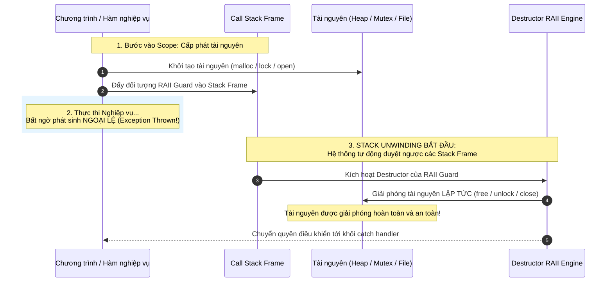
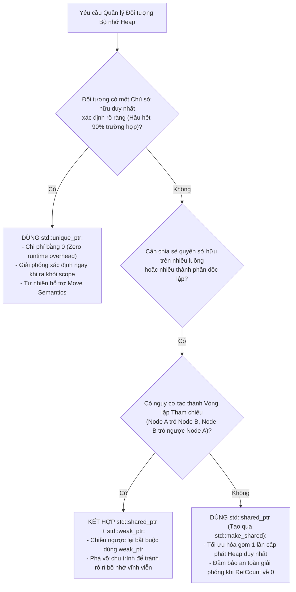

# 4.3. Manual Management, RAII and Safety

> [!IMPORTANT]
> **Nếu bạn chỉ được nhớ một điều duy nhất:** Sự khác biệt cốt lõi giữa hệ thống có tính xác định (Deterministic) và bất định (Non-deterministic) nằm ở triết lý **RAII (Resource Acquisition Is Initialization)**: Gắn chặt vòng đời của một tài nguyên vật lý (Bộ nhớ Heap, File Descriptor, Socket, Khóa Mutex) vào thời gian sống của một biến trên Call Stack. Khi biến đi ra khỏi phạm vi hoạt động (Scope Exit) hoặc khi xảy ra ngoại lệ (Stack Unwinding), hàm hủy (**Destructor**) được kích hoạt **NGAY LẬP TỨC** tại vị trí dòng lệnh đó. Ngược lại hoàn toàn với hàm kết thúc bất định (**Finalizers**) của các ngôn ngữ chạy Garbage Collection (Java, C#) — nơi tài nguyên có thể bị treo hàng giờ mà không bao giờ được giải phóng.

---

## 1. Kiến trúc Tổng quan & Mô hình Tư duy (Mental Model)

### Ẩn dụ Đời sống: Chiếc Thẻ Khách Sạn Tự Động Ngắt Điện vs Người Thu Gom Rác Định Kỳ
Hãy tưởng tượng việc quản lý năng lượng trong một căn phòng khách sạn:
1. **Mô hình RAII (Chiếc Thẻ Khóa Thông minh)**:
   - Khi bạn bước vào phòng, bạn cắm chiếc thẻ phòng vào khe gắn tường (**Acquisition / Initialization**): Toàn bộ đèn bật sáng, điều hòa chạy, nước nóng mở.
   - Khi bạn rời khỏi phòng, bạn rút chiếc thẻ ra (**Scope Exit**): Ngay trong tích tắc đó, mạch điện tự động ngắt toàn bộ hệ thống (**Deterministic Destruction**). Bất kể bạn rời phòng vì hết giờ thuê hay vì có chuông báo cháy khẩn cấp (Exception Handling / Stack Unwinding), điện luôn được đảm bảo ngắt 100%, không bao giờ lãng phí một watt điện nào.
2. **Mô hình Finalizer / Garbage Collection (Đội Dọn Dẹp Không Lịch Trình)**:
   - Bạn rời khỏi phòng nhưng để nguyên đèn điện và vòi nước xả tràn trề.
   - Bạn dựa dẫm vào một đội lao công đi tuần (Garbage Collector). Đội lao công này chỉ ghé qua phòng khi nào toàn bộ khách sạn đã sắp hết nước sạch!
   - Thậm chí, nếu khách sạn không bao giờ hết nước, đội lao công có thể **không bao giờ ghé vào phòng của bạn** (Finalizer starvation), dẫn đến việc vòi nước tiếp tục rò rỉ làm sập tường và ngập tầng hầm (Resource Exhaustion Outage)!



---

## 2. Chi tiết từng Keyword (Under-the-Hood Deep Dive)

### 2.1. RAII, Deterministic Destruction, Destructors vs Finalizers
- **Triết lý RAII (Bjarne Stroustrup - C++)**:
  - Gắn việc chiếm giữ tài nguyên với việc khởi tạo đối tượng (Constructor) và giải phóng tài nguyên với việc phá hủy đối tượng (Destructor).
  - *Tính Xác định Tuyệt đối (Deterministic Destruction)*: Thời điểm tài nguyên được trả lại cho hệ điều hành được biết trước chính xác tại compile-time (ngay tại dấu đóng ngoặc nhọn `}` của khối lệnh).
  - *Mở khóa Ngoại lệ An toàn (Exception Safety Guarantee)*: Khi một exception được ném ra, cơ chế **Stack Unwinding** của CPU/OS duyệt ngược lại từng stack frame, tự động gọi hàm hủy của toàn bộ các đối tượng cục bộ đã khởi tạo thành công trước đó theo thứ tự LIFO (Vào sau ra trước).
- **Hàm Hủy (Destructors) vs Hàm Dọn Dẹp Bất Định (Finalizers)**:
  - *Destructor (C++, Rust)*:
    - Được gọi đồng bộ, ngay lập tức trong chính luồng hiện tại khi đối tượng rời khỏi scope.
    - Thời gian chạy xác định, không có độ trễ gián tiếp, không có rủi ro luồng bị treo.
  - *Finalizer (`finalize()` trong Java cũ, `Finalize()` trong .NET)*:
    - Đối tượng sau khi chết được đẩy vào một hàng đợi đặc biệt (Finalization Queue).
    - Một luồng ưu tiên thấp của GC (Finalizer Thread) sẽ thức dậy vào một thời điểm bất định trong tương lai để chạy hàm này.
    - *Hiểm họa Kinh hoàng*: Nếu hàm finalizer bị block (ví dụ chờ mạng hoặc deadlock), toàn bộ hàng đợi dọn dẹp của JVM bị tắc nghẽn, dẫn đến sập toàn bộ máy chủ (`java.lang.OutOfMemoryError`). Kể từ Java 9, `finalize()` đã bị gắn nhãn Deprecated và cấm sử dụng!

### 2.2. Smart Pointers: Unique, Shared, Weak & Reference Graph
- **`std::unique_ptr` (Độc quyền Sở hữu - Exclusive Ownership)**:
  - Kích thước bộ nhớ vật lý: **Đúng bằng 1 con trỏ thô (8 Bytes)**!
  - Không thể copy, chỉ có thể Move (`std::move`). Khi chuyển quyền sở hữu, con trỏ cũ bị gán về `nullptr`.
  - Khi `unique_ptr` ra khỏi scope, hàm hủy tự động gọi `delete` trên con trỏ thô bên dưới.
  - *Hiệu năng*: **Zero-Overhead Abstraction** — Trình biên dịch tối ưu hóa nó giống hệt 100% như việc lập trình viên tự gọi `free()` bằng tay trong C.
- **`std::shared_ptr` (Chia sẻ Sở hữu qua Đếm Tham chiếu - Reference Counting)**:
  - Cho phép nhiều thành phần cùng sở hữu một vùng nhớ chung. Vùng nhớ chỉ được giải phóng khi người sở hữu cuối cùng rời đi.
  - *Cấu trúc Bộ nhớ 128-bit*: Gồm hai con trỏ 64-bit độc lập:
    1. Con trỏ trỏ tới Đối tượng Dữ liệu thực tế (`T* ptr`).
    2. Con trỏ trỏ tới Khối Điều khiển (**Control Block**).
  - *Cấu trúc Control Block*:
    - **Strong Reference Count (`std::atomic<long>`)**: Đếm số lượng `shared_ptr` đang cùng sở hữu. Mọi thao tác sao chép hoặc hủy đều phát lệnh tăng/giảm nguyên tử (`lock xadd` / `atomic::fetch_add`), gây chi phí đồng bộ hóa cache coherence liên lõi!
    - **Weak Reference Count (`std::atomic<long>`)**: Đếm số lượng `weak_ptr` đang quan sát.
    - Custom Deleter / Allocator metadata.
  - *`std::make_shared` Optimization*: Cấp phát gộp chung cả Object và Control Block vào **MỘT KHỐI BỘ NHỚ DUY NHẤT** trên Heap, giảm số lần gọi `malloc` từ 2 lần xuống 1 lần và tăng cường Data Locality cho CPU cache.
- **`std::weak_ptr` (Quan sát Không Sở hữu & Phá vỡ Vòng lặp Tham chiếu)**:
  - Không làm tăng `Strong Count`, chỉ làm tăng `Weak Count`.
  - Không ngăn cản việc đối tượng bị hủy (khi `Strong Count` về 0, đối tượng bị hủy ngay lập tức, nhưng Control Block vẫn được giữ lại cho đến khi `Weak Count` cũng về 0).
  - *Giải quyết Tham chiếu Vòng (Cyclic References)*: Nếu Node A trỏ `shared_ptr` vào Node B, và Node B trỏ ngược `shared_ptr` vào Node A, cả hai sẽ có `Strong Count = 1` mãi mãi, dẫn đến rò rỉ bộ nhớ vĩnh viễn! Bắt buộc phải chuyển một trong hai chiều thành `weak_ptr`.

```
CẤU TRÚC BỘ NHỚ VẬT LÝ CỦA std::shared_ptr:
+-------------------+-------------------+
|  T* object_ptr    |  ControlBlock*    |
+---------|---------+---------|---------+
          |                   |
          v                   v
     [Object T]     +-----------------------------------+
                    | Strong Ref Count (Atomic: e.g. 2) |
                    | Weak Ref Count   (Atomic: e.g. 1) |
                    | Custom Deleter / Allocator info   |
                    +-----------------------------------+
```

---

## 3. Thực thi Mã nguồn & Mô phỏng Chuyên sâu (Dual-Engine Implementation)

### 3.1. Engine 1: C++20 Zero-Overhead Smart Pointers & Stack Unwinding RAII Demo
Chương trình C++20 tự tay hiện thực một phiên bản rút gọn của `CustomUniquePtr` và cơ chế RAII Lock Guard, đồng thời chứng minh quá trình **Stack Unwinding** tự động dọn dẹp tài nguyên khi có ngoại lệ xảy ra.

```cpp
// compile: g++ -std=c++20 -O3 -pthread raii_smart_pointers.cpp -o raii_smart_pointers
#include <iostream>
#include <memory>
#include <string>
#include <mutex>
#include <stdexcept>
#include <iomanip>

// ==========================================
// 1. CUSTOM UNIQUE POINTER (ZERO-OVERHEAD RAII)
// ==========================================
template<typename T>
class CustomUniquePtr {
    T* ptr_{nullptr};

public:
    explicit CustomUniquePtr(T* ptr = nullptr) noexcept : ptr_(ptr) {}

    ~CustomUniquePtr() noexcept {
        if (ptr_) {
            std::cout << "  [CustomUniquePtr Destructor] Tự động giải phóng ô nhớ Heap của: " << *ptr_ << "\n";
            delete ptr_;
            ptr_ = nullptr;
        }
    }

    // Cấm sao chép
    CustomUniquePtr(const CustomUniquePtr&) = delete;
    CustomUniquePtr& operator=(const CustomUniquePtr&) = delete;

    // Cho phép Move
    CustomUniquePtr(CustomUniquePtr&& other) noexcept : ptr_(other.ptr_) {
        other.ptr_ = nullptr;
    }

    CustomUniquePtr& operator=(CustomUniquePtr&& other) noexcept {
        if (this != &other) {
            delete ptr_;
            ptr_ = other.ptr_;
            other.ptr_ = nullptr;
        }
        return *this;
    }

    T& operator*() const noexcept { return *ptr_; }
    T* operator->() const noexcept { return ptr_; }
    T* get() const noexcept { return ptr_; }
};

// ==========================================
// 2. RAII MUTEX LOCK GUARD (EXCEPTION SAFETY)
// ==========================================
class RaiiLockGuard {
    std::mutex& mtx_;

public:
    explicit RaiiLockGuard(std::mutex& m) : mtx_(m) {
        mtx_.lock();
        std::cout << "  [RAII Guard] ĐÃ KHÓA MUTEX THÀNH CÔNG.\n";
    }

    ~RaiiLockGuard() {
        mtx_.unlock();
        std::cout << "  [RAII Guard] ĐÃ TỰ ĐỘNG MỞ KHÓA MUTEX (Deterministic Release)!\n";
    }

    RaiiLockGuard(const RaiiLockGuard&) = delete;
    RaiiLockGuard& operator=(const RaiiLockGuard&) = delete;
};

std::mutex g_database_mutex;

void simulate_critical_transaction(bool should_fail) {
    RaiiLockGuard lock(g_database_mutex);
    auto secret_buffer = CustomUniquePtr<std::string>(new std::string("CreditCard_Payload_1234"));

    std::cout << "  [Giao dịch] Đang xử lý dữ liệu: " << *secret_buffer << "\n";

    if (should_fail) {
        std::cout << "  [Sự cố] Đột ngột phát sinh ngoại lệ hệ thống!\n";
        throw std::runtime_error("Lỗi đường truyền mạng hoặc Database Timeout!");
    }

    std::cout << "  [Giao dịch] Giao dịch hoàn tất bình thường.\n";
}

int main() {
    std::cout << "========================================================\n";
    std::cout << "  C++20 RAII & EXCEPTION STACK UNWINDING BENCHMARK      \n";
    std::cout << "========================================================\n\n";

    std::cout << "[Step 1] Kịch bản 1: Thực thi thành công bình thường:\n";
    simulate_critical_transaction(false);

    std::cout << "\n--------------------------------------------------------\n";
    std::cout << "[Step 2] Kịch bản 2: Bị ném Ngoại lệ (Stack Unwinding):\n";
    try {
        simulate_critical_transaction(true);
    } catch (const std::exception& ex) {
        std::cout << "  [Catch Handler] Đã bắt ngoại lệ: \"" << ex.what() << "\"\n";
    }

    std::cout << "\n[Step 3] Kiểm tra trạng thái Mutex sau khi văng ngoại lệ:\n";
    if (g_database_mutex.try_lock()) {
        std::cout << "  >> XÁC NHẬN: Mutex hoàn toàn tự do! RAII đã dọn dẹp sạch sẽ trong Stack Unwinding.\n";
        g_database_mutex.unlock();
    } else {
        std::cout << "  >> THẢM HỌA: Mutex bị khóa chết (Deadlock) do rò rỉ giải phóng!\n";
    }

    std::cout << "========================================================\n";
    return 0;
}
```

### 3.2. Engine 2: Python 3.11+ Reference Counting & Cyclic Memory Leak Simulator
Trình mô phỏng phân tích cơ chế đếm tham chiếu (Reference Counting), minh họa hiện tượng rò rỉ bộ nhớ do tham chiếu vòng tròn (Cyclic Reference) và cách giải quyết dứt điểm bằng `weakref`.

```python
#!/usr/bin/env python3
"""
Reference Counting & Cyclic Memory Leak Simulator (Python 3.11+)
Mo phong Bo dem tham chieu, Tham chieu Vong tron va Co che Weakref
"""
import sys
import weakref
from typing import Optional

class Node:
    def __init__(self, name: str):
        self.name = name
        self.next_node: Optional['Node'] = None
        self.weak_prev: Optional[weakref.ReferenceType['Node']] = None
        print(f"  [Allocated] Tạo mới Node: '{self.name}'")

    def __del__(self):
        print(f"  [Destructor / Drop] Node '{self.name}' ĐÃ ĐƯỢC GIẢI PHÓNG HOÀN TOÀN KHỎI BỘ NHỚ!")

def demonstrate_cyclic_leak():
    print("\n--- THỬ NGHIỆM 1: THAM CHIẾU VÒNG TRÒN GÂY RÒ RỈ BỘ NHỚ ---")
    node_a = Node("A_Cyclic")
    node_b = Node("B_Cyclic")

    # Tạo chu trình khép kín: A -> B và B -> A
    node_a.next_node = node_b
    node_b.next_node = node_a

    print("  Biến cục bộ node_a và node_b sắp đi ra khỏi scope...")
    # Sau khi hàm kết thúc, dù biến node_a và node_b mất, nhưng RefCount của cả 2 vẫn = 1!
    # Hàm __del__ của chúng SẼ KHÔNG ĐƯỢC GỌI NGAY!

def demonstrate_weakref_fix():
    print("\n--- THỬ NGHIỆM 2: DÙNG WEAKREF PHÁ VỠ CHU TRÌNH ---")
    node_c = Node("C_Safe")
    node_d = Node("D_Safe")

    # Chiều xuôi dùng Strong Reference: C -> D
    node_c.next_node = node_d
    # Chiều ngược dùng Weak Reference: D -> C (Không làm tăng RefCount!)
    node_d.weak_prev = weakref.ref(node_c)

    print("  Biến cục bộ node_c và node_d sắp đi ra khỏi scope...")
    # Cả hai sẽ được giải phóng ngay lập tức một cách xác định!

def main():
    print("==================================================================")
    print("      PYTHON 3.11 REFERENCE COUNTING & CYCLIC LEAK SIMULATOR      ")
    print("==================================================================")

    demonstrate_cyclic_leak()
    print("  (Lưu ý: Hai node A và B vẫn đang bị kẹt trong RAM, phải chờ GC quét!)")

    demonstrate_weakref_fix()

    print("\n==================================================================")

if __name__ == "__main__":
    main()
```

### 3.3. Terminal Output Mẫu Thực tế
```bash
$ g++ -std=c++20 -O3 -pthread raii_smart_pointers.cpp -o raii_smart_pointers
$ ./raii_smart_pointers
========================================================
  C++20 RAII & EXCEPTION STACK UNWINDING BENCHMARK      
========================================================

[Step 1] Kịch bản 1: Thực thi thành công bình thường:
  [RAII Guard] ĐÃ KHÓA MUTEX THÀNH CÔNG.
  [Giao dịch] Đang xử lý dữ liệu: CreditCard_Payload_1234
  [Giao dịch] Giao dịch hoàn tất bình thường.
  [CustomUniquePtr Destructor] Tự động giải phóng ô nhớ Heap của: CreditCard_Payload_1234
  [RAII Guard] ĐÃ TỰ ĐỘNG MỞ KHÓA MUTEX (Deterministic Release)!

--------------------------------------------------------
[Step 2] Kịch bản 2: Bị ném Ngoại lệ (Stack Unwinding):
  [RAII Guard] ĐÃ KHÓA MUTEX THÀNH CÔNG.
  [Giao dịch] Đang xử lý dữ liệu: CreditCard_Payload_1234
  [Sự cố] Đột ngột phát sinh ngoại lệ hệ thống!
  [CustomUniquePtr Destructor] Tự động giải phóng ô nhớ Heap của: CreditCard_Payload_1234
  [RAII Guard] ĐÃ TỰ ĐỘNG MỞ KHÓA MUTEX (Deterministic Release)!
  [Catch Handler] Đã bắt ngoại lệ: "Lỗi đường truyền mạng hoặc Database Timeout!"

[Step 3] Kiểm tra trạng thái Mutex sau khi văng ngoại lệ:
  >> XÁC NHẬN: Mutex hoàn toàn tự do! RAII đã dọn dẹp sạch sẽ trong Stack Unwinding.
========================================================

$ python3 cyclic_sim.py
==================================================================
      PYTHON 3.11 REFERENCE COUNTING & CYCLIC LEAK SIMULATOR      
==================================================================

--- THỬ NGHIỆM 1: THAM CHIẾU VÒNG TRÒN GÂY RÒ RỈ BỘ NHỚ ---
  [Allocated] Tạo mới Node: 'A_Cyclic'
  [Allocated] Tạo mới Node: 'B_Cyclic'
  Biến cục bộ node_a và node_b sắp đi ra khỏi scope...
  (Lưu ý: Hai node A và B vẫn đang bị kẹt trong RAM, phải chờ GC quét!)

--- THỬ NGHIỆM 2: DÙNG WEAKREF PHÁ VỠ CHU TRÌNH ---
  [Allocated] Tạo mới Node: 'C_Safe'
  [Allocated] Tạo mới Node: 'D_Safe'
  Biến cục bộ node_c và node_d sắp đi ra khỏi scope...
  [Destructor / Drop] Node 'C_Safe' ĐÃ ĐƯỢC GIẢI PHÓNG HOÀN TOÀN KHỎI BỘ NHỚ!
  [Destructor / Drop] Node 'D_Safe' ĐÃ ĐƯỢC GIẢI PHÓNG HOÀN TOÀN KHỎI BỘ NHỚ!

==================================================================
```

---

## 4. Systems Engineering & Production Pitfalls

### 4.1. "Atomic RefCount Contention" Làm Chậm Ứng Dụng Đa Luồng Trên Nhiều Socket
- **Hiện tượng**: Một dịch vụ web đa luồng viết bằng C++ sử dụng `std::shared_ptr` để chia sẻ một đối tượng cấu hình chung (`Config`) cho 64 luồng worker. Dù các luồng chỉ **đọc** cấu hình, hiệu năng CPU sụt giảm nghiêm trọng và xuất hiện hiện tượng thắt cổ chai liên socket.
- **Bản chất Vi kiến trúc**:
  Mỗi khi một luồng sao chép `std::shared_ptr<Config>` (hoặc truyền qua tham trị theo value):
  1. CPU phải phát lệnh `lock xadd` để tăng `Strong Count` trong Control Block.
  2. Dòng Cache Line chứa Control Block lập tức bị đổi sang trạng thái Modified (M) trong giao thức MESI, kích hoạt một cơn bão tín hiệu snoop invalidation xuyên socket (Cache Line Bouncing / Ping-Pong effect).
- **Khắc phục**:
  - Truyền `shared_ptr` bằng **Tham chiếu Hằng (`const std::shared_ptr<T>&`)** thay vì tham trị (Value Copy) để triệt tiêu các lệnh `lock xadd` nguyên tử không cần thiết.
  - Hoặc nếu dữ liệu là chỉ đọc, hãy sử dụng con trỏ thô `const T*` hoặc `std::unique_ptr` độc quyền.

### 4.2. Cạm bẫy Gọi Hàm Ảo (Virtual Methods) Trong Hàm Hủy
- **Hậu quả C++**: Khi đối tượng đang trong quá trình thực thi Destructor, cơ chế đa hình ảo (Dynamic Dispatch) bị vô hiệu hóa: Con trỏ bảng ảo `vptr` được điều chỉnh lùi lại trỏ vào VTable của lớp cha! Nếu hàm hủy gọi một phương thức thuần ảo (`pure virtual`), chương trình sẽ bị crash ngay lập tức với lỗi `pure virtual method called`!
- **Quy tắc Vàng**: Không bao giờ gọi các phương thức ảo từ bên trong Constructor hoặc Destructor.

---

## 5. Bảng So sánh & Decision Matrix

### 5.1. So sánh Ba Loại Con Trỏ Thông Minh Chuẩn

| Tiêu chuẩn So sánh | `std::unique_ptr` | `std::shared_ptr` | `std::weak_ptr` |
| :--- | :--- | :--- | :--- |
| **Quyền Sở Hữu** | **Độc quyền duy nhất (1 Owner)** | Chia sẻ đa quyền (N Owners) | Không sở hữu (Quan sát tạm thời) |
| **Kích thước Bộ nhớ** | **8 Bytes (Bằng con trỏ thô C)** | **16 Bytes (T* + ControlBlock*)** | 16 Bytes (T* + ControlBlock*) |
| **Chi phí Vi kiến trúc**| **0 chu kỳ phụ (Zero-Cost RAII)**| **Có chi phí Atomic RMW Coherence**| Có chi phí Atomic RMW Coherence |
| **Hành vi khi Move** | Con trỏ cũ thành `nullptr` | Chuyển giao mà không tăng RefCount | Chuyển giao không đổi RefCount |
| **Mục đích Sử dụng** | Mặc định cho mọi tài nguyên heap | Khi vòng đời đối tượng không thể dự đoán | Phá vỡ Cyclic References, Caches |

### 5.2. Decision Matrix: Lựa chọn Con Trỏ Thông Minh


