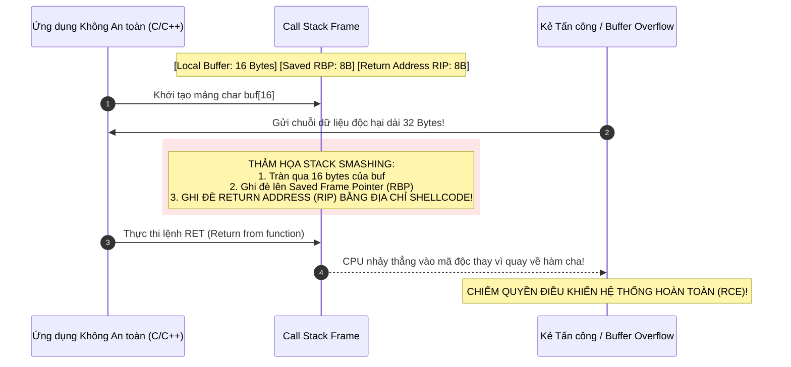
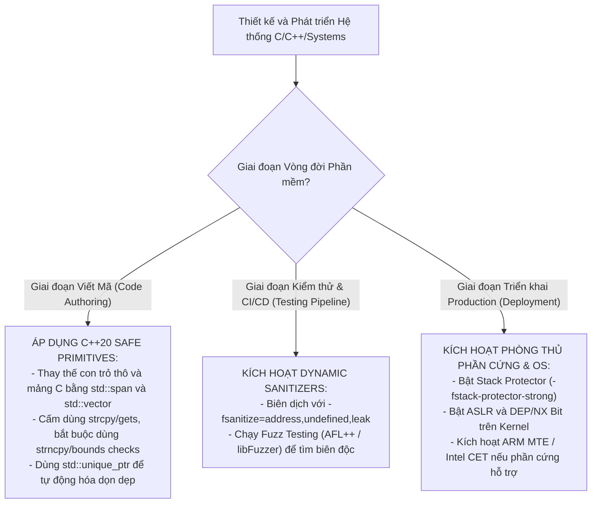

# 4.4. Memory Bugs and Safety Violations

> [!IMPORTANT]
> **Nếu bạn chỉ được nhớ một điều duy nhất:** Hơn 70% các lỗ hổng bảo mật nghiêm trọng (Zero-Day CVEs) trong toàn bộ lịch sử của Microsoft, Google Chromium và Linux Kernel đều xuất phát từ vi phạm **An toàn Bộ nhớ (Memory Safety)**. Mọi lỗi bộ nhớ trong khoa học máy tính được chia làm hai chiều không-thời gian độc lập: **Vi phạm Không gian (Spatial Memory Violations)** — truy cập vượt ra ngoài giới hạn kích thước hợp lệ của một khối nhớ (Buffer Overflow, Out-of-Bounds); và **Vi phạm Thời gian (Temporal Memory Violations)** — truy cập vào một khối nhớ đã chết sau khi nó đã bị giải phóng trở lại hệ điều hành (Use-After-Free, Double-Free, Dangling Pointer).

---

## 1. Kiến trúc Tổng quan & Mô hình Tư duy (Mental Model)

### Ẩn dụ Đời sống: Vượt Vạch Sơn Giao Thông vs Cố Tình Vào Khách Sạn Đã Trả Phòng
Hãy tưởng tượng các quy tắc an toàn trong cuộc sống:
1. **Vi phạm Không gian (Spatial Memory Violations - Vượt Quá Vạch Đỗ Xe)**:
   - Bạn lái một chiếc xe tải dài 10 mét nhưng lại cố tình lùi vào một ô đỗ xe dài 6 mét (Buffer Overflow).
   - Đuôi xe của bạn húc đổ bức tường phía sau, đè nát chiếc xe của người khác đang đỗ ở ô bên cạnh (Ghi đè biến cục bộ lân cận hoặc Return Address trên Call Stack). Bạn đã vượt quá ranh giới không gian cho phép.
2. **Vi phạm Thời gian (Temporal Memory Violations - Chiếc Chìa Khóa Phòng Đã Hết Hạn)**:
   - Bạn thuê một phòng khách sạn trong 2 ngày, làm một chiếc chìa khóa vạn năng (Con trỏ Pointer).
   - Đến ngày thứ 3, bạn trả phòng và rời đi (**`free()` / Deallocation**). Khách sạn cho một vị khách VIP khác vào ở căn phòng đó (Ô nhớ được tái cấp phát cho dữ liệu nhạy cảm).
   - Đêm đó, bạn dùng chiếc chìa khóa cũ lén mở cửa bước vào phòng để đọc trộm tài liệu của vị khách mới (**Use-After-Free - UAF**)! Nếu bạn lại mang chiếc chìa khóa cũ đó đến quầy lễ tân để đòi trả phòng một lần nữa, hệ thống máy tính lễ tân sẽ phát nổ vì mâu thuẫn dữ liệu (**Double-Free**)!



---

## 2. Chi tiết từng Keyword (Under-the-Hood Deep Dive)

### 2.1. Buffer Overflow & Spatial Memory Safety
- **An toàn Bộ nhớ Không gian (Spatial Memory Safety)**:
  - Một thao tác truy cập bộ nhớ $P$ được gọi là an toàn về không gian nếu địa chỉ con trỏ của nó nằm nghiêm ngặt trong khoảng biên xác định:
    $$\text{base\_addr} \le P < \text{base\_addr} + \text{bound\_size}$$
  - Mọi thao tác đọc/ghi nằm ngoài phạm vi này đều là vi phạm không gian.
- **Stack Smashing / Stack Buffer Overflow**:
  - Trên kiến trúc x86-64, ngăn xếp phát triển từ địa chỉ cao xuống địa chỉ thấp (Grows Downwards), nhưng các thao tác ghi chuỗi vào mảng (`strcpy`, `gets`, `memcpy`) lại ghi từ địa chỉ thấp lên địa chỉ cao (Writes Upwards).
  - *Cấu trúc Ngăn xếp Điển hình*:
    ```
    [ Địa chỉ Thấp ]  <-- Đỉnh ngăn xếp RSP
      char buffer[64];
      uint64_t saved_rbp;
      uint64_t return_address (RIP);
    [ Địa chỉ Cao ]   <-- Đáy ngăn xếp RBP của Hàm Cha
    ```
  - Khi ghi vượt quá 64 bytes, dữ liệu tràn sẽ đè nát `saved_rbp` và đè tiếp lên **Return Address (RIP)**. Khi hàm kết thúc và thực hiện lệnh `ret`, CPU nạp địa chỉ giả mạo này vào con trỏ lệnh, trao quyền kiểm soát cho kẻ tấn công (Arbitrary Code Execution).
- **Cơ chế Phòng thủ Cấp Phần cứng và Trình biên dịch**:
  1. *Stack Canaries (`-fstack-protector-strong`)*: Trình biên dịch chèn một số ngẫu nhiên bí mật (Canary) ngay trước Return Address. Trước khi `ret`, CPU kiểm tra Canary. Nếu Canary bị đổi dù chỉ 1 bit, chương trình lập tức tự sát (`__stack_chk_fail`).
  2. *ASLR (Address Space Layout Randomization)*: Hệ điều hành ngẫu nhiên hóa địa chỉ nạp của Stack, Heap và Thư viện liên kết mỗi lần chạy, khiến kẻ tấn công không biết trước địa chỉ để nhảy tới.
  3. *DEP / NX Bit (No-Execute Memory Page)*: Đánh dấu các trang Stack và Heap là cấm thực thi (Data Execution Prevention). Nếu CPU cố nhảy vào chạy mã trên Stack, phần cứng MMU kích hoạt Page Fault lập tức.
  4. *Intel CET (Control-flow Enforcement Technology) / Shadow Stack*: Phần cứng CPU duy trì một ngăn xếp phụ trợ ẩn hoàn toàn (Shadow Stack) chỉ lưu địa chỉ Return Address, không thể bị ghi đè bởi phần mềm.

### 2.2. Temporal Memory Violations: Dangling Pointer, Use-After-Free & Double Free
- **An toàn Bộ nhớ Thời gian (Temporal Memory Safety)**:
  - Đảm bảo rằng một vùng nhớ chỉ có thể được truy cập khi nó còn đang trong trạng thái cấp phát hợp lệ (Valid Allocation State).
- **Con Trỏ Treo (Dangling Pointer)**:
  - Xảy ra khi một con trỏ tiếp tục trỏ vào địa chỉ của một biến cục bộ trên ngăn xếp sau khi hàm đã trả về (Dangling Stack Pointer), hoặc trỏ vào một khối nhớ Heap đã bị `free()`.
- **Use-After-Free (UAF - CVE Đắt Giá Nhất Thế Giới)**:
  - *Cơ chế Hoạt động*:
    1. Tiến trình cấp phát một đối tượng nghiệp vụ $A$ chứa con trỏ bảng hàm ảo (`vptr`): `ObjectA* a = new ObjectA();`.
    2. Tiến trình gọi `delete a;` nhưng quên gán `a = nullptr;` (Con trỏ `a` trở thành Dangling Pointer).
    3. Kẻ tấn công gửi một gói tin mạng độc hại có kích thước y hệt đối tượng $A$. Bộ cấp phát bộ nhớ (Heap Allocator / glibc ptmalloc) tái sử dụng đúng địa chỉ ô nhớ cũ của $A$ để lưu dữ liệu của kẻ tấn công!
    4. Tiến trình vô tình gọi phương thức nghiệp vụ qua con trỏ cũ: `a->do_work();`.
    5. CPU đọc con trỏ `vptr` (nay đã bị kẻ tấn công kiểm soát) và nhảy vào địa chỉ do hacker chỉ định!
- **Double-Free (Giải phóng Hai Lần)**:
  - Gọi `free(ptr)` hai lần trên cùng một địa chỉ bộ nhớ.
  - *Phá Hủy Cấu Trúc Heap (Heap Metadata Corruption)*: Trong các bộ cấp phát cổ điển, các khối nhớ rỗng được liên kết thành một danh sách liên kết đơn (Fastbin / Freelist). Khi gọi double-free, cùng một nút bị đưa vào danh sách hai lần, tạo thành một **Vòng lặp trong Heap Metadata (Cyclic Freelist)**. Lần cấp phát tiếp theo sẽ trả về cùng một địa chỉ cho hai đối tượng khác nhau, dẫn đến chiếm quyền bộ nhớ.
- **Giải pháp Phòng vệ Hiện đại: AddressSanitizer (ASan) & Hardware Memory Tagging (ARM MTE)**:
  - *AddressSanitizer (ASan)*: Sử dụng kỹ thuật **Shadow Memory (Ánh xạ 8-to-1)** và chèn các vùng đệm độc (**Redzones**) xung quanh mỗi biến để phát hiện tràn bộ nhớ và UAF ngay tại thời điểm xảy ra.
  - *ARM Memory Tagging Extension (MTE)*: Phần cứng gắn một nhãn 4-bit (Tag) vào 4 bit trên cùng của con trỏ 64-bit và một nhãn 4-bit tương ứng vào mỗi khối nhớ 16 byte vật lý. Mỗi khi CPU thực hiện lệnh Load/Store, phần cứng tự động đối chiếu hai nhãn này. Nếu lệch nhãn, CPU kích hoạt ngắt phần cứng ngay lập tức!

---

## 3. Thực thi Mã nguồn & Mô phỏng Chuyên sâu (Dual-Engine Implementation)

### 3.1. Engine 1: C++20 Spatial Bounds Check via std::span & Heap Poisoning Guard
Chương trình C++20 minh họa:
1. Phòng chống Buffer Overflow bằng `std::span` (C++20) có kiểm tra biên giới hạn.
2. Tự tay xây dựng một **Heap Memory Poisoning Allocator** phát hiện lỗi Use-After-Free và Double-Free bằng kỹ thuật ghi đè mã độc giả lập (Magic Poison Pattern `0xDEADBEEF`).

```cpp
// compile: g++ -std=c++20 -O3 memory_safety_demo.cpp -o memory_safety_demo
#include <iostream>
#include <vector>
#include <span>
#include <cstring>
#include <stdexcept>
#include <iomanip>

// ==========================================
// 1. SPATIAL SAFETY: std::span BOUNDS CHECK
// ==========================================
void secure_copy_span(std::span<int> destination, std::span<const int> source) {
    if (source.size() > destination.size()) {
        throw std::out_of_range("LỖI SPATIAL VIOLATION: Kích thước nguồn vượt quá dung lượng đích (Buffer Overflow Blocked)!");
    }
    std::copy(source.begin(), source.end(), destination.begin());
}

// ==========================================
// 2. TEMPORAL SAFETY: HEAP POISONING GUARD
// ==========================================
struct HeapBlockHeader {
    uint32_t magic_canary; // 0xCAFEBABE (Đang sống) hoặc 0xDEADDEAD (Đã free)
    size_t size;
};

class SafeHeapAllocator {
    static constexpr uint32_t MAGIC_ALIVE = 0xCAFEBABE;
    static constexpr uint32_t MAGIC_DEAD  = 0xDEADDEAD;

public:
    static void* allocate(size_t size) {
        size_t total_size = sizeof(HeapBlockHeader) + size;
        auto* raw = static_cast<uint8_t*>(std::malloc(total_size));
        
        auto* header = reinterpret_cast<HeapBlockHeader*>(raw);
        header->magic_canary = MAGIC_ALIVE;
        header->size = size;

        std::cout << "  [Heap Alloc] Cấp phát " << size << " bytes tại " << (void*)(raw + sizeof(HeapBlockHeader)) << "\n";
        return raw + sizeof(HeapBlockHeader);
    }

    static void deallocate(void* user_ptr) {
        if (!user_ptr) return;

        auto* raw = static_cast<uint8_t*>(user_ptr) - sizeof(HeapBlockHeader);
        auto* header = reinterpret_cast<HeapBlockHeader*>(raw);

        // KIỂM TRA DOUBLE-FREE
        if (header->magic_canary == MAGIC_DEAD) {
            std::cerr << "  >> BẢO VỆ PHÁT HIỆN: THẢM HỌA DOUBLE-FREE trên ô nhớ " << user_ptr << "!\n";
            return;
        }

        if (header->magic_canary != MAGIC_ALIVE) {
            std::cerr << "  >> BẢO VỆ PHÁT HIỆN: HEAP METADATA CORRUPTION!\n";
            return;
        }

        // POISONING: Làm độc vùng nhớ để phát hiện Use-After-Free
        header->magic_canary = MAGIC_DEAD;
        std::memset(user_ptr, 0xCC, header->size); // Ghi đè toàn bộ dữ liệu bằng 0xCC (INT3 breakpoint)
        std::free(raw);
        std::cout << "  [Heap Free] Đã giải phóng và Poison vùng nhớ an toàn.\n";
    }

    static void access_memory(void* user_ptr) {
        auto* raw = static_cast<uint8_t*>(user_ptr) - sizeof(HeapBlockHeader);
        auto* header = reinterpret_cast<HeapBlockHeader*>(raw);

        // KIỂM TRA USE-AFTER-FREE (UAF)
        if (header->magic_canary == MAGIC_DEAD) {
            std::cerr << "  >> BẢO VỆ PHÁT HIỆN: TRUY CẬP USE-AFTER-FREE (UAF) trên ô nhớ " << user_ptr << "!\n";
            return;
        }
        std::cout << "  [Memory Read] Truy cập ô nhớ an toàn.\n";
    }
};

int main() {
    std::cout << "========================================================\n";
    std::cout << "  C++20 MEMORY SAFETY & POISONING DETECTOR ENGINE       \n";
    std::cout << "========================================================\n\n";

    // 1. Thử nghiệm Spatial Safety với std::span
    std::cout << "[Step 1] Kiểm tra Phòng thủ Buffer Overflow qua std::span:\n";
    std::vector<int> small_dest(3, 0);
    std::vector<int> large_src = {1, 2, 3, 4, 5}; // 5 phần tử > 3

    try {
        secure_copy_span(small_dest, large_src);
    } catch (const std::exception& e) {
        std::cout << "  >> BẮT LỖI SPATIAL THÀNH CÔNG: " << e.what() << "\n\n";
    }

    // 2. Thử nghiệm Temporal Safety: Use-After-Free & Double Free
    std::cout << "[Step 2] Kiểm tra Phát hiện Lỗi Use-After-Free & Double-Free:\n";
    void* buffer = SafeHeapAllocator::allocate(64);
    SafeHeapAllocator::access_memory(buffer); // Hợp lệ

    // Giải phóng bộ nhớ
    SafeHeapAllocator::deallocate(buffer);

    // Truy cập sau khi đã giải phóng -> Bắt lỗi UAF
    SafeHeapAllocator::access_memory(buffer);

    // Giải phóng lần thứ hai -> Bắt lỗi Double-Free
    SafeHeapAllocator::deallocate(buffer);

    std::cout << "========================================================\n";
    return 0;
}
```

### 3.2. Engine 2: Python 3.11+ AddressSanitizer (ASan) Shadow Memory Simulator
Trình mô phỏng hoạt động bên trong của AddressSanitizer: Ánh xạ 8 byte bộ nhớ người dùng vào 1 byte Shadow Memory, chèn các vùng đệm Redzones ngăn chặn Buffer Overflow và theo dõi trạng thái Poisoning.

```python
#!/usr/bin/env python3
"""
AddressSanitizer (ASan) Shadow Memory Simulator (Python 3.11+)
Mo phong kien truc Shadow Memory 8-to-1 byte mapping va Phat hien Redzone Overflow / UAF
"""
from typing import Dict, List

# Các trạng thái của Shadow Byte:
# 0: Cả 8 bytes đều hợp lệ (Accessible)
# 1..7: Có k bytes đầu hợp lệ, phần còn lại là Redzone
# -1 (0xFF): Vùng đệm cấm (Redzone)
# -2 (0xFD): Vùng nhớ đã bị giải phóng (Freed / Poisoned Heap)
SHADOW_ACCESSIBLE = 0
SHADOW_REDZONE    = -1
SHADOW_FREED_UAF  = -2

class AddressSanitizerSimulator:
    def __init__(self, memory_size_bytes: int = 128):
        self.memory = bytearray(memory_size_bytes)
        # Shadow memory: Cứ 8 bytes bộ nhớ thường = 1 byte shadow
        self.shadow_memory = [SHADOW_REDZONE] * (memory_size_bytes // 8)

    def allocate(self, address: int, size: int) -> bool:
        """Cấp phát bộ nhớ và đánh dấu Shadow Memory tương ứng là Accessible."""
        start_shadow = address // 8
        end_shadow = (address + size + 7) // 8
        
        # Đánh dấu các byte shadow tương ứng là hợp lệ
        for i in range(start_shadow, end_shadow):
            self.shadow_memory[i] = SHADOW_ACCESSIBLE
        
        print(f"  [ASan Malloc] Cấp phát [{address} .. {address + size - 1}] "
              f"(Shadow Indices: {start_shadow}..{end_shadow - 1} = OK)")
        return True

    def free(self, address: int, size: int):
        """Giải phóng bộ nhớ và Poison toàn bộ Shadow Memory sang trạng thái FREED."""
        start_shadow = address // 8
        end_shadow = (address + size + 7) // 8
        for i in range(start_shadow, end_shadow):
            self.shadow_memory[i] = SHADOW_FREED_UAF
        print(f"  [ASan Free] Đã giải phóng và POISON Shadow Memory tại dải: {start_shadow}..{end_shadow - 1}")

    def validate_access(self, address: int, op_name: str) -> bool:
        shadow_idx = address // 8
        shadow_state = self.shadow_memory[shadow_idx]

        if shadow_state == SHADOW_ACCESSIBLE:
            print(f"  [ASan Check] {op_name} tại địa chỉ {address}: HỢP LỆ (Shadow = 0)")
            return True
        elif shadow_state == SHADOW_REDZONE:
            print(f"  >> [ASan CRASH] BẮT LỖI SPATIAL: {op_name} tại {address} vi phạm BUFFER OVERFLOW / REDZONE!")
            return False
        elif shadow_state == SHADOW_FREED_UAF:
            print(f"  >> [ASan CRASH] BẮT LỖI TEMPORAL: {op_name} tại {address} vi phạm USE-AFTER-FREE (UAF)!")
            return False
        return False

def main():
    print("==================================================================")
    print("      ADDRESSSANITIZER (ASAN) SHADOW MEMORY SIMULATOR             ")
    print("==================================================================")

    asan = AddressSanitizerSimulator(memory_size_bytes=128)

    # 1. Thử nghiệm Cấp phát mảng 16 bytes tại địa chỉ 16
    print("[Phase 1] Cấp phát bộ đệm 16 bytes:")
    asan.allocate(address=16, size=16)

    # Đọc hợp lệ
    asan.validate_access(16, "Đọc phần tử [0]")
    asan.validate_access(31, "Đọc phần tử [15]")

    # Đọc tràn biên (Buffer Overflow vào Redzone)
    print("\n[Phase 2] Thử nghiệm Vi phạm Buffer Overflow:")
    asan.validate_access(32, "Đọc phần tử [16] (Out of bounds)")

    # 2. Thử nghiệm Use-After-Free
    print("\n[Phase 3] Thử nghiệm Giải phóng và Use-After-Free:")
    asan.free(address=16, size=16)
    asan.validate_access(16, "Đọc lại sau khi đã free (UAF)")

    print("==================================================================")

if __name__ == "__main__":
    main()
```

### 3.3. Terminal Output Mẫu Thực tế
```bash
$ g++ -std=c++20 -O3 memory_safety_demo.cpp -o memory_safety_demo
$ ./memory_safety_demo
========================================================
  C++20 MEMORY SAFETY & POISONING DETECTOR ENGINE       
========================================================

[Step 1] Kiểm tra Phòng thủ Buffer Overflow qua std::span:
  >> BẮT LỖI SPATIAL THÀNH CÔNG: LỖI SPATIAL VIOLATION: Kích thước nguồn vượt quá dung lượng đích (Buffer Overflow Blocked)!

[Step 2] Kiểm tra Phát hiện Lỗi Use-After-Free & Double-Free:
  [Heap Alloc] Cấp phát 64 bytes tại 0x6000028a4038
  [Memory Read] Truy cập ô nhớ an toàn.
  [Heap Free] Đã giải phóng và Poison vùng nhớ an toàn.
  >> BẢO VỆ PHÁT HIỆN: TRUY CẬP USE-AFTER-FREE (UAF) trên ô nhớ 0x6000028a4038!
  >> BẢO VỆ PHÁT HIỆN: THẢM HỌA DOUBLE-FREE trên ô nhớ 0x6000028a4038!
========================================================

$ python3 asan_sim.py
==================================================================
      ADDRESSSANITIZER (ASAN) SHADOW MEMORY SIMULATOR             
==================================================================
[Phase 1] Cấp phát bộ đệm 16 bytes:
  [ASan Malloc] Cấp phát [16 .. 31] (Shadow Indices: 2..3 = OK)
  [ASan Check] Đọc phần tử [0] tại địa chỉ 16: HỢP LỆ (Shadow = 0)
  [ASan Check] Đọc phần tử [15] tại địa chỉ 31: HỢP LỆ (Shadow = 0)

[Phase 2] Thử nghiệm Vi phạm Buffer Overflow:
  >> [ASan CRASH] BẮT LỖI SPATIAL: Đọc phần tử [16] (Out of bounds) tại 32 vi phạm BUFFER OVERFLOW / REDZONE!

[Phase 3] Thử nghiệm Giải phóng và Use-After-Free:
  [ASan Free] Đã giải phóng và POISON Shadow Memory tại dải: 2..3
  >> [ASan CRASH] BẮT LỖI TEMPORAL: Đọc lại sau khi đã free (UAF) tại 16 vi phạm USE-AFTER-FREE (UAF)!
==================================================================
```

---

## 4. Systems Engineering & Production Pitfalls

### 4.1. "Heartbleed Bug" (CVE-2014-0160) - Thảm Họa Buffer Over-read Toàn Cầu
- **Bản chất Lỗ hổng**: Trong giao thức TLS Heartbeat của OpenSSL, bên yêu cầu gửi một gói tin chứa một chuỗi ký tự kèm theo một trường khai báo độ dài `payload_length` (16-bit nguyên, tối đa 65,535 bytes).
- **Lỗi Mã nguồn**: OpenSSL tin tưởng mù quáng vào giá trị `payload_length` do kẻ tấn công gửi lên mà không kiểm tra độ dài thực tế của bộ đệm:
  ```c
  // CỰC KỲ NGUY HIỂM: Buffer Over-read!
  memcpy(response_buffer, client_payload, payload_length);
  ```
- **Hậu quả**: Kẻ tấn công gửi 1 byte dữ liệu nhưng khai báo độ dài là 64 KB. OpenSSL đọc tràn qua ranh giới của bộ đệm 64 KB, lôi theo toàn bộ khóa riêng tư SSL Private Keys, mật khẩu người dùng và token phiên đang nằm trong bộ nhớ Heap của máy chủ để gửi về cho hacker!

### 4.2. Cạm bẫy Bật AddressSanitizer (ASan) Trực Tiếp Trên Môi Trường Production
- **Hậu quả**: ASan là công cụ tuyệt vời cho môi trường Testing và CI/CD. Tuy nhiên, nếu vô tình bật `-fsanitize=address` trên production:
  1. Bộ nhớ RAM bị đội lên gấp **2x đến 3x** do bảng Shadow Memory và các Redzones.
  2. Tốc độ CPU bị chậm đi từ **2 lần đến 3 lần** do mỗi lệnh đọc ghi đều phải chèn thêm 3-4 lệnh kiểm tra shadow byte.
- **Giải pháp Production**: Sử dụng **Hardened Malloc** (như Scudo, GWP-ASan hoặc DieHarder) hoặc tận dụng phần cứng **ARM MTE** với chi phí hiệu năng dưới 1-2%.

---

## 5. Bảng So sánh & Decision Matrix

### 5.1. So sánh Toàn diện Các Lỗi Vi phạm An toàn Bộ nhớ

| Lỗi Bộ nhớ | Chiều Vi phạm | Cơ chế Phát sinh Gốc rễ | Hậu quả Nghiêm trọng Nhất | Công cụ Phát hiện Hiệu quả |
| :--- | :--- | :--- | :--- | :--- |
| **Buffer Overflow (Stack)** | Spatial (Không gian) | Ghi vượt quá biên mảng trên Stack | Thực thi mã từ xa (RCE / Overwrite RIP)| Stack Canaries, ASan, Shadow Stack |
| **Buffer Over-read** | Spatial (Không gian) | Đọc vượt quá biên mảng (Heartbleed)| Rò rỉ khóa bí mật, Passwords | Bounds Checking (`std::span`), ASan |
| **Use-After-Free (UAF)** | Temporal (Thời gian) | Đọc/ghi qua con trỏ đã bị `free()` | Chiếm quyền điều khiển qua VTable fake | AddressSanitizer, ARM MTE, Rust Ownership |
| **Double-Free** | Temporal (Thời gian) | Giải phóng 2 lần cùng một địa chỉ heap | Phá nát Freelist Metadata, Heap Exploit| Heap Canary, Hardened Malloc |
| **Dangling Stack Pointer** | Temporal (Thời gian) | Trả về con trỏ biến cục bộ hàm | Đọc phải dữ liệu rác của stack frame sau | C++ Core Guidelines, Clang Static Analyzer |

### 5.2. Decision Matrix: Chiến lược Phòng thủ An toàn Bộ nhớ Toàn diện


