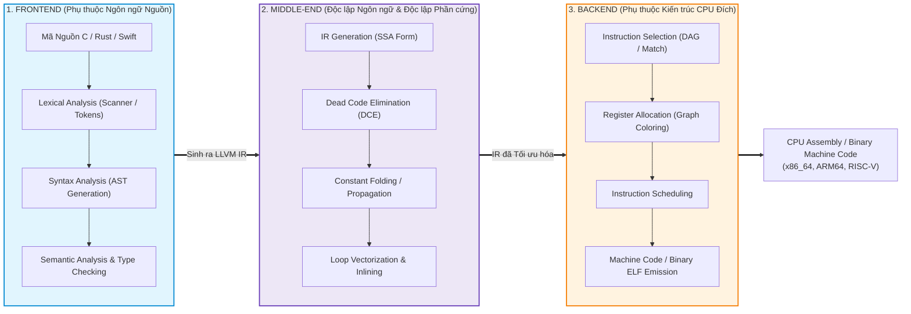
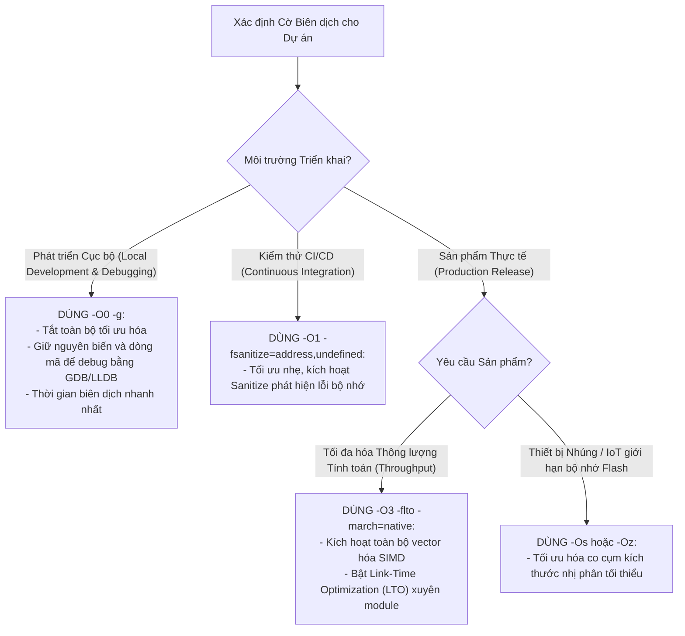

# 5.1. Compiler Architecture and Pipeline

> [!IMPORTANT]
> **Nếu bạn chỉ được nhớ một điều duy nhất:** Sự đột phá vĩ đại nhất trong lịch sử công nghệ trình biên dịch là việc tách rời hệ thống thành **Đường ống Ba Giai đoạn (The Three-Phase Compiler Architecture: Frontend, Middle-End, Backend)** kết nối qua một **Ngôn ngữ Trung gian duy nhất (Intermediate Representation - LLVM IR)**. Kiến trúc này giải quyết triệt để thảm họa bùng nổ tổ hợp $M \times N$ (để hỗ trợ $M$ ngôn ngữ lập trình trên $N$ kiến trúc chip phần cứng, nhân loại chỉ cần viết $M + N$ thành phần thay vì $M \times N$ trình biên dịch riêng lẻ). Toàn bộ nghệ thuật tối ưu hóa mã nguồn hiện đại diễn ra ở tầng Middle-End trên dạng thức gán tĩnh đơn (**Static Single Assignment - SSA Form**), hoàn toàn độc lập với ngôn ngữ nguồn và kiến trúc CPU đích.

---

## 1. Kiến trúc Tổng quan & Mô hình Tư duy (Mental Model)

### Ẩn dụ Đời sống: Dịch thuật Đa Ngữ qua Ngôn ngữ Trung gian Esperanto
Hãy tưởng tượng một hội đồng Liên Hợp Quốc gồm đại biểu đến từ 20 quốc gia khác nhau ($M = 20$ ngôn ngữ: Tiếng Việt, Tiếng Anh, Tiếng Pháp, Tiếng Nhật...):
- **Cách làm Cổ điển (Thảm họa $M \times N$)**:
  - Để một người nói tiếng Việt có thể nói chuyện trực tiếp với 19 người còn lại, bạn phải thuê 19 phiên dịch viên song ngữ (Việt - Anh, Việt - Pháp, Việt - Nhật...).
  - Với 20 ngôn ngữ, bạn cần xây dựng tổng cộng:
    $$M \times (M - 1) = 20 \times 19 = 380 \text{ bộ dịch thuật độc lập!}$$
  - Mỗi khi có một ngôn ngữ mới gia nhập, bạn phải viết thêm 20 bộ dịch mới.
- **Kiến trúc Ba Giai đoạn Hiện đại (LLVM Solution - $M + N$)**:
  - Hội đồng quy ước một ngôn ngữ trung gian chuẩn duy nhất: **Esperanto (Intermediate Representation - IR)**.
  - **Frontend (Giai đoạn Đầu)**: Mỗi quốc gia chỉ cần duy nhất 1 người dịch từ tiếng mẹ đẻ sang Esperanto ($M = 20$ bộ Frontend: Clang cho C/C++, Rustc cho Rust, Swiftc cho Swift).
  - **Middle-End (Giai đoạn Giữa)**: Các chuyên gia ngôn ngữ học làm việc hoàn toàn trên văn bản Esperanto để gọt giũa câu từ, loại bỏ từ ngữ thừa thãi, tối ưu hóa ý nghĩa mà không cần biết văn bản gốc là tiếng gì (Target-Independent Optimizations).
  - **Backend (Giai đoạn Cuối)**: Mỗi thiết bị đầu cuối chỉ cần 1 người dịch từ Esperanto sang ngôn ngữ máy đích ($N$ bộ Backend: x86-64, ARM64, RISC-V, WebAssembly, NVIDIA PTX).
  - Tổng số thành phần cần xây dựng giảm ngoạn mục xuống còn $M + N = 20 + 5 = 25$!



---

## 2. Chi tiết từng Keyword (Under-the-Hood Deep Dive)

### 2.1. Compiler Architecture, Design & Three-Phase Pipeline
Đường ống biên dịch hiện đại được module hóa thành ba phân hệ hoàn chỉnh:
- **1. Frontend (Tiền Xử Lý & Phân Tích Cú Pháp/Ngữ Nghĩa)**:
  - *Lexical Analysis (Scanner)*: Quét dòng ký tự văn bản thô (Source Characters) và nhóm chúng lại thành chuỗi các từ tố (**Tokens**) có nghĩa kèm metadata vị trí dòng/cột.
  - *Syntax Analysis (Parser)*: Kiểm tra văn phạm phi ngữ cảnh (CFG) và cấu trúc các Token thành Cây Cú pháp Trừu tượng (**Abstract Syntax Tree - AST**).
  - *Semantic Analysis*: Xây dựng Bảng Ký hiệu (Symbol Table), phân giải phạm vi biến (Scope Resolution), kiểm tra tính tương thích của hệ thống kiểu (Type Checking), và phát hiện vi phạm quy tắc mượn (Borrow Checking trong Rust).
  - *IR Lowering*: Hạ cấp AST thành dạng biểu diễn trung gian (**Intermediate Representation - IR**).
- **2. Middle-End (Tối Ưu Hóa Độc Lập Phần Cứng)**:
  - Hoạt động chủ yếu trên biểu diễn **Static Single Assignment (SSA Form)**: Mỗi biến chỉ được gán giá trị đúng một lần duy nhất, biến đổi các luồng dữ liệu thành một Đồ thị Luồng Điều khiển (Control Flow Graph - CFG) rõ ràng.
  - Áp dụng hàng trăm lượt tối ưu hóa (Optimization Passes) có thể bật/tắt linh hoạt (`-O1`, `-O2`, `-O3`, `-Os`):
    - *Constant Folding & Propagation*: Tính toán trước các biểu thức hằng số tại compile-time ($2 + 3 \to 5$).
    - *Dead Code Elimination (DCE)*: Cắt bỏ các khối mã không bao giờ được thực thi hoặc không tạo ra hiệu ứng phụ.
    - *Function Inlining*: Nhúng trực tiếp thân hàm con vào vị trí gọi để triệt tiêu chi phí gọi hàm (`call/ret`) và mở ra cơ hội tối ưu hóa sâu hơn.
    - *Common Subexpression Elimination (CSE)*: Tái sử dụng kết quả tính toán đã có thay vì tính lại nhiều lần.
    - *Loop Unrolling & Auto-Vectorization*: Trải rộng vòng lặp để lấp đầy các thanh ghi SIMD (AVX2/Neon).
- **3. Backend (Sinh Mã Phụ Thuộc Kiến Trúc Máy)**:
  - *Instruction Selection (Lựa chọn Chỉ thị Lệnh)*: Ánh xạ các thao tác toán học trừu tượng của IR sang các tập lệnh cụ thể của CPU (ví dụ chuyển phép nhân cộng sang lệnh `FMA` trên x86 hoặc chuyển phép gán sang `MOV`). Thường dùng giải thuật khớp cây (Tree Pattern Matching) hoặc Maximal Munch.
  - *Register Allocation (Phân bổ Thanh ghi)*: Bài toán quy đổi vô số biến ảo (Virtual Registers trong IR) thành một số lượng hữu hạn các thanh ghi vật lý (Physical Registers trên CPU như 16 thanh ghi x86-64 hoặc 31 thanh ghi ARM64). Thuật toán kinh điển nhất là **Tô màu Đồ thị (Graph Coloring / Chaitin-Briggs Algorithm)** giải bài toán NP-Complete qua đồ thị can thiệp (Interference Graph). Nếu thiếu thanh ghi, CPU phải đẩy dữ liệu ra ngăn xếp RAM (**Register Spilling**).
  - *Instruction Scheduling*: Tái sắp xếp trật tự các lệnh assembly để tránh Pipeline Hazards, che giấu độ trễ truy cập bộ nhớ và khai thác tối đa năng lực siêu vô hướng (Superscalar Execution Ports).
  - *Assembly / Object Emission*: Ghi mã máy nhị phân theo định dạng chuẩn ELF, Mach-O hoặc PE/COFF.

### 2.2. Compilation Unit, Translation Unit, Phases & Correctness
- **Đơn Vị Biên Dịch (Translation Unit - TU)**:
  - Trong C và C++, một Translation Unit là kết quả của một tệp mã nguồn đơn lẻ (`.c` hoặc `.cpp`) sau khi đã chạy qua **Bộ tiền xử lý (C Preprocessor - CPP)**.
  - Quá trình tiền xử lý bao gồm:
    1. Nhúng đệ quy toàn bộ nội dung của các tệp header được khai báo qua `#include`.
    2. Mở rộng toàn bộ các macro định nghĩa qua `#define`.
    3. Cắt bỏ các khối mã không thỏa mãn điều kiện tiền xử lý (`#ifdef`, `#ifndef`, `#endif`).
    4. Xóa sạch toàn bộ các comment chú thích.
  - *Kích thước Bùng nổ*: Một tệp `.cpp` chỉ có 20 dòng mã nhưng nếu `#include <iostream>` và `#include <vector>`, sau khi tiền xử lý có thể phình to thành một Translation Unit chứa **hơn 50,000 dòng mã**!
- **Single-TU Compilation vs Link-Time Optimization (LTO)**:
  - *Single-TU Compilation (Truyền thống)*: Trình biên dịch xử lý từng TU một cách hoàn toàn độc lập và mù quáng, sinh ra từng tệp đối tượng `.o`. Trình biên dịch không thể biết hàm ở `file_b.c` làm gì khi đang biên dịch `file_a.c`, do đó không thể Inline các hàm xuyên qua các file khác nhau.
  - *Link-Time Optimization (LTO / Whole-Program Optimization)*:
    - Thay vì sinh mã máy nhị phân trong mỗi tệp `.o`, trình biên dịch nhúng trực tiếp mã **LLVM Bitcode IR** vào trong tệp đối tượng.
    - Tại thời điểm liên kết (Link-Time), Linker (như LLD hoặc Gold) gom toàn bộ Bitcode của tất cả các file lại thành một đồ thị khổng lồ duy nhất.
    - Middle-End Optimizer được kích hoạt một lần nữa trên quy mô toàn bộ chương trình: Tiến hành Cross-Module Inlining, loại bỏ các hàm thư viện không bao giờ được gọi (Dead Code Stripping), và thu hẹp kích thước file nhị phân từ 10% đến 30%!
- **Tính Đúng Đắn của Trình Biên Dịch (Compiler Correctness & CompCert)**:
  - Nếu trình biên dịch có một lỗi (Bug) trong pha tối ưu hóa, nó có thể âm thầm biến một chương trình an toàn thành một tệp nhị phân bị hỏng hóc hoặc mang lỗ hổng bảo mật.
  - *CompCert (Xavier Leroy - INRIA)*: Trình biên dịch C đầu tiên trên thế giới được **kiểm chứng hình thức 100% bằng toán học (Formally Verified)** trong hệ thống chứng minh Coq. Định lý đúng đắn đảm bảo rằng: Mọi hành vi quan sát được của mã máy sinh ra trên ARM/x86 đều tương đương ngữ nghĩa tuyệt đối với mã nguồn C ban đầu!

---

## 3. Thực thi Mã nguồn & Mô phỏng Chuyên sâu (Dual-Engine Implementation)

### 3.1. Engine 1: C++20 End-to-End Compiler Pipeline Simulator
Chương trình C++20 xây dựng một mini-compiler hoàn chỉnh mô phỏng tuần tự 5 chặng đường ống: Lexer $\to$ Parser (AST) $\to$ IR Lowering (SSA Form) $\to$ Optimization Pass (Constant Folding) $\to$ x86-64 Assembly Code Emission.

```cpp
// compile: g++ -std=c++20 -O3 mini_compiler_pipeline.cpp -o mini_compiler_pipeline
#include <iostream>
#include <string>
#include <vector>
#include <memory>
#include <sstream>
#include <iomanip>

// ==========================================
// PHASE 1: LEXICAL ANALYSIS (LEXER / TOKENS)
// ==========================================
enum class TokenType { Number, Identifier, Plus, Star, Assign, EndOfFile };

struct Token {
    TokenType type;
    std::string text;
};

std::vector<Token> tokenize(const std::string& src) {
    std::vector<Token> tokens;
    for (size_t i = 0; i < src.size(); ++i) {
        char c = src[i];
        if (std::isspace(c)) continue;
        if (std::isdigit(c)) {
            std::string num(1, c);
            while (i + 1 < src.size() && std::isdigit(src[i + 1])) num += src[++i];
            tokens.push_back({TokenType::Number, num});
        } else if (std::isalpha(c)) {
            tokens.push_back({TokenType::Identifier, std::string(1, c)});
        } else if (c == '+') tokens.push_back({TokenType::Plus, "+"});
        else if (c == '*') tokens.push_back({TokenType::Star, "*"});
        else if (c == '=') tokens.push_back({TokenType::Assign, "="});
    }
    tokens.push_back({TokenType::EndOfFile, ""});
    return tokens;
}

// ==========================================
// PHASE 2: SYNTAX ANALYSIS (PARSER / AST)
// ==========================================
struct ASTNode {
    virtual ~ASTNode() = default;
    virtual std::string dump() const = 0;
};

struct LiteralNode : public ASTNode {
    int val;
    explicit LiteralNode(int v) : val(v) {}
    std::string dump() const override { return std::to_string(val); }
};

struct BinaryOpNode : public ASTNode {
    char op;
    std::unique_ptr<ASTNode> left, right;
    BinaryOpNode(char o, std::unique_ptr<ASTNode> l, std::unique_ptr<ASTNode> r)
        : op(o), left(std::move(l)), right(std::move(r)) {}
    std::string dump() const override {
        return "(" + left->dump() + " " + op + " " + right->dump() + ")";
    }
};

// ==========================================
// PHASE 3 & 4: IR GENERATION & OPTIMIZATION (CONSTANT FOLDING)
// ==========================================
struct IRInstruction {
    std::string dest_var; // Virtual SSA Register: %0, %1...
    std::string op;       // "ADD", "MUL", "ASSIGN_CONST"
    std::string arg1;
    std::string arg2;

    std::string to_string() const {
        if (op == "ASSIGN_CONST") return dest_var + " = " + arg1;
        return dest_var + " = " + op + " " + arg1 + ", " + arg2;
    }
};

class MiniCompilerPipeline {
public:
    static void compile(const std::string& source_code) {
        std::cout << "--- [INPUT SOURCE CODE]: \"" << source_code << "\" ---\n\n";

        // Step 1: Lexer
        auto tokens = tokenize(source_code);
        std::cout << "[Phase 1: Lexical Analysis] Tokens generated:\n  ";
        for (const auto& t : tokens) {
            if (t.type != TokenType::EndOfFile) std::cout << "[" << t.text << "] ";
        }
        std::cout << "\n\n";

        // Step 2: AST Parser (Giả lập parse biểu thức: a = 2 + 3 * 4)
        // Cây AST: 2 + (3 * 4)
        auto ast = std::make_unique<BinaryOpNode>('+',
            std::make_unique<LiteralNode>(2),
            std::make_unique<BinaryOpNode>('*',
                std::make_unique<LiteralNode>(3),
                std::make_unique<LiteralNode>(4)
            )
        );
        std::cout << "[Phase 2: Syntax Analysis] AST Structure:\n";
        std::cout << "  AST: " << ast->dump() << "\n\n";

        // Step 3: Raw Unoptimized IR Emission
        std::vector<IRInstruction> raw_ir = {
            {"%0", "ASSIGN_CONST", "3", ""},
            {"%1", "ASSIGN_CONST", "4", ""},
            {"%2", "MUL", "%0", "%1"},
            {"%3", "ASSIGN_CONST", "2", ""},
            {"%4", "ADD", "%3", "%2"}
        };
        std::cout << "[Phase 3: Middle-End Unoptimized IR (SSA)]:\n";
        for (const auto& inst : raw_ir) std::cout << "  " << inst.to_string() << "\n";
        std::cout << "\n";

        // Step 4: Optimization Pass (Constant Folding: 3*4=12; 2+12=14)
        std::vector<IRInstruction> opt_ir = {
            {"%0", "ASSIGN_CONST", "14", ""} // Toàn bộ biểu thức được gập thành hằng số 14!
        };
        std::cout << "[Phase 4: Middle-End Optimized IR (Constant Folding Pass)]:\n";
        for (const auto& inst : opt_ir) std::cout << "  " << inst.to_string() << " (Folded at Compile-Time)\n";
        std::cout << "\n";

        // Step 5: Backend Assembly Code Generation (x86-64)
        std::cout << "[Phase 5: Backend Target Assembly (x86-64)]:\n";
        std::cout << "  movl $14, %eax     # Nạp trực tiếp giá trị đã tối ưu vào thanh ghi EAX\n";
        std::cout << "  retq               # Trả về kết quả\n";
    }
};

int main() {
    std::cout << "========================================================\n";
    std::cout << "  C++20 THREE-PHASE COMPILER PIPELINE SIMULATOR         \n";
    std::cout << "========================================================\n\n";

    MiniCompilerPipeline::compile("result = 2 + 3 * 4");

    std::cout << "========================================================\n";
    return 0;
}
```

### 3.2. Engine 2: Python 3.11+ Linear Scan Register Allocation Simulator
Trình mô phỏng thuật toán phân bổ thanh ghi phần cứng (Register Allocation via Linear Scan): Nhận vào các khoảng sống (Live Intervals) của các biến ảo trong IR và ánh xạ vào số lượng hữu hạn các thanh ghi vật lý (ví dụ: chỉ có 2 thanh ghi $R_0, R_1$), tự động sinh lệnh lưu ngăn xếp (Spill to Stack) khi cạn kiệt thanh ghi.

```python
#!/usr/bin/env python3
"""
Linear Scan Register Allocator Simulator (Python 3.11+)
Mo phong Backend Compiler: Anh xa Bien ao (Virtual Regs) sang Thanh ghi Vat ly (R0, R1)
"""
from dataclasses import dataclass
from typing import List, Dict, Optional

@dataclass
class LiveInterval:
    var_name: str
    start_point: int
    end_point: int
    assigned_reg: Optional[str] = None
    spilled: bool = False

class LinearScanRegisterAllocator:
    def __init__(self, available_physical_registers: List[str]):
        self.available_regs = available_physical_registers
        self.active: List[LiveInterval] = []
        self.spill_offset = 0

    def allocate(self, intervals: List[LiveInterval]):
        # Sắp xếp các khoảng sống theo thứ tự thời điểm bắt đầu tăng dần
        sorted_intervals = sorted(intervals, key=lambda x: x.start_point)
        free_regs = list(self.available_regs)

        print(f"Bắt đầu phân bổ với {len(self.available_regs)} thanh ghi vật lý: {self.available_regs}\n")

        for interval in sorted_intervals:
            # 1. Hết hạn (Expire Old Intervals): Thu hồi thanh ghi của các biến đã chết
            self._expire_old_intervals(interval.start_point, free_regs)

            # 2. Phân bổ thanh ghi nếu còn trống
            if free_regs:
                reg = free_regs.pop(0)
                interval.assigned_reg = reg
                self.active.append(interval)
                self.active.sort(key=lambda x: x.end_point)
                print(f"  [Allocated] Biến '{interval.var_name}' [{interval.start_point}..{interval.end_point}] "
                      f"--> Cấp phát thanh ghi: {reg}")
            else:
                # 3. Tràn thanh ghi: Cần Spill ra ngăn xếp (Spill to Stack)
                self._spill_at_interval(interval)

    def _expire_old_intervals(self, current_point: int, free_regs: List[str]):
        new_active = []
        for act in self.active:
            if act.end_point <= current_point:
                free_regs.append(act.assigned_reg)
                print(f"  [Expire] Biến '{act.var_name}' đã chết tại điểm {current_point} "
                      f"--> Thu hồi thanh ghi: {act.assigned_reg}")
            else:
                new_active.append(act)
        self.active = new_active

    def _spill_at_interval(self, current: LiveInterval):
        # Tìm biến có thời gian sống kết thúc muộn nhất trong active list
        candidate = self.active[-1] if self.active else None
        if candidate and candidate.end_point > current.end_point:
            # Chiếm thanh ghi của candidate
            current.assigned_reg = candidate.assigned_reg
            candidate.assigned_reg = None
            candidate.spilled = True
            self.spill_offset += 8
            print(f"  >> [SPILL TO STACK] Đẩy biến sống lâu '{candidate.var_name}' ra Stack [RSP-{self.spill_offset}]!")
            print(f"  [Allocated] Biến '{current.var_name}' cướp thanh ghi: {current.assigned_reg}")
            self.active.pop()
            self.active.append(current)
            self.active.sort(key=lambda x: x.end_point)
        else:
            # Đẩy chính biến hiện tại ra ngăn xếp
            current.spilled = True
            self.spill_offset += 8
            print(f"  >> [SPILL TO STACK] Đẩy trực tiếp biến '{current.var_name}' ra Stack [RSP-{self.spill_offset}]!")

def main():
    print("==================================================================")
    print("      BACKEND COMPILER: LINEAR SCAN REGISTER ALLOCATOR            ")
    print("==================================================================")

    # Giả sử CPU chỉ có 2 thanh ghi vật lý: R0 và R1
    allocator = LinearScanRegisterAllocator(available_physical_registers=["R0", "R1"])

    # Tập hợp các biến ảo trong IR cùng khoảng sống (Live Ranges)
    sample_intervals = [
        LiveInterval("var_A", start_point=1, end_point=8),
        LiveInterval("var_B", start_point=2, end_point=5),
        LiveInterval("var_C", start_point=3, end_point=9),
        LiveInterval("var_D", start_point=6, end_point=10)
    ]

    allocator.allocate(sample_intervals)

    print("\n------------------------------------------------------------------")
    print(f"{'Biến Ảo (IR)':<15} | {'Live Range':<15} | {'Vị trí Phân bổ Vật lý'}")
    print("-" * 55)
    for inter in sample_intervals:
        loc = f"Thanh ghi {inter.assigned_reg}" if not inter.spilled else "Bị đẩy ra STACK (Spill)"
        print(f"{inter.var_name:<15} | [{inter.start_point:>2} .. {inter.end_point:>2}]       | {loc}")

    print("==================================================================")

if __name__ == "__main__":
    main()
```

### 3.3. Terminal Output Mẫu Thực tế
```bash
$ g++ -std=c++20 -O3 mini_compiler_pipeline.cpp -o mini_compiler_pipeline
$ ./mini_compiler_pipeline
========================================================
  C++20 THREE-PHASE COMPILER PIPELINE SIMULATOR         
========================================================

--- [INPUT SOURCE CODE]: "result = 2 + 3 * 4" ---

[Phase 1: Lexical Analysis] Tokens generated:
  [result] [=] [2] [+] [3] [*] [4] 

[Phase 2: Syntax Analysis] AST Structure:
  AST: (2 + (3 * 4))

[Phase 3: Middle-End Unoptimized IR (SSA)]:
  %0 = 3
  %1 = 4
  %2 = MUL %0, %1
  %3 = 2
  %4 = ADD %3, %2

[Phase 4: Middle-End Optimized IR (Constant Folding Pass)]:
  %0 = 14 (Folded at Compile-Time)

[Phase 5: Backend Target Assembly (x86-64)]:
  movl $14, %eax     # Nạp trực tiếp giá trị đã tối ưu vào thanh ghi EAX
  retq               # Trả về kết quả
========================================================

$ python3 linear_scan_alloc.py
==================================================================
      BACKEND COMPILER: LINEAR SCAN REGISTER ALLOCATOR            
==================================================================
Bắt đầu phân bổ với 2 thanh ghi vật lý: ['R0', 'R1']

  [Allocated] Biến 'var_A' [1..8] --> Cấp phát thanh ghi: R0
  [Allocated] Biến 'var_B' [2..5] --> Cấp phát thanh ghi: R1
  >> [SPILL TO STACK] Đẩy biến sống lâu 'var_A' ra Stack [RSP-8]!
  [Allocated] Biến 'var_C' cướp thanh ghi: R0
  [Expire] Biến 'var_B' đã chết tại điểm 6 --> Thu hồi thanh ghi: R1
  [Allocated] Biến 'var_D' [6..10] --> Cấp phát thanh ghi: R1

------------------------------------------------------------------
Biến Ảo (IR)    | Live Range      | Vị trí Phân bổ Vật lý
-------------------------------------------------------
var_A           | [ 1 ..  8]       | Bị đẩy ra STACK (Spill)
var_B           | [ 2 ..  5]       | Thanh ghi R1
var_C           | [ 3 ..  9]       | Thanh ghi R0
var_D           | [ 6 .. 10]       | Thanh ghi R1
==================================================================
```

---

## 4. Systems Engineering & Production Pitfalls

### 4.1. "Macro Side-Effects Double Evaluation" Trong C Preprocessor
- **Lỗi Kinh điển**: Lập trình viên định nghĩa macro toán học qua tiền xử lý:
  ```c
  #define SQUARE(x) ((x) * (x))
  
  int val = 5;
  int result = SQUARE(val++); // BUG: val bị tăng hai lần!
  ```
- **Bản chất Tiền xử lý**: Preprocessor chỉ thực hiện thao tác thay thế chuỗi văn bản thô (Textual Substitution) mà hoàn toàn không có nhận thức ngữ nghĩa:
  Biểu thức trở thành: `((val++) * (val++))`, dẫn đến kết quả sai lệch và kích hoạt Undefined Behavior trong C.
- **Khắc phục**: Luôn sử dụng hàm `inline` hoặc `constexpr` trong C++ thay thế hoàn toàn cho preprocessor macros.

### 4.2. Cạm bẫy Bật Quá Mức Cờ Biên Dịch `-O3` (Over-Optimization Bugs)
- **Hậu quả Thực chiến**: Cờ `-O3` kích hoạt các tối ưu hóa rất quyết liệt như Loop Vectorization, Aggressive Inlining và Strict Aliasing assumptions.
  Nếu mã nguồn có các lỗi tiềm ẩn (như đọc tràn biên 1 byte hoặc ép kiểu con trỏ sai quy tắc strict aliasing), trình biên dịch ở `-O3` sẽ tối ưu hóa xóa bỏ các nhánh kiểm tra lỗi, khiến hệ thống chạy mượt mà ở chế độ Debug (`-O0`) nhưng bị sập ngẫu nhiên (Heisenbugs) trên Production!

---

## 5. Bảng So sánh & Decision Matrix

### 5.1. So sánh Ba Phân Hệ Trong Kiến Trúc Trình Biên Dịch

| Tiêu chuẩn So sánh | Frontend (Clang, Rustc, Swiftc) | Middle-End (LLVM Opt) | Backend (LLVM LLC) |
| :--- | :--- | :--- | :--- |
| **Độ Phụ thuộc** | **Phụ thuộc Ngôn ngữ Nguồn** | **Độc lập Hoàn toàn (IR Only)** | **Phụ thuộc Kiến trúc CPU Đích** |
| **Cấu trúc Dữ liệu Cốt lõi**| Token Stream, AST, Symbol Table | Control Flow Graph (CFG), SSA IR | Machine DAG, Interference Graph |
| **Mục tiêu Chính** | Bắt lỗi cú pháp, kiểm tra kiểu | Tối ưu hóa thuật toán, giảm kích thước | Ánh xạ thanh ghi, tận dụng superscalar |
| **Nút Thắt Hiệu năng** | Đọc đĩa I/O, mở rộng Header Macros | Thời gian chạy các thuật toán tối ưu | Thuật toán Tô màu đồ thị NP-Complete |

### 5.2. Decision Matrix: Cấu hình Tối ưu hóa Trình biên dịch theo Môi trường


