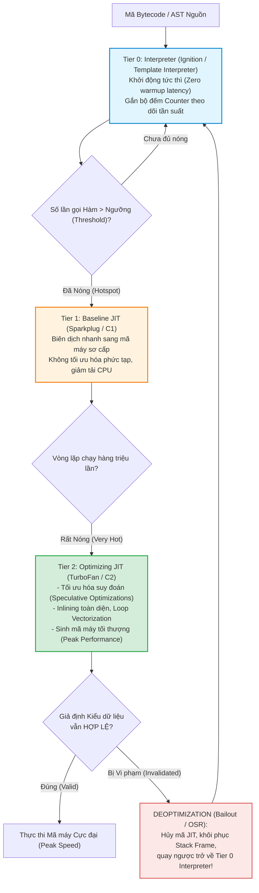
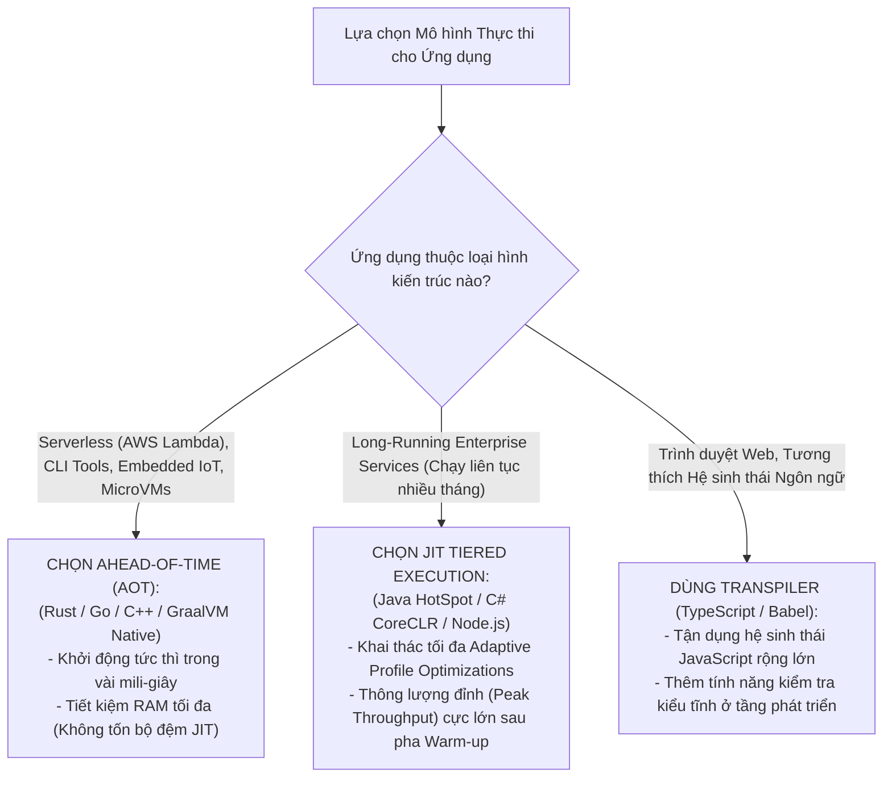

# 5.2. Compilation Strategies and Execution Models

> [!IMPORTANT]
> **Nếu bạn chỉ được nhớ một điều duy nhất:** Sự lựa chọn giữa **Ahead-of-Time (AOT)** và **Just-in-Time (JIT)** là sự đánh đổi kinh điển giữa **Thời gian Khởi động (Cold Start)** và **Hiệu năng Đỉnh Bền vững (Peak Throughput)**. Trong khi AOT (C, Rust, Go) biên dịch sẵn toàn bộ mã máy trước khi chạy để tối ưu hóa thời gian khởi động tức thì và tiết kiệm bộ nhớ; thì JIT (V8, JVM HotSpot) sử dụng kiến trúc **Biên dịch Phân tầng (Tiered Compilation)**: Khởi động cực nhanh bằng Trình thông dịch (Interpreter), theo dõi các điểm nóng (**Hotspots Profile**), suy đoán tối ưu hóa cực đoan (Speculative Inlining), và sẵn sàng hủy tối ưu hóa (**Deoptimization / Bailout**) quay trở về Interpreter nếu giả định kiểu bị phá vỡ!

---

## 1. Kiến trúc Tổng quan & Mô hình Tư duy (Mental Model)

### Ẩn dụ Đời sống: In Sách Xuất Bản Toàn Diện vs Phiên Dịch Viên Đồng Thời
Hãy tưởng tượng việc truyền tải một cuốn tiểu thuyết nước ngoài đến độc giả:
1. **Biên dịch Trước Thời hạn (Ahead-of-Time - AOT)**:
   - Một nhóm dịch giả dành 6 tháng để dịch toàn bộ cuốn sách sang tiếng Việt, biên tập kỹ lưỡng, in ấn thành 10,000 cuốn sách giấy bìa cứng hoàn chỉnh (Tệp nhị phân độc lập ELF/Mach-O).
   - Khi độc giả mua sách về, họ có thể mở ra đọc ngay lập tức từ trang 1 mà không có bất kỳ độ trễ nào (**Zero Startup Latency / Zero Cold Start**). Toàn bộ cuốn sách đã là tiếng mẹ đẻ.
2. **Trình Thông dịch Thuần túy (Pure Interpreter - Người dịch từng câu một)**:
   - Bạn vừa đọc một câu tiếng nước ngoài, người phiên dịch lập tức dịch câu đó sang tiếng Việt.
   - Ưu điểm: Bắt đầu nói chuyện được ngay tức thì mà không cần chờ 6 tháng dịch sách.
   - Nhược điểm: Nếu bạn đọc một bài thơ lặp đi lặp lại 1,000 lần, người phiên dịch cũng phải dịch đi dịch lại 1,000 lần y hệt nhau, tốc độ chậm hơn hàng chục lần so với việc đọc bản in sẵn.
3. **Biên dịch Tại chỗ Phân tầng (Hybrid Tiered JIT - Dịch giả Thông minh Học việc)**:
   - Ban đầu, anh ta chỉ dịch thô từng câu bằng miệng (Interpreter / Tier 0).
   - Khi anh ta nhận thấy bạn đang đọc lặp lại một đoạn kinh Phật hàng vạn lần (**Hot Loop**): Anh ta lập tức rút giấy bút ra, chép lại bản dịch tiếng Việt tối ưu nhất của đoạn kinh đó (JIT Compiler / Tier 1 & 2).
   - Từ lần đọc thứ 101 trở đi, anh ta không dịch bằng miệng nữa mà chỉ việc đưa trực tiếp bản dịch viết tay cho bạn đọc với tốc độ bản địa (Native Machine Code Speed)!



---

## 2. Chi tiết từng Keyword (Under-the-Hood Deep Dive)

### 2.1. Ahead-of-Time (AOT), Just-in-Time (JIT) & Hybrid Tiered Execution
- **Ahead-of-Time Compilation (AOT)**:
  - *Đặc trưng*: Toàn bộ mã nguồn được chuyển đổi thành mã máy nhị phân tĩnh trước khi chương trình được phân phối hoặc triển khai (C, C++, Rust, Go, Swift, GraalVM Native Image).
  - *Ưu điểm Cốt lõi*:
    1. *Khởi động Tức thì*: Không tốn thời gian "làm nóng" (Warm-up phase), hoàn hảo cho mô hình Serverless Functions (AWS Lambda) và Container khởi động nhanh.
    2. *Chi phí Bộ nhớ Cố định*: Không cần nạp trình biên dịch, bảng metadata AST hay trình giám sát profiling vào bộ nhớ RAM của tiến trình tại runtime.
  - *Hạn chế*: Không thể tận dụng thông tin hồ sơ thời gian chạy thực tế (Runtime Profile Data) trừ khi sử dụng kỹ thuật phức tạp PGO (Profile-Guided Optimization).
- **Just-in-Time Compilation (JIT)**:
  - *Đặc trưng*: Chương trình được phân phối dưới dạng độc lập nền tảng (Bytecode của JVM `.class`, CLI của .NET CIL, hoặc mã nguồn JavaScript V8). Khi chạy, máy ảo VM dịch các đoạn mã Bytecode thường xuyên sử dụng thành mã máy của CPU thực tế ngay trong bộ nhớ RAM.
  - *Lợi thế Vượt trội*: Trình biên dịch JIT biết rõ kiến trúc chip CPU chính xác mà nó đang chạy (hỗ trợ tập lệnh AVX-512 hay ARM Neon nào) và nắm bắt được phân phối kiểu dữ liệu thực tế của người dùng để thực hiện tối ưu hóa thích ứng (**Adaptive Optimization**).
- **Mô hình Thực thi Phân tầng (Tiered Compilation)**:
  - Các cỗ máy hiện đại không bao giờ dùng JIT ngây thơ (biên dịch toàn bộ ngay từ đầu vì sẽ làm ứng dụng bị đơ lúc khởi động).
  - *Kiến trúc Phân tầng V8 (Google Chrome / Node.js)*:
    1. **Ignition (Interpreter)**: Dịch mã nguồn sang Bytecode và thực thi ngay lập tức.
    2. **Sparkplug (Baseline Compiler)**: Chuyển đổi nhanh từng bytecode thành mã máy thô mà không cần phân tích đồ thị IR.
    3. **Maglev (Mid-tier Compiler)**: Thực hiện tối ưu hóa kiểu cơ bản.
    4. **TurboFan (Optimizing Compiler)**: Xây dựng đồ thị SSA (Sea of Nodes), thực hiện suy đoán kiểu cực đoan để sinh mã máy tối ưu tối thượng.
- **Hủy Tối ưu hóa (Deoptimization / Bailout) & Thay thế Ngăn xếp (On-Stack Replacement - OSR)**:
  - *Deoptimization*: Giả sử TurboFan suy đoán rằng hàm `add(a, b)` luôn nhận hai số nguyên `Int`. Đột nhiên, người dùng truyền vào một chuỗi `String`! Đoạn mã JIT được tối ưu hóa trước đó không còn hợp lệ. CPU lập tức kích hoạt bẫy **Bailout**: Dừng thực thi mã máy JIT, khôi phục lại trạng thái thanh ghi và ngăn xếp, rồi chuyển giao quyền điều khiển ngược về Interpreter!
  - *On-Stack Replacement (OSR)*: Kỹ thuật thay thế mã máy của một hàm ngay giữa chừng khi nó đang chạy vòng lặp hàng triệu lần bên trong stack frame hiện tại mà không cần đợi hàm trả về.

### 2.2. Transpilers, Cross-Compilation, Whole-Program & Incremental
- **Trình Chuyển Đổi Mã (Transpilers / Source-to-Source Compilers)**:
  - Khác với compiler truyền thống (dịch từ ngôn ngữ bậc cao sang mã máy bậc thấp), Transpiler dịch từ một ngôn ngữ bậc cao sang một ngôn ngữ bậc cao khác ở cùng tầng trừu tượng.
  - *Ví dụ Thực tiễn*:
    - Babel: Chuyển đổi JavaScript ESNext hiện đại sang ES5 tương thích với các trình duyệt cũ.
    - TypeScript Compiler (`tsc`): Xóa bỏ các chú thích kiểu và chuyển đổi TypeScript sang JavaScript thuần.
    - C2Rust: Dịch mã nguồn C cũ sang mã nguồn Rust an toàn.
- **Biên Dịch Chéo (Cross-Compilation)**:
  - Quá trình biên dịch mã nguồn trên một nền tảng máy tính (gọi là **Host Machine**, ví dụ: x86-64 Linux Workstation) để sinh ra tệp thực thi nhị phân chạy trên một nền tảng phần cứng hoàn toàn khác biệt (gọi là **Target Machine**, ví dụ: ARM64 Cortex-M4 Microcontroller hoặc Apple Silicon M-series).
  - *Target Triples (Bộ Ba Định Danh Nền Tảng Đích)*:
    Định dạng chuẩn của LLVM / GCC: `<arch><sub>-<vendor>-[sys]-[abi]`
    - `x86_64-unknown-linux-gnu`: Vi xử lý x86-64, hệ điều hành Linux, thư viện GNU libc.
    - `aarch64-apple-darwin`: Vi xử lý ARM 64-bit, hệ điều hành macOS/iOS.
    - `arm-none-eabi`: Vi xử lý ARM 32-bit nhúng Bare-metal (không có hệ điều hành).
- **Whole-Program Optimization (WPO) vs Incremental Compilation**:
  - *Whole-Program Optimization*: Phân tích toàn bộ mã nguồn của dự án cùng tất cả các thư viện liên kết để tối ưu hóa trên quy mô toàn cầu. Trình biên dịch có thể xóa bỏ toàn bộ các phương thức ảo của một Class nếu chứng minh được cả chương trình chỉ có duy nhất một lớp kế thừa (Devirtualization).
  - *Incremental Compilation (Biên dịch Tăng dần)*: Thay vì biên dịch lại toàn bộ dự án mỗi khi sửa 1 dòng code, hệ thống duy trì một đồ thị phụ thuộc (Dependency Graph) và bộ nhớ đệm (Cache). Chỉ những Translation Unit và AST Nodes bị ảnh hưởng trực tiếp bởi thay đổi mới được nạp lại, giảm thời gian build từ vài phút xuống vài giây.

---

## 3. Thực thi Mã nguồn & Mô phỏng Chuyên sâu (Dual-Engine Implementation)

### 3.1. Engine 1: C++20 Bare-Metal JIT Engine with Dynamic Code Execution (`mmap`)
Chương trình C++20 tự tay hiện thực một cỗ máy JIT Compiler nguyên thủy cấp thấp: Cấp phát trang nhớ có cờ thực thi (`PROT_READ | PROT_WRITE | PROT_EXEC`) qua `mmap`, tự động sinh mã máy x86-64 thô (hàm tính tổng hai số nguyên $a + b$ bằng hợp ngữ) và gọi thực thi trực tiếp qua con trỏ hàm.

```cpp
// compile: g++ -std=c++20 -O3 mini_jit_engine.cpp -o mini_jit_engine
#include <iostream>
#include <vector>
#include <cstring>
#include <cstdint>
#include <iomanip>

#if defined(__unix__) || defined(__APPLE__)
#include <sys/mman.h>
#include <unistd.h>
#else
#error "Chuong trinh yeu cau he dieu hanh POSIX (Linux / macOS) de thuc thi mmap!"
#endif

// Kiểu con trỏ hàm JIT: int32_t (*)(int32_t, int32_t)
using JITFunctionInt32 = int32_t (*)(int32_t, int32_t);

class MinimalJITCompiler {
public:
    static void run_demo() {
        std::cout << "[Step 1] Khởi tạo Bộ nhớ Thực thi qua System Call mmap()...\n";
        
        size_t page_size = sysconf(_SC_PAGESIZE);
        // Cấp phát 1 trang nhớ có quyền Đọc, Ghi và Thực thi (R+W+X)
        void* exec_memory = mmap(
            nullptr,
            page_size,
            PROT_READ | PROT_WRITE | PROT_EXEC,
            MAP_ANONYMOUS | MAP_PRIVATE,
            -1,
            0
        );

        if (exec_memory == MAP_FAILED) {
            std::cerr << "Lỗi mmap() cấp phát bộ nhớ thực thi thất bại!\n";
            return;
        }

        std::cout << "  -> Cấp phát thành công vùng nhớ thực thi tại: " << exec_memory << "\n\n";

        // Step 2: Sinh mã máy x86-64 thô (Machine Code Generation)
        // Hàm tính: int32_t add(int32_t edi, int32_t esi) { return edi + esi; }
        // Hợp ngữ x86-64 chuẩn System V ABI:
        //   8d 04 37      lea (%rdi,%rsi,1), %eax   # EAX = EDI + ESI
        //   c3            retq                      # Trả về kết quả trong EAX
        std::vector<uint8_t> x86_machine_code = {
            0x8D, 0x04, 0x37, // lea (%rdi,%rsi,1), %eax
            0xC3              // ret
        };

        std::cout << "[Step 2] Sao chép Bytecode mã máy x86-64 vào vùng nhớ JIT:\n  Bytes: ";
        for (uint8_t byte : x86_machine_code) {
            std::cout << "0x" << std::hex << std::setw(2) << std::setfill('0') << static_cast<int>(byte) << " ";
        }
        std::cout << std::dec << "\n\n";

        // Nạp mã máy vào bộ nhớ thực thi
        std::memcpy(exec_memory, x86_machine_code.data(), x86_machine_code.size());

        // Step 3: Ép kiểu vùng nhớ thành con trỏ hàm và thực thi
        std::cout << "[Step 3] Kích hoạt Lời gọi Hàm JIT Biên dịch Trực tiếp (Direct JIT Call):\n";
        auto jit_add_fn = reinterpret_cast<JITFunctionInt32>(exec_memory);

        int a = 125, b = 875;
        int result = jit_add_fn(a, b); // CPU NHẢY TRỰC TIẾP VÀO TRANG NHỚ VỪA SINH ĐỂ THỰC THI!

        std::cout << "  -> Kết quả tính toán: " << a << " + " << b << " = " << result << "\n\n";

        // Giải phóng trang nhớ thực thi
        munmap(exec_memory, page_size);
        std::cout << "[Step 4] Thu hồi bộ nhớ thực thi qua munmap() an toàn.\n";
    }
};

int main() {
    std::cout << "========================================================\n";
    std::cout << "  C++20 BARE-METAL JUST-IN-TIME (JIT) EXECUTION ENGINE  \n";
    std::cout << "========================================================\n\n";

    MinimalJITCompiler::run_demo();

    std::cout << "========================================================\n";
    return 0;
}
```

### 3.2. Engine 2: Python 3.11+ Tiered JIT Compilation & Deoptimization Simulator
Trình mô phỏng kiến trúc thực thi phân tầng (Tiered Execution Engine phỏng theo V8/HotSpot): Bắt đầu bằng Trình thông dịch (Interpreter), đếm số lần gọi hàm, kích hoạt Baseline JIT và Optimizing JIT khi đạt ngưỡng nhiệt (Warmup Threshold), và kích hoạt Deoptimization (Bailout) khi phát hiện đối số vi phạm giả định kiểu.

```python
#!/usr/bin/env python3
"""
Tiered Compilation & Deoptimization Simulator (Python 3.11+)
Mo phong cac tang thuc thi: Interpreter -> Baseline JIT -> Optimizing JIT va Deopt Bailout
"""
from dataclasses import dataclass
from typing import Any, List

@dataclass
class ProfilingMetrics:
    invocation_count: int = 0
    tier_level: str = "TIER_0_INTERPRETER"
    speculated_type: str = "int"

class TieredExecutionVM:
    THRESHOLD_BASELINE_JIT = 5      # 5 lần gọi -> Nâng lên Baseline JIT
    THRESHOLD_OPTIMIZING_JIT = 20   # 20 lần gọi -> Nâng lên Optimizing JIT

    def __init__(self):
        self.profile = ProfilingMetrics()

    def execute_add(self, a: Any, b: Any) -> Any:
        self.profile.invocation_count += 1
        current_tier = self.profile.tier_level

        # KIỂM TRA ĐIỀU KIỆN DEOPTIMIZATION (BAILOUT)
        if current_tier == "TIER_2_OPTIMIZING_JIT":
            # Giả định suy đoán: a và b bắt buộc phải là số nguyên (int)
            if not isinstance(a, int) or not isinstance(b, int):
                print(f"\n  >> [DEOPTIMIZATION BAILOUT]: Phát hiện đối số '{type(a).__name__}' "
                      f"vi phạm giả định kiểu '{self.profile.speculated_type}'!")
                print("  >> Khôi phục Stack Frame và GIÁNG CẤP về TIER_0_INTERPRETER ngay lập tức!")
                self.profile.tier_level = "TIER_0_INTERPRETER"
                self.profile.invocation_count = 0 # Reset counter
                return self._interpret_fallback(a, b)

        # NÂNG CẤP TẦNG THỰC THI (TIER PROMOTION)
        if self.profile.invocation_count >= self.THRESHOLD_OPTIMIZING_JIT:
            if self.profile.tier_level != "TIER_2_OPTIMIZING_JIT":
                self.profile.tier_level = "TIER_2_OPTIMIZING_JIT"
                print(f"  [TIER PROMOTION] Hàm đạt ngưỡng {self.profile.invocation_count} lần gọi "
                      f"--> Kích hoạt TIER_2_OPTIMIZING_JIT (TurboFan: SIMD / Inlined Native Code)!")
        elif self.profile.invocation_count >= self.THRESHOLD_BASELINE_JIT:
            if self.profile.tier_level == "TIER_0_INTERPRETER":
                self.profile.tier_level = "TIER_1_BASELINE_JIT"
                print(f"  [TIER PROMOTION] Hàm đạt ngưỡng {self.profile.invocation_count} lần gọi "
                      f"--> Kích hoạt TIER_1_BASELINE_JIT (Sparkplug: Quick Machine Code)!")

        # THỰC THI THEO TẦNG TƯƠNG ỨNG
        if self.profile.tier_level == "TIER_0_INTERPRETER":
            return self._interpret_fallback(a, b)
        elif self.profile.tier_level == "TIER_1_BASELINE_JIT":
            return a + b
        elif self.profile.tier_level == "TIER_2_OPTIMIZING_JIT":
            # Mã máy tối ưu hóa cao độ
            return a + b

    def _interpret_fallback(self, a: Any, b: Any) -> Any:
        # Mô phỏng thông dịch từng bytecode
        return a + b

def main():
    print("==================================================================")
    print("      TIERED JIT COMPILATION & DEOPTIMIZATION SIMULATOR           ")
    print("==================================================================")

    vm = TieredExecutionVM()

    print("[Phase 1] Chạy hàm 25 lần với kiểu số nguyên đồng nhất (Int):")
    for i in range(1, 26):
        res = vm.execute_add(i, 10)
        if i in [1, 5, 20, 25]:
            print(f"  Gọi lần #{i:02d} | Trạng thái: {vm.profile.tier_level:<24} | Kết quả: {res}")

    print("\n[Phase 2] Đột ngột truyền đối số kiểu Chuỗi (String) gây phá vỡ Giả định:")
    res_str = vm.execute_add("Hello ", "JIT Compiler")
    print(f"  Kết quả sau Bailout: \"{res_str}\" | Trạng thái hiện tại: {vm.profile.tier_level}")

    print("==================================================================")

if __name__ == "__main__":
    main()
```

### 3.3. Terminal Output Mẫu Thực tế
```bash
$ g++ -std=c++20 -O3 mini_jit_engine.cpp -o mini_jit_engine
$ ./mini_jit_engine
========================================================
  C++20 BARE-METAL JUST-IN-TIME (JIT) EXECUTION ENGINE  
========================================================

[Step 1] Khởi tạo Bộ nhớ Thực thi qua System Call mmap()...
  -> Cấp phát thành công vùng nhớ thực thi tại: 0x104b20000

[Step 2] Sao chép Bytecode mã máy x86-64 vào vùng nhớ JIT:
  Bytes: 0x8d 0x04 0x37 0xc3 

[Step 3] Kích hoạt Lời gọi Hàm JIT Biên dịch Trực tiếp (Direct JIT Call):
  -> Kết quả tính toán: 125 + 875 = 1000

[Step 4] Thu hồi bộ nhớ thực thi qua munmap() an toàn.
========================================================

$ python3 tiered_jit_sim.py
==================================================================
      TIERED JIT COMPILATION & DEOPTIMIZATION SIMULATOR           
==================================================================
[Phase 1] Chạy hàm 25 lần với kiểu số nguyên đồng nhất (Int):
  Gọi lần #01 | Trạng thái: TIER_0_INTERPRETER       | Kết quả: 11
  [TIER PROMOTION] Hàm đạt ngưỡng 5 lần gọi --> Kích hoạt TIER_1_BASELINE_JIT (Sparkplug: Quick Machine Code)!
  Gọi lần #05 | Trạng thái: TIER_1_BASELINE_JIT      | Kết quả: 15
  [TIER PROMOTION] Hàm đạt ngưỡng 20 lần gọi --> Kích hoạt TIER_2_OPTIMIZING_JIT (TurboFan: SIMD / Inlined Native Code)!
  Gọi lần #20 | Trạng thái: TIER_2_OPTIMIZING_JIT    | Kết quả: 30
  Gọi lần #25 | Trạng thái: TIER_2_OPTIMIZING_JIT    | Kết quả: 35

[Phase 2] Đột ngột truyền đối số kiểu Chuỗi (String) gây phá vỡ Giả định:

  >> [DEOPTIMIZATION BAILOUT]: Phát hiện đối số 'str' vi phạm giả định kiểu 'int'!
  >> Khôi phục Stack Frame và GIÁNG CẤP về TIER_0_INTERPRETER ngay lập tức!
  Kết quả sau Bailout: "Hello JIT Compiler" | Trạng thái hiện tại: TIER_0_INTERPRETER
==================================================================
```

---

## 4. Systems Engineering & Production Pitfalls

### 4.1. "JIT Compilation Stalls & Warm-up Spikes" trong Hệ Thống Microservices
- **Hiện tượng**: Một dịch vụ Java Spring Boot hoặc Node.js mới được triển khai lên Kubernetes Cluster. Trong 60 giây đầu tiên, CPU tăng vọt lên 100%, độ trễ phản hồi $p99$ tăng từ 2ms lên 800ms, khiến các Health Check probe của K8s đánh giá Pod bị hỏng và liên tục giết tiến trình (CrashLoopBackOff).
- **Nguyên nhân**: Toàn bộ các luồng JIT Compiler (C1/C2 threads hoặc TurboFan) đồng loạt thức dậy để biên dịch hàng ngàn phương thức điểm nóng cùng một lúc, cạnh tranh tài nguyên CPU với luồng phục vụ người dùng.
- **Khắc phục**:
  - Áp dụng kỹ thuật **Pre-warming** (bơm lưu lượng giả lập trước khi trỏ Traffic thực sự vào Pod).
  - Hoặc chuyển đổi sang công nghệ **AOT Native Compilation** (GraalVM Native Image / Quarkus) để loại bỏ 100% thời gian khởi động JIT.

### 4.2. Lỗ Hổng Bảo Mật Thực Thi Vùng Nhớ (W^X / Write-XOR-Execute Violation)
- **Hiểm họa**: Một số JIT engine đời cũ cấp phát vùng nhớ vừa có quyền GHI vừa có quyền THỰC THI (`PROT_WRITE | PROT_EXEC`). Kẻ tấn công có thể lợi dụng lỗi bộ nhớ để ghi đè mã độc vào trang nhớ này và ép CPU nhảy vào chạy mã độc trực tiếp!
- **Chuẩn mực Bảo mật Bắt buộc (W^X)**: Một trang nhớ chỉ được phép GHI hoặc THỰC THI, không bao giờ cả hai cùng lúc! Khi sinh mã: đặt quyền `PROT_READ | PROT_WRITE`. Sau khi ghi mã máy xong: bắt buộc gọi `mprotect(PROT_READ | PROT_EXEC)` trước khi chuyển giao quyền điều khiển.

---

## 5. Bảng So sánh & Decision Matrix

### 5.1. So sánh Toàn diện Các Chiến Lược Thực Thi Chương Trình

| Tiêu chuẩn So sánh | Ahead-of-Time (AOT) | Just-in-Time (JIT) | Pure Interpreter | Transpiler (Source-to-Source) |
| :--- | :--- | :--- | :--- | :--- |
| **Thời điểm Sinh Mã Máy**| **Trước khi chạy (Compile-time)**| **Trong lúc chạy (Runtime Hotspots)**| Không sinh mã máy (Duyệt AST/Bytecode)| Không sinh mã máy (Sinh ngôn ngữ khác) |
| **Thời gian Khởi động** | **Cực nhanh (0 ms Warmup)** | Chậm (Cần pha làm nóng Warm-up) | **Nhanh tức thì** | N/A (Build tool) |
| **Tiêu tốn Bộ nhớ RAM** | Thấp nhất | **Cao (Chứa cả JIT compiler & Bytecode)**| Thấp | N/A |
| **Khả năng Tối ưu Hóa** | Toàn cầu (WPO, LTO) | Thích ứng động theo Profile thực tế | Không có tối ưu hóa sâu | Phụ thuộc Compiler của ngôn ngữ đích |
| **Ngôn ngữ Đại diện** | C, C++, Rust, Go, Swift | Java (HotSpot), C# (CLR), JS (V8) | Python (CPython), Ruby cổ điển | TypeScript, Babel, C2Rust |

### 5.2. Decision Matrix: Khi nào Nên Chọn AOT vs JIT?


