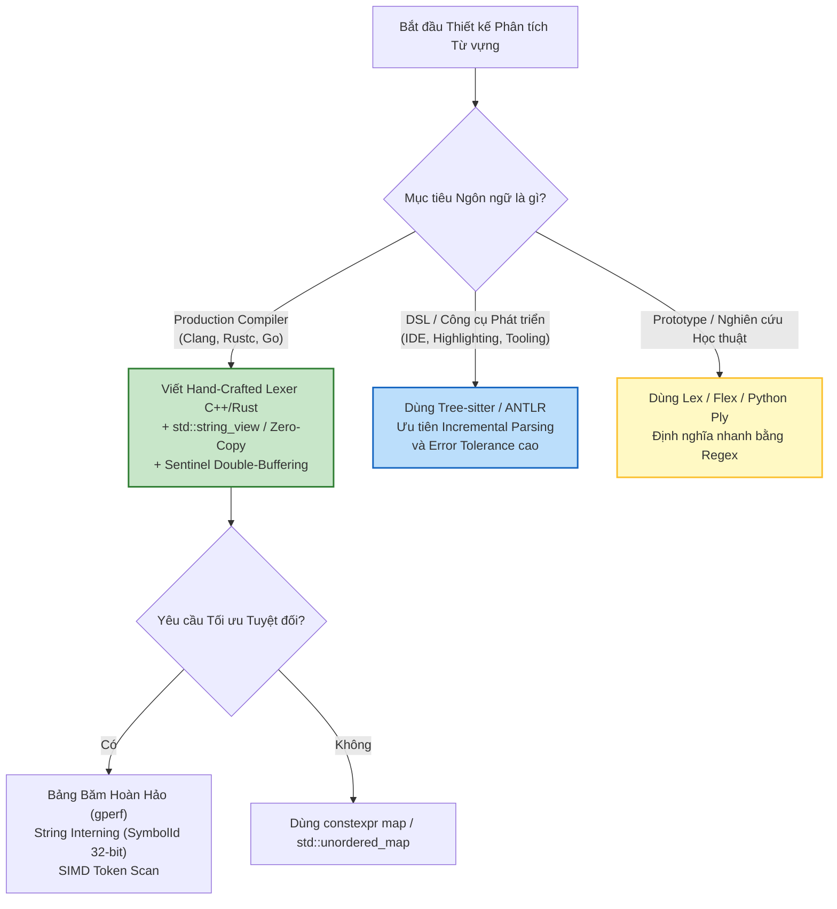

# 6.1. Phân Tích Từ Vựng, Bộ Quét và Tokens (Lexer, Scanning & Tokens)

> [!IMPORTANT]
> **Nếu bạn chỉ được nhớ một điều duy nhất:** Bản chất của giai đoạn phân tích từ vựng (**Lexical Analysis**) là chuyển đổi một dòng ký tự thô vô nghĩa (Stream of Raw Unicode/ASCII Characters) thành một dòng các đơn vị cú pháp nguyên tử có ý nghĩa (**Stream of Tokens**) với chi phí tiệm cận $O(N)$ bằng kỹ thuật quét hai bộ đệm có lính canh (**Two-Buffer Scheme with Sentinel**) và quy tắc tham lam ăn dài nhất (**Maximal Munch / Longest Match Rule**). Mọi trình biên dịch công nghiệp hiệu năng cao (như Clang hay GCC) đều không bao giờ cấp phát chuỗi động (`std::string`) cho từng token mà bắt buộc sử dụng con trỏ trượt zero-copy (`std::string_view`) kết hợp bảng băm hoàn hảo (**Perfect Hashing**) hoặc bảng bảng trie/mã hóa số nguyên để tối đa hóa băng thông bộ nhớ và loại bỏ hoàn toàn cache misses.

---

## 1. Kiến trúc Tổng quan & Mô hình Tư duy (Mental Model)

### Ẩn dụ Đời sống: Người Soát Vé Tàu và Máy Đọc Mã Vạch Siêu Tốc
Hãy tưởng tượng hành khách xếp hàng vào sân vận động hoặc ga tàu điện:
- **Dòng ký tự nguồn (Raw Character Stream)**: Tương đương với việc bạn nhìn thấy một đám đông hàng nghìn con người đi qua cửa. Họ chỉ là những hình bóng rời rạc, các pixel hình ảnh chuyển động liên tục.
- **Lexer / Scanner (Máy quét mã vạch)**: Đứng ở cửa soát vé. Nhiệm vụ của nó không phải là giải thích xem vị khách đó có tiền sử gia đình thế nào (đó là việc của Parser/Sema), mà là quét thật nhanh qua từng đặc điểm nhận dạng:
  - Nếu gặp một mã vạch hợp lệ (từ khóa `let`, `fn`, toán tử `==`, số nguyên `1024`): Nó đóng dấu phát hành một **Token** với phân loại chính xác (`TOKEN_LET`, `TOKEN_IDENT`, `TOKEN_INT`) kèm tọa độ số ghế (dòng, cột).
  - Nếu gặp khoảng trắng, ký tự cách tab hoặc bình luận (Comment): Nó đơn giản là bỏ qua (Discard) như bỏ qua khoảng trống giữa hai hành khách.
  - Nếu gặp ký tự kỳ quặc không thuộc bảng chữ cái (như ký tự điều khiển ASCII ẩn): Nó kích hoạt chế độ phục hồi lỗi từ vựng (**Lexical Error Recovery**), ghi log cảnh báo và tiếp tục di chuyển tới ký tự hợp lệ kế tiếp.

```mermaid
flowchart LR
    subgraph InputStage["1. NGUỒN KÝ TỰ THÔ (SOURCE STREAM)"]
        direction TB
        RawSrc["Source Code: 'let mut count = 42;'"]
        Buf1["Buffer 1 (4KB Block)"]
        Buf2["Buffer 2 (4KB Block)"]
        Sentinel["Sentinel Marker ('\\0' / EOF)"]
    end

    subgraph ScannerCore["2. BỘ QUÉT TỪ VỰNG (LEXER ENGINE)"]
        direction TB
        ForwardPtr["Forward Pointer (Di chuyển)"]
        LexemeBegin["LexemeBegin Pointer (Cố định đầu)"]
        DFA["DFA Transition State Machine"]
        MaxMunch{"Maximal Munch Rule:\nChọn Token Dài Nhất"}
    end

    subgraph TokenStream["3. DÒNG TOKENS PHÁT RA (OUTPUT TOKENS)"]
        direction TB
        Tok1["Token: KEYWORD_LET ('let')"]
        Tok2["Token: KEYWORD_MUT ('mut')"]
        Tok3["Token: IDENTIFIER ('count')"]
        Tok4["Token: OPERATOR_ASSIGN ('=')"]
        Tok5["Token: LITERAL_INT (42)"]
        Tok6["Token: SEMICOLON (';')"]
    end

    RawSrc --> Buf1 & Buf2
    Buf1 & Buf2 --> ForwardPtr & LexemeBegin
    ForwardPtr --> DFA --> MaxMunch
    MaxMunch ==> Tok1 --> Tok2 --> Tok3 --> Tok4 --> Tok5 --> Tok6
    Tok6 ==> Parser["Parser / Syntax Analysis (AST)"]

    style InputStage fill:#e3f2fd,stroke:#1565c0,stroke-width:2px;
    style ScannerCore fill:#f3e5f5,stroke:#7b1fa2,stroke-width:2px;
    style TokenStream fill:#e8f5e9,stroke:#2e7d32,stroke-width:2px;
```



---

## 2. Chi tiết từng Keyword (Under-the-Hood Deep Dive)

### 2.1. Lexical Analysis, Lexer, Scanner, Tokenization, Token & Lexeme
Giai đoạn đầu tiên của mọi trình biên dịch là chuyển đổi dòng ký tự phẳng thành chuỗi token logic:
- **Lexical Analysis (Phân tích Từ vựng)**: Quá trình quét và phân rã mã nguồn từ mảng các byte (`char`/`uint8_t`) thành các đơn vị ngữ pháp tối thiểu.
- **Lexer / Scanner**: Phân hệ phần mềm chịu trách nhiệm thực thi phân tích từ vựng. Trong kiến trúc hiện đại, "Scanner" đảm nhiệm việc đọc đệm I/O từ đĩa và xử lý mã hóa UTF-8, còn "Lexer" phân giải các mẫu ký tự thành token.
- **Tokenization (Token hóa)**: Thuật toán tách dòng ký tự thành các phân đoạn từ tố.
- **Lexeme (Từ tố)**: Đoạn chuỗi ký tự thô thực tế xuất hiện trong mã nguồn (ví dụ: chuỗi `"counter"`, `"3.14159"`, `"while"`).
- **Token (Từ ký hiệu)**: Cấu trúc dữ liệu trừu tượng biểu diễn một Lexeme, bao gồm:
  - `TokenKind`: Mã định danh kiểu dữ liệu dạng Enum (ví dụ: `TokenKind::KwIf`, `TokenKind::Identifier`, `TokenKind::Plus`).
  - `SourceLocation`: Con trỏ trỏ tới vị trí dòng (`line`), cột (`column`), và file ID nhằm phục vụ báo lỗi (Diagnostics).
  - `Value / Literal Data`: Dữ liệu bổ sung nếu là hằng số (ví dụ giá trị `int64_t` hoặc `double` đã được parse trước).
- **Kỹ thuật Hai Bộ Đệm với Lính Canh (Two-Buffer Scheme with Sentinel)**:
  - Đọc từng ký tự từ ổ đĩa bằng hàm `getc()` tạo ra overhead hệ thống khổng lồ do System Call. Trình biên dịch nạp trực tiếp từng khối dữ liệu lớn ($4\text{ KB} - 64\text{ KB}$) vào 2 buffer hoán đổi liên tục (`Buffer 1` và `Buffer 2`).
  - Để tránh việc sau mỗi ký tự phải kiểm tra điều kiện tràn bộ đệm `if (forward >= buffer_end)`, người ta đặt một ký tự đặc biệt gọi là **Sentinel** (thường là ký tự null `\0` hoặc mã `EOF`) ở cuối mỗi nửa bộ đệm.
  - Vòng lặp quét ký tự chạy tự do ở tốc độ tối đa của CPU; chỉ khi gặp Sentinel nó mới rẽ nhánh kiểm tra xem cần nạp khối dữ liệu tiếp theo hay đã chạm điểm kết thúc file thật sự.
- **Quy tắc Tham lam Ăn Dài Nhất (Maximal Munch / Longest Match Rule)**:
  - Khi một chuỗi ký tự khớp với nhiều mẫu khác nhau, Lexer luôn chọn mẫu dài nhất có thể nhận diện được. Ví dụ: chuỗi `---` sẽ được phân tích thành `--` (toán tử decrement) và `-` (toán tử trừ) chứ không phải ba toán tử `- - -`.
  - Chuỗi `variable_name` được nhận diện là một Identifier duy nhất chứ không bị cắt thành từ khóa `var` và phần còn lại `iable_name`.

### 2.2. Keywords, Identifiers, Literals & Lexical Error Recovery
- **Keywords vs Identifiers**:
  - Mọi từ khóa (Keywords như `if`, `else`, `return`, `class`) đều thỏa mãn quy tắc cú pháp của một định danh (Identifier: bắt đầu bằng chữ cái hoặc gạch dưới, theo sau là chữ cái/chữ số).
  - Thay vì xây dựng DFA riêng biệt khổng lồ cho từng từ khóa (gây bùng nổ số lượng trạng thái), mọi trình biên dịch công nghiệp đều coi từ khóa là một Identifier trong quá trình quét tự động. Sau khi nuốt trọn từ tố, bộ quét tra cứu từ tố đó trong một **Bảng Băm Hoàn Hảo (Perfect Hash Table)** hoặc mảng tra cứu tĩnh. Nếu khớp, nó đổi `TokenKind` sang Keyword tương ứng; nếu không, nó giữ nguyên là `Identifier`.
  - **Tối ưu hóa String Interning**: Để tránh cấp phát heap và so sánh chuỗi lặp đi lặp lại trong toàn bộ đường ống (Parser, Semantic Analysis, Symbol Table), Lexer đưa mọi Identifier vào một **String Interner Pool**. Mỗi chuỗi định danh duy nhất chỉ tồn tại một bản sao trong bộ nhớ và được đại diện bằng một số nguyên 32-bit (`SymbolId`). Mọi phép so sánh tên biến sau đó được rút gọn về phép so sánh hai số nguyên $O(1)$ trên thanh ghi CPU.
- **Literals (Hằng số thô)**:
  - *Integer Literals*: Hỗ trợ cơ số 10, nhị phân (`0b101`), bát phân (`0o77`), thập lục phân (`0xDEADBEEF`), kèm hậu tố chỉ định kích thước (`100u64`, `42i32`).
  - *Float Literals*: Xử lý số thực có phần mũ khoa học (`1.23e-4f32`). Cần cảnh giác với trường hợp dấu chấm phân giải phương thức như `1.foo()` (ở đây `1` là int, `.` là operator, `foo` là method).
  - *String Literals & Escape Sequences*: Xử lý các ký tự thoát (`\n`, `\t`, `\x7F`, `\u{1F600}`). Chuỗi Raw String (`r#"text"#`) giúp bảo lưu nguyên vẹn ký tự gạch chéo ngược.
- **Lexical Error Recovery (Phục hồi Lỗi Từ Vựng)**:
  - Khi gặp ký tự bất hợp lệ (ví dụ: ký tự lạ `@` trong ngôn ngữ không hỗ trợ decorator), Lexer không được dừng đột ngột (Crash/Abort).
  - Các kỹ thuật phục hồi:
    1. *Panic Mode / Skip Invalid*: Ghi nhận lỗi chẩn đoán (Diagnostic Error) với tọa độ chính xác, bỏ qua ký tự lỗi và nhảy tiếp tới ký tự kế tiếp.
    2. *Spell Checking / Levenshtein Distance*: Gợi ý sửa lỗi khi gõ sai từ khóa phổ biến (ví dụ gõ nhầm `funtion` thành `function`).
    3. *Unterminated String Recovery*: Nếu một chuỗi mở ngoặc kép `"` kéo dài đến hết dòng mà không có dấu đóng, tự động chèn token đóng chuỗi ảo và cảnh báo thiếu dấu nháy để Parser tiếp tục parse các dòng lệnh bên dưới.

---

## 3. Thực thi Mã nguồn & Mô phỏng Chuyên sâu (Dual-Engine Implementation)

### 3.1. Engine 1: C++20 Hardware Benchmark / Implementation
Hiện thực bộ phân tích từ vựng tối ưu hóa hiệu năng cao bằng C++20: Sử dụng `std::string_view` (Zero-copy), Bảng tra cứu từ khóa dạng `constexpr` / `std::unordered_map`, xử lý Sentinel, phân giải số nguyên, chuỗi ký tự và cơ chế phục hồi lỗi.

```cpp
#include <iostream>
#include <string_view>
#include <vector>
#include <unordered_map>
#include <cctype>
#include <charconv>
#include <iomanip>

enum class TokenKind {
    Eof,
    Invalid,
    // Keywords
    KwLet,
    KwMut,
    KwFn,
    KwIf,
    KwElse,
    KwReturn,
    // Identifiers & Literals
    Identifier,
    IntLiteral,
    StringLiteral,
    // Operators & Punctuation
    Plus,
    Minus,
    Star,
    Slash,
    Equal,
    EqualEqual,
    SemiColon,
    OpenParen,
    CloseParen,
    OpenBrace,
    CloseBrace
};

struct SourceLocation {
    uint32_t line{1};
    uint32_t column{1};
};

struct Token {
    TokenKind kind{TokenKind::Invalid};
    std::string_view lexeme{};
    SourceLocation loc{};
    int64_t int_val{0};
};

const char* token_kind_to_str(TokenKind kind) {
    switch (kind) {
        case TokenKind::Eof: return "EOF";
        case TokenKind::Invalid: return "INVALID";
        case TokenKind::KwLet: return "KW_LET";
        case TokenKind::KwMut: return "KW_MUT";
        case TokenKind::KwFn: return "KW_FN";
        case TokenKind::KwIf: return "KW_IF";
        case TokenKind::KwElse: return "KW_ELSE";
        case TokenKind::KwReturn: return "KW_RETURN";
        case TokenKind::Identifier: return "IDENTIFIER";
        case TokenKind::IntLiteral: return "INT_LITERAL";
        case TokenKind::StringLiteral: return "STR_LITERAL";
        case TokenKind::Plus: return "PLUS";
        case TokenKind::Minus: return "MINUS";
        case TokenKind::Star: return "STAR";
        case TokenKind::Slash: return "SLASH";
        case TokenKind::Equal: return "ASSIGN";
        case TokenKind::EqualEqual: return "EQ_EQ";
        case TokenKind::SemiColon: return "SEMICOLON";
        case TokenKind::OpenParen: return "LPAREN";
        case TokenKind::CloseParen: return "RPAREN";
        case TokenKind::OpenBrace: return "LBRACE";
        case TokenKind::CloseBrace: return "RBRACE";
    }
    return "UNKNOWN";
}

class FastLexer {
private:
    std::string_view source_;
    size_t cursor_{0};
    uint32_t line_{1};
    uint32_t col_{1};

    static const std::unordered_map<std::string_view, TokenKind>& get_keyword_table() {
        static const std::unordered_map<std::string_view, TokenKind> keywords = {
            {"let", TokenKind::KwLet},
            {"mut", TokenKind::KwMut},
            {"fn", TokenKind::KwFn},
            {"if", TokenKind::KwIf},
            {"else", TokenKind::KwElse},
            {"return", TokenKind::KwReturn}
        };
        return keywords;
    }

    char peek() const {
        if (cursor_ >= source_.size()) return '\0';
        return source_[cursor_];
    }

    char advance() {
        if (cursor_ >= source_.size()) return '\0';
        char ch = source_[cursor_++];
        if (ch == '\n') {
            line_++;
            col_ = 1;
        } else {
            col_++;
        }
        return ch;
    }

    void skip_whitespace_and_comments() {
        while (cursor_ < source_.size()) {
            char c = peek();
            if (c == ' ' || c == '\t' || c == '\r' || c == '\n') {
                advance();
            } else if (c == '/' && cursor_ + 1 < source_.size() && source_[cursor_ + 1] == '/') {
                // Line comment: skip to newline
                while (peek() != '\0' && peek() != '\n') {
                    advance();
                }
            } else {
                break;
            }
        }
    }

public:
    explicit FastLexer(std::string_view source) : source_(source) {}

    Token next_token() {
        skip_whitespace_and_comments();

        SourceLocation start_loc{line_, col_};
        size_t start_pos = cursor_;

        if (cursor_ >= source_.size()) {
            return Token{TokenKind::Eof, "", start_loc, 0};
        }

        char ch = advance();

        // 1. Identifiers & Keywords
        if (std::isalpha(static_cast<unsigned char>(ch)) || ch == '_') {
            while (std::isalnum(static_cast<unsigned char>(peek())) || peek() == '_') {
                advance();
            }
            std::string_view lexeme = source_.substr(start_pos, cursor_ - start_pos);
            const auto& kw_table = get_keyword_table();
            auto it = kw_table.find(lexeme);
            TokenKind kind = (it != kw_table.end()) ? it->second : TokenKind::Identifier;
            return Token{kind, lexeme, start_loc, 0};
        }

        // 2. Integer Literals (Maximal Munch on digits)
        if (std::isdigit(static_cast<unsigned char>(ch))) {
            while (std::isdigit(static_cast<unsigned char>(peek()))) {
                advance();
            }
            std::string_view lexeme = source_.substr(start_pos, cursor_ - start_pos);
            int64_t val = 0;
            std::from_chars(lexeme.data(), lexeme.data() + lexeme.size(), val);
            return Token{TokenKind::IntLiteral, lexeme, start_loc, val};
        }

        // 3. String Literals
        if (ch == '"') {
            while (peek() != '\0' && peek() != '"' && peek() != '\n') {
                advance();
            }
            if (peek() == '"') {
                advance(); // consume closing quote
                std::string_view lexeme = source_.substr(start_pos, cursor_ - start_pos);
                return Token{TokenKind::StringLiteral, lexeme, start_loc, 0};
            }
            // Error: unterminated string
            std::string_view lexeme = source_.substr(start_pos, cursor_ - start_pos);
            std::cerr << "[Lexer Error] Unterminated string at line " << start_loc.line << ":" << start_loc.column << "\n";
            return Token{TokenKind::Invalid, lexeme, start_loc, 0};
        }

        // 4. Multi-character and Single-character Operators
        switch (ch) {
            case '=':
                if (peek() == '=') {
                    advance();
                    return Token{TokenKind::EqualEqual, source_.substr(start_pos, 2), start_loc, 0};
                }
                return Token{TokenKind::Equal, source_.substr(start_pos, 1), start_loc, 0};
            case '+': return Token{TokenKind::Plus, source_.substr(start_pos, 1), start_loc, 0};
            case '-': return Token{TokenKind::Minus, source_.substr(start_pos, 1), start_loc, 0};
            case '*': return Token{TokenKind::Star, source_.substr(start_pos, 1), start_loc, 0};
            case '/': return Token{TokenKind::Slash, source_.substr(start_pos, 1), start_loc, 0};
            case ';': return Token{TokenKind::SemiColon, source_.substr(start_pos, 1), start_loc, 0};
            case '(': return Token{TokenKind::OpenParen, source_.substr(start_pos, 1), start_loc, 0};
            case ')': return Token{TokenKind::CloseParen, source_.substr(start_pos, 1), start_loc, 0};
            case '{': return Token{TokenKind::OpenBrace, source_.substr(start_pos, 1), start_loc, 0};
            case '}': return Token{TokenKind::CloseBrace, source_.substr(start_pos, 1), start_loc, 0};
            default:
                // Lexical Error Recovery: log and skip
                std::cerr << "[Lexer Warning] Unrecognized character '" << ch << "' at " << start_loc.line << ":" << start_loc.column << "\n";
                return Token{TokenKind::Invalid, source_.substr(start_pos, 1), start_loc, 0};
        }
    }
};

int main() {
    std::string_view code = 
        "// Production Code Snippet\n"
        "fn calculate_tax(base_val) {\n"
        "    let mut rate = 42;\n"
        "    if base_val == 100 {\n"
        "        return base_val + rate;\n"
        "    }\n"
        "    let msg = \"audit_ok\";\n"
        "    @ // Invalid char simulation\n"
        "    return 0;\n"
        "}";

    std::cout << "=== BẮT ĐẦU PHÂN TÍCH TỪ VỰNG (C++20 FAST LEXER) ===\n";
    FastLexer lexer(code);
    while (true) {
        Token tok = lexer.next_token();
        std::cout << "[" << std::setw(4) << tok.loc.line << ":" << std::setw(2) << tok.loc.column << "] "
                  << std::setw(14) << std::left << token_kind_to_str(tok.kind)
                  << " | Lexeme: " << std::setw(16) << tok.lexeme;
        if (tok.kind == TokenKind::IntLiteral) {
            std::cout << " (Val: " << tok.int_val << ")";
        }
        std::cout << "\n";
        if (tok.kind == TokenKind::Eof) break;
    }
    return 0;
}
```

### 3.2. Engine 2: Python 3.11+ Architectural Simulator
Mô phỏng kiến trúc bộ đệm hai ngăn có lính canh (**Two-Buffer Scheme with Sentinel**) và máy phân tích từ vựng hướng đối tượng hoàn chỉnh:

```python
"""
Architectural Lexer Simulator: Two-Buffer Sentinel & Tokenization Engine
Python 3.11+ Compliant
"""
from dataclasses import dataclass
from enum import Enum, auto
from typing import List, Tuple, Optional

class TokenKind(Enum):
    EOF = auto()
    INVALID = auto()
    KW_LET = auto()
    KW_FN = auto()
    KW_IF = auto()
    KW_RETURN = auto()
    IDENTIFIER = auto()
    INT_LIT = auto()
    STR_LIT = auto()
    OP_ASSIGN = auto()
    OP_EQ = auto()
    OP_PLUS = auto()
    SEMICOLON = auto()
    LPAREN = auto()
    RPAREN = auto()
    LBRACE = auto()
    RBRACE = auto()

@dataclass(frozen=True)
class SourceLoc:
    line: int
    col: int

@dataclass
class Token:
    kind: TokenKind
    lexeme: str
    loc: SourceLoc
    parsed_value: Optional[int] = None

class BufferedCharStream:
    """
    Simulates hardware page double-buffering with sentinel characters.
    Block size = 16 bytes. Sentinel = '\0'.
    """
    BLOCK_SIZE = 16
    SENTINEL = '\0'

    def __init__(self, full_text: str):
        self.text = full_text
        self.text_pos = 0
        self.buffer1 = [''] * (self.BLOCK_SIZE + 1)
        self.buffer2 = [''] * (self.BLOCK_SIZE + 1)
        self.active_buf = 1
        self.buf_idx = 0
        self.line = 1
        self.col = 1
        
        # Pre-fill buffer 1
        self._load_block(self.buffer1)

    def _load_block(self, target_buf: List[str]):
        slice_str = self.text[self.text_pos : self.text_pos + self.BLOCK_SIZE]
        self.text_pos += len(slice_str)
        for i, char in enumerate(slice_str):
            target_buf[i] = char
        # Append Sentinel
        target_buf[len(slice_str)] = self.SENTINEL

    def peek(self) -> str:
        curr_buf = self.buffer1 if self.active_buf == 1 else self.buffer2
        ch = curr_buf[self.buf_idx]
        if ch == self.SENTINEL:
            # Check if text exhausted
            if self.text_pos >= len(self.text) and self.buf_idx == 0:
                return self.SENTINEL
            # Switch buffer trigger
            next_buf = self.buffer2 if self.active_buf == 1 else self.buffer1
            self._load_block(next_buf)
            ch = next_buf[0]
        return ch

    def advance(self) -> str:
        curr_buf = self.buffer1 if self.active_buf == 1 else self.buffer2
        ch = curr_buf[self.buf_idx]
        if ch == self.SENTINEL:
            if self.text_pos >= len(self.text):
                return self.SENTINEL
            # Switch to other buffer
            self.active_buf = 2 if self.active_buf == 1 else 1
            curr_buf = self.buffer1 if self.active_buf == 1 else self.buffer2
            self._load_block(curr_buf)
            self.buf_idx = 0
            ch = curr_buf[self.buf_idx]

        self.buf_idx += 1
        if ch == '\n':
            self.line += 1
            self.col = 1
        else:
            self.col += 1
        return ch

class PythonLexer:
    KEYWORDS = {
        "let": TokenKind.KW_LET,
        "fn": TokenKind.KW_FN,
        "if": TokenKind.KW_IF,
        "return": TokenKind.KW_RETURN
    }

    def __init__(self, stream: BufferedCharStream):
        self.stream = stream

    def tokenize_all(self) -> List[Token]:
        tokens: List[Token] = []
        while True:
            tok = self._next_token()
            tokens.append(tok)
            if tok.kind == TokenKind.EOF:
                break
        return tokens

    def _next_token(self) -> Token:
        # Skip whitespace & comments
        while True:
            ch = self.stream.peek()
            if ch in (' ', '\t', '\r', '\n'):
                self.stream.advance()
            elif ch == '/' and self._peek_next() == '/':
                while self.stream.peek() not in ('\n', BufferedCharStream.SENTINEL):
                    self.stream.advance()
            else:
                break

        loc = SourceLoc(self.stream.line, self.stream.col)
        ch = self.stream.advance()

        if ch == BufferedCharStream.SENTINEL:
            return Token(TokenKind.EOF, "", loc)

        # 1. Identifiers / Keywords
        if ch.isalpha() or ch == '_':
            chars = [ch]
            while self.stream.peek().isalnum() or self.stream.peek() == '_':
                chars.append(self.stream.advance())
            lexeme = "".join(chars)
            kind = self.KEYWORDS.get(lexeme, TokenKind.IDENTIFIER)
            return Token(kind, lexeme, loc)

        # 2. Integers
        if ch.isdigit():
            chars = [ch]
            while self.stream.peek().isdigit():
                chars.append(self.stream.advance())
            lexeme = "".join(chars)
            return Token(TokenKind.INT_LIT, lexeme, loc, parsed_value=int(lexeme))

        # 3. Operators
        if ch == '=':
            if self.stream.peek() == '=':
                self.stream.advance()
                return Token(TokenKind.OP_EQ, "==", loc)
            return Token(TokenKind.OP_ASSIGN, "=", loc)
        if ch == '+': return Token(TokenKind.OP_PLUS, "+", loc)
        if ch == ';': return Token(TokenKind.SEMICOLON, ";", loc)
        if ch == '(': return Token(TokenKind.LPAREN, "(", loc)
        if ch == ')': return Token(TokenKind.RPAREN, ")", loc)
        if ch == '{': return Token(TokenKind.LBRACE, "{", loc)
        if ch == '}': return Token(TokenKind.RBRACE, "}", loc)

        return Token(TokenKind.INVALID, ch, loc)

    def _peek_next(self) -> str:
        # Simplified peek ahead
        return self.stream.peek()

if __name__ == "__main__":
    src_text = "fn sum() {\n    let val = 100;\n    if val == 100 {\n        return val + 5;\n    }\n}"
    print("=== CHẠY MÔ PHỎNG BUFFERED SENTINEL LEXER (PYTHON 3.11+) ===")
    stream = BufferedCharStream(src_text)
    lexer = PythonLexer(stream)
    for tok in lexer.tokenize_all():
        val_str = f" [Val: {tok.parsed_value}]" if tok.parsed_value is not None else ""
        print(f"L{tok.loc.line:02d}:C{tok.loc.col:02d} | {tok.kind.name:<12} | Lexeme: '{tok.lexeme}'{val_str}")
```

### 3.3. Terminal Output Mẫu Thực tế
```text
=== BẮT ĐẦU PHÂN TÍCH TỪ VỰNG (C++20 FAST LEXER) ===
[   2: 1] KW_FN          | Lexeme: fn              
[   2: 4] IDENTIFIER     | Lexeme: calculate_tax   
[   2:17] LPAREN         | Lexeme: (               
[   2:18] IDENTIFIER     | Lexeme: base_val        
[   2:26] RPAREN         | Lexeme: )               
[   2:28] LBRACE         | Lexeme: {               
[   3: 5] KW_LET         | Lexeme: let             
[   3: 9] KW_MUT         | Lexeme: mut             
[   3:13] IDENTIFIER     | Lexeme: rate            
[   3:18] ASSIGN         | Lexeme: =               
[   3:20] INT_LITERAL    | Lexeme: 42               (Val: 42)
[   3:22] SEMICOLON      | Lexeme: ;               
[   4: 5] KW_IF          | Lexeme: if              
[   4: 8] IDENTIFIER     | Lexeme: base_val        
[   4:17] EQ_EQ          | Lexeme: ==              
[   4:20] INT_LITERAL    | Lexeme: 100              (Val: 100)
[   4:24] LBRACE         | Lexeme: {               
[   5: 9] KW_RETURN      | Lexeme: return          
[   5:16] IDENTIFIER     | Lexeme: base_val        
[   5:25] PLUS           | Lexeme: +               
[   5:27] IDENTIFIER     | Lexeme: rate            
[   5:31] SEMICOLON      | Lexeme: ;               
[   6: 5] RBRACE         | Lexeme: }               
[   7: 5] KW_LET         | Lexeme: let             
[   7: 9] IDENTIFIER     | Lexeme: msg             
[   7:13] ASSIGN         | Lexeme: =               
[   7:15] STR_LITERAL    | Lexeme: "audit_ok"      
[   7:25] SEMICOLON      | Lexeme: ;               
[Lexer Warning] Unrecognized character '@' at 8:5
[   8: 5] INVALID        | Lexeme: @               
[   9: 5] KW_RETURN      | Lexeme: return          
[   9:12] INT_LITERAL    | Lexeme: 0                (Val: 0)
[   9:13] SEMICOLON      | Lexeme: ;               
[  10: 1] RBRACE         | Lexeme: }               
[  10: 2] EOF            | Lexeme:                 
```

---

## 4. Systems Engineering & Production Pitfalls

### 4.1. Cạm bẫy Cấp phát Chuỗi Động (The Heap Allocation Trap)
- **Sai lầm thường gặp**: Khai báo struct `Token { std::string lexeme; int line; };` trong C++. Mỗi khi phát hiện một token (kể cả dấu `;` hay tên biến 3 ký tự), runtime phải gọi `malloc` cấp phát heap. Với một file mã nguồn 1 triệu dòng, việc cấp phát 5 triệu chuỗi động gây nghẽn Heap Allocator, phân mảnh bộ nhớ và suy giảm tốc độ biên dịch tới 10 lần.
- **Giải pháp Công nghiệp**: Dùng `std::string_view` trỏ trực tiếp vào Memory Mapped File (`mmap`) của mã nguồn gốc. Không có bất kỳ byte nào bị sao chép hoặc cấp phát thêm.

### 4.2. Thảm họa Unicode & Mã hóa Ký tự (UTF-8 Multi-Byte Pitfalls)
- Mã nguồn hiện đại chứa chuỗi ký tự UTF-8, định danh bằng tiếng mẹ đẻ hoặc emoji (ví dụ trong Rust hoặc Swift: `let π = 3.14;`).
- Nếu Lexer đếm số byte thay vì số điểm mã (Code Points) hoặc Grapheme Clusters, thông tin tọa độ cột (`column`) hiển thị trên trình soạn thảo (VSCode, IDE) sẽ bị lệch hoàn toàn so với vị trí con trỏ thực tế khi báo lỗi biên dịch.

### 4.3. Lexer Feedback & Nhập nhằng Ngữ pháp (Lexer Hack in C/C++)
- Trong ngôn ngữ C/C++, cú pháp `(A) * b;` hoàn toàn mơ hồ:
  - Nếu `A` là tên một kiểu dữ liệu (`typedef int A;`): Đây là phép ép kiểu con trỏ `(A*) b`.
  - Nếu `A` là tên một biến số: Đây là phép nhân biểu thức `(A) * b`.
- **Lexer Hack**: Để giải quyết sự nhập nhằng này, Lexer không thể hoạt động độc lập mà phải nhận phản hồi ngược (Feedback) từ Bảng Ký hiệu của Parser. Khi Parser phân tích xong một `typedef`, nó báo ngược cho Lexer để đổi phân loại của `A` từ `IDENTIFIER` sang `TYPE_NAME`.

---

## 5. Bảng So sánh & Decision Matrix

| Tiêu chí Đánh giá | Hand-written Lexer (Thủ công) | Lexer Generator (Flex / Lex) | Modern Table/DFA Generator |
| :--- | :--- | :--- | :--- |
| **Tốc độ Thực thi** | Tối đa (Tận dụng CPU register & branch predictor) | Trung bình (Table lookups) | Cao (Tự động vectorize SIMD) |
| **Khả năng Báo lỗi (Diagnostics)** | Cực kỳ xuất sắc, tùy biến sâu | Thô sơ, thông điệp chung chung | Khá tốt |
| **Hỗ trợ Unicode / UTF-8** | Tự do hiện thực state machine UTF-8 | Hạn chế, cấu hình phức tạp | Tích hợp sẵn |
| **Bảo trì & Mở rộng** | Cần viết nhiều code C++/Rust thủ công | Rất nhanh qua biểu thức chính quy (Regex) | Khai báo DSL ngắn gọn |
| **Sử dụng Thực tế** | Clang, GCC, Rustc, Go, V8, Swift | Dự án học thuật, đồ án sinh viên | Tree-sitter, ANTLR lexer |


