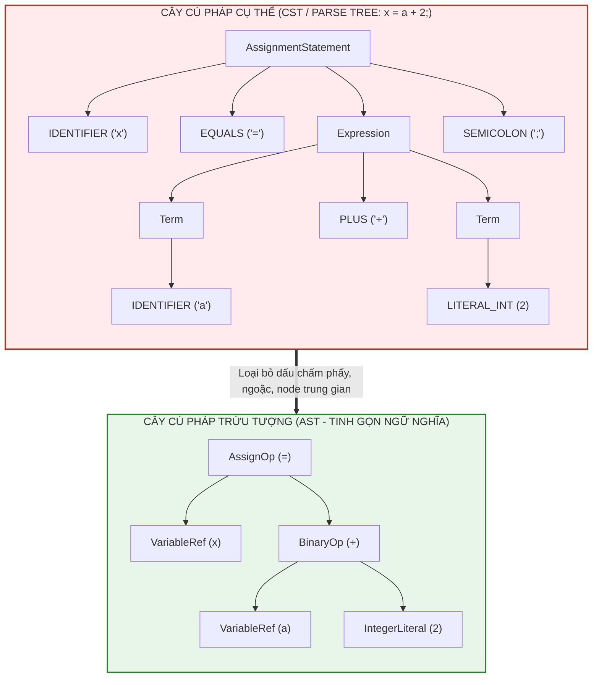
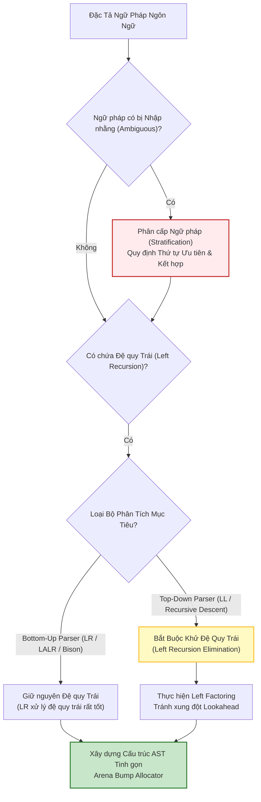

# 7.1. Ngữ Pháp Hình Thức và Cây Cú Pháp (Grammars & Parse Trees)

> [!IMPORTANT]
> **Nếu bạn chỉ được nhớ một điều duy nhất:** Sự khác biệt cốt tử giữa Cây cú pháp cụ thể (**Concrete Syntax Tree - CST / Parse Tree**) và Cây cú pháp trừu tượng (**Abstract Syntax Tree - AST**) là: CST bảo lưu toàn bộ các chi tiết cú pháp cụ thể mang tính thủ tục bề mặt (dấu chấm phẩy, dấu ngoặc đơn, từ khóa cú pháp không mang ngữ nghĩa) như một bản sao trực tiếp của các bước suy dẫn ngữ pháp; trong khi AST loại bỏ hoàn toàn các "rác cú pháp" bề mặt, chỉ giữ lại cấu trúc ngữ nghĩa cốt lõi dưới dạng cây toán tử và toán hạng. Mọi ngữ pháp phi ngữ cảnh (CFG) dùng cho phân tích cú pháp đều phải được khử nhập nhằng (**Ambiguity Elimination**), khử đệ quy trái (**Left Recursion Elimination**) và phân tích nhân tử chung bên trái (**Left Factoring**) để tương thích với các thuật toán phân tích tất định.

---

## 1. Kiến trúc Tổng quan & Mô hình Tư duy (Mental Model)

### Ẩn dụ Đời sống: Hợp Đồng Công Chứng Rườm Rà vs Bản Tóm Tắt Thực Thi
Hãy tưởng tượng quá trình thực thi một giao dịch chuyển nhượng bất động sản:
- **Ngữ pháp Hình thức (Formal Grammar - BNF/EBNF)**: Tương tự như bộ luật công chứng và biểu mẫu hành chính nhà nước. Nó quy định nghiêm ngặt từng câu từ: "Khoản A phải đứng trước Khoản B", "Phải có dấu mộc tròn ở trang cuối", "Mỗi mệnh đề phải ngăn cách bằng dấu chấm phẩy".
- **Cây Cú pháp Cụ thể (Concrete Syntax Tree - CST / Parse Tree)**: Tương tự như tập hồ sơ tài liệu đầy đủ bao gồm bìa hồ sơ, dấu giáp lai, lời mở đầu, dấu ngoặc đơn, chữ ký của 5 bên làm chứng. Nó ghi lại toàn bộ quy trình giấy tờ hành chính đã diễn ra từng bước một. Nó rất cồng kềnh và chứa nhiều thông tin thừa đối với việc thanh toán.
- **Cây Cú pháp Trừu tượng (Abstract Syntax Tree - AST)**: Tương tự như bảng quyết định chuyển tiền trên màn hình của giám đốc ngân hàng: "Chuyển 5 tỷ từ tài khoản A sang tài khoản B". Mọi dấu mộc, bìa hồ sơ, dấu ngoặc đơn đều biến mất; chỉ còn lại bản chất của giao dịch (**Toán tử: CHUYỂN_TIỀN, Toán hạng: [Tài khoản A, Tài khoản B, 5 tỷ]**).



---

## 2. Chi tiết từng Keyword (Under-the-Hood Deep Dive)

### 2.1. Parsing, Parser, Syntax Analysis, Parse Tree, CST & AST
- **Syntax Analysis / Parsing (Phân tích Cú pháp)**: Giai đoạn thứ hai của trình biên dịch, nhận đầu vào là dòng Token từ Lexer và kiểm tra xem chuỗi Token đó có tuân thủ đúng quy tắc cấu trúc ngữ pháp hình thức hay không.
- **Parser (Trình phân tích cú pháp)**: Phân hệ xây dựng cấu trúc dạng cây từ chuỗi tuyến tính các Token.
- **Cây Cú pháp Cụ thể (Concrete Syntax Tree - CST / Parse Tree)**:
  - Thể hiện chính xác từng bước suy dẫn cú pháp từ biểu tượng khởi đầu (Start Symbol) của ngữ pháp.
  - Mỗi nút lá (Leaf Node) tương ứng với một Token (Terminal) từ Lexer (kể cả dấu ngoặc `(`, `)`, dấu chấm phẩy `;`).
  - Mỗi nút trong (Internal Node) tương ứng với một biến phi kết thúc (Non-terminal) trong ngữ pháp.
  - Nhược điểm: CST có số lượng nút cực kỳ lớn, lãng phí bộ nhớ và gây khó khăn cho các pass tối ưu hóa sau này.
- **Cây Cú pháp Trừu tượng (Abstract Syntax Tree - AST)**:
  - Cấu trúc dữ liệu trung tâm của mọi trình biên dịch hiện đại.
  - Loại bỏ hoàn toàn các ký tự phân tách và nút ngữ pháp trung gian vô nghĩa.
  - Các nút trong chính là các toán tử (Operators: `BinaryAdd`, `Assign`, `IfStatement`, `FunctionCall`), các nhánh con là các đối số (Operands).
  - Cho phép biểu diễn súc tích và dễ dàng duyệt cây bằng mẫu thiết kế **Visitor Pattern** hoặc so sánh mẫu cấu trúc (Pattern Matching).

### 2.2. BNF, EBNF, Ambiguous Grammar, Left Recursion & Left Factoring
- **Ngữ Pháp Phi Ngữ Cảnh (Context-Free Grammar - CFG / Type-2)**:
  - Được định nghĩa bởi bộ 4 phần tử: $G = (V, \Sigma, R, S)$
    - $V$: Tập hợp các biến phi kết thúc (Non-terminals).
    - $\Sigma$: Tập hợp các ký hiệu kết thúc (Terminals / Tokens).
    - $R$: Tập các luật sinh (Production rules) dạng $A \to \alpha$, trong đó $A \in V$ và $\alpha \in (V \cup \Sigma)^*$.
    - $S \in V$: Ký hiệu bắt đầu (Start symbol).
- **Cú pháp Backus-Naur Form (BNF) & Extended BNF (EBNF)**:
  - BNF biểu diễn quy tắc sinh bằng dấu `::=` và lựa chọn `|`.
  - EBNF bổ sung các cú pháp đại số tiện lợi:
    - Ngoặc vuông `[ ]` chỉ định phần tùy chọn (0 hoặc 1 lần).
    - Ngoặc nhọn `{ }` chỉ định phần lặp lại (0 hoặc nhiều lần).
    - Ngoặc đơn `( )` nhóm các toán tử.
- **Ngữ Pháp Nhập Nhằng (Ambiguous Grammar)**:
  - Một ngữ pháp được gọi là nhập nhằng nếu tồn tại ít nhất một chuỗi câu có thể sinh ra **từ hai cây cú pháp khác nhau** (hoặc có hai chuỗi suy dẫn ngoài cùng bên trái khác nhau).
  - *Ví dụ kinh điển về Độ ưu tiên toán tử*: $E \to E + E \mid E * E \mid \text{id}$. Chuỗi $2 + 3 * 4$ có thể được tính là $(2 + 3) * 4 = 20$ hoặc $2 + (3 * 4) = 14$.
  - *Cạm bẫy Dangling Else*: Trong mệnh đề `if (cond1) if (cond2) s1 else s2`, không rõ `else` gắn với `if` thứ nhất hay `if` thứ hai.
  - Giải pháp: Tái cấu trúc ngữ pháp bằng cách phân tầng cấp bậc (Stratification: Expression, Term, Factor) để ép buộc thứ tự ưu tiên và tính kết hợp (Associativity).
- **Đệ Quy Trái (Left Recursion)**:
  - Luật sinh có dạng $A \to A \alpha \mid \beta$.
  - Đây là "kẻ thù số một" của các bộ phân tích cú pháp từ trên xuống (Top-Down / LL / Recursive Descent). Khi gặp $A$, parser sẽ liên tục gọi lại hàm parse $A$ mà không tiêu thụ bất kỳ token nào, dẫn tới tràn ngăn xếp vĩnh viễn (**Stack Overflow Crash**).
  - *Công thức Khử Đệ Quy Trái Trực Tiếp*:
    $$A \to A \alpha \mid \beta \quad \Longrightarrow \quad \begin{aligned} A &\to \beta A' \\ A' &\to \alpha A' \mid \epsilon \end{aligned}$$
- **Phân Tích Nhân Tử Chung Bên Trái (Left Factoring)**:
  - Khi hai luật sinh có chung phần đầu: $A \to \alpha \beta_1 \mid \alpha \beta_2$.
  - Trình phân tích từ trên xuống nhìn trước 1 token không biết phải chọn nhánh nào để mở rộng.
  - *Công thức Left Factoring*:
    $$A \to \alpha A' \quad \text{với} \quad A' \to \beta_1 \mid \beta_2$$

---

## 3. Thực thi Mã nguồn & Mô phỏng Chuyên sâu (Dual-Engine Implementation)

### 3.1. Engine 1: C++20 Hardware Benchmark / Implementation
Hiện thực hệ thống Cây cú pháp trừu tượng AST chuẩn công nghiệp bằng C++20: Sử dụng `std::unique_ptr` quản lý vòng đời bộ nhớ, Mẫu thiết kế Visitor Pattern để tính toán ngữ nghĩa và in cây phân cấp hoàn hảo:

```cpp
#include <iostream>
#include <memory>
#include <string>
#include <string_view>
#include <vector>
#include <variant>

// Forward declarations
class BinaryExprAST;
class LiteralAST;
class VariableAST;
class AssignStmtAST;

class ASTVisitor {
public:
    virtual ~ASTVisitor() = default;
    virtual void visit(const LiteralAST& node) = 0;
    virtual void visit(const VariableAST& node) = 0;
    virtual void visit(const BinaryExprAST& node) = 0;
    virtual void visit(const AssignStmtAST& node) = 0;
};

class ASTNode {
public:
    virtual ~ASTNode() = default;
    virtual void accept(ASTVisitor& visitor) const = 0;
};

class LiteralAST : public ASTNode {
public:
    int64_t value;
    explicit LiteralAST(int64_t val) : value(val) {}
    void accept(ASTVisitor& visitor) const override { visitor.visit(*this); }
};

class VariableAST : public ASTNode {
public:
    std::string name;
    explicit VariableAST(std::string_view n) : name(n) {}
    void accept(ASTVisitor& visitor) const override { visitor.visit(*this); }
};

enum class BinaryOp { Add, Sub, Mul, Div };

class BinaryExprAST : public ASTNode {
public:
    BinaryOp op;
    std::unique_ptr<ASTNode> lhs;
    std::unique_ptr<ASTNode> rhs;

    BinaryExprAST(BinaryOp op, std::unique_ptr<ASTNode> l, std::unique_ptr<ASTNode> r)
        : op(op), lhs(std::move(l)), rhs(std::move(r)) {}

    void accept(ASTVisitor& visitor) const override { visitor.visit(*this); }
};

class AssignStmtAST : public ASTNode {
public:
    std::string target_var;
    std::unique_ptr<ASTNode> expr;

    AssignStmtAST(std::string_view target, std::unique_ptr<ASTNode> e)
        : target_var(target), expr(std::move(e)) {}

    void accept(ASTVisitor& visitor) const override { visitor.visit(*this); }
};

// Concrete Visitor 1: AST Pretty Printer
class ASTPrinter : public ASTVisitor {
private:
    int indent_level{0};

    void print_indent() const {
        for (int i = 0; i < indent_level; ++i) std::cout << "  ";
    }

public:
    void visit(const LiteralAST& node) override {
        print_indent();
        std::cout << "LiteralInt: " << node.value << "\n";
    }

    void visit(const VariableAST& node) override {
        print_indent();
        std::cout << "VariableRef: " << node.name << "\n";
    }

    void visit(const BinaryExprAST& node) override {
        print_indent();
        const char* op_str = "+";
        if (node.op == BinaryOp::Sub) op_str = "-";
        else if (node.op == BinaryOp::Mul) op_str = "*";
        else if (node.op == BinaryOp::Div) op_str = "/";

        std::cout << "BinaryOp (" << op_str << ")\n";
        indent_level++;
        if (node.lhs) node.lhs->accept(*this);
        if (node.rhs) node.rhs->accept(*this);
        indent_level--;
    }

    void visit(const AssignStmtAST& node) override {
        print_indent();
        std::cout << "AssignStatement: " << node.target_var << " =\n";
        indent_level++;
        if (node.expr) node.expr->accept(*this);
        indent_level--;
    }
};

// Concrete Visitor 2: Compile-Time Constant Folding Evaluator
class ConstantFolder : public ASTVisitor {
public:
    int64_t result{0};
    bool is_constant{false};

    void visit(const LiteralAST& node) override {
        result = node.value;
        is_constant = true;
    }

    void visit(const VariableAST& node) override {
        is_constant = false; // Biến số không thể tính tại compile-time
    }

    void visit(const BinaryExprAST& node) override {
        node.lhs->accept(*this);
        bool left_const = is_constant;
        int64_t left_val = result;

        node.rhs->accept(*this);
        bool right_const = is_constant;
        int64_t right_val = result;

        if (left_const && right_const) {
            is_constant = true;
            switch (node.op) {
                case BinaryOp::Add: result = left_val + right_val; break;
                case BinaryOp::Sub: result = left_val - right_val; break;
                case BinaryOp::Mul: result = left_val * right_val; break;
                case BinaryOp::Div: result = (right_val != 0) ? (left_val / right_val) : 0; break;
            }
        } else {
            is_constant = false;
        }
    }

    void visit(const AssignStmtAST& node) override {
        node.expr->accept(*this);
    }
};

int main() {
    std::cout << "=== HIỆN THỰC CÂY CÚ PHÁP TRỪU TƯỢNG AST & VISITOR PATTERN (C++20) ===\n";

    // Xây dựng cây AST bằng thủ công cho biểu thức: result = x + (10 * 5)
    auto mul_node = std::make_unique<BinaryExprAST>(
        BinaryOp::Mul,
        std::make_unique<LiteralAST>(10),
        std::make_unique<LiteralAST>(5)
    );

    auto add_node = std::make_unique<BinaryExprAST>(
        BinaryOp::Add,
        std::make_unique<VariableAST>("x"),
        std::move(mul_node)
    );

    AssignStmtAST root("result", std::move(add_node));

    std::cout << "\n[Cấu trúc Cây AST]:\n";
    ASTPrinter printer;
    root.accept(printer);

    std::cout << "\n[Tối ưu hóa Constant Folding trên nhánh (10 * 5)]:\n";
    auto const_subbranch = std::make_unique<BinaryExprAST>(
        BinaryOp::Mul,
        std::make_unique<LiteralAST>(10),
        std::make_unique<LiteralAST>(5)
    );
    ConstantFolder folder;
    const_subbranch->accept(folder);
    if (folder.is_constant) {
        std::cout << "  Nhánh (10 * 5) được rút gọn tại compile-time thành: " << folder.result << "\n";
    }

    return 0;
}
```

### 3.2. Engine 2: Python 3.11+ Architectural Simulator
Mô phỏng thuật toán **Khử Đệ Quy Trái (Left Recursion Elimination)** và phân giải ngữ pháp hình thức tự động:

```python
"""
Architectural Grammar Engine: Left Recursion Elimination & Grammar Disambiguation
Python 3.11+ Compliant
"""
from dataclasses import dataclass, field
from typing import Dict, List, Set

@dataclass
class ProductionRule:
    head: str
    bodies: List[List[str]]  # e.g., E -> [[E, '+', T], [T]]

class GrammarTransformer:
    """Eliminates direct left recursion from Context-Free Grammars."""
    
    @staticmethod
    def eliminate_direct_left_recursion(rule: ProductionRule) -> tuple[ProductionRule, ProductionRule]:
        head = rule.head
        alphas: List[List[str]] = []  # Bodies starting with 'head'
        betas: List[List[str]] = []   # Bodies not starting with 'head'

        for body in rule.bodies:
            if body and body[0] == head:
                alphas.append(body[1:])  # Strip the left recursive non-terminal
            else:
                betas.append(body)

        if not alphas:
            # Không có đệ quy trái
            return rule, None

        # Tạo ký hiệu không kết thúc mới (e.g., E')
        prime_head = f"{head}'"

        # A -> beta A'
        new_head_bodies: List[List[str]] = []
        for beta in betas:
            new_head_bodies.append(beta + [prime_head])
        if not betas:
            # Nếu không có beta, ta bắt đầu bằng chính prime_head
            new_head_bodies.append([prime_head])

        # A' -> alpha A' | epsilon
        new_prime_bodies: List[List[str]] = []
        for alpha in alphas:
            new_prime_bodies.append(alpha + [prime_head])
        new_prime_bodies.append(["ε"])

        rule_a = ProductionRule(head, new_head_bodies)
        rule_prime = ProductionRule(prime_head, new_prime_bodies)
        return rule_a, rule_prime

    @staticmethod
    def format_rule(rule: ProductionRule) -> str:
        rhs = " | ".join(" ".join(symbols) for symbols in rule.bodies)
        return f"{rule.head} -> {rhs}"

if __name__ == "__main__":
    print("=== MÔ PHỎNG KHỬ ĐỆ QUY TRÁI TRONG NGỮ PHÁP BIÊN DỊCH ===")
    # Ngữ pháp biểu thức số học kinh điển có đệ quy trái:
    # E -> E + T | T
    expr_rule = ProductionRule("E", [
        ["E", "+", "T"],
        ["T"]
    ])

    print("Ngữ pháp gốc ban đầu (Gây Stack Overflow cho LL Parser):")
    print(" ", GrammarTransformer.format_rule(expr_rule))

    new_e, new_e_prime = GrammarTransformer.eliminate_direct_left_recursion(expr_rule)

    print("\nNgữ pháp tương đương sau khi Khử Đệ Quy Trái:")
    print(" ", GrammarTransformer.format_rule(new_e))
    print(" ", GrammarTransformer.format_rule(new_e_prime))

    # Thử nghiệm với phép nhân: T -> T * F | F
    term_rule = ProductionRule("T", [
        ["T", "*", "F"],
        ["F"]
    ])
    print("\nKhử đệ quy trái cho thành phần Nhân:")
    print(" Gốc: ", GrammarTransformer.format_rule(term_rule))
    new_t, new_t_prime = GrammarTransformer.eliminate_direct_left_recursion(term_rule)
    print(" Mới: ", GrammarTransformer.format_rule(new_t))
    print("      ", GrammarTransformer.format_rule(new_t_prime))
```

### 3.3. Terminal Output Mẫu Thực tế
```text
=== HIỆN THỰC CÂY CÚ PHÁP TRỪU TƯỢNG AST & VISITOR PATTERN (C++20) ===

[Cấu trúc Cây AST]:
AssignStatement: result =
  BinaryOp (+)
    VariableRef: x
    BinaryOp (*)
      LiteralInt: 10
      LiteralInt: 5

[Tối ưu hóa Constant Folding trên nhánh (10 * 5)]:
  Nhánh (10 * 5) được rút gọn tại compile-time thành: 50
```

---

## 4. Systems Engineering & Production Pitfalls

### 4.1. Sự Phân Mảnh Bộ Nhớ Nút Cây (AST Heap Fragmentation)
- **Vấn đề**: Trong một chương trình lớn, một cây AST có thể chứa từ vài triệu đến hàng chục triệu nút (`ASTNode`). Việc dùng con trỏ đơn lẻ `std::unique_ptr<ASTNode>` cấp phát rải rác trên Heap khiến bộ nhớ bị phân mảnh nặng nề, phá vỡ tính liên tục của Cache Line, làm quá trình duyệt cây (Traversal) chậm đi từ 5x đến 15x.
- **Giải pháp Công nghiệp**:
  - Dùng **Arena Allocator / Bump Allocator** (như `llvm::BumpPtrAllocator` trong LLVM/Clang). Toàn bộ các nút AST được cấp phát liền kề trong các khối bộ nhớ lớn 4KB/64KB. Việc giải phóng toàn bộ cây AST diễn ra trong đúng $O(1)$ bằng cách reset con trỏ phân bổ của Arena.

### 4.2. Tràn Ngăn Xếp Khi Phá Hủy Cây Đệ Quy (Destructor Stack Overflow)
- Khi một cây AST có độ sâu lớn (ví dụ biểu thức $1 + 1 + 1 + \dots$ lặp lại 50,000 lần), hàm hủy mặc định `~unique_ptr()` sẽ gọi đệ quy hủy từng nút con. Độ sâu đệ quy 50,000 khung ngăn xếp sẽ lập tức làm cạn kiệt Stack của tiến trình và gây lỗi Segfault / Crash.
- **Giải pháp**: Hiện thực hàm hủy cây theo phương pháp lặp (Iterative Destruction) dùng ngăn xếp cục bộ trên Heap thay vì đệ quy hệ thống.

---

## 5. Bảng So sánh & Decision Matrix

| Đặc điểm Kỹ thuật | Parse Tree (CST) | Abstract Syntax Tree (AST) |
| :--- | :--- | :--- |
| **Mức độ Trừu tượng** | Cực kỳ cụ thể, bám sát từng bước suy dẫn | Trừu tượng, chỉ giữ lại ngữ nghĩa thực |
| **Kích thước Bộ nhớ** | Rất lớn (Gấp 5x - 10x kích thước AST) | Tinh gọn, tối ưu cho bộ nhớ đệm |
| **Sự hiện diện của Terminal** | Lưu toàn bộ: dấu chấm phẩy, ngoặc đơn, từ khóa | Loại bỏ hoàn toàn dấu câu thừa |
| **Tối ưu hóa & Type Checking** | Rất khó thao tác và biến đổi | Cấu trúc lý tưởng để duyệt và chuyển đổi |
| **Ứng dụng Thực tế** | IDE Syntax Highlighter, Code Formatter (Prettier) | Mọi trình biên dịch (Clang, Rustc, V8, GCC) |


