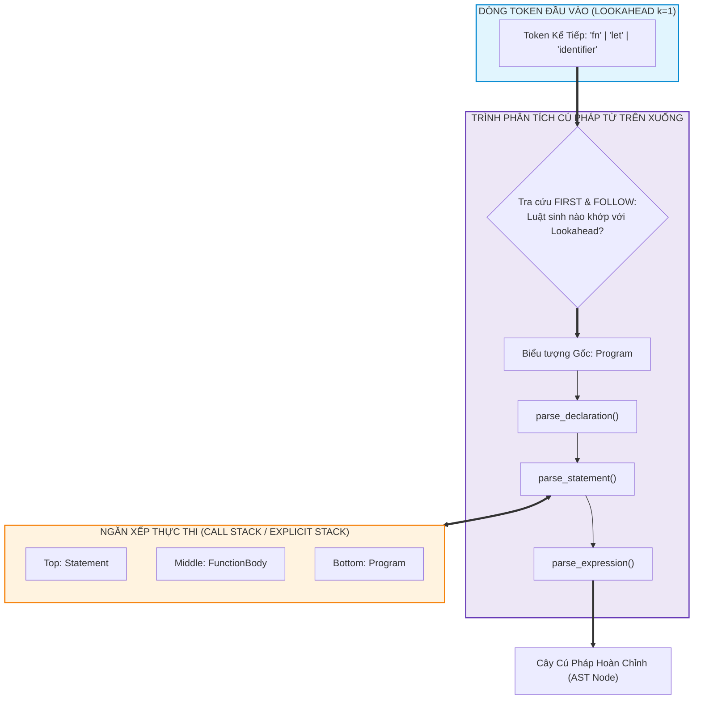
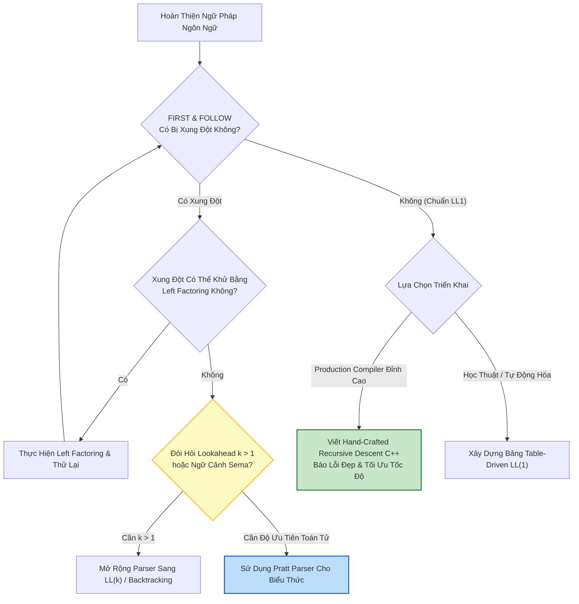

# 7.2. Phân Tích Cú Pháp Từ Trên Xuống (Top-Down Parsing & LL Parsers)

> [!IMPORTANT]
> **Nếu bạn chỉ được nhớ một điều duy nhất:** Phân tích cú pháp từ trên xuống (**Top-Down Parsing**) xây dựng cây cú pháp bắt đầu từ nút gốc biểu tượng khởi đầu ($S$) đi dần xuống các nút lá bằng cách dự đoán các luật sinh cần mở rộng. Dạng thức phổ biến và mạnh mẽ nhất trong các trình biên dịch công nghiệp thực chiến (như GCC, Clang, Rustc, Go) là **Phân tích Đệ quy Giảm dần (Recursive Descent Parsing)** kết hợp nhìn trước $k$ token (**Predictive Parsing**). Ngữ pháp có thể phân tích được bằng thuật toán **LL(1)** (quét từ trái sang phải **L**eft-to-right, suy dẫn ngoài cùng bên trái **L**eftmost derivation, nhìn trước **1** token) bắt buộc không được có đệ quy trái và các tập hợp toán học **$\text{FIRST}$** và **$\text{FOLLOW}$** của các luật sinh lựa chọn phải hoàn toàn rời nhau (Disjoint).

---

## 1. Kiến trúc Tổng quan & Mô hình Tư duy (Mental Model)

### Ẩn dụ Đời sống: Người Thợ Mộc Đóng Bàn Ghế Theo Bản Vẽ Thiết Kế
Hãy tưởng tượng một người thợ mộc nhận nhiệm vụ chế tác một chiếc bàn làm việc cao cấp:
- **Biểu tượng gốc ($S$ - Cái Bàn Hoàn Chỉnh)**: Người thợ bắt đầu từ mục tiêu tối cao: "Tôi cần làm một Cái Bàn".
- **Phân rã Từ Trên Xuống (Top-Down Decomposition)**:
  - Bản thiết kế quy định: `Cái Bàn` gồm `Mặt Bàn` + `Bộ 4 Chân Bàn` + `Ngăn Kéo Tùy Chọn`.
  - Để làm `Mặt Bàn`, ông gọi một quy trình con: "Làm phẳng tấm gỗ sồi".
  - Để làm `Chân Bàn`, ông gọi một quy trình con: "Tiện 4 trụ gỗ tròn".
  - Mỗi khi cần quyết định (ví dụ: làm bàn có ngăn kéo hay không có ngăn kéo), ông nhìn vào đơn đặt hàng kế tiếp (**Lookahead Token = 1**). Nếu thấy chữ "Yêu cầu ngăn kéo", ông rẽ nhánh sang phương án tương ứng mà không bao giờ phải đập đi xây lại.
- **Table-Driven LL(1) vs Recursive Descent**:
  - *Recursive Descent*: Người thợ tự tay thực hiện từng bước bằng chính các thói quen phản xạ đệ quy trong não bộ (các hàm gọi hàm lồng nhau trong mã nguồn C++/Rust).
  - *Table-Driven LL(1)*: Người thợ là một cỗ máy tự động hóa, nhìn vào một **Bảng Ma Trận Hướng Dẫn** dạng 2D `[Mục tiêu hiện tại][Vật liệu nhìn thấy]` và một chiếc ngăn xếp (Stack) chứa danh sách các bộ phận còn nợ cần chế tạo.



---

## 2. Chi tiết từng Keyword (Under-the-Hood Deep Dive)

### 2.1. Top-Down Parsing, Recursive Descent & Predictive Parsing
- **Top-Down Parsing (Phân tích từ trên xuống)**:
  - Mục tiêu: Tìm một chuỗi các suy dẫn ngoài cùng bên trái (**Leftmost Derivation**) để biến đổi ký hiệu bắt đầu $S$ thành chuỗi các token đầu vào $w$.
  - Cây phân tích được kiến tạo từ gốc (Root) lan dần xuống các lá (Leaves).
- **Recursive Descent Parsing (Phân tích Đệ quy Giảm dần)**:
  - Mỗi biến phi kết thúc (Non-terminal $A$) trong ngữ pháp được ánh xạ trực tiếp thành **một hàm trong mã nguồn** (ví dụ: `parse_expr()`, `parse_statement()`).
  - Cấu trúc cây suy dẫn được phản ánh tự nhiên thông qua Call Stack của chương trình.
  - Cực kỳ linh hoạt, dễ đọc, dễ bảo trì, và cho phép viết các thông điệp báo lỗi (Compiler Diagnostics) tuyệt vời nhất trong ngành công nghiệp.
- **Predictive Parsing (Phân tích Dự đoán)**:
  - Một dạng phân tích đệ quy giảm dần không bao giờ cần quay lui (No Backtracking).
  - Dựa trên một số lượng cố định các token nhìn trước ($k$, thường là $k=1$), trình phân tích có thể lựa chọn chính xác duy nhất luật sinh cần mở rộng.
  - Yêu cầu ngữ pháp phải thỏa mãn điều kiện lớp ngữ pháp $LL(k)$.

### 2.2. LL Parser, LL(1) & Tập Hợp Toán Học FIRST và FOLLOW
- **Ký hiệu $LL(k)$**:
  - Chữ **L** thứ nhất: Quét đầu vào từ trái sang phải (**L**eft-to-right scan).
  - Chữ **L** thứ hai: Xây dựng suy dẫn ngoài cùng bên trái (**L**eftmost derivation).
  - Tham số **$k$**: Số lượng token nhìn trước (**$k$ tokens of lookahead**). Nếu $k=1$, gọi tắt là $LL(1)$.
- **Tập Hợp Toán Học $\text{FIRST}(\alpha)$**:
  - Với một chuỗi ký hiệu ngữ pháp $\alpha \in (V \cup \Sigma)^*$, $\text{FIRST}(\alpha)$ là tập hợp tất cả các ký hiệu kết thúc (Terminals) có thể xuất hiện ở vị trí đầu tiên của các chuỗi được suy dẫn ra từ $\alpha$.
  - Nếu $\alpha \Rightarrow^* \epsilon$, thì $\epsilon \in \text{FIRST}(\alpha)$.
  - *Quy tắc Tính toán*:
    1. Nếu $X$ là Terminal, thì $\text{FIRST}(X) = \{X\}$.
    2. Nếu $X \to \epsilon$ là một luật sinh, thêm $\epsilon$ vào $\text{FIRST}(X)$.
    3. Nếu $X$ là Non-terminal và $X \to Y_1 Y_2 \dots Y_k$, thêm tất cả các ký hiệu không phải $\epsilon$ từ $\text{FIRST}(Y_1)$ vào $\text{FIRST}(X)$. Nếu $Y_1 \Rightarrow^* \epsilon$, xét tiếp $\text{FIRST}(Y_2)$, v.v.
- **Tập Hợp Toán Học $\text{FOLLOW}(A)$**:
  - Với một biến phi kết thúc $A \in V$, $\text{FOLLOW}(A)$ là tập hợp tất cả các ký hiệu kết thúc (Terminals) có thể xuất hiện ngay sau $A$ trong một dạng câu bất kỳ được suy dẫn từ ký hiệu gốc $S$.
  - *Quy tắc Tính toán*:
    1. Đặt ký hiệu kết thúc file $\$$ vào $\text{FOLLOW}(S)$ ($S$ là start symbol).
    2. Nếu có luật sinh $A \to \alpha B \beta$, thì mọi ký hiệu trong $\text{FIRST}(\beta)$ (ngoại trừ $\epsilon$) đều thuộc $\text{FOLLOW}(B)$.
    3. Nếu có luật sinh $A \to \alpha B$, hoặc $A \to \alpha B \beta$ với $\epsilon \in \text{FIRST}(\beta)$, thì mọi phần tử trong $\text{FOLLOW}(A)$ đều thuộc về $\text{FOLLOW}(B)$.
- **Điều Kiện Cần và Đủ để Ngữ Pháp là $LL(1)$**:
  Một ngữ pháp $G$ là $LL(1)$ khi và chỉ khi với mọi cặp luật sinh lựa chọn của cùng một biến phi kết thúc $A \to \alpha \mid \beta$:
  1. $\text{FIRST}(\alpha) \cap \text{FIRST}(\beta) = \emptyset$ (Không có xung đột First/First).
  2. Nếu $\epsilon \in \text{FIRST}(\beta)$, thì $\text{FIRST}(\alpha) \cap \text{FOLLOW}(A) = \emptyset$ (Không có xung đột First/Follow).
- **Table-Driven LL(1) Parser Engine**:
  - Xây dựng ma trận phân tích $M[A, a]$ trong đó $A$ là Non-terminal, $a$ là Terminal hoặc $\$$.
  - Sử dụng một cấu trúc ngăn xếp rõ ràng (Explicit Stack) thay vì Call Stack: Nạp ký hiệu bắt đầu $S$ và $\$$ vào đáy ngăn xếp. Liên tục so khớp đỉnh ngăn xếp với token đầu vào và tra cứu ma trận $M$ để thay thế non-terminal bằng vế phải của luật sinh.

---

## 3. Thực thi Mã nguồn & Mô phỏng Chuyên sâu (Dual-Engine Implementation)

### 3.1. Engine 1: C++20 Hardware Benchmark / Implementation
Hiện thực bộ phân tích cú pháp đệ quy giảm dần (**Recursive Descent LL(1) Predictive Parser**) hoàn chỉnh bằng C++20 cho ngôn ngữ biểu thức số học có gán biến, xây dựng cây AST, bắt lỗi cú pháp và phục hồi lỗi đồng bộ hóa (**Panic-Mode Error Recovery with Synchronization Tokens**):

```cpp
#include <iostream>
#include <string_view>
#include <vector>
#include <memory>
#include <stdexcept>
#include <iomanip>

enum class TokType {
    Eof,
    Number,
    Ident,
    Plus,
    Minus,
    Mul,
    Div,
    Assign,
    LParen,
    RParen,
    Semi,
    Error
};

struct Token {
    TokType type;
    std::string_view text;
    int64_t val{0};
};

// Simple Lexer for LL(1) Parser
class SimpleLexer {
private:
    std::string_view src_;
    size_t pos_{0};

public:
    explicit SimpleLexer(std::string_view src) : src_(src) {}

    Token next() {
        while (pos_ < src_.size() && (src_[pos_] == ' ' || src_[pos_] == '\t' || src_[pos_] == '\n' || src_[pos_] == '\r')) {
            pos_++;
        }
        if (pos_ >= src_.size()) return {TokType::Eof, ""};

        char c = src_[pos_];
        if (std::isalpha(c) || c == '_') {
            size_t start = pos_;
            while (pos_ < src_.size() && (std::isalnum(src_[pos_]) || src_[pos_] == '_')) pos_++;
            return {TokType::Ident, src_.substr(start, pos_ - start)};
        }
        if (std::isdigit(c)) {
            size_t start = pos_;
            int64_t val = 0;
            while (pos_ < src_.size() && std::isdigit(src_[pos_])) {
                val = val * 10 + (src_[pos_] - '0');
                pos_++;
            }
            return {TokType::Number, src_.substr(start, pos_ - start), val};
        }

        pos_++;
        switch (c) {
            case '+': return {TokType::Plus, "+"};
            case '-': return {TokType::Minus, "-"};
            case '*': return {TokType::Mul, "*"};
            case '/': return {TokType::Div, "/"};
            case '=': return {TokType::Assign, "="};
            case '(': return {TokType::LParen, "("};
            case ')': return {TokType::RParen, ")"};
            case ';': return {TokType::Semi, ";"};
            default:  return {TokType::Error, src_.substr(pos_ - 1, 1)};
        }
    }
};

// AST Nodes
struct ExprAST { virtual ~ExprAST() = default; virtual void print(int indent) const = 0; };
struct NumAST : ExprAST {
    int64_t val;
    explicit NumAST(int64_t v) : val(v) {}
    void print(int indent) const override {
        std::cout << std::string(indent * 2, ' ') << "Num(" << val << ")\n";
    }
};
struct VarAST : ExprAST {
    std::string name;
    explicit VarAST(std::string_view n) : name(n) {}
    void print(int indent) const override {
        std::cout << std::string(indent * 2, ' ') << "Var(" << name << ")\n";
    }
};
struct BinOpAST : ExprAST {
    char op;
    std::unique_ptr<ExprAST> lhs, rhs;
    BinOpAST(char op, std::unique_ptr<ExprAST> l, std::unique_ptr<ExprAST> r)
        : op(op), lhs(std::move(l)), rhs(std::move(r)) {}
    void print(int indent) const override {
        std::cout << std::string(indent * 2, ' ') << "BinOp(" << op << ")\n";
        lhs->print(indent + 1);
        rhs->print(indent + 1);
    }
};
struct AssignAST {
    std::string var;
    std::unique_ptr<ExprAST> expr;
    void print(int indent) const {
        std::cout << std::string(indent * 2, ' ') << "Assign: " << var << " =\n";
        expr->print(indent + 1);
    }
};

// Recursive Descent LL(1) Parser
class RecursiveDescentParser {
private:
    SimpleLexer lexer_;
    Token curr_tok_;

    void advance() {
        curr_tok_ = lexer_.next();
    }

    bool match(TokType t) {
        if (curr_tok_.type == t) {
            advance();
            return true;
        }
        return false;
    }

    void expect(TokType t, std::string_view msg) {
        if (curr_tok_.type == t) {
            advance();
        } else {
            std::cerr << "[Syntax Error]: " << msg << " (Gặp token: '" << curr_tok_.text << "')\n";
            // Panic Mode: Skip until synchronization token (e.g., Semicolon)
            while (curr_tok_.type != TokType::Semi && curr_tok_.type != TokType::Eof) {
                advance();
            }
        }
    }

public:
    explicit RecursiveDescentParser(std::string_view src) : lexer_(src) {
        advance(); // Pre-fetch lookahead token
    }

    // EBNF:
    // Factor -> NUMBER | IDENT | '(' Expr ')'
    std::unique_ptr<ExprAST> parse_factor() {
        if (curr_tok_.type == TokType::Number) {
            int64_t v = curr_tok_.val;
            advance();
            return std::make_unique<NumAST>(v);
        } else if (curr_tok_.type == TokType::Ident) {
            std::string n(curr_tok_.text);
            advance();
            return std::make_unique<VarAST>(n);
        } else if (match(TokType::LParen)) {
            auto expr = parse_expr();
            expect(TokType::RParen, "Kỳ vọng dấu ')' đóng ngoặc biểu thức");
            return expr;
        } else {
            std::cerr << "[Syntax Error]: Kỳ vọng biểu thức toán hạng hợp lệ!\n";
            advance();
            return std::make_unique<NumAST>(0);
        }
    }

    // Term -> Factor ( ('*' | '/') Factor )*
    std::unique_ptr<ExprAST> parse_term() {
        auto lhs = parse_factor();
        while (curr_tok_.type == TokType::Mul || curr_tok_.type == TokType::Div) {
            char op = (curr_tok_.type == TokType::Mul) ? '*' : '/';
            advance();
            auto rhs = parse_factor();
            lhs = std::make_unique<BinOpAST>(op, std::move(lhs), std::move(rhs));
        }
        return lhs;
    }

    // Expr -> Term ( ('+' | '-') Term )*
    std::unique_ptr<ExprAST> parse_expr() {
        auto lhs = parse_term();
        while (curr_tok_.type == TokType::Plus || curr_tok_.type == TokType::Minus) {
            char op = (curr_tok_.type == TokType::Plus) ? '+' : '-';
            advance();
            auto rhs = parse_term();
            lhs = std::make_unique<BinOpAST>(op, std::move(lhs), std::move(rhs));
        }
        return lhs;
    }

    // Statement -> IDENT '=' Expr ';'
    std::unique_ptr<AssignAST> parse_statement() {
        if (curr_tok_.type != TokType::Ident) return nullptr;
        std::string var_name(curr_tok_.text);
        advance();
        expect(TokType::Assign, "Kỳ vọng dấu '=' sau tên biến");
        auto expr = parse_expr();
        expect(TokType::Semi, "Kỳ vọng dấu ';' kết thúc câu lệnh");
        auto stmt = std::make_unique<AssignAST>();
        stmt->var = var_name;
        stmt->expr = std::move(expr);
        return stmt;
    }

    std::vector<std::unique_ptr<AssignAST>> parse_program() {
        std::vector<std::unique_ptr<AssignAST>> stmts;
        while (curr_tok_.type != TokType::Eof) {
            auto s = parse_statement();
            if (s) stmts.push_back(std::move(s));
            else advance();
        }
        return stmts;
    }
};

int main() {
    std::string_view code = 
        "total = x + y * 10;\n"
        "res = (a - 5) / 2;\n";

    std::cout << "=== BẮT ĐẦU PHÂN TÍCH RECURSIVE DESCENT LL(1) (C++20) ===\n";
    RecursiveDescentParser parser(code);
    auto program = parser.parse_program();

    std::cout << "Phân tích thành công " << program.size() << " câu lệnh AST:\n\n";
    for (size_t i = 0; i < program.size(); ++i) {
        std::cout << "[Câu lệnh " << (i + 1) << "]:\n";
        program[i]->print(1);
        std::cout << "\n";
    }
    return 0;
}
```

### 3.2. Engine 2: Python 3.11+ Architectural Simulator
Mô phỏng thuật toán tính toán toán học hai tập hợp **$\text{FIRST}$** và **$\text{FOLLOW}$** cùng bộ sinh bảng phân tích cú pháp **Table-Driven LL(1) Parser**:

```python
"""
Architectural LL(1) Engine: FIRST & FOLLOW Set Calculator and Table-Driven Parser
Python 3.11+ Compliant
"""
from typing import Dict, Set, List, Tuple

EPSILON = 'ε'
EOF_MARKER = '$'

class LL1GrammarAnalysis:
    def __init__(self, non_terminals: Set[str], terminals: Set[str],
                 rules: Dict[str, List[List[str]]], start_symbol: str):
        self.non_terminals = non_terminals
        self.terminals = terminals
        self.rules = rules
        self.start_symbol = start_symbol
        self.first: Dict[str, Set[str]] = {nt: set() for nt in non_terminals}
        self.follow: Dict[str, Set[str]] = {nt: set() for nt in non_terminals}
        self.parse_table: Dict[Tuple[str, str], List[str]] = {}

    def compute_first(self):
        # 1. Terminals
        for t in self.terminals:
            self.first[t] = {t}

        changed = True
        while changed:
            changed = False
            for head, bodies in self.rules.items():
                for body in bodies:
                    # Case epsilon
                    if body == [EPSILON]:
                        if EPSILON not in self.first[head]:
                            self.first[head].add(EPSILON)
                            changed = True
                        continue

                    # Chain of symbols
                    all_derive_eps = True
                    for symbol in body:
                        sym_first = self.first.get(symbol, {symbol})
                        before_len = len(self.first[head])
                        self.first[head].update(sym_first - {EPSILON})
                        if len(self.first[head]) > before_len:
                            changed = True

                        if EPSILON not in sym_first:
                            all_derive_eps = False
                            break

                    if all_derive_eps:
                        if EPSILON not in self.first[head]:
                            self.first[head].add(EPSILON)
                            changed = True

    def compute_follow(self):
        self.follow[self.start_symbol].add(EOF_MARKER)

        changed = True
        while changed:
            changed = False
            for head, bodies in self.rules.items():
                for body in bodies:
                    for i, symbol in enumerate(body):
                        if symbol in self.non_terminals:
                            # Symbols after this one
                            beta = body[i + 1:]
                            beta_first: Set[str] = set()
                            all_beta_eps = True
                            for b in beta:
                                b_f = self.first.get(b, {b})
                                beta_first.update(b_f - {EPSILON})
                                if EPSILON not in b_f:
                                    all_beta_eps = False
                                    break

                            before_len = len(self.follow[symbol])
                            self.follow[symbol].update(beta_first)

                            # If beta derives epsilon or is empty, add follow(head)
                            if all_beta_eps:
                                self.follow[symbol].update(self.follow[head])

                            if len(self.follow[symbol]) > before_len:
                                changed = True

    def build_ll1_table(self) -> bool:
        is_ll1 = True
        for head, bodies in self.rules.items():
            for body in bodies:
                # Compute FIRST(body)
                first_body: Set[str] = set()
                all_eps = True
                for s in body:
                    if s == EPSILON:
                        first_body.add(EPSILON)
                        break
                    sf = self.first.get(s, {s})
                    first_body.update(sf - {EPSILON})
                    if EPSILON not in sf:
                        all_eps = False
                        break
                if all_eps:
                    first_body.add(EPSILON)

                for terminal in first_body - {EPSILON}:
                    key = (head, terminal)
                    if key in self.parse_table:
                        print(f"[Xung đột LL1]: Ô M[{head}, {terminal}] đã tồn tại luật!")
                        is_ll1 = False
                    self.parse_table[key] = body

                if EPSILON in first_body:
                    for terminal in self.follow[head]:
                        key = (head, terminal)
                        if key in self.parse_table:
                            print(f"[Xung đột LL1 FIRST/FOLLOW]: Ô M[{head}, {terminal}]!")
                            is_ll1 = False
                        self.parse_table[key] = body
        return is_ll1

if __name__ == "__main__":
    print("=== TÍNH TOÁN FIRST & FOLLOW CHO NGỮ PHÁP BIỂU THỨC LL(1) ===")
    # E  -> T E'
    # E' -> + T E' | ε
    # T  -> F T'
    # T' -> * F T' | ε
    # F  -> ( E ) | id
    non_terms = {"E", "E'", "T", "T'", "F"}
    terms = {"+", "*", "(", ")", "id", EOF_MARKER}
    grammar_rules = {
        "E": [["T", "E'"]],
        "E'": [["+", "T", "E'"], [EPSILON]],
        "T": [["F", "T'"]],
        "T'": [["*", "F", "T'"], [EPSILON]],
        "F": [["(", "E", ")"], ["id"]]
    }

    analyzer = LL1GrammarAnalysis(non_terms, terms, grammar_rules, "E")
    analyzer.compute_first()
    analyzer.compute_follow()
    is_valid_ll1 = analyzer.build_ll1_table()

    print("\n[TẬP HỢP FIRST]:")
    for nt in sorted(non_terms):
        print(f"  FIRST({nt:<2}) = {sorted(list(analyzer.first[nt]))}")

    print("\n[TẬP HỢP FOLLOW]:")
    for nt in sorted(non_terms):
        print(f"  FOLLOW({nt:<2}) = {sorted(list(analyzer.follow[nt]))}")

    print(f"\nKiểm tra chuẩn văn phạm LL(1): {'HOÀN HẢO (HỢP LỆ LL1)' if is_valid_ll1 else 'XUNG ĐỘT'}")
    print(f"Tổng số mục trong Bảng Phân Tích M[NonTerminal, Terminal]: {len(analyzer.parse_table)}")
```

### 3.3. Terminal Output Mẫu Thực tế
```text
=== BẮT ĐẦU PHÂN TÍCH RECURSIVE DESCENT LL(1) (C++20) ===
Phân tích thành công 2 câu lệnh AST:

[Câu lệnh 1]:
  Assign: total =
    BinOp(+)
      Var(x)
      BinOp(*)
        Var(y)
        Num(10)

[Câu lệnh 2]:
  Assign: res =
    BinOp(/)
      BinOp(-)
        Var(a)
        Num(5)
      Num(2)

=== TÍNH TOÁN FIRST & FOLLOW CHO NGỮ PHÁP BIỂU THỨC LL(1) ===
[TẬP HỢP FIRST]:
  FIRST(E ) = ['(', 'id']
  FIRST(E') = ['+', 'ε']
  FIRST(F ) = ['(', 'id']
  FIRST(T ) = ['(', 'id']
  FIRST(T') = ['*', 'ε']

[TẬP HỢP FOLLOW]:
  FOLLOW(E ) = ['$', ')']
  FOLLOW(E') = ['$', ')']
  FOLLOW(F ) = ['$', ')', '*', '+']
  FOLLOW(T ) = ['$', ')', '+']
  FOLLOW(T') = ['$', ')', '+']

Kiểm tra chuẩn văn phạm LL(1): HOÀN HẢO (HỢP LỆ LL1)
Tổng số mục trong Bảng Phân Tích M[NonTerminal, Terminal]: 13
```

---

## 4. Systems Engineering & Production Pitfalls

### 4.1. Giới Hạn Của Độ Nhìn Trước 1 Token ($LL(1)$ Lookahead Bottleneck)
- Rất nhiều cấu trúc ngôn ngữ thực tế không thể phân tích được chỉ với 1 token nhìn trước.
- *Ví dụ cú pháp C++*: `a < b > c;`
  - Nếu `a` là template: Đây là khai báo kiểu/biểu thức template `a<b, c>`.
  - Nếu `a` là biến số: Đây là hai phép so sánh nhỏ hơn và lớn hơn `(a < b) > c`.
- **Giải pháp**:
  - Chuyển sang **$LL(k)$** với bộ đệm vòng (Ring Buffer) lưu trữ $k$ token.
  - Sử dụng **Backtracking Tentative Parsing** (như trong Clang): Parser lưu vị trí con trỏ hiện tại, thử phân tích theo giả thuyết A, nếu gặp lỗi thì Rollback quay lui và thử lại theo giả thuyết B.

### 4.2. Bẫy Ngăn Xếp Khi Phục Hồi Lỗi (Infinite Error Loops in Panic Mode)
- Khi gặp token không mong đợi, nếu hàm phục hồi lỗi bỏ qua token nhưng không tiến tới một điểm neo đồng bộ hóa (**Synchronization Anchor** như `;`, `}`, `)`), Parser có thể rơi vào vòng lặp vô tận (Infinite Loop) liên tục in ra hàng triệu dòng thông báo lỗi trùng lặp khiến trình biên dịch bị tràn đĩa log.

---

## 5. Bảng So sánh & Decision Matrix

| Khía Cạnh | Hand-Written Recursive Descent | Table-Driven LL(1) Parser |
| :--- | :--- | :--- |
| **Cơ Chế Điều Khiển** | Call Stack của hàm C++/Rust | Ngăn xếp tường minh (Explicit Stack) + Ma trận |
| **Báo Lỗi & Diagnostics** | Rất chi tiết, ngữ cảnh cụ thể đến từng biến | Thông điệp cơ bản ("Unexpected token X at state Y") |
| **Hỗ Trợ Ngữ Pháp Phi-LL(1)** | Dễ dàng chèn code rẽ nhánh/lookahead tùy biến | Bắt buộc biến đổi ngữ pháp chặt chẽ |
| **Tốc Độ Biên Dịch** | Cực nhanh nhờ Branch Predictor phần cứng | Chậm hơn do nạp mảng gián tiếp 2 chiều |
| **Dự Án Sử Dụng** | Clang (C++), Rustc (Rust), Go Compiler, TypeScript | ANTLR runtime, Giáo trình Lý thuyết Biên dịch |


