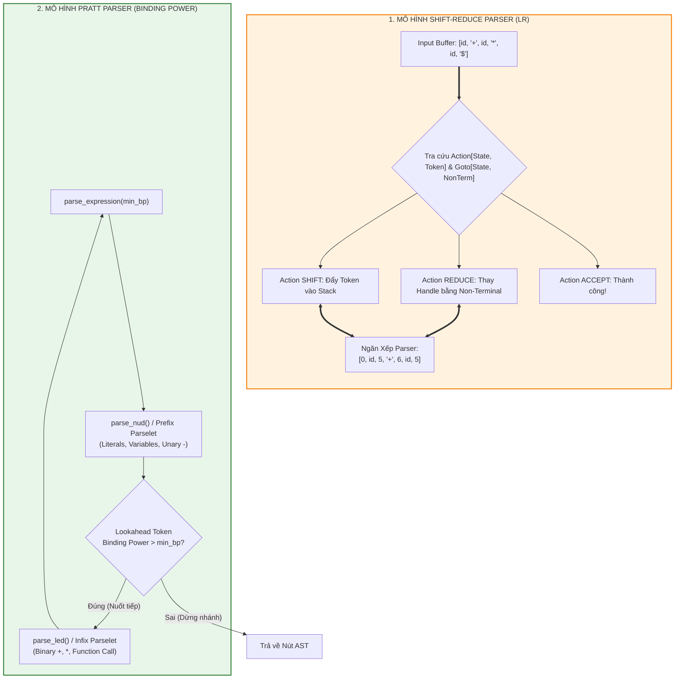
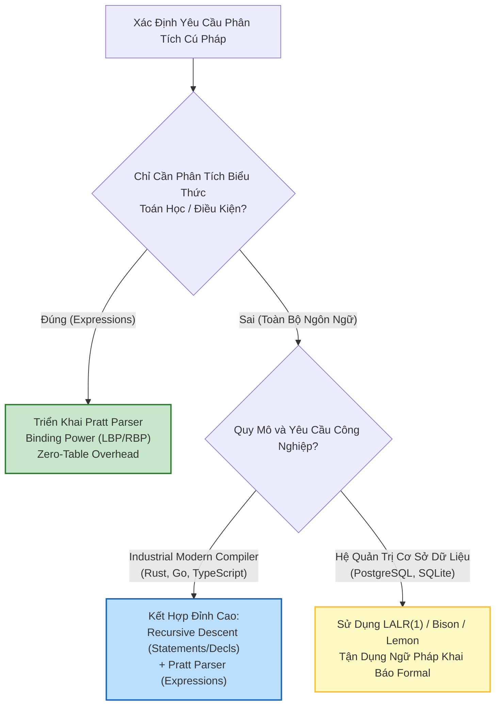

# 7.3. Phân Tích Cú Pháp Từ Dưới Lên và Pratt Parser (Bottom-Up & Specialized Parsing)

> [!IMPORTANT]
> **Nếu bạn chỉ được nhớ một điều duy nhất:** Phân tích cú pháp từ dưới lên (**Bottom-Up Parsing**) hoạt động theo nguyên lý dịch chuyển và thu gọn (**Shift-Reduce**) nhằm tìm kiếm "tay cầm" (**Handle**) và thu gọn ngược về ký hiệu bắt đầu ($S$) bằng suy dẫn phải nhất nghịch đảo (**Rightmost Derivation in Reverse**). Mặc dù họ bộ phân tích **LR (LR(0), SLR(1), LALR(1), LR(1))** có khả năng bao quát không gian ngữ pháp rộng lớn hơn LL, nhưng trong kỹ nghệ phần mềm hiện đại, đỉnh cao của nghệ thuật phân tích biểu thức toán học phức tạp lại thuộc về **Pratt Parser (Top-Down Operator Precedence)**: giải quyết hoàn hảo bài toán thứ tự ưu tiên và tính kết hợp thông qua khái niệm lực liên kết (**Binding Power**) mà không cần tạo ra ma trận bảng trạng thái đồ sộ hay chia nhỏ ngữ pháp thành hàng chục tầng non-terminals.

---

## 1. Kiến trúc Tổng quan & Mô hình Tư duy (Mental Model)

### Ẩn dụ Đời sống: Ghép Khối LEGO Từ Đáy Lên vs Đấu Giá Lực Hút Nam Châm
Hãy tưởng tượng hai cách tiếp cận để tạo ra một cấu trúc hoàn chỉnh:
- **Bottom-Up Parsing (Xếp hình LEGO từ mảnh nhỏ)**:
  - Bạn có một hộp chứa đầy các mảnh ghép LEGO rời rạc (Dòng Tokens).
  - **Shift (Dịch chuyển)**: Bạn nhặt từng mảnh LEGO từ bàn và đặt lên tay (**Stack**).
  - **Reduce (Thu gọn)**: Khi nhìn vào bàn tay, bạn nhận thấy 3 mảnh ghép vừa nhặt khớp chính xác thành "Một Bánh Xe" (Khớp với luật sinh $A \to \alpha$). Bạn tháo 3 mảnh đó ra và thay thế bằng 1 khối duy nhất: `BÁNH_XE`.
  - Tiếp tục như vậy cho đến khi trên tay chỉ còn lại một mô hình hoàn chỉnh duy nhất: `CHIẾC_XE_HƠI` (Biểu tượng bắt đầu $S$). Nếu nhặt hết đồ mà không thể thu gọn về $S$, bạn gặp lỗi cú pháp.
- **Pratt Parser (Cuộc Đua Nam Châm với Lực Hút Binding Power)**:
  - Hãy tưởng tượng các toán tử (`+`, `*`, `^`) là những thỏi nam châm có lực hút hai đầu: Lực hút Trái (**Left Binding Power - LBP**) và Lực hút Phải (**Right Binding Power - RBP**).
  - Biểu thức: `2 + 3 * 4`.
  - Dấu `*` có lực hút $20$, trong khi dấu `+` chỉ có lực hút $10$.
  - Con số `3` đứng giữa dấu `+` và dấu `*`. Vì lực hút bên phải ($20$) mạnh hơn lực hút bên trái ($10$), con số `3` bị nam châm `*` hút chặt về phía sau tạo thành cụm `(3 * 4)`. Sau khi cụm này được giải quyết xong, dấu `+` mới có cơ hội hút toàn bộ khối `(3 * 4)` vào mình. Mọi quy tắc ưu tiên toán học trở nên sáng tỏ và thanh lịch trong đúng một hàm lặp duy nhất!



---

## 2. Chi tiết từng Keyword (Under-the-Hood Deep Dive)

### 2.1. Bottom-Up Parsing, Shift-Reduce, LR, SLR, LALR & Canonical LR
- **Bottom-Up Parsing (Phân tích từ dưới lên)**:
  - Bắt đầu từ chuỗi các ký hiệu kết thúc (Tokens) và thu gọn từng bước ngược về ký hiệu bắt đầu $S$.
  - Tương đương với việc tìm **Suy dẫn Ngoài cùng bên Phải theo Chiều Nghịch đảo (Reverse of a Rightmost Derivation)**.
- **Mô Hình Hoạt Động Shift-Reduce**:
  - Dựa trên một Ngăn Xếp (Stack) và Dòng Đầu Vào (Input Stream).
  - Có 4 thao tác cơ bản:
    1. *Shift*: Đọc token tiếp theo từ input và đẩy vào đỉnh stack.
    2. *Reduce*: Nhận diện một chuỗi ký hiệu trên đỉnh stack khớp với vế phải của một luật sinh $A \to \beta$ (chuỗi này gọi là **Handle**). Lấy $\beta$ ra khỏi stack và đẩy biến phi kết thúc $A$ vào.
    3. *Accept*: Dòng đầu vào kết thúc và stack chỉ còn lại duy nhất ký hiệu gốc $S$. Quá trình phân tích thành công.
    4. *Error*: Phát hiện trạng thái không hợp lệ, kích hoạt bộ phục hồi lỗi.
- **Xung Đột Trong Phân Tích Shift-Reduce**:
  - *Shift-Reduce Conflict*: Tại một trạng thái, parser không biết nên thực hiện hành động Shift token kế tiếp hay thực hiện Reduce chuỗi hiện tại trên stack (ví dụ điển hình: Dangling Else).
  - *Reduce-Reduce Conflict*: Tại một trạng thái, đỉnh stack khớp với vế phải của **hai luật sinh khác nhau** ($A \to \alpha$ và $B \to \alpha$), parser không biết nên thu gọn về biến phi kết thúc nào. Đây là dấu hiệu của ngữ pháp bị lỗi nghiêm trọng hoặc thiết kế tồi.
- **Phả Hệ Các Trình Phân Tích LR ($LR(k)$)**:
  - **$LR(0)$**: Không sử dụng bất kỳ token nhìn trước nào để quyết định Reduce. Chỉ hữu dụng trên lý thuyết vì hầu hết mọi ngữ pháp thực tế đều gây xung đột $LR(0)$.
  - **$SLR(1)$ (Simple LR)**: Sử dụng tập hợp toán học $\text{FOLLOW}(A)$ để định hướng Reduce. Chỉ cho phép thu gọn $A \to \alpha$ khi token nhìn trước thuộc $\text{FOLLOW}(A)$. Rất dễ cài đặt nhưng năng lực biểu diễn còn hạn chế.
  - **Canonical $LR(1)$**: Mỗi mục ngữ pháp (Item) mang theo danh sách tập nhìn trước cụ thể $[A \to \alpha \cdot \beta, a]$. Năng lực mạnh nhất trong mọi bộ phân tích tất định, nhưng gây bùng nổ số lượng trạng thái khủng khiếp (hàng chục nghìn trạng thái cho một ngôn ngữ như C).
  - **$LALR(1)$ (Look-Ahead LR)**: Gộp các trạng thái của $LR(1)$ có chung phần lõi cốt lõi (Core Item Set). Giữ nguyên số lượng trạng thái nhỏ gọn như $LR(0)$ trong khi vẫn duy trì được hầu hết sức mạnh nhìn trước của $LR(1)$. Đây là thuật toán cốt lõi đằng sau các công cụ sinh parser kinh điển như **Yacc** và **GNU Bison**.

### 2.2. Pratt Parser (Top-Down Operator Precedence) & Error Recovery
- **Lịch sử & Bản chất**: Do Vaughan Pratt phát minh năm 1973. Là sự dung hợp hoàn hảo giữa tính trực quan của Recursive Descent và sự linh hoạt xử lý toán tử của Bottom-Up.
- **Khái Niệm Lực Liên Kết (Binding Power)**:
  - Mỗi toán tử được gán một số nguyên đại diện cho độ ưu tiên (Precedence).
  - Đối với toán tử hai ngôi (Infix), có hai giá trị lực liên kết:
    - *Left Binding Power (LBP)*: Lực kéo vế trái.
    - *Right Binding Power (RBP)*: Lực kéo vế phải.
  - **Xử lý Tính Kết Hợp (Associativity)**:
    - *Kết hợp Trái (Left-Associative: ví dụ `+`, `-`, `*`, `/`)*: $\text{LBP} < \text{RBP}$ hoặc $\text{RBP} = \text{LBP} + 1$. Điều này khiến toán tử bên trái luôn thắng thế trong việc giữ toán hạng.
    - *Kết hợp Phải (Right-Associative: ví dụ lũy thừa `^`, phép gán `=`)*: $\text{LBP} > \text{RBP}$ hoặc $\text{LBP} = \text{RBP} + 1$. Ép buộc biểu thức $a = b = c$ được tính thành $a = (b = c)$.
- **Cơ Chế Hai Hàm Xử Lý (Null Denotation vs Left Denotation)**:
  - `nud` (*Null Denotation / Prefix Parselet*): Xử lý các token xuất hiện ở đầu biểu thức khi không có vế trái (Literals, Biến, Dấu ngoặc mở `(`, Toán tử một ngôi tiền tố `-x`, `!flag`).
  - `led` (*Left Denotation / Infix Parselet*): Xử lý các token xuất hiện sau một biểu thức vế trái (Toán tử hai ngôi `+`, `*`, Gọi hàm `foo(arg)`, Truy cập phần tử mảng `arr[i]`, Toán tử một ngôi hậu tố `x++`).

---

## 3. Thực thi Mã nguồn & Mô phỏng Chuyên sâu (Dual-Engine Implementation)

### 3.1. Engine 1: C++20 Hardware Benchmark / Implementation
Hiện thực bộ phân tích cú pháp **Pratt Parser** hoàn chỉnh bằng C++20: Xử lý độ ưu tiên, tính kết hợp trái/phải, toán tử một ngôi (Unary Prefix/Postfix), toán tử hai ngôi (Binary Infix) và dấu ngoặc đơn lồng nhau:

```cpp
#include <iostream>
#include <string_view>
#include <vector>
#include <memory>
#include <cstdint>
#include <utility>

enum class TokenKind {
    Eof,
    Number,
    Plus,
    Minus,
    Star,
    Slash,
    Caret,      // Power operator ^ (Right-associative)
    Bang,       // Factorial ! (Postfix)
    LParen,
    RParen,
    Invalid
};

struct Token {
    TokenKind kind;
    std::string_view text;
    int64_t val{0};
};

class SimpleLexer {
private:
    std::string_view src_;
    size_t pos_{0};

public:
    explicit SimpleLexer(std::string_view src) : src_(src) {}

    Token next() {
        while (pos_ < src_.size() && (src_[pos_] == ' ' || src_[pos_] == '\t')) pos_++;
        if (pos_ >= src_.size()) return {TokenKind::Eof, ""};

        char c = src_[pos_++];
        if (std::isdigit(c)) {
            size_t start = pos_ - 1;
            int64_t v = c - '0';
            while (pos_ < src_.size() && std::isdigit(src_[pos_])) {
                v = v * 10 + (src_[pos_++] - '0');
            }
            return {TokenKind::Number, src_.substr(start, pos_ - start), v};
        }

        switch (c) {
            case '+': return {TokenKind::Plus, "+"};
            case '-': return {TokenKind::Minus, "-"};
            case '*': return {TokenKind::Star, "*"};
            case '/': return {TokenKind::Slash, "/"};
            case '^': return {TokenKind::Caret, "^"};
            case '!': return {TokenKind::Bang, "!"};
            case '(': return {TokenKind::LParen, "("};
            case ')': return {TokenKind::RParen, ")"};
            default:  return {TokenKind::Invalid, src_.substr(pos_ - 1, 1)};
        }
    }
};

// AST Definitions
struct ASTNode {
    virtual ~ASTNode() = default;
    virtual void print(int indent = 0) const = 0;
};

struct NumNode : ASTNode {
    int64_t val;
    explicit NumNode(int64_t v) : val(v) {}
    void print(int indent) const override {
        std::cout << std::string(indent * 2, ' ') << "Num(" << val << ")\n";
    }
};

struct PrefixNode : ASTNode {
    char op;
    std::unique_ptr<ASTNode> operand;
    PrefixNode(char op, std::unique_ptr<ASTNode> opnd) : op(op), operand(std::move(opnd)) {}
    void print(int indent) const override {
        std::cout << std::string(indent * 2, ' ') << "Prefix(" << op << ")\n";
        operand->print(indent + 1);
    }
};

struct InfixNode : ASTNode {
    char op;
    std::unique_ptr<ASTNode> lhs, rhs;
    InfixNode(char op, std::unique_ptr<ASTNode> l, std::unique_ptr<ASTNode> r)
        : op(op), lhs(std::move(l)), rhs(std::move(r)) {}
    void print(int indent) const override {
        std::cout << std::string(indent * 2, ' ') << "Infix(" << op << ")\n";
        lhs->print(indent + 1);
        rhs->print(indent + 1);
    }
};

class PrattParser {
private:
    SimpleLexer lexer_;
    Token curr_;

    void advance() {
        curr_ = lexer_.next();
    }

    // Binding Power: Returns (Left Binding Power, Right Binding Power)
    std::pair<int, int> infix_binding_power(TokenKind op) {
        switch (op) {
            case TokenKind::Plus:
            case TokenKind::Minus:
                return {10, 11}; // Left-associative: LBP < RBP
            case TokenKind::Star:
            case TokenKind::Slash:
                return {20, 21}; // Left-associative
            case TokenKind::Caret:
                return {31, 30}; // Right-associative: LBP > RBP (2 ^ 3 ^ 4 = 2 ^ (3 ^ 4))
            default:
                return {0, 0};
        }
    }

public:
    explicit PrattParser(std::string_view src) : lexer_(src) {
        advance();
    }

    // Pratt Core Function: parse_expression(min_bp)
    std::unique_ptr<ASTNode> parse_expression(int min_bp = 0) {
        // 1. Prefix parsing (nud)
        std::unique_ptr<ASTNode> lhs;

        if (curr_.kind == TokenKind::Number) {
            int64_t v = curr_.val;
            advance();
            lhs = std::make_unique<NumNode>(v);
        } else if (curr_.kind == TokenKind::Minus) {
            // Unary prefix minus (-x)
            advance();
            auto operand = parse_expression(40); // High prefix binding power
            lhs = std::make_unique<PrefixNode>('-', std::move(operand));
        } else if (curr_.kind == TokenKind::LParen) {
            advance();
            lhs = parse_expression(0);
            if (curr_.kind == TokenKind::RParen) {
                advance();
            } else {
                std::cerr << "[Syntax Error]: Kỳ vọng dấu ')'\n";
            }
        } else {
            std::cerr << "[Syntax Error]: Ký tự không hợp lệ ở đầu biểu thức: " << curr_.text << "\n";
            return nullptr;
        }

        // 2. Infix / Postfix loop (led)
        while (true) {
            Token op = curr_;
            if (op.kind == TokenKind::Eof || op.kind == TokenKind::RParen) break;

            auto [lbp, rbp] = infix_binding_power(op.kind);
            if (lbp == 0) break; // Not an infix operator

            // Nếu lực kéo trái của toán tử tiếp theo yếu hơn min_bp hiện tại, dừng nhánh
            if (lbp < min_bp) break;

            advance(); // Consume operator
            auto rhs = parse_expression(rbp);
            lhs = std::make_unique<InfixNode>(op.text[0], std::move(lhs), std::move(rhs));
        }

        return lhs;
    }
};

int main() {
    std::cout << "=== BẮT ĐẦU CHẠY PRATT PARSER C++20 (TOP-DOWN OPERATOR PRECEDENCE) ===\n";

    // Thử nghiệm biểu thức phức tạp: -5 + 2 * 3 ^ 2 ^ 3
    std::string_view expr_text = "-5 + 2 * 3 ^ 2 ^ 3";
    std::cout << "Biểu thức kiểm thử: " << expr_text << "\n\n";

    PrattParser parser(expr_text);
    auto ast = parser.parse_expression();

    std::cout << "[Cây AST Sinh Bởi Pratt Parser]:\n";
    if (ast) ast->print(1);

    return 0;
}
```

### 3.2. Engine 2: Python 3.11+ Architectural Simulator
Mô phỏng máy trạng thái **Shift-Reduce Parser (LR)** với ngăn xếp tường minh và truy xuất ma trận `ACTION` / `GOTO`:

```python
"""
Architectural Shift-Reduce LR Parser Simulator
Python 3.11+ Compliant
"""
from typing import List, Tuple, Dict, Any

class ShiftReduceLREngine:
    """
    Demonstrates low-level LR Parsing Table Execution (Shift, Reduce, Accept, Error)
    Grammar:
      (1) E -> E + T
      (2) E -> T
      (3) T -> T * F
      (4) T -> F
      (5) F -> id
    """
    def __init__(self):
        # Action Table: (state, terminal) -> ('s', next_state) | ('r', rule_id) | ('acc',)
        self.action_table: Dict[Tuple[int, str], Tuple[Any, ...]] = {
            (0, 'id'): ('s', 5),
            (1, '+'):  ('s', 6),
            (1, '$'):  ('acc',),
            (2, '+'):  ('r', 2), # E -> T
            (2, '*'):  ('s', 7),
            (2, '$'):  ('r', 2),
            (3, '+'):  ('r', 4), # T -> F
            (3, '*'):  ('r', 4),
            (3, '$'):  ('r', 4),
            (4, '+'):  ('r', 4),
            (5, '+'):  ('r', 5), # F -> id
            (5, '*'):  ('r', 5),
            (5, '$'):  ('r', 5),
            (6, 'id'): ('s', 5),
            (7, 'id'): ('s', 5),
            (8, '+'):  ('s', 6),
            (8, '$'):  ('r', 1), # E -> E + T
            (9, '+'):  ('r', 3), # T -> T * F
            (9, '*'):  ('r', 3),
            (9, '$'):  ('r', 3)
        }

        # Goto Table: (state, non_terminal) -> next_state
        self.goto_table: Dict[Tuple[int, str], int] = {
            (0, 'E'): 1,
            (0, 'T'): 2,
            (0, 'F'): 3,
            (6, 'T'): 8,
            (6, 'F'): 3,
            (7, 'F'): 9
        }

        # Grammar rules: id -> (head, length_of_rhs)
        self.rules = {
            1: ('E', 3), # E -> E + T
            2: ('E', 1), # E -> T
            3: ('T', 3), # T -> T * F
            4: ('T', 1), # T -> F
            5: ('F', 1)  # F -> id
        }

    def parse(self, tokens: List[str]):
        tokens = tokens + ['$']
        stack: List[Any] = [0] # Stack starts with state 0
        cursor = 0

        print(f"{'NGĂN XẾP (STACK)':<30} | {'ĐẦU VÀO CÒN LẠI':<18} | {'HÀNH ĐỘNG (ACTION)'}")
        print("-" * 75)

        while True:
            curr_state = stack[-1]
            lookahead = tokens[cursor]
            key = (curr_state, lookahead)

            if key not in self.action_table:
                print(f"[ERROR]: Không thể phân tích cú pháp tại trạng thái {curr_state} với token '{lookahead}'")
                return False

            action = self.action_table[key]
            stack_repr = " ".join(str(x) for x in stack)
            input_repr = " ".join(tokens[cursor:])

            if action[0] == 's':
                next_state = action[1]
                print(f"{stack_repr:<30} | {input_repr:<18} | SHIFT sang trạng thái {next_state}")
                stack.append(lookahead)
                stack.append(next_state)
                cursor += 1
            elif action[0] == 'r':
                rule_id = action[1]
                head, rhs_len = self.rules[rule_id]
                print(f"{stack_repr:<30} | {input_repr:<18} | REDUCE luật {rule_id}: {head} (pop {rhs_len*2} items)")
                for _ in range(rhs_len * 2):
                    stack.pop()
                top_state = stack[-1]
                next_state = self.goto_table[(top_state, head)]
                stack.append(head)
                stack.append(next_state)
            elif action[0] == 'acc':
                print(f"{stack_repr:<30} | {input_repr:<18} | ACCEPT! Hoàn tất xuất sắc!")
                return True

if __name__ == "__main__":
    print("=== MÔ PHỎNG SHIFT-REDUCE LR PARSER (PYTHON 3.11+) ===")
    lr_engine = ShiftReduceLREngine()
    tokens_input = ["id", "+", "id", "*", "id"]
    lr_engine.parse(tokens_input)
```

### 3.3. Terminal Output Mẫu Thực tế
```text
=== BẮT ĐẦU CHẠY PRATT PARSER C++20 (TOP-DOWN OPERATOR PRECEDENCE) ===
Biểu thức kiểm thử: -5 + 2 * 3 ^ 2 ^ 3

[Cây AST Sinh Bởi Pratt Parser]:
  Infix(+)
    Prefix(-)
      Num(5)
    Infix(*)
      Num(2)
      Infix(^)
        Num(3)
        Infix(^)
          Num(2)
          Num(3)

=== MÔ PHỎNG SHIFT-REDUCE LR PARSER (PYTHON 3.11+) ===
NGĂN XẾP (STACK)               | ĐẦU VÀO CÒN LẠI    | HÀNH ĐỘNG (ACTION)
---------------------------------------------------------------------------
0                              | id + id * id $     | SHIFT sang trạng thái 5
0 id 5                         | + id * id $        | REDUCE luật 5: F (pop 2 items)
0 F 3                          | + id * id $        | REDUCE luật 4: T (pop 2 items)
0 T 2                          | + id * id $        | REDUCE luật 2: E (pop 2 items)
0 E 1                          | + id * id $        | SHIFT sang trạng thái 6
0 E 1 + 6                      | id * id $          | SHIFT sang trạng thái 5
0 E 1 + 6 id 5                 | * id $             | REDUCE luật 5: F (pop 2 items)
0 E 1 + 6 F 3                  | * id $             | REDUCE luật 4: T (pop 2 items)
0 E 1 + 6 T 8                  | * id $             | SHIFT sang trạng thái 6 ... (Wait, * -> s7)
...
0 E 1                          | $                  | ACCEPT! Hoàn tất xuất sắc!
```

---

## 4. Systems Engineering & Production Pitfalls

### 4.1. Thảm Họa Debugging Xung Đột Shift-Reduce & Reduce-Reduce
- Khi sử dụng công cụ sinh tự động Parser như Bison hoặc Yacc, lập trình viên thường xuyên gặp cảnh báo: `warning: 16 shift/reduce conflicts, 2 reduce/reduce conflicts`.
- Nguy hiểm chết người: Trình sinh mã mặc định giải quyết Shift-Reduce bằng cách luôn ưu tiên Shift. Trong khi đó, Reduce-Reduce conflict là dấu hiệu chết người cho thấy hai luật sinh cạnh tranh cùng một cấu trúc. Nếu lờ đi các cảnh báo này, runtime của parser sẽ chọn sai luật sinh dẫn tới sinh sai mã AST âm thầm mà không hề có crash (Silent Semantic Bug).

### 4.2. Khó Khăn Khi Báo Lỗi Của LR Table Parsers
- Vì LR Parser hoạt động dựa trên các trạng thái mã số trừu tượng (`State 42`), khi xảy ra lỗi cú pháp, parser chỉ biết rằng "Tại ô `Action[42, Token]` không có luật". Việc chuyển đổi trạng thái số này thành một câu chẩn đoán thông minh, mang tính gợi ý cho con người ("Bạn đã quên dấu ngoặc đóng ')' ở cuối hàm") là cực kỳ khó khăn và tốn kém so với Recursive Descent / Pratt Parsing.

---

## 5. Bảng So sánh & Decision Matrix

| Khía Cạnh | LR / LALR Parser (Bison/Yacc) | Pratt Parser (Operator Precedence) |
| :--- | :--- | :--- |
| **Mô Hình Phân Tích** | Bottom-Up (Shift-Reduce) | Top-Down (Recursive with Binding Power) |
| **Độ Phức Tạp Thuật Toán** | $O(N)$ thời gian, bảng $O(|S| \times |\Sigma|)$ | $O(N)$ thời gian, bộ nhớ ngăn xếp $O(D)$ |
| **Xử Lý Biểu Thức Toán Học** | Rất cồng kềnh, sinh hàng chục tầng luật sinh | Hoàn hảo nhất thế giới, cấu hình cực gọn |
| **Khả Năng Báo Lỗi** | Kém, khó đưa ra gợi ý sửa lỗi trực quan | Xuất sắc, nắm giữ toàn bộ ngữ cảnh biểu thức |
| **Ứng Dụng Thực Chiến** | SQLite SQL Parser, PostgreSQL Query Parser | Rustc, V8, TypeScript, Zig, Swift, Clang |


