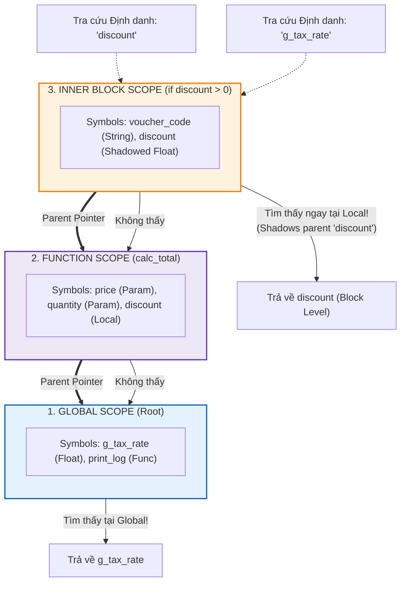
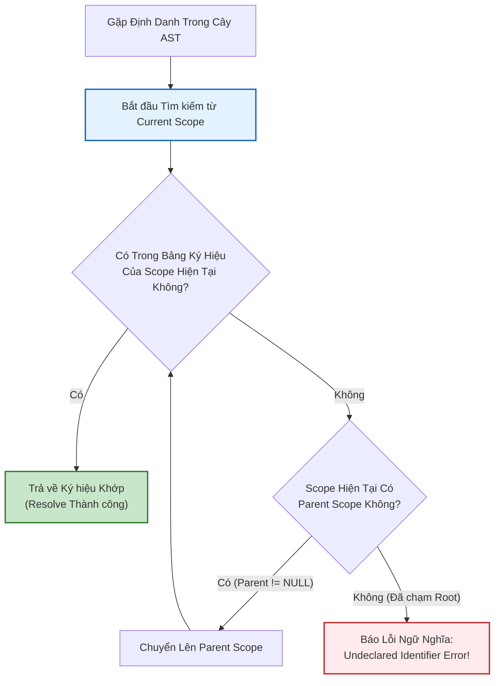

# 8.1. Bảng Ký Hiệu và Phân Giải Phạm Vi (Symbol Tables & Scope Resolution)

> [!IMPORTANT]
> **Nếu bạn chỉ được nhớ một điều duy nhất:** Bảng ký hiệu (**Symbol Table**) là "linh hồn nhận thức" của giai đoạn phân tích ngữ nghĩa, ánh xạ định danh văn bản thô sang các thực thể ngữ nghĩa duy nhất (biến, hàm, kiểu dữ liệu) trong không gian bộ nhớ. Để xử lý phạm vi tĩnh phân tầng (**Lexical / Static Scoping**) và hiện tượng che khuất tên (**Variable Shadowing**), trình biên dịch hiện đại triển khai Bảng ký hiệu dưới dạng **Cây phân cấp ngăn xếp xương rồng (Cactus Stack / Spaghetti Stack)**: mỗi Scope con giữ một con trỏ trỏ ngược về Scope cha trực tiếp, cho phép tra cứu biến với chi phí $O(D)$ ($D$ là độ sâu lồng nhau) mà không bao giờ làm rò rỉ hoặc xáo trộn các biến giữa các hàm đồng cấp.

---

## 1. Kiến trúc Tổng quan & Mô hình Tư duy (Mental Model)

### Ẩn dụ Đời sống: Hộ Khẩu Gia Đình Phân Cấp và Quy Tắc Tra Cứu Tên
Hãy tưởng tượng bạn sống trong một ngôi làng cổ có cấu trúc dòng họ phân cấp:
- **Phạm vi Cục bộ (Local Scope)**: Bạn đang ngồi trong phòng riêng của mình. Bạn gọi to: "Huy ơi!".
  - Nếu chính trong phòng bạn có một người tên là "Huy", người đó sẽ đáp lại ngay lập tức. Đây là biến cục bộ (**Local Variable**).
- **Hiện tượng Che Khuất (Variable Shadowing)**: Bác ruột của bạn ở ngoài sân lớn cũng tên là "Huy" (Biến toàn cục / Scope cha). Nhưng vì có "Huy nhỏ" ngay trong phòng, bạn hoàn toàn không nhìn thấy và không gọi được "Huy lớn" ở ngoài sân nữa. Người cháu đã "che khuất" (shadow) người bác.
- **Tra cứu Ngược theo Phạm vi Tĩnh (Lexical Scope Resolution)**:
  - Nếu trong phòng bạn không có ai tên "Huy", bạn bước ra phòng khách của gia đình (Scope cha cấp 1) để tìm.
  - Nếu phòng khách không có, bạn bước tiếp ra sân lớn của dòng họ (Scope toàn cục / Global Scope).
  - Nếu đã ra tới cổng làng (Global/Root Scope) mà vẫn không ai tên "Huy", trưởng làng sẽ tuyên bố: **"Lỗi Biên Dịch: Ký hiệu không xác định (Undeclared Identifier Error)!"**.
- **Lexical Scope vs Dynamic Scope**:
  - *Lexical Scope (Phạm vi Tĩnh)*: Quan hệ cha-con được xác định bất di bất dịch lúc bạn **viết mã nguồn trên giấy** (theo cấu trúc khối lệnh `{ }`).
  - *Dynamic Scope (Phạm vi Động)*: Quan hệ cha-con lại phụ thuộc vào **ai là người gọi hàm trong lúc chạy (Call Stack)**. Hàm `foo()` sẽ nhìn thấy biến của hàm `bar()` chỉ vì `bar()` đã gọi `foo()`. Lập trình hiện đại gần như loại bỏ Dynamic Scope vì nó biến mã nguồn thành cơn ác mộng khó gỡ lỗi.



---

## 2. Chi tiết từng Keyword (Under-the-Hood Deep Dive)

### 2.1. Semantic Analysis, Symbol Table, Scope Resolution, Lexical vs Dynamic Scope
- **Semantic Analysis (Phân tích Ngữ nghĩa)**:
  - Giai đoạn thứ ba của trình biên dịch, nhận cây AST từ Parser để kiểm tra tính hợp lệ về logic và ngữ nghĩa của chương trình:
    - Biến có được khai báo trước khi sử dụng không?
    - Kiểu dữ liệu của biểu thức có tương thích không?
    - Hàm có được gọi với đúng số lượng và kiểu đối số không?
    - Giá trị trả về của hàm có khớp với chữ ký (Signature) không?
- **Symbol Table (Bảng Ký hiệu)**:
  - Cấu trúc dữ liệu trung tâm lưu trữ thông tin về mọi định danh (Identifiers) xuất hiện trong chương trình.
  - Thông tin của mỗi mục ký hiệu (`SymbolEntry`):
    - `name`: Tên chuỗi hoặc mã định danh đã intern (`SymbolId`).
    - `type`: Kiểu dữ liệu ngữ nghĩa (`TypeDescriptor*`).
    - `kind`: Phân loại ký hiệu (`Variable`, `Function`, `TypeAlias`, `Module`, `Parameter`).
    - `storage_offset`: Độ lệch offset bộ nhớ trên Stack Frame hoặc địa chỉ toàn cục (Data Segment).
    - `decl_location`: Vị trí file/dòng/cột nơi định danh được khai báo.
- **Scope Resolution & Cấu Trúc Cactus Stack (Spaghetti Stack)**:
  - Mỗi khối lệnh `{ ... }` sinh ra một `Scope` mới.
  - Thay vì copy toàn bộ bảng băm khi mở scope mới, mỗi `Scope` chỉ chứa một bảng băm cục bộ (`local_table`) và một con trỏ trỏ tới `parent_scope`.
  - Thao tác Tra Cứu (`lookup(name)`): Kiểm tra `local_table`. Nếu không thấy, duyệt ngược lên `parent_scope` đệ quy cho tới khi gặp `Root` hoặc tìm thấy. Độ phức tạp $O(D)$ với $D$ hiếm khi vượt quá 10.
  - Thao tác Khai Báo (`insert(name, sym)`): Luôn ghi trực tiếp vào `local_table` của Scope hiện hành. Nếu cùng một tên đã tồn tại trong cùng một scope, báo lỗi **Redeclaration Error**.
- **Lexical Scoping vs Dynamic Scoping**:
  - *Lexical (Static) Scope*: Được cố định hoàn toàn tại compile-time dựa trên vị trí địa lý của mã nguồn. Cho phép tối ưu hóa biến thành thanh ghi/stack offset cố định.
  - *Dynamic Scope*: Quyết định tại runtime dựa trên chuỗi Call Stack. Tạo ra rủi ro rò rỉ biến ngoài ý muốn và phá hủy hoàn toàn khả năng tối ưu hóa tĩnh của trình biên dịch.

### 2.2. Name Binding, Declaration Checking, Function & Overload Resolution
- **Name Binding (Ràng Buộc Tên)**:
  - Quá trình liên kết một định danh cú pháp với thực thể khai báo tương ứng trong bảng ký hiệu.
  - *Early (Static) Binding*: Thực hiện hoàn toàn tại compile-time (C, C++, Rust, Java non-virtual).
  - *Late (Dynamic) Binding*: Thực hiện tại runtime thông qua tra cứu chuỗi hoặc con trỏ hàm ảo (Python, JavaScript, Ruby, Objective-C `objc_msgSend`).
- **Declaration Checking**:
  - Đảm bảo mọi biến phải có khai báo hợp lệ (trong các ngôn ngữ tĩnh).
  - Phát hiện truy cập trước khi khởi tạo (Use Before Initialization / Definite Assignment).
- **Function & Overload Resolution (Phân Giải Nạp Chồng Hàm)**:
  - Khi nhiều hàm có cùng tên nhưng khác nhau về tham số (Parameter Types), trình biên dịch phải chọn ra hàm khớp nhất (Best Viable Candidate).
  - Quy trình 4 bước của C++ Overload Resolution:
    1. *Candidate Functions*: Thu thập tất cả các hàm cùng tên khả dĩ trong phạm vi nhìn thấy (kèm Argument-Dependent Lookup - ADL).
    2. *Viable Functions*: Lọc ra các hàm có số lượng tham số tương thích và các đối số thực tế có thể ép kiểu hợp lệ sang kiểu tham số hình thức.
    3. *Best Match Ranking*: Xếp hạng các hàm khả dĩ dựa trên chi phí chuyển đổi kiểu (Exact Match > Promotion `float` $\to$ `double`, `short` $\to$ `int` > Standard Conversion `int` $\to$ `double` > User-Defined Conversion > Ellipsis `...`).
    4. *Ambiguity Check*: Nếu có từ hai hàm trở lên đạt cùng thứ bậc tốt nhất, trình biên dịch lập tức dừng lại và phát ra lỗi **Ambiguous Overload Call**.

---

## 3. Thực thi Mã nguồn & Mô phỏng Chuyên sâu (Dual-Engine Implementation)

### 3.1. Engine 1: C++20 Hardware Benchmark / Implementation
Hiện thực hệ thống **Scoped Symbol Table (Cactus Stack)** chuẩn công nghiệp bằng C++20: Quản lý bộ nhớ Scope phân tầng bằng `std::shared_ptr`, hỗ trợ Tra cứu Đệ quy (Scope Resolution), Che khuất biến (Shadowing), Bắt lỗi Khai báo trùng lặp (Redeclaration Error), và Mô phỏng phân giải nạp chồng hàm (Overload Resolution):

```cpp
#include <iostream>
#include <string>
#include <string_view>
#include <unordered_map>
#include <memory>
#include <vector>
#include <optional>
#include <iomanip>

enum class DataType { Int, Float, String, Void, Custom };

struct TypeDescriptor {
    DataType base_type;
    std::string type_name;
};

enum class SymbolKind { Variable, Parameter, Function };

struct Symbol {
    std::string name;
    TypeDescriptor type;
    SymbolKind kind;
    uint32_t scope_depth{0};
    int32_t memory_offset{0}; // Stack frame offset
};

class Scope {
private:
    std::unordered_map<std::string, Symbol> table_;
    std::shared_ptr<Scope> parent_{nullptr};
    uint32_t depth_{0};

public:
    explicit Scope(std::shared_ptr<Scope> parent = nullptr)
        : parent_(parent), depth_(parent ? parent->depth_ + 1 : 0) {}

    uint32_t depth() const { return depth_; }
    std::shared_ptr<Scope> get_parent() const { return parent_; }

    // Thêm ký hiệu vào scope hiện hành
    bool define(const Symbol& sym) {
        if (table_.find(sym.name) != table_.end()) {
            return false; // Redeclaration error trong cùng 1 scope!
        }
        Symbol s = sym;
        s.scope_depth = depth_;
        table_.emplace(s.name, s);
        return true;
    }

    // Tra cứu biến ngược dòng từ con lên cha
    std::optional<Symbol> resolve(std::string_view name) const {
        auto it = table_.find(std::string(name));
        if (it != table_.end()) {
            return it->second;
        }
        if (parent_) {
            return parent_->resolve(name);
        }
        return std::nullopt; // Không tìm thấy ký hiệu ở bất kỳ scope cha nào
    }
};

class SymbolTableManager {
private:
    std::shared_ptr<Scope> current_scope_{nullptr};
    int32_t current_stack_offset_{0};

public:
    SymbolTableManager() {
        // Khởi tạo Global Scope (Depth 0)
        current_scope_ = std::make_shared<Scope>(nullptr);
    }

    void enter_scope() {
        current_scope_ = std::make_shared<Scope>(current_scope_);
        std::cout << ">> [ENTER SCOPE]: Độ sâu hiện tại = " << current_scope_->depth() << "\n";
    }

    void exit_scope() {
        if (current_scope_->get_parent()) {
            std::cout << "<< [EXIT SCOPE]: Rời khỏi độ sâu = " << current_scope_->depth() << "\n";
            current_scope_ = current_scope_->get_parent();
        } else {
            std::cerr << "[Error]: Không thể thoát khỏi Global Scope!\n";
        }
    }

    void declare_variable(std::string_view name, DataType type, std::string_view type_name) {
        current_stack_offset_ += 8; // Giả lập biến 64-bit trên stack
        Symbol sym{
            .name = std::string(name),
            .type = TypeDescriptor{type, std::string(type_name)},
            .kind = SymbolKind::Variable,
            .scope_depth = current_scope_->depth(),
            .memory_offset = -current_stack_offset_
        };

        if (!current_scope_->define(sym)) {
            std::cerr << "  [Semantic Error]: Khai báo trùng lặp định danh '" << name 
                      << "' tại Scope độ sâu " << current_scope_->depth() << "!\n";
        } else {
            std::cout << "  [Declared]: " << std::setw(12) << std::left << name 
                      << " | Type: " << std::setw(8) << type_name 
                      << " | Depth: " << current_scope_->depth() 
                      << " | RBP Offset: " << sym.memory_offset << "\n";
        }
    }

    void lookup(std::string_view name) {
        auto res = current_scope_->resolve(name);
        if (res.has_value()) {
            std::cout << "  [Lookup '" << name << "']: TÌM THẤY! Type: " << res->type.type_name
                      << " (Khai báo tại Depth: " << res->scope_depth 
                      << ", Current Depth: " << current_scope_->depth() << ")\n";
        } else {
            std::cerr << "  [Lookup '" << name << "']: LỖI! Undeclared Identifier!\n";
        }
    }
};

int main() {
    std::cout << "=== BẮT ĐẦU MÔ PHỎNG SCOPED SYMBOL TABLE (C++20) ===\n\n";
    SymbolTableManager sym_tab;

    // 1. Global Scope
    std::cout << "--- 1. KHAI BÁO TOÀN CỤC (GLOBAL SCOPE) ---\n";
    sym_tab.declare_variable("g_tax_rate", DataType::Float, "float64");
    sym_tab.declare_variable("app_name", DataType::String, "string");

    // 2. Vào Function Scope
    std::cout << "\n--- 2. VÀO HÀM (FUNCTION SCOPE) ---\n";
    sym_tab.enter_scope();
    sym_tab.declare_variable("base_salary", DataType::Int, "int64");
    sym_tab.declare_variable("bonus", DataType::Int, "int64");

    // Tra cứu biến toàn cục từ hàm
    sym_tab.lookup("g_tax_rate");
    sym_tab.lookup("base_salary");

    // 3. Vào Khối lệnh If (Block Scope) & Test Shadowing
    std::cout << "\n--- 3. VÀO KHỐI LỆNH LỒNG NHAU (BLOCK SCOPE) ---\n";
    sym_tab.enter_scope();
    // Shadowing: khai báo lại bonus kiểu khác ở scope con
    sym_tab.declare_variable("bonus", DataType::Float, "float32 (Shadowed)");
    sym_tab.declare_variable("temp_factor", DataType::Int, "int32");

    // Test Redeclaration Error in same scope
    sym_tab.declare_variable("temp_factor", DataType::Int, "int32");

    sym_tab.lookup("bonus");       // Phải tìm thấy bonus của scope con
    sym_tab.lookup("base_salary"); // Tìm thấy từ scope cha
    sym_tab.lookup("unknown_var"); // Lỗi undeclared

    // 4. Thoát khỏi khối lệnh con
    std::cout << "\n--- 4. THOÁT RA KHỎI BLOCK SCOPE ---\n";
    sym_tab.exit_scope();
    sym_tab.lookup("bonus");       // Phải hồi phục lại bonus int64 của Function Scope!
    sym_tab.lookup("temp_factor"); // Phải lỗi vì temp_factor đã bị hủy khi thoát scope!

    return 0;
}
```

### 3.2. Engine 2: Python 3.11+ Architectural Simulator
Mô phỏng thuật toán **Phân giải Nạp chồng Hàm (Overload Resolution)** xếp hạng ứng viên khả thi (Candidate Ranking) của trình biên dịch:

```python
"""
Architectural Overload Resolution Simulator
Python 3.11+ Compliant
"""
from dataclasses import dataclass
from enum import IntEnum
from typing import List, Optional, Tuple

class ConversionRank(IntEnum):
    EXACT_MATCH = 1
    PROMOTION = 2
    STANDARD_CONVERSION = 3
    INCOMPATIBLE = 99

@dataclass
class FunctionSignature:
    name: str
    param_types: List[str]
    return_type: str

class OverloadResolver:
    # Ma trận chi phí chuyển đổi kiểu dữ liệu
    CONVERSION_COSTS = {
        ("int", "int"): ConversionRank.EXACT_MATCH,
        ("float", "float"): ConversionRank.EXACT_MATCH,
        ("double", "double"): ConversionRank.EXACT_MATCH,
        ("string", "string"): ConversionRank.EXACT_MATCH,
        # Promotion
        ("int", "long"): ConversionRank.PROMOTION,
        ("float", "double"): ConversionRank.PROMOTION,
        # Standard conversions
        ("int", "double"): ConversionRank.STANDARD_CONVERSION,
        ("int", "float"): ConversionRank.STANDARD_CONVERSION,
        ("double", "int"): ConversionRank.STANDARD_CONVERSION,
    }

    def __init__(self):
        self.functions: List[FunctionSignature] = []

    def register_function(self, fn: FunctionSignature):
        self.functions.append(fn)

    def resolve_call(self, call_name: str, arg_types: List[str]) -> Optional[FunctionSignature]:
        print(f"\nPhân giải lời gọi hàm: {call_name}({', '.join(arg_types)})")

        # 1. Thu thập Candidates
        candidates = [fn for fn in self.functions if fn.name == call_name and len(fn.param_types) == len(arg_types)]
        if not candidates:
            print("  -> Lỗi: Không có hàm nào trùng tên và số lượng đối số!")
            return None

        # 2. Đánh giá Viable Functions & Tính Rank Vector
        viable: List[Tuple[FunctionSignature, List[ConversionRank]]] = []
        for cand in candidates:
            ranks = []
            is_viable = True
            for arg_t, param_t in zip(arg_types, cand.param_types):
                rank = self.CONVERSION_COSTS.get((arg_t, param_t), ConversionRank.INCOMPATIBLE)
                if rank == ConversionRank.INCOMPATIBLE:
                    is_viable = False
                    break
                ranks.append(rank)
            if is_viable:
                viable.append((cand, ranks))

        if not viable:
            print("  -> Lỗi: Không có ứng viên nào chuyển đổi kiểu hợp lệ!")
            return None

        # 3. Tìm ứng viên Best Match (Pareto Optimal)
        best_candidate: Optional[FunctionSignature] = None
        best_ranks: Optional[List[ConversionRank]] = None

        for cand, ranks in viable:
            if best_ranks is None:
                best_candidate = cand
                best_ranks = ranks
                continue

            # So sánh ranks từng vị trí
            cand_better = False
            best_better = False
            for r_cand, r_best in zip(ranks, best_ranks):
                if r_cand < r_best:
                    cand_better = True
                elif r_cand > r_best:
                    best_better = True

            if cand_better and not best_better:
                best_candidate = cand
                best_ranks = ranks
            elif cand_better and best_better:
                print("  -> LỖI BIÊN DỊCH: Ambiguous Overload Call! Hai ứng viên ngang hàng nhau!")
                return None

        print(f"  -> KHỚP THÀNH CÔNG: {best_candidate.name}({', '.join(best_candidate.param_types)}) -> {best_candidate.return_type}")
        return best_candidate

if __name__ == "__main__":
    print("=== MÔ PHỎNG THUẬT TOÁN OVERLOAD RESOLUTION (PYTHON 3.11+) ===")
    resolver = OverloadResolver()

    # Đăng ký các hàm nạp chồng
    resolver.register_function(FunctionSignature("process", ["int", "double"], "void (Func 1)"))
    resolver.register_function(FunctionSignature("process", ["double", "int"], "void (Func 2)"))
    resolver.register_function(FunctionSignature("process", ["int", "int"], "void (Func 3)"))
    resolver.register_function(FunctionSignature("process", ["float", "float"], "void (Func 4)"))

    # Test 1: Khớp chính xác hoàn hảo
    resolver.resolve_call("process", ["int", "int"])

    # Test 2: Khớp qua Promotion / Standard conversion
    resolver.resolve_call("process", ["int", "float"])

    # Test 3: Xung đột Ambiguity
    # Gọi với (double, double) -> Cả Func 1 và Func 2 đều cần 1 standard conversion
    resolver.resolve_call("process", ["double", "double"])
```

### 3.3. Terminal Output Mẫu Thực tế
```text
=== BẮT ĐẦU MÔ PHỎNG SCOPED SYMBOL TABLE (C++20) ===

--- 1. KHAI BÁO TOÀN CỤC (GLOBAL SCOPE) ---
  [Declared]: g_tax_rate   | Type: float64  | Depth: 0 | RBP Offset: -8
  [Declared]: app_name     | Type: string   | Depth: 0 | RBP Offset: -16

--- 2. VÀO HÀM (FUNCTION SCOPE) ---
>> [ENTER SCOPE]: Độ sâu hiện tại = 1
  [Declared]: base_salary  | Type: int64    | Depth: 1 | RBP Offset: -24
  [Declared]: bonus        | Type: int64    | Depth: 1 | RBP Offset: -32
  [Lookup 'g_tax_rate']: TÌM THẤY! Type: float64 (Khai báo tại Depth: 0, Current Depth: 1)
  [Lookup 'base_salary']: TÌM THẤY! Type: int64 (Khai báo tại Depth: 1, Current Depth: 1)

--- 3. VÀO KHỐI LỆNH LỒNG NHAU (BLOCK SCOPE) ---
>> [ENTER SCOPE]: Độ sâu hiện tại = 2
  [Declared]: bonus        | Type: float32 (Shadowed) | Depth: 2 | RBP Offset: -40
  [Declared]: temp_factor  | Type: int32    | Depth: 2 | RBP Offset: -48
  [Semantic Error]: Khai báo trùng lặp định danh 'temp_factor' tại Scope độ sâu 2!
  [Lookup 'bonus']: TÌM THẤY! Type: float32 (Shadowed) (Khai báo tại Depth: 2, Current Depth: 2)
  [Lookup 'base_salary']: TÌM THẤY! Type: int64 (Khai báo tại Depth: 1, Current Depth: 2)
  [Lookup 'unknown_var']: LỖI! Undeclared Identifier!

--- 4. THOÁT RA KHỎI BLOCK SCOPE ---
<< [EXIT SCOPE]: Rời khỏi độ sâu = 2
  [Lookup 'bonus']: TÌM THẤY! Type: int64 (Khai báo tại Depth: 1, Current Depth: 1)
  [Lookup 'temp_factor']: LỖI! Undeclared Identifier!

=== MÔ PHỎNG THUẬT TOÁN OVERLOAD RESOLUTION (PYTHON 3.11+) ===
Phân giải lời gọi hàm: process(int, int)
  -> KHỚP THÀNH CÔNG: process(int, int) -> void (Func 3)

Phân giải lời gọi hàm: process(int, float)
  -> KHỚP THÀNH CÔNG: process(int, double) -> void (Func 1)

Phân giải lời gọi hàm: process(double, double)
  -> LỖI BIÊN DỊCH: Ambiguous Overload Call! Hai ứng viên ngang hàng nhau!
```

---

## 4. Systems Engineering & Production Pitfalls

### 4.1. Cạm Bẫy Variable Shadowing Vô Tình (Accidental Shadowing Bug)
- Trong các dự án lớn, việc một lập trình viên vô tình đặt tên biến trong khối `if` trùng với tên biến cấu hình quan trọng ở Scope ngoài (`int timeout = 5;` bên trong `if` che khuất `int timeout = 30;` bên ngoài) là nguyên nhân gây ra vô số lỗi sản xuất nghiêm trọng.
- **Giải pháp**: Bật cờ cảnh báo `-Wshadow` trong GCC/Clang hoặc cấm tuyệt đối Variable Shadowing trong các quy chuẩn linter nội bộ (như quy tắc của Golang hoặc Rust clippy).

### 4.2. Cạm Bẫy Argument-Dependent Lookup (ADL / Koenig Lookup)
- Trong C++, khi gọi một hàm không có tiền tố namespace (ví dụ `swap(a, b)`), trình biên dịch tự động tìm kiếm hàm `swap` bên trong chính namespace của kiểu dữ liệu của `a` và `b`. Nếu không hiểu rõ ADL, mã nguồn có thể vô tình gọi nhầm một hàm lạ được định nghĩa trong namespace của bên thứ ba dẫn tới lỗ hổng bảo mật hoặc lỗi runtime khó hiểu.

---

## 5. Bảng So sánh & Decision Matrix

| Tiêu chí | Lexical (Static) Scoping | Dynamic Scoping |
| :--- | :--- | :--- |
| **Thời Điểm Ràng Buộc** | Compile-time (dựa trên cấu trúc khối mã `{}`) | Runtime (dựa trên Call Stack lúc chạy) |
| **Khả Năng Tối Ưu Hóa CPU** | Tối đa (Biến được cố định vào Register/Stack Offset) | Rất kém (Bắt buộc tra cứu bảng băm động lúc chạy) |
| **Tính Dễ Đoán & Đọc Hiểu** | Rõ ràng, cục bộ, đọc code là hiểu | Rất khó lường, hành vi hàm thay đổi theo ai gọi nó |
| **Ngôn Ngữ Sử Dụng** | C, C++, Rust, Go, Java, Python, JavaScript | Bash Scripting, Emacs Lisp, Perl (tùy chọn `local`) |


