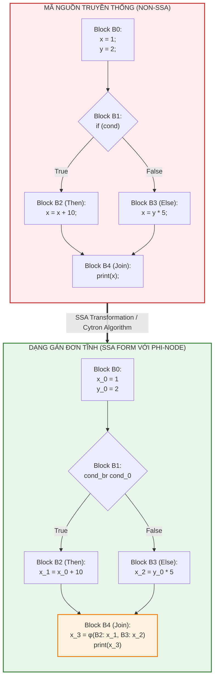
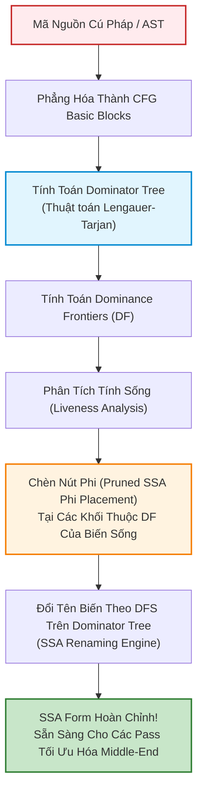

# 9.2. Đồ Thị Luồng Điều Khiển và Dạng Gán Đơn Tĩnh (Control Flow & SSA Form)

> [!IMPORTANT]
> **Nếu bạn chỉ được nhớ một điều duy nhất:** Dạng Gán Đơn Tĩnh (**Static Single Assignment - SSA Form**) là phát minh cách mạng vĩ đại nhất trong lý thuyết tối ưu hóa trình biên dịch hiện đại: mỗi biến số được gán giá trị **chính xác duy nhất một lần**, biến toàn bộ chuỗi phụ thuộc dữ liệu phức tạp thành một đồ thị hàm số thuần khiết (Pure Functional Def-Use Chains). Tại các điểm hội tụ luồng điều khiển trong Đồ thị Khối Cơ bản (**Control Flow Graph - CFG**), sự xung đột giữa các phiên bản giá trị khác nhau được giải quyết triệt để thông qua các **Nút Phi ($\phi$-nodes)** đặt tại các ranh giới thống trị (**Dominance Frontiers**) theo thuật toán Cytron kinh điển. Nhờ SSA, các bài toán tối ưu hóa phức tạp bậc cao như Lan truyền Hằng số (Sparse Conditional Constant Propagation) hay Loại bỏ Mã Chết (DCE) được giảm độ phức tạp từ đa thức bậc cao xuống tiệm cận tuyến tính $O(V + E)$.

---

## 1. Kiến trúc Tổng quan & Mô hình Tư duy (Mental Model)

### Ẩn dụ Đời sống: Dòng Chảy Con Sông và Ngã Ba Trộn Nước Phi-Node
Hãy tưởng tượng dòng chảy của các nhánh sông trên sườn núi:
- **Biến Thông Thường (Thùng Nước Bị Đổi Nước Liên Tục)**:
  - Trong lập trình truyền thống: Bạn có một cái thùng mang tên `x`.
  - Lúc đầu bạn đổ nước ngọt vào `x = 1`. Sau đó bạn rẽ nhánh đổ nước mặn vào `x = 2`. Tiếp tục bạn lại đổ nước bẩn vào `x = x + 5`.
  - Khi một người ở hạ lưu uống nước từ thùng `x`, người phân tích không thể biết chắc nước trong thùng tại thời điểm đó là ngọt hay mặn trừ khi phải mô phỏng lại toàn bộ lịch sử chảy của dòng nước (Dataflow Analysis phức tạp).
- **Dạng Gán Đơn Tĩnh (SSA Form - Mỗi Nguồn Nước Đóng Chai Đánh Số Riêng)**:
  - Quy tắc bất di bất dịch: Không bao giờ đổ đè nước vào chai cũ!
  - Nguồn nước thứ nhất được đóng chai và dán nhãn bất biến: $x_0$.
  - Nguồn nước thứ hai được đóng chai dán nhãn: $x_1$.
  - Nguồn nước thứ ba được đóng chai dán nhãn: $x_2 = x_1 + 5$.
- **Nút Phi ($\phi$-Node - Van Phân Phối Tự Động Tại Ngã Ba Sông)**:
  - Khi hai nhánh sông từ hai thung lũng (nhánh `Then` mang chai $x_1$, nhánh `Else` mang chai $x_2$) cùng đổ về một hồ chứa ở hạ lưu:
  - Chiếc van thông minh $\phi$ được đặt tại cổng hồ chứa:
    $$x_3 = \phi(x_1 \text{ [nếu đến từ nhánh Then]}, x_2 \text{ [nếu đến từ nhánh Else]})$$
  - Chai nước mới $x_3$ đại diện hoàn hảo cho giá trị hợp nhất tại hạ lưu. Mọi thao tác sau đó chỉ cần quan tâm tới $x_3$ mà không bị phụ thuộc mơ hồ vào nguồn gốc ban đầu!



---

## 2. Chi tiết từng Keyword (Under-the-Hood Deep Dive)

### 2.1. Control Flow Graph (CFG), Basic Blocks & Program Graphs
- **Khối Cơ Bản (Basic Block - BB)**:
  - Đơn vị cấu trúc nguyên tử của Đồ thị Luồng Điều khiển CFG.
  - Định nghĩa toán học: Một chuỗi các chỉ thị thực thi tuần tự tuyến tính thỏa mãn hai tính chất nghiêm ngặt:
    1. *Cửa Vào Duy Nhất (Single Entry)*: Luồng điều khiển chỉ có thể bắt đầu từ chỉ thị đầu tiên của khối (Leader Instruction). Không có bất kỳ lệnh nhảy (`goto`/`jmp`) nào từ bên ngoài được phép nhảy vào giữa khối.
    2. *Cửa Ra Duy Nhất (Single Exit)*: Luồng điều khiển chỉ có thể rời khỏi khối tại chỉ thị cuối cùng (Terminator Instruction: `jmp`, `branch`, `call`, `ret`).
  - *Thuật toán Tìm Khối Cơ Bản (Leader Finding Algorithm)*:
    - Chỉ thị đầu tiên của chương trình là một Leader.
    - Bất kỳ chỉ thị nào là đích đến của một lệnh nhảy có/không điều kiện đều là một Leader.
    - Bất kỳ chỉ thị nào đi ngay sau một lệnh nhảy đều là một Leader.
- **Đồ Thị Luồng Điều Khiển (Control Flow Graph - CFG)**:
  - Đồ thị có hướng $G = (V, E)$ trong đó các đỉnh $V$ là các Basic Blocks, và các cạnh $E = (u, v)$ thể hiện khả năng luồng thực thi có thể chuyển trực tiếp từ khối $u$ sang khối $v$.
  - Khối đặc biệt: Khối khởi đầu (`Entry`) và Khối kết thúc (`Exit`).

### 2.2. Static Single Assignment (SSA Form), Dominator Tree & Phi Nodes ($\phi$-nodes)
- **Định Nghĩa Static Single Assignment (SSA Form)**:
  - Một biểu diễn trung gian được gọi là ở dạng SSA nếu:
    1. Mỗi biến số chỉ xuất hiện ở vế trái của phép gán (Definition) **đúng một lần duy nhất trong toàn bộ mã nguồn tĩnh**.
    2. Mỗi lần một biến được sử dụng (Use) phải được chi phối bởi chính định nghĩa duy nhất của nó.
  - *Def-Use Chains Tức Thời*: Trong SSA, mối quan hệ giữa nơi định nghĩa giá trị và các nơi sử dụng giá trị là con trỏ $1-1$ hoặc $1-N$ trực tiếp, không bao giờ bị can thiệp bởi các phép gán đè.
- **Quan Hệ Thống Trị (Dominance) & Cây Thống Trị (Dominator Tree)**:
  - *Khái niệm*: Trong CFG, một nút $d$ được gọi là **thống trị (dominates)** nút $n$ ($d \text{ dom } n$) nếu mọi đường dẫn thực thi từ nút `Entry` đến nút $n$ đều bắt buộc phải đi qua nút $d$.
  - *Strict Dominance*: $d \text{ sdom } n$ nếu $d \text{ dom } n$ và $d \neq n$.
  - *Immediate Dominator ($idom(n)$)*: Nút thống trị nghiêm ngặt cuối cùng nằm ngay trước $n$ trên mọi đường dẫn từ `Entry`. Mỗi nút (trừ `Entry`) có duy nhất một $idom$.
  - *Cây Thống Trị (Dominator Tree)*: Đồ thị cây biểu diễn quan hệ $idom$: Nút cha là $idom$ của các nút con. Thuật toán **Lengauer-Tarjan** tính toán cây Dominator Tree trong thời gian gần như tuyến tính $O(E \cdot \alpha(V))$.
- **Ranh Giới Thống Trị (Dominance Frontier - DF)**:
  - Ranh giới thống trị của một nút $X$ ($DF(X)$) là tập hợp tất cả các nút $Y$ trong CFG sao cho: $X$ thống trị một tiền nhiệm (Predecessor) của $Y$, nhưng $X$ **không thống trị nghiêm ngặt chính nút $Y$**.
  - Ý nghĩa cốt tử: $DF(X)$ chính là những điểm hội tụ trong đồ thị nơi mà "tầm ảnh hưởng thống trị" của $X$ bị chặn lại bởi một luồng rẽ nhánh khác.
- **Vị Trí Đặt Nút Phi ($\phi$-Node Placement - Thuật toán Cytron)**:
  - Khi một biến $v$ được gán giá trị tại khối $B$, định nghĩa mới này có nguy cơ xung đột với các định nghĩa khác của $v$ tại các khối thuộc **Bao đóng Ranh giới Thống trị (Iterated Dominance Frontier - $IDF(B)$)**.
  - Thuật toán Cytron: Với mỗi biến $v$, tìm tất cả các khối có gán $v$, sau đó tính $IDF$ của tập khối đó. Đặt một nút $\phi$ cho biến $v$ ở đầu mỗi khối thuộc $IDF$.
- **Thuật Toán Đổi Tên Biến (SSA Variable Renaming)**:
  - Duyệt Cây Thống trị theo thứ tự Depth-First Search (DFS).
  - Sử dụng một Ngăn Xếp (Stack) cho mỗi biến ban đầu: Mỗi khi gặp một định nghĩa mới của $v$, sinh số chỉ mục mới (ví dụ $v_i$), đẩy $v_i$ vào đỉnh stack của $v$, và đổi tên biến đích thành $v_i$.
  - Thay thế mọi lần sử dụng của $v$ bằng phần tử ở đỉnh stack hiện tại.
  - Khi duyệt xong một cây con trong Dominator Tree, rút (Pop) các định nghĩa của khối đó ra khỏi stack để bảo vệ phạm vi của các nhánh song song.
- **Hủy SSA (SSA Destruction / Out-of-SSA)**:
  - Phần cứng vật lý không có lệnh $\phi$. Trước khi sinh mã assembly, compiler phải chuyển đổi ngược từ SSA về mã máy thông thường.
  - Kỹ thuật: Thay thế mỗi nút $x = \phi(y, z)$ bằng các lệnh sao chép trực tiếp (`Copy / MOV x, y` tại cuối khối tiền nhiệm 1 và `Copy / MOV x, z` tại cuối khối tiền nhiệm 2).

---

## 3. Thực thi Mã nguồn & Mô phỏng Chuyên sâu (Dual-Engine Implementation)

### 3.1. Engine 1: C++20 Hardware Benchmark / Implementation
Hiện thực cấu trúc dữ liệu **Control Flow Graph (CFG)**, **Khối Cơ Bản (Basic Block)** và Mô hình chuyển đổi **SSA Form** với **$\phi$-node** bằng C++20:

```cpp
#include <iostream>
#include <string>
#include <string_view>
#include <vector>
#include <memory>
#include <unordered_map>
#include <unordered_set>
#include <iomanip>

struct PhiOperand {
    std::string block_label;
    std::string var_version;
};

struct Instruction {
    std::string dest_var;
    std::string op;
    std::string arg1;
    std::string arg2;
    bool is_phi{false};
    std::vector<PhiOperand> phi_args{};

    void print() const {
        if (is_phi) {
            std::cout << "    " << std::setw(6) << std::left << dest_var << " = φ(";
            for (size_t i = 0; i < phi_args.size(); ++i) {
                std::cout << phi_args[i].block_label << ": " << phi_args[i].var_version;
                if (i + 1 < phi_args.size()) std::cout << ", ";
            }
            std::cout << ")\n";
        } else if (op == "assign") {
            std::cout << "    " << std::setw(6) << std::left << dest_var << " = " << arg1 << "\n";
        } else {
            std::cout << "    " << std::setw(6) << std::left << dest_var << " = " 
                      << arg1 << " " << op << " " << arg2 << "\n";
        }
    }
};

class BasicBlock {
public:
    std::string label;
    std::vector<Instruction> instructions;
    std::vector<std::shared_ptr<BasicBlock>> predecessors;
    std::vector<std::shared_ptr<BasicBlock>> successors;

    explicit BasicBlock(std::string_view name) : label(name) {}

    void add_instruction(Instruction inst) {
        instructions.push_back(std::move(inst));
    }

    void add_successor(std::shared_ptr<BasicBlock> succ) {
        successors.push_back(succ);
    }

    void print() const {
        std::cout << "[" << label << "]:\n";
        if (!predecessors.empty()) {
            std::cout << "  ; Tiền nhiệm: ";
            for (const auto& p : predecessors) std::cout << p->label << " ";
            std::cout << "\n";
        }
        for (const auto& inst : instructions) {
            inst.print();
        }
        if (!successors.empty()) {
            std::cout << "  ; Kế nhiệm: ";
            for (const auto& s : successors) std::cout << s->label << " ";
            std::cout << "\n";
        }
        std::cout << "\n";
    }
};

class ControlFlowGraph {
public:
    std::vector<std::shared_ptr<BasicBlock>> blocks;

    void add_block(std::shared_ptr<BasicBlock> bb) {
        blocks.push_back(bb);
    }

    void link(std::shared_ptr<BasicBlock> from, std::shared_ptr<BasicBlock> to) {
        from->add_successor(to);
        to->predecessors.push_back(from);
    }

    void dump_cfg() const {
        std::cout << "========================================\n";
        std::cout << "CONTROL FLOW GRAPH (SSA FORM DUMP):\n";
        std::cout << "========================================\n\n";
        for (const auto& bb : blocks) {
            bb->print();
        }
    }
};

int main() {
    std::cout << "=== HIỆN THỰC CẤU TRÚC CFG VÀ SSA FORM PHI-NODE (C++20) ===\n\n";

    ControlFlowGraph cfg;

    // Tạo các khối cơ bản
    auto b0 = std::make_shared<BasicBlock>("B0_Entry");
    auto b1 = std::make_shared<BasicBlock>("B1_IfBranch");
    auto b2 = std::make_shared<BasicBlock>("B2_Then");
    auto b3 = std::make_shared<BasicBlock>("B3_Else");
    auto b4 = std::make_shared<BasicBlock>("B4_Join");

    // Block B0: Khởi tạo giá trị biến ban đầu (SSA Version 0)
    b0->add_instruction({"x_0", "assign", "1", ""});
    b0->add_instruction({"y_0", "assign", "5", ""});

    // Block B1: Điều kiện rẽ nhánh
    b1->add_instruction({"cond_0", "<", "x_0", "y_0"});

    // Block B2 (Then): Gán x mới (SSA Version 1)
    b2->add_instruction({"x_1", "+", "x_0", "100"});

    // Block B3 (Else): Gán x mới theo đường khác (SSA Version 2)
    b3->add_instruction({"x_2", "*", "y_0", "2"});

    // Block B4 (Join): Điểm hội tụ ranh giới thống trị -> Đặt Phi Node!
    Instruction phi_x;
    phi_x.dest_var = "x_3";
    phi_x.is_phi = true;
    phi_x.phi_args = {{"B2_Then", "x_1"}, {"B3_Else", "x_2"}};
    b4->add_instruction(phi_x);

    // Sử dụng x_3 sau khi hợp nhất
    b4->add_instruction({"final_0", "*", "x_3", "2"});

    // Thiết lập các cạnh đồ thị CFG
    cfg.add_block(b0);
    cfg.add_block(b1);
    cfg.add_block(b2);
    cfg.add_block(b3);
    cfg.add_block(b4);

    cfg.link(b0, b1);
    cfg.link(b1, b2);
    cfg.link(b1, b3);
    cfg.link(b2, b4);
    cfg.link(b3, b4);

    // In toàn bộ CFG SSA
    cfg.dump_cfg();

    return 0;
}
```

### 3.2. Engine 2: Python 3.11+ Architectural Simulator
Mô phỏng thuật toán tính toán **Cây Thống Trị (Dominator Tree)** và **Ranh Giới Thống Trị (Dominance Frontier)** trên CFG:

```python
"""
Architectural SSA Engine: Dominator Tree & Dominance Frontier Calculator
Python 3.11+ Compliant
"""
from typing import Dict, Set, List

class DominanceAnalyzer:
    """Computes Dominators, Immediate Dominators, and Dominance Frontiers."""
    def __init__(self, nodes: List[str], entry: str, edges: Dict[str, List[str]]):
        self.nodes = nodes
        self.entry = entry
        self.edges = edges
        self.preds: Dict[str, List[str]] = {n: [] for n in nodes}
        for u, neighbors in edges.items():
            for v in neighbors:
                self.preds[v].append(u)

        self.dom: Dict[str, Set[str]] = {}
        self.idom: Dict[str, str] = {}
        self.df: Dict[str, Set[str]] = {n: set() for n in nodes}

    def compute_dominators(self):
        # 1. Khởi tạo: dom(entry) = {entry}. dom(n) = Tất cả các nút
        self.dom[self.entry] = {self.entry}
        all_nodes_set = set(self.nodes)
        for n in self.nodes:
            if n != self.entry:
                self.dom[n] = set(all_nodes_set)

        # 2. Lặp điểm bất động
        changed = True
        while changed:
            changed = False
            for n in self.nodes:
                if n == self.entry:
                    continue
                predecessor_doms = [self.dom[p] for p in self.preds[n]]
                if predecessor_doms:
                    common_doms = set.intersection(*predecessor_doms)
                else:
                    common_doms = set()
                new_dom = {n}.union(common_doms)
                if new_dom != self.dom[n]:
                    self.dom[n] = new_dom
                    changed = True

        # 3. Tính Immediate Dominator (idom)
        for n in self.nodes:
            if n == self.entry:
                continue
            # Strictly dominating nodes
            strict_doms = self.dom[n] - {n}
            # idom(n) là nút d thuộc strict_doms mà không thống trị bất kỳ nút nào khác trong strict_doms
            for d in strict_doms:
                if self.dom[d].issuperset(strict_doms - {d}):
                    self.idom[n] = d
                    break

    def compute_dominance_frontiers(self):
        """
        DF[X] = {Y | Tồn tại P in Preds(Y) sao cho X dom P và NOT (X sdom Y)}
        """
        for y in self.nodes:
            if len(self.preds[y]) >= 2:
                for p in self.preds[y]:
                    runner = p
                    while runner != self.idom.get(y, None) and runner is not None:
                        self.df[runner].add(y)
                        runner = self.idom.get(runner, None)

if __name__ == "__main__":
    print("=== MÔ PHỎNG TÍNH TOÁN DOMINATOR TREE & DOMINANCE FRONTIER ===")

    # Đồ thị kinh điển có vòng lặp và rẽ nhánh:
    # Entry -> B1 -> B2 (Then) -> B4 (Join)
    #            -> B3 (Else) -> B4
    # B4 -> B1 (Loop back) hoặc Exit
    cfg_nodes = ["Entry", "B1", "B2", "B3", "B4", "Exit"]
    cfg_edges = {
        "Entry": ["B1"],
        "B1": ["B2", "B3"],
        "B2": ["B4"],
        "B3": ["B4"],
        "B4": ["B1", "Exit"],
        "Exit": []
    }

    analyzer = DominanceAnalyzer(cfg_nodes, "Entry", cfg_edges)
    analyzer.compute_dominators()
    analyzer.compute_dominance_frontiers()

    print("\n[TẬP HỢP THỐNG TRỊ DOM(N)]:")
    for n in cfg_nodes:
        print(f"  DOM({n:<6}) = {sorted(list(analyzer.dom[n]))}")

    print("\n[IMMEDIATE DOMINATOR IDOM(N)]:")
    for n in cfg_nodes:
        if n != "Entry":
            print(f"  idom({n:<6}) = {analyzer.idom.get(n, 'None')}")

    print("\n[RANH GIỚI THỐNG TRỊ DOMINANCE FRONTIER (NƠI ĐẶT PHI-NODE)]:")
    for n in cfg_nodes:
        df_list = sorted(list(analyzer.df[n]))
        print(f"  DF({n:<6})  = {df_list if df_list else 'Ø'}")
```

### 3.3. Terminal Output Mẫu Thực tế
```text
=== HIỆN THỰC CẤU TRÚC CFG VÀ SSA FORM PHI-NODE (C++20) ===

========================================
CONTROL FLOW GRAPH (SSA FORM DUMP):
========================================

[B0_Entry]:
    x_0    = 1
    y_0    = 5
  ; Kế nhiệm: B1_IfBranch 

[B1_IfBranch]:
  ; Tiền nhiệm: B0_Entry 
    cond_0 = x_0 < y_0
  ; Kế nhiệm: B2_Then B3_Else 

[B2_Then]:
  ; Tiền nhiệm: B1_IfBranch 
    x_1    = x_0 + 100
  ; Kế nhiệm: B4_Join 

[B3_Else]:
  ; Tiền nhiệm: B1_IfBranch 
    x_2    = y_0 * 2
  ; Kế nhiệm: B4_Join 

[B4_Join]:
  ; Tiền nhiệm: B2_Then B3_Else 
    x_3    = φ(B2_Then: x_1, B3_Else: x_2)
    final_0 = x_3 * 2

=== MÔ PHỎNG TÍNH TOÁN DOMINATOR TREE & DOMINANCE FRONTIER ===

[TẬP HỢP THỐNG TRỊ DOM(N)]:
  DOM(Entry ) = ['Entry']
  DOM(B1    ) = ['B1', 'Entry']
  DOM(B2    ) = ['B1', 'B2', 'Entry']
  DOM(B3    ) = ['B1', 'B3', 'Entry']
  DOM(B4    ) = ['B1', 'B4', 'Entry']
  DOM(Exit  ) = ['B1', 'B4', 'Entry', 'Exit']

[IMMEDIATE DOMINATOR IDOM(N)]:
  idom(B1    ) = Entry
  idom(B2    ) = B1
  idom(B3    ) = B1
  idom(B4    ) = B1
  idom(Exit  ) = B4

[RANH GIỚI THỐNG TRỊ DOMINANCE FRONTIER (NƠI ĐẶT PHI-NODE)]:
  DF(Entry ) = Ø
  DF(B1    ) = ['B1']
  DF(B2    ) = ['B4']
  DF(B3    ) = ['B4']
  DF(B4    ) = ['B1']
  DF(Exit  ) = Ø
```

---

## 4. Systems Engineering & Production Pitfalls

### 4.1. Thảm Họa Sinh Quá Nhiều Nút Phi Dư Thừa (Pruned vs Minimal SSA)
- Nếu áp dụng thuật toán Cytron cổ điển một cách mù quáng, compiler sẽ sinh ra nút $\phi$ cho mọi biến tại mọi ranh giới thống trị, kể cả những biến không bao giờ được sử dụng lại sau điểm hội tụ (**Dead Variables**).
- Điều này gây phình to bộ nhớ của LLVM IR tới hàng gigabyte trong các dự án lớn.
- **Giải pháp**: Sử dụng **Pruned SSA** hoặc **Semi-Pruned SSA**: Chỉ đặt nút $\phi$ nếu biến đó còn "sống" (**Liveness Analysis - Variable is Live-In**) tại khối cơ bản đích.

### 4.2. Cạm Bẫy Hoán Vị Song Song Khi Phá Hủy SSA (The Lost-Copy Problem)
- Khi chuyển đổi từ SSA về mã máy thông thường (Out-of-SSA), một nút $\phi$ lặp trong vòng lặp có dạng:
  $$x_1 = \phi(x_0, y_1), \quad y_2 = \phi(y_0, x_1)$$
- Nếu compiler ngây thơ hạ cấp thành hai lệnh sao chép tuần tự:
  ```asm
  mov x, y   ; Ghi đè giá trị mới vào x!
  mov y, x   ; Nguy hiểm! y nhận nhầm giá trị x vừa mới ghi đè thay vì giá trị x cũ!
  ```
- Đây là lỗi kinh điển **Lost-Copy / Swap Problem**. Compiler bắt buộc phải nhận diện chu trình phụ thuộc và chèn biến tạm trung gian (`temp`) hoặc dùng lệnh trao đổi thanh ghi chuyên dụng (`XCHG`).

---

## 5. Bảng So sánh & Decision Matrix

| Khía Cạnh | Dạng Biểu Diễn Truyền Thống (Non-SSA) | Dạng Gán Đơn Tĩnh (SSA Form) |
| :--- | :--- | :--- |
| **Số Lần Gán Biến** | Vô hạn (Một biến có thể bị gán đè liên tục) | Chính xác 1 lần duy nhất cho mỗi phiên bản |
| **Phân Tích Luồng Dữ Liệu** | Phức tạp, giải hệ phương trình Dataflow tốn $O(N^2)$ | Cực kỳ đơn giản, truy vết Def-Use Chain trong $O(1)$ |
| **Tối Ưu Hóa (DCE, SCCP)** | Khó khăn, dễ bỏ sót cơ hội tối ưu | Tuyệt hảo, thực hiện ở tốc độ tiệm cận tuyến tính |
| **Chi Phí Bộ Nhớ IR** | Nhỏ gọn ban đầu | Tăng nhẹ do sinh nhiều biến ảo và nút $\phi$ |
| **Trình Biên Dịch Áp Dụng** | Trình biên dịch cổ điển trước năm 1990 | Mọi compiler hiện đại: LLVM, GCC, HotSpot JIT, V8 |


