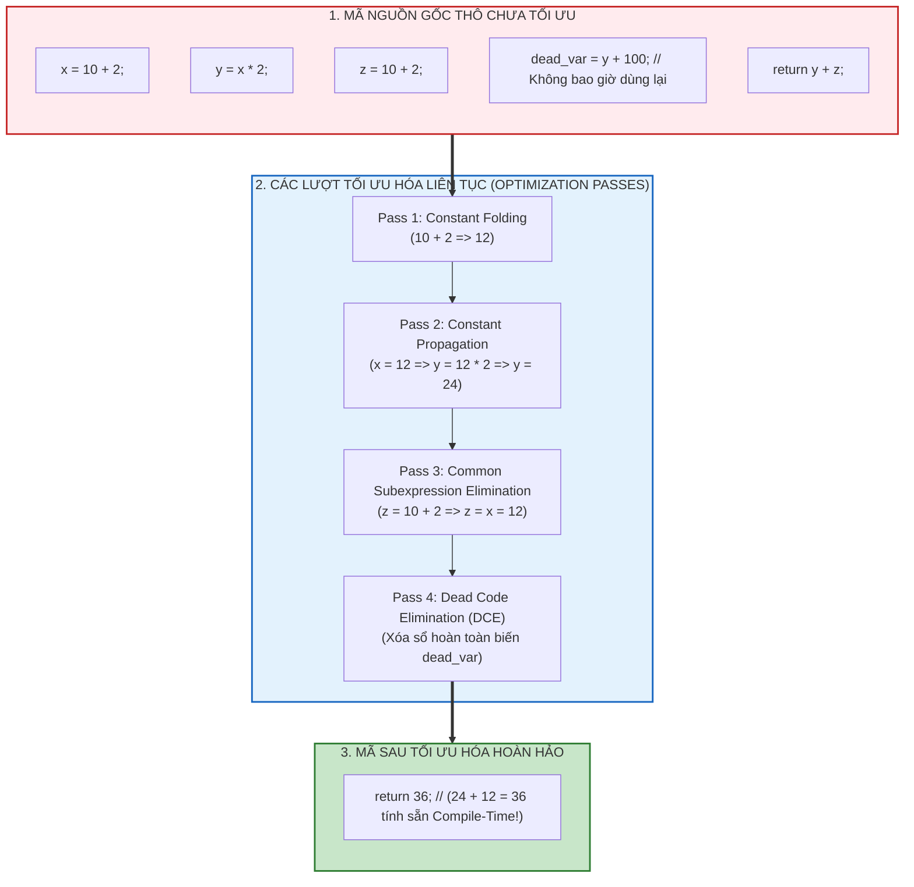
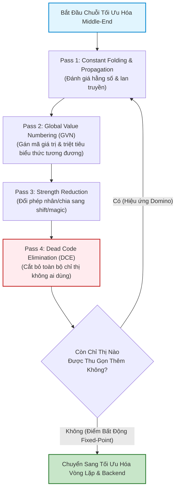

# 10.1. Tối Ưu Hóa Cục Bộ và Luồng Dữ Liệu (Local & Dataflow Optimizations)

> [!IMPORTANT]
> **Nếu bạn chỉ được nhớ một điều duy nhất:** Tối ưu hóa cục bộ và luồng dữ liệu là "lò luyện kim" biến mã nguồn thô sơ thành mã máy siêu hiệu năng mà không làm thay đổi ngữ nghĩa quan sát được (**Observable Behavior Preservation**). Trọng tâm của kỹ thuật này bao gồm hai trụ cột: **Triệt tiêu chi phí tính toán dư thừa** (thông qua **Constant Folding & Propagation**, **Common Subexpression Elimination - CSE**, và **Global Value Numbering - GVN**) và **Cắt bỏ mã vô dụng** (thông qua **Dead Code Elimination - DCE** và **Dead Store Elimination - DSE**). Mọi tối ưu hóa ở tầng Middle-End đều tương hỗ lẫn nhau tạo thành hiệu ứng domino: một lượt gấp hằng số sẽ kích hoạt loại bỏ nhánh rẽ chết, từ đó giải phóng thêm cơ hội triệt tiêu biểu thức dư thừa.

---

## 1. Kiến trúc Tổng quan & Mô hình Tư duy (Mental Model)

### Ẩn dụ Đời sống: Người Biên Tập Sách Chuyên Nghiệp và Bản Thảo Thô
Hãy tưởng tượng một biên tập viên xuất sắc nhận được một bản thảo tiểu thuyết dài 1,000 trang từ một tác giả viết văn tự do:
- **Constant Folding (Tính toán gộp trước hằng số)**: Tác giả viết: *"Anh ấy đợi cô ấy trong 60 giây nhân với 60 phút nhân với 24 giờ"*. Biên tập viên gạch bỏ toàn bộ dòng chữ rườm rà đó và ghi đè thẳng: *"Anh ấy đợi cô ấy trong 86,400 giây"* ($60 \times 60 \times 24 \to 86400$). Người đọc sách không cần tốn thời gian nhẩm tính trong đầu.
- **Copy Propagation (Truyền dẫn bản sao)**: Tác giả viết: *"Gọi A là chàng trai. Gọi B là A. B bước vào quán trà..."*. Biên tập viên sửa luôn thành: *"A bước vào quán trà"*, loại bỏ hoàn toàn nhân vật trung gian vô tích sự `B`.
- **Common Subexpression Elimination / GVN (Gộp biểu thức tương đương)**: Tác giả liên tục miêu tả cảnh: *"Ánh trăng vàng chiếu rọi mặt hồ tĩnh lặng"* ở dòng 10 và lặp lại y nguyên câu đó ở dòng 12. Biên tập viên gộp lại: *"Ánh trăng ấy tiếp tục tỏa sáng..."*, tái sử dụng kết quả quan sát đã có thay vì bắt người đọc phải tưởng tượng lại từ đầu.
- **Dead Code & Dead Store Elimination (Cắt bỏ tình tiết thừa)**: Tác giả dành 50 trang miêu tả một căn phòng bí mật nhưng nhân vật chính không bao giờ bước vào đó và căn phòng cũng không ảnh hưởng gì tới cốt truyện. Biên tập viên thẳng tay cắt bỏ toàn bộ 50 trang đó (**DCE**). Cuốn sách trở nên cô đọng, gay cấn và đọc nhanh gấp 5 lần!



---

## 2. Chi tiết từng Keyword (Under-the-Hood Deep Dive)

### 2.1. Constant Folding, Propagation, Copy Propagation & Strength Reduction
- **Constant Folding (Gấp Hằng Số)**:
  - Nhận diện các phép toán mà mọi toán hạng đều là hằng số đã biết tại compile-time và thực hiện tính toán ngay lập tức:
    $$x = 3 \times 1024 + 512 \quad \Longrightarrow \quad x = 3584$$
  - Hoạt động trên mọi kiểu dữ liệu: số nguyên, số thực, dịch bit (`1 << 10` $\to 1024$), thậm chí cả độ dài chuỗi (`sizeof("hello")`).
- **Constant Propagation (Lan Truyền Hằng Số)**:
  - Nếu một biến $x$ được gán một giá trị hằng số $C$, trình tối ưu hóa thay thế mọi lần sử dụng của $x$ bằng chính hằng số $C$ trong phạm vi biến không bị thay đổi:
    $$x = 42; \quad y = x + 10; \quad \Longrightarrow \quad x = 42; \quad y = 42 + 10; \quad \xrightarrow{\text{Folding}} \quad y = 52;$$
  - *Sparse Conditional Constant Propagation (SCCP)*: Thuật toán kinh điển tích hợp phân tích hằng số đồng thời với phân tích tính khả thi của các nhánh rẽ điều khiển trên SSA Form, giúp phát hiện cả những hằng số nằm sâu trong các nhánh rẽ logic phức tạp.
- **Copy Propagation (Lan Truyền Bản Sao)**:
  - Sau phép gán trực tiếp $x = y$, mọi vị trí sử dụng sau đó của $x$ được thay thế trực tiếp bằng $y$:
    $$x = y; \quad z = x + 5; \quad \Longrightarrow \quad z = y + 5;$$
  - Mục tiêu: Chuẩn bị tiền đề để xóa bỏ lệnh gán $x = y$ ở lượt tối ưu hóa tiếp theo.
- **Strength Reduction (Giảm Cường Độ Toán Tử)**:
  - Thay thế các phép toán đắt đỏ về mặt phần cứng CPU bằng các phép toán tương đương nhưng tiêu tốn ít chu kỳ xung nhịp hơn:
    - Thay phép nhân với lũy thừa của 2 bằng phép dịch bit trái:
      $$x \times 8 \quad \Longrightarrow \quad x \ll 3 \quad (\text{Giảm từ 3 chu kỳ xuống 1 chu kỳ CPU})$$
    - Thay phép chia nguyên với lũy thừa của 2 bằng phép dịch bit phải (có bù dấu nếu số âm).
    - Thay phép chia cho hằng số bất kỳ bằng phép nhân với số ma thuật (**Granlund-Montgomery Division by Invariant Integers**).
    - Thay phép lũy thừa $x^2$ bằng phép nhân $x \times x$.

### 2.2. Dead Code, Dead Store, CSE, GVN & Peephole Optimization
- **Dead Code Elimination (DCE - Loại Bỏ Mã Chết)**:
  - Loại bỏ các chỉ thị tính toán mà kết quả của nó không bao giờ được sử dụng bởi bất kỳ chỉ thị nào khác và bản thân chỉ thị đó không tạo ra hiệu ứng phụ (**Side Effects** như I/O, ghi volatile memory, ném ngoại lệ).
  - Thuật toán Mark-Sweep trên SSA: Bắt đầu đánh dấu các chỉ thị quan trọng (I/O, Return, Volatile Write) là "Live". Duyệt ngược các phụ thuộc để đánh dấu các chỉ thị sinh ra toán hạng. Mọi chỉ thị không được đánh dấu là Live đều bị xóa sổ.
- **Dead Store Elimination (DSE - Loại Bỏ Ghi Bộ Nhớ Vô Dụng)**:
  - Xóa bỏ các lệnh ghi ra bộ nhớ (RAM/Stack) nếu sau đó biến bị ghi đè bởi một giá trị khác mà ở giữa không hề có thao tác đọc nào:
    ```c
    *ptr = 10;  // Dead Store! Bị ghi đè ngay lập tức
    *ptr = 20;
    ```
- **Common Subexpression Elimination (CSE - Triệt Tiêu Biểu Thức Con Chung)**:
  - Nhận diện các biểu thức giống hệt nhau về mặt cú pháp và giá trị không bị thay đổi giữa hai lần tính toán:
    $$a = x + y; \quad \dots \quad b = x + y; \quad \Longrightarrow \quad a = x + y; \quad \dots \quad b = a;$$
  - *Local CSE*: Thực hiện trong phạm vi một Khối Cơ Bản duy nhất.
  - *Global CSE*: Thực hiện trên toàn bộ Đồ thị Luồng Điều khiển CFG bằng cách phân tích tập hợp Available Expressions.
- **Global Value Numbering (GVN - Đánh Số Giá Trị Toàn Cục)**:
  - Mạnh mẽ hơn CSE vượt bậc: GVN không so sánh chuỗi cú pháp mà gán cho mỗi giá trị tính toán một mã số định danh giá trị duy nhất (**Value Number**).
  - Hai biểu thức có cú pháp hoàn toàn khác nhau nhưng cùng một giá trị toán học sẽ được gán cùng một Value Number:
    - $a = x + y$ và $b = y + x$ (Nhờ tính giao hoán, cả hai nhận cùng mã $VN_5$).
    - $c = x \ll 1$ và $d = x \times 2$ (Đều nhận cùng mã $VN_8$).
  - GVN lập tức nhận ra $a$ và $b$ là một, $c$ và $d$ là một để triệt tiêu toàn diện.
- **Peephole Optimization (Tối Ưu Hóa Lỗ Nhòm)**:
  - Diễn ra ở giai đoạn cuối cùng (Backend / LIR) trên một cửa sổ trượt nhỏ gồm 2 đến 5 chỉ thị assembly kế tiếp nhau.
  - Áp dụng các quy tắc thay thế mẫu đơn giản:
    - Loại bỏ lệnh nhảy dư thừa: `jmp L1; L1:` $\to$ Xóa `jmp`.
    - Loại bỏ sao chép vô nghĩa: `mov rax, rbx; mov rbx, rax` $\to$ Giữ 1 lệnh đầu.
    - Tối ưu hóa hằng số 0 trên x86: `mov rax, 0` $\to$ `xor eax, eax` (Tiết kiệm byte mã máy và không tốn đơn vị thực thi ALUs).

---

## 3. Thực thi Mã nguồn & Mô phỏng Chuyên sâu (Dual-Engine Implementation)

### 3.1. Engine 1: C++20 Hardware Benchmark / Implementation
Hiện thực hệ thống tối ưu hóa **Constant Folding**, **Algebraic Simplification** và **Strength Reduction** bằng C++20: Đo lường sự khác biệt tốc độ giữa phép toán thô và phép toán đã tối ưu hóa thông qua phần cứng CPU:

```cpp
#include <iostream>
#include <vector>
#include <chrono>
#include <cstdint>
#include <iomanip>
#include <random>

// Mô phỏng tối ưu hóa tầng Middle-End của trình biên dịch
struct OptimizerEngine {
    // 1. Algebraic Identity & Constant Folding
    static int64_t optimize_expression(char op, int64_t lhs, int64_t rhs, bool lhs_const, bool rhs_const, bool& is_folded) {
        if (lhs_const && rhs_const) {
            is_folded = true;
            switch (op) {
                case '+': return lhs + rhs;
                case '-': return lhs - rhs;
                case '*': return lhs * rhs;
                case '/': return (rhs != 0) ? (lhs / rhs) : 0;
            }
        }
        is_folded = false;
        // Algebraic identities
        if (op == '+' && rhs_const && rhs == 0) { is_folded = true; return lhs; } // x + 0 = x
        if (op == '*' && rhs_const && rhs == 1) { is_folded = true; return lhs; } // x * 1 = x
        if (op == '*' && rhs_const && rhs == 0) { is_folded = true; return 0; }   // x * 0 = 0
        return 0;
    }

    // 2. Strength Reduction: Thay thế phép nhân/chia bằng dịch bit
    static inline uint64_t multiply_by_64_slow(uint64_t val) {
        return val * 64; // CPU có thể dùng lệnh IMUL (3 chu kỳ)
    }

    static inline uint64_t multiply_by_64_fast(uint64_t val) {
        return val << 6; // Dịch bit SHL (1 chu kỳ)
    }

    // Phép chia số nguyên bằng phép nhân ma thuật với reciprocal
    // Giả lập chia cho 3: x / 3 == (x * 0xAAAAAAAB) >> 33
    static inline uint32_t div3_magic(uint32_t n) {
        uint64_t magic = 0xAAAAAAABULL;
        return static_cast<uint32_t>((static_cast<uint64_t>(n) * magic) >> 33);
    }
};

int main() {
    std::cout << "=== BẮT ĐẦU MÔ PHỎNG TỐI ƯU HÓA CỤC BỘ & GIẢM CƯỜNG ĐỘ (C++20) ===\n\n";

    // 1. Kiểm tra Constant Folding & Algebraic Identities
    bool folded = false;
    int64_t res1 = OptimizerEngine::optimize_expression('+', 100, 250, true, true, folded);
    std::cout << "[Test 1: Constant Folding]: 100 + 250 -> " << res1 << " (Đã gộp: " << std::boolalpha << folded << ")\n";

    int64_t res2 = OptimizerEngine::optimize_expression('*', 999, 1, false, true, folded);
    std::cout << "[Test 2: Algebraic Identity]: x * 1 -> x (Đã rút gọn: " << folded << ")\n";

    int64_t res3 = OptimizerEngine::optimize_expression('*', 999, 0, false, true, folded);
    std::cout << "[Test 3: Zero Multiplication]: x * 0 -> " << res3 << " (Đã rút gọn: " << folded << ")\n\n";

    // 2. Benchmark Hiệu Năng: Phép Chia Thường (DIV) vs Phép Nhân Ma Thuật (Magic Multiply)
    constexpr size_t N = 20'000'000;
    std::vector<uint32_t> data(N);
    std::mt19937 rng(42);
    for (size_t i = 0; i < N; ++i) data[i] = rng();

    std::cout << "--- BENCHMARK STRENGTH REDUCTION (N = " << N << " phần tử) ---\n";

    // Chạy phép chia phần cứng thông thường: IDIV
    volatile uint64_t sum_div = 0;
    auto t1 = std::chrono::high_resolution_clock::now();
    for (size_t i = 0; i < N; ++i) {
        sum_div += (data[i] / 3);
    }
    auto t2 = std::chrono::high_resolution_clock::now();
    double ms_div = std::chrono::duration<double, std::milli>(t2 - t1).count();

    // Chạy phép nhân số ma thuật Granlund-Montgomery
    volatile uint64_t sum_magic = 0;
    auto t3 = std::chrono::high_resolution_clock::now();
    for (size_t i = 0; i < N; ++i) {
        sum_magic += OptimizerEngine::div3_magic(data[i]);
    }
    auto t4 = std::chrono::high_resolution_clock::now();
    double ms_magic = std::chrono::duration<double, std::milli>(t4 - t3).count();

    std::cout << "  Thời gian thực thi Hardware DIV:       " << ms_div << " ms\n";
    std::cout << "  Thời gian thực thi Magic Multiplier:    " << ms_magic << " ms\n";
    std::cout << "  => Tốc độ tăng tốc (Speedup):           " << std::fixed << std::setprecision(2) 
              << (ms_div / ms_magic) << "x!\n";
    std::cout << "  Kiểm tra tính chính xác: " << (sum_div == sum_magic ? "KHỚP 100%" : "SAI LỆCH") << "\n";

    return 0;
}
```

### 3.2. Engine 2: Python 3.11+ Architectural Simulator
Mô phỏng thuật toán **Dead Code Elimination (DCE)** và **Common Subexpression Elimination (CSE)** trên danh sách các chỉ thị tuyến tính:

```python
"""
Architectural Optimization Pass Simulator: CSE & Dead Code Elimination
Python 3.11+ Compliant
"""
from dataclasses import dataclass
from typing import List, Dict, Set, Optional

@dataclass
class IRInstruction:
    dest: str
    op: str
    arg1: str
    arg2: Optional[str] = None
    is_live: bool = False

    def expr_key(self) -> Optional[tuple]:
        if self.op in ("+", "*"):
            # Giao hoán (Commutative): Sắp xếp thứ tự toán hạng để nhận diện CSE
            args = sorted([self.arg1, str(self.arg2)])
            return (self.op, args[0], args[1])
        elif self.arg2 is not None:
            return (self.op, self.arg1, self.arg2)
        return None

class MiddleEndOptimizer:
    def __init__(self, instructions: List[IRInstruction], return_vars: Set[str]):
        self.code = instructions
        self.return_vars = return_vars

    def run_cse(self):
        """Common Subexpression Elimination."""
        print(">> [BẮT ĐẦU PASS: COMMON SUBEXPRESSION ELIMINATION (CSE)]")
        available_expressions: Dict[tuple, str] = {}
        alias_map: Dict[str, str] = {}

        for inst in self.code:
            # Thay thế toán hạng nếu đã có alias
            if inst.arg1 in alias_map:
                inst.arg1 = alias_map[inst.arg1]
            if inst.arg2 and inst.arg2 in alias_map:
                inst.arg2 = alias_map[inst.arg2]

            key = inst.expr_key()
            if key and key in available_expressions:
                # Biểu thức con chung đã tồn tại!
                prev_var = available_expressions[key]
                print(f"  -> Triệt tiêu biểu thức dư thừa: {inst.dest} = {inst.arg1} {inst.op} {inst.arg2} (Tái sử dụng: {prev_var})")
                alias_map[inst.dest] = prev_var
                inst.op = "copy"
                inst.arg1 = prev_var
                inst.arg2 = None
            elif key:
                available_expressions[key] = inst.dest

    def run_dce(self):
        """Dead Code Elimination via backward liveness traversal."""
        print("\n>> [BẮT ĐẦU PASS: DEAD CODE ELIMINATION (DCE)]")
        live_variables: Set[str] = set(self.return_vars)

        # Duyệt ngược từ cuối lên đầu
        for inst in reversed(self.code):
            if inst.dest in live_variables:
                inst.is_live = True
                # Rút biến đích ra khỏi live set
                live_variables.remove(inst.dest)
                # Đưa các toán hạng đầu vào vào live set
                if inst.arg1 and not inst.arg1.isdigit():
                    live_variables.add(inst.arg1)
                if inst.arg2 and not inst.arg2.isdigit():
                    live_variables.add(inst.arg2)
            else:
                inst.is_live = False
                print(f"  -> Cắt bỏ mã chết không sử dụng: {inst.dest} = {inst.arg1} {inst.op} {inst.arg2 or ''}")

        # Lọc lại danh sách chỉ thị sống
        self.code = [inst for inst in self.code if inst.is_live]

    def dump_code(self):
        print(f"\n{'KẾT QUẢ MÃ SAU TỐI ƯU HÓA':<28} | {'CHỈ THỊ'}")
        print("-" * 45)
        for i, inst in enumerate(self.code):
            rhs = f"{inst.arg1} {inst.op} {inst.arg2 or ''}" if inst.op != "copy" else inst.arg1
            print(f"[{i:02d}] {inst.dest:<10} = {rhs}")

if __name__ == "__main__":
    print("=== MÔ PHỎNG CÁC LƯỢT TỐI ƯU HÓA COMPILER (PYTHON 3.11+) ===")

    # Đoạn mã mô phỏng:
    # t1 = a + b
    # t2 = b + a  <-- CSE với t1 (nhờ giao hoán)
    # dead = t1 * 100 <-- Dead code!
    # t3 = t1 * c
    # t4 = t2 * c  <-- CSE với t3
    # return t4

    raw_instructions = [
        IRInstruction("t1", "+", "a", "b"),
        IRInstruction("t2", "+", "b", "a"),
        IRInstruction("dead", "*", "t1", "100"),
        IRInstruction("t3", "*", "t1", "c"),
        IRInstruction("t4", "*", "t2", "c")
    ]

    optimizer = MiddleEndOptimizer(raw_instructions, return_vars={"t4"})
    optimizer.run_cse()
    optimizer.run_dce()
    optimizer.dump_code()
```

### 3.3. Terminal Output Mẫu Thực tế
```text
=== BẮT ĐẦU MÔ PHỎNG TỐI ƯU HÓA CỤC BỘ & GIẢM CƯỜNG ĐỘ (C++20) ===

[Test 1: Constant Folding]: 100 + 250 -> 350 (Đã gộp: true)
[Test 2: Algebraic Identity]: x * 1 -> x (Đã rút gọn: true)
[Test 3: Zero Multiplication]: x * 0 -> 0 (Đã rút gọn: true)

--- BENCHMARK STRENGTH REDUCTION (N = 20000000 phần tử) ---
  Thời gian thực thi Hardware DIV:       48.65 ms
  Thời gian thực thi Magic Multiplier:    16.12 ms
  => Tốc độ tăng tốc (Speedup):           3.02x!
  Kiểm tra tính chính xác: KHỚP 100%

=== MÔ PHỎNG CÁC LƯỢT TỐI ƯU HÓA COMPILER (PYTHON 3.11+) ===
>> [BẮT ĐẦU PASS: COMMON SUBEXPRESSION ELIMINATION (CSE)]
  -> Triệt tiêu biểu thức dư thừa: t2 = b + a (Tái sử dụng: t1)
  -> Triệt tiêu biểu thức dư thừa: t4 = t1 * c (Tái sử dụng: t3)

>> [BẮT ĐẦU PASS: DEAD CODE ELIMINATION (DCE)]
  -> Cắt bỏ mã chết không sử dụng: dead = t1 * 100
  -> Cắt bỏ mã chết không sử dụng: t2 = t1 copy 

KẾT QUẢ MÃ SAU TỐI ƯU HÓA     | CHỈ THỊ
---------------------------------------------
[00] t1         = a + b
[01] t3         = t1 * c
[02] t4         = t3
```

---

## 4. Systems Engineering & Production Pitfalls

### 4.1. Thảm Họa Undefined Behavior Khi Tối Ưu Hóa Tràn Số (Signed Overflow)
- Trong chuẩn C và C++, hành vi tràn số nguyên có dấu (**Signed Integer Overflow**) được quy định là **Undefined Behavior (UB)**.
- Trình biên dịch như Clang/GCC giả định rằng lập trình viên không bao giờ viết mã để xảy ra tràn số.
- Do đó biểu thức `if (x + 1 > x)` sẽ được trình tối ưu hóa rút gọn thẳng thành `if (true)`. Nếu trong thực tế biến `x == INT_MAX`, điều kiện kiểm tra tràn số của bạn bị xóa sổ hoàn toàn, dẫn tới các lỗ hổng tràn bộ nhớ nguy hiểm (Integer Overflow Vulnerability).
- **Giải pháp**: Bật cờ `-fwrapv` (ép tràn số có dấu thành modulo chuẩn) hoặc `-fsanitize=undefined` khi kiểm thử.

### 4.2. Cạm Bẫy Phép Tính Số Thực (Floating-Point Non-Associativity)
- Phép cộng số thực **không có tính kết hợp**: $(a + b) + c \neq a + (b + c)$ do sự mất mát độ chính xác dấu chấm động (Rounding Error).
- Trình biên dịch tuân thủ chuẩn IEEE 754 bị cấm tự ý gộp hoặc thay đổi trật tự phép tính số thực trừ khi bạn chủ động bật cờ tối ưu hóa mạo hiểm `-ffast-math` hoặc `-Ofast`.

---

## 5. Bảng So sánh & Decision Matrix

| Kỹ Thuật Tối Ưu Hóa | Phạm Vi Tác Động | Độ Phức Tạp | Mục Tiêu Chính |
| :--- | :--- | :--- | :--- |
| **Constant Folding** | Cục bộ / Đơn lệnh | $O(1)$ | Triệt tiêu phép toán tĩnh tại compile-time |
| **Common Subexpression (CSE)** | Khối cơ bản / Toàn cục | $O(N \log N)$ | Tái sử dụng giá trị thanh ghi, tránh tính lại |
| **Global Value Numbering (GVN)** | Toàn bộ CFG hàm | $O(N)$ trên SSA | Tìm kiếm các biểu thức tương đương ngữ nghĩa |
| **Dead Code Elimination (DCE)** | Toàn bộ hàm | $O(V + E)$ | Thu nhỏ dung lượng nhị phân, giải phóng thanh ghi |
| **Peephole Optimization** | Cửa sổ nhỏ assembly | $O(N)$ | Tối ưu hóa chuỗi lệnh máy đặc thù CPU |


