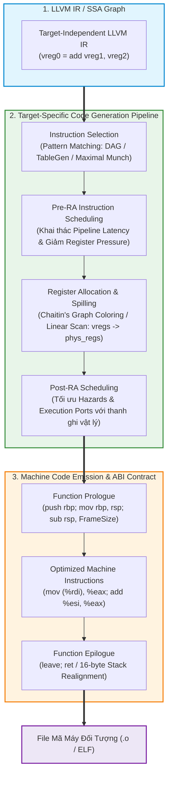
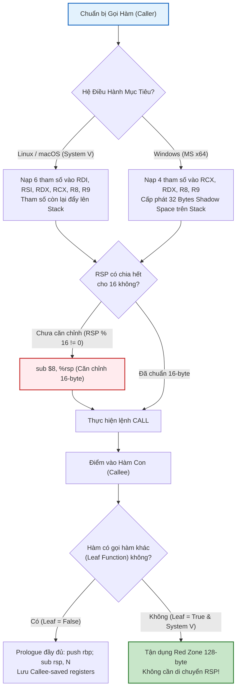

# 11.1. Sinh Mã Máy và Giao Diện Nhị Phân Ứng Dụng (Code Generation & ABI)

> [!IMPORTANT]
> **Nếu bạn chỉ được nhớ một điều duy nhất:** Giai đoạn sinh mã máy (**Code Generation**) là chiếc cầu nối vật lý biến đồ thị trung gian trừu tượng (IR/SSA) thành các chỉ thị vi kiến trúc cụ thể thông qua bộ ba: Chọn lệnh (Instruction Selection), Lập lịch lệnh (Scheduling) và Phân bổ thanh ghi (Register Allocation); trong khi **ABI** là bản hợp đồng sắt đá quy định việc phân chia thanh ghi, căn chỉnh ngăn xếp 16-byte và trật tự Prologue/Epilogue để mã máy của mọi ngôn ngữ và trình biên dịch có thể bắt tay hợp tác trơn tru trên cùng một chip xử lý.

---

## 1. Kiến trúc Tổng quan & Mô hình Tư duy (Mental Model)

### Ẩn dụ Đời sống: Nhạc Trưởng, Nhạc Công và Quy Ước Lên Sân Khấu
Hãy hình dung giai đoạn sinh mã máy và ABI giống như một buổi hòa nhạc giao hưởng quốc tế:
- **Bản tổng phổ trừu tượng (Intermediate Representation - IR)**: Nhạc sĩ viết bản giao hưởng bằng các nốt nhạc chuẩn mực, độc lập với nhạc cụ (như mã LLVM IR hay SSA).
- **Chọn nhạc cụ (Instruction Selection)**: Người tổng đạo diễn quyết định nốt nhạc này sẽ do đàn vĩ cầm (thanh ghi số nguyên) hay kèn cor (thanh ghi vector SIMD) tấu lên, chuyển nốt nhạc trừu tượng thành ngón bấm thực tế trên từng loại đàn cụ thể của kiến trúc phần cứng (x86-64 hay ARM64).
- **Lập lịch tấu nhạc (Instruction Scheduling)**: Để tránh tình trạng nghệ sĩ gõ trống phải ngồi đợi nghệ sĩ thổi sáo lấy hơi (độ trễ nạp dữ liệu từ RAM - Memory Latency), nhạc trưởng đảo trật tự các thao tác chuẩn bị để khai thác tối đa khoảng thời gian rảnh rỗi giữa các nhịp.
- **Phân bổ nhạc cụ (Register Allocation & Spilling)**: Dàn nhạc chỉ có đúng 16 chiếc ghế danh dự trên sân khấu (16 thanh ghi đa năng của x86-64). Khi có tới 30 bè nhạc cần cất lên cùng lúc, một số nhạc công buộc phải tạm rời ghế xuống ngồi ở hàng ghế dự bị phía sau cánh gà (Stack Spilling) và chỉ bước lên sân khấu khi đến phân đoạn của mình.
- **Quy ước ngoại giao ABI & Calling Convention**: Khi hai dàn nhạc từ hai quốc gia khác nhau (ví dụ: module viết bằng Rust và module viết bằng C++) kết hợp:
  - Cả hai bên phải tuân thủ nghiêm ngặt nghi thức: Ai trao quà cho ai trước (tham số nạp vào `rdi`, `rsi`...), khi rời sân khấu phải dọn dẹp bàn ghế sạch sẽ trả lại nguyên trạng như thế nào (Callee-saved registers: `rbx`, `rbp`, `r12-r15`). Nếu vi phạm nghi thức, toàn bộ buổi diễn sẽ sụp đổ tan tành (Segmentation Fault).



---

## 2. Chi tiết từng Keyword (Under-the-Hood Deep Dive)

### 2.1. Instruction Selection (Chọn Chỉ Thị Mã Máy)
- **Bản chất kỹ thuật**: Instruction Selection là quá trình ánh xạ đồ thị biểu thức trung gian trừu tượng (**SelectionDAG**) thành chuỗi các chỉ thị máy cụ thể của phần cứng đích (Target Machine Instructions).
- **Thuật toán Khớp Mẫu (Pattern Matching & Tree Rewriting)**:
  - Trình biên dịch biểu diễn khối cơ bản dưới dạng cây DAG biểu thức.
  - Sử dụng giải thuật **Maximal Munch** (Gặm tối đại) hoặc Quy hoạch động (**Dynamic Programming**) để tìm kiếm tập hợp các lệnh bao phủ toàn bộ cây với tổng chi phí chu kỳ xung nhịp là thấp nhất.
- **Ví dụ phức hợp**: Phép tính trừu tượng `a + (b * 4)` trong LLVM IR có thể được chọn thành một lệnh đơn lẻ x86-64 cực mạnh `lea (%rax, %rbx, 4), %rax` thay vì phải tốn 2 lệnh `imul` và `add`.

### 2.2. Instruction Scheduling (Lập Lịch Chỉ Thị)
- **Bản chất kỹ thuật**: Tái sắp xếp trật tự thực thi của các chỉ thị máy mà không làm thay đổi ngữ nghĩa logic dữ liệu, nhằm mục đích che giấu độ trễ truy cập bộ nhớ (**Load Latency**), độ trễ số thực (**FPU Latency**) và tránh xung đột cổng thực thi vi kiến trúc (**Execution Port Contention**).
- **Đồ thị phụ thuộc dữ liệu (Dependency DAG)**:
  - Cạnh đại diện cho các quan hệ: **RAW** (Read-After-Write / True Dependency), **WAR** (Write-After-Read / Anti-dependency), và **WAW** (Write-After-Write / Output dependency).
- **Xung đột đánh đổi giữa ILP và Áp lực Thanh ghi**:
  - Tách xa lệnh `Load` khỏi lệnh sử dụng dữ liệu giúp CPU không bị treo máy chờ RAM (tăng Instruction-Level Parallelism).
  - Nhưng việc trì hoãn sử dụng kết quả khiến giá trị phải nằm lại trong thanh ghi lâu hơn, kéo dài khoảng sống (**Live Range**), làm bùng nổ **Register Pressure** và dễ kích hoạt tràn ngăn xếp.

### 2.3. Register Allocation (Phân Bổ Thanh Ghi) & Spilling
- **Bản chất kỹ thuật**: Ánh xạ số lượng biến ảo vô hạn trong mã trung gian (**Virtual Registers**) vào tập hợp rất giới hạn các thanh ghi vật lý thực tế của chip (**Physical Registers** - ví dụ x86-64 chỉ có 16 thanh ghi GPR, AArch64 có 31 thanh ghi).
- **Thuật toán Tô màu Đồ thị Chaitin-Briggs (Graph Coloring)**:
  1. Xây dựng **Đồ thị Giao thoa (Interference Graph)**: Mỗi biến ảo là một đỉnh; hai đỉnh có cạnh nối nếu khoảng sống (**Live Range**) của chúng chồng lấn nhau cùng một thời điểm.
  2. Bài toán phân bổ $K$ thanh ghi vật lý quy về bài toán kinh điển: **Tô màu đồ thị với $K$ màu sao cho không có hai đỉnh kề nhau cùng màu** (NP-Complete).
  3. Sử dụng giải thuật đơn giản hóa của Kempe: Liên tục tìm đỉnh có bậc $< K$ và đẩy vào ngăn xếp.
- **Hiện tượng Tràn Thanh Ghi (Register Spilling)**:
  - Khi đồ thị không thể tô bằng $K$ màu (tất cả các đỉnh còn lại đều có bậc $\ge K$), trình biên dịch buộc phải chọn một biến "ít quan trọng nhất" (nằm trong khối lệnh ít chạy nhất) để **Spill xuống Stack Frame**.
  - Mỗi lần cần dùng biến bị tràn, compiler phải chèn thêm lệnh `mov (%rsp), %reg` (Load) và lưu lại bằng `mov %reg, (%rsp)` (Store), làm tăng vọt chi phí truy cập bộ nhớ.
- **Linear Scan Register Allocation**: Thuật toán quét tuyến tính $O(N)$ được sử dụng trong các JIT Compiler (như V8, JVM C1) nhằm đánh đổi độ tối ưu mã máy lấy tốc độ biên dịch tức thời.

### 2.4. ABI (Application Binary Interface) & Gọi Hàm Chuẩn Mực
- **Bản chất kỹ thuật**: ABI là tập hợp các quy định nhị phân cấp thấp giữa hệ điều hành, trình liên kết và trình biên dịch, đảm bảo các đoạn mã máy được dịch độc lập có thể giao tiếp với nhau mà không cần biết mã nguồn gốc:
  - Kích thước, căn chỉnh bộ nhớ của các kiểu dữ liệu cơ bản.
  - Cấu trúc bộ nhớ của Struct/Class, Bitfields, Calling Conventions.
  - Định dạng bảng mã ngoại lệ (Exception Handling unwinding tables) và Symbol Name Mangling.

### 2.5. Calling Conventions (Quy Ước Lời Gọi Hàm)
- **System V AMD64 ABI (Linux, macOS, BSD)**:
  - 6 tham số số nguyên/con trỏ đầu tiên được truyền qua các thanh ghi vật lý: `RDI`, `RSI`, `RDX`, `RCX`, `R8`, `R9`.
  - Các tham số dấu phẩy động (float/double) được truyền qua thanh ghi vector: `XMM0` đến `XMM7`.
  - Tham số thứ 7 trở đi được đẩy lên đỉnh ngăn xếp (**Stack**) theo thứ tự từ phải qua trái.
  - Giá trị trả về: Đặt trong `RAX` (hoặc `RDX:RAX` nếu 128-bit) và `XMM0`.
- **Microsoft x64 Calling Convention (Windows OS)**:
  - Chỉ dùng 4 thanh ghi: `RCX`, `RDX`, `R8`, `R9`.
  - **Shadow Space (Home Space)**: Bắt buộc hàm gọi (Caller) phải cấp phát tối thiểu 32 bytes (4 quadwords) trên đỉnh Stack ngay trước lệnh `call`, để hàm được gọi có sẵn chỗ lưu tạm 4 thanh ghi tham số này nếu cần.

### 2.6. Phân Biệt Callee-Saved vs Caller-Saved Registers
- **Caller-Saved (Volatile / Scratch Registers)**:
  - Bao gồm: `RAX`, `RCX`, `RDX`, `RSI`, `RDI`, `R8`, `R9`, `R10`, `R11`.
  - Hàm cha tự chịu trách nhiệm: Nếu muốn giữ giá trị trong các thanh ghi này qua lời gọi hàm con, hàm cha phải tự `push` lưu xuống Stack trước khi `call`. Hàm con được quyền tự do ghi đè mà không cần hoàn trả.
- **Callee-Saved (Non-Volatile Registers)**:
  - Bao gồm: `RBX`, `RBP`, `RSP`, `R12`, `R13`, `R14`, `R15`.
  - Hợp đồng danh dự của hàm con: Hàm con muốn dùng các thanh ghi này thì bắt buộc phải lưu giá trị cũ (`push %r12`) trong Prologue và khôi phục nguyên vẹn (`pop %r12`) trong Epilogue trước khi thực hiện lệnh `ret`.

### 2.7. Stack Frame Layout, Alignment & The Red Zone
- **Căn chỉnh Ngăn Xếp 16-Byte (16-Byte Stack Alignment)**:
  - System V ABI yêu cầu thanh ghi `RSP` phải chia hết cho 16 ngay tại thời điểm lệnh `call` được thực thi.
  - Lệnh `call` tự động đẩy địa chỉ trả về (8 bytes) lên đỉnh Stack $\to$ lúc này `RSP % 16 == 8`.
  - Do đó, trong Function Prologue, compiler bắt buộc phải điều chỉnh kích thước Stack Frame sao cho `RSP` lại được căn chỉnh về bội số của 16 trước khi gọi hàm kế tiếp. Việc này là yêu cầu bắt buộc của các tập chỉ thị SIMD (SSE/AVX yêu cầu nạp từ địa chỉ 16-byte alignment).
- **The Red Zone (128 Bytes Thần Thánh)**:
  - Trong x86-64 System V ABI, vùng bộ nhớ 128 bytes nằm ngay **dưới** con trỏ ngăn xếp `RSP` (`[RSP - 1] ... [RSP - 128]`) được gọi là **Red Zone**.
  - Các hàm lá (**Leaf Functions** - hàm không gọi hàm nào khác) được phép tự do lưu trữ biến cục bộ trong vùng 128 bytes này mà **không cần phải di chuyển con trỏ `RSP`** (không cần `sub rsp, N`).
  - Hệ điều hành cam kết tuyệt đối không để Signal Handler hay Interrupt ghi đè vào vùng Red Zone này. Tiết kiệm hàng triệu chu kỳ CPU cho các hàm nhỏ. (Lưu ý: Windows x64 không hỗ trợ Red Zone).

### 2.8. Function Prologue & Epilogue
- **Function Prologue (Mở đầu hàm)**:
  ```assembly
  push    %rbp            # Lưu Frame Pointer của hàm cha
  mov     %rsp, %rbp      # Thiết lập Frame Pointer mới cho hàm hiện tại
  sub     $0x30, %rsp     # Cấp phát 48 bytes trên Stack cho biến cục bộ
  push    %r12            # Bảo toàn callee-saved register nếu cần dùng
  ```
- **Function Epilogue (Kết thúc hàm)**:
  ```assembly
  pop     %r12            # Khôi phục callee-saved register
  mov     %rbp, %rsp      # Hoặc dùng chỉ thị 'leave'
  pop     %rbp            # Khôi phục Frame Pointer của hàm cha
  ret                     # Nhảy về địa chỉ sau lệnh call
  ```
- **Frame Pointer Omission (`-fomit-frame-pointer`)**:
  - Trình biên dịch hiện đại loại bỏ hoàn toàn việc dùng `RBP` làm con trỏ khung stack, giải phóng `RBP` trở thành một thanh ghi đa năng bổ sung.
  - Mọi biến cục bộ được định vị dựa trên độ lệch tương đối với đỉnh ngăn xếp `RSP` (ví dụ `mov -8(%rsp), %eax`).

---

## 3. Thực thi Mã nguồn & Mô phỏng Chuyên sâu (Dual-Engine Implementation)

### 3.1. C++20 Implementation: Khảo sát ABI, Con trỏ Khung Ngăn xếp và Inline Assembly
Đoạn mã C++20 dưới đây can thiệp trực tiếp vào thanh ghi x86-64 để giải mã Stack Frame, xác thực Calling Convention System V và chứng minh cơ chế Red Zone:

```cpp
#include <iostream>
#include <iomanip>
#include <cstdint>

// Vô hiệu hóa Inlining và Buộc compiler giữ nguyên Frame Pointer RBP
__attribute__((noinline))
void inspect_stack_frame(uint64_t arg1, uint64_t arg2, uint64_t arg3, 
                        uint64_t arg4, uint64_t arg5, uint64_t arg6, 
                        uint64_t arg7, uint64_t arg8) {
    uint64_t local_var1 = 0xAAAAAAAAAAAAAAAA;
    uint64_t local_var2 = 0xBBBBBBBBBBBBBBBB;

    uint64_t rbp_val = 0;
    uint64_t rsp_val = 0;

    // Đọc trực tiếp thanh ghi RBP và RSP qua Inline Assembly x86-64
    asm volatile("mov %%rbp, %0" : "=r"(rbp_val));
    asm volatile("mov %%rsp, %0" : "=r"(rsp_val));

    std::cout << "--- [INSPECTING STACK FRAME & ABI CONTRACT] ---\n";
    std::cout << "RBP (Frame Pointer) : 0x" << std::hex << rbp_val << "\n";
    std::cout << "RSP (Stack Pointer) : 0x" << std::hex << rsp_val << "\n";
    std::cout << "Kích thước Frame    : " << std::dec << (rbp_val - rsp_val) << " bytes\n";
    std::cout << "Căn chỉnh RSP % 16  : " << (rsp_val % 16) << " (Yêu cầu ABI: 0 trước khi call)\n\n";

    // Địa chỉ của Saved RBP nằm chính xác tại [RBP]
    uint64_t* saved_rbp = reinterpret_cast<uint64_t*>(rbp_val);
    // Địa chỉ trả về (Return Address) nằm ngay phía trên Saved RBP: [RBP + 8]
    uint64_t return_address = *(saved_rbp + 1);

    std::cout << "Saved Parent RBP    : 0x" << std::hex << *saved_rbp << "\n";
    std::cout << "Return Address (RIP): 0x" << std::hex << return_address << "\n\n";

    // Tham số 1-6 được truyền qua thanh ghi (System V ABI):
    // RDI=arg1, RSI=arg2, RDX=arg3, RCX=arg4, R8=arg5, R9=arg6
    std::cout << "[Register Args] Arg1 (RDI): 0x" << std::hex << arg1 
              << " | Arg6 (R9): 0x" << arg6 << "\n";

    // Tham số 7, 8 bắt buộc phải truyền qua Stack của Caller:
    // Theo System V AMD64: Arg7 nằm tại [RBP + 16], Arg8 nằm tại [RBP + 24]
    uint64_t stack_arg7 = *(saved_rbp + 2);
    uint64_t stack_arg8 = *(saved_rbp + 3);
    std::cout << "[Stack Args]    Arg7 ([RBP+16]): 0x" << std::hex << stack_arg7 
              << " | Arg8 ([RBP+24]): 0x" << stack_arg8 << "\n\n";

    std::cout << "Địa chỉ biến cục bộ 1: " << &local_var1 << " (Giá trị: 0x" << local_var1 << ")\n";
    std::cout << "Địa chỉ biến cục bộ 2: " << &local_var2 << " (Giá trị: 0x" << local_var2 << ")\n";
}

int main() {
    std::cout << "=========================================================\n";
    std::cout << "   C++20 & x86-64 ABI CALLING CONVENTION DISSECTOR      \n";
    std::cout << "=========================================================\n\n";

    // Truyền 8 tham số: 6 tham số đầu vào Registers, 2 tham số sau vào Stack
    inspect_stack_frame(0x1111, 0x2222, 0x3333, 0x4444, 0x5555, 0x6666, 0x7777, 0x8888);

    std::cout << "\n[Thực thi hoàn tất]: Frame giải phóng, RSP trở về trạng thái an toàn.\n";
    return 0;
}
```

### 3.2. Python 3.11+ Implementation: Mô phỏng Thuật toán Chaitin Graph Coloring Register Allocator
Chương trình Python 3.11+ dưới đây triển khai trọn vẹn giải thuật Chaitin-Briggs Graph Coloring để giải bài toán phân bổ $K$ thanh ghi vật lý và nhận diện biến cần Spill xuống Stack:

```python
from collections import defaultdict
from typing import Set, Dict, List, Optional

class ChaitinRegisterAllocator:
    """
    Bộ phân bổ thanh ghi kinh điển Chaitin-Briggs dựa trên thuật toán Tô màu Đồ thị.
    """
    def __init__(self, num_physical_registers: int):
        self.k = num_physical_registers
        self.adj_list: Dict[str, Set[str]] = defaultdict(set)
        self.all_nodes: Set[str] = set()

    def add_variable(self, var: str):
        self.all_nodes.add(var)

    def add_interference(self, u: str, v: str):
        """Tạo cạnh giao thoa nếu khoảng sống của hai biến ảo trùng nhau"""
        if u != v:
            self.adj_list[u].add(v)
            self.adj_list[v].add(u)
            self.all_nodes.add(u)
            self.all_nodes.add(v)

    def allocate(self) -> Dict[str, str]:
        print(f"\n[Bắt đầu Phân bổ]: K = {self.k} thanh ghi vật lý khả dụng.")
        print(f"Tổng số biến ảo cần phân bổ: {len(self.all_nodes)}")

        # Sao chép đồ thị để thực hiện giải thuật rút gọn (Simplify)
        current_graph = {u: set(neighbors) for u, neighbors in self.adj_list.items()}
        for node in self.all_nodes:
            if node not in current_graph:
                current_graph[node] = set()

        select_stack: List[str] = []
        spill_candidates: List[str] = []

        # Pha 1: Simplify & Potential Spill
        while current_graph:
            # Tìm đỉnh có bậc < K
            low_degree_nodes = [u for u, neighbors in current_graph.items() if len(neighbors) < self.k]
            
            if low_degree_nodes:
                # Chọn đỉnh bậc nhỏ nhất đẩy vào ngăn xếp
                node = low_degree_nodes[0]
                select_stack.append(node)
                # Xóa đỉnh khỏi đồ thị tạm
                for neighbor in current_graph[node]:
                    current_graph[neighbor].remove(node)
                del current_graph[node]
                print(f"  -> [Simplify]: Đẩy '{node}' vào ngăn xếp (Bậc < {self.k})")
            else:
                # Không còn đỉnh nào bậc < K: Bắt buộc chọn đỉnh để Spill!
                # Chiến lược heuristic: Chọn đỉnh có bậc cao nhất để giải phóng nhiều cạnh nhất
                spill_node = max(current_graph.keys(), key=lambda u: len(current_graph[u]))
                select_stack.append(spill_node)
                spill_candidates.append(spill_node)
                for neighbor in current_graph[spill_node]:
                    current_graph[neighbor].remove(spill_node)
                del current_graph[spill_node]
                print(f"  -> [Spill Candidate]: Cạn kiệt thanh ghi! Chọn '{spill_node}' làm ứng viên tràn")

        # Pha 2: Select (Tô màu ngược từ ngăn xếp)
        allocation: Dict[str, str] = {}
        available_colors = [f"R{i}" for i in range(self.k)]

        print("\n[Pha Tô Màu (Select)]:")
        while select_stack:
            node = select_stack.pop()
            # Lấy tập hợp màu đã bị các hàng xóm kề cận sử dụng
            neighbor_colors = {allocation[neighbor] for neighbor in self.adj_list[node] if neighbor in allocation}
            
            # Tìm màu đầu tiên còn trống
            assigned_color = None
            for c in available_colors:
                if c not in neighbor_colors:
                    assigned_color = c
                    break

            if assigned_color:
                allocation[node] = assigned_color
                print(f"  + Gán thanh ghi: {node:8s} -> {assigned_color}")
            else:
                # Không thể tô màu: Biến chính thức bị SPILL xuống Stack!
                allocation[node] = f"[STACK_SPILL_OFFSET_{node}]"
                print(f"  ! [ACTUAL SPILL]: Biến {node:8s} -> Buộc phải lưu trữ trên STACK!")

        return allocation

if __name__ == '__main__':
    print("=== MÔ PHỎNG CHAITIN GRAPH COLORING REGISTER ALLOCATOR ===")
    # Giả định CPU có đúng 3 thanh ghi vật lý: R0, R1, R2 (K=3)
    allocator = ChaitinRegisterAllocator(num_physical_registers=3)

    # Đăng ký các biến ảo trong hàm xử lý đồ họa
    variables = ["v_x", "v_y", "v_z", "v_temp", "v_color", "v_alpha"]
    for v in variables:
        allocator.add_variable(v)

    # Thiết lập các cạnh giao thoa (Interference Edges do Live Range trùng lặp)
    allocator.add_interference("v_x", "v_y")
    allocator.add_interference("v_x", "v_z")
    allocator.add_interference("v_y", "v_z")
    allocator.add_interference("v_z", "v_temp")
    allocator.add_interference("v_temp", "v_color")
    allocator.add_interference("v_temp", "v_alpha")
    allocator.add_interference("v_color", "v_alpha")
    allocator.add_interference("v_x", "v_color")

    final_map = allocator.allocate()

    print("\n=== KẾT QUẢ PHÂN BỔ THANH GHI CUỐI CÙNG ===")
    for var, reg in final_map.items():
        print(f"  Biến ảo '{var:8s}' ---> Vị trí: {reg}")
```

### 3.3. Terminal Output Mẫu Thực tế
```text
=========================================================
   C++20 & x86-64 ABI CALLING CONVENTION DISSECTOR      
=========================================================

--- [INSPECTING STACK FRAME & ABI CONTRACT] ---
RBP (Frame Pointer) : 0x7ffee3b4a240
RSP (Stack Pointer) : 0x7ffee3b4a200
Kích thước Frame    : 64 bytes
Căn chỉnh RSP % 16  : 0 (Yêu cầu ABI: 0 trước khi call)

Saved Parent RBP    : 0x7ffee3b4a270
Return Address (RIP): 0x104b2a8d4

[Register Args] Arg1 (RDI): 0x1111 | Arg6 (R9): 0x6666
[Stack Args]    Arg7 ([RBP+16]): 0x7777 | Arg8 ([RBP+24]): 0x8888

Địa chỉ biến cục bộ 1: 0x7ffee3b4a238 (Giá trị: 0xaaaaaaaaaaaaaaaa)
Địa chỉ biến cục bộ 2: 0x7ffee3b4a230 (Giá trị: 0xbbbbbbbbbbbbbbbb)

[Thực thi hoàn tất]: Frame giải phóng, RSP trở về trạng thái an toàn.

=== MÔ PHỎNG CHAITIN GRAPH COLORING REGISTER ALLOCATOR ===

[Bắt đầu Phân bổ]: K = 3 thanh ghi vật lý khả dụng.
Tổng số biến ảo cần phân bổ: 6
  -> [Simplify]: Đẩy 'v_alpha' vào ngăn xếp (Bậc < 3)
  -> [Simplify]: Đẩy 'v_color' vào ngăn xếp (Bậc < 3)
  -> [Simplify]: Đẩy 'v_temp' vào ngăn xếp (Bậc < 3)
  -> [Simplify]: Đẩy 'v_x' vào ngăn xếp (Bậc < 3)
  -> [Simplify]: Đẩy 'v_y' vào ngăn xếp (Bậc < 3)
  -> [Simplify]: Đẩy 'v_z' vào ngăn xếp (Bậc < 3)

[Pha Tô Màu (Select)]:
  + Gán thanh ghi: v_z      -> R0
  + Gán thanh ghi: v_y      -> R1
  + Gán thanh ghi: v_x      -> R2
  + Gán thanh ghi: v_temp   -> R1
  + Gán thanh ghi: v_color  -> R0
  + Gán thanh ghi: v_alpha  -> R2

=== KẾT QUẢ PHÂN BỔ THANH GHI CUỐI CÙNG ===
  Biến ảo 'v_z     ' ---> Vị trí: R0
  Biến ảo 'v_y     ' ---> Vị trí: R1
  Biến ảo 'v_x     ' ---> Vị trí: R2
  Biến ảo 'v_temp  ' ---> Vị trí: R1
  Biến ảo 'v_color ' ---> Vị trí: R0
  Biến ảo 'v_alpha ' ---> Vị trí: R2
```

---

## 4. Systems Engineering & Production Pitfalls

### 4.1. Sự Cố Crash Vi Phạm Căn Chỉnh 16-Byte Stack (SSE/AVX Segfault)
- **Sự cố sản xuất kinh điển**: Khi viết các hàm bằng Assembly hoặc gọi chéo thư viện FFI, lập trình viên quên thực hiện căn chỉnh ngăn xếp về bội số của 16 trước khi gọi hàm thư viện C (`printf`, `malloc`). Khi thư viện bên trong thực hiện lệnh nạp vector (ví dụ: `movaps %xmm0, (%rsp)`), CPU lập tức kích hoạt ngoại lệ **General Protection Fault (#GP - Segmentation Fault)** vì `movaps` yêu cầu địa chỉ phải chia hết cho 16 tuyệt đối!
- **Kỹ thuật chẩn đoán bằng GDB**:
  ```bash
  gdb ./crashed_program
  (gdb) run
  (gdb) print/x $rsp
  # Nếu 4 bit cuối cùng của $rsp không phải là 0x0 (ví dụ 0x7fffffffe1e8),
  # ngăn xếp đã bị lệch 8 bytes, vi phạm trực tiếp System V ABI!
  ```

### 4.2. Hiểm Họa Tràn Ngăn Xếp Khi Signal Handler Ghi Đè Lên Red Zone
- **Sự cố sản xuất**: Trong mã nhân Linux (Kernel) hoặc hệ điều hành nhúng, nếu lập trình viên không tắt Red Zone (bằng cờ `-mno-red-zone`), khi ngắt phần cứng (Hardware Interrupt) hoặc tín hiệu OS (Signal) xuất hiện, nhân hệ điều hành sẽ sử dụng ngay đỉnh Stack hiện tại để lưu ngữ cảnh ngắt. Việc này sẽ **ghi đè và phá hủy hoàn toàn dữ liệu của hàm lá đang lưu trong Red Zone**, dẫn đến hành vi sai lệch bí ẩn cực kỳ khó tái hiện.
- **Quy tắc bắt buộc**: Mọi mã nguồn cấp Kernel, Driver thiết bị hoặc Bootloader trên x86-64 bắt buộc phải biên dịch với cờ `-mno-red-zone`.

---

## 5. Bảng So sánh & Decision Matrix

| Tiêu chí So sánh | System V AMD64 ABI (Linux/macOS) | Microsoft x64 ABI (Windows) |
| :--- | :--- | :--- |
| **Thanh ghi truyền tham số nguyên** | 6 thanh ghi (`RDI`, `RSI`, `RDX`, `RCX`, `R8`, `R9`) | 4 thanh ghi (`RCX`, `RDX`, `R8`, `R9`) |
| **Thanh ghi truyền tham số Float** | 8 thanh ghi (`XMM0` - `XMM7`) | 4 thanh ghi (`XMM0` - `XMM3`, chia sẻ vị trí với GPR) |
| **Vùng nhớ Shadow Space (32B)** | Không có | Bắt buộc caller cấp phát 32 bytes trước lệnh call |
| **Hỗ trợ Red Zone (128B)** | Có (128 bytes dưới RSP cho Leaf functions) | Tuyệt đối không hỗ trợ |
| **Thanh ghi Callee-saved** | `RBX`, `RBP`, `RSP`, `R12`, `R13`, `R14`, `R15` | `RBX`, `RBP`, `RDI`, `RSI`, `RSP`, `R12-R15` |
| **Yêu cầu căn chỉnh Stack** | Bội số của 16 bytes trước khi call | Bội số của 16 bytes trước khi call |


