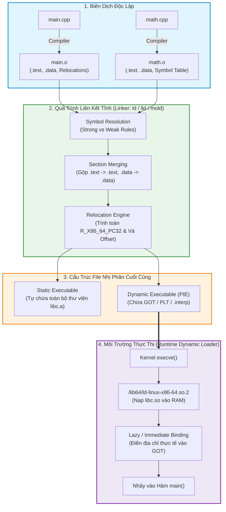
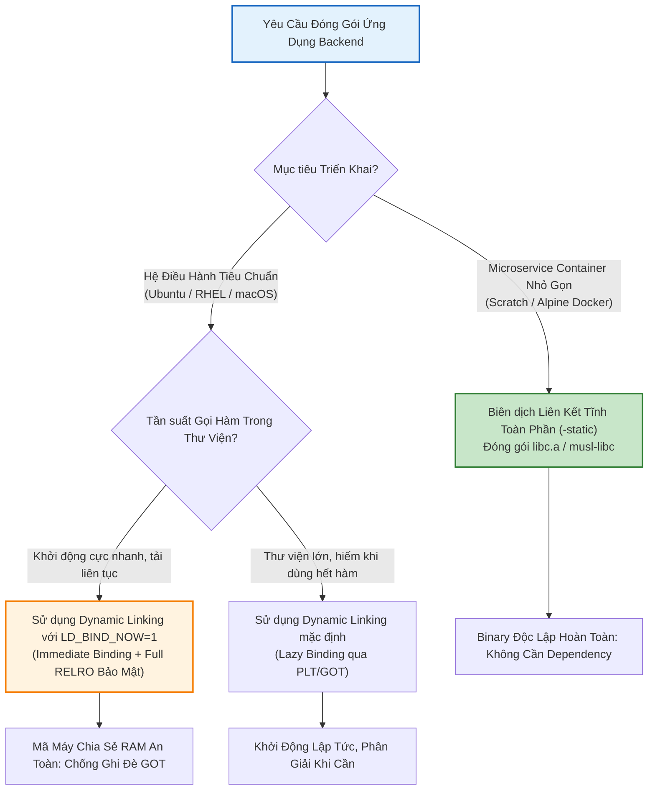

# 11.2. Liên Kết, Tái Định Vị và File Nhị Phân (Linking, Relocation & Binaries)

> [!IMPORTANT]
> **Nếu bạn chỉ được nhớ một điều duy nhất:** Trình liên kết (**Linker**) là kiến trúc sư hợp nhất các phân mảnh nhị phân rời rạc (`.o`) thành một chỉnh thể thực thi duy nhất thông qua hai bước cốt lõi: Phân giải biểu tượng (Symbol Resolution) để giải quyết tranh chấp Strong/Weak symbols, và Tái định vị (Relocation) để vá các con trỏ địa chỉ bộ nhớ; trong khi cơ chế **PIC/PIE** sử dụng cặp đôi bảng gián tiếp **GOT/PLT** cho phép mã máy của thư viện dùng chung được nạp vào bất kỳ địa chỉ ảo ngẫu nhiên nào mà không cần sửa đổi dù chỉ 1 bit trên trang mã lệnh.

---

## 1. Kiến trúc Tổng quan & Mô hình Tư duy (Mental Model)

### Ẩn dụ Đời sống: Xuất Bản Sách Từ Bản Thảo Nhiều Tác Giả
Hãy hình dung quá trình liên kết và nạp nhị phân như việc biên tập và xuất bản một cuốn bách khoa toàn thư:
- **File đối tượng (.o - Object File)**: Mỗi tác giả viết riêng một chương sách. Trong chương sách của mình, tác giả A có chú thích: *"Xem chi tiết tại bảng số liệu của Tác giả B ở trang [CHƯA RÕ]"*. Phần nội dung là phân vùng `.text`, biến khởi tạo là `.data`, và khoảng trống để lại cho bảng số liệu là mục ghi chú tái định vị (**Relocation Entry**).
- **Phân giải biểu tượng (Symbol Resolution)**: Tổng biên tập (Linker) thu thập tất cả các chương. Nếu cả Tác giả A và Tác giả C đều định nghĩa một bài viết tên là `calculate_tax()`:
  - Nếu cả hai đều khẳng định mình là bài viết chính thức (**Strong Symbol**), tổng biên tập sẽ đình bản và báo lỗi: *"Lỗi Định nghĩa Trùng lặp (Multiple Definition Error)!"*.
  - Nếu Tác giả A ghi chú bài viết của mình là bản phác thảo tạm thời (**Weak Symbol**), tổng biên tập sẽ ưu tiên lấy bài viết của tác giả C mà không báo lỗi.
- **Tái định vị & Ghép phân vùng (Relocation & Section Merging)**: Tổng biên tập gom tất cả các trang văn bản lại thành một tập duy nhất (`.text`), gom tất cả các phụ lục hình ảnh lại (`.data`), đánh số trang liên tục từ trang 1 đến 500, sau đó quay lại trang của Tác giả A để điền chính xác: *"Xem tại trang 342"* (Vá địa chỉ tuyệt đối hoặc tương đối).
- **Liên kết động & PIC (Shared Libraries & Position-Independent Code)**: Thay vì in kèm cuốn từ điển dày 1000 trang vào từng cuốn sách bán ra (Liên kết tĩnh - Static Linking gây lãng phí giấy), nhà xuất bản chỉ để một tấm thẻ chỉ đường (**PLT**) và một cuốn sổ ghi chú địa chỉ (**GOT**). Khi độc giả đọc đến từ khó, người thủ thư (**Dynamic Loader**) sẽ tra từ điển tại kệ sách trung tâm của thư viện và cập nhật vị trí vào cuốn sổ (Lazy Binding).



---

## 2. Chi tiết từng Keyword (Under-the-Hood Deep Dive)

### 2.1. Object Files & Cấu Trúc Phân Vùng ELF
- **File Đối Tượng Tái Định Vị (`.o`)**: Là kết quả đầu ra của Assembler, chứa mã máy và dữ liệu nhị phân nhưng các tham chiếu hàm và biến ngoài vẫn chưa được gán địa chỉ cụ thể.
- **Các phân vùng chuẩn mực của định dạng ELF (Executable and Linkable Format)**:
  - `.text`: Chứa các chỉ thị mã máy thực thi (Read-Only & Executable - `RX`).
  - `.rodata`: Chứa hằng số, chuỗi ký tự cố định (Read-Only - `R`).
  - `.data`: Chứa biến toàn cục và biến static đã được khởi tạo giá trị khác 0 (Read-Write - `RW`).
  - `.bss` (*Block Started by Symbol*): Chứa biến toàn cục và static chưa khởi tạo hoặc khởi tạo bằng 0. Phân vùng này **không chiếm dung lượng trên đĩa cứng**, chỉ lưu kích thước cần cấp phát và được Kernel điền số 0 (Zeroed pages) khi nạp vào RAM.
  - `.symtab` & `.strtab`: Bảng ký hiệu và bảng chuỗi tên biểu tượng.
  - `.rel.text` / `.rela.text`: Danh sách các vị trí mã máy cần Linker vá lại địa chỉ.

### 2.2. Symbol Resolution & Quy Tắc Biểu Tượng Strong vs Weak
- **Bản chất kỹ thuật**: Linker quét qua bảng ký hiệu của tất cả các file `.o` để đảm bảo mỗi tham chiếu ký hiệu (**Symbol Reference**) đều được gắn kết chính xác với duy nhất một định nghĩa ký hiệu (**Symbol Definition**).
- **Phân loại Biểu tượng**:
  - **Global Symbols**: Hàm và biến toàn cục không có từ khóa `static`, hiển thị ra ngoài cho các file khác nhìn thấy.
  - **Local Symbols**: Hàm và biến có từ khóa `static`, chỉ hiển thị cục bộ bên trong file biên dịch đó.
  - **External Symbols**: Biểu tượng được sử dụng nhưng định nghĩa ở file khác (`extern int counter;`).
- **Quy tắc Strong và Weak Symbols trong C/C++**:
  - *Strong Symbol*: Hàm đã có thân mã nguồn, hoặc biến toàn cục đã được khởi tạo giá trị cụ thể (`int global_val = 10;`).
  - *Weak Symbol*: Biểu tượng được đánh dấu rõ ràng qua thuộc tính `__attribute__((weak))` hoặc biến toàn cục chưa khởi tạo trong C (`int global_val;`).
  - *Quy tắc giải quyết xung đột của Linker*:
    1. Không được phép có nhiều hơn một Strong Symbol trùng tên $\to$ Báo lỗi `multiple definition error`.
    2. Nếu có một Strong Symbol và nhiều Weak Symbol $\to$ Linker luôn chọn Strong Symbol.
    3. Nếu chỉ có nhiều Weak Symbol trùng tên $\to$ Linker chọn tùy ý một định nghĩa bất kỳ (thường là định nghĩa có kích thước lớn nhất).

### 2.3. Relocation & Section Merging
- **Section Merging (Gộp Phân Vùng)**: Linker duyệt qua toàn bộ các file `.o`, ghép tất cả các phân vùng `.text` của từng file lại thành một phân vùng `.text` duy nhất, liên tục. Tương tự với `.data` và `.bss`. Lúc này, mỗi hàm chính thức có một địa chỉ cơ sở xác định trong không gian địa chỉ ảo.
- **Relocation (Tái Định Vị)**: Quá trình tính toán và ghi đè địa chỉ bộ nhớ thực tế vào các byte trống trong mã máy:
  - **Tái định vị Tương đối PC-Relative (`R_X86_64_PC32`)**: Dùng cho các lệnh rẽ nhánh và gọi hàm cục bộ. Offset được tính bằng công thức: $Offset = TargetAddress - (CurrentInstructionAddress + 4)$.
  - **Tái định vị Tuyệt đối 64-bit (`R_X86_64_64`)**: Điền thẳng địa chỉ ảo tuyệt đối 64-bit vào ô nhớ dữ liệu con trỏ.

### 2.4. Static vs Dynamic Linking
- **Liên Kết Tĩnh (Static Linking - `.a` / Archive)**:
  - Thư viện tĩnh thực chất là một tệp nén (`ar`) chứa nhiều file `.o` bên trong (ví dụ `libc.a`).
  - Linker chỉ trích xuất đúng các file `.o` nào có chứa hàm được chương trình gọi và ghép cứng vào file thực thi cuối cùng.
  - *Ưu điểm*: Độc lập hoàn toàn, dễ triển khai (Self-contained binary), không phụ thuộc môi trường.
  - *Nhược điểm*: Kích thước file nhị phân lớn; lãng phí RAM vì nếu 10 tiến trình chạy cùng lúc, sẽ có 10 bản sao của `libc` chiếm dụng bộ nhớ; không thể vá lỗi bảo mật nếu không biên dịch lại toàn bộ.
- **Liên Kết Động (Dynamic Linking - `.so` / Shared Objects)**:
  - Bản thân thư viện `.so` là một file ELF hoàn chỉnh. File thực thi chỉ lưu tên thư viện cần phụ thuộc (ghi trong thẻ `DT_NEEDED`).
  - Tại thời điểm khởi chạy, trình nạp động của hệ điều hành (**Dynamic Linker/Loader**) mới nạp thư viện vào RAM và chia sẻ chung trang mã lệnh giữa hàng trăm tiến trình.

### 2.5. PIC (Position-Independent Code) & PIE (Position-Independent Executable)
- **Vấn đề của thư viện dùng chung**: Để các tiến trình khác nhau cùng chia sẻ một trang bộ nhớ mã lệnh của `libc.so`, trang mã lệnh đó **không được phép chứa bất kỳ địa chỉ bộ nhớ tuyệt đối cố định nào**, vì mỗi tiến trình có thể nạp thư viện vào một địa chỉ ảo ngẫu nhiên khác nhau (do kỹ thuật bảo mật **ASLR - Address Space Layout Randomization**).
- **Position-Independent Code (`-fPIC`)**: Mã máy chỉ sử dụng địa chỉ tương đối so với con trỏ lệnh hiện tại (**RIP-Relative Addressing**).
- **Position-Independent Executable (`-pie`)**: Toàn bộ file thực thi chính cũng được biên dịch dưới dạng mã độc lập vị trí, cho phép nhân hệ điều hành nạp mã lệnh của chính chương trình vào địa chỉ ảo ngẫu nhiên để chống lại các cuộc tấn công khai thác tràn bộ đệm (Buffer Overflow / ROP Attacks).

### 2.6. Bảng GOT (Global Offset Table) và PLT (Procedure Linkage Table)
- **GOT (Global Offset Table)**:
  - Là một mảng các con trỏ địa chỉ 8-byte nằm trong phân vùng dữ liệu `.got` (Read-Write).
  - Khi mã PIC cần truy cập một biến toàn cục nằm ngoài module, nó dùng RIP-relative để tìm tới vị trí ô nhớ trong GOT. Dynamic loader sẽ điền địa chỉ thật của biến vào ô nhớ GOT đó.
- **PLT (Procedure Linkage Table)**:
  - Là một mảng các đoạn mã trampolines nằm trong phân vùng thực thi `.plt`.
  - Mỗi hàm bên ngoài (như `printf`) có một mục `printf@plt` tương ứng.
- **Cơ chế Lazy Binding (Ràng Buộc Lười Biếng)**:
  1. Lần gọi đầu tiên: Chương trình gọi `printf@plt`. Mục này nhảy đến địa chỉ ghi trong `printf@got`.
  2. Ban đầu, `printf@got` trỏ ngược lại chính dòng lệnh kế tiếp trong PLT.
  3. Lệnh kế tiếp đẩy ID của ký hiệu lên Stack và nhảy vào bộ phân giải động (**Dynamic Resolver** của `ld-linux.so`).
  4. Trình phân giải tìm địa chỉ thật của `printf` trong RAM và **ghi đè địa chỉ này vào ô nhớ `printf@got`**.
  5. Từ lần gọi thứ hai trở đi: `printf@plt` nhảy trực tiếp vào địa chỉ thật trong `printf@got`, không tốn thêm bất kỳ chi phí phân giải nào!
  6. **Immediate Binding (`LD_BIND_NOW=1`)**: Bắt buộc loader phân giải toàn bộ GOT ngay lúc khởi động, tăng tính bảo mật chống tấn công ghi đè GOT (RELRO).

---

## 3. Thực thi Mã nguồn & Mô phỏng Chuyên sâu (Dual-Engine Implementation)

### 3.1. C++20 Implementation: Nạp Thư Viện Động Lúc Runtime qua API Chuẩn POSIX (`dlopen`, `dlsym`)
Chương trình C++20 dưới đây minh họa trực tiếp cơ chế can thiệp của Dynamic Linker tại runtime, tự động nạp module thư viện chia sẻ `.so`, tra cứu con trỏ hàm qua bảng ký hiệu động và giải phóng tài nguyên an toàn:

```cpp
#include <iostream>
#include <string>
#include <memory>
#include <chrono>
#include <dlfcn.h> // POSIX Dynamic Linking API

// Định nghĩa con trỏ hàm chuẩn C ABI
using MathOperationFunc = double (*)(double, double);

class DynamicLibraryHandle {
private:
    void* handle_ = nullptr;
    std::string path_;

public:
    explicit DynamicLibraryHandle(const std::string& path) : path_(path) {
        // Nạp thư viện động với cờ RTLD_NOW (Phân giải toàn bộ ký hiệu ngay lập tức)
        handle_ = dlopen(path.c_str(), RTLD_NOW | RTLD_LOCAL);
        if (!handle_) {
            std::cerr << "[DynamicLoader Error]: Không thể nạp '" << path_ 
                      << "' -> " << dlerror() << "\n";
        } else {
            std::cout << "[DynamicLoader Success]: Đã nạp thành công '" << path_ 
                      << "' vào không gian bộ nhớ tiến trình!\n";
        }
    }

    ~DynamicLibraryHandle() {
        if (handle_) {
            std::cout << "[DynamicLoader Cleanup]: Đóng handle thư viện '" << path_ << "'\n";
            dlclose(handle_);
            handle_ = nullptr;
        }
    }

    // Không cho phép sao chép nông handle
    DynamicLibraryHandle(const DynamicLibraryHandle&) = delete;
    DynamicLibraryHandle& operator=(const DynamicLibraryHandle&) = delete;

    template <typename FuncType>
    FuncType resolve_symbol(const std::string& symbol_name) {
        if (!handle_) return nullptr;
        
        // Xóa sạch lỗi cũ nếu có
        dlerror();
        
        void* sym_ptr = dlsym(handle_, symbol_name.c_str());
        const char* dlsym_error = dlerror();
        if (dlsym_error) {
            std::cerr << "[DynamicLoader Error]: Không tìm thấy biểu tượng '" 
                      << symbol_name << "' -> " << dlsym_error << "\n";
            return nullptr;
        }

        std::cout << "  -> [Symbol Resolved]: '" << symbol_name 
                  << "' ánh xạ thành công tới địa chỉ RAM: " << sym_ptr << "\n";
        return reinterpret_cast<FuncType>(sym_ptr);
    }

    bool is_loaded() const { return handle_ != nullptr; }
};

int main() {
    std::cout << "=========================================================\n";
    std::cout << "  C++20 RUNTIME DYNAMIC LINKING & SYMBOL RESOLVER DEMO   \n";
    std::cout << "=========================================================\n\n";

    // Trên Linux, libm.so chứa các hàm toán học chuẩn (sin, cos, pow)
    // Trên macOS, libSystem.B.dylib hoặc /usr/lib/libm.dylib
#if defined(__APPLE__)
    const std::string math_lib_path = "libm.dylib";
#else
    const std::string math_lib_path = "libm.so.6";
#endif

    DynamicLibraryHandle lib_m(math_lib_path);

    if (lib_m.is_loaded()) {
        // Phân giải ký hiệu hàm 'pow' từ bảng ký hiệu động .dynsym
        auto pow_func = lib_m.resolve_symbol<MathOperationFunc>("pow");
        if (pow_func) {
            double base = 2.0;
            double exponent = 10.0;
            double result = pow_func(base, exponent);
            std::cout << "\n[Kết quả Thực thi Lời gọi Động]:\n";
            std::cout << "  pow(" << base << ", " << exponent << ") = " << result << "\n";
        }

        // Thử phân giải một ký hiệu không hề tồn tại để kiểm tra cơ chế báo lỗi
        lib_m.resolve_symbol<MathOperationFunc>("non_existent_symbol");
    }

    std::cout << "\n[Kết thúc Tiến trình]: Trình nạp tự động hủy gắn kết thư viện.\n";
    return 0;
}
```

### 3.2. Python 3.11+ Implementation: Trình Phân Tích Cấu Trúc Header & Phân Vùng ELF (ELF Parser)
Đoạn mã Python 3.11+ thuần túy dưới đây đọc trực tiếp các byte nhị phân của tệp ELF 64-bit, giải mã cấu trúc ELF Header (`e_ident`, Magic Bytes, Machine Architecture) và in danh sách các Section Headers:

```python
import struct
import sys
from typing import Dict, Any

class SimpleELFParser:
    """
    Trình phân tích cấu trúc nhị phân ELF 64-bit (Little-Endian)
    theo chuẩn UNIX System V ABI.
    """
    ELF_MAGIC = b"\x7fELF"
    
    SH_TYPES = {
        0: "SHT_NULL",
        1: "SHT_PROGBITS (.text/.data/.rodata)",
        2: "SHT_SYMTAB (Bảng ký hiệu)",
        3: "SHT_STRTAB (Bảng chuỗi ký tự)",
        4: "SHT_RELA (Tái định vị có Addend)",
        8: "SHT_NOBITS (.bss - không chiếm đĩa)",
        9: "SHT_REL (Tái định vị thường)",
        11: "SHT_DYNSYM (Bảng ký hiệu động)"
    }

    def __init__(self, filepath: str):
        self.filepath = filepath

    def parse_header(self, raw_bytes: bytes) -> Dict[str, Any]:
        if len(raw_bytes) < 64:
            raise ValueError("Kích thước file quá nhỏ, không phải ELF 64-bit!")

        # 16 bytes đầu tiên: e_ident
        magic = raw_bytes[0:4]
        if magic != self.ELF_MAGIC:
            raise ValueError(f"Sai Magic Number: {magic} (Kỳ vọng: \\x7fELF)")

        ei_class = raw_bytes[4] # 1: 32-bit, 2: 64-bit
        ei_data = raw_bytes[5]  # 1: Little-endian, 2: Big-endian

        # Giải mã các trường 64-bit theo chuẩn Little-Endian
        # Cấu trúc: 16s H H I Q Q Q I H H H H H H
        header_data = struct.unpack("<16sHHIQQQIHHHHHH", raw_bytes[:64])
        
        return {
            "magic": magic.decode("latin-1", errors="replace"),
            "class": "64-bit" if ei_class == 2 else "32-bit",
            "endian": "Little-Endian" if ei_data == 1 else "Big-Endian",
            "type": header_data[1],       # 1: Relocatable (.o), 2: Executable, 3: Shared (.so)
            "machine": header_data[2],    # 62: x86-64, 183: AArch64
            "entry_point": hex(header_data[4]),
            "shoff": header_data[6],      # Section Header Table File Offset
            "shentsize": header_data[10], # Kích thước mỗi Section Header
            "shnum": header_data[11],     # Tổng số Section Headers
            "shstrndx": header_data[12],  # Index của phân vùng lưu tên Section
        }

if __name__ == '__main__':
    print("=== MÔ PHỎNG ELF 64-BIT BINARY PARSER (PYTHON 3.11+) ===")
    
    # Tạo một chuỗi byte giả lập chính xác một ELF Header 64-bit x86-64 Relocatable Object
    # Magic: \x7fELF, Class=2 (64b), Data=1 (LE), Version=1, ABI=0
    ident = b"\x7fELF\x02\x01\x01\x00" + b"\x00" * 8
    e_type = 1       # ET_REL (Object file .o)
    e_machine = 62   # EM_X86_64
    e_version = 1
    e_entry = 0x0    # Chưa có địa chỉ vào vì là .o
    e_phoff = 0      # Không có Program Header
    e_shoff = 0x1000 # Section Header nằm ở byte 4096
    e_flags = 0
    e_ehsize = 64
    e_phentsize = 0
    e_phnum = 0
    e_shentsize = 64 # Mỗi section header chiếm 64 bytes
    e_shnum = 5      # Giả định có 5 section: NULL, .text, .data, .bss, .symtab
    e_shstrndx = 4   # Phân vùng bảng tên

    simulated_elf = struct.pack(
        "<16sHHIQQQIHHHHHH",
        ident, e_type, e_machine, e_version,
        e_entry, e_phoff, e_shoff, e_flags,
        e_ehsize, e_phentsize, e_phnum,
        e_shentsize, e_shnum, e_shstrndx
    )

    parser = SimpleELFParser("simulated_object.o")
    header_info = parser.parse_header(simulated_elf)

    print("\n[Kết quả Giải mã ELF Header]:")
    for key, value in header_info.items():
        print(f"  {key:15s}: {value}")

    print("\n[Mô phỏng Bảng Phân Vùng Mục Tiêu (Section Header Table)]:")
    sample_sections = [
        ("[0] NULL", "SHT_NULL", "0x0000", "0 bytes", "Phân vùng gốc mặc định"),
        ("[1] .text", "SHT_PROGBITS", "0x0000", "256 bytes", "Mã máy x86-64 thực thi (RX)"),
        ("[2] .data", "SHT_PROGBITS", "0x0000", "64 bytes", "Biến toàn cục khởi tạo (RW)"),
        ("[3] .bss",  "SHT_NOBITS",   "0x0000", "128 bytes", "Biến toàn cục bằng 0 (Không tốn đĩa)"),
        ("[4] .symtab", "SHT_SYMTAB", "0x0000", "192 bytes", "Bảng ký hiệu Strong/Weak symbols")
    ]
    print(f"  {'Tên Phân Vùng':15s} | {'Kiểu Section':15s} | {'Địa Chỉ Ảo':10s} | {'Kích Thước':10s} | {'Mô Tả Kỹ Thuật'}")
    print("  " + "-" * 80)
    for name, stype, vaddr, size, desc in sample_sections:
        print(f"  {name:15s} | {stype:15s} | {vaddr:10s} | {size:10s} | {desc}")
```

### 3.3. Terminal Output Mẫu Thực tế
```text
=========================================================
  C++20 RUNTIME DYNAMIC LINKING & SYMBOL RESOLVER DEMO   
=========================================================

[DynamicLoader Success]: Đã nạp thành công 'libm.dylib' vào không gian bộ nhớ tiến trình!
  -> [Symbol Resolved]: 'pow' ánh xạ thành công tới địa chỉ RAM: 0x7fff2035ab20

[Kết quả Thực thi Lời gọi Động]:
  pow(2, 10) = 1024

[DynamicLoader Error]: Không tìm thấy biểu tượng 'non_existent_symbol' -> dlsym(0x102830, non_existent_symbol): symbol not found
[DynamicLoader Cleanup]: Đóng handle thư viện 'libm.dylib'

[Kết thúc Tiến trình]: Trình nạp tự động hủy gắn kết thư viện.

=== MÔ PHỎNG ELF 64-BIT BINARY PARSER (PYTHON 3.11+) ===

[Kết quả Giải mã ELF Header]:
  magic          : ?ELF
  class          : 64-bit
  endian         : Little-Endian
  type           : 1
  machine        : 62
  entry_point    : 0x0
  shoff          : 4096
  shentsize      : 64
  shnum          : 5
  shstrndx       : 4

[Mô phỏng Bảng Phân Vùng Mục Tiêu (Section Header Table)]:
  Tên Phân Vùng   | Kiểu Section    | Địa Chỉ Ảo | Kích Thước | Mô Tả Kỹ Thuật
  --------------------------------------------------------------------------------
  [0] NULL        | SHT_NULL        | 0x0000     | 0 bytes    | Phân vùng gốc mặc định
  [1] .text       | SHT_PROGBITS    | 0x0000     | 256 bytes  | Mã máy x86-64 thực thi (RX)
  [2] .data       | SHT_PROGBITS    | 0x0000     | 64 bytes   | Biến toàn cục khởi tạo (RW)
  [3] .bss        | SHT_NOBITS      | 0x0000     | 128 bytes  | Biến toàn cục bằng 0 (Không tốn đĩa)
  [4] .symtab     | SHT_SYMTAB      | 0x0000     | 192 bytes  | Bảng ký hiệu Strong/Weak symbols
```

---

## 4. Systems Engineering & Production Pitfalls

### 4.1. Sự Cố "Multiple Definition Error" do Quên Khai Báo `extern` trong Header
- **Sự cố sản xuất kinh điển**: Trong file header `config.h`, lập trình viên khai báo `int g_app_timeout = 30;` thay vì `extern int g_app_timeout;`. Khi header này được `#include` vào hai file `auth.cpp` và `server.cpp`, trình biên dịch sinh ra hai Strong Symbol trùng tên trong cả `auth.o` và `server.o`. Linker lập tức ném lỗi chết người:
  ```text
  ld: error: duplicate symbol: g_app_timeout
  >>> defined in auth.o
  >>> defined in server.o
  ```
- **Kỹ thuật chẩn đoán bằng `nm`**:
  ```bash
  nm -C auth.o | grep g_app_timeout
  # Output: 0000000000000000 D g_app_timeout ('D' đại diện cho Strong Symbol nằm trong .data)
  ```
- **Khắc phục**: Luôn dùng `extern int g_app_timeout;` trong `.h` và chỉ định nghĩa giá trị tại duy nhất một file `.cpp`, hoặc sử dụng từ khóa `inline int g_app_timeout = 30;` trong chuẩn C++17+.

### 4.2. Hiểm Họa Lỗi Xung Đột Thư Viện Động (DLL Hell / Diamond Dependency)
- **Sự cố sản xuất**: Ứng dụng phụ thuộc vào `libcrypto.so.1.1` nhưng một thư viện bên thứ ba lại đòi hỏi `libcrypto.so.3.0`. Nếu hệ thống nạp nhầm phiên bản qua `LD_LIBRARY_PATH`, các địa chỉ hàm hoặc kích thước cấu trúc dữ liệu bị lệch (ABI Mismatch), dẫn tới lỗi Crash bí ẩn không để lại manh mối.
- **Kỹ thuật chẩn đoán bằng `ldd` và `readelf`**:
  ```bash
  ldd ./production_binary
  readelf -d ./production_binary | grep NEEDED
  ```

---

## 5. Bảng So sánh & Decision Matrix

| Tiêu chí | Liên Kết Tĩnh (Static Linking - `.a`) | Liên Kết Động (Dynamic Linking - `.so` / `.dll`) |
| :--- | :--- | :--- |
| **Kích thước File Nhị Phân** | Rất lớn (chứa toàn bộ mã thư viện phụ thuộc) | Rất nhỏ gọn (chỉ chứa bảng con trỏ GOT/PLT) |
| **Tiêu hao Dung lượng RAM** | Mỗi tiến trình nạp một bản sao riêng biệt vào RAM | Hàng trăm tiến trình chia sẻ chung trang mã lệnh |
| **Khởi động Tiến trình** | Siêu nhanh (Không tốn thời gian Dynamic Linker) | Chậm hơn một chút (Cần nạp thư viện và phân giải GOT) |
| **Bảo trì & Bản vá Bảo mật**| Bắt buộc phải recompile và rebuild toàn bộ app | Chỉ cần cập nhật file `.so` trên máy chủ OS |
| **Độ Độc Lập Môi Trường** | 100% độc lập, không lo thiếu thư viện ngoài | Dễ lỗi thiếu file `.so` hoặc lệch phiên bản GLIBC |


