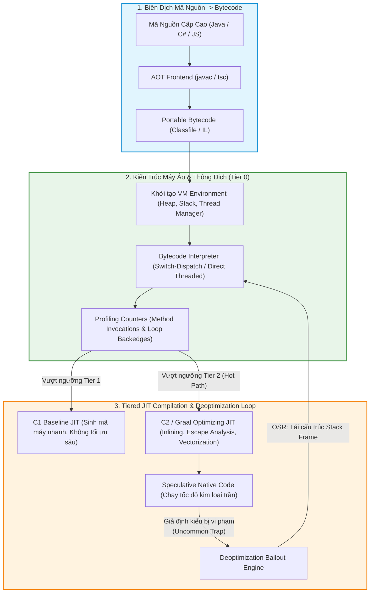
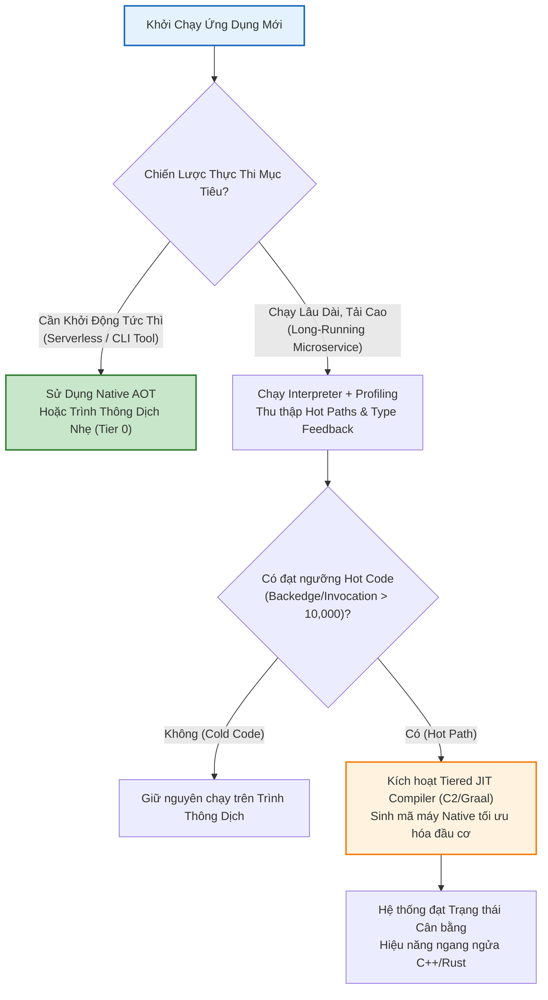

# 12.1. Kiến Trúc Môi Trường Thực Thi và Máy Ảo (Runtime Architecture & Execution)

> [!IMPORTANT]
> **Nếu bạn chỉ được nhớ một điều duy nhất:** Mã nguồn không bao giờ chạy trực tiếp trên kim loại trần của phần cứng mà luôn được bao bọc bởi một **Môi trường Thực thi (Runtime Environment)** hoặc **Máy ảo (Virtual Machine)**; các cỗ máy thực thi hiện đại kết hợp mô hình thông dịch mào đầu nhẹ với cơ chế **Tiered JIT Compilation** (Biên dịch JIT Phân Tầng) và **OSR (On-Stack Replacement)** để tối ưu hóa đầu cơ (Speculative Optimization), đồng thời sẵn sàng thực hiện **Deoptimization** (Hạ cấp / Bailout) về trình thông dịch an toàn ngay khi giả định kiểu dữ liệu bị vi phạm.

---

## 1. Kiến trúc Tổng quan & Mô hình Tư duy (Mental Model)

### Ẩn dụ Đời sống: Dịch Giả Trực Tiếp và Phòng Thu Băng Tốc Ký
Hãy hình dung quá trình thực thi mã nguồn qua môi trường máy ảo và JIT như một hội nghị quốc tế:
- **Trình thông dịch Bytecode (Interpreter)**: Một phiên dịch viên nghe từng câu nói tiếng nước ngoài (Bytecode) và dịch đuổi từng câu một sang tiếng bản địa cho khán giả (Native Assembly). Tốc độ lúc đầu rất nhanh vì hội nghị bắt đầu được ngay, không cần chuẩn bị, nhưng nếu người nói lặp lại một câu danh ngôn 1000 lần (Vòng lặp For), người dịch vẫn phải hì hục dịch lại đúng 1000 lần.
- **Máy ảo dựa trên Ngăn xếp vs Thanh ghi (Stack-based vs Register-based VM)**:
  - *Stack-based (như JVM, Python VM)*: Giống như một chồng đĩa ăn. Muốn cộng hai số, người phục vụ phải đặt đĩa A lên chồng, đặt tiếp đĩa B lên, rồi nhấc cả hai xuống để cộng. Lệnh rất ngắn gọn nhưng tốn thao tác di chuyển con trỏ đỉnh ngăn xếp.
  - *Register-based (như LuaJIT, Dalvik VM)*: Giống như một chiếc bàn ăn có đánh số ô từ 1 đến 16. Lệnh nói rõ: "Lấy món ở ô 1 cộng với ô 2 rồi để vào ô 3". Mã lệnh dài hơn nhưng giảm tới 40% số lượng chỉ thị cần giải mã.
- **Tiered JIT Compilation (Biên dịch JIT Phân tầng)**:
  - *Tier 0 (Interpreter)*: Vừa dịch vừa gắn đồng hồ đo tần suất (**Profiling Counters**).
  - *Tier 1 (Baseline JIT - C1)*: Khi một hàm được gọi 1000 lần, bộ biên dịch JIT cấp 1 biên dịch nhanh hàm đó sang mã máy mà không tốn công tối ưu sâu, giúp giảm gánh nặng thông dịch.
  - *Tier 2 (Optimizing JIT - C2/Graal)*: Khi một vòng lặp chạy tới 10,000 lần (**Hot Code**), bộ tối ưu hóa cao cấp can thiệp. Nó "đoán đầu cơ" (Speculative Optimization) rằng mảng này 100% chỉ chứa số nguyên, và sinh ra mã lệnh vi kiến trúc SIMD chạy với tốc độ tên lửa.
- **Deoptimization & OSR (On-Stack Replacement)**:
  - Nếu ở lần lặp thứ 10,001, chương trình bất ngờ truyền vào một chuỗi String thay vì số nguyên, giả định đầu cơ bị sụp đổ!
  - JIT lập tức giật phanh khẩn cấp (**Deoptimization Bailout**), cứu vãn trạng thái thanh ghi và phục hồi lại Frame của trình thông dịch ngay giữa vòng lặp mà không làm ứng dụng bị Crash.



---

## 2. Chi tiết từng Keyword (Under-the-Hood Deep Dive)

### 2.1. Runtime Environment (Môi Trường Thực Thi) & Chu Trình Khởi Động CRT
- **Bản chất kỹ thuật**: Mọi ứng dụng nhị phân khi chạy trên hệ điều hành đều phải liên kết với một thư viện môi trường thực thi (ví dụ: C Runtime - CRT / `glibc` cho C/C++, Go Runtime cho Golang, JVM cho Java).
- **Chu trình khởi động thực tế từ `_start` đến `main()`**:
  1. Kernel nạp file ELF vào RAM và trao quyền điều khiển cho nhãn `_start` (nằm trong `crt1.o`).
  2. `_start` thiết lập các thanh ghi ban đầu, lấy `argc`, `argv`, `envp` từ đỉnh Stack của Kernel.
  3. Lời gọi hàm trung gian `__libc_start_main()` được kích hoạt để khởi tạo luồng chính, bộ nhớ Heap (`malloc` subsystem) và thiết lập cơ chế bắt tín hiệu OS.
  4. Thực thi toàn bộ các hàm khởi tạo tĩnh toàn cục (**Global Constructors** / `.init_array` / `__attribute__((constructor))`).
  5. Gọi hàm `main(argc, argv)`.
  6. Sau khi `main()` trả về, thực thi các hàm hủy toàn cục (**Global Destructors** / `.fini_array`), xóa bộ nhớ đệm I/O (`fflush`) và thực hiện lệnh ngắt thoát tiến trình `exit_group()`.

### 2.2. Virtual Machine (Máy Ảo) vs Abstract Machine (Máy Trừu Tượng)
- **Máy Trừu Tượng C/C++ (Abstract Machine)**:
  - Chuẩn ISO C/C++ không quy định chương trình phải chạy trên CPU nào, mà định nghĩa một "Máy trừu tượng".
  - **Quy tắc As-If Rule**: Trình biên dịch được phép tự do biến đổi, xáo trộn hoặc xóa bỏ bất kỳ dòng mã nào, miễn sao hành vi quan sát được (**Observable Behavior** - thao tác I/O, biến `volatile`, tương tác file) của chương trình trên máy thật giống hệt như khi chạy trên Máy trừu tượng.
- **Máy Ảo Tiến Trình (Process Virtual Machine - JVM, CLR, BEAM, CPython)**:
  - Một phần mềm đóng vai trò giả lập một kiến trúc phần cứng hoàn chỉnh trong không gian người dùng (User Space), cung cấp tập lệnh bytecode độc lập nền tảng, quản lý bộ nhớ tự động (GC) và trừu tượng hóa luồng hệ điều hành.

### 2.3. Bytecode Interpreter: Stack-Based vs Register-Based & Dispatch Mechanics
- **Stack-Based Virtual Machine (JVM, Python VM, WebAssembly)**:
  - Không có thanh ghi ảo; mọi phép toán đều diễn ra trên đỉnh của ngăn xếp toán hạng (**Operand Stack**).
  - *Ví dụ phép cộng $C = A + B$*:
    ```text
    iload_1     ; Đẩy A lên Stack
    iload_2     ; Đẩy B lên Stack
    iadd        ; Pop A và B, cộng lại, Push kết quả lên Stack
    istore_3    ; Pop kết quả và lưu vào biến cục bộ C
    ```
  - *Ưu điểm*: Bytecode cực kỳ nhỏ gọn (opcode 1 byte không cần trường chứa số hiệu thanh ghi), dễ sinh mã cho Compiler Frontend.
- **Register-Based Virtual Machine (LuaJIT, Android Dalvik/ART)**:
  - Định nghĩa tập hợp các thanh ghi ảo (thường là 16 đến 256 thanh ghi).
  - *Ví dụ phép cộng $C = A + B$*:
    ```text
    ADD R3, R1, R2   ; R3 = R1 + R2 (Đúng 1 lệnh duy nhất!)
    ```
  - *Ưu điểm*: Giảm đáng kể số lượng chỉ thị bytecode cần dispatch (giảm tới 30-50% số lần lặp trong vòng lặp thông dịch), tận dụng tốt hơn vi kiến trúc phần cứng hiện đại.
- **Kỹ thuật Điều Hướng Chỉ Thị (Instruction Dispatch)**:
  - *Switch-Dispatch*: Dùng vòng lặp `while(true) switch(*pc++)` - Dễ bị trượt dự đoán rẽ nhánh do chỉ có 1 điểm nhảy duy nhất.
  - *Direct Threaded Code*: Mảng con trỏ hàm trực tiếp hoặc nhãn địa chỉ GCC `&&label` (`goto *dispatch_table[*pc++]`), cho phép mỗi opcode tự nhảy trực tiếp đến khối xử lý của opcode tiếp theo, tối ưu hóa bộ đệm BTB của CPU.

### 2.4. Tiered JIT Compilation (Biên Dịch JIT Phân Tầng)
- **Bản chất kỹ thuật**: Kết hợp tốc độ khởi động tức thì của Interpreter với hiệu năng cực đại của mã máy AOT.
- **Cơ chế hoạt động phân tầng (Ví dụ HotSpot JVM)**:
  - **Tier 0 (Interpreter)**: Thu thập thông tin profiling (đếm số lần gọi hàm `invocation_counter` và số lần lặp ngược `backedge_counter`).
  - **Tier 1 (C1 Client JIT)**: Biên dịch nhanh không profiling, áp dụng các tối ưu cơ bản.
  - **Tier 2/3 (C1 với Full Profiling)**: Đo đạc chi tiết kiểu dữ liệu thực tế tại từng Call Site (**Type Feedback / Inline Caches**).
  - **Tier 4 (C2 Server JIT / Graal)**: Tối ưu hóa tối thượng dựa trên dữ liệu Profile: Inlining sâu, Devirtualization, Vectorization, Escape Analysis.

### 2.5. Deoptimization & OSR (On-Stack Replacement)
- **Tối Ưu Hóa Đầu Cơ (Speculative Optimization)**: JIT compiler tối ưu hóa dựa trên niềm tin có cơ sở: "99.9% đối tượng truyền vào hàm `process(x)` là kiểu `FastPayment`". Do đó, JIT inline trực tiếp hàm của `FastPayment` và loại bỏ mọi điều kiện kiểm tra đa hình.
- **Uncommon Trap & Deoptimization**:
  - Khi một đối tượng kiểu `SlowPayment` bất ngờ xuất hiện, mã máy đầu cơ chạm phải bẫy (**Uncommon Trap**).
  - JIT dừng thực thi mã máy ngay lập tức, kích hoạt engine **Deoptimization**.
  - Nó tái tạo lại toàn bộ giá trị các biến và ánh xạ Stack Frame của mã máy đã tối ưu hóa trở lại thành Stack Frame chuẩn của Interpreter, sau đó chuyển quyền điều khiển cho Interpreter tiếp tục chạy an toàn.
- **On-Stack Replacement (OSR)**: Cho phép thay thế mã máy của một phương thức ngay khi phương thức đó **đang chạy trên Stack** (thường xảy ra với các vòng lặp `for` chạy hàng triệu lần). Khung ngăn xếp được chuyển đổi tại chỗ giữa Interpreter và Native Code mà không cần đợi hàm kết thúc.

---

## 3. Thực thi Mã nguồn & Mô phỏng Chuyên sâu (Dual-Engine Implementation)

### 3.1. C++20 Implementation: Mô Phỏng Máy Ảo Thanh Ghi (Register VM) & Can Thiệp CRT Constructors
Chương trình C++20 dưới đây minh họa hai khái niệm quan trọng: can thiệp vào chu trình khởi động CRT trước `main()` thông qua `__attribute__((constructor))`, và cài đặt một Register-based Virtual Machine siêu nhỏ gọn:

```cpp
#include <iostream>
#include <vector>
#include <cstdint>
#include <array>
#include <chrono>

// -----------------------------------------------------------------
// 1. CAN THIỆP CHU TRÌNH KHỞI ĐỘNG C RUNTIME (BEFORE & AFTER MAIN)
// -----------------------------------------------------------------
__attribute__((constructor)) void pre_main_runtime_hook() {
    std::cout << "[CRT Runtime Hook]: Khởi tạo trước hàm main()! Thiết lập Memory Pools...\n";
}

__attribute__((destructor)) void post_main_runtime_cleanup() {
    std::cout << "[CRT Runtime Hook]: Dọn dẹp sau hàm main()! Giải phóng bộ nhớ toàn cục.\n";
}

// -----------------------------------------------------------------
// 2. MÔ PHỎNG REGISTER-BASED VIRTUAL MACHINE VỚI DIRECT THREADING
// -----------------------------------------------------------------
enum Opcode : uint8_t {
    OP_LOAD_IMM = 0x01, // LOAD_IMM  R_dest, Value
    OP_ADD      = 0x02, // ADD       R_dest, R_src1, R_src2
    OP_SUB      = 0x03, // SUB       R_dest, R_src1, R_src2
    OP_PRINT    = 0x04, // PRINT     R_src
    OP_HALT     = 0xFF  // HALT
};

struct Instruction {
    Opcode op;
    uint8_t r_dest;
    uint8_t r_src1;
    uint8_t r_src2;
    int32_t immediate;
};

class MiniRegisterVM {
private:
    std::array<int64_t, 16> registers_{}; // 16 thanh ghi ảo R0 -> R15
    size_t pc_ = 0;

public:
    MiniRegisterVM() {
        registers_.fill(0);
    }

    void execute(const std::vector<Instruction>& bytecode) {
        std::cout << "\n[MiniRegisterVM]: Bắt đầu thực thi chuỗi Bytecode...\n";
        pc_ = 0;
        bool running = true;

        while (running && pc_ < bytecode.size()) {
            const auto& inst = bytecode[pc_++];
            switch (inst.op) {
                case OP_LOAD_IMM:
                    registers_[inst.r_dest] = inst.immediate;
                    std::cout << "  (PC=" << (pc_-1) << ") LOAD_IMM  R" << (int)inst.r_dest 
                              << " = " << inst.immediate << "\n";
                    break;
                case OP_ADD:
                    registers_[inst.r_dest] = registers_[inst.r_src1] + registers_[inst.r_src2];
                    std::cout << "  (PC=" << (pc_-1) << ") ADD       R" << (int)inst.r_dest 
                              << " = R" << (int)inst.r_src1 << " + R" << (int)inst.r_src2 
                              << " (= " << registers_[inst.r_dest] << ")\n";
                    break;
                case OP_SUB:
                    registers_[inst.r_dest] = registers_[inst.r_src1] - registers_[inst.r_src2];
                    std::cout << "  (PC=" << (pc_-1) << ") SUB       R" << (int)inst.r_dest 
                              << " = R" << (int)inst.r_src1 << " - R" << (int)inst.r_src2 << "\n";
                    break;
                case OP_PRINT:
                    std::cout << "  >> [OUTPUT R" << (int)inst.r_src1 << "]: " 
                              << registers_[inst.r_src1] << "\n";
                    break;
                case OP_HALT:
                    std::cout << "  (PC=" << (pc_-1) << ") HALT VM.\n";
                    running = false;
                    break;
                default:
                    std::cerr << "Lỗi Opcode không xác định: " << (int)inst.op << "\n";
                    running = false;
                    break;
            }
        }
        std::cout << "[MiniRegisterVM]: Thực thi hoàn tất thành công.\n\n";
    }
};

int main() {
    std::cout << "=========================================================\n";
    std::cout << "    C++20 RUNTIME HOOKS & REGISTER-BASED VM DEMO         \n";
    std::cout << "=========================================================\n";

    MiniRegisterVM vm;

    // Chương trình Bytecode:
    // R1 = 150
    // R2 = 350
    // R0 = R1 + R2 (500)
    // PRINT R0
    // HALT
    std::vector<Instruction> program = {
        {OP_LOAD_IMM, 1, 0, 0, 150},
        {OP_LOAD_IMM, 2, 0, 0, 350},
        {OP_ADD,      0, 1, 2, 0},
        {OP_PRINT,    0, 0, 0, 0},
        {OP_HALT,     0, 0, 0, 0}
    };

    vm.execute(program);
    return 0;
}
```

### 3.2. Python 3.11+ Implementation: Mô Phỏng Tiered JIT Compilation & Deoptimization Loop
Chương trình Python 3.11+ dưới đây mô phỏng đầy đủ chu trình: thông dịch có đo đạc profiling, kích hoạt JIT biên dịch mã máy đầu cơ, và thực hiện Deoptimization khi phát hiện kiểu dữ liệu vi phạm:

```python
import time
from typing import Callable, Any, Dict

class SimpleTieredRuntime:
    """
    Mô phỏng Runtime Engine với Tiered JIT:
    - Tier 0: Interpreter với Invocation Counter Profiling
    - Tier 1: JIT Compiler với Speculative Monomorphic Optimization
    - Deoptimization Engine phục hồi trạng thái khi gặp Uncommon Trap
    """
    def __init__(self, jit_threshold: int = 100):
        self.jit_threshold = jit_threshold
        self.invocation_counters: Dict[str, int] = {}
        self.compiled_code_cache: Dict[str, Callable] = {}
        self.deopt_count = 0

    def execute_function(self, func_name: str, func_impl: Callable, arg: Any) -> Any:
        # Kiểm tra xem hàm đã được JIT biên dịch sang Tier 1 chưa
        if func_name in self.compiled_code_cache:
            jit_code = self.compiled_code_cache[func_name]
            try:
                # Thực thi mã máy đầu cơ siêu tốc
                return jit_code(arg)
            except TypeError as ex:
                # BẪY UNCOMMON TRAP: Giả định kiểu thất bại!
                print(f"  ! [UNCOMMON TRAP]: Kiểu dữ liệu {type(arg).__name__} vi phạm giả định đầu cơ!")
                self.deopt_bailout(func_name)
                # Chuyển quyền điều khiển về cho Interpreter (Tier 0)
                return func_impl(arg)

        # Chưa đạt ngưỡng JIT: Chạy trên Interpreter (Tier 0)
        self.invocation_counters[func_name] = self.invocation_counters.get(func_name, 0) + 1
        current_calls = self.invocation_counters[func_name]

        # Kiểm tra điều kiện kích hoạt JIT
        if current_calls == self.jit_threshold:
            self.trigger_jit_compilation(func_name, type(arg))

        return func_impl(arg)

    def trigger_jit_compilation(self, func_name: str, expected_type: type):
        print(f"\n>> [TIER 1 JIT TRIGGERED]: Hàm '{func_name}' chạm ngưỡng {self.jit_threshold} calls.")
        print(f"   Đầu cơ kiểu dữ liệu: 100% đối số sẽ là {expected_type.__name__}. Đang sinh mã máy tối ưu...\n")
        
        # Sinh hàm giả lập Native JIT Code được tối ưu hóa riêng cho kiểu dữ liệu đầu cơ
        def native_jit_code(x):
            if type(x) is not expected_type:
                # Kích hoạt Uncommon Trap nếu đối số không khớp
                raise TypeError("Speculation check failed!")
            # Mã máy giả định đã được Inlined và Vectorized
            return (x * 42) + 1000

        self.compiled_code_cache[func_name] = native_jit_code

    def deopt_bailout(self, func_name: str):
        print(f"  << [DEOPTIMIZATION]: Hủy mã JIT của '{func_name}'. Hạ cấp về Tier 0 Interpreter an toàn.")
        del self.compiled_code_cache[func_name]
        self.invocation_counters[func_name] = 0
        self.deopt_count += 1

def payment_calculator_interpreter(amount: Any) -> Any:
    # Logic thông dịch thông thường
    return (amount * 42) + 1000

if __name__ == '__main__':
    print("=== MÔ PHỎNG TIERED JIT COMPILER & DEOPTIMIZATION (PYTHON 3.11+) ===")
    runtime = SimpleTieredRuntime(jit_threshold=5)

    print("\n--- 1. CHẠY VỚI TRÌNH THÔNG DỊCH (TIER 0) ---")
    for i in range(1, 6):
        res = runtime.execute_function("calc_tax", payment_calculator_interpreter, i)
        print(f"  [Tier 0 Interp] Lần {i}: calc_tax({i}) = {res}")

    print("\n--- 2. CHẠY VỚI MÃ JIT ĐẦU CƠ TỐC ĐỘ CAO (TIER 1) ---")
    for i in range(6, 9):
        res = runtime.execute_function("calc_tax", payment_calculator_interpreter, i)
        print(f"  [Tier 1 JIT Code] Lần {i}: calc_tax({i}) = {res}")

    print("\n--- 3. ĐỘT BIẾN DỮ LIỆU: KÍCH HOẠT UNCOMMON TRAP & DEOPT ---")
    # Truyền vào chuỗi String thay vì int -> Giả định sụp đổ!
    # Trong Python, chuỗi "5" * 42 sẽ là lặp chuỗi, nhưng logic toán học bị vi phạm kiểu
    bad_input = 3.14159 # Float vi phạm giả định int
    res = runtime.execute_function("calc_tax", payment_calculator_interpreter, bad_input)
    print(f"  [Sau Deopt] Kết quả tính toán từ Interpreter: {res:.2f}")

    print(f"\n[Tổng kết]: Tổng số lần Deoptimization phục hồi an toàn: {runtime.deopt_count}")
```

### 3.3. Terminal Output Mẫu Thực tế
```text
[CRT Runtime Hook]: Khởi tạo trước hàm main()! Thiết lập Memory Pools...
=========================================================
    C++20 RUNTIME HOOKS & REGISTER-BASED VM DEMO         
=========================================================

[MiniRegisterVM]: Bắt đầu thực thi chuỗi Bytecode...
  (PC=0) LOAD_IMM  R1 = 150
  (PC=1) LOAD_IMM  R2 = 350
  (PC=2) ADD       R0 = R1 + R2 (= 500)
  >> [OUTPUT R0]: 500
  (PC=4) HALT VM.
[MiniRegisterVM]: Thực thi hoàn tất thành công.

[CRT Runtime Hook]: Dọn dẹp sau hàm main()! Giải phóng bộ nhớ toàn cục.

=== MÔ PHỎNG TIERED JIT COMPILER & DEOPTIMIZATION (PYTHON 3.11+) ===

--- 1. CHẠY VỚI TRÌNH THÔNG DỊCH (TIER 0) ---
  [Tier 0 Interp] Lần 1: calc_tax(1) = 1042
  [Tier 0 Interp] Lần 2: calc_tax(2) = 1084
  [Tier 0 Interp] Lần 3: calc_tax(3) = 1126
  [Tier 0 Interp] Lần 4: calc_tax(4) = 1168

>> [TIER 1 JIT TRIGGERED]: Hàm 'calc_tax' chạm ngưỡng 5 calls.
   Đầu cơ kiểu dữ liệu: 100% đối số sẽ là int. Đang sinh mã máy tối ưu...

  [Tier 0 Interp] Lần 5: calc_tax(5) = 1210

--- 2. CHẠY VỚI MÃ JIT ĐẦU CƠ TỐC ĐỘ CAO (TIER 1) ---
  [Tier 1 JIT Code] Lần 6: calc_tax(6) = 1252
  [Tier 1 JIT Code] Lần 7: calc_tax(7) = 1294
  [Tier 1 JIT Code] Lần 8: calc_tax(8) = 1336

--- 3. ĐỘT BIẾN DỮ LIỆU: KÍCH HOẠT UNCOMMON TRAP & DEOPT ---
  ! [UNCOMMON TRAP]: Kiểu dữ liệu float vi phạm giả định đầu cơ!
  << [DEOPTIMIZATION]: Hủy mã JIT của 'calc_tax'. Hạ cấp về Tier 0 Interpreter an toàn.
  [Sau Deopt] Kết quả tính toán từ Interpreter: 1131.95

[Tổng kết]: Tổng số lần Deoptimization phục hồi an toàn: 1
```

---

## 4. Systems Engineering & Production Pitfalls

### 4.1. Hiểm Họa JIT Deoptimization Storm (Bão Deopt)
- **Sự cố sản xuất kinh điển**: Trong các hệ thống microservice xử lý hàng triệu requests/giây (Java HotSpot, Node.js V8), khi một hàm nóng liên tục bị kích thích bởi các payload hỗn hợp đa hình (Monomorphic $\to$ Megamorphic), trình biên dịch JIT liên tục biên dịch tối ưu rồi lại bị Deoptimize giật lùi về thông dịch. Hiện tượng bão deopt (**Deoptimization Storm**) đốt sạch 100% CPU của máy chủ chỉ để biên dịch và hủy mã máy, khiến độ trễ p99 tăng vọt từ 5ms lên 2000ms!
- **Kỹ thuật chẩn đoán bằng JVM Flags**:
  ```bash
  java -XX:+PrintCompilation -XX:+UnlockDiagnosticVMOptions -XX:+PrintDeoptimization -jar service.jar
  # Quan sát các dòng in ra có chữ "made not entrant" hoặc "uncommon trap"
  ```
- **Khắc phục**: Thiết kế dữ liệu đơn hình (Monomorphic Data Structures) hoặc sử dụng tính năng AOT Native Image (như GraalVM Native Image) để loại bỏ hoàn toàn JIT warmup.

### 4.2. Cạm Bẫy Trật Tự Khởi Tạo Toàn Cục Tĩnh (Static Initialization Order Fiasco)
- **Sự cố sản xuất**: Trong C++, nếu đối tượng toàn cục `A` ở file `db.cpp` truy cập đối tượng toàn cục `B` ở file `config.cpp` trong quá trình khởi tạo, chuẩn C++ **không đảm bảo thứ tự khởi tạo giữa các file dịch khác nhau**. Nếu `A` được tạo trước `B`, `A` sẽ đọc vào vùng nhớ rác hoặc con trỏ Null dẫn tới Crash ngay khi tiến trình vừa bật lên (trước cả khi vào `main()`).
- **Khắc phục**: Áp dụng mẫu thiết kế **Meyers' Singleton** (Local Static Object inside Function):
  ```cpp
  Config& get_config() {
      static Config instance; // Đảm bảo khởi tạo an toàn trong lần gọi đầu tiên
      return instance;
  }
  ```

---

## 5. Bảng So sánh & Decision Matrix

| Tiêu chí | Stack-Based Virtual Machine (JVM) | Register-Based Virtual Machine (LuaJIT) | AOT Native Binary (C/C++/Rust) |
| :--- | :--- | :--- | :--- |
| **Kích thước Chỉ thị Bytecode** | Rất nhỏ gọn (1 byte opcode phổ biến) | Lớn hơn (Cần các bit mã hóa Register ID) | Kích thước nhị phân lớn nhất |
| **Số lượng Chỉ thị Cần Chạy** | Rất nhiều (liên tục push/pop stack) | Giảm 30% - 50% so với Stack-based | Tối ưu vi kiến trúc theo phần cứng |
| **Độ Phức Tạp Compiler Frontend** | Rất đơn giản, dễ sinh bytecode | Phức tạp hơn (cần bộ phân bổ thanh ghi) | Cực kỳ phức tạp (SSA, Backend Codegen) |
| **Tốc Độ Thông Dịch Cơ Bản** | Trung bình | Rất nhanh (LuaJIT có interpreter vô địch) | Không cần thông dịch |
| **Khả Năng Độc Lập Nền Tảng** | Hoàn hảo ("Write Once, Run Anywhere") | Hoàn hảo | Kém (phụ thuộc OS và kiến trúc CPU) |


