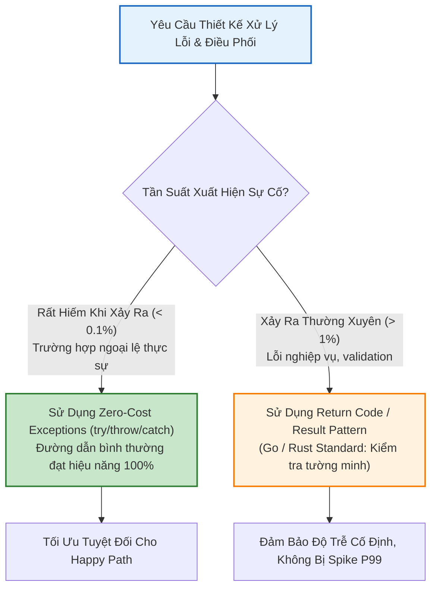

# 12.2. Tính Năng Động và Dịch Vụ Môi Trường Thực Thi (Dynamic Features & Runtime Services)

> [!IMPORTANT]
> **Nếu bạn chỉ được nhớ một điều duy nhất:** Các tính năng động cấp cao như đa hình ảo (**Dynamic Dispatch**), phản chiếu (**Reflection**) và xử lý ngoại lệ (**Zero-Cost Exceptions**) được hiện thực hóa ở tầng máy nhị phân thông qua các cấu trúc siêu dữ liệu ẩn: con trỏ **VTable** với kỹ thuật điều chỉnh độ lệch đa kế thừa (**Thunk Pointer**), cấu trúc bảng gỡ lỗi ngăn xếp **DWARF `.eh_frame`** với cơ chế **Personality Routine & Landing Pads**, cùng bộ lập lịch **M:N Runtime Scheduler** áp dụng thuật toán đánh cắp công việc (**Work-Stealing**) để điều phối hàng triệu luồng xanh trên một số ít luồng phần cứng của nhân hệ điều hành.

---

## 1. Kiến trúc Tổng quan & Mô hình Tư duy (Mental Model)

### Ẩn dụ Đời sống: Trung Tâm Dịch Vụ Khách Hàng và Bảng Danh Bạ Văn Phòng
Hãy hình dung runtime services giống như cơ chế vận hành của một tòa nhà văn phòng cao cấp:
- **Đa hình động & VTable (Dynamic Dispatch)**: Mỗi nhân viên (Object Instance) đeo một chiếc thẻ nhân viên nhỏ gắn ở đầu túi áo (con trỏ `_vptr`). Trên thẻ ghi: *"Xem sơ đồ phòng ban tại Bảng chỉ dẫn số 4"* (Con trỏ trỏ tới VTable duy nhất của lớp đó trong `.rodata`). Khi có yêu cầu "Hãy phê duyệt đơn này", khách hàng không cần biết nhân viên là Trưởng phòng hay Giám đốc; họ chỉ nhìn vào ô thứ 2 của bảng chỉ dẫn để bước vào căn phòng tương ứng.
- **Đa kế thừa & Con trỏ Thunk (Multiple Inheritance Thunk)**: Khi một giám đốc kiêm nhiệm cả Trưởng ban Tài chính lẫn Trưởng ban Kỹ thuật, địa chỉ "Bàn làm việc Kỹ thuật" bị lệch đi 16 mét so với "Cổng chính của Giám đốc". Một nhân viên phụ tá (**This-Adjustment Thunk**) sẽ trừ đúng 16 mét trên con trỏ địa chỉ của khách hàng trước khi dẫn khách vào phòng họp kỹ thuật.
- **Zero-Cost Exceptions & `.eh_frame`**: Thay vì trên từng bậc cầu thang đều phải cử một bảo vệ đứng hỏi: *"Bạn có bị trượt chân không?"* (Kiểm tra mã lỗi trả về `if (err != 0)` làm tốn thời gian ở đường dẫn bình thường), tòa nhà không đặt bất kỳ bảo vệ nào cả. Nhưng ở phòng bảo vệ trung tâm có lưu trữ sơ đồ chi tiết từng bậc thang (**DWARF `.eh_frame`**). Khi ai đó thực sự ngã (Ngoại lệ ném ra - `throw`), đội cứu hộ lập tức tra cứu sơ đồ ngăn xếp để tìm chiếc đệm đỡ gần nhất (**Catch Block / Landing Pad**) để hạ cánh an toàn.
- **Bộ lập lịch M:N Runtime Scheduler (Go GMP Model)**: Một công ty có 1000 nhân viên văn phòng (Goroutines - M) nhưng chỉ có 8 chiếc máy tính cấu hình cao (OS Threads / CPU Cores - P). Quản đốc (Scheduler) phân bổ công việc vào các hàng đợi cục bộ; nếu máy số 1 xử lý hết việc, nó sẽ thò tay sang máy số 2 "đánh cắp" một nửa số việc (**Work-Stealing**) để đảm bảo không có bất kỳ lõi CPU nào bị rảnh rỗi.

```mermaid
flowchart TD
    subgraph ObjectLayout["1. Cấu Trúc Bộ Nhớ Đối Tượng & VTable"]
        Obj["Object Instance trên Heap/Stack"] -->|Chứa trường ẩn 8-byte| VPtr["Con Trỏ _vptr"]
        VPtr --> VTable[".rodata: VTable Layout"]
        VTable --> Offset0["[Offset 0]: RTTI TypeInfo Pointer"]
        VTable --> Offset1["[Offset 8]: Virtual Method 1 (Direct Func Pointer)"]
        VTable --> Offset2["[Offset 16]: Virtual Method 2 (Thunk Adjustment Pointer)"]
    end

    subgraph ZeroCostException["2. Zero-Cost Exception Handling (Itanium ABI)"]
        Throw["throw Exception()"] --> Unwinder["libunwind: _Unwind_RaiseException()"]
        Unwinder --> EHFrame["Đọc DWARF .eh_frame (CFI - Call Frame Info)"]
        EHFrame --> Personality["Personality Routine (__gxx_personality_v0)"]
        Personality -->|Pha 1: Search Phase| SearchCatch["Tìm Khối catch (Landing Pad) tương ứng"]
        Personality -->|Pha 2: Cleanup Phase| CallDestructors["Gọi Destructor của các biến cục bộ"]
        CallDestructors --> LandingPad["Chuyển quyền điều khiển vào Landing Pad"]
    end

    subgraph RuntimeScheduler["3. M:N Work-Stealing Runtime Scheduler (Go GMP)"]
        GQueue["Global Run Queue (Mức ưu tiên thấp)"]
        P1["Processor Context P1 (Local Run Queue: G1, G2)"] -->|Gắn kết| M1["OS Thread M1 (Lõi CPU 1)"]
        P2["Processor Context P2 (Local Run Queue: Rỗng)"] -->|Gắn kết| M2["OS Thread M2 (Lõi CPU 2)"]
        P2 -.->|Work-Stealing: Đánh cắp 50% G| P1
    end

    style ObjectLayout fill:#e1f5fe,stroke:#0288d1,stroke-width:2px;
    style ZeroCostException fill:#ffebee,stroke:#c62828,stroke-width:2px;
    style RuntimeScheduler fill:#e8f5e9,stroke:#388e3c,stroke-width:2px;
```



---

## 2. Chi tiết từng Keyword (Under-the-Hood Deep Dive)

### 2.1. RTTI (Run-Time Type Information) & Toán Tử `dynamic_cast`
- **Bản chất kỹ thuật**: RTTI là cơ chế lưu trữ siêu dữ liệu về kiểu dữ liệu thực tế của đối tượng tại thời điểm runtime, cho phép kiểm tra danh tính kiểu (`typeid`) và ép kiểu an toàn dọc theo cây kế thừa (`dynamic_cast`).
- **Cấu trúc `std::type_info` & Type Descriptor**:
  - Mỗi lớp có ít nhất một phương thức ảo đều được trình biên dịch sinh ra một cấu trúc tĩnh `typeinfo` nằm trong phân vùng `.rodata`.
  - Mục nằm ngay **phía trước** VTable (`VTable[-1]`) là con trỏ trỏ trực tiếp đến cấu trúc `typeinfo` này.
- **Cơ chế vận hành của `dynamic_cast<Derived*>(base_ptr)`**:
  - Không thể thực hiện đơn thuần bằng phép gán địa chỉ vì cây kế thừa có thể phức tạp.
  - Runtime gọi hàm hỗ trợ `__dynamic_cast` trong C++ runtime (`libcxxabi` / `libsupc++`).
  - Hàm này duyệt qua đồ thị kế thừa được ghi lại trong Type Descriptor để kiểm tra tính tương thích. Nếu là Downcasting không hợp lệ: trả về `nullptr` đối với con trỏ, hoặc ném ngoại lệ `std::bad_cast` đối với tham chiếu.

### 2.2. Reflection (Phản Chiếu) & Introspection (Nội Soi)
- **Introspection (Nội soi)**: Khả năng của chương trình tự kiểm tra cấu trúc, thuộc tính và kiểu dữ liệu của chính mình tại runtime (ví dụ `isinstance()` trong Python, `instanceof` trong Java).
- **Reflection (Phản chiếu)**: Cung cấp quyền năng đọc, can thiệp và thực thi động: lấy danh sách các trường, gọi phương thức dựa trên chuỗi tên (String Method Name), thậm chí sửa đổi giá trị của các trường riêng tư (`private`).
- **Chi phí kỹ thuật trong Virtual Machine**: Để hỗ trợ Reflection, JVM hoặc CLR phải lưu trữ toàn bộ chuỗi tên lớp, tên phương thức, kiểu đối số trong phân vùng Metaspace / Constant Pool, vô hiệu hóa phần lớn các tối ưu hóa Inlining của JIT tại các điểm gọi động (`Method.invoke()`).

### 2.3. Dynamic Dispatch & Giải Phẫu Bên Trong VTable (Virtual Table Internals)
- **Con trỏ `_vptr`**: Là trường dữ liệu đầu tiên (8 bytes) được compiler âm thầm chèn vào struct/class. Mọi instance của cùng một class đều trỏ chung về một bảng VTable duy nhất trong `.rodata`.
- **Cơ chế gọi hàm ảo đơn kế thừa**:
  - Lời gọi `ptr->render()` được biên dịch thành:
    ```assembly
    mov    (%rdi), %rax        # Nạp _vptr từ đầu đối tượng vào RAX
    mov    16(%rax), %rax      # Nạp con trỏ hàm render tại Offset 16 trong VTable
    call   *%rax               # Gọi gián tiếp tới hàm
    ```
- **Hiện tượng Đa kế thừa & Con trỏ Thunk (This-Adjustment Thunk)**:
  - Cho lớp `class Derived : public BaseA, public BaseB`.
  - Đối tượng `Derived` chứa **2 con trỏ `_vptr` riêng biệt**: một cho `BaseA` (nằm ở offset 0) và một cho `BaseB` (nằm ở offset 8).
  - Khi một con trỏ `BaseB* b = &derived` gọi hàm ảo được override trong `Derived`, con trỏ `this` truyền vào hàm phải là địa chỉ gốc của `Derived` chứ không phải địa chỉ của `BaseB`.
  - Trình biên dịch tạo ra một đoạn mã đệm nhị phân siêu nhỏ gọi là **Thunk**:
    ```assembly
    # Non-virtual thunk to Derived::method()
    sub    $0x8, %rdi          # Trừ con trỏ this đi 8 bytes để trở về đầu Derived
    jmp    Derived::method     # Nhảy thẳng vào hàm thực tế
    ```

### 2.4. Runtime Schedulers: Mô Hình M:N & Thuật Toán Work-Stealing (Go GMP Model)
- **So sánh mô hình phân luồng**:
  - *1:1 (OS Thread Model - C++, Java)*: Mỗi luồng ứng dụng ánh xạ 1-1 với luồng nhân Linux (`clone`). Tốn 2-8MB dung lượng Stack và chi phí Context Switch rất lớn (chuyển đổi Kernel/User Mode).
  - *M:N (Green Threads / Coroutines - Go, Erlang, Java Virtual Threads)*: $M$ luồng xanh không gian người dùng được lập lịch chạy trên $N$ luồng hệ điều hành. Stack khởi tạo siêu nhỏ (2KB trong Go) và tự động co giãn.
- **Kiến trúc Go GMP**:
  - **G (Goroutine)**: Luồng xanh chứa trạng thái thực thi, con trỏ lệnh PC và ngăn xếp riêng.
  - **M (Machine)**: Đại diện cho một luồng phần cứng của hệ điều hành (OS Kernel Thread).
  - **P (Processor)**: Ngữ cảnh logic cần thiết để thực thi mã Go (số lượng $P$ bằng số lõi CPU - `GOMAXPROCS`). Mỗi $P$ sở hữu một hàng đợi cục bộ (**Local Run Queue**) chứa tối đa 256 Goroutines.
- **Thuật toán Đánh Cắp Công Việc (Work-Stealing Algorithm)**:
  - Khi một Processor $P$ xử lý hết toàn bộ Goroutines trong Local Queue của mình:
    1. Nó kiểm tra hàng đợi toàn cục (**Global Run Queue**) với xác suất định kỳ.
    2. Nếu Global Queue rỗng, nó chọn ngẫu nhiên một Processor $P_{target}$ khác và **đánh cắp chính xác 50% số Goroutines** từ Local Queue của nạn nhân đưa về cho mình chạy. Cơ chế này cân bằng tải hoàn hảo mà không cần khóa đồng bộ tập trung!

### 2.5. Zero-Cost Exception Handling (Itanium C++ ABI)
- **Triết lý Zero-Cost**: Lập trình viên không phải trả bất kỳ chi phí CPU nào cho cấu trúc `try-catch` nếu **không có ngoại lệ nào được ném ra**. Không có lệnh `setjmp/longjmp`, không có khối lệnh bảo vệ runtime được chèn vào đường dẫn bình thường.
- **Cấu trúc DWARF `.eh_frame` (Call Frame Information - CFI)**:
  - Compiler sinh ra bảng tra cứu tĩnh trong file nhị phân, ánh xạ dải địa chỉ con trỏ lệnh `RIP` với bảng các hành động dọn dẹp biến cục bộ.
- **Hai Pha Xử Lý Ngoại Lệ (Two-Phase Unwinding)**:
  1. **Phase 1: Search Phase**: Hàm `_Unwind_RaiseException` đi ngược lên Call Stack, gọi **Personality Routine** để kiểm tra từng Frame xem có khối `catch` nào tương thích với kiểu ngoại lệ ném ra không. Nếu duyệt đến tận cùng mà không thấy, gọi ngay `std::terminate()`.
  2. **Phase 2: Cleanup Phase**: Bắt đầu cuộn ngược ngăn xếp lần thứ hai, thực thi các khối **Landing Pads** để gọi toàn bộ Destructor của các biến cục bộ đang nằm trên Stack (RAII cleanup), sau đó nhảy vào khối mã của lệnh `catch`.

### 2.6. FFI (Foreign Function Interface) & Cấu Trúc C-Bridge
- **Bản chất kỹ thuật**: Cung cấp cơ chế cho phép một ngôn ngữ cấp cao (Python, Node.js, Java) gọi trực tiếp các thư viện viết bằng C/C++ mà không cần biên dịch lại thư viện đó.
- **C ABI làm ngôn ngữ trung gian toàn cầu**: Do C++ mang tính phức tạp cao về Mangling và VTable, chuẩn FFI toàn cầu (như `libffi`) chuẩn hóa giao tiếp dựa trên C Calling Convention.

---

## 3. Thực thi Mã nguồn & Mô phỏng Chuyên sâu (Dual-Engine Implementation)

### 3.1. C++20 Implementation: Khám Phá Cấu Trúc Bộ Nhớ VTable & RTTI Con Trỏ Thô
Đoạn mã C++20 dưới đây bóc tách trực tiếp vùng nhớ của đối tượng có phương thức ảo, trích xuất con trỏ `_vptr`, đọc bảng hàm ảo VTable từ phân vùng `.rodata` và gọi hàm ảo qua con trỏ hàm thô:

```cpp
#include <iostream>
#include <cstdint>
#include <typeinfo>
#include <iomanip>

class Animal {
public:
    virtual ~Animal() = default;
    virtual void speak() const {
        std::cout << "  -> [Animal::speak]: Âm thanh sinh vật nguyên thủy.\n";
    }
    virtual void move() const {
        std::cout << "  -> [Animal::move]: Di chuyển cơ bản.\n";
    }
};

class Dog : public Animal {
public:
    void speak() const override {
        std::cout << "  -> [Dog::speak]: Gâu gâu! (Đã ghi đè thành công).\n";
    }
    void move() const override {
        std::cout << "  -> [Dog::move]: Chạy 4 chân siêu tốc.\n";
    }
};

// Kiểu con trỏ hàm ảo nhận 'this' pointer làm tham số đầu tiên theo System V ABI
using VirtualMethodPtr = void (*)(const Animal*);

int main() {
    std::cout << "=========================================================\n";
    std::cout << "     C++20 VTABLE & RTTI LOW-LEVEL DISSECTOR DEMO        \n";
    std::cout << "=========================================================\n\n";

    Dog dog_instance;
    Animal* poly_ptr = &dog_instance;

    std::cout << "[1. Khảo Sát Địa Chỉ Bộ Nhớ]:\n";
    std::cout << "  Địa chỉ đối tượng dog_instance : " << &dog_instance << "\n";
    std::cout << "  Kích thước đối tượng (sizeof)  : " << sizeof(dog_instance) 
              << " bytes (8 bytes đầu là con trỏ _vptr)\n\n";

    // 8 bytes đầu tiên của instance là con trỏ _vptr
    uintptr_t* object_memory = reinterpret_cast<uintptr_t*>(&dog_instance);
    uintptr_t vptr_value = object_memory[0];
    std::cout << "  Giá trị con trỏ _vptr bên trong : 0x" << std::hex << vptr_value << "\n";

    // VTable thực chất là một mảng các con trỏ hàm nằm trong .rodata
    uintptr_t* vtable = reinterpret_cast<uintptr_t*>(vptr_value);

    // Truy cập RTTI TypeInfo: Theo Itanium ABI, con trỏ typeinfo nằm tại VTable[-1]
    uintptr_t rtti_ptr = vtable[-1];
    const std::type_info* type_info_obj = reinterpret_cast<const std::type_info*>(rtti_ptr);
    std::cout << "\n[2. Trích Xuất RTTI qua VTable[-1]]:\n";
    std::cout << "  Địa chỉ TypeInfo Descriptor   : 0x" << std::hex << rtti_ptr << "\n";
    std::cout << "  Tên kiểu dữ liệu nội bộ RTTI  : " << type_info_obj->name() << "\n";

    std::cout << "\n[3. Gọi Hàm Ảo Trực Tiếp Bằng Cách Tra Cứu VTable Thủ Công]:\n";
    // Trong cấu trúc Itanium ABI:
    // vtable[0] và vtable[1] thường là Destructors (Deleting & Complete Destructors)
    // vtable[2] là phương thức ảo đầu tiên: speak()
    // vtable[3] là phương thức ảo thứ hai: move()
    VirtualMethodPtr raw_speak = reinterpret_cast<VirtualMethodPtr>(vtable[2]);
    VirtualMethodPtr raw_move  = reinterpret_cast<VirtualMethodPtr>(vtable[3]);

    std::cout << "  Gọi raw_speak(&dog_instance) tại địa chỉ: 0x" << (void*)raw_speak << "\n";
    raw_speak(poly_ptr);

    std::cout << "  Gọi raw_move(&dog_instance)  tại địa chỉ: 0x" << (void*)raw_move << "\n";
    raw_move(poly_ptr);

    std::cout << "\n[Xác Thực Hoàn Tất]: Dynamic Dispatch hoạt động bằng cách gián tiếp qua con trỏ bảng hàm.\n";
    return 0;
}
```

### 3.2. Python 3.11+ Implementation: Mô Phỏng Work-Stealing Runtime Scheduler
Chương trình Python 3.11+ dưới đây triển khai một bộ lập lịch Work-Stealing thu nhỏ mô phỏng kiến trúc Go GMP Scheduler với các Processor $P$ và hàng đợi công việc cục bộ:

```python
import collections
import random
import time
from typing import List, Optional

class Task:
    def __init__(self, task_id: str, cost: int):
        self.task_id = task_id
        self.cost = cost

    def execute(self):
        # Giả lập xử lý tác vụ
        time.sleep(self.cost * 0.001)

class LogicalProcessor:
    """Đại diện cho đối tượng P trong mô hình Go GMP với Local Run Queue"""
    def __init__(self, p_id: int):
        self.p_id = p_id
        self.local_queue = collections.deque()
        self.completed_tasks = 0

    def push_task(self, task: Task):
        self.local_queue.append(task)

    def pop_task(self) -> Optional[Task]:
        if self.local_queue:
            return self.local_queue.popleft()
        return None

    def steal_from(self, victim: 'LogicalProcessor') -> int:
        """Thuật toán Work-Stealing: Đánh cắp một nửa số task của nạn nhân"""
        victim_len = len(victim.local_queue)
        if victim_len < 2:
            return 0 # Không bõ công đánh cắp

        steal_count = victim_len // 2
        for _ in range(steal_count):
            stolen_task = victim.local_queue.pop() # Lấy từ đuôi hàng đợi nạn nhân
            self.local_queue.append(stolen_task)
        return steal_count

class WorkStealingScheduler:
    def __init__(self, num_processors: int):
        self.processors = [LogicalProcessor(i) for i in range(num_processors)]

    def run_simulation(self):
        print(f"\n[Scheduler Start]: Khởi tạo {len(self.processors)} Processors.")
        total_remaining = sum(len(p.local_queue) for p in self.processors)

        ticks = 0
        while total_remaining > 0 and ticks < 20:
            ticks += 1
            print(f"\n--- NHỊP ĐIỀU PHỐI #{ticks} ---")
            for p in self.processors:
                task = p.pop_task()
                if task:
                    task.execute()
                    p.completed_tasks += 1
                    print(f"  Processor P{p.p_id} xử lý thành công: {task.task_id} (Còn lại trong queue: {len(p.local_queue)})")
                else:
                    # Queue của P rỗng -> Kích hoạt Work-Stealing!
                    victims = [other for other in self.processors if other.p_id != p.p_id and len(other.local_queue) > 0]
                    if victims:
                        target = random.choice(victims)
                        stolen = p.steal_from(target)
                        print(f"  ! [WORK-STEALING]: P{p.p_id} đã đánh cắp {stolen} tasks từ P{target.p_id}!")
                    else:
                        print(f"  Processor P{p.p_id} ở trạng thái IDLE (Không còn việc để cướp)")

            total_remaining = sum(len(p.local_queue) for p in self.processors)

        print("\n=== THỐNG KÊ KẾT QUẢ ĐIỀU PHỐI WORK-STEALING ===")
        for p in self.processors:
            print(f"  Processor P{p.p_id}: Hoàn thành {p.completed_tasks} tasks | Hàng đợi còn: {len(p.local_queue)}")

if __name__ == '__main__':
    print("=== MÔ PHỎNG WORK-STEALING RUNTIME SCHEDULER (GO GMP MODEL) ===")
    scheduler = WorkStealingScheduler(num_processors=3)

    # Giả lập sự mất cân bằng tải trầm trọng: P0 nhận toàn bộ 10 tasks, P1 và P2 rỗng hoàn toàn!
    print("Khởi tạo kịch bản nghẽn cổ chai: P0 nhận 10 tasks, P1 và P2 rỗng.")
    for i in range(10):
        scheduler.processors[0].push_task(Task(f"Job_0_{i}", cost=2))

    scheduler.run_simulation()
```

### 3.3. Terminal Output Mẫu Thực tế
```text
=========================================================
     C++20 VTABLE & RTTI LOW-LEVEL DISSECTOR DEMO        
=========================================================

[1. Khảo Sát Địa Chỉ Bộ Nhớ]:
  Địa chỉ đối tượng dog_instance : 0x7ffee1f4b320
  Kích thước đối tượng (sizeof)  : 8 bytes (8 bytes đầu là con trỏ _vptr)
  Giá trị con trỏ _vptr bên trong : 0x10a248f20

[2. Trích Xuất RTTI qua VTable[-1]]:
  Địa chỉ TypeInfo Descriptor   : 0x10a248f48
  Tên kiểu dữ liệu nội bộ RTTI  : 3Dog

[3. Gọi Hàm Ảo Trực Tiếp Bằng Cách Tra Cứu VTable Thủ Công]:
  Gọi raw_speak(&dog_instance) tại địa chỉ: 0x10a245a40
  -> [Dog::speak]: Gâu gâu! (Đã ghi đè thành công).
  Gọi raw_move(&dog_instance)  tại địa chỉ: 0x10a245a80
  -> [Dog::move]: Chạy 4 chân siêu tốc.

[Xác Thực Hoàn Tất]: Dynamic Dispatch hoạt động bằng cách gián tiếp qua con trỏ bảng hàm.

=== MÔ PHỎNG WORK-STEALING RUNTIME SCHEDULER (GO GMP MODEL) ===
Khởi tạo kịch bản nghẽn cổ chai: P0 nhận 10 tasks, P1 và P2 rỗng.

[Scheduler Start]: Khởi tạo 3 Processors.

--- NHỊP ĐIỀU PHỐI #1 ---
  Processor P0 xử lý thành công: Job_0_0 (Còn lại trong queue: 9)
  ! [WORK-STEALING]: P1 đã đánh cắp 4 tasks từ P0!
  ! [WORK-STEALING]: P2 đã đánh cắp 2 tasks từ P0!

--- NHỊP ĐIỀU PHỐI #2 ---
  Processor P0 xử lý thành công: Job_0_1 (Còn lại trong queue: 2)
  Processor P1 xử lý thành công: Job_0_9 (Còn lại trong queue: 3)
  Processor P2 xử lý thành công: Job_0_5 (Còn lại trong queue: 1)

--- NHỊP ĐIỀU PHỐI #3 ---
  Processor P0 xử lý thành công: Job_0_2 (Còn lại trong queue: 1)
  Processor P1 xử lý thành công: Job_0_8 (Còn lại trong queue: 2)
  Processor P2 xử lý thành công: Job_0_4 (Còn lại trong queue: 0)

=== THỐNG KÊ KẾT QUẢ ĐIỀU PHỐI WORK-STEALING ===
  Processor P0: Hoàn thành 4 tasks | Hàng đợi còn: 0
  Processor P1: Hoàn thành 4 tasks | Hàng đợi còn: 0
  Processor P2: Hoàn thành 2 tasks | Hàng đợi còn: 0
```

---

## 4. Systems Engineering & Production Pitfalls

### 4.1. Cạm Bẫy Slicing Khi Bắt Ngoại Lệ Theo Trị Giá (Catching by Value)
- **Sự cố sản xuất kinh điển**: Trong C++, lập trình viên viết `catch (std::exception ex)` thay vì `catch (const std::exception& ex)`. Khi ngoại lệ con `CustomDatabaseTimeoutException` được ném ra, việc sao chép theo giá trị sẽ kích hoạt hiện tượng **Object Slicing** (cắt gọt đối tượng):
  - Phần dữ liệu mở rộng của lớp con bị vứt bỏ, chỉ giữ lại phần cơ sở của `std::exception`.
  - VTable pointer bị ghi đè thành VTable của lớp cha, làm mất sạch thông tin chi tiết lỗi (Error Code, Query Context), gây mù lòa trong khâu giám sát lỗi Production.
- **Quy tắc vàng**: Luôn luôn bắt ngoại lệ bằng tham chiếu hằng: `catch (const std::exception& ex)`.

### 4.2. Hiểm Họa Treo Luồng Vì Vòng Lặp Không Hợp Tác (Goroutine Preemption Starvation)
- **Sự cố sản xuất**: Trong các phiên bản Go cũ (trước Go 1.14), Go Scheduler áp dụng cơ chế điều phối hợp tác (**Cooperative Scheduling**). Nếu một Goroutine chạy một vòng lặp tính toán thuần túy CPU mà không có bất kỳ lời gọi hàm nào (`for {}`), nó sẽ **không bao giờ nhả lõi CPU**, khiến toàn bộ các Goroutines khác gán vào $P$ đó bị chết đói (Starvation) và GC không thể kích hoạt Stop-The-World.
- **Kỹ thuật chẩn đoán**:
  ```bash
  GODEBUG=schedtrace=1000 ./production_app
  # Theo dõi xem có P nào bị treo với gomaxprocs hay không
  ```
- **Cải tiến**: Từ Go 1.14+, Go bổ sung cơ chế cưỡng chế ngắt luồng thông qua tín hiệu hệ điều hành (**Asynchronous Preemption via OS Signals - SIGURG**).

---

## 5. Bảng So sánh & Decision Matrix

| Cơ Chế Runtime | Mô Thức Triển Khai | Chi Phí Bình Thường (Happy Path) | Chi Phí Khi Kích Hoạt |
| :--- | :--- | :--- | :--- |
| **Dynamic Dispatch (VTable)** | Mảng con trỏ hàm tĩnh trong `.rodata` | 1 lần giải tham chiếu bộ nhớ gián tiếp | Rất thấp (khoảng 1-3ns) |
| **Zero-Cost Exception** | Bảng DWARF `.eh_frame` trong nhị phân | **0.00ns** (Không tốn bất kỳ chu kỳ nào) | Rất đắt đỏ (Hàng ngàn chu kỳ CPU để Unwind) |
| **Return Code Error (`if err != nil`)** | Kiểm tra cờ thanh ghi rẽ nhánh (`test/jnz`) | Tốn 1-2 chu kỳ kiểm tra CPU ở mọi hàm | Siêu nhanh (Không tốn chi phí cuộn ngược) |
| **Reflection / Introspection** | Bảng siêu dữ liệu chuỗi ký tự trong Heap | Tốn dung lượng bộ nhớ Ram tĩnh | Rất đắt (Tra cứu chuỗi và boxing/unboxing) |
| **Work-Stealing Scheduler** | Hàng đợi Lock-free Deque 2 đầu | Cực thấp trên Local Queue | Thấp (chỉ tốn chi phí đồng bộ CAS khi ăn cắp) |


