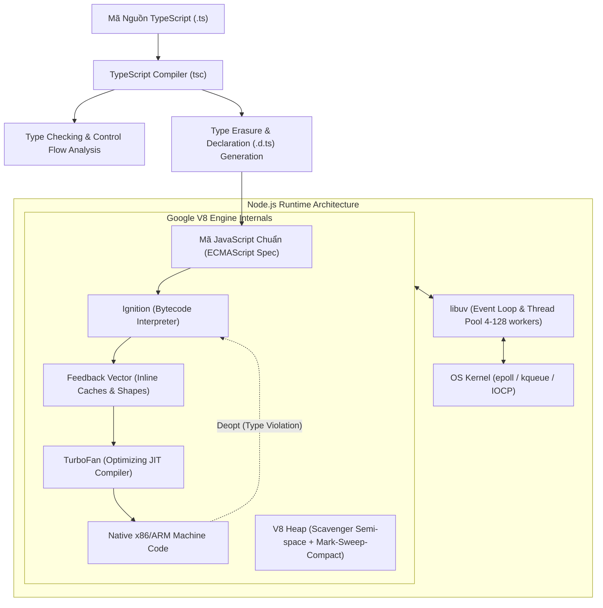
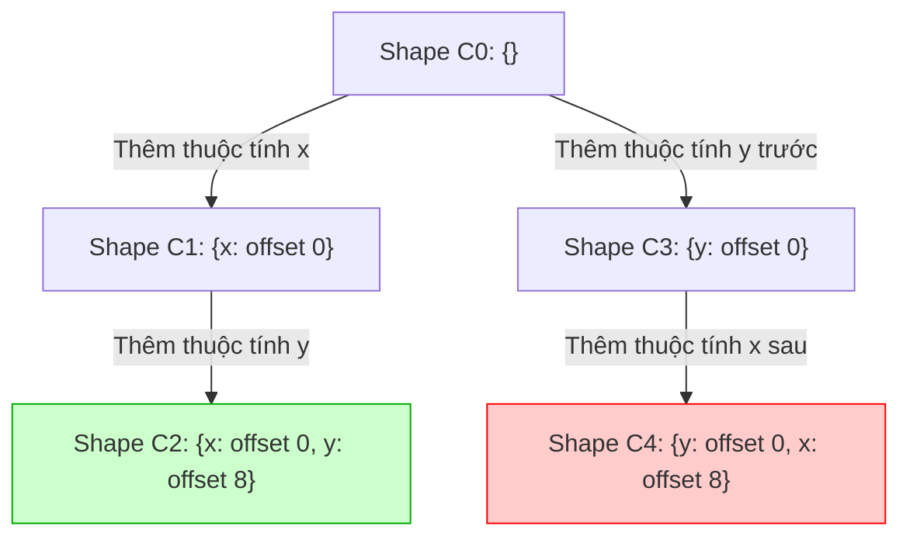
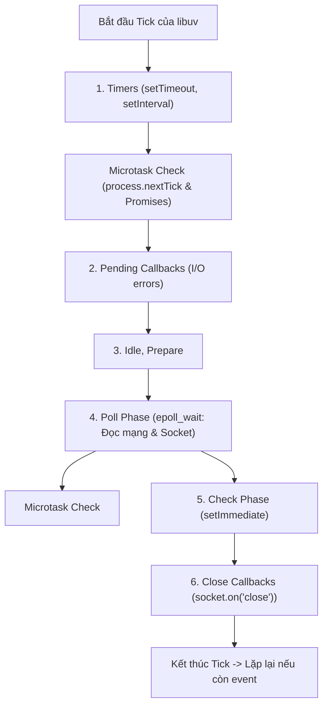
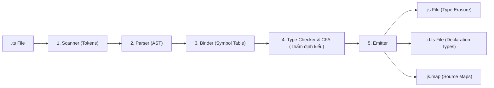

# 13.1. Kiến Trúc Bên Trong Runtime của JavaScript và TypeScript (JavaScript & TypeScript Runtime Internals)

## Tổng quan về JavaScript & TypeScript Runtime Internals
JavaScript từ một ngôn ngữ kịch bản chạy trong trình duyệt đã phát triển thành nền tảng điện toán đám mây và server-side khổng lồ thông qua Node.js, Deno và Bun. Sức mạnh này bắt nguồn từ các động cơ máy ảo hiện đại nhất thế giới như **Google V8**, **JavaScriptCore** (Apple WebKit) và **SpiderMonkey** (Mozilla). Đồng thời, **TypeScript** bổ sung hệ thống kiểu tĩnh cấu trúc (Structural Type System) phức tạp, được xóa bỏ hoàn toàn (Type Erasure) khi chuyển sang mã JavaScript thuần để nạp vào động cơ V8.



---

## 2. Chi tiết từng Keyword (Under-the-Hood Deep Dive)

---

### 1. ECMAScript, V8 Engine, Ignition & TurboFan Pipeline

#### 1. Khái niệm bản chất (What & Why)
- **ECMAScript Specification (ECMA-262)**: Bản đặc tả tiêu chuẩn hình thức của JavaScript, được quản lý bởi ủy ban TC39 (Technical Committee 39).
- **V8 Engine**: Động cơ JavaScript và WebAssembly mã nguồn mở hiệu năng cao viết bằng C++ của Google, cung cấp sức mạnh cho Google Chrome và Node.js.
- **JavaScriptCore (JSC / Nitro)**: Động cơ của Apple WebKit (Safari, Bun).
- **SpiderMonkey**: Động cơ JavaScript đầu tiên trên thế giới (Brendan Eich 1995), hiện dùng trong Mozilla Firefox.
- **Ignition**: Trình thông dịch Bytecode dựa trên thanh ghi của V8, thiết kế để khởi động ứng dụng ngay lập tức với footprint bộ nhớ cực thấp.
- **TurboFan**: Trình biên dịch JIT tối ưu hóa đỉnh cao của V8, sử dụng biểu diễn trung gian dạng đồ thị "Sea of Nodes" để sinh mã máy assembly tối ưu.

#### 2. Cơ chế hoạt động sâu (Under the hood / Hardcore Internals)
- **Đường Ống V8: Từ Source Code đến TurboFan Machine Code**:
  1. *Parser*: Phân tích mã JS thành cây AST.
  2. *Ignition*: Chuyển đổi AST thành **V8 Bytecode**. Khởi động thực thi ngay lập tức thông qua một thanh ghi tích lũy duy nhất (**Accumulator Register**).
  3. *Feedback Collection*: Trong khi Ignition thực thi, nó ghi chép các kiểu dữ liệu thực tế được truyền vào hàm vào một cấu trúc gọi là **Feedback Vector**.
  4. *TurboFan Compilation*: Khi một hàm trở nên "nóng" (Hot Function), TurboFan kích hoạt JIT:
     - Đọc Bytecode kết hợp với dữ liệu trong Feedback Vector.
     - Thực hiện **Speculative Inlining** (Nhúng thẳng thân hàm với giả định kiểu không đổi).
     - Loại bỏ các bước kiểm tra ranh giới mảng (Bounds Check Elimination).
     - Sinh mã máy x86-64/ARM64 trực tiếp vào V8 Code Space.
  5. *Deoptimization (Bailout)*: Nếu giả định kiểu bị vi phạm, CPU nhảy vào stub deopt, tái dựng lại stack frame của Ignition và tiếp tục thông dịch.

#### 3. Sơ đồ minh họa (Đường ống V8 Engine Execution Pipeline)


#### 4. Code ví dụ thực chiến (C++ & JavaScript: Khảo sát V8 Bytecode qua Node.js Flags)
```bash
# Chạy Node.js với cờ khảo sát chi tiết đường ống Ignition Bytecode và TurboFan JIT
node --print-bytecode --print-opt-code script.js
```

```javascript
// script.js: Hàm đơn giản minh họa tối ưu hóa JIT của V8
function calculateTotal(price, quantity) {
    return price * quantity;
}

// 1. Warm-up hàm với kiểu số nguyên (Smi - Small Integer)
// V8 Ignition thu thập Feedback: price là Smi, quantity là Smi
for (let i = 0; i < 20000; ++i) {
    calculateTotal(10, 5);
} // TurboFan biên dịch JIT thành đúng 1 lệnh CPU: imul eax, edx

// 2. Kích hoạt Deoptimization tức thì: Truyền kiểu chuỗi String!
calculateTotal("10", "5"); // Vi phạm Feedback Vector -> TurboFan Bailout giật lùi về Ignition!
```

#### 5. Cạm bẫy & Anti-patterns
- Thay đổi cấu trúc đối tượng (Thêm/xóa thuộc tính động sau khi tạo) khiến V8 phải liên tục hủy tối ưu hóa và sinh lại mã máy.

#### 6. Ứng dụng thực tế trong Backend / Systems
- Viết microservice Node.js hiệu năng cao: Giữ cho các hàm xử lý dữ liệu luôn đơn hình (**Monomorphic** - cùng cấu trúc dữ liệu) để V8 duy trì mã máy JIT TurboFan vĩnh viễn.

---

### 2. Hidden Classes (Shapes), Inline Caches (IC) & V8 Memory Management

#### 1. Khái niệm bản chất (What & Why)
- **Hidden Classes (Shapes / Maps)**: Cơ chế tối ưu hóa nội bộ của V8 biến các đối tượng JavaScript động thành các cấu trúc bộ nhớ có vị trí cố định (Static Offsets). Vì JS không có class tĩnh cố định, V8 âm thầm tạo các Hidden Class phía sau hậu trường.
- **Inline Caches (IC)**: Kỹ thuật ghi nhớ địa chỉ offset bộ nhớ của thuộc tính đối tượng ngay tại vị trí dòng lệnh gọi (Call site), biến thao tác tìm kiếm thuộc tính đắt đỏ thành một thao tác nạp bộ nhớ trực tiếp trong 1 chu kỳ CPU.
- **V8 Generational Garbage Collection**:
  - **Scavenger (Young Generation)**: Vùng nhớ nhỏ (16MB - 64MB) chia thành Semi-spaces, áp dụng Cheney Copying Algorithm để dọn dẹp các đối tượng ngắn hạn.
  - **Major GC (Old Generation)**: Quản lý các đối tượng sống lâu, sử dụng Mark-Sweep kết hợp Mark-Compact và Concurrent Marking đa luồng.

#### 2. Cơ chế hoạt động sâu (Under the hood / Hardcore Internals)
- **Sự Chuyển Đổi Trạng Thái của Hidden Class (Transition Tree)**:
  - Khi bạn viết `const obj = {};`: V8 gán cho `obj` Hidden Class $C_0$ (trống).
  - Khi viết `obj.x = 10;`: V8 tạo Hidden Class mới $C_1$ (chứa thuộc tính `x` tại offset `0x00`), và tạo đường chuyển tiếp ($C_0 \xrightarrow{+x} C_1$).
  - Khi viết `obj.y = 20;`: V8 tạo Hidden Class $C_2$ (chứa `x` tại offset `0x00`, `y` tại offset `0x08`), và tạo đường chuyển tiếp ($C_1 \xrightarrow{+y} C_2$).
  - *Nếu đối tượng thứ hai được tạo theo đúng thứ tự đó*: `const obj2 = {}; obj2.x = 5; obj2.y = 8;` $\to$ Cả hai đối tượng dùng chung chính xác Hidden Class $C_2$!
  - *Nếu tạo ngược thứ tự*: `const obj3 = {}; obj3.y = 8; obj3.x = 5;` $\to$ V8 tạo một nhánh chuyển tiếp hoàn toàn mới $C_3, C_4$! Hai đối tượng có hai Hidden Class khác nhau.
- **Phân loại Inline Caches (IC States)**:
  - **Monomorphic IC**: Vị trí gọi chỉ gặp duy nhất 1 Shape. Tốc độ nhanh nhất (1 lệnh so sánh Shape + 1 lệnh đọc offset).
  - **Polymorphic IC**: Vị trí gọi gặp từ 2 đến 4 Shapes khác nhau. V8 sinh bảng tra cứu nhỏ.
  - **Megamorphic IC**: Gặp từ 5 Shapes trở lên. V8 từ bỏ JIT cache, chuyển sang tra cứu toàn cục chậm chạp.

#### 3. Sơ đồ minh họa (Cây Chuyển Tiếp Hidden Class trong V8)


#### 4. Code ví dụ thực chiến (JavaScript: Tối Ưu Hóa Hidden Class Alignment)
```javascript
// ANTI-PATTERN: Khởi tạo thuộc tính lộn xộn -> Sinh ra 2 Shapes khác nhau (Megamorphic)
function createMessyUser(id, name, isVip) {
    const user = {};
    if (isVip) {
        user.vip = true;
    }
    user.id = id;
    user.name = name;
    return user; // Đối tượng có các Shapes khác nhau tùy thuộc vào isVip!
}

// BEST PRACTICE: Khởi tạo tất cả thuộc tính trong Constructor cùng 1 thứ tự
class CleanUser {
    constructor(id, name, isVip) {
        this.id = id;
        this.name = name;
        this.vip = isVip; // Luôn khởi tạo cùng thứ tự -> 1 Shape duy nhất (Monomorphic IC)!
    }
}

// Benchmark
const users = [];
for (let i = 0; i < 100000; ++i) {
    users.push(new CleanUser(i, "user", i % 2 === 0));
}
```

#### 5. Cạm bẫy & Anti-patterns
- Sử dụng toán tử `delete obj.property`: Xóa một thuộc tính khỏi đối tượng làm V8 giáng cấp đối tượng đó về chế độ tra cứu từ điển chậm chạp (**Slow Dictionary Mode / Hash Table Map**), làm mất hoàn toàn tính tối ưu của Hidden Class.

#### 6. Ứng dụng thực tế trong Backend / Systems
- Viết JSON Parsers và Serializers siêu tốc cho Node.js (Fastify, `fast-json-stringify`): Tạo trước các schema để đảm bảo 100% đối tượng được sinh ra có cùng một Shape cố định.

---

### 3. Node.js Architecture: libuv, Event Loop, Queues & V8 Isolates

#### 1. Khái niệm bản chất (What & Why)
- **Node.js Runtime Architecture**: Sự kết hợp giữa V8 Engine (thực thi JS), thư viện C **libuv** (xử lý I/O bất đồng bộ và Event Loop), c-ares (DNS), llhttp (HTTP parser), và OpenSSL (mật mã).
- **libuv**: Thư viện đa nền tảng viết bằng C, trừu tượng hóa các cơ chế non-blocking I/O của kernel (`epoll` trên Linux, `kqueue` trên macOS, `IOCP` trên Windows).
- **Node.js Thread Pool**: Một hồ chứa luồng nền (mặc định 4 threads, mở rộng tối đa 128 threads qua biến `UV_THREADPOOL_SIZE`) dùng để xử lý các tác vụ blocking không thể non-blocking ở tầng OS (File System I/O, DNS lookup, Crypto hashing).
- **V8 Isolates**: Một phiên bản độc lập hoàn toàn của V8 Engine với heap và garbage collector riêng biệt. Node.js Worker Threads sử dụng Isolates để chạy đa luồng an toàn mà không chia sẻ bộ nhớ.

#### 2. Cơ chế hoạt động sâu (Under the hood / Hardcore Internals)
- **6 Pha của Node.js Event Loop (libuv Tick)**:
  1. **Timers**: Thực thi các callback của `setTimeout()` và `setInterval()`.
  2. **Pending Callbacks**: Thực thi các I/O callbacks bị hoãn lại từ vòng lặp trước.
  3. **Idle, Prepare**: Sử dụng nội bộ bởi libuv.
  4. **Poll Phase (Pha then chốt nhất)**: Tính toán thời gian chờ I/O và thực thi syscall `epoll_wait()`. Đón nhận các kết nối TCP mới và đọc dữ liệu socket.
  5. **Check Phase**: Thực thi các callback của `setImmediate()`.
  6. **Close Callbacks**: Thực thi các sự kiện đóng (ví dụ: `socket.on('close', ...)`).
- **Thứ Tự Ưu Tiên của Microtasks vs Macrotasks**:
  - Giữa **BẤT KỲ CHUYỂN TIẾP NÀO** của 6 pha trên, Event Loop lập tức vét sạch hai hàng đợi Microtask:
    1. **`process.nextTick` Queue**: Độ ưu tiên cao nhất, chạy trước mọi thứ khác.
    2. **Promise Microtask Queue**: Chạy ngay sau `nextTick`.
  - Một vòng lặp vô hạn `process.nextTick()` sẽ làm chết đói (Starve) toàn bộ Event Loop, khiến I/O và Timers không bao giờ được chạy!

#### 3. Sơ đồ minh họa (Kiến trúc 6 Pha của Node.js Event Loop)


#### 4. Code ví dụ thực chiến (JavaScript: Kiểm chứng Thứ Tự Thực Thi Microtask vs Macrotask)
```javascript
console.log("1. Đồng Bộ (Sync Main)");

setTimeout(() => {
    console.log("5. Timers Macrotask (setTimeout)");
}, 0);

setImmediate(() => {
    console.log("6. Check Macrotask (setImmediate)");
});

Promise.resolve().then(() => {
    console.log("3. Promise Microtask");
});

process.nextTick(() => {
    console.log("2. process.nextTick Microtask (Ưu tiên số 1!)");
});

console.log("4. Đồng Bộ Kết Thúc");

// Thứ tự in ra chính xác 100%:
// 1. Đồng Bộ (Sync Main)
// 4. Đồng Bộ Kết Thúc
// 2. process.nextTick Microtask (Ưu tiên số 1!)
// 3. Promise Microtask
// 5. Timers Macrotask (setTimeout)
// 6. Check Macrotask (setImmediate)
```

#### 5. Cạm bẫy & Anti-patterns
- Gọi các hàm File System đồng bộ (`fs.readFileSync`) hoặc tính toán CPU nặng (JSON parsing 100MB) trong Event Loop, làm nghẽn toàn bộ hàng nghìn kết nối của các client khác. Luôn đẩy việc nặng sang Worker Threads.

#### 6. Ứng dụng thực tế trong Backend / Systems
- Cấu hình kích thước Thread Pool cho các service I/O đĩa nặng: Đặt `UV_THREADPOOL_SIZE=64` trước khi khởi động tiến trình Node.js để tăng gấp 10 lần thông lượng đọc ghi file đồng thời.

---

### 4. TypeScript Compiler Architecture & Type-Level Pipeline

#### 1. Khái niệm bản chất (What & Why)
- **TypeScript Compiler (`tsc`) Architecture**: Trình biên dịch source-to-source viết hoàn toàn bằng TypeScript, gồm 5 tầng chính:
  1. *Scanner*: Lexer biến mã TS thành Tokens.
  2. *Parser*: Xây dựng AST theo chuẩn TypeScript AST.
  3. *Binder*: Tạo Bảng Ký Hiệu (Symbol Table) và liên kết các Scopes.
  4. *Type Checker*: Trái tim của `tsc`, thực hiện kiểm tra kiểu và **Control Flow Analysis (CFA)**. Chiếm 80-90% thời gian biên dịch!
  5. *Emitter*: Sinh file JavaScript thuần (thực hiện **Type Erasure**) và các file khai báo kiểu (**Declaration Files `.d.ts`**).
- **Control Flow Analysis (CFA)**: Khả năng của `tsc` phân tích luồng điều khiển để tự động thu hẹp kiểu (**Type Narrowing**) dựa trên các câu lệnh điều kiện (`if`, `typeof`, `instanceof`, `in`).

#### 2. Cơ chế hoạt động sâu (Under the hood / Hardcore Internals)
- **Type Narrowing dựa trên Control Flow Analysis**:
  - Cho biến $x$ có kiểu `string | number | null`.
  - Khi đi qua câu lệnh `if (x === null) return;`, CFA loại bỏ nhánh `null`, kiểu của $x$ được thu hẹp còn `string | number`.
  - Tiếp tục qua câu lệnh `if (typeof x === 'string')`: CFA xác định chắc chắn kiểu của $x$ trong khối `if` là `string`. Bạn có thể gọi `x.toUpperCase()` an toàn 100%.
- **Chi phí của Type Erasure và Declaration Files (`.d.ts`)**:
  - Quá trình chuyển đổi từ `.ts` sang `.js` là một thao tác cắt bỏ văn bản thô (Syntax Stripping). Toàn bộ `type`, `interface`, và generics bị xóa sổ mà không sinh thêm bất kỳ logic nào ở runtime.
  - Các công cụ build hiện đại (esbuild, SWC) hoàn toàn bỏ qua bước Type Checking của `tsc`, chỉ thực hiện Parser $\to$ Emitter để biến đổi file TypeScript hàng chục nghìn dòng trong vài mili-giây.

#### 3. Sơ đồ minh họa (Kiến trúc 5 Tầng của TypeScript Compiler `tsc`)


#### 4. Code ví dụ thực chiến (TypeScript: Khai Thác Control Flow Analysis & Type Narrowing)
```typescript
interface NetworkSuccess {
    status: 200;
    data: { userId: string; email: string };
}

interface NetworkError {
    status: 400 | 500;
    errorMessage: string;
}

type ApiResponse = NetworkSuccess | NetworkError;

function handleResponse(res: ApiResponse) {
    // Control Flow Analysis nhận diện Discriminated Union dựa trên trường 'status'
    if (res.status === 200) {
        // CFA tự động Narrowing kiểu thành NetworkSuccess
        console.log("Email người dùng:", res.data.email);
    } else {
        // CFA tự động Narrowing kiểu thành NetworkError
        console.error("Lỗi API:", res.errorMessage);
    }
}
```

#### 5. Cạm bẫy & Anti-patterns
- Lạm dụng Type Assertions (`as unknown as T`) để ép compiler im lặng, khiến các lỗi sai cấu trúc dữ liệu không được phát hiện và âm thầm gây sập ứng dụng ở môi trường production.

#### 6. Ứng dụng thực tế trong Backend / Systems
- Xây dựng Backend APIs hướng hợp đồng (Contract-first APIs) với tRPC hoặc Zod: Tận dụng TypeScript Type-Level Inference để chia sẻ 100% Type an toàn giữa Backend và Frontend mà không cần sinh mã trung gian.
