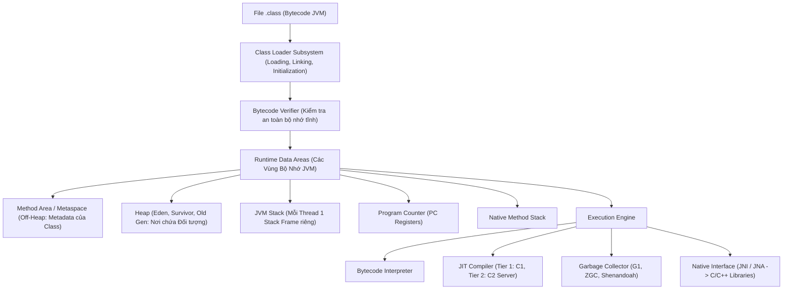
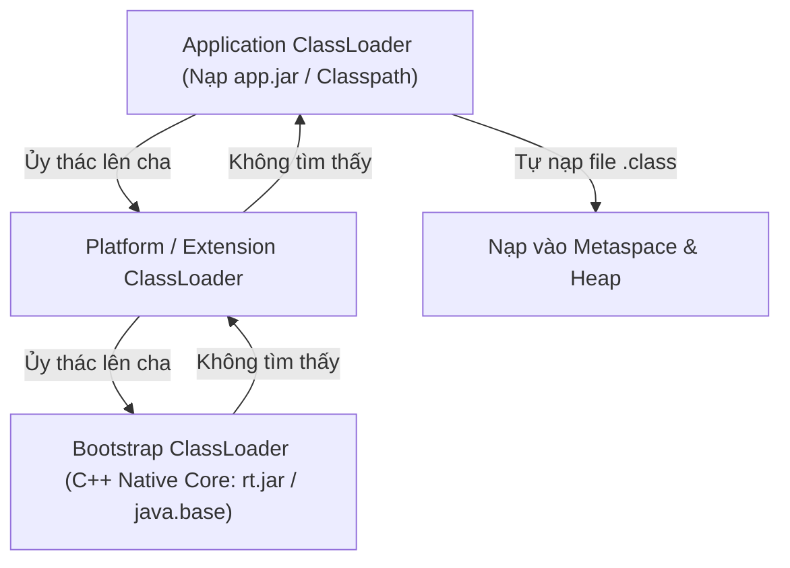
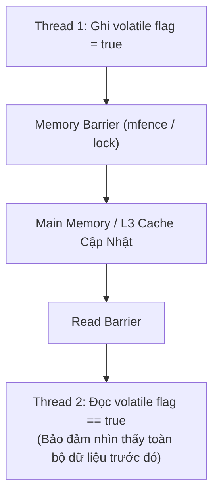

# 13.2. Kiến Trúc Bên Trong Máy Ảo Java và HotSpot JVM (Java & JVM Runtime Internals)

## Tổng quan về Java & JVM Runtime Internals
Máy ảo Java (Java Virtual Machine - JVM) là một trong những kỳ quan kỹ nghệ phần mềm vĩ đại nhất, cung cấp môi trường thực thi vững chắc, an toàn và tối ưu hóa cao độ cho hàng triệu hệ thống doanh nghiệp lớn trên toàn cầu. Trái tim của hệ sinh thái JVM hiện đại là **HotSpot VM** với kiến trúc phân tầng: nạp lớp động (Class Loading), xác minh bytecode an toàn (Bytecode Verification), quản lý bộ nhớ thế hệ nâng cao (Metaspace & Heap), các bộ thu gom rác thế hệ mới với độ trễ dưới 1 mili-giây (**ZGC, Shenandoah, G1 GC**), và hệ thống biên dịch JIT kép (**C1 Client & C2 Server Compiler**) kết hợp với mô hình bộ nhớ **Java Memory Model (JMM)**.



---

## 2. Chi tiết từng Keyword (Under-the-Hood Deep Dive)

---

### 1. JVM Architecture, Class Loading, Bytecode Verification & Runtime Data Areas

#### 1. Khái niệm bản chất (What & Why)
- **JDK vs JRE vs JVM**:
  - **JVM**: Máy ảo thực thi bytecode (`java`).
  - **JRE (Java Runtime Environment)**: JVM + Thư viện chuẩn Java Core Libraries.
  - **JDK (Java Development Kit)**: JRE + Bộ công cụ phát triển (Compiler `javac`, Debugger `jdb`, Profilers `jcmd`, `jconsole`).
- **Class Loading Subsystem**: Cơ chế nạp các file `.class` vào bộ nhớ theo mô hình ủy thác cha phụ thuộc (**Parent Delegation Model**):
  1. *Bootstrap ClassLoader*: Nạp các lớp hệ thống cốt lõi (`java.lang.*`) viết bằng C++ trong thư viện gốc.
  2. *Platform / Extension ClassLoader*: Nạp các module mở rộng.
  3. *Application / System ClassLoader*: Nạp các class từ Classpath của ứng dụng.
- **Bytecode Verification**: Pha kiểm tra bảo mật khắt khe trước khi thực thi: đảm bảo bytecode không làm tràn ngăn xếp toán hạng, không truy cập con trỏ ngoài ranh giới, và tuân thủ chặt chẽ quyền truy cập kiểu.
- **Runtime Data Areas**:
  - **Heap**: Vùng nhớ chia sẻ giữa tất cả các luồng, nơi cấp phát mọi đối tượng.
  - **Java Thread Stack**: Mỗi luồng có một Stack riêng chứa các **Stack Frames** (Local Variables Table, Operand Stack, Frame Data).
  - **Metaspace (Thay thế PermGen từ Java 8)**: Nằm ở bộ nhớ ngoài Native Memory (Off-Heap), tự động co giãn theo dung lượng RAM vật lý để lưu trữ Metadata của Class, Method Descriptors, và Constant Pool.

#### 2. Cơ chế hoạt động sâu (Under the hood / Hardcore Internals)
- **Mô Hình Ủy Thác Cha (Parent Delegation Model)**:
  - Khi một ClassLoader nhận yêu cầu nạp một lớp, nó **không tự nạp ngay**.
  - Nó ủy thác yêu cầu lên cho ClassLoader cha trước. Chỉ khi ClassLoader cha báo không tìm thấy lớp (`ClassNotFoundException`), nó mới tự quét và nạp file `.class`.
  - *Mục đích cốt lõi*: Bảo vệ an ninh hệ thống! Ngăn chặn kẻ tấn công tự viết một class giả mạo mang tên `java.lang.SecurityManager` hoặc `java.lang.String` để ghi đè class gốc của Java.
- **Bytecode Verification Type-State Checking**:
  - Không cần chạy thực tế, Verifier sử dụng thuật toán luồng dữ liệu tĩnh để chứng minh rằng tại mỗi lệnh bytecode, số lượng và kiểu của các giá trị trên **Operand Stack** luôn luôn khớp chính xác với đặc tả chỉ thị CPU.

#### 3. Sơ đồ minh họa (Mô hình Ủy Thác Cha của JVM ClassLoaders)


#### 4. Code ví dụ thực chiến (Java: Tự Hiện Thực Custom ClassLoader Độc Lập)
```java
import java.io.IOException;
import java.nio.file.Files;
import java.nio.file.Paths;

// Custom ClassLoader dùng để Hot-Reloading hoặc nạp Bytecode mã hóa từ xa
public class EncryptedClassLoader extends ClassLoader {
    private final String classDir;

    public EncryptedClassLoader(String dir, ClassLoader parent) {
        super(parent);
        this.classDir = dir;
    }

    @Override
    protected Class<?> findClass(String name) throws ClassNotFoundException {
        try {
            String fileName = classDir + "/" + name.replace('.', '/') + ".class";
            byte[] rawBytes = Files.readAllBytes(Paths.get(fileName));

            // Có thể giải mã AES byte[] tại đây trước khi nạp vào JVM
            return defineClass(name, rawBytes, 0, rawBytes.length);
        } catch (IOException e) {
            throw new ClassNotFoundException("Không tìm thấy class: " + name, e);
        }
    }
}
```

#### 5. Cạm bẫy & Anti-patterns
- **Metaspace OutOfMemoryError (`java.lang.OutOfMemoryError: Metaspace`)**: Sinh ra hàng triệu class động tại runtime (thông qua CGLIB, ByteBuddy hoặc Dynamic Proxies) mà không có cơ chế thu hồi ClassLoader, làm tràn ngập bộ nhớ Native RAM của máy chủ.

#### 6. Ứng dụng thực tế trong Backend / Systems
- Kiến trúc Plugin Hot-Deploy trong các ứng dụng Enterprise (OSGi, Apache Tomcat WebappClassLoader): Mỗi ứng dụng web chạy trong một ClassLoader riêng biệt để cô lập phiên bản thư viện và có thể reload mà không cần khởi động lại toàn bộ JVM.

---

### 2. HotSpot JIT (C1, C2), Escape Analysis & Modern Garbage Collectors (G1, ZGC, Shenandoah)

#### 1. Khái niệm bản chất (What & Why)
- **HotSpot JIT Engine**:
  - **C1 Compiler (Client Compiler)**: Biên dịch rất nhanh, thực hiện các tối ưu hóa cơ bản (Inlining, Constant Folding). Phù hợp cho ứng dụng desktop hoặc pha khởi động.
  - **C2 Compiler (Opto / Server Compiler)**: Biên dịch chậm hơn nhưng thực hiện các tối ưu hóa sâu đỉnh cao (Global Value Numbering, Loop Unrolling, Vectorization, Escape Analysis). Dành cho các ứng dụng Server chạy lâu dài.
- **Modern Garbage Collectors**:
  - **G1 GC (Garbage-First)**: Chia Heap thành hàng nghìn phân vùng (Regions) nhỏ kích thước bằng nhau (1MB - 32MB). Ưu tiên dọn dẹp các phân vùng chứa nhiều rác nhất trước ("Garbage-First"), cho phép cấu hình giới hạn thời gian tạm dừng mong muốn (`-XX:MaxGCPauseMillis=200`).
  - **ZGC (Z Garbage Collector)** & **Shenandoah GC**: Các bộ thu gom rác thế hệ mới với mục tiêu **Độ trễ cực thấp (Sub-millisecond Pauses < 1ms)** bất kể kích thước Heap lên tới hàng Terabytes. Toàn bộ các pha Mark, Relocate và Compact đều được thực hiện **Đồng thời (Concurrent)** song song với các luồng ứng dụng.

#### 2. Cơ chế hoạt động sâu (Under the hood / Hardcore Internals)
- **Cơ chế Colored Pointers và Load Barriers trong ZGC**:
  - Làm thế nào ZGC có thể dời chỗ đối tượng (Compact) khi các luồng ứng dụng vẫn đang đọc ghi vào đối tượng đó?
  - ZGC sử dụng **Colored Pointers (Con trỏ nhuộm màu)** trên địa chỉ 64-bit:
    - 42 bit đầu: Địa chỉ ô nhớ thực tế (hỗ trợ tối đa 4TB/16TB RAM).
    - 4 bit tiếp theo (42 đến 45): Lưu trữ trạng thái của GC: `Marked0`, `Marked1`, `Remapped`.
  - **Load Barrier (Rào cản nạp)**: Một đoạn mã JIT chèn vào mỗi thao tác đọc con trỏ (`obj.field`). Nếu con trỏ chưa được "Remap" (vẫn trỏ vào địa chỉ cũ đang bị dời đi), Load Barrier lập tức đọc Forwarding Table, sửa con trỏ thành địa chỉ mới và trả về dữ liệu an toàn. Quá trình này chỉ tốn 2-3 nano-giây.

#### 3. Sơ đồ minh họa (Mô hình Cấu trúc Con Trỏ 64-bit của ZGC)
```text
ZGC 64-bit Colored Pointer Layout:
+-------------------+-------------+----------------------------------------------+
| 16 bits Chưa Dùng | 4 bits Màu  | 44 bits Địa Chỉ Vùng Nhớ Thực Tế (Max 16 TB) |
+-------------------+-------------+----------------------------------------------+
                     | | | |
                     | | | +-- Finalizable
                     | | +---- Remapped (Đã cập nhật địa chỉ mới)
                     | +------ Marked1
                     +-------- Marked0
```

#### 4. Code ví dụ thực chiến (Java: Cấu Hình Flags Tối Ưu ZGC và HotSpot C2 trên Production)
```bash
# Lệnh chạy Java Backend với ZGC siêu tốc và bật tối ưu hóa C2
java -XX:+UseZGC \
     -XX:+ZGenerational \
     -Xms16g -Xmx16g \
     -XX:+UnlockDiagnosticVMOptions \
     -XX:+PrintCompilation \
     -XX:+PrintInlining \
     -jar backend-service.jar
```

```java
// Mã nguồn minh họa Escape Analysis và Lock Coarsening trong HotSpot C2
public class HighThroughputService {
    public int processTask(int input) {
        // HotSpot C2 nhận diện: Đối tượng Integer này không escape ra ngoài hàm
        // Thực hiện Scalar Replacement -> Không cấp phát Heap, dùng thanh ghi CPU!
        Integer value = Integer.valueOf(input * 2);
        
        // Lock Elision: Nhận diện lock trên đối tượng cục bộ là vô nghĩa -> Xóa bỏ lệnh Lock!
        synchronized (new Object()) {
            return value + 10;
        }
    }
}
```

#### 5. Cạm bẫy & Anti-patterns
- Cấu hình `-Xms` (Initial Heap) nhỏ hơn `-Xmx` (Max Heap) trên server production: Khiến JVM phải liên tục gọi syscall xin thêm RAM từ OS kernel và kích hoạt Full GC để co giãn heap. Luôn đặt `-Xms` bằng chính xác `-Xmx`.

#### 6. Ứng dụng thực tế trong Backend / Systems
- Các hệ thống xử lý giao dịch tài chính chứng khoán (High-Frequency Trading, Kafka Clusters, Cassandra DB): Sử dụng Generational ZGC để triệt tiêu hoàn toàn hiện tượng "Stop-the-World GC Spikes", đảm bảo SLA độ trễ phản hồi luôn dưới 1ms ở 99.99th percentile (p99.99).

---

### 3. Java Memory Model (JMM) & Native Interoperability (JNI vs JNA)

#### 1. Khái niệm bản chất (What & Why)
- **Java Memory Model (JMM - JSR-133)**: Bản đặc tả trừu tượng hóa kiến trúc bộ đệm CPU (L1/L2 Cache), định nghĩa các quy tắc về tính hiển thị (Visibility) và thứ tự sắp xếp lại lệnh (Reordering) giữa các luồng. Khái niệm cốt lõi: **Quan hệ Xảy ra trước (Happens-Before Relationship)**.
  - Từ khóa `volatile`: Đảm bảo mọi thao tác ghi vào biến sẽ được đẩy ngay lập tức xuống bộ nhớ chính (Main Memory) và mọi thao tác đọc sau đó luôn nhìn thấy giá trị mới nhất, đồng thời thiết lập rào cản bộ nhớ (**Memory Barrier / Fence**) ngăn cấm CPU sắp xếp lại lệnh qua ranh giới đó.
- **Java Native Interface (JNI)**: Chuẩn FFI chính thức của Java để gọi mã C/C++. Đạt hiệu năng tối đa nhưng phức tạp, yêu cầu viết mã glue-code C++ và biên dịch thành thư viện động `.so/.dll`.
- **Java Native Access (JNA)**: Thư viện bậc cao cho phép gọi trực tiếp các hàm trong Shared Library C mà không cần viết một dòng mã C++ JNI nào (sử dụng libffi bên dưới). Tiện lợi hơn nhưng chậm hơn JNI.
- **Project Panama (Foreign Function & Memory API - Java 22+)**: Thay thế hiện đại cho JNI, cho phép truy cập Off-heap memory và gọi hàm C bản địa với độ an toàn cao và hiệu năng ngang ngửa C++.

#### 2. Cơ chế hoạt động sâu (Under the hood / Hardcore Internals)
- **Tầng Assembly của Từ Khóa `volatile` trên Kiến Trúc x86-64**:
  - Khi một trường `volatile` được ghi giá trị trong Java, HotSpot C2 sinh ra một chỉ thị CPU:
    ```text
    lock addl $0, (%rsp)   ; Hoặc chỉ thị `mfence`
    ```
  - Tiền tố `lock` kích hoạt giao thức đồng bộ bộ nhớ đệm phần cứng vi xử lý (**Cache Coherency Protocol - MESI**):
    - Đẩy Store Buffer ra L1 Cache.
    - Đánh dấu dòng cache của các lõi CPU khác là Không hợp lệ (**Invalidate - 'I' State**).
    - Ngăn chặn triệt để CPU thực hiện Out-of-Order Execution vượt qua lệnh ghi này.

#### 3. Sơ đồ minh họa (Mô hình Happens-Before của Java Memory Model)


#### 4. Code ví dụ thực chiến (Java: Giao Tiếp Native C qua JNI Chuẩn Mực)
```java
// Java Interface khai báo hàm Native
public class NativeFastMath {
    static {
        // Nạp thư viện C++ shared library (.so trên Linux, .dylib trên macOS)
        System.loadLibrary("fastmath");
    }

    // Khai báo hàm native được hiện thực bằng C++
    public native double fastVectorDotProduct(double[] a, double[] b, int length);

    public static void main(String[] args) {
        NativeFastMath math = new NativeFastMath();
        double[] v1 = {1.0, 2.0, 3.0};
        double[] v2 = {4.0, 5.0, 6.0};
        double result = math.fastVectorDotProduct(v1, v2, 3);
        System.out.println("Kết quả tính toán từ C++ JNI: " + result); // 32.0
    }
}
```

```cpp
// fastmath.cpp: Hiện thực hàm C++ JNI
#include <jni.h>

extern "C" JNIEXPORT jdouble JNICALL 
Java_NativeFastMath_fastVectorDotProduct(JNIEnv* env, jobject obj, 
                                        jdoubleArray a, jdoubleArray b, jint len) {
    // Lấy con trỏ trực tiếp đến mảng trên Java Heap (Critical Pinning)
    jdouble* arrA = env->GetDoubleArrayElements(a, nullptr);
    jdouble* arrB = env->GetDoubleArrayElements(b, nullptr);

    double total = 0.0;
    for (int i = 0; i < len; ++i) {
        total += arrA[i] * arrB[i];
    }

    // Giải phóng con trỏ và trả lại cho GC
    env->ReleaseDoubleArrayElements(a, arrA, JNI_ABORT);
    env->ReleaseDoubleArrayElements(b, arrB, JNI_ABORT);

    return total;
}
```

#### 5. Cạm bẫy & Anti-patterns
- Giữ con trỏ mảng JNI (`GetPrimitiveArrayCritical`) quá lâu trong lúc thực hiện các tác vụ I/O đĩa hoặc mạng, khiến Garbage Collector bị chặn đứng hoàn toàn (GC Stall), làm tê liệt toàn bộ ứng dụng JVM.

#### 6. Ứng dụng thực tế trong Backend / Systems
- Kafka và RocksDB: Tích hợp trực tiếp mã C++ bản địa vào Java Backend qua JNI/Panama để đạt thông lượng đọc ghi đĩa NVMe hàng triệu IOPS mà không bị giới hạn bởi Java Heap.
