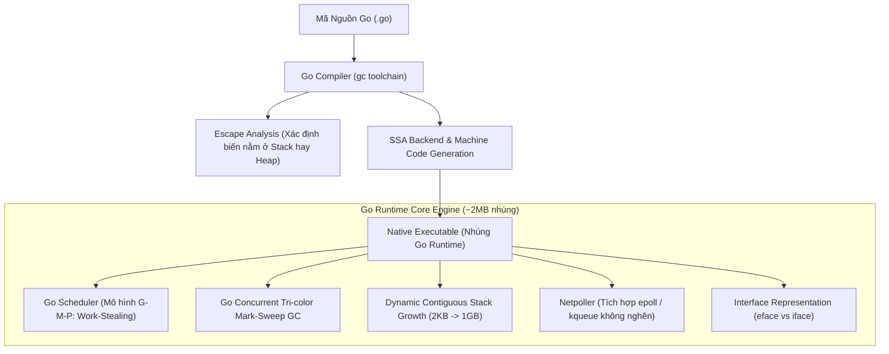
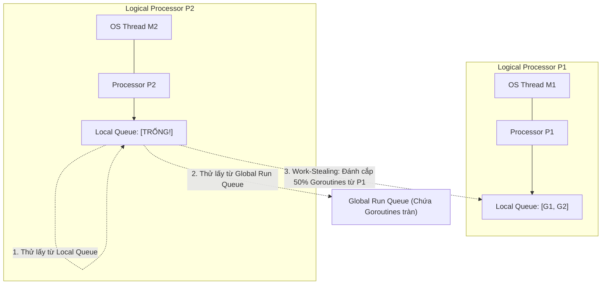
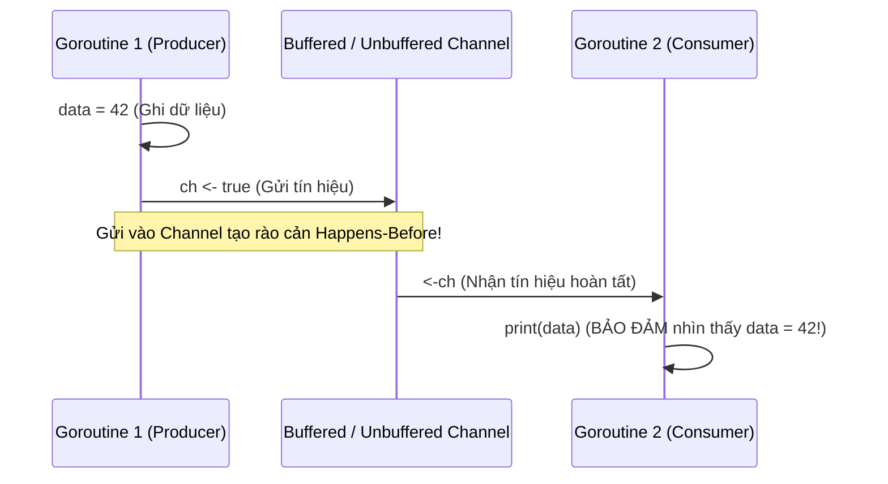

# 13.3. Kiến Trúc Bên Trong Trình Biên Dịch và Runtime của Go (Go Runtime & Internals)

## Tổng quan về Go Runtime & Internals
Go (Golang) được thiết kế bởi những huyền thoại công nghệ của Google (Robert Griesemer, Rob Pike, Ken Thompson) với triết lý tối giản, thực dụng và tập trung tối đa vào kỹ nghệ hệ thống Backend phân tán quy mô lớn. Không sử dụng máy ảo thông dịch như Java hay V8, Go biên dịch trực tiếp thành mã máy bản địa (AOT Native Binary) nhưng **tự động nhúng kèm một hệ thống Runtime gọn nhẹ (~2MB)** chịu trách nhiệm điều phối hàng triệu Goroutines (**Mô hình G-M-P**), thu gom rác đồng thời (**Concurrent Tri-color GC**), và tự động co giãn ngăn xếp (**Dynamic Stack Growth**).



---

## 2. Chi tiết từng Keyword (Under-the-Hood Deep Dive)

---

### 1. Go Scheduler, G-M-P Model & Goroutine Stack Growth

#### 1. Khái niệm bản chất (What & Why)
- **Goroutine**: Luồng tính toán siêu nhẹ do Go Runtime quản lý (Green Thread). Khởi đầu chỉ chiếm **2 KB bộ nhớ** (so với 2MB - 8MB của một OS Thread tiêu chuẩn), cho phép một tiến trình Go có thể tạo và chạy hàng triệu Goroutines đồng thời.
- **Go Scheduler**: Bộ điều phối thời gian chạy theo mô hình **$M:N$ Scheduler** phân bổ các Goroutines lên các luồng của Hệ điều hành.
- **Mô Hình G-M-P**:
  - **G (Goroutine)**: Đại diện cho một Goroutine (chứa con trỏ ngăn xếp `stack`, con trỏ lệnh `PC`, trạng thái `_Grunning`, `_Gwaiting`).
  - **M (Machine)**: Đại diện cho một luồng hệ điều hành thực tế (OS Thread do kernel quản lý qua syscall `clone`).
  - **P (Processor / Logical Context)**: Đại diện cho tài nguyên xử lý cần thiết để thực thi mã Go. Số lượng $P$ mặc định bằng số lõi CPU vật lý (`runtime.GOMAXPROCS`).
- **Dynamic Stack Growth (Ngăn xếp co giãn động)**: Cơ chế bắt đầu với Stack cực nhỏ (2KB) và tự động cấp phát nhân đôi khi chạm ngưỡng tràn ngăn xếp.

#### 2. Cơ chế hoạt động sâu (Under the hood / Hardcore Internals)
- **Cơ chế Tăng Trưởng Ngăn Xếp Liên Tục (Contiguous Stacks)**:
  - Ở đầu mỗi hàm Go, compiler tự động chèn một đoạn mã kiểm tra (**Stack Split Check**): So sánh con trỏ ngăn xếp `SP` hiện tại với con trỏ giới hạn `stackguard0`.
  - Nếu hàm cần nhiều bộ nhớ hơn dung lượng còn lại:
    1. Runtime cấp phát một vùng nhớ Stack mới trên Heap có kích thước gấp đôi (ví dụ: từ 2KB lên 4KB).
    2. Sao chép toàn bộ các Stack Frames cũ sang vùng nhớ mới.
    3. **Điều chỉnh tất cả các con trỏ nội bộ** trỏ vào các biến trên Stack cũ sang địa chỉ mới trên Stack mới.
    4. Giải phóng Stack cũ.
- **Thuật toán Work-Stealing và Syscall Handoff**:
  - Khi Goroutine thực thi một syscall blocking (ví dụ: đọc file đồng bộ):
    - Runtime tách rời luồng $M$ hiện tại cùng Goroutine $G$ đó ra khỏi context $P$.
    - Luồng $M$ đi vào trạng thái block trong OS kernel.
    - Context $P$ lập tức tìm hoặc tạo một luồng $M'$ khác để tiếp tục thực thi các Goroutine còn lại trong hàng đợi (**Syscall Handoff**), đảm bảo CPU không bao giờ bị nhàn rỗi!

#### 3. Sơ đồ minh họa (Mô hình G-M-P Work-Stealing Scheduler)


#### 4. Code ví dụ thực chiến (Go: Khảo Sát Cơ Chế Co Giãn Stack và Concurrency)
```go
package main

import (
	"fmt"
	"runtime"
	"sync"
)

// Hàm đệ quy sâu để ép buộc Go Runtime kích hoạt Stack Growth
func deepRecursion(depth int, ptr *int) {
	var localArray [1024]byte // Mỗi frame tốn 1KB
	localArray[0] = byte(depth)

	if depth > 0 {
		deepRecursion(depth-1, ptr)
	} else {
		*ptr = int(localArray[0])
	}
}

func main() {
	fmt.Printf("GOMAXPROCS: %d cores\n", runtime.GOMAXPROCS(0))

	var wg sync.WaitGroup
	// Chạy 100,000 Goroutines đồng thời
	for i := 0; i < 100_000; i++ {
		wg.Add(1)
		go func(id int) {
			defer wg.Done()
			var dummy int
			// Goroutine tự động mở rộng stack từ 2KB lên 8KB mà không crash
			deepRecursion(5, &dummy)
		}(i)
	}
	wg.Wait()
	fmt.Println("Hoàn thành xử lý 100,000 Goroutines thành công!")
}
```

#### 5. Cạm bẫy & Anti-patterns
- **Goroutine Leak**: Khởi chạy một Goroutine đọc từ một Channel không có ai gửi dữ liệu, hoặc gửi vào một Unbuffered Channel không có ai nhận. Goroutine này sẽ bị treo ở trạng thái `_Gwaiting` vĩnh viễn, không bao giờ được Garbage Collector thu hồi và làm cạn kiệt bộ nhớ theo thời gian.

#### 6. Ứng dụng thực tế trong Backend / Systems
- Là nền tảng hạ tầng của Kubernetes, Docker, Terraform, và CockroachDB: Xử lý hàng vạn tác vụ microservice đồng thời với mức tiêu thụ tài nguyên tối thiểu.

---

### 2. Escape Analysis, Interface Representation (`eface` vs `iface`) & Go Assembly

#### 1. Khái niệm bản chất (What & Why)
- **Escape Analysis trong Go**: Thuật toán phân tích tĩnh của compiler (`go build -gcflags="-m"`) xác định xem vùng nhớ của một biến có thể an toàn giữ trên **Stack** hay bắt buộc phải chuyển (escape) lên **Heap**.
  - Quy tắc vàng: *Nếu một biến được tham chiếu bởi một con trỏ sống lâu hơn hàm tạo ra nó (ví dụ: trả về con trỏ biến cục bộ), biến đó BẮT BUỘC phải Escape lên Heap*.
- **Interface Representation**: Cấu trúc nội bộ của interface trong Go:
  - **`eface` (Empty Interface - `any` / `interface{}`)**: Đại diện cho interface không có method nào. Chiếm 16 bytes: `_type` (con trỏ kiểu) + `data` (con trỏ dữ liệu).
  - **`iface` (Non-empty Interface)**: Đại diện cho interface có chứa methods. Chiếm 16 bytes: `tab` (con trỏ tới `itab`) + `data` (con trỏ dữ liệu).
- **Go Assembly**: Dạng assembly trung gian dựa trên kiến trúc Plan 9, sử dụng các thanh ghi ảo (`SP`, `SB`, `FP`, `PC`) làm cầu nối trước khi hạ xuống mã máy x86/ARM thực tế.

#### 2. Cơ chế hoạt động sâu (Under the hood / Hardcore Internals)
- **Cấu trúc `itab` trong Non-empty Interface (`iface`)**:
  - `itab` chứa:
    1. `interfacetype`: Con trỏ metadata của interface.
    2. `_type`: Con trỏ metadata của kiểu struct thực tế gán vào.
    3. `hash`: Bản sao mã băm kiểu dùng cho Type Assertion nhanh (`val, ok := i.(MyType)`).
    4. `fun[1]`: Mảng các con trỏ hàm ảo thực tế tương ứng với các method của interface.
  - Khi gán struct vào interface: Go Runtime chỉ tính toán `itab` này một lần duy nhất và lưu vào bảng băm toàn cục (**Global Itab Hash Table**), các lần gán sau được tái sử dụng trong $O(1)$.

#### 3. Sơ đồ minh họa (Cấu trúc Bộ Nhớ của `iface` trong Go Runtime)
```text
iface Layout (16 bytes trên kiến trúc 64-bit):
+-----------------------+ 0x00: tab (*itab) ---> [ itab Structure ]
|  tab pointer (8 B)    |                        +----------------------------------+
+-----------------------+ 0x08                   |  interfacetype (*interfacetype)  |
|  data pointer (8 B)   |                        |  _type         (*_type)          |
+-----------------------+                        |  hash          (uint32)          |
            |                                    |  fun[0]        (*func) --------+ |
            v                                    +--------------------------------|-+
   [ Struct Data trên RAM ]                                                       |
   (Giá trị thực tế của biến) <---------------------------------------------------+
```

#### 4. Code ví dụ thực chiến (Go: Khảo Sát Escape Analysis và Interface Allocations)
```bash
# Lệnh xem báo cáo chi tiết Escape Analysis của Go Compiler
go build -gcflags="-m -m" main.go
```

```go
package main

import "fmt"

type Worker struct {
	ID int
}

// 1. Biến KHÔNG escape -> Cấp phát trên Stack (Zero GC)
func createOnStack() int {
	x := 42
	return x // Trả về giá trị copy -> Nằm trên Stack an toàn
}

// 2. Biến ESCAPE lên Heap (Tốn GC)
func createOnHeap() *Worker {
	w := Worker{ID: 100}
	return &w // Trả về con trỏ -> Compiler buộc phải chuyển w lên Heap!
	// Output của compiler: "moved to heap: w"
}

func main() {
	val := createOnStack()
	wPtr := createOnHeap()
	
	// fmt.Println nhận interface{} rỗng (eface) -> Ép wPtr.ID escape lên Heap!
	fmt.Printf("Val: %d, Worker ID: %d\n", val, wPtr.ID)
}
```

#### 5. Cạm bẫy & Anti-patterns
- Truyền con trỏ struct vào các hàm nhận `interface{}` hoặc hàm variadic (`fmt.Println`) trong các vòng lặp xử lý dữ liệu nặng: Biến sẽ bị ngầm định Escape lên Heap và gây áp lực lớn lên Garbage Collector.

#### 6. Ứng dụng thực tế trong Backend / Systems
- Viết Zero-Allocation Web Frameworks (như Fiber, FastHTTP): Tận dụng Escape Analysis và `sync.Pool` để tái sử dụng các struct `Request` và `Response`, đạt tỷ lệ **0 byte Heap Allocation** trên mỗi HTTP request.

---

### 3. Go Memory Model, Race Detector & Cgo

#### 1. Khái niệm bản chất (What & Why)
- **Go Memory Model**: Định nghĩa các điều kiện chính xác để một thao tác đọc một biến trong một Goroutine được bảo đảm nhìn thấy giá trị được ghi bởi một Goroutine khác. Quy tắc trung tâm: **Giao tiếp qua Channel thiết lập quan hệ Happens-Before**:
  - Gửi dữ liệu vào Channel xảy ra trước khi nhận dữ liệu từ Channel đó hoàn tất.
  - Đóng Channel xảy ra trước khi bên nhận nhận được giá trị zero-value báo đóng.
- **Race Detector (`go test -race` / `go run -race`)**: Công cụ phát hiện xung đột dữ liệu (Data Race) tích hợp trực tiếp vào toolchain của Go, dựa trên thư viện **ThreadSanitizer (TSan)** của Google.
- **cgo**: Cơ chế FFI cho phép mã nguồn Go gọi trực tiếp các thư viện và hàm viết bằng ngôn ngữ C.

#### 2. Cơ chế hoạt động sâu (Under the hood / Hardcore Internals)
- **Cơ chế Hoạt Động của Race Detector (ThreadSanitizer)**:
  - Khi biên dịch với cờ `-race`, compiler chèn mã theo dõi vào **MỌI THAO TÁC ĐỌC VÀ GHI BỘ NHỚ**.
  - Go Runtime phân bổ một bảng bóng bộ nhớ (**Shadow Memory**: Mỗi 8 bytes bộ nhớ của ứng dụng được ánh xạ tới 32 bytes shadow memory).
  - Shadow memory lưu trữ: Thread ID vừa truy cập, Vector Clock (Thời gian logic), và loại thao tác (Read/Write).
  - Nếu phát hiện hai Goroutines cùng truy cập một ô nhớ mà không có rào cản Happens-Before (Mutex hoặc Channel), Race Detector lập tức in stack trace của cả hai Goroutines và cảnh báo vi phạm.
- **Chi Phí của `cgo` (Cgo Overhead)**:
  - Gọi một hàm C qua `cgo` không phải là một lệnh `call` đơn thuần!
  - Luồng $M$ của Go phải chuyển đổi từ Go Stack sang C Stack (Pthread stack), lưu trữ ngữ cảnh thanh ghi, chuyển đổi tín hiệu hệ điều hành, và đảm bảo GC không thu hồi đối tượng trong lúc C đang chạy.
  - Chi phí một lần gọi `cgo` tốn khoảng **50 - 100 nano-giây** (chậm hơn 20-30 lần so với gọi hàm Go thông thường).

#### 3. Sơ đồ minh họa (Quan hệ Happens-Before thông qua Channel Synchronization)


#### 4. Code ví dụ thực chiến (Go: Phát Hiện Data Race qua Race Detector)
```go
package main

import (
	"fmt"
	"sync"
)

// CHẠY VỚI CỜ: go run -race main.go
func main() {
	var counter int
	var wg sync.WaitGroup

	// Hai Goroutines cùng ghi vào một biến counter mà không có Mutex bảo vệ -> DATA RACE!
	for i := 0; i < 2; i++ {
		wg.Add(1)
		go func() {
			defer wg.Done()
			for j := 0; j < 1000; j++ {
				counter++ // Data Race: Đọc, Tăng, Ghi không nguyên tử
			}
		}()
	}

	wg.Wait()
	fmt.Printf("Counter: %d (Kết quả có thể bị sai lệch)\n", counter)
}
```

#### 5. Cạm bẫy & Anti-patterns
- Sử dụng biến toàn cục hoặc map không đồng bộ giữa nhiều Goroutines mà không dùng `sync.RWMutex` hoặc `sync.Map`: Go map có cơ chế phát hiện ghi đồng thời nội bộ (`fatal error: concurrent map writes`), làm crash toàn bộ tiến trình server ngay lập tức mà không thể bắt bằng `recover()`.

#### 6. Ứng dụng thực tế trong Backend / Systems
- Luôn bật cờ `-race` trong quy trình CI/CD tự động khi chạy Unit Tests và Integration Tests để đảm bảo 100% mã nguồn phân tán không chứa bất kỳ lỗi Data Race tiềm ẩn nào.
