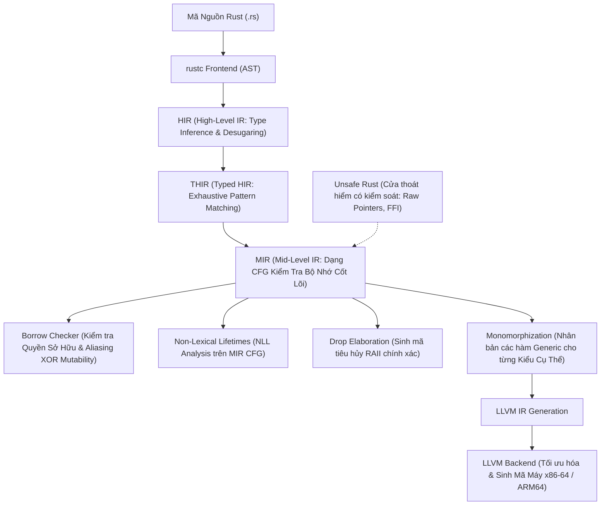
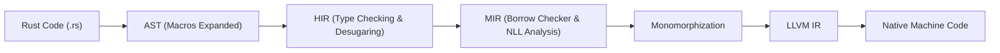

# 13.4. Kiến Trúc Trình Biên Dịch Rust và Bộ Kiểm Tra Mượn (Rust Compiler & Runtime Internals)

## Tổng quan về Rust Compiler & Runtime Internals
Rust định nghĩa lại ngành khoa học máy tính hệ thống bằng cách đạt được đồng thời ba mục tiêu tưởng chừng như bất khả thi: **An toàn bộ nhớ tuyệt đối (Memory Safety)**, **Hiệu năng mã máy đạt tốc độ tối đa của C/C++**, và **Trừu tượng hóa không chi phí (Zero-Cost Abstractions)** mà hoàn toàn **KHÔNG CẦN Garbage Collector**. Trọng tâm của kiến trúc trình biên dịch Rust (`rustc`) là đường ống phân tích trung gian nhiều tầng (**HIR $\to$ MIR**), hệ thống **Borrow Checker** dựa trên phân tích dòng dữ liệu không từ vựng (Non-Lexical Lifetimes - NLL), cơ chế phân giải Trait (**Chalk / Trait Resolution**), và ngữ nghĩa tiêu hủy **Drop Semantics**.



---

## 2. Chi tiết từng Keyword (Under-the-Hood Deep Dive)

---

### 1. rustc Pipeline, HIR, MIR, Monomorphization & Trait Resolution

#### 1. Khái niệm bản chất (What & Why)
- **`rustc` (Rust Compiler)**: Trình biên dịch chính thức của Rust, xây dựng trên nền tảng LLVM Backend.
- **HIR (High-Level Intermediate Representation)**: Biểu diễn gần với AST nhưng đã được mở rộng cú pháp (Desugaring: biến đổi vòng lặp `for` thành `loop` và `match`, mở rộng macro).
- **MIR (Mid-Level Intermediate Representation)**: Biểu diễn trung gian cốt lõi của Rust, được tổ chức dưới dạng Đồ thị Luồng Điều Khiển (CFG) gồm các Basic Blocks. Mọi khái niệm phức tạp (closures, async/await, destructors) đều được hạ cấp thành các câu lệnh gán đơn giản và lệnh nhảy. **Borrow Checker hoạt động 100% trên MIR**.
- **Trait Resolution**: Quá trình compiler thẩm định xem một kiểu dữ liệu cụ thể có thỏa mãn các ràng buộc của Trait hay không, dựa trên logic vị từ toán học (Engine Chalk / Polonius).
- **Monomorphization (Đơn hình hóa)**: Quá trình chuyển đổi mã Generic thành mã chuyên biệt cho từng kiểu cụ thể tại thời điểm compile-time. Nếu bạn dùng `Vec<i32>` và `Vec<f64>`, compiler sẽ sinh ra hai khối assembly độc lập tối ưu cho từng kích thước byte, hiện thực hóa triết lý **Zero-Cost Abstraction** (Bjarne Stroustrup: *"What you don't use, you don't pay for. What you do use, you couldn't hand code any better"*).

#### 2. Cơ chế hoạt động sâu (Under the hood / Hardcore Internals)
- **Đường Ống Xử Lý MIR trong `rustc`**:
  - Tại sao Rust cần phát minh ra MIR thay vì dùng trực tiếp LLVM IR?
  - LLVM IR quá thấp: Nó đã bị xóa sạch thông tin về kiểu dữ liệu của Rust, không biết khái niệm Lifetimes hay Borrowing là gì.
  - AST quá cao: Đầy rẫy các cú pháp lồng ghép (`match`, `if let`, closures) khiến việc kiểm tra an toàn bộ nhớ trở nên phức tạp và dễ sót lỗi.
  - **MIR là điểm ngọt ngào hoàn hảo**: Biểu diễn toàn bộ hàm thành các Basic Blocks phẳng. Mỗi biến có một vị trí lưu trữ xác định (`Place`).
  - Borrow Checker trên MIR duyệt qua từng câu lệnh và theo dõi:
    - Tại câu lệnh này, biến $X$ đang bị mượn bởi tham chiếu nào?
    - Tham chiếu đó có còn "Sống" (Live) ở các khối tiếp theo không?
    - Nếu có một thao tác ghi vào $X$ trong khi nó vẫn đang bị mượn đọc: Báo lỗi compile-time ngay lập tức!

#### 3. Sơ đồ minh họa (Đường ống Đa Tầng của Trình Biên Dịch `rustc`)


#### 4. Code ví dụ thực chiến (Rust: Minh họa Zero-Cost Abstraction qua Iterator Chaining)
```rust
// Mã nguồn trừu tượng bậc cao (High-Level Functional Style)
pub fn sum_even_squares(numbers: &[i64]) -> i64 {
    numbers
        .iter()
        .filter(|&&x| x % 2 == 0)
        .map(|&x| x * x)
        .sum()
}

/*
Nhờ Monomorphization và LLVM Inlining, toàn bộ closure và iterator chain trên
được compiler biến đổi (Zero-Cost Abstraction) thành một vòng lặp phẳng duy nhất
tương đương mã C tối ưu cực đại, thậm chí được tự động vector hóa SIMD:

sum_even_squares:
    xor eax, eax
.L_LOOP:
    test rdi, 1
    ... (Thực hiện tính toán trên thanh ghi, zero heap, zero indirect calls)
*/
```

#### 5. Cạm bẫy & Anti-patterns
- **Compile-Time Bloat do Monomorphization quá đà**: Việc lạm dụng Generics trong các thư viện lớn khiến compiler phải sinh ra hàng nghìn bản sao mã máy tương tự nhau, làm file nhị phân phình to và kéo dài thời gian build (Giải quyết bằng cách tách phần logic không phụ thuộc kiểu ra một hàm trợ giúp không generic: Inner Function Idiom).

#### 6. Ứng dụng thực tế trong Backend / Systems
- Viết các hệ điều hành thế hệ mới (Redox OS) và web servers hiệu năng cao (Actix Web, Axum): Tận dụng Monomorphization để đạt thông lượng hàng triệu HTTP requests/s với 0 byte overhead runtime.

---

### 2. Borrow Checker, Polonius, NLL & Drop Semantics

#### 1. Khái niệm bản chất (What & Why)
- **Borrow Checker**: Thành phần trung tâm của `rustc` bảo đảm tính an toàn bộ nhớ tại compile-time mà không cần Garbage Collector. Thực thi định luật:
  $$\textbf{Aliasing} \oplus \textbf{Mutability} \quad (\text{Chỉ được phép HOẶC Chia sẻ Đọc, HOẶC Độc quyền Ghi})$$
- **Non-Lexical Lifetimes (NLL)**: Cải tiến mang tính bước ngoặt trong Rust 2018. Vòng đời của một tham chiếu không còn bị trói buộc cứng nhắc vào dấu ngoặc nhọn `{}` của phạm vi khối lệnh (Lexical Scope), mà kết thúc **chính xác tại câu lệnh cuối cùng mà tham chiếu đó được sử dụng**.
- **Polonius**: Thế hệ tiếp theo của Borrow Checker dựa trên lập trình logic Datalog, cho phép chấp nhận các mẫu code an toàn phức tạp hơn nữa mà NLL hiện tại vẫn từ chối.
- **Drop Semantics**: Quy tắc tự động gọi hàm hủy `Drop::drop(&mut self)` để giải phóng tài nguyên một cách tất định (Deterministic RAII) khi biến kết thúc quyền sở hữu.

#### 2. Cơ chế hoạt động sâu (Under the hood / Hardcore Internals)
- **Cơ chế Drop Flags (Xác định Đối tượng Cần Hủy ở Runtime)**:
  - Nếu một biến bị di chuyển (Move) có điều kiện bên trong câu lệnh `if`:
    ```rust
    let x = Box::new(42);
    if condition {
        consume(x); // x bị move trong nhánh này
    }
    // Hết hàm: Liệu x có cần được giải phóng (Drop) không?
    ```
  - Trình biên dịch sinh ra một biến boolean ẩn trên Stack gọi là **Drop Flag**:
    - Khi `x` được khởi tạo: `drop_flag = true`.
    - Khi `x` bị move trong nhánh `if`: `drop_flag = false`.
    - Tại điểm kết thúc hàm (Epilogue): Compiler chèn mã kiểm tra: `if drop_flag { drop(x); }`.
  - Nếu compiler chứng minh được biến luôn luôn bị move hoặc không bao giờ bị move, nó sẽ tối ưu hóa loại bỏ hoàn toàn Drop Flag này ở compile-time (**Drop Elaboration**).

#### 3. Sơ đồ minh họa (Sự Khác Biệt Giữa Lexical Scope Cũ vs Non-Lexical Lifetimes - NLL)
```text
Mã nguồn:
let mut map = HashMap::new();
let value = map.get("key"); // Bắt đầu mượn đọc bất biến (Read Borrow)
println!("{:?}", value);    // LẦN CUỐI CÙNG SỬ DỤNG VALUE!

map.insert("key", 100);     // Cần mượn ghi độc quyền (Write Borrow)

Lexical Scope cũ:  [========== Read Borrow kéo dài hết block '}' ==========] -> LỖI COMPILE!
NLL hiện đại:     [== Read Borrow kết thúc ngay sau println ==]
                                                              [= Write Borrow HỢP LỆ =]
```

#### 4. Code ví dụ thực chiến (Rust: Minh Họa Non-Lexical Lifetimes và Drop Flags)
```rust
struct Resource {
    name: &'static str,
}

impl Drop for Resource {
    fn drop(&mut self) {
        println!("[RAII Drop] Tài nguyên '{}' đã được giải phóng an toàn!", self.name);
    }
}

fn demonstrate_nll() {
    let mut data = vec![1, 2, 3];

    // NLL cho phép mượn bất biến và kết thúc sớm
    let first = &data[0]; 
    println!("Phần tử đầu: {}", first); // Lần cuối first được dùng -> Vòng đời kết thúc tại đây!

    // Tại đây, ta có thể mượn khả biến để sửa data mà KHÔNG bị lỗi compiler!
    data.push(4); 
    println!("Data mới: {:?}", data);
}

fn main() {
    let _res = Resource { name: "Database_Connection" };
    demonstrate_nll();
} // _res tự động được gọi drop() tại đây
```

#### 5. Cạm bẫy & Anti-patterns
- Cố tình đánh bại Borrow Checker bằng cách bọc mọi thứ vào `Rc<RefCell<T>>`: Điều này đẩy việc kiểm tra an toàn bộ nhớ từ compile-time sang runtime, gây giảm hiệu năng và nguy cơ crash nổ `BorrowMutError` khi chạy thực tế.

#### 6. Ứng dụng thực tế trong Backend / Systems
- Viết Storage Engine hiệu năng cao (như TiKV, RocksDB Rust wrapper): Tận dụng Drop Semantics để bảo đảm các file locks và write-ahead logs (WAL) luôn được flush và đóng an toàn kể cả khi có luồng bị panic.

---

### 3. Unsafe Rust & Rust Memory Model

#### 1. Khái niệm bản chất (What & Why)
- **Unsafe Rust**: Một siêu tập con (Superset) của Rust cho phép lập trình viên tắt một số bảo vệ tĩnh của compiler để thực hiện các thao tác cấp thấp mà Borrow Checker không thể chứng minh được tính an toàn:
  1. Giải tham chiếu con trỏ thô (Dereference raw pointers `*const T`, `*mut T`).
  2. Gọi các hàm hoặc hàm ngoại vi không an toàn (`unsafe fn`, FFI C functions).
  3. Cài đặt các trait không an toàn (`unsafe impl Send/Sync`).
  4. Đọc hoặc sửa đổi biến toàn cục khả biến (`static mut`).
  5. Truy cập các trường của một `union`.
- **Rust Memory Model**: Dựa trên mô hình bộ nhớ C11/C++11, định nghĩa các thao tác nguyên tử (**Atomic Operations**) và các cấp độ sắp xếp bộ nhớ (**Memory Ordering**: `Relaxed`, `Acquire`, `Release`, `AcqRel`, `SeqCst`) để đồng bộ hóa đa luồng an toàn.

#### 2. Cơ chế hoạt động sâu (Under the hood / Hardcore Internals)
- **Triết lý Safe Abstraction Boundary**:
  - `unsafe` KHÔNG CÓ NGHĨA là code bị tắt kiểm tra kiểu hoặc được phép có lỗi!
  - `unsafe` có nghĩa là: *"Trình biên dịch không thể tự động chứng minh đoạn này an toàn; lập trình viên cam kết với compiler bằng danh dự rằng đã tự kiểm chứng thủ công tính đúng đắn"*.
  - Toàn bộ thư viện chuẩn của Rust (`Vec`, `String`, `HashMap`, `Box`) đều được viết bằng **Unsafe Rust bên trong**, nhưng bọc lại bằng một **Giao diện An toàn (Safe Interface) tuyệt đối ra bên ngoài**.

#### 3. Sơ đồ minh họa (Mô hình Vỏ Bọc Safe Abstraction quanh Unsafe Core)
```text
+-----------------------------------------------------------+
|               SAFE RUST EXTERNAL API                      |
|  (Được bảo đảm 100% bởi Borrow Checker: Vec, Box, Mutex)  |
|                                                           |
|    +-------------------------------------------------+    |
|    |           UNSAFE RUST INNER CORE                |    |
|    |  (Con trỏ thô *mut T, malloc, Syscalls, SIMD)   |    |
|    +-------------------------------------------------+    |
+-----------------------------------------------------------+
```

#### 4. Code ví dụ thực chiến (Rust: Xây Dựng Safe Smart Pointer từ Con Trỏ Thô Unsafe)
```rust
use std::ops::{Deref, DerefMut};
use std::alloc::{alloc, dealloc, Layout};

// Tự xây dựng MyBox<T> an toàn từ con trỏ thô bên trong unsafe
pub struct MyBox<T> {
    ptr: *mut T,
}

impl<T> MyBox<T> {
    pub fn new(val: T) -> Self {
        let layout = Layout::new::<T>();
        // 1. Unsafe: Cấp phát bộ nhớ Heap thủ công
        let raw_ptr = unsafe { alloc(layout) as *mut T };
        if raw_ptr.is_null() {
            panic!("Không thể cấp phát bộ nhớ!");
        }
        // 2. Unsafe: Ghi giá trị vào ô nhớ
        unsafe { raw_ptr.write(val); }
        MyBox { ptr: raw_ptr }
    }
}

// Cung cấp giao diện Safe thông qua Deref
impl<T> Deref for MyBox<T> {
    type Target = T;
    fn deref(&self) -> &Self::Target {
        unsafe { &*self.ptr } // An toàn vì ptr luôn hợp lệ
    }
}

impl<T> Drop for MyBox<T> {
    fn drop(&mut self) {
        unsafe {
            // Tiêu hủy đối tượng bên trong và giải phóng RAM
            std::ptr::drop_in_place(self.ptr);
            dealloc(self.ptr as *mut u8, Layout::new::<T>());
            println!("[MyBox] Đã giải phóng bộ nhớ Heap thủ công!");
        }
    }
}

fn main() {
    let b = MyBox::new(42);
    println!("Giá trị trong MyBox: {}", *b); // 42
}
```

#### 5. Cạm bẫy & Anti-patterns
- Tạo ra **Aliasing Pointer Vi phạm Miri (Undefined Behavior)**: Ép kiểu một tham chiếu chia sẻ `&T` thành con trỏ thô khả biến `*mut T` và ghi đè giá trị trong khi vẫn còn các tham chiếu đọc khác, phá vỡ tính bất biến và bị công cụ kiểm thử **Miri** bắt lỗi tức thì.

#### 6. Ứng dụng thực tế trong Backend / Systems
- Viết Network Device Drivers, Hypervisors (Firecracker microVM - nền tảng của AWS Lambda), và Linux Kernel Modules: Sử dụng Unsafe Rust để tương tác trực tiếp với các thanh ghi điều khiển phần cứng (Memory-Mapped I/O - MMIO) với độ an toàn cao nhất có thể.
