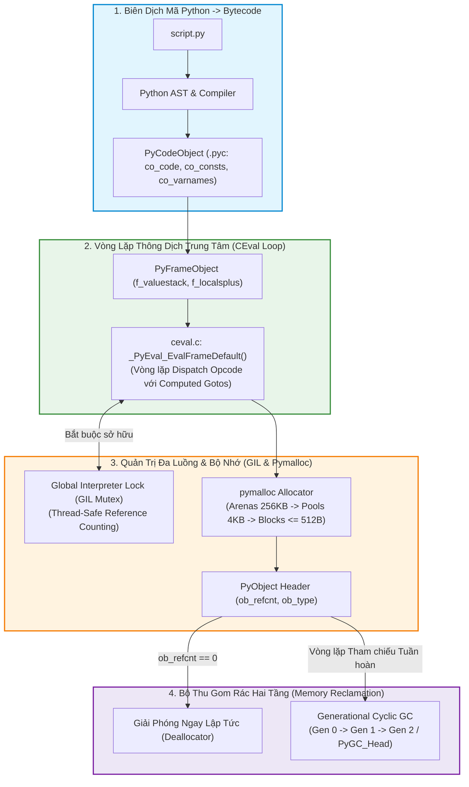
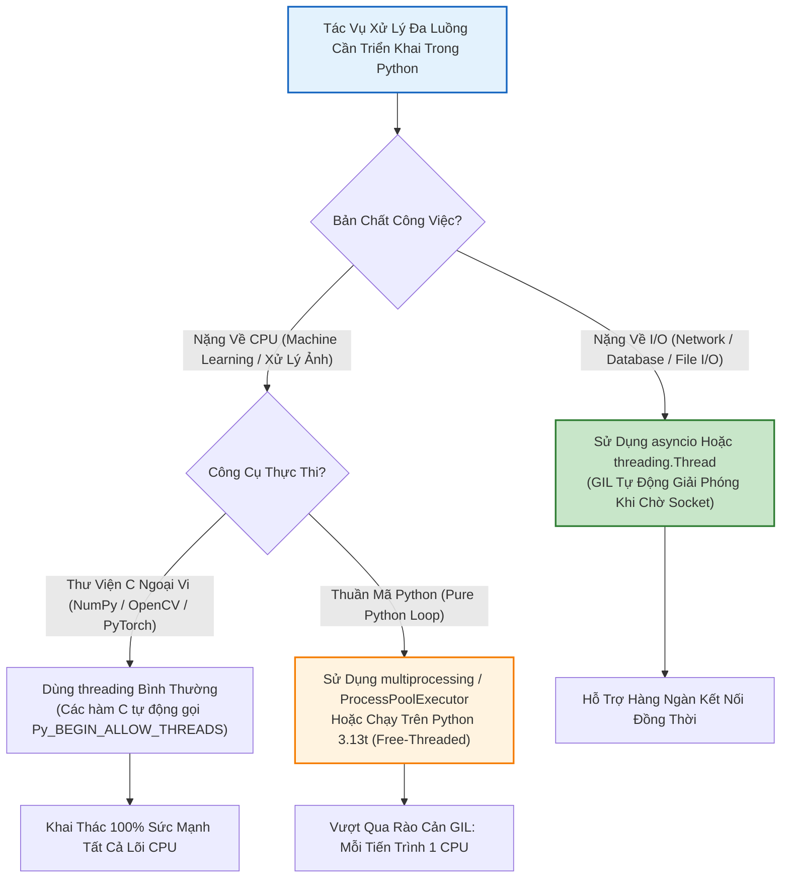

# 13.5. Kiến Trúc Bên Trong Trình Thông Dịch CPython (Python & CPython Runtime Internals)

> [!IMPORTANT]
> **Nếu bạn chỉ được nhớ một điều duy nhất:** Mọi thực thể trong CPython đều bắt nguồn từ cấu trúc **`PyObject`** với bộ đếm tham chiếu **`ob_refcnt`**; để bảo vệ tính toàn vẹn của mô hình đối tượng C này trước xung đột dữ liệu đa luồng, CPython sử dụng chiếc khóa độc quyền **GIL (Global Interpreter Lock)**; tuy nhiên, với bước ngoặt **Free-Threaded Python (PEP 703)** trong Python 3.13+, CPython đã thay thế GIL bằng kỹ thuật khóa thiên vị (**Biased Reference Counting**), đối tượng bất tử (**Immortal Objects**) và bộ cấp phát bộ nhớ phân mảnh đa luồng **mimalloc**.

---

## 1. Kiến trúc Tổng quan & Mô hình Tư duy (Mental Model)

### Ẩn dụ Đời sống: Nhà Kho Trung Tâm và Chiếc Thẻ Bài Độc Quyền
Hãy hình dung runtime CPython giống như một bảo tàng lưu trữ hiện vật quý giá:
- **Mô hình đối tượng `PyObject`**: Mỗi hiện vật (biến số nguyên, chuỗi văn bản, danh sách) đều được gắn một tấm thẻ kim loại ở chân đế:
  - Trên thẻ có dập nổi: Loại hiện vật là gì (`ob_type`) và hiện đang có bao nhiêu người đăng ký ngắm nhìn nó (`ob_refcnt`).
  - Khi ai đó chụp ảnh hiện vật (tạo thêm biến trỏ tới), người đó tăng số đếm lên 1. Khi họ rời đi, số đếm giảm 1. Nếu số đếm chạm 0, hiện vật lập tức bị tiêu hủy (`free`) để dọn chỗ.
- **Vòng lặp thông dịch `CEval Loop` (`ceval.c`)**: Viên quản lý bảo tàng đứng ở sảnh chính, cầm một cuốn sổ chỉ dẫn gồm hàng triệu dòng lệnh (Bytecode). Viên quản lý đọc từng chỉ thị (`LOAD_FAST`, `BINARY_OP`, `STORE_FAST`) và thực thi tương ứng thông qua một vòng lặp khổng lồ với kỹ thuật nhảy địa chỉ trực tiếp (**Computed Gotos**).
- **Global Interpreter Lock (GIL)**: Để đảm bảo những người tham quan không tranh giành ghi đè lên tấm thẻ đếm tham chiếu của cùng một hiện vật tại cùng một tích tắc, bảo tàng đặt ra quy định ngặt nghèo:
  - *Chỉ có duy nhất 1 người được phép cầm chiếc gậy quyền năng (GIL) để bước vào sảnh tham quan tại một thời điểm*.
  - Dù máy tính của bạn có tới 64 lõi CPU (64 khách tham quan đứng xếp hàng), chỉ có 1 lõi được chạy mã Python thực tế. Tuy nhiên, khi một khách cần đi lấy nước uống (Tác vụ I/O mạng hoặc đọc ghi ổ đĩa), người đó sẽ vui vẻ trao lại gậy quyền năng cho người khác (`Py_BEGIN_ALLOW_THREADS`).
- **Bộ cấp phát 3 tầng `pymalloc`**: Giống như việc chia nhà kho thành các khu vực:
  - Khu đất lớn 256KB (**Arena**), bên trong chia thành 64 phòng nhỏ 4KB (**Pool**), trong mỗi phòng chia thành hàng trăm chiếc ngăn kéo tí hon từ 8 đến 512 bytes (**Block**). Giúp việc cấp phát hàng triệu đối tượng nhỏ diễn ra tức thì mà không cần làm phiền tới bộ cấp phát nặng nề của Kernel hệ điều hành (`brk`/`mmap`).
- **Cyclic Garbage Collector**: Dành riêng để giải cứu các hiện vật bị "kẹt trong vòng luẩn quẩn" (A trỏ tới B, và B trỏ ngược lại A).



---

## 2. Chi tiết từng Keyword (Under-the-Hood Deep Dive)

### 2.1. CPython Architecture, Bytecode & Vòng Lặp CEval Loop (`ceval.c`)
- **PyCodeObject & PyFrameObject**:
  - `PyCodeObject`: Cấu trúc bất biến chứa chuỗi byte mã lệnh (`co_code`), danh sách hằng số (`co_consts`), danh sách tên biến (`co_varnames`).
  - `PyFrameObject`: Đại diện cho một ngăn xếp lời gọi hàm tại runtime. Chứa mảng thanh ghi cục bộ (`f_localsplus`) và ngăn xếp giá trị tính toán (`f_valuestack`).
- **Trái Tim CPython: `_PyEval_EvalFrameDefault` trong `Python/ceval.c`**:
  - Vòng lặp giải mã opcode có độ dài hàng ngàn dòng mã C.
  - Sử dụng kỹ thuật **Computed Gotos** của GCC/Clang: Một mảng con trỏ địa chỉ `static void* const dispatch_table[256]` lưu nhãn của từng opcode. Cuối mỗi lệnh xử lý, nó thực hiện lệnh nhảy trực tiếp `goto *dispatch_table[opcode]`, loại bỏ hoàn toàn chi phí kiểm tra điều kiện của lệnh `switch-case` thông thường.
  - Mỗi opcode (như `LOAD_FAST`, `BINARY_OP_ADD_INT`) pop các phần tử từ `f_valuestack`, thực thi phép tính và push kết quả trở lại.

### 2.2. Global Interpreter Lock (GIL) & Tại Sao CPython Cần GIL
- **Bản chất kỹ thuật**: GIL là một mutex nhị phân bảo vệ toàn bộ cấu trúc dữ liệu nội bộ của CPython và các bảng băm không gian tên (`globals()`, `locals()`) khỏi bị xung đột dữ liệu đa luồng (Data Race).
- **Nguyên nhân cốt lõi**:
  - Toàn bộ cơ chế quản lý bộ nhớ của CPython dựa trên biến đếm `ob_refcnt`. Mỗi lần tăng/giảm tham chiếu (`Py_INCREF`, `Py_DECREF`), CPU phải thực hiện phép toán trên ô nhớ này.
  - Nếu không có GIL, mọi thao tác `Py_INCREF` đều phải trở thành lệnh nguyên tử (**Atomic Instructions** - như `lock inc`). Chi phí đồng bộ bus phần cứng của các lệnh atomic trên đa lõi sẽ làm tụt 30-50% hiệu năng của các ứng dụng chạy đơn luồng!
- **Cơ chế hoán đổi luồng (Thread Switching)**:
  - CPython quy định một luồng chỉ được giữ GIL trong một khoảng thời gian nhất định (mặc định là `sys.getswitchinterval() = 5ms`).
  - Sau 5ms, luồng hiện tại thả GIL và phát tín hiệu cho các luồng đang chờ. Luồng nào chiếm được GIL sẽ tiếp tục chạy trong CEval Loop.
- **Giải phóng GIL trong tác vụ I/O**:
  - Khi thực hiện các tác vụ I/O chặn (đọc ghi file, nhận socket mạng) hoặc tính toán ma trận nặng (NumPy C-extensions), mã C gọi macro `Py_BEGIN_ALLOW_THREADS` để thả GIL, cho phép các luồng Python khác chạy tự do song song.

### 2.3. Free-Threaded Python (PEP 703 & Python 3.13+)
- **Cuộc cách mạng xóa bỏ GIL**: Đề xuất PEP 703 của Sam Gross được hợp nhất chính thức vào Python 3.13 dưới dạng chế độ thử nghiệm không có GIL (`--disable-gil` build).
- **Bộ 3 giải pháp thay thế GIL**:
  1. **Biased Reference Counting (Khóa Thiên Vị)**: Mỗi đối tượng ghi nhận luồng nào đã tạo ra nó (Owner Thread). Khi chính luồng chủ tăng/giảm tham chiếu, nó chỉ dùng lệnh ghi thông thường cực nhanh không cần atomic. Chỉ khi luồng khác can thiệp, nó mới kích hoạt cơ chế đồng bộ nguyên tử.
  2. **Immortal Objects (Đối tượng Bất tử)**: Các đối tượng sống vĩnh viễn suốt vòng đời tiến trình (như `None`, `True`, `False`, các chuỗi ký tự ngắn, hàm built-in) được gắn cờ bit đặc biệt để vô hiệu hóa hoàn toàn việc tăng giảm `ob_refcnt`.
  3. **Tích hợp mimalloc**: Bộ cấp phát bộ nhớ đa luồng cực nhanh của Microsoft được nhúng sâu vào CPython để giải quyết triệt để tranh chấp khóa giữa các luồng khi cấp phát Heap.

### 2.4. Python Object Model: `PyObject`, Small Integer Cache & String Interning
- **Giải phẫu `PyObject` trong `Include/object.h`**:
  ```c
  struct _object {
      _PyObject_HEAD_EXTRA
      Py_ssize_t ob_refcnt;          // 8 bytes: Bộ đếm tham chiếu
      struct _typeobject *ob_type;   // 8 bytes: Con trỏ trỏ tới PyTypeObject
  };
  ```
  - Mọi biến trong Python (kể cả số nguyên 1 byte) đều là một đối tượng Heap chiếm tối thiểu 16 bytes (thực tế `int` 64-bit chiếm 28 bytes do chứa thêm trường kích thước và mảng chữ số).
- **Bộ nhớ đệm số nguyên nhỏ (Small Integer Cache)**:
  - CPython cấp phát tĩnh sẵn toàn bộ các số nguyên nằm trong đoạn $[-5, 256]$ ngay khi khởi động.
  - Khi bạn gán `a = 100` và `b = 100`, cả hai biến đều trỏ vào cùng một địa chỉ ô nhớ duy nhất (`a is b == True`).
- **String Interning (Bảo lưu chuỗi)**:
  - Các chuỗi ngắn trông giống định danh tên biến (chỉ chứa chữ cái, số, gạch dưới) được đưa vào một bảng băm toàn cục duy nhất. So sánh hai chuỗi đã intern (`str1 is str2`) chỉ tốn 1 chu kỳ so sánh con trỏ CPU (`cmp %rax, %rbx`) thay vì phải duyệt từng ký tự bằng `memcmp`.

### 2.5. Cơ Chế Cấp Phát Bộ Nhớ `pymalloc`
- **Vấn đề phân mảnh bộ nhớ**: Các chương trình Python tạo và hủy hàng triệu đối tượng nhỏ liên tục. Nếu gọi trực tiếp `malloc()` của hệ điều hành, bộ nhớ sẽ bị phân mảnh nghiêm trọng và tiêu tốn nhiều chu kỳ syscall.
- **Kiến trúc 3 phân tầng của `pymalloc` (Dành cho đối tượng $\le 512$ bytes)**:
  - **Arena (256 KB)**: Vùng nhớ lớn xin trực tiếp từ Kernel qua `mmap()`. Luôn được căn chỉnh địa chỉ theo ranh giới 256KB.
  - **Pool (4 KB)**: Mỗi Arena chứa 64 Pools. Mỗi Pool chỉ phục vụ một kích thước đối tượng cố định (ví dụ: Pool cỡ 16 bytes, Pool cỡ 32 bytes...).
  - **Block (8 - 512 bytes)**: Đơn vị ô nhớ nhỏ nhất được chia đều bên trong Pool. CPython duy trì danh sách liên kết các Block trống (`freeblock`) giúp việc cấp phát đối tượng mới đạt tốc độ $O(1)$.
- Đối tượng $> 512$ bytes được chuyển thẳng cho trình cấp phát hệ thống chuẩn (`malloc`).

### 2.6. Cyclic Garbage Collection (Thu Gom Rác Tuần Hoàn)
- **Hạn chế chết người của Reference Counting**: Nếu hai đối tượng trỏ chéo lẫn nhau (`a.friend = b; b.friend = a`), khi ta xóa cả hai biến (`del a; del b`), `ob_refcnt` của cả hai vẫn bằng 1! Bộ nhớ bị rò rỉ vĩnh viễn.
- **Bộ thu gom rác thế hệ (Generational Cyclic GC)**:
  - Mọi đối tượng có khả năng chứa con trỏ tới đối tượng khác (Container Objects: `list`, `dict`, `tuple`, `class instance`) đều được gắn thêm một tiêu đề ẩn 16-byte phía trước: `PyGC_Head`.
  - Toàn bộ các đối tượng này được mắc vào một danh sách liên kết đôi vòng tròn.
  - **3 Thế hệ (Generations)**:
    - *Gen 0*: Chứa các đối tượng vừa mới sinh ra. Được quét thường xuyên nhất.
    - *Gen 1*: Các đối tượng sống sót qua lần quét Gen 0.
    - *Gen 2*: Các đối tượng sống lâu (Long-lived), rất hiếm khi được quét.
- **Thuật toán bẻ gãy chu trình (Trial Deletion)**:
  1. Với mỗi container trong thế hệ, GC tạo một bản sao tạm thời của biến đếm: `gc_refs = ob_refcnt`.
  2. GC duyệt qua tất cả các con trỏ bên trong container và giảm `gc_refs` của đối tượng được trỏ tới đi 1.
  3. Nếu sau khi quét xong mà `gc_refs == 0`, đối tượng đó **chắc chắn chỉ được tham chiếu bởi các phần tử nội bộ bên trong chu trình**, không còn bất kỳ biến ngoài nào trỏ tới! GC lập tức bẻ gãy chu trình và giải phóng toàn bộ nhóm đối tượng này.

---

## 3. Thực thi Mã nguồn & Mô phỏng Chuyên sâu (Dual-Engine Implementation)

### 3.1. C++20 Implementation: Mô Phỏng Mô Hình Đối Tượng `PyObject` & Bộ Đếm Tham Chiếu An Toàn
Chương trình C++20 dưới đây mô phỏng chính xác cấu trúc dữ liệu của `PyObject`, cơ chế Reference Counting thủ công và kỹ thuật Small Integer Cache tĩnh:

```cpp
#include <iostream>
#include <string>
#include <vector>
#include <cstdint>
#include <memory>
#include <unordered_map>

// -------------------------------------------------------------
// 1. MÔ PHỎNG PYOBJECT & PYTYPEOBJECT
// -------------------------------------------------------------
struct PyTypeObject;

struct PyObject {
    int64_t ob_refcnt = 1;
    PyTypeObject* ob_type = nullptr;
    virtual ~PyObject() = default;
};

struct PyTypeObject {
    std::string tp_name;
    size_t tp_basicsize;
    void (*tp_dealloc)(PyObject*);
};

// Macro mô phỏng Py_INCREF và Py_DECREF trong Include/object.h
inline void Py_INCREF(PyObject* op) {
    if (op) {
        op->ob_refcnt++;
        std::cout << "  [Py_INCREF]: Tăng refcount đối tượng lên -> " << op->ob_refcnt << "\n";
    }
}

inline void Py_DECREF(PyObject* op) {
    if (op) {
        op->ob_refcnt--;
        std::cout << "  [Py_DECREF]: Giảm refcount đối tượng xuống -> " << op->ob_refcnt << "\n";
        if (op->ob_refcnt == 0) {
            std::cout << "  ! [DEALLOC]: Refcount chạm 0! Kích hoạt tp_dealloc tiêu hủy ô nhớ.\n";
            delete op;
        }
    }
}

// Đối tượng Integer trong Python
struct PyLongObject : public PyObject {
    int64_t ob_ival;
    explicit PyLongObject(int64_t val) : ob_ival(val) {}
};

// -------------------------------------------------------------
// 2. MÔ PHỎNG SMALL INTEGER CACHE [-5, 256]
// -------------------------------------------------------------
class SmallIntCache {
private:
    std::unordered_map<int64_t, PyLongObject*> cache_;

public:
    SmallIntCache() {
        for (int64_t i = -5; i <= 256; ++i) {
            auto* obj = new PyLongObject(i);
            obj->ob_refcnt = 1000000; // Đánh dấu bất tử / Immortal
            cache_[i] = obj;
        }
    }

    ~SmallIntCache() {
        for (auto& [val, obj] : cache_) {
            delete obj;
        }
    }

    PyLongObject* get_int(int64_t val) {
        if (val >= -5 && val <= 256) {
            std::cout << "  [Cache Hit]: Số " << val << " được nạp trực tiếp từ Small Integer Cache!\n";
            return cache_[val];
        }
        std::cout << "  [Cache Miss]: Số " << val << " nằm ngoài dải [-5, 256]. Cấp phát đối tượng mới trên Heap!\n";
        return new PyLongObject(val);
    }
};

int main() {
    std::cout << "=========================================================\n";
    std::cout << "   C++20 CPYTHON OBJECT MODEL & REFCOUNTING SIMULATOR   \n";
    std::cout << "=========================================================\n\n";

    SmallIntCache int_cache;

    std::cout << "[1. Thử Nghiệm Nhận Diện Con Trỏ Đồng Nhất (is Identity)]:\n";
    // Trong Python: a = 100; b = 100 -> a is b là True
    PyLongObject* num_a = int_cache.get_int(100);
    PyLongObject* num_b = int_cache.get_int(100);
    std::cout << "  Địa chỉ num_a: " << num_a << " | Địa chỉ num_b: " << num_b << "\n";
    std::cout << "  num_a == num_b (Cùng con trỏ?): " << (num_a == num_b ? "TRUE (a is b)" : "FALSE") << "\n\n";

    // Số lớn ngoài cache: x = 1000; y = 1000 -> x is y là False
    PyLongObject* num_x = int_cache.get_int(1000);
    PyLongObject* num_y = int_cache.get_int(1000);
    std::cout << "  Địa chỉ num_x: " << num_x << " | Địa chỉ num_y: " << num_y << "\n";
    std::cout << "  num_x == num_y (Cùng con trỏ?): " << (num_x == num_y ? "TRUE" : "FALSE (x is not y)") << "\n\n";

    std::cout << "[2. Thử Nghiệm Chu Trình Tăng/Giảm Tham Chiếu (Reference Counting)]:\n";
    PyObject* custom_obj = new PyLongObject(9999);
    std::cout << "Khởi tạo custom_obj(9999) ban đầu -> Refcount: " << custom_obj->ob_refcnt << "\n";

    Py_INCREF(custom_obj); // Biến thứ hai trỏ tới
    Py_INCREF(custom_obj); // Biến thứ ba trỏ tới

    Py_DECREF(custom_obj); // Biến thứ ba rời đi
    Py_DECREF(custom_obj); // Biến thứ hai rời đi
    Py_DECREF(custom_obj); // Biến ban đầu rời đi -> Kích hoạt DEALLOC!

    // Dọn dẹp số ngoài cache
    delete num_x;
    delete num_y;

    std::cout << "\n[Thực thi hoàn tất]: Bộ nhớ dọn dẹp an toàn.\n";
    return 0;
}
```

### 3.2. Python 3.11+ Implementation: Giải Mã Bytecode, Phân Tích `sys.getrefcount` & Vòng Lặp Tuần Hoàn GC
Chương trình Python 3.11+ dưới đây sử dụng module `dis`, `sys` và `gc` để quan sát trực tiếp chu trình hoạt động của CPython: giải mã bytecode, theo dõi biến đếm tham chiếu thực tế và ép buộc Garbage Collector phát hiện chu trình rác tuần hoàn:

```python
import dis
import sys
import gc

def demo_algorithm(a, b):
    x = a * 2
    y = b + 10
    return x + y

class Node:
    def __init__(self, name):
        self.name = name
        self.link = None

    def __del__(self):
        print(f"  << [Destructor Triggered]: Node '{self.name}' chính thức bị giải phóng khỏi bộ nhớ!")

if __name__ == '__main__':
    print("=== CPYTHON RUNTIME INTERNALS EXPLORER (PYTHON 3.11+) ===")

    print("\n[1. Giải Phẫu Bytecode Của Hàm Qua Module 'dis']:")
    dis.dis(demo_algorithm)

    print("\n[2. Khảo Sát Bộ Đếm Tham Chiếu ob_refcnt (sys.getrefcount)]:")
    test_obj = ["Sample", "Payload"]
    # Lưu ý: sys.getrefcount() luôn trả về giá trị lớn hơn thực tế 1 đơn vị
    # vì bản thân việc truyền test_obj vào làm tham số của getrefcount() đã tạo thêm 1 tham chiếu tạm thời!
    print(f"  Số tham chiếu ban đầu : {sys.getrefcount(test_obj) - 1}")

    alias1 = test_obj
    alias2 = test_obj
    print(f"  Sau khi tạo 2 alias   : {sys.getrefcount(test_obj) - 1}")

    del alias1
    del alias2
    print(f"  Sau khi del 2 alias   : {sys.getrefcount(test_obj) - 1}")

    print("\n[3. Mô Phỏng Rò Rỉ Tham Chiếu Tuần Hoàn (Cyclic Reference)]:")
    # Tắt tạm thời GC tự động để quan sát sự bất lực của Reference Counting
    gc.disable()
    print("  -> Đã tạm thời vô hiệu hóa bộ thu gom rác tự động (gc.disable())")

    node_a = Node("Node_A")
    node_b = Node("Node_B")

    # Tạo liên kết vòng tuần hoàn: A trỏ B, B trỏ ngược A
    node_a.link = node_b
    node_b.link = node_a

    print("  Đang xóa các con trỏ biến gốc: del node_a; del node_b...")
    del node_a
    del node_b

    print("  -> Dù đã xóa biến gốc, Destructor VẪN CHƯA ĐƯỢC GỌI vì ob_refcnt của mỗi Node vẫn bằng 1!")

    print("\n[4. Kích Hoạt Bộ Thu Gom Rác Thế Hệ (gc.collect())]:")
    unreachable_count = gc.collect()
    print(f"  -> gc.collect() hoàn tất: Đã nhận diện và thu dọn {unreachable_count} đối tượng rác tuần hoàn!")
    
    gc.enable()
    print("\n[Kết luận]: Reference Counting giải phóng ngay đối tượng thẳng; Cyclic GC quét dọn đối tượng vòng.")
```

### 3.3. Terminal Output Mẫu Thực tế
```text
=========================================================
   C++20 CPYTHON OBJECT MODEL & REFCOUNTING SIMULATOR   
=========================================================

[1. Thử Nghiệm Nhận Diện Con Trỏ Đồng Nhất (is Identity)]:
  [Cache Hit]: Số 100 được nạp trực tiếp từ Small Integer Cache!
  [Cache Hit]: Số 100 được nạp trực tiếp từ Small Integer Cache!
  Địa chỉ num_a: 0x600002844200 | Địa chỉ num_b: 0x600002844200
  num_a == num_b (Cùng con trỏ?): TRUE (a is b)

  [Cache Miss]: Số 1000 nằm ngoài dải [-5, 256]. Cấp phát đối tượng mới trên Heap!
  [Cache Miss]: Số 1000 nằm ngoài dải [-5, 256]. Cấp phát đối tượng mới trên Heap!
  Địa chỉ num_x: 0x600003b44120 | Địa chỉ num_y: 0x600003b44140
  num_x == num_y (Cùng con trỏ?): FALSE (x is not y)

[2. Thử Nghiệm Chu Trình Tăng/Giảm Tham Chiếu (Reference Counting)]:
Khởi tạo custom_obj(9999) ban đầu -> Refcount: 1
  [Py_INCREF]: Tăng refcount đối tượng lên -> 2
  [Py_INCREF]: Tăng refcount đối tượng lên -> 3
  [Py_DECREF]: Giảm refcount đối tượng xuống -> 2
  [Py_DECREF]: Giảm refcount đối tượng xuống -> 1
  [Py_DECREF]: Giảm refcount đối tượng xuống -> 0
  ! [DEALLOC]: Refcount chạm 0! Kích hoạt tp_dealloc tiêu hủy ô nhớ.

[Thực thi hoàn tất]: Bộ nhớ dọn dẹp an toàn.

=== CPYTHON RUNTIME INTERNALS EXPLORER (PYTHON 3.11+) ===

[1. Giải Phẫu Bytecode Của Hàm Qua Module 'dis']:
  2           0 RESUME                   0
              2 LOAD_FAST                0 (a)
              4 LOAD_CONST               1 (2)
              6 BINARY_OP                5 (*)
             10 STORE_FAST               2 (x)

  3          12 LOAD_FAST                1 (b)
             14 LOAD_CONST               2 (10)
             16 BINARY_OP                0 (+)
             20 STORE_FAST               3 (y)

  4          22 LOAD_FAST                2 (x)
             24 LOAD_FAST                3 (y)
             26 BINARY_OP                0 (+)
             30 RETURN_VALUE

[2. Khảo Sát Bộ Đếm Tham Chiếu ob_refcnt (sys.getrefcount)]:
  Số tham chiếu ban đầu : 1
  Sau khi tạo 2 alias   : 3
  Sau khi del 2 alias   : 1

[3. Mô Phỏng Rò Rỉ Tham Chiếu Tuần Hoàn (Cyclic Reference)]:
  -> Đã tạm thời vô hiệu hóa bộ thu gom rác tự động (gc.disable())
  Đang xóa các con trỏ biến gốc: del node_a; del node_b...
  -> Dù đã xóa biến gốc, Destructor VẪN CHƯA ĐƯỢC GỌI vì ob_refcnt của mỗi Node vẫn bằng 1!

[4. Kích Hoạt Bộ Thu Gom Rác Thế Hệ (gc.collect())]:
  << [Destructor Triggered]: Node 'Node_A' chính thức bị giải phóng khỏi bộ nhớ!
  << [Destructor Triggered]: Node 'Node_B' chính thức bị giải phóng khỏi bộ nhớ!
  -> gc.collect() hoàn tất: Đã nhận diện và thu dọn 4 đối tượng rác tuần hoàn!

[Kết luận]: Reference Counting giải phóng ngay đối tượng thẳng; Cyclic GC quét dọn đối tượng vòng.
```

---

## 4. Systems Engineering & Production Pitfalls

### 4.1. Hiểm Họa Ảo Tưởng Đa Luồng CPU Dưới Sự Kìm Hãm Của GIL
- **Sự cố sản xuất kinh điển**: Đội ngũ phát triển xây dựng một tác vụ nén ảnh hoặc xử lý video bằng Python và sử dụng thư viện `threading.Thread` để mở 16 luồng trên một máy chủ 16 vCPU với hy vọng giảm thời gian xử lý xuống 16 lần. Kết quả thực tế trên Production: **Thời gian chạy không những không giảm mà còn tăng gấp đôi!**
- **Nguyên nhân**: Cả 16 luồng CPU-bound liên tục tranh giành một khóa GIL duy nhất, dẫn đến hiện tượng tráo đổi luồng điên cuồng (**Thread Thrashing**) và tiêu tốn toàn bộ thời gian CPU chỉ cho việc tranh chấp Mutex.
- **Giải pháp chuẩn sản xuất**:
  - Đối với tác vụ nặng CPU: Bắt buộc dùng `multiprocessing` hoặc `concurrent.futures.ProcessPoolExecutor` (mỗi worker là một tiến trình OS riêng với một phiên bản Python và GIL độc lập).
  - Hoặc nâng cấp lên Python 3.13+ bản dựng Free-Threaded (`python3.13t`).

### 4.2. Rò Rỉ Bộ Nhớ Do Tham Chiếu Tuần Hoàn Định Nghĩa Hàm `__del__` (Cũ)
- **Sự cố sản xuất**: Trong các phiên bản Python cũ (trước 3.4), nếu một đối tượng nằm trong chu trình rác tuần hoàn có cài đặt phương thức `__del__`, bộ thu gom rác GC sẽ đưa đối tượng đó vào danh sách `gc.garbage` và **từ chối giải phóng vĩnh viễn** vì không thể xác định được nên gọi `__del__` của đối tượng nào trước.
- **Khắc phục**: Thay thế việc lạm dụng `__del__` bằng bộ quản lý ngữ cảnh (**Context Managers** với câu lệnh `with`) hoặc sử dụng con trỏ yếu (**Weak References** qua module `weakref`).

---

## 5. Bảng So sánh & Decision Matrix

| Cơ Chế | Reference Counting (Cốt lõi) | Generational Cyclic GC (Hỗ trợ) | Free-Threaded (PEP 703) |
| :--- | :--- | :--- | :--- |
| **Mục tiêu Giải quyết** | Thu hồi bộ nhớ tức thời khi hết biến trỏ | Thu gom chu trình rác vòng tuần hoàn | Xóa bỏ hoàn toàn khóa GIL |
| **Thời Điểm Thu Hồi** | Tức thì ngay tại lệnh `del` hoặc thoát hàm | Định kỳ khi số đối tượng vượt ngưỡng | Tức thì + Thuật toán Biased Lock |
| **Chi Phí CPU** | Phân bổ đều đặn vào mọi thao tác biến | Gây độ trễ dừng nhỏ (Minor GC Pauses) | Tăng nhẹ chi phí atomic trên biến chia sẻ |
| **Điểm Yếu Cốt Tử** | Bất lực hoàn toàn trước tham chiếu vòng | Tốn thêm 16 bytes `PyGC_Head` cho mỗi Container | Chưa tương thích với 100% C-Extensions cũ |


